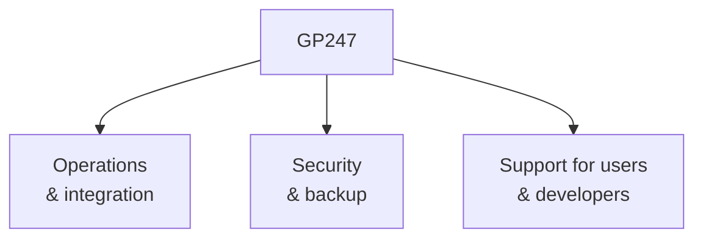
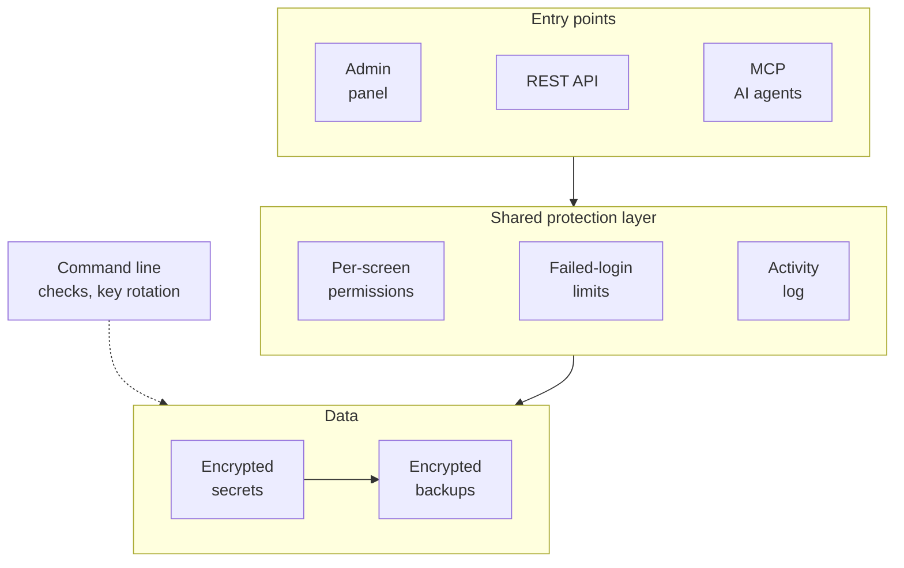

> 🌐 **Language:** [🇻🇳 Tiếng Việt](./gp247_vi.md) · 🇬🇧 English (current) · [🇯🇵 日本語](./gp247_ja.md)

# About GP247

**GP247** is an open-source e-commerce platform for businesses, built on Laravel. Beyond its selling features, GP247 comes
with a **command line** for automated operations, a **REST API v2** to connect apps and ERPs, an **MCP server** to work with
AI agents, plus **centrally managed security** and built-in **backup & restore**. Everything is free under the MIT license.

## GP247 in one minute

| Item | Details |
| --- | --- |
| **What it is** | An open-source e-commerce platform for businesses, built on Laravel |
| **License** | MIT — free, customize it and integrate it into your own Laravel system |
| **Tech stack (GP247 3.x)** | PHP 8.3+ · Laravel 13 · Livewire 4 · Tailwind CSS 3 (prebuilt, no Node needed) · MySQL / MariaDB |
| **Components** | `gp247/core` · `gp247/front` · `gp247/shop` · `gp247/mcp` |
| **All-in-one bundle** | **S-Cart** = core + front + shop + mcp |
| **Operations & integration** | `php artisan gp247:*` command line · REST API v2 (ERP sync) · MCP server for AI agents |
| **Security** | One set of permissions and logs for the admin panel, API and MCP · encrypted secrets · encrypted backup & restore |
| **Where it runs** | From shared hosting without cron to VPS and Docker |
| **Documentation** | Three languages: Vietnamese · English · Japanese, plus Agent Skills for AI coding agents |

## Highlights

GP247 focuses on three groups of capabilities that a store in real operation needs:

- **Operations & integration** — command line, REST API v2, MCP server for AI agents.
- **Security & backup** — one shared protection layer for every entry point, backup & restore built in.
- **Support** — three-language documentation kept up to date, Agent Skills for developers.

### Operations & integration

- **`gp247:*` command line — built for full automation** — more than 40 commands to install, update, check site health
  (`gp247:doctor`), back up, and manage plugins and templates without opening the admin panel. Every command has `--json` for
  scripts, CI and Docker; commands that can delete data always ask for confirmation. See
  [GP247 command line (CLI)](../cli/cli-introduction.md).
- **REST API v2 — connect apps and ERPs** — two API groups, one for the storefront/customers and one for administration, token
  sign-in, and an OpenAPI 3.1 specification. ERPs, inventory software and CRMs stay in sync through `updated_since`, an event log
  and signed webhooks. See [API introduction](../api/api-introduction.md) and [Syncing data with an ERP](../api/api-sync.md).
- **MCP server — work with AI agents** — included in S-Cart and off until you turn it on. Store owners ask in plain language in
  Claude Code, Claude Desktop / claude.ai, Cursor or VS Code to look up orders, check stock or summarize revenue. 15 tools (11 read,
  4 write tools off by default); every write shows a preview and needs a one-time confirmation code. See
  [MCP server introduction](../mcp/mcp-introduction.md).

### Advanced, centrally managed security

Every entry point — the admin panel, the REST API, AI agents over MCP — passes through **the same protection layer** before it
touches data:

- **One standard for every entry point** — the API and AI agents share permissions and logs with the admin panel, so they can never
  do more than that account can on screen; admin sign-in over the web and the API share one failed-login counter.
- **Central switches** — turn each part of the API and MCP on or off on the **API config** screen; turning off the master switch also
  turns off MCP.
- **Encrypted secrets** — SMTP passwords, third-party keys and licenses are encrypted in the database and never shown again on screen;
  the encryption key is rotated with one command.
- **One-command check** — `gp247:doctor` checks the server, the installation and the security configuration.
- **Built-in backup & restore** — backups are encrypted and verified right after they are made; the site backs itself up every 24 hours
  without cron; it takes a snapshot before a system update, an extension update or a template change; backups can be copied to
  S3-compatible storage or SFTP / NAS; restore is guided by situation.

See [GP247 system security](../security/security-introduction.md) and [Backup & restore](../backup/backup-and-restore.md).

### Support for users and developers

- **Complete documentation, updated continuously** — more than 80 pages per language (Vietnamese · English · Japanese), written for
  both store owners and developers, updated with every release. See the [documentation index](../README.md).
- **Agent Skills for AI coding agents** — a set of skills that lets an AI agent (such as Claude Code) build plugins, payment plugins,
  shipping plugins and templates, and manage extensions from the command line, the GP247 way; each skill detects the site's core
  version before it starts. See [gp247-skills](https://github.com/gp247net/gp247-skills).

## Components

The GP247 ecosystem is made of the following main components:

| Component | Role |
| --- | --- |
| **GP247/core** | The backend system, with a library of plugins and templates for complex business needs |
| **GP247/front** | The user interface, working with GP247/core |
| **GP247/shop** | Features for building an online store website |
| **GP247/mcp** | Lets AI agents work with the system |

> **S-Cart project** = GP247/core + GP247/front + GP247/shop + GP247/mcp

All components are **free and open source**. You can customize them and integrate them into your own Laravel
system.

## Source code

Learn more and browse the source code at:

- **GP247/core**: <https://github.com/gp247net/core>
- **GP247/front**: <https://github.com/gp247net/front>
- **GP247/shop**: <https://github.com/gp247net/shop>
- **GP247/mcp**: <https://github.com/gp247net/mcp>
- **GP247/s-cart**: <https://github.com/gp247net/s-cart>
- **Plugins**: <https://github.com/gp247-plugin>
- **Documentation**: <https://github.com/gp247net/gp247-docs>
- **Agent Skills**: <https://github.com/gp247net/gp247-skills>

## Contact information

> **Technical support email:** [support@gp247.net](mailto:support@gp247.net)

## Quick support from the community

Join the community on social media to get quick help from the development team and other members:

- **Facebook**: <https://www.facebook.com/gp247.official>
- **S-Cart group**: <https://www.facebook.com/groups/scart.opensource>
