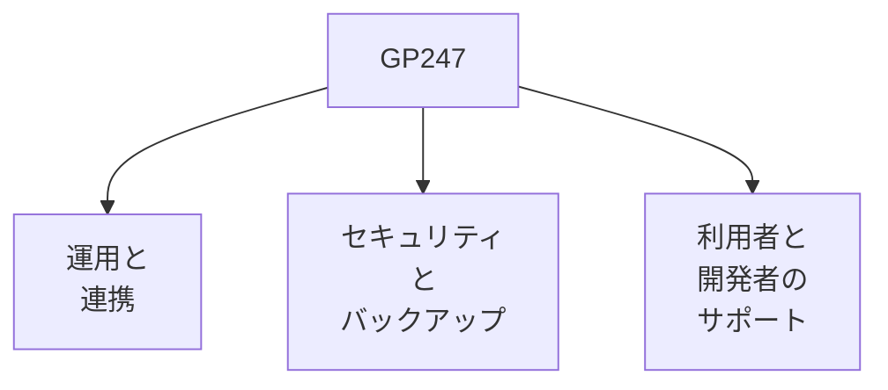
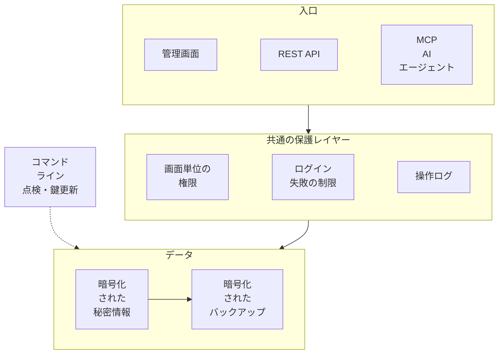

> 🌐 **言語:** [🇻🇳 Tiếng Việt](./gp247_vi.md) · [🇬🇧 English](./gp247.md) · 🇯🇵 日本語（現在）

# GP247について

**GP247** は、Laravel で構築された企業向けのオープンソース E コマースプラットフォームです。販売機能に加えて、運用を自動化する
**コマンドライン**、アプリや ERP とつなぐ **REST API v2**、AI エージェントと連携する **MCP サーバー**、そして**一元管理のセキュリティ**
と組み込みの**バックアップと復元**を備えています。すべて MIT ライセンスで無料です。

## 1 分でわかる GP247

| 項目 | 内容 |
| --- | --- |
| **概要** | Laravel で構築された企業向けのオープンソース E コマースプラットフォーム |
| **ライセンス** | MIT — 無料。自由にカスタマイズし、ご自身の Laravel システムに組み込めます |
| **技術スタック（GP247 3.x）** | PHP 8.3 以上 · Laravel 13 · Livewire 4 · Tailwind CSS 3（ビルド済みのため Node は不要）· MySQL / MariaDB |
| **コンポーネント** | `gp247/core` · `gp247/front` · `gp247/shop` · `gp247/mcp` |
| **オールインワン版** | **S-Cart** = core + front + shop + mcp |
| **運用と連携** | コマンドライン `php artisan gp247:*` · REST API v2（ERP 同期）· AI エージェント向け MCP サーバー |
| **セキュリティ** | 管理画面・API・MCP で共通の権限とログ · 秘密情報の暗号化 · 暗号化されたバックアップと復元 |
| **動作環境** | cron のない共有ホスティングから VPS、Docker まで |
| **ドキュメント** | ベトナム語 · 英語 · 日本語の 3 言語。AI コーディングエージェント向けの Agent Skills もあります |

## 主な特長

GP247 は、実際に運営しているストアに必要な 3 つの能力に力を入れています。

- **運用と連携** — コマンドライン、REST API v2、AI エージェント向け MCP サーバー。
- **セキュリティとバックアップ** — すべての入口に共通の保護レイヤー、組み込みのバックアップと復元。
- **サポート** — 継続的に更新される 3 言語のドキュメント、開発者向けの Agent Skills。

### 運用と連携

- **コマンドライン `gp247:*` — 完全な自動化を目指して** — インストール、更新、サイトの健康チェック（`gp247:doctor`）、
  バックアップ、プラグインとテンプレートの管理を、管理画面を開かずに行える 40 以上のコマンドがあります。すべてのコマンドに
  スクリプト・CI・Docker 向けの `--json` があり、データを削除しうるコマンドは必ず確認を求めます。詳しくは
  [GP247 のコマンドライン（CLI）](../cli/cli-introduction_ja.md)をご覧ください。
- **REST API v2 — アプリや ERP とつなぐ** — ストアフロント／顧客向けと管理向けの 2 つの API グループ、トークンによるログイン、
  OpenAPI 3.1 の仕様書を備えています。ERP、在庫管理ソフト、CRM は `updated_since`、イベントログ、署名付き Webhook でデータを
  同期できます。詳しくは [API 入門](../api/api-introduction_ja.md)と [ERP とのデータ同期](../api/api-sync_ja.md)をご覧ください。
- **MCP サーバー — AI エージェントと連携** — S-Cart に標準搭載され、有効にするまではオフです。ストアオーナーは Claude Code、
  Claude Desktop / claude.ai、Cursor、VS Code から普段の言葉で、注文の確認、在庫の確認、売上の要約を依頼できます。ツールは 15 個
  （読み取り 11 個、書き込み 4 個は初期状態でオフ）。書き込み操作は必ずプレビューと 1 回限りの確認コードを伴います。詳しくは
  [MCP サーバーの紹介](../mcp/mcp-introduction_ja.md)をご覧ください。

### 高度で一元管理されたセキュリティ

管理画面、REST API、MCP 経由の AI エージェント — すべての入口は、データに触れる前に**同じ保護レイヤー**を通ります。

- **すべての入口に同じ基準** — API と AI エージェントは管理画面と権限・ログを共有するため、そのアカウントが画面でできる以上の
  ことは決してできません。Web と API からの管理者ログインは、ログイン失敗のカウンターを共有します。
- **一元化されたスイッチ** — 「**API設定**」画面で API と MCP の各部分をオン／オフできます。マスタースイッチをオフにすると MCP も
  オフになります。
- **秘密情報の暗号化** — SMTP パスワード、外部サービスの鍵、ライセンスはデータベース内で暗号化され、画面に再表示されません。
  暗号化キーの更新もコマンド 1 つで行えます。
- **コマンド 1 つで点検** — `gp247:doctor` がサーバー、インストール、セキュリティ設定をチェックします。
- **組み込みのバックアップと復元** — バックアップは暗号化され、作成直後に自動で検証されます。cron なしで 24 時間ごとに自動
  バックアップし、システムの更新、拡張機能の更新、テンプレートの変更の前にはスナップショットを取ります。S3 互換ストレージや
  SFTP / NAS へのコピーにも対応し、状況に応じた復元手順を用意しています。

詳しくは [GP247 システムのセキュリティ](../security/security-introduction_ja.md)と[バックアップと復元](../backup/backup-and-restore_ja.md)
をご覧ください。

### 利用者と開発者のサポート

- **充実したドキュメントを継続的に更新** — 各言語（ベトナム語 · 英語 · 日本語）80 ページ以上。ストアオーナーと開発者の両方に向けて
  書かれ、リリースごとに更新されます。詳しくは[ドキュメント目次](../README_ja.md)をご覧ください。
- **AI コーディングエージェント向けの Agent Skills** — AI エージェント（Claude Code など）が、GP247 の流儀どおりにプラグイン、
  決済プラグイン、配送プラグイン、テンプレートを構築し、コマンドラインで拡張機能を管理できるスキル集です。各スキルは作業の前に
  サイトの core バージョンを自動で判別します。詳しくは [gp247-skills](https://github.com/gp247net/gp247-skills) をご覧ください。

## 構成コンポーネント

GP247 のエコシステムは、次の主要コンポーネントで構成されています。

| コンポーネント | 役割 |
| --- | --- |
| **GP247/core** | バックエンドシステム。複雑な業務ニーズに対応するプラグイン・テンプレートのライブラリを備えています |
| **GP247/front** | GP247/core と連携するユーザーインターフェース |
| **GP247/shop** | EC サイト構築機能 |
| **GP247/mcp** | AI エージェントがシステムを操作できるようにします |

> **S-Cart プロジェクト** = GP247/core + GP247/front + GP247/shop + GP247/mcp

すべてのコンポーネントは**無料のオープンソース**です。自由にカスタマイズし、ご自身の Laravel システムに組み込むことが
できます。

## ソースコード

詳しい情報とソースコードは、以下でご覧いただけます。

- **GP247/core**: <https://github.com/gp247net/core>
- **GP247/front**: <https://github.com/gp247net/front>
- **GP247/shop**: <https://github.com/gp247net/shop>
- **GP247/mcp**: <https://github.com/gp247net/mcp>
- **GP247/s-cart**: <https://github.com/gp247net/s-cart>
- **プラグイン**: <https://github.com/gp247-plugin>
- **ドキュメント**: <https://github.com/gp247net/gp247-docs>
- **Agent Skills**: <https://github.com/gp247net/gp247-skills>

## お問い合わせ先

> **技術サポートメール：** [support@gp247.net](mailto:support@gp247.net)

## コミュニティによる迅速なサポート

SNS のコミュニティに参加すると、開発チームや他のメンバーから迅速なサポートを受けられます。

- **Facebook**: <https://www.facebook.com/gp247.official>
- **S-Cart グループ**: <https://www.facebook.com/groups/scart.opensource>
