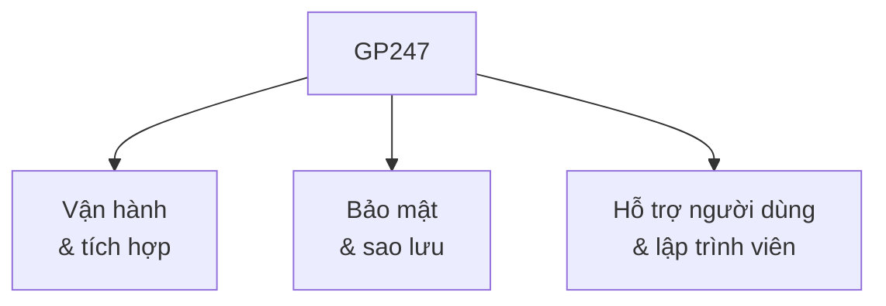
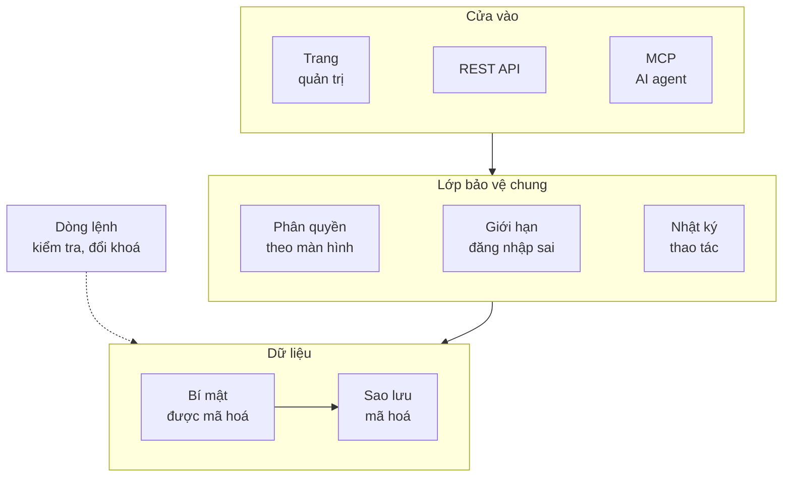

> 🌐 **Ngôn ngữ:** 🇻🇳 Tiếng Việt (hiện tại) · [🇬🇧 English](./gp247.md) · [🇯🇵 日本語](./gp247_ja.md)

# Giới thiệu về GP247

**GP247** là nền tảng thương mại điện tử mã nguồn mở dành cho doanh nghiệp, xây dựng trên Laravel. Ngoài các tính năng bán
hàng, GP247 có sẵn **dòng lệnh** để vận hành tự động, **REST API v2** để kết nối ứng dụng và ERP, **MCP server** để làm việc
với AI agent, cùng lớp **bảo mật quản lý tập trung** và **sao lưu & phục hồi** tích hợp sẵn. Tất cả miễn phí, giấy phép MIT.

## GP247 trong một phút

| Mục | Thông tin |
| --- | --- |
| **Là gì** | Nền tảng thương mại điện tử mã nguồn mở cho doanh nghiệp, xây dựng trên Laravel |
| **Giấy phép** | MIT — miễn phí, tự do tùy chỉnh và tích hợp vào hệ thống Laravel của bạn |
| **Công nghệ (GP247 3.x)** | PHP 8.3+ · Laravel 13 · Livewire 4 · Tailwind CSS 3 (biên dịch sẵn, không cần Node) · MySQL / MariaDB |
| **Thành phần** | `gp247/core` · `gp247/front` · `gp247/shop` · `gp247/mcp` |
| **Bản trọn gói** | **S-Cart** = core + front + shop + mcp |
| **Vận hành & tích hợp** | Dòng lệnh `php artisan gp247:*` · REST API v2 (đồng bộ ERP) · MCP server cho AI agent |
| **Bảo mật** | Phân quyền và nhật ký dùng chung cho trang quản trị, API, MCP · mã hoá bí mật · sao lưu & phục hồi mã hoá |
| **Môi trường chạy** | Từ shared hosting không có cron tới VPS, Docker |
| **Tài liệu** | Ba ngôn ngữ Việt · Anh · Nhật, kèm Agent Skills cho AI agent lập trình |

## Điểm nổi bật

GP247 tập trung vào ba nhóm năng lực mà một cửa hàng đang vận hành thật cần đến:

- **Vận hành & tích hợp** — dòng lệnh, REST API v2, MCP server cho AI agent.
- **Bảo mật & sao lưu** — một lớp bảo vệ chung cho mọi cửa vào, sao lưu & phục hồi có sẵn.
- **Hỗ trợ** — tài liệu ba ngôn ngữ cập nhật liên tục, Agent Skills cho lập trình viên.

### Vận hành & tích hợp

- **Dòng lệnh `gp247:*` — hướng tới tự động hoá hoàn toàn** — hơn 40 lệnh để cài đặt, cập nhật, kiểm tra sức khoẻ site
  (`gp247:doctor`), sao lưu, quản lý plugin và template mà không cần mở trang quản trị. Mọi lệnh có `--json` cho script, CI và
  Docker; lệnh có thể xoá dữ liệu luôn hỏi xác nhận. Xem [Dòng lệnh GP247 (CLI)](../cli/cli-introduction_vi.md).
- **REST API v2 — kết nối ứng dụng và ERP** — hai nhóm API cho cửa hàng/khách hàng và cho quản trị, đăng nhập bằng token, đặc tả
  OpenAPI 3.1. ERP, phần mềm kho hay CRM đồng bộ dữ liệu bằng `updated_since`, nhật ký sự kiện và webhook có chữ ký. Xem
  [Giới thiệu API](../api/api-introduction_vi.md) và [Đồng bộ dữ liệu với ERP](../api/api-sync_vi.md).
- **MCP server — làm việc với AI agent** — có sẵn trong S-Cart, tắt sẵn cho tới khi bạn bật. Chủ cửa hàng hỏi bằng lời thường
  trong Claude Code, Claude Desktop / claude.ai, Cursor hay VS Code để tra đơn, xem tồn kho, tóm tắt doanh thu. 15 công cụ (11 đọc,
  4 ghi mặc định tắt); thao tác ghi luôn có bản xem trước và mã xác nhận. Xem [Giới thiệu MCP server](../mcp/mcp-introduction_vi.md).

### Bảo mật nâng cao, quản lý tập trung

Mọi cửa vào — trang quản trị, REST API, AI agent qua MCP — đi qua **cùng một lớp bảo vệ** trước khi chạm dữ liệu:

- **Một chuẩn bảo vệ cho mọi cửa vào** — API và AI agent dùng chung phân quyền và nhật ký với trang quản trị, nên không bao giờ làm
  được nhiều hơn tài khoản đó trên màn hình; đăng nhập quản trị qua web và API dùng chung bộ đếm đăng nhập sai.
- **Công tắc tập trung** — bật/tắt từng phần API và MCP trên màn **Cấu hình API**; tắt công tắc tổng là tắt luôn MCP.
- **Bí mật được mã hoá** — mật khẩu SMTP, khoá bên thứ ba, license được mã hoá trong cơ sở dữ liệu, không hiện lại trên màn hình;
  đổi khoá mã hoá bằng một lệnh.
- **Kiểm tra bằng một lệnh** — `gp247:doctor` kiểm máy chủ, cài đặt và cấu hình bảo mật.
- **Sao lưu & phục hồi tích hợp sẵn** — bản sao lưu được mã hoá và tự kiểm ngay sau khi tạo; site tự sao lưu mỗi 24 giờ mà không cần
  cron; tự chụp một bản trước khi cập nhật hệ thống, cập nhật extension hay đổi template; chép được ra lưu trữ S3-compatible hoặc
  SFTP / NAS; phục hồi theo từng tình huống.

Xem [Bảo mật hệ thống GP247](../security/security-introduction_vi.md) và [Sao lưu & phục hồi](../backup/backup-and-restore_vi.md).

### Hỗ trợ người dùng và lập trình viên

- **Tài liệu đầy đủ, cập nhật liên tục** — hơn 80 trang cho mỗi ngôn ngữ (Việt · Anh · Nhật), viết cho cả chủ cửa hàng lẫn lập trình
  viên, cập nhật cùng mỗi bản phát hành. Xem [mục lục tài liệu](../README_vi.md).
- **Agent Skills cho AI agent lập trình** — bộ skill giúp AI agent (như Claude Code) dựng plugin, plugin thanh toán, plugin vận
  chuyển, template và quản lý extension qua dòng lệnh theo đúng chuẩn GP247; skill tự nhận phiên bản core của site trước khi làm.
  Xem [gp247-skills](https://github.com/gp247net/gp247-skills).

## Các thành phần

Hệ sinh thái GP247 gồm các thành phần chính sau:

| Thành phần | Vai trò |
| --- | --- |
| **GP247/core** | Hệ thống backend, kèm thư viện plugin và template đáp ứng các nhu cầu nghiệp vụ phức tạp |
| **GP247/front** | Giao diện người dùng, làm việc với GP247/core |
| **GP247/shop** | Các tính năng xây dựng website bán hàng |
| **GP247/mcp** | Cho phép AI agent làm việc với hệ thống |

> **Dự án S-Cart** = GP247/core + GP247/front + GP247/shop + GP247/mcp

Tất cả thành phần đều **miễn phí và mã nguồn mở**. Bạn có thể tùy chỉnh và tích hợp chúng vào hệ thống Laravel
của riêng mình.

## Mã nguồn

Tìm hiểu thêm và xem mã nguồn tại:

- **GP247/core**: <https://github.com/gp247net/core>
- **GP247/front**: <https://github.com/gp247net/front>
- **GP247/shop**: <https://github.com/gp247net/shop>
- **GP247/mcp**: <https://github.com/gp247net/mcp>
- **GP247/s-cart**: <https://github.com/gp247net/s-cart>
- **Plugin**: <https://github.com/gp247-plugin>
- **Tài liệu**: <https://github.com/gp247net/gp247-docs>
- **Agent Skills**: <https://github.com/gp247net/gp247-skills>

## Thông tin liên hệ

> **Email hỗ trợ kỹ thuật:** [support@gp247.net](mailto:support@gp247.net)

## Hỗ trợ nhanh qua cộng đồng

Tham gia cộng đồng trên mạng xã hội để được đội ngũ phát triển và các thành viên khác hỗ trợ nhanh:

- **Facebook**: <https://www.facebook.com/gp247.official>
- **Nhóm S-Cart**: <https://www.facebook.com/groups/scart.opensource>
