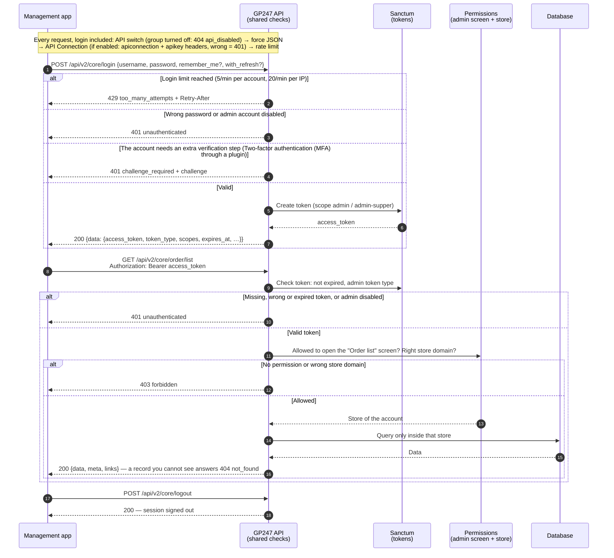
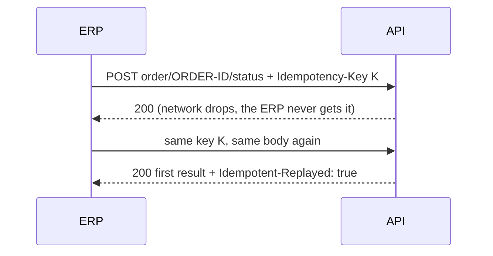

> 🌐 **Language:** [🇻🇳 Tiếng Việt](./api-admin_vi.md) · 🇬🇧 English (current) · [🇯🇵 日本語](./api-admin_ja.md)

# Admin API (`api/v2/core`)

## Introduction

This page shows how to work with the admin API: sign in with an administrator account, read orders, products and customers as on the admin
screens, and write data (order status, shipping, prices, stock, locking customers). It is for people connecting an ERP, warehouse software, CRM or internal
tool to the site. Every call follows the administrator account's own permissions and store (see [Concepts you need](./api-concepts.md));
details of each endpoint are in [Reference — Admin](./api-reference-admin.md).

## Core API workflow (Admin)

The diagram below shows a management app signing in and then reading data through the Core API. Every request
goes through the checks in the order shown; the first check that refuses answers with an error straight away.



Takeaway: a token is **not enough** to read data — the account also needs permission to open the matching admin
screen, and it only sees the data of its own store ([Permissions and data scope of the Core API](./api-concepts.md#permissions-and-data-scope-of-the-core-api)).

**Login & session endpoints** (prefix `api/v2/core`):

| Method | Path | Login required | Function |
| --- | --- | --- | --- |
| `POST` | `api/v2/core/login` | No | Admin login, returns `access_token` (optional `with_refresh` — [Refresh tokens — stay signed in with short-lived tokens](./api-authentication.md#refresh-tokens--stay-signed-in-with-short-lived-tokens)) |
| `POST` | `api/v2/core/login/challenge` | No | Finish a sign-in that needs an extra verification step ([Two-factor authentication (MFA) through a plugin](./api-authentication.md#two-factor-authentication-mfa-through-a-plugin)) |
| `POST` | `api/v2/core/refresh` | No (send the refresh token) | Exchange a refresh token for a new token pair ([Refresh tokens — stay signed in with short-lived tokens](./api-authentication.md#refresh-tokens--stay-signed-in-with-short-lived-tokens)) |
| `POST` | `api/v2/core/logout` | Yes (Bearer) | Sign the current session out (refresh token included) |
| `GET` | `api/v2/core/info` | Yes (Bearer) | Get the currently logged-in administrator's info (with roles) |
| `GET` | `api/v2/core/sessions` | Yes (Bearer) | The admin's API sign-in sessions (devices) ([Managing sign-in sessions](./api-authentication.md#managing-sign-in-sessions)) |
| `DELETE` | `api/v2/core/sessions/{id}` | Yes (Bearer) | Sign one session out |

**Admin data endpoints** (prefix `api/v2/core`, token + permission from [Permissions and data scope of the Core API](./api-concepts.md#permissions-and-data-scope-of-the-core-api) required):

| Method | Path | Function |
| --- | --- | --- |
| `GET` | `api/v2/core/customer/list` | Customer list |
| `GET` | `api/v2/core/customer/detail/{id}` | A customer's details |
| `GET` | `api/v2/core/order/list` | Order list |
| `GET` | `api/v2/core/order/detail/{id}` | An order's details |
| `GET` | `api/v2/core/product/list` | Product list (with stock and cost price) |
| `GET` | `api/v2/core/product/detail/{id}` | A product's details |
| `GET` | `api/v2/core/category/list` | Category list |
| `GET` | `api/v2/core/category/detail/{id}` | A category's details |
| `GET` | `api/v2/core/brand/list` | Brand list |
| `GET` | `api/v2/core/brand/detail/{id}` | A brand's details |
| `GET` | `api/v2/core/supplier/list` | Supplier list |
| `GET` | `api/v2/core/supplier/detail/{id}` | A supplier's details |
| `GET` | `api/v2/core/banner/list` | Banner list |
| `GET` | `api/v2/core/banner/detail/{id}` | A banner's details |
| `GET` | `api/v2/core/page/list` | Content page list |
| `GET` | `api/v2/core/page/detail/{id}` | A content page's details |
| `GET` | `api/v2/core/events` | Event log for ERP / sync tools ([Response format, list parameters & error codes](./api-conventions.md#response-format-list-parameters--error-codes)) |
| `POST` | `api/v2/core/order/{id}/status` | Change an order's status ([Writing data through the admin API](#writing-data-through-the-admin-api)) |
| `POST` | `api/v2/core/order/{id}/shipping` | Change the shipping status, keep the tracking number |
| `POST` | `api/v2/core/order/{id}/notes` | Add a note to the order history |
| `PATCH` | `api/v2/core/product/{id}` | Change a product's selling price, cost price, status ([Writing data through the admin API](#writing-data-through-the-admin-api)) |
| `POST` | `api/v2/core/product/{id}/stock` | Receive / issue goods, set the stock after a stock count |
| `POST` | `api/v2/core/stock/batch` | Write the stock of many products at once (up to 100 lines) |
| `PATCH` | `api/v2/core/customer/{id}` | Lock / unlock a customer ([Customers](#customers)) |

Example admin login (using `curl` in a Terminal):

```bash
curl -X POST "https://shop.example.com/api/v2/core/login" \
  -H "Content-Type: application/json" \
  -d '{"username":"admin","password":"your-password","remember_me":true}'
```

On success, you receive JSON like (shortened):

```json
{
  "data": {
    "access_token": "1|aBcD...very-long...XyZ",
    "token_type": "Bearer",
    "scopes": ["admin-supper"],
    "expires_at": "2026-11-25 10:00:00",
    "expires_in": 2592000
  }
}
```

Then fetch the latest orders using the token you just received (`data.access_token`):

```bash
curl -X GET "https://shop.example.com/api/v2/core/order/list?sort=-created_at&page[size]=20" \
  -H "Accept: application/json" \
  -H "Authorization: Bearer 1|aBcD...very-long...XyZ"
```

### Writing data through the admin API

> ℹ️ **Available since:** gp247/core 3.7.0, gp247/shop 3.6.0

An ERP, CRM or warehouse tool can update orders, product prices and stock, and lock / unlock customers through the API
instead of doing it by hand on the admin area. Each order write has **the same effect** as the matching action on the order details screen: same stock
movements, same order history lines.

| Method | Path | Request body (JSON) | Effect |
| --- | --- | --- | --- |
| `POST` | `api/v2/core/order/{id}/status` | `{"status": …}` | Change the order's status |
| `POST` | `api/v2/core/order/{id}/shipping` | `{"shipping_status"?, "tracking_number"?, "tracking_url"?}` | Change the shipping status, keep the tracking number |
| `POST` | `api/v2/core/order/{id}/notes` | `{"content": "…"}` | Add a note to the order history |
| `PATCH` | `api/v2/core/product/{id}` | `{"price"?, "cost"?, "status"?}` | Change the product's selling price, cost price, status |
| `POST` | `api/v2/core/product/{id}/stock` | `{"delta": …}` or `{"set": …}` | Receive / issue goods, or set the stock after a stock count |
| `POST` | `api/v2/core/stock/batch` | `{"items": [{"id" or "sku", "delta" or "set"}, …]}` | Write the stock of many products (1–100 lines) |
| `PATCH` | `api/v2/core/customer/{id}` | `{"status": 0}` or `{"status": 1}` | Lock / unlock a customer |

**Common rules (the three order endpoints):**

- **Permission:** the account needs **change permission** on the **Order list** screen, checked exactly as when using an
  action on that screen — whoever may change orders on the screen may change them through the API. View-only accounts
  (including the `view.all` role) → `403 forbidden`.
- Only orders of your own store ([Permissions and data scope of the Core API](./api-concepts.md#permissions-and-data-scope-of-the-core-api)); an order of another store → `404 not_found`.
- Success → `200 {"data": <order>}`, same shape as `order/detail/{id}`, already including the change.
- Invalid data → `422 validation_failed` with `errors`.
- Every write shows in the **Operation log** like any admin API call ([Admin API access log](./api-authentication.md#admin-api-access-log)).

**Order status — `order/{id}/status`:**

- `status` is the id of one of the site's order statuses; an unknown id → `422`.
- Same effect as changing the status on the admin screen: cancelling returns the goods to stock, reopening a cancelled
  order takes them out of stock again, and every change adds an order history line. A finished or cancelled order can be
  reopened, as on the screen.
- The order already has the status sent → `200`, nothing written.
- Reopening refused (for example not enough stock) → `409`, with the reason in `code`, for example
  `admin.order.reopen_blocked_stock`.

**Shipping — `order/{id}/shipping`:**

- Send at least `shipping_status` or `tracking_number`. `tracking_url` needs `tracking_number` and must be an `http(s)` address.
- `shipping_status`: the id of one of the site's shipping statuses; a change adds an order history line.
- `tracking_number`: kept as the order's **manual shipment** (one per order; sending another number updates it), shown on
  the order details screen.
- Sending `payment_status` → `422`: the payment status always follows the order's payments and cannot be set by hand.

**Notes — `order/{id}/notes`:**

- `content` is 1–1000 characters; the note goes into the order history with its author and the label `[API]`.
- The text is shown as plain text: HTML tags are shown as written, never run.

Example: the ERP reports that an order was handed to the carrier, with its tracking number:

```bash
curl -X POST "https://shop.example.com/api/v2/core/order/ORDER-ID/shipping" \
  -H "Accept: application/json" \
  -H "Content-Type: application/json" \
  -H "Authorization: Bearer 1|aBcD...very-long...XyZ" \
  -H "Idempotency-Key: 6f1c2a7e-0b9d-4c51-9e3a-2d8f4b7c1a90" \
  -d '{"shipping_status":2,"tracking_number":"VN123456789","tracking_url":"https://tracking.example.com/VN123456789"}'
```

Result (shortened):

```json
{
  "data": {
    "id": "ORDER-ID",
    "status": 2,
    "payment_status": 3,
    "shipping_status": 2,
    "total": 350000,
    "balance": 0,
    "updated_at": "2026-10-31T09:15:00+07:00"
  }
}
```

#### Products and stock

**Common rules (the three product and stock endpoints):**

- **Permission:** the account needs **change permission** on the **Product list** screen, checked exactly as the order
  writes are checked against the Order list screen. View-only accounts → `403 forbidden`.
- Only products of your own store; a product of another store → `404 not_found` (in `stock/batch`: a `not_found` line).
- Invalid data → `422 validation_failed` with `errors`.

**Price and status — `PATCH product/{id}`:**

- Send at least one of `price`, `cost` (a number ≥ 0), `status` (`0` or `1`). An empty body → `422`.
- Any other field (for example `sku`, `stock`) → `422 validation_failed`; it is not silently ignored. Stock is written with
  the stock commands below.
- A field turned off in the store's **Config product** settings (**Use PRICE** / **Use COST PRICE**) → `422`: the API follows
  the same field switches as the product form on the admin area, for the product's own store.
- Success → `200 {"data": <product>}`, same shape as `product/detail/{id}`.
- `Idempotency-Key` is optional, as for the order writes.

**Stock of one product — `product/{id}/stock`:** the body carries **exactly one** of two fields.

| Field | Meaning | Rules |
| --- | --- | --- |
| `delta` | Receive goods (positive) or issue goods (negative) | Not 0; whole numbers unless **Allow decimal quantity** is on in the product settings. The stock never goes below 0 → `422 stock_would_be_negative`, nothing changes |
| `set` | Set the stock outright after a stock count | ≥ 0; only an account with the **administrator** role (others → `403`) |

- Both fields or neither → `422 validation_failed`.
- `delta` adds or subtracts atomically: an order placed at the same moment loses nothing. The product's **sold** counter does
  not change — this is not a sale.
- A build product (a combo whose stock comes from its components) → `422 stock_managed_by_components`.
- The `Idempotency-Key` header is **required** (missing → `400 idempotency_key_required`): a retry with the same key moves
  the stock only once and answers the first result with the header `Idempotent-Replayed: true`.
- Success → `200 {"data": {"id": "…", "sku": "…", "stock": 15}}`.

> 💡 **Why send `delta` and not the new stock figure?** Between the moment the ERP reads the stock and the moment it sends a
> new figure, a customer may place an order. Sending the new figure would overwrite what that order took; sending a
> `delta` (receive +20, issue −3) adds or subtracts on the current figure. Use `set` only right after a physical stock count.

Example: the warehouse tool reports 20 units received:

```bash
curl -X POST "https://shop.example.com/api/v2/core/product/PRODUCT-ID/stock" \
  -H "Accept: application/json" \
  -H "Content-Type: application/json" \
  -H "Authorization: Bearer 1|aBcD...very-long...XyZ" \
  -H "Idempotency-Key: 3b9e7d10-5c2f-4a8e-b1d4-7f0a6c2e9b35" \
  -d '{"delta":20}'
```

Result:

```json
{ "data": { "id": "PRODUCT-ID", "sku": "TSHIRT-01", "stock": 35 } }
```

**Many products at once — `stock/batch`:**

- `items` has 1–100 lines; each line has the product's `id` **or** `sku`, with `delta` **or** `set` (same rules as above).
  More than 100 lines or a malformed line (for example neither `delta` nor `set`) → `422`, no line runs.
- Each line has its own result; a bad line does not stop the others. HTTP stays `200` even when some lines fail — read
  `ok` / `failed` and each result.
- `results` are in the same order as `items`; each result echoes the line's `id` or `sku`.
- `Idempotency-Key` is **required**: a retried batch moves nothing twice and answers the same body.

| Line `code` | When |
| --- | --- |
| `not_found` | The `id` is not in the account's store |
| `sku_not_found` | No product has this SKU |
| `sku_ambiguous` | Several products share the SKU — send the `id` |
| `forbidden` | `set` by an account that is not an administrator |
| `stock_would_be_negative` | The issue would take the stock below 0 — this line does not run |
| `stock_managed_by_components` | A build product; its stock comes from its components |

Example:

```bash
curl -X POST "https://shop.example.com/api/v2/core/stock/batch" \
  -H "Accept: application/json" \
  -H "Content-Type: application/json" \
  -H "Authorization: Bearer 1|aBcD...very-long...XyZ" \
  -H "Idempotency-Key: 9a4d2c61-7e3b-4f05-8c1a-0b6e5d3f2a78" \
  -d '{"items":[{"id":"PRODUCT-ID","delta":20},{"sku":"MUG-07","delta":-3}]}'
```

Result:

```json
{
  "data": {
    "results": [
      { "id": "PRODUCT-ID", "ok": true, "stock": 35 },
      { "sku": "MUG-07", "ok": false, "code": "sku_not_found", "msg": "No product has this SKU" }
    ],
    "ok": 1,
    "failed": 1
  }
}
```

#### Customers

A CRM or ERP locks a customer account (for example after fraud or overdue debt) and unlocks it again through
`PATCH customer/{id}`.

- The body holds only `status` (required): `0` locks, `1` unlocks. A value other than `0` / `1` → `422`.
- Any other field (for example `email`, `first_name`) → `422 validation_failed`: personal data is changed by the customer
  or on the admin area, never by a sync tool.
- **Permission:** **change permission** on the **Customer list** screen, checked exactly as on that screen. View-only
  accounts → `403 forbidden`.
- Only customers of your own store; a customer of another store → `404 not_found`.
- **A lock bites at once:** the customer's API tokens are refused from the next request (`401`), and a customer signed in
  on the storefront is signed out.
- Success → `200 {"data": <customer>}`, same shape as `customer/detail/{id}`.
- `Idempotency-Key` is optional, as for the order writes.

Example of a CRM locking a customer:

```bash
curl -X PATCH "https://shop.example.com/api/v2/core/customer/CUSTOMER-ID" \
  -H "Accept: application/json" \
  -H "Content-Type: application/json" \
  -H "Authorization: Bearer 1|aBcD...very-long...XyZ" \
  -H "Idempotency-Key: 5d8e1f02-a6b4-4c37-9e2d-1b7c0a4f6e93" \
  -d '{"status":0}'
```

Result (trimmed):

```json
{
  "data": {
    "id": "CUSTOMER-ID",
    "email": "customer@example.com",
    "status": 0,
    "updated_at": "2026-11-01T10:20:00+07:00"
  }
}
```

#### Retrying safely with `Idempotency-Key`

On a flaky network the app cannot tell whether a write ran. Send an `Idempotency-Key` header (8–255 printable characters,
for example a UUID) to retry without writing twice. On the three order endpoints, `PATCH product/{id}` and
`PATCH customer/{id}` the key is **optional**; on `product/{id}/stock` and `stock/batch` it is **required** (missing key → `400 idempotency_key_required`).



| Situation | Result |
| --- | --- |
| Same key, same body again | The first result is answered again, with the header `Idempotent-Replayed: true`; nothing runs again |
| Same key, another request (other body or path) | `409 idempotency_key_reused` |
| Same key, first request still being processed | `409 idempotency_in_progress` — wait, then send again |
| First request hit a server error (`5xx`) | The key is freed: a retry really runs |
| Malformed key, or missing on a stock write | `400 idempotency_key_required` |
| Site has not run `php artisan gp247:update` | `503 idempotency_unavailable` (only when a key is sent) |

- Keys are separate for each admin account and kept **24 hours**. Each new write needs a new key.
- `4xx` results (for example `409`, `422`) are stored too: retrying with the same key gets the same error — after fixing the
  data, use a new key.

#### Write rate limit

- Writes are counted **per admin account**: by default **300 requests / minute**. Change it with the environment variable
  `GP247_API_WRITE_THROTTLE` as `requests,minutes`, for example `600,1`.
- Product, stock, order and customer writes share this limit; one `stock/batch` counts as **one** request.
- Over the limit → `429 too_many_attempts` with a `Retry-After` header.
- Reads keep the general per-IP limit.

## Q&A

**Q1: Which administrator account should an ERP use?**

→ Create a separate account for the ERP and grant only the screens it needs (for example Orders, Products). Do not use a real person's account or
the top administrator account.

**Q2: If the ERP resends a write call after a network drop, is stock taken twice?**

→ No, as long as it sends the same `Idempotency-Key` header as the first time: the site returns the earlier result instead of doing it again (see Retrying safely above).

---

<sub>📅 **Last updated:** 2026-11-03 · ✍️ **Author:** GP247</sub>
