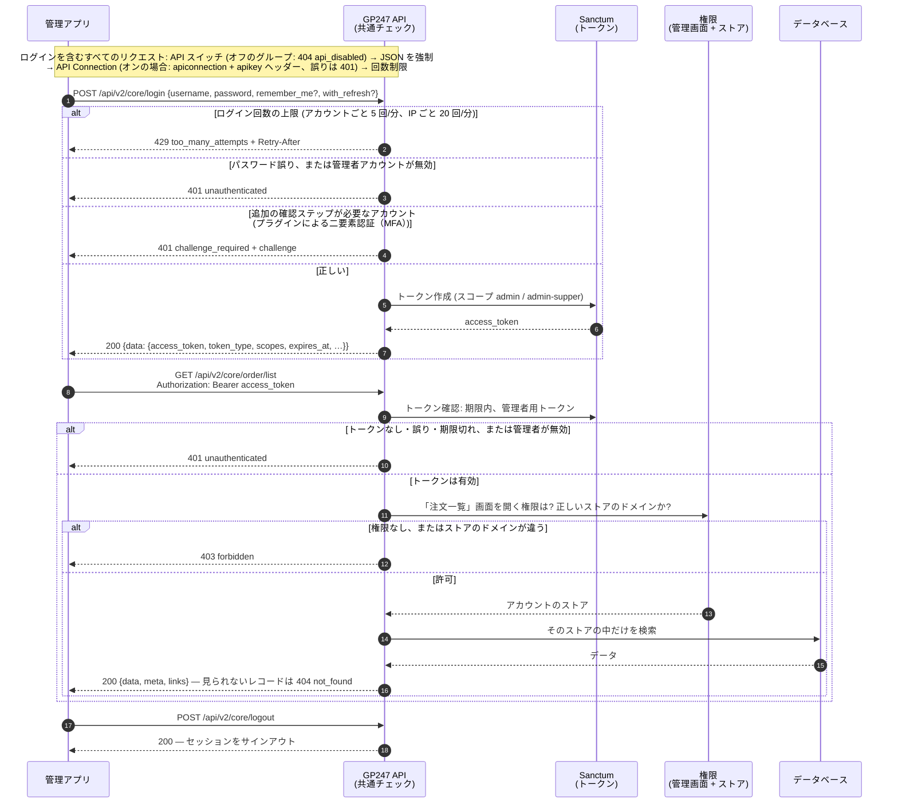
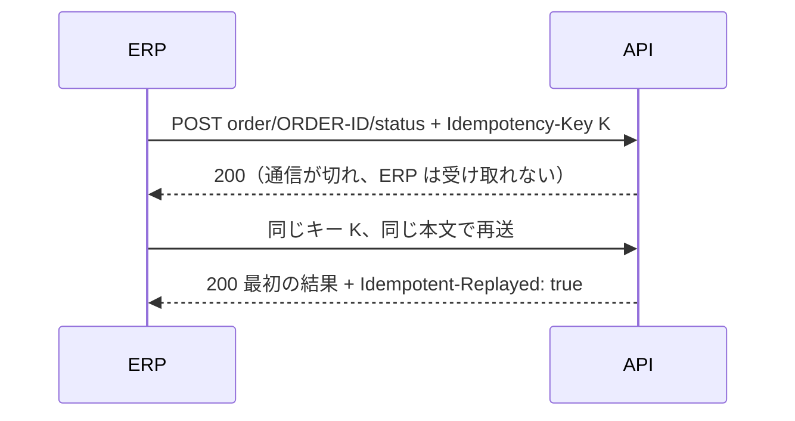

> 🌐 **言語:** [🇻🇳 Tiếng Việt](./api-admin_vi.md) · [🇬🇧 English](./api-admin.md) · 🇯🇵 日本語（現在）

# 管理 API（`api/v2/core`）

## はじめに

このページでは、管理 API の使い方を説明します：管理者アカウントでログインし、管理画面と同じように注文、商品、顧客を読み取り、
データを書き込みます（注文のステータス、配送、価格、在庫、顧客のロック）。ERP、倉庫ソフト、CRM、社内ツールを
サイトと連携する人向けです。すべての呼び出しは管理者アカウントの権限とストアに従います（[知っておくべき概念](./api-concepts_ja.md)を参照）。
エンドポイントごとの詳細は[リファレンス — Admin](./api-reference-admin_ja.md)にあります。

## Core API（管理）の処理の流れ

下の図は、管理アプリがログインしてから Core API でデータを読む順序を示しています。すべてのリクエストは図の順に
チェックを通り、どこかで拒否されるとその場でエラーを返し、先へは進みません。



ポイント: トークンがあるだけではデータを読めません。対応する管理画面を開く権限が必要で、見えるのは自分のストアの
データだけです（[Core API の権限とデータの範囲](./api-concepts_ja.md#core-api-の権限とデータの範囲)）。

**ログインとセッションのエンドポイント**（接頭辞 `api/v2/core`）：

| メソッド | パス | ログイン必要 | 機能 |
| --- | --- | --- | --- |
| `POST` | `api/v2/core/login` | 不要 | 管理者ログイン、`access_token` を受け取る（`with_refresh` は任意 — [リフレッシュトークン — 短命なトークンでサインイン状態を保つ](./api-authentication_ja.md#リフレッシュトークン--短命なトークンでサインイン状態を保つ)） |
| `POST` | `api/v2/core/login/challenge` | 不要 | 追加の確認ステップが必要なサインインを完了（[プラグインによる二要素認証（MFA）](./api-authentication_ja.md#プラグインによる二要素認証mfa)） |
| `POST` | `api/v2/core/refresh` | 不要（リフレッシュトークンを送る） | リフレッシュトークンを新しいトークンの組と交換（[リフレッシュトークン — 短命なトークンでサインイン状態を保つ](./api-authentication_ja.md#リフレッシュトークン--短命なトークンでサインイン状態を保つ)） |
| `POST` | `api/v2/core/logout` | 必要（Bearer） | 現在のセッションをサインアウト（リフレッシュトークンを含む） |
| `GET` | `api/v2/core/info` | 必要（Bearer） | ログイン中の管理者情報を取得（ロールを含む） |
| `GET` | `api/v2/core/sessions` | 必要（Bearer） | 管理者の API サインインセッション（端末）（[サインインセッションの管理](./api-authentication_ja.md#サインインセッションの管理)） |
| `DELETE` | `api/v2/core/sessions/{id}` | 必要（Bearer） | 1 つのセッションをサインアウト |

**管理データのエンドポイント**（接頭辞 `api/v2/core`、トークン ＋ [Core API の権限とデータの範囲](./api-concepts_ja.md#core-api-の権限とデータの範囲) の権限が必要）：

| メソッド | パス | 機能 |
| --- | --- | --- |
| `GET` | `api/v2/core/customer/list` | 顧客一覧 |
| `GET` | `api/v2/core/customer/detail/{id}` | 顧客 1 件の詳細 |
| `GET` | `api/v2/core/order/list` | 注文一覧 |
| `GET` | `api/v2/core/order/detail/{id}` | 注文 1 件の詳細 |
| `GET` | `api/v2/core/product/list` | 商品一覧（在庫数と原価を含む） |
| `GET` | `api/v2/core/product/detail/{id}` | 商品 1 件の詳細 |
| `GET` | `api/v2/core/category/list` | カテゴリー一覧 |
| `GET` | `api/v2/core/category/detail/{id}` | カテゴリー 1 件の詳細 |
| `GET` | `api/v2/core/brand/list` | ブランド一覧 |
| `GET` | `api/v2/core/brand/detail/{id}` | ブランド 1 件の詳細 |
| `GET` | `api/v2/core/supplier/list` | 仕入先一覧 |
| `GET` | `api/v2/core/supplier/detail/{id}` | 仕入先 1 件の詳細 |
| `GET` | `api/v2/core/banner/list` | バナー一覧 |
| `GET` | `api/v2/core/banner/detail/{id}` | バナー 1 件の詳細 |
| `GET` | `api/v2/core/page/list` | コンテンツページ一覧 |
| `GET` | `api/v2/core/page/detail/{id}` | コンテンツページ 1 件の詳細 |
| `GET` | `api/v2/core/events` | ERP／同期ツール向けのイベントログ（[レスポンスの形式、一覧のパラメーター、エラーコード](./api-conventions_ja.md#レスポンスの形式一覧のパラメーターエラーコード)） |
| `POST` | `api/v2/core/order/{id}/status` | 注文ステータスを変更（[管理 API によるデータの書き込み](#管理-api-によるデータの書き込み)） |
| `POST` | `api/v2/core/order/{id}/shipping` | 配送ステータスを変更し、追跡番号を保存 |
| `POST` | `api/v2/core/order/{id}/notes` | 注文履歴にメモを追加 |
| `PATCH` | `api/v2/core/product/{id}` | 商品の販売価格・原価・ステータスを変更（[管理 API によるデータの書き込み](#管理-api-によるデータの書き込み)） |
| `POST` | `api/v2/core/product/{id}/stock` | 入庫／出庫、棚卸し後に在庫を設定 |
| `POST` | `api/v2/core/stock/batch` | 複数商品の在庫を一度に書き込む（最大 100 行） |
| `PATCH` | `api/v2/core/customer/{id}` | 顧客をロック／ロック解除（[顧客](#顧客)） |

管理者ログインの例（ターミナルで `curl` を使用）：

```bash
curl -X POST "https://shop.example.com/api/v2/core/login" \
  -H "Content-Type: application/json" \
  -d '{"username":"admin","password":"your-password","remember_me":true}'
```

成功すると、次のような JSON が返ります（抜粋）。

```json
{
  "data": {
    "access_token": "1|aBcD...very-long...XyZ",
    "token_type": "Bearer",
    "scopes": ["admin-supper"],
    "expires_at": "2026-11-25 10:00:00",
    "expires_in": 2592000
  }
}
```

続いて、受け取ったトークン（`data.access_token`）で最新の注文を取得します。

```bash
curl -X GET "https://shop.example.com/api/v2/core/order/list?sort=-created_at&page[size]=20" \
  -H "Accept: application/json" \
  -H "Authorization: Bearer 1|aBcD...very-long...XyZ"
```

### 管理 API によるデータの書き込み

> ℹ️ **対応バージョン:** gp247/core 3.7.0, gp247/shop 3.6.0

ERP、CRM や倉庫管理ソフトは、管理画面で手作業する代わりに API で注文、商品の価格と在庫を更新し、顧客をロック／
ロック解除できます。注文の各書き込みは
注文詳細画面の対応する操作と**同じ効果**を持ちます。在庫の増減も注文履歴の行も同じです。

| メソッド | パス | リクエスト本文（JSON） | 効果 |
| --- | --- | --- | --- |
| `POST` | `api/v2/core/order/{id}/status` | `{"status": …}` | 注文ステータスを変更 |
| `POST` | `api/v2/core/order/{id}/shipping` | `{"shipping_status"?, "tracking_number"?, "tracking_url"?}` | 配送ステータスを変更し、追跡番号を保存 |
| `POST` | `api/v2/core/order/{id}/notes` | `{"content": "…"}` | 注文履歴にメモを追加 |
| `PATCH` | `api/v2/core/product/{id}` | `{"price"?, "cost"?, "status"?}` | 商品の販売価格・原価・ステータスを変更 |
| `POST` | `api/v2/core/product/{id}/stock` | `{"delta": …}` または `{"set": …}` | 入庫／出庫、または棚卸し後に在庫を設定 |
| `POST` | `api/v2/core/stock/batch` | `{"items": [{"id" または "sku", "delta" または "set"}, …]}` | 複数商品の在庫を書き込む（1〜100 行） |
| `PATCH` | `api/v2/core/customer/{id}` | `{"status": 0}` または `{"status": 1}` | 顧客をロック／ロック解除 |

**共通のルール（注文の 3 つのエンドポイント）：**

- **権限：** アカウントには **注文一覧** 画面の **変更権限** が必要で、その画面で操作するときとまったく同じように確認されます —
  画面で注文を変更できる人は API でも変更できます。閲覧のみのアカウント（`view.all` ロールを含む）→ `403 forbidden`。
- 自分のストアの注文のみ（[Core API の権限とデータの範囲](./api-concepts_ja.md#core-api-の権限とデータの範囲)）。他のストアの注文 → `404 not_found`。
- 成功 → `200 {"data": <注文>}`。`order/detail/{id}` と同じ形で、書き込んだ変更が反映済みです。
- データが不正 → `422 validation_failed`（`errors` 付き）。
- すべての書き込みは、管理 API のほかの呼び出しと同じく **操作ログ** に記録されます（[管理 API のアクセスログ](./api-authentication_ja.md#管理-api-のアクセスログ)）。

**注文ステータス — `order/{id}/status`：**

- `status` はサイトの注文ステータスの ID。存在しない ID → `422`。
- 管理画面でステータスを変えたときと同じ効果です：キャンセルすると商品が在庫に戻り、キャンセル済みの注文を再開すると
  再び在庫から引かれ、変更のたびに注文履歴に 1 行追加されます。完了済み・キャンセル済みの注文も、画面と同じく再開できます。
- 注文がすでに送ったステータスになっている → `200`、何も書き込みません。
- 再開できない（例: 在庫不足）→ `409`。`code` が理由コードです（例: `admin.order.reopen_blocked_stock`）。

**配送 — `order/{id}/shipping`：**

- `shipping_status` か `tracking_number` の少なくとも一方を送ります。`tracking_url` は `tracking_number` と一緒に送り、
  `http(s)` のアドレスである必要があります。
- `shipping_status`：サイトの配送ステータスの ID。変更すると注文履歴に 1 行追加されます。
- `tracking_number`：注文の **手動の送り状** として保存されます（注文ごとに 1 つ。別の番号を送るとその送り状を更新）。
  注文詳細画面に表示されます。
- `payment_status` を送る → `422`：支払いステータスは常に注文の支払いに従い、手動では設定できません。

**メモ — `order/{id}/notes`：**

- `content` は 1〜1000 文字。メモは作成者とラベル `[API]` 付きで注文履歴に追加されます。
- 本文はプレーンテキストとして表示されます：HTML タグは書いたとおりに表示され、実行されません。

例：ERP が、注文を配送業者に引き渡したことを追跡番号とともに知らせる場合。

```bash
curl -X POST "https://shop.example.com/api/v2/core/order/ORDER-ID/shipping" \
  -H "Accept: application/json" \
  -H "Content-Type: application/json" \
  -H "Authorization: Bearer 1|aBcD...very-long...XyZ" \
  -H "Idempotency-Key: 6f1c2a7e-0b9d-4c51-9e3a-2d8f4b7c1a90" \
  -d '{"shipping_status":2,"tracking_number":"VN123456789","tracking_url":"https://tracking.example.com/VN123456789"}'
```

結果（抜粋）：

```json
{
  "data": {
    "id": "ORDER-ID",
    "status": 2,
    "payment_status": 3,
    "shipping_status": 2,
    "total": 350000,
    "balance": 0,
    "updated_at": "2026-10-31T09:15:00+07:00"
  }
}
```

#### 商品と在庫

**共通のルール（商品・在庫の 3 つのエンドポイント）：**

- **権限：** アカウントには **商品一覧** 画面の **変更権限** が必要で、注文の書き込みが注文一覧画面で確認されるのと同じ方法で
  確認されます。閲覧のみのアカウント → `403 forbidden`。
- 自分のストアの商品のみ。他のストアの商品 → `404 not_found`（`stock/batch` では `not_found` の行）。
- データが不正 → `422 validation_failed`（`errors` 付き）。

**価格とステータス — `PATCH product/{id}`：**

- `price`、`cost`（0 以上の数値）、`status`（`0` または `1`）のうち少なくとも 1 つを送ります。本文が空 → `422`。
- それ以外の項目（例: `sku`、`stock`）→ `422 validation_failed`。黙って無視はされません。在庫は下記の在庫コマンドで書き込みます。
- ストアの **商品設定** でオフになっている項目（**価格を使用** / **原価を使用**）→ `422`：API は管理画面の商品フォームと
  同じ項目スイッチに、その商品のストアの設定で従います。
- 成功 → `200 {"data": <商品>}`。`product/detail/{id}` と同じ形です。
- `Idempotency-Key` は注文の書き込みと同じく任意です。

**1 商品の在庫 — `product/{id}/stock`：** 本文には 2 つの項目のうち **ちょうど 1 つ** を送ります。

| 項目 | 意味 | ルール |
| --- | --- | --- |
| `delta` | 入庫（正の数）または出庫（負の数） | 0 以外。商品設定で **小数の数量を許可** がオンでない限り整数。在庫は 0 未満にならない → `422 stock_would_be_negative`、何も変更されない |
| `set` | 棚卸し後に在庫をそのまま設定 | 0 以上。**administrator** ロールのアカウントのみ（それ以外 → `403`） |

- 両方送る、またはどちらも送らない → `422 validation_failed`。
- `delta` はアトミックに加減算されます：同じ瞬間に入った注文の分が失われることはありません。商品の **販売数** は変わりません
  — 販売ではないためです。
- ビルド商品（構成商品から在庫を求めるセット商品）→ `422 stock_managed_by_components`。
- `Idempotency-Key` ヘッダーは **必須** です（なし → `400 idempotency_key_required`）：同じキーで再送しても在庫は 1 回だけ
  動き、最初の結果がヘッダー `Idempotent-Replayed: true` 付きで返ります。
- 成功 → `200 {"data": {"id": "…", "sku": "…", "stock": 15}}`。

> 💡 **新しい在庫数ではなく `delta` を送るのはなぜ？** ERP が在庫を読んでから新しい数を送るまでの間に、お客様が注文するかも
> しれません。新しい在庫数を送るとその注文で減った分を上書きしてしまいますが、`delta`（入庫 +20、出庫 −3）なら現在の数に
> 対して加減算されます。`set` は実地棚卸しの直後にだけ使ってください。

例：倉庫ソフトが 20 個の入庫を知らせる場合。

```bash
curl -X POST "https://shop.example.com/api/v2/core/product/PRODUCT-ID/stock" \
  -H "Accept: application/json" \
  -H "Content-Type: application/json" \
  -H "Authorization: Bearer 1|aBcD...very-long...XyZ" \
  -H "Idempotency-Key: 3b9e7d10-5c2f-4a8e-b1d4-7f0a6c2e9b35" \
  -d '{"delta":20}'
```

結果：

```json
{ "data": { "id": "PRODUCT-ID", "sku": "TSHIRT-01", "stock": 35 } }
```

**複数商品を一度に — `stock/batch`：**

- `items` は 1〜100 行。各行に商品の `id` **または** `sku` と、`delta` **または** `set`（ルールは上と同じ）を指定します。
  100 行を超える、または形式が不正な行（例: `delta` も `set` もない）→ `422`、どの行も実行されません。
- 行ごとに結果があり、エラーの行があってもほかの行は止まりません。一部の行が失敗しても HTTP は `200` です — `ok` / `failed`
  と各結果を確認してください。
- `results` は `items` と同じ順で、各結果にはその行の `id` または `sku` が入ります。
- `Idempotency-Key` は **必須**：同じバッチを再送しても在庫は二重に動かず、同じ本文が返ります。

| 行の `code` | 発生する場合 |
| --- | --- |
| `not_found` | その `id` がアカウントのストアにない |
| `sku_not_found` | その SKU の商品がない |
| `sku_ambiguous` | 複数の商品が同じ SKU を持つ — `id` を送る |
| `forbidden` | administrator ではないアカウントによる `set` |
| `stock_would_be_negative` | 出庫すると在庫が 0 未満になる — この行は実行されない |
| `stock_managed_by_components` | ビルド商品。在庫は構成商品から求められる |

例：

```bash
curl -X POST "https://shop.example.com/api/v2/core/stock/batch" \
  -H "Accept: application/json" \
  -H "Content-Type: application/json" \
  -H "Authorization: Bearer 1|aBcD...very-long...XyZ" \
  -H "Idempotency-Key: 9a4d2c61-7e3b-4f05-8c1a-0b6e5d3f2a78" \
  -d '{"items":[{"id":"PRODUCT-ID","delta":20},{"sku":"MUG-07","delta":-3}]}'
```

結果：

```json
{
  "data": {
    "results": [
      { "id": "PRODUCT-ID", "ok": true, "stock": 35 },
      { "sku": "MUG-07", "ok": false, "code": "sku_not_found", "msg": "No product has this SKU" }
    ],
    "ok": 1,
    "failed": 1
  }
}
```

#### 顧客

CRM や ERP は `PATCH customer/{id}` で顧客アカウントをロックし（例: 不正行為、支払い遅延）、再びロック解除できます。

- 本文は `status`（必須）だけです: `0` でロック、`1` でロック解除。`0`／`1` 以外の値 → `422`。
- それ以外のフィールド（例: `email`、`first_name`）→ `422 validation_failed`: 個人情報は顧客自身または管理画面で変更する
  もので、同期ツールが変更することはありません。
- **権限：** **顧客一覧** 画面の **変更権限** が必要で、その画面と同じ方法で確認されます。閲覧のみのアカウント →
  `403 forbidden`。
- 自分のストアの顧客のみ。他のストアの顧客 → `404 not_found`。
- **ロックはすぐに効きます：** 次のリクエストから顧客の API トークンは拒否され（`401`）、ストアにサインイン中の顧客は
  サインアウトされます。
- 成功 → `200 {"data": <顧客>}`、`customer/detail/{id}` と同じ形式。
- `Idempotency-Key` は注文の書き込みと同じく任意です。

CRM が顧客をロックする例：

```bash
curl -X PATCH "https://shop.example.com/api/v2/core/customer/CUSTOMER-ID" \
  -H "Accept: application/json" \
  -H "Content-Type: application/json" \
  -H "Authorization: Bearer 1|aBcD...very-long...XyZ" \
  -H "Idempotency-Key: 5d8e1f02-a6b4-4c37-9e2d-1b7c0a4f6e93" \
  -d '{"status":0}'
```

結果（抜粋）：

```json
{
  "data": {
    "id": "CUSTOMER-ID",
    "email": "customer@example.com",
    "status": 0,
    "updated_at": "2026-11-01T10:20:00+07:00"
  }
}
```

#### `Idempotency-Key` で安全に再送する

通信が不安定だと、アプリは書き込みが実行されたかどうか分かりません。`Idempotency-Key` ヘッダー（印字可能な 8〜255 文字、
例: UUID）を付けて送れば、二重に書き込む心配なく再送できます。注文の 3 つのエンドポイント、`PATCH product/{id}` と
`PATCH customer/{id}` ではキーは **任意**、`product/{id}/stock` と `stock/batch` では **必須** です（キーなし → `400 idempotency_key_required`）。



| 状況 | 結果 |
| --- | --- |
| 同じキー、同じ本文で再送 | 最初の結果がもう一度返り、ヘッダー `Idempotent-Replayed: true` が付く。再実行はされない |
| 同じキー、別のリクエスト（本文またはパスが違う） | `409 idempotency_key_reused` |
| 同じキー、最初のリクエストがまだ処理中 | `409 idempotency_in_progress` — 待ってから再送 |
| 最初のリクエストがサーバーエラー（`5xx`） | キーは解放され、再送すると実際に実行される |
| キーの形式が不正、または在庫の書き込みでキーがない | `400 idempotency_key_required` |
| サイトが `php artisan gp247:update` を未実行 | `503 idempotency_unavailable`（キーを送ったときのみ） |

- キーは管理者アカウントごとに別々で、**24 時間** 保持されます。新しい書き込みには新しいキーが必要です。
- `4xx` の結果（例: `409`、`422`）も保存されます：同じキーで再送すると同じエラーが返ります — データを直したら新しいキーを
  使ってください。

#### 書き込みの回数制限

- 書き込みは **管理者アカウントごと** に数えます：既定は **1 分あたり 300 リクエスト**。環境変数
  `GP247_API_WRITE_THROTTLE` に `リクエスト数,分数` の形で設定して変更できます（例: `600,1`）。
- 商品・在庫・注文・顧客の書き込みはこの制限を共有します。`stock/batch` 1 回は **1** リクエストと数えます。
- 上限を超える → `429 too_many_attempts`（`Retry-After` ヘッダー付き）。
- 読み取りは従来どおり IP ごとの共通の制限に従います。

## よくある質問（Q&A）

**Q1: ERP にはどの管理者アカウントを使うべきですか？**

→ ERP 専用のアカウントを作り、必要な画面（例: 注文、商品）の権限だけを与えてください。実在の担当者のアカウントや
最上位の管理者アカウントは使わないでください。

**Q2: ネットワークが切れて ERP が書き込みを再送すると、在庫が 2 回引かれますか？**

→ 引かれません。初回と同じ `Idempotency-Key` ヘッダーを送れば、サイトは処理をやり直さずに前回の結果を返します（上記の「`Idempotency-Key` で安全に再送する」を参照）。

---

<sub>📅 **最終更新:** 2026-11-03 · ✍️ **作成者 (Author):** GP247</sub>
