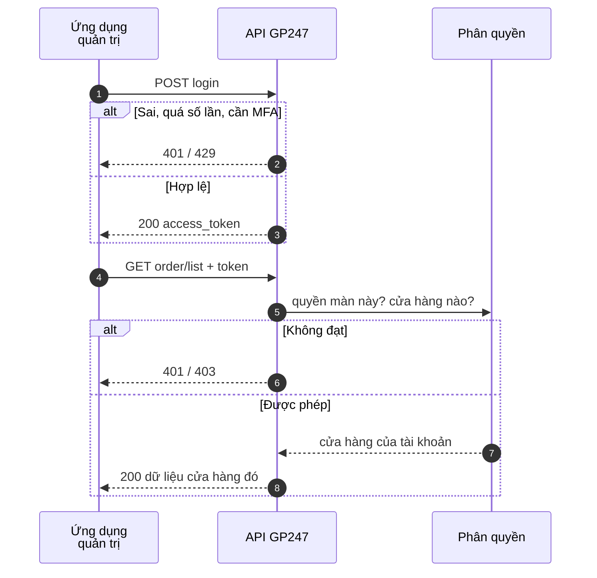
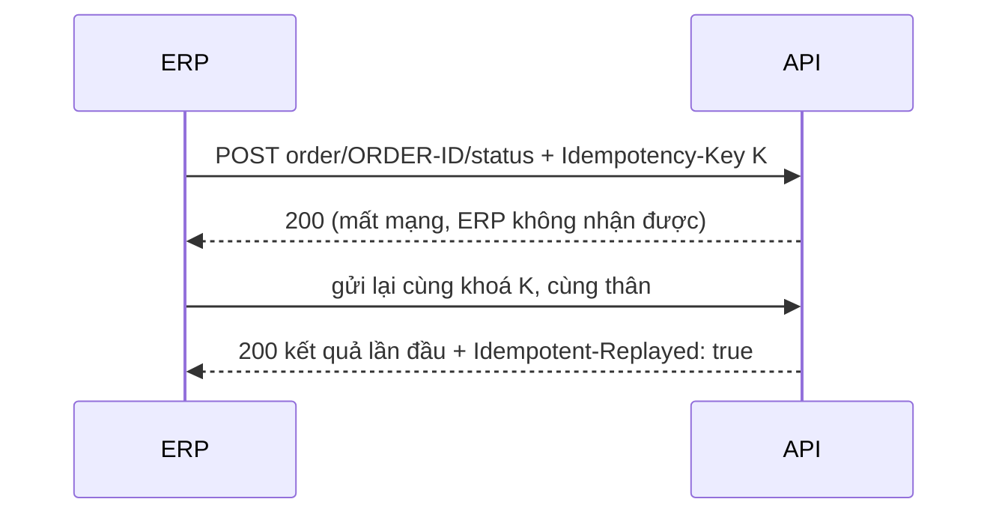

> 🌐 **Ngôn ngữ:** 🇻🇳 Tiếng Việt (hiện tại) · [🇬🇧 English](./api-admin.md) · [🇯🇵 日本語](./api-admin_ja.md)

# API quản trị (`api/v2/core`)

## Giới thiệu

Trang này hướng dẫn làm việc với API quản trị: đăng nhập bằng tài khoản quản trị, đọc đơn hàng, sản phẩm, khách hàng như trên các màn
quản trị, và ghi dữ liệu (trạng thái đơn, giao hàng, giá, tồn kho, khóa khách hàng). Dành cho người nối ERP, phần mềm kho, CRM hay công cụ
nội bộ với site. Mọi lệnh gọi theo đúng quyền và cửa hàng của tài khoản quản trị (xem [Khái niệm cần biết](./api-concepts_vi.md));
chi tiết từng endpoint ở [Tham chiếu — Admin](./api-reference-admin_vi.md).

## Luồng làm việc API Core (Admin)

Sơ đồ dưới đây mô tả trình tự một ứng dụng quản trị đăng nhập rồi đọc dữ liệu qua API Core. Mỗi yêu cầu đi
qua các lớp kiểm tra theo đúng thứ tự trong sơ đồ; lớp nào từ chối thì trả lỗi ngay, không đi tiếp. Trước các bước trong sơ đồ,
mọi yêu cầu (kể cả đăng nhập) đã qua công tắc API, API Connection (nếu bật) và giới hạn tần suất
([Nhìn nhanh](./api-concepts_vi.md#nhìn-nhanh)).



Điểm rút ra: có token **chưa đủ** để đọc dữ liệu — tài khoản còn phải có quyền mở màn hình quản trị tương ứng, và
chỉ thấy dữ liệu của cửa hàng mình ([Phân quyền và phạm vi dữ liệu của API Core](./api-concepts_vi.md#phân-quyền-và-phạm-vi-dữ-liệu-của-api-core)).

**Endpoint đăng nhập & phiên** (tiền tố `api/v2/core`):

| Phương thức | Đường dẫn | Cần đăng nhập | Chức năng |
| --- | --- | --- | --- |
| `POST` | `api/v2/core/login` | Không | Đăng nhập admin, nhận `access_token` (`with_refresh` tuỳ chọn — [Refresh token — giữ đăng nhập mà token ngắn hạn](./api-authentication_vi.md#refresh-token--giữ-đăng-nhập-mà-token-ngắn-hạn)) |
| `POST` | `api/v2/core/login/challenge` | Không | Hoàn tất đăng nhập cần bước xác thực thêm ([Xác thực hai lớp (MFA) qua plugin](./api-authentication_vi.md#xác-thực-hai-lớp-mfa-qua-plugin)) |
| `POST` | `api/v2/core/refresh` | Không (gửi refresh token) | Đổi refresh token lấy cặp token mới ([Refresh token — giữ đăng nhập mà token ngắn hạn](./api-authentication_vi.md#refresh-token--giữ-đăng-nhập-mà-token-ngắn-hạn)) |
| `POST` | `api/v2/core/logout` | Có (Bearer) | Đăng xuất phiên hiện tại (cả refresh token) |
| `GET` | `api/v2/core/info` | Có (Bearer) | Thông tin quản trị viên đang đăng nhập (kèm vai trò) |
| `GET` | `api/v2/core/sessions` | Có (Bearer) | Các phiên đăng nhập API (thiết bị) của admin ([Quản lý phiên đăng nhập](./api-authentication_vi.md#quản-lý-phiên-đăng-nhập)) |
| `DELETE` | `api/v2/core/sessions/{id}` | Có (Bearer) | Đăng xuất một phiên |

**Endpoint dữ liệu quản trị** (tiền tố `api/v2/core`, cần token + quyền ở [Phân quyền và phạm vi dữ liệu của API Core](./api-concepts_vi.md#phân-quyền-và-phạm-vi-dữ-liệu-của-api-core)):

| Phương thức | Đường dẫn | Chức năng |
| --- | --- | --- |
| `GET` | `api/v2/core/customer/list` | Danh sách khách hàng |
| `GET` | `api/v2/core/customer/detail/{id}` | Chi tiết một khách hàng |
| `GET` | `api/v2/core/order/list` | Danh sách đơn hàng |
| `GET` | `api/v2/core/order/detail/{id}` | Chi tiết một đơn hàng |
| `GET` | `api/v2/core/product/list` | Danh sách sản phẩm (kèm tồn kho, giá vốn) |
| `GET` | `api/v2/core/product/detail/{id}` | Chi tiết một sản phẩm |
| `GET` | `api/v2/core/category/list` | Danh sách danh mục |
| `GET` | `api/v2/core/category/detail/{id}` | Chi tiết một danh mục |
| `GET` | `api/v2/core/brand/list` | Danh sách thương hiệu |
| `GET` | `api/v2/core/brand/detail/{id}` | Chi tiết một thương hiệu |
| `GET` | `api/v2/core/supplier/list` | Danh sách nhà cung cấp |
| `GET` | `api/v2/core/supplier/detail/{id}` | Chi tiết một nhà cung cấp |
| `GET` | `api/v2/core/banner/list` | Danh sách banner |
| `GET` | `api/v2/core/banner/detail/{id}` | Chi tiết một banner |
| `GET` | `api/v2/core/page/list` | Danh sách trang nội dung |
| `GET` | `api/v2/core/page/detail/{id}` | Chi tiết một trang nội dung |
| `GET` | `api/v2/core/events` | Nhật ký sự kiện cho ERP / công cụ đồng bộ ([Định dạng phản hồi, tham số danh sách & mã lỗi](./api-conventions_vi.md#định-dạng-phản-hồi-tham-số-danh-sách--mã-lỗi)) |
| `POST` | `api/v2/core/order/{id}/status` | Đổi trạng thái đơn hàng ([Ghi dữ liệu qua API quản trị](#ghi-dữ-liệu-qua-api-quản-trị)) |
| `POST` | `api/v2/core/order/{id}/shipping` | Đổi trạng thái giao hàng, lưu mã vận đơn |
| `POST` | `api/v2/core/order/{id}/notes` | Thêm ghi chú vào lịch sử đơn |
| `PATCH` | `api/v2/core/product/{id}` | Sửa giá bán, giá vốn, trạng thái sản phẩm ([Ghi dữ liệu qua API quản trị](#ghi-dữ-liệu-qua-api-quản-trị)) |
| `POST` | `api/v2/core/product/{id}/stock` | Nhập / xuất kho, đặt lại tồn kho sau kiểm kê |
| `POST` | `api/v2/core/stock/batch` | Ghi tồn kho nhiều sản phẩm trong một lần (tối đa 100 dòng) |
| `PATCH` | `api/v2/core/customer/{id}` | Khoá / mở khoá một khách hàng ([Khách hàng](#khách-hàng)) |

Ví dụ đăng nhập admin (dùng `curl` trong Terminal):

```bash
curl -X POST "https://shop.example.com/api/v2/core/login" \
  -H "Content-Type: application/json" \
  -d '{"username":"admin","password":"your-password","remember_me":true}'
```

Nếu thành công, bạn nhận về JSON dạng (rút gọn):

```json
{
  "data": {
    "access_token": "1|aBcD...rất-dài...XyZ",
    "token_type": "Bearer",
    "scopes": ["admin-supper"],
    "expires_at": "2026-11-25 10:00:00",
    "expires_in": 2592000
  }
}
```

Sau đó lấy các đơn hàng mới nhất bằng token vừa nhận (`data.access_token`):

```bash
curl -X GET "https://shop.example.com/api/v2/core/order/list?sort=-created_at&page[size]=20" \
  -H "Accept: application/json" \
  -H "Authorization: Bearer 1|aBcD...rất-dài...XyZ"
```

### Ghi dữ liệu qua API quản trị

> ℹ️ **Có từ:** gp247/core 3.7.0, gp247/shop 3.6.0

ERP, CRM hay phần mềm kho có thể cập nhật đơn hàng, giá và tồn kho sản phẩm, khoá / mở khoá khách hàng qua API thay vì
thao tác tay trên trang quản trị. Mỗi
lệnh ghi đơn hàng có **cùng tác dụng** với thao tác tương ứng trên màn chi tiết đơn hàng: cùng trừ/trả kho, cùng dòng lịch
sử đơn.

| Phương thức | Đường dẫn | Thân yêu cầu (JSON) | Tác dụng |
| --- | --- | --- | --- |
| `POST` | `api/v2/core/order/{id}/status` | `{"status": …}` | Đổi trạng thái đơn hàng |
| `POST` | `api/v2/core/order/{id}/shipping` | `{"shipping_status"?, "tracking_number"?, "tracking_url"?}` | Đổi trạng thái giao hàng, lưu mã vận đơn |
| `POST` | `api/v2/core/order/{id}/notes` | `{"content": "…"}` | Thêm ghi chú vào lịch sử đơn |
| `PATCH` | `api/v2/core/product/{id}` | `{"price"?, "cost"?, "status"?}` | Sửa giá bán, giá vốn, trạng thái sản phẩm |
| `POST` | `api/v2/core/product/{id}/stock` | `{"delta": …}` hoặc `{"set": …}` | Nhập / xuất kho, hoặc đặt lại tồn kho sau kiểm kê |
| `POST` | `api/v2/core/stock/batch` | `{"items": [{"id" hoặc "sku", "delta" hoặc "set"}, …]}` | Ghi tồn kho nhiều sản phẩm (1–100 dòng) |
| `PATCH` | `api/v2/core/customer/{id}` | `{"status": 0}` hoặc `{"status": 1}` | Khoá / mở khoá khách hàng |

**Quy tắc chung (ba endpoint đơn hàng):**

- **Quyền:** tài khoản phải có **quyền sửa** trên màn **Danh sách đơn hàng**, kiểm tra y như khi bấm thao tác trên màn
  đó — ai sửa được đơn trên màn hình thì sửa được qua API. Tài khoản chỉ được xem (kể cả vai trò `view.all`) → `403 forbidden`.
- Chỉ đơn của cửa hàng mình ([Phân quyền và phạm vi dữ liệu của API Core](./api-concepts_vi.md#phân-quyền-và-phạm-vi-dữ-liệu-của-api-core)); đơn của cửa hàng khác → `404 not_found`.
- Thành công → `200 {"data": <đơn hàng>}`, cùng dạng với `order/detail/{id}`, đã gồm thay đổi vừa ghi.
- Dữ liệu sai → `422 validation_failed` kèm `errors`.
- Mỗi lệnh ghi có mặt trong **Nhật ký thao tác** như mọi lần gọi API quản trị ([Nhật ký truy cập API quản trị](./api-authentication_vi.md#nhật-ký-truy-cập-api-quản-trị)).

**Trạng thái đơn — `order/{id}/status`:**

- `status` là id một trạng thái đơn hàng của site; id không có → `422`.
- Tác dụng như đổi trạng thái trên màn quản trị: huỷ đơn thì trả hàng về kho, mở lại đơn đã huỷ thì lấy hàng khỏi kho lần
  nữa, mỗi lần đổi thêm một dòng lịch sử đơn. Đơn đã hoàn tất hoặc đã huỷ vẫn mở lại được, như trên màn hình.
- Đơn đã ở đúng trạng thái gửi lên → `200`, không ghi gì.
- Không mở lại được (ví dụ không đủ tồn kho) → `409`, `code` là mã lý do, ví dụ `admin.order.reopen_blocked_stock`.

**Giao hàng — `order/{id}/shipping`:**

- Gửi ít nhất `shipping_status` hoặc `tracking_number`. `tracking_url` phải đi kèm `tracking_number` và là địa chỉ `http(s)`.
- `shipping_status`: id một trạng thái giao hàng của site; đổi thì thêm một dòng lịch sử đơn.
- `tracking_number`: lưu làm **vận đơn thủ công** của đơn (mỗi đơn một vận đơn thủ công; gửi mã khác thì cập nhật vận đơn
  đó), hiện trên màn chi tiết đơn hàng.
- Gửi `payment_status` → `422`: trạng thái thanh toán luôn đi theo các khoản thanh toán của đơn, không đặt tay được.

**Ghi chú — `order/{id}/notes`:**

- `content` dài 1–1000 ký tự; ghi chú vào lịch sử đơn kèm người viết và nhãn `[API]`.
- Nội dung hiện dạng chữ thường: thẻ HTML hiện nguyên văn, không được chạy.

Ví dụ ERP báo đơn đã giao cho hãng vận chuyển, kèm mã vận đơn:

```bash
curl -X POST "https://shop.example.com/api/v2/core/order/ORDER-ID/shipping" \
  -H "Accept: application/json" \
  -H "Content-Type: application/json" \
  -H "Authorization: Bearer 1|aBcD...rất-dài...XyZ" \
  -H "Idempotency-Key: 6f1c2a7e-0b9d-4c51-9e3a-2d8f4b7c1a90" \
  -d '{"shipping_status":2,"tracking_number":"VN123456789","tracking_url":"https://tracking.example.com/VN123456789"}'
```

Kết quả (rút gọn):

```json
{
  "data": {
    "id": "ORDER-ID",
    "status": 2,
    "payment_status": 3,
    "shipping_status": 2,
    "total": 350000,
    "balance": 0,
    "updated_at": "2026-10-31T09:15:00+07:00"
  }
}
```

#### Sản phẩm và tồn kho

**Quy tắc chung (ba endpoint sản phẩm, tồn kho):**

- **Quyền:** tài khoản phải có **quyền sửa** trên màn **Danh sách sản phẩm**, kiểm tra y như lệnh ghi đơn hàng với màn
  Danh sách đơn hàng. Tài khoản chỉ được xem → `403 forbidden`.
- Chỉ sản phẩm của cửa hàng mình; sản phẩm của cửa hàng khác → `404 not_found` (trong `stock/batch`: dòng `not_found`).
- Dữ liệu sai → `422 validation_failed` kèm `errors`.

**Giá và trạng thái — `PATCH product/{id}`:**

- Gửi ít nhất một trong `price`, `cost` (số ≥ 0), `status` (`0` hoặc `1`). Thân rỗng → `422`.
- Trường khác (ví dụ `sku`, `stock`) → `422 validation_failed`, không bị bỏ qua lặng lẽ. Tồn kho ghi bằng lệnh tồn kho bên dưới.
- Trường đang tắt trong **Cấu hình sản phẩm** của cửa hàng (**Sử dụng GIÁ** / **Sử dụng GIÁ GỐC**) → `422`: API theo đúng các
  công tắc trường của form sản phẩm trên trang quản trị, theo cửa hàng của sản phẩm.
- Thành công → `200 {"data": <sản phẩm>}`, cùng dạng với `product/detail/{id}`.
- `Idempotency-Key` tuỳ chọn, như lệnh ghi đơn hàng.

**Tồn kho một sản phẩm — `product/{id}/stock`:** thân gửi **đúng một** trong hai trường.

| Trường | Ý nghĩa | Quy tắc |
| --- | --- | --- |
| `delta` | Nhập kho (số dương) hoặc xuất kho (số âm) | Khác 0; số nguyên, trừ khi cửa hàng bật **Cho phép số lượng thập phân** trong Cấu hình sản phẩm. Tồn kho không bao giờ xuống dưới 0 → `422 stock_would_be_negative`, không thay đổi gì |
| `set` | Đặt thẳng tồn kho sau kiểm kê | ≥ 0; chỉ tài khoản vai trò **administrator** (tài khoản khác → `403`) |

- Gửi cả hai hoặc không gửi trường nào → `422 validation_failed`.
- `delta` cộng/trừ nguyên tử: đơn hàng đặt cùng lúc không bị mất. Số **đã bán** của sản phẩm không đổi — đây không phải bán hàng.
- Sản phẩm dạng build (combo lấy tồn kho từ các thành phần) → `422 stock_managed_by_components`.
- **Bắt buộc** header `Idempotency-Key` (thiếu → `400 idempotency_key_required`): gửi lại cùng khoá chỉ chuyển kho một lần
  và trả lại kết quả lần đầu kèm header `Idempotent-Replayed: true`.
- Thành công → `200 {"data": {"id": "…", "sku": "…", "stock": 15}}`.

> 💡 **Vì sao gửi `delta` mà không gửi số tồn kho mới?** Giữa lúc ERP đọc tồn kho và lúc gửi số mới, khách có thể vừa đặt
> đơn. Gửi số tồn kho mới sẽ ghi đè mất phần hàng đơn đó đã trừ; gửi `delta` (nhập +20, xuất −3) thì cộng/trừ trên số
> đang có. Chỉ dùng `set` ngay sau khi kiểm kê thực tế.

Ví dụ phần mềm kho báo vừa nhập 20 sản phẩm:

```bash
curl -X POST "https://shop.example.com/api/v2/core/product/PRODUCT-ID/stock" \
  -H "Accept: application/json" \
  -H "Content-Type: application/json" \
  -H "Authorization: Bearer 1|aBcD...rất-dài...XyZ" \
  -H "Idempotency-Key: 3b9e7d10-5c2f-4a8e-b1d4-7f0a6c2e9b35" \
  -d '{"delta":20}'
```

Kết quả:

```json
{ "data": { "id": "PRODUCT-ID", "sku": "TSHIRT-01", "stock": 35 } }
```

**Nhiều sản phẩm một lần — `stock/batch`:**

- `items` có 1–100 dòng; mỗi dòng có `id` **hoặc** `sku` của sản phẩm, kèm `delta` **hoặc** `set` (quy tắc như trên). Quá
  100 dòng hoặc dòng sai dạng (ví dụ thiếu cả `delta` lẫn `set`) → `422`, không dòng nào chạy.
- Mỗi dòng có kết quả riêng; một dòng lỗi không chặn các dòng khác. HTTP vẫn là `200` khi có dòng lỗi — đọc `ok` / `failed`
  và từng kết quả.
- `results` cùng thứ tự với `items`; mỗi kết quả lặp lại `id` hoặc `sku` của dòng.
- **Bắt buộc** `Idempotency-Key`: gửi lại cả lô không chuyển kho lần hai và trả lại đúng thân lần đầu.

| `code` của dòng | Khi nào |
| --- | --- |
| `not_found` | `id` không có trong cửa hàng của tài khoản |
| `sku_not_found` | Không sản phẩm nào có SKU này |
| `sku_ambiguous` | Nhiều sản phẩm cùng SKU — gửi `id` |
| `forbidden` | `set` từ tài khoản không phải administrator |
| `stock_would_be_negative` | Xuất kho làm tồn kho dưới 0 — dòng này không chạy |
| `stock_managed_by_components` | Sản phẩm dạng build, tồn kho lấy từ các thành phần |

Ví dụ:

```bash
curl -X POST "https://shop.example.com/api/v2/core/stock/batch" \
  -H "Accept: application/json" \
  -H "Content-Type: application/json" \
  -H "Authorization: Bearer 1|aBcD...rất-dài...XyZ" \
  -H "Idempotency-Key: 9a4d2c61-7e3b-4f05-8c1a-0b6e5d3f2a78" \
  -d '{"items":[{"id":"PRODUCT-ID","delta":20},{"sku":"MUG-07","delta":-3}]}'
```

Kết quả:

```json
{
  "data": {
    "results": [
      { "id": "PRODUCT-ID", "ok": true, "stock": 35 },
      { "sku": "MUG-07", "ok": false, "code": "sku_not_found", "msg": "No product has this SKU" }
    ],
    "ok": 1,
    "failed": 1
  }
}
```

#### Khách hàng

CRM hay ERP khoá tài khoản khách (ví dụ khách gian lận, nợ quá hạn) và mở khoá lại qua `PATCH customer/{id}`.

- Thân chỉ có `status` (bắt buộc): `0` khoá, `1` mở khoá. Giá trị khác `0` / `1` → `422`.
- Trường khác (ví dụ `email`, `first_name`) → `422 validation_failed`: thông tin cá nhân do khách tự sửa hoặc sửa trên trang
  quản trị, không bao giờ do công cụ đồng bộ.
- **Quyền:** **quyền sửa** trên màn **Danh sách khách hàng**, kiểm tra y như trên màn đó. Tài khoản chỉ được xem → `403 forbidden`.
- Chỉ khách của cửa hàng mình; khách của cửa hàng khác → `404 not_found`.
- **Khoá có hiệu lực ngay:** token API của khách bị từ chối từ yêu cầu kế tiếp (`401`), khách đang đăng nhập trên website bị
  đăng xuất.
- Thành công → `200 {"data": <khách hàng>}`, cùng dạng với `customer/detail/{id}`.
- `Idempotency-Key` tuỳ chọn, như lệnh ghi đơn hàng.

Ví dụ CRM khoá một khách:

```bash
curl -X PATCH "https://shop.example.com/api/v2/core/customer/CUSTOMER-ID" \
  -H "Accept: application/json" \
  -H "Content-Type: application/json" \
  -H "Authorization: Bearer 1|aBcD...rất-dài...XyZ" \
  -H "Idempotency-Key: 5d8e1f02-a6b4-4c37-9e2d-1b7c0a4f6e93" \
  -d '{"status":0}'
```

Kết quả (rút gọn):

```json
{
  "data": {
    "id": "CUSTOMER-ID",
    "email": "khach@example.com",
    "status": 0,
    "updated_at": "2026-11-01T10:20:00+07:00"
  }
}
```

#### Gửi lại an toàn với `Idempotency-Key`

Mạng chập chờn khiến ứng dụng không biết lệnh ghi đã chạy hay chưa. Gửi kèm header `Idempotency-Key` (8–255 ký tự in
được, ví dụ UUID) để gửi lại mà không sợ ghi hai lần. Ở ba endpoint đơn hàng, `PATCH product/{id}` và `PATCH customer/{id}`,
khoá là **tuỳ chọn**;
ở `product/{id}/stock` và `stock/batch`, khoá **bắt buộc** (thiếu khoá → `400 idempotency_key_required`).



| Tình huống | Kết quả |
| --- | --- |
| Gửi lại cùng khoá, cùng thân | Trả lại đúng kết quả lần đầu, kèm header `Idempotent-Replayed: true`; không chạy lại |
| Cùng khoá, yêu cầu khác (thân hoặc đường dẫn khác) | `409 idempotency_key_reused` |
| Cùng khoá, lần đầu vẫn đang xử lý | `409 idempotency_in_progress` — chờ rồi gửi lại |
| Lần đầu gặp lỗi máy chủ (`5xx`) | Khoá được giải phóng: gửi lại sẽ chạy thật |
| Khoá sai dạng, hoặc thiếu ở lệnh tồn kho | `400 idempotency_key_required` |
| Site chưa chạy `php artisan gp247:update` | `503 idempotency_unavailable` (chỉ khi có gửi khoá) |

- Khoá tính riêng cho từng tài khoản quản trị và được giữ **24 giờ**. Mỗi lệnh ghi mới cần một khoá mới.
- Kết quả lỗi `4xx` (ví dụ `409`, `422`) cũng được lưu: gửi lại cùng khoá nhận lại đúng lỗi đó — sửa dữ liệu thì dùng khoá mới.

#### Giới hạn tần suất ghi

- Lệnh ghi đếm theo **từng tài khoản quản trị**: mặc định **300 yêu cầu / phút**. Đổi bằng biến môi trường
  `GP247_API_WRITE_THROTTLE` dạng `số-yêu-cầu,số-phút`, ví dụ `600,1`.
- Sản phẩm, tồn kho, đơn hàng và khách hàng dùng chung giới hạn này; một lô `stock/batch` tính là **một** yêu cầu.
- Vượt giới hạn → `429 too_many_attempts` kèm header `Retry-After`.
- Lệnh đọc vẫn theo giới hạn chung theo IP.

## Hỏi & Đáp (Q&A)

**Câu 1: Nên dùng tài khoản quản trị nào cho ERP?**

→ Tạo một tài khoản riêng cho ERP, chỉ cấp quyền các màn nó cần (ví dụ Đơn hàng, Sản phẩm). Không dùng tài khoản của người thật hay
tài khoản quản trị cao nhất.

**Câu 2: ERP gửi lại một lệnh ghi do mất mạng thì có bị trừ kho hai lần không?**

→ Không, nếu gửi header `Idempotency-Key` giống lần đầu: site trả lại kết quả cũ thay vì làm lại (xem mục Gửi lại an toàn ở trên).

---

<sub>📅 **Cập nhật lần cuối:** 2026-11-04 · ✍️ **Tác giả (Author):** GP247</sub>
