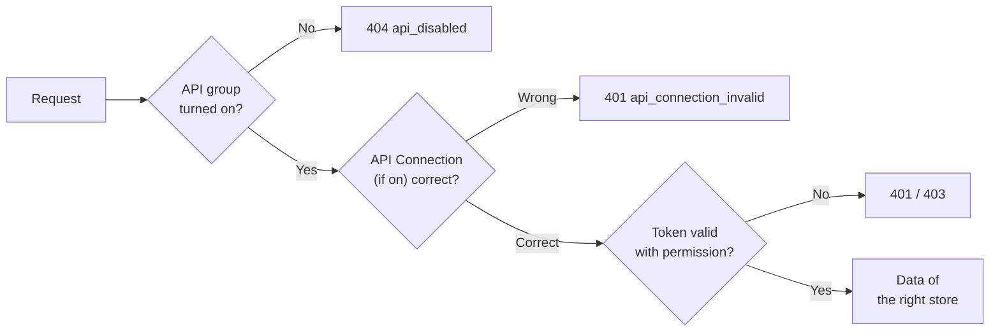

> 🌐 **Language:** [🇻🇳 Tiếng Việt](./api-concepts_vi.md) · 🇬🇧 English (current) · [🇯🇵 日本語](./api-concepts_ja.md)

# Concepts you need for a GP247 API integration

## Introduction

This page explains in plain words the GP247 concepts that change what the API returns: the two API groups, permissions per admin screen,
stores, the API on/off switches and the API Connection lock. It is for integration developers new to Laravel or GP247 and for site
owners who want to open the API to a partner. After reading, you understand why the same call answers `403`, `404` or an empty list — without reading the source code.

## At a glance

A request passes four checks before it gets any data:



- **API switches** are turned on/off by the site owner in the admin area — a group that is off answers `404 api_disabled`.
- **API Connection** is an optional lock just for your application.
- **A token's permissions** are exactly the account's permissions on the admin screens — no more.
- **Data always follows a store**: the domain you call (front) or the administrator account's store (core).

## Glossary

| Term | In everyday words |
| --- | --- |
| **API / endpoint** | The site's "service counter"; each endpoint is an address that does one job, for example `GET /api/v2/front/product/list` |
| **JSON** | A text data format that machines can read; every API response is JSON |
| **Header** | Information sent along with a request, for example `Accept: application/json` or `Authorization: Bearer …` |
| **Token (Bearer)** | A string you get when signing in and send back with each request to prove who you are |
| **Refresh token** | A second token used to ask for a new token when the main one expires, without the password |
| **Store** | One GP247 site can have several stores (domains); data always belongs to one store |
| **Permissions (RBAC)** | The roles and permissions of an admin account on each screen; the API reuses exactly those permissions |
| **Plugin** | An add-on installed on the site; a plugin can add its own endpoints |
| **ETag / `304`** | A version stamp of the data; send it back, and if nothing changed the API answers `304` without resending the data |
| **Webhook** | The site calls your system on its own when something changes (instead of you asking again and again) |
| **v1 / v2** | Two API versions; v2 is the current one, v1 is no longer developed |

## The two API groups

The GP247 system splits its API into **two groups**, serving two different audiences:

| Group | Address prefix | For | Who logs in |
| --- | --- | --- | --- |
| **Core API (Admin)** | `api/v2/core` | Remote system administration (management apps, custom dashboards) | **Administrator** accounts |
| **Front API (Storefront)** | `api/v2/front` | Displaying store data, customer accounts, cart and ordering | Guests/members, or **no login needed** for public data |

- **`api/v2/core`**: the `gp247/core` package provides the admin login/info part; `gp247/shop` and
  `gp247/front` add endpoints that read admin data (customers, orders, products, banners…).
- **`api/v2/front`** is provided by the `gp247/front` and `gp247/shop` packages — "storefront" data such
  as product lists, categories, brands, content pages, banners, plus customer accounts, carts and orders.

> ℹ️ **Available since:** gp247/core, gp247/front, gp247/shop 3.3.0

> The **full address** = your site domain + prefix + path. For example, if your site is
> `https://shop.example.com`, the endpoint for the product list is:
> `https://shop.example.com/api/v2/front/product/list`.

## Permissions and data scope of the Core API

> ℹ️ **Available since:** gp247/core 3.2.3, gp247/shop 3.2.3, gp247/front 3.2.3

The Core API **never shows more than the admin screens do**. Each data-reading endpoint is tied to an
admin screen; an administrator can only call the endpoint if the account is allowed to open that screen
(permissions are set under **Admin → Roles / Permissions**). No permission → HTTP `403`.

| Endpoint (prefix `api/v2/core`) | Permission required (admin screen) |
| --- | --- |
| `customer/list`, `customer/detail/{id}` | Customer list |
| `customer/{id}` (`PATCH`) | **Change permission** on the Customer list screen ([Core API workflow (Admin)](./api-admin.md#core-api-workflow-admin)) |
| `order/list` | Order list |
| `order/detail/{id}` | Order details |
| `order/{id}/status`, `order/{id}/shipping`, `order/{id}/notes` | **Change permission** on the Order list screen ([Core API workflow (Admin)](./api-admin.md#core-api-workflow-admin)) |
| `product/*` | Product list |
| `product/{id}` (`PATCH`), `product/{id}/stock`, `stock/batch` | **Change permission** on the Product list screen ([Core API workflow (Admin)](./api-admin.md#core-api-workflow-admin)) |
| `category/*`, `brand/*`, `supplier/*` | Category / brand / supplier list |
| `banner/*`, `page/*` | Banner / content page list |
| `logout`, `info`, `sessions` | Only a valid token |
| `login`, `login/challenge`, `refresh` | No token needed |

- The `administrator` role can call every endpoint; the `view.all` role is read-only.
- **Per-store data:** on a multi-store site, an administrator assigned to one store only sees that
  store's data and can only call the API on **their own store's domain** (just like logging in to the
  admin area). Records of other stores return `404`.
- If an administrator account is disabled (`status = 0`), its old tokens no longer work (`401`).

## The API Connection protection layer — optional

Beyond the token, GP247 also has **an extra lock** standing in front of all APIs, called the
**API Connection**. It is a second "gatekeeper" ensuring only authorized applications can call the
API — even the public endpoints.

- This layer is **off by default**; turn it on/off with the `api_connection_required` setting in the
  admin area.
- **When enabled:** every request must additionally carry **two headers**:

  ```
  apiconnection: <connection code>
  apikey: <secret key>
  ```

- The `apiconnection`/`apikey` pair is created and managed in the **GP247 admin area** (the API
  Connection management section); each pair can have an expiry date (`expire`) and an on/off status
  (`status`).
- If it is missing, wrong, expired or disabled, the API returns HTTP `401` with
  `"code": "api_connection_invalid"`.

> ℹ️ **Available since:** gp247/core 3.2.3 — keys are **stored hashed**: the admin screen shows a key
> **only once**, right after it is created/regenerated, so copy it immediately. When editing a
> connection, leave the key field empty to keep the old key. Keys already in use keep working after the
> upgrade (`php artisan gp247:update`); **regenerate** older keys when convenient to remove the plain copy still
> stored. A key you type yourself must be at least 32 characters long.

> ℹ️ **Available since:** gp247/core 3.4.0 — `php artisan gp247:update` **removes** the plain copy of the keys for good;
> keys in use keep working (they are matched through the hash). The plain copy cannot be recovered, so **back up the
> database** before upgrading if you need it.

> The order of the checking layers (middleware) is: **attach the request id `X-Request-Id` → check the API on/off switch
> ([Turning the API on and off](#turning-the-api-on-and-off)) → return JSON → check API Connection → rate limit**, then the login/permission checks of each endpoint.
> This order is fixed and should not be changed. *(The first two layers: since gp247/core 3.3.1 and 3.4.0.)*

## Turning the API on and off

> ℹ️ **Available since:** gp247/core 3.3.1

The site owner turns the API on and off right on the **API management screen** of the admin (the same screen as API
Connection), with no configuration file to edit and no command to run on the server. A change takes effect on the next
request.

| Switch | Applies to |
| --- | --- |
| **REST API (all groups)** | Every API endpoint (including APIs added by plugins through the standard mechanism) |
| **v2 · Admin API (core)** | `api/v2/core/*` |
| **v2 · Public & customer API (front)** | `api/v2/front/*` |
| **Event log for sync (ERP)** *(since gp247/core 3.7.0)* | Records changes so an ERP / sync tool can read them through `api/v2/core/events` ([Response format, list parameters & error codes](./api-conventions.md#response-format-list-parameters--error-codes)) — **off by default** |

The screen also has two switches for API v1 (no longer developed) — see [API v1, section 2](./api-v1.md). Ordering through
the API has one more switch, **Ordering through the API**, under the v2 front group ([Placing the order](./api-storefront.md#placing-the-order)).

- Each group switch sits right on top of that group's endpoint list; a group that is off is marked "off".
- Calling a group that is off → HTTP `404` with `"code": "api_disabled"` ([Response format, list parameters & error codes](./api-conventions.md#response-format-list-parameters--error-codes)) — even without a token *(since
  gp247/core 3.4.0; 3.3.1 answers `401` when the token is missing)*.
- A **fresh install** turns **v2** on. A site **upgraded** from an older version keeps every group that was on.
- **Event log for sync (ERP)** is off on both fresh installs and upgraded sites. While it is off no event is recorded, and
  reading `api/v2/core/events` answers `409 event_log_disabled`. Turn it on only when an ERP or sync tool reads it.
  Webhooks ([Response format, list parameters & error codes](./api-conventions.md#response-format-list-parameters--error-codes)) deliver the events of this log, so they also need this switch on.
- The environment variable `GP247_API_MODE=0` is still the **server-level switch**: then no API endpoint exists and the
  switches on the screen are locked — meant for hosting/technical staff who want the API off for good.
- Plugin APIs that use their own mechanism (for example the MCP server) are **not** covered by these switches and have
  their own switch on the plugin's screen.
- **Sites with a route cache** (`php artisan route:cache`): `php artisan gp247:update` rebuilds the cache after upgrading.
  If you only run `composer update`, the switches may not take effect yet — `php artisan gp247:doctor` reports it under
  `api_route_gate` *(since gp247/core 3.4.0)*; run `php artisan gp247:cache-rebuild` to fix it.

## Q&A

**Q1: Which API group should I use?**

→ If you're building an app/customer client for the store (browse products, account, cart, ordering) → use the
**Front API** (`api/v2/front`). If you're building a remote admin tool for administrators → use the
**Core API** (`api/v2/core`).

**Q2: How is `apiconnection`/`apikey` different from `access_token`?**

→ The `access_token` authenticates the **user** (who you are). The `apiconnection`/`apikey`
authenticates the **application** (which app is allowed to call the API) and is an **optional layer**
— only required when the admin enables `api_connection_required`.

**Q3: Do public endpoints need a token?**

→ No. The `meta` endpoint and the product, category, brand, banner and content-page list/detail endpoints are public. But if
the API Connection layer is enabled, you must still send the `apiconnection`/`apikey` headers.

**Q4: Why doesn't the public API return cost price or stock counts?**

→ That is internal business data. The public API only returns what customers see on the store (a product only has an
in-stock/out-of-stock `stock_status`). Internal apps that need these figures should use the Core API
(`api/v2/core/product/*`) with an account that has permission.

**Q5: Do I need to know Laravel to use the API?**

→ No. The API is a set of web addresses that return JSON; an app written in any language can call it. Laravel is only the platform the site runs on.

---

<sub>📅 **Last updated:** 2026-11-03 · ✍️ **Author:** GP247</sub>
