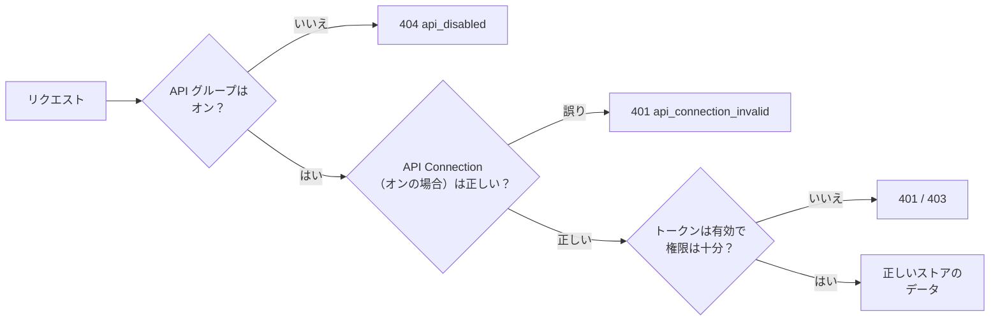

> 🌐 **言語:** [🇻🇳 Tiếng Việt](./api-concepts_vi.md) · [🇬🇧 English](./api-concepts.md) · 🇯🇵 日本語（現在）

# GP247 の API 連携で知っておくべき概念

## はじめに

このページでは、API の結果を左右する GP247 の概念を平易な言葉で説明します：2 つの API グループ、管理画面ごとの権限、
ストア（store）、API のオン／オフのスイッチ、そして API Connection の鍵のレイヤーです。Laravel や GP247 に慣れていない連携開発者と、パートナーに API を開放したい
サイトのオーナー向けです。読み終えると、同じ呼び出しがなぜ `403`、`404`、空の一覧を返すのかが、ソースコードを読まずに理解できます。

## ひと目でわかる

リクエストは、データを得る前に 4 つのチェックを通ります。



- **API のスイッチ**は、サイトのオーナーが管理画面でオン／オフします — オフのグループは `404 api_disabled` を返します。
- **API Connection** は、あなたのアプリ専用の任意の鍵のレイヤーです。
- **トークンの権限**は、管理画面でのアカウントの権限とまったく同じです — それ以上にはなりません。
- **データは常にストア単位です**：呼び出すドメイン（front）、または管理者アカウントのストア（core）で決まります。

## 用語集

| 用語 | 身近な意味 |
| --- | --- |
| **API／エンドポイント** | サイトの「窓口」。各エンドポイントは 1 つの処理をするアドレスです。例: `GET /api/v2/front/product/list` |
| **JSON** | コンピューターが読めるテキスト形式のデータ。API のレスポンスはすべて JSON です |
| **ヘッダー** | リクエストに付ける情報。例: `Accept: application/json` や `Authorization: Bearer …` |
| **トークン（Bearer）** | ログインで受け取る文字列。リクエストごとに送り返して、あなたが誰かを証明します |
| **リフレッシュトークン** | メインのトークンの期限が切れたとき、パスワードなしで新しいトークンをもらうための 2 つ目のトークン |
| **ストア（store）** | 1 つの GP247 サイトに複数のストア（ドメイン）を持てます。データは常にいずれかのストアに属します |
| **権限（RBAC）** | 管理者アカウントの画面ごとのロールと権限。API はその権限をそのまま使います |
| **プラグイン** | サイトに追加でインストールする拡張機能。プラグインは独自のエンドポイントを追加できます |
| **ETag／`304`** | データのバージョンを示す印。この印を送り返し、変わっていなければ API は `304` を返してデータを再送しません |
| **Webhook** | 変更があったとき、サイトのほうからあなたのシステムを呼び出します（あなたが何度も問い合わせる代わりに） |
| **v1／v2** | API の 2 つのバージョン。v2 が現行版で、v1 は開発を終了しました |

## 2 つの主要 API グループ

GP247 システムは API を **2 つのグループ**に分けています。それぞれ利用者が異なります。

| グループ | アドレスの接頭辞（prefix） | 用途 | ログインする人 |
| --- | --- | --- | --- |
| **Core API（管理）** | `api/v2/core` | リモートからのシステム管理（管理アプリ、独自ダッシュボード） | **管理者**（admin）アカウント |
| **Front API（ストアフロント）** | `api/v2/front` | ストアのデータ表示、顧客アカウント、カートと注文 | 顧客／会員。公開データは**ログイン不要** |

- **`api/v2/core`** は、ログイン／管理者情報の部分を `gp247/core` パッケージが提供します。
  `gp247/shop` と `gp247/front` が、管理データ（顧客、注文、商品、バナーなど）を読み取るエンドポイントを追加します。
- **`api/v2/front`** は `gp247/front` と `gp247/shop` パッケージが提供します。商品一覧、カテゴリー、
  ブランド、コンテンツページ、バナー、そして顧客のアカウント／カート／注文など、ストアの「表側」のデータです。

> ℹ️ **対応バージョン:** gp247/core, gp247/front, gp247/shop 3.3.0

> **完全なアドレス** ＝ サイトのドメイン ＋ 接頭辞 ＋ パス です。たとえばサイトが
> `https://shop.example.com` の場合、商品一覧を取得するエンドポイントは次のとおりです。
> `https://shop.example.com/api/v2/front/product/list`

## Core API の権限とデータの範囲

> ℹ️ **対応バージョン:** gp247/core 3.2.3, gp247/shop 3.2.3, gp247/front 3.2.3

Core API は**管理画面で見られる以上のデータを見せません**。データを読み取る各エンドポイントは 1 つの管理画面に対応しており、
管理者はアカウントがその画面を開く権限を持っている場合にだけ呼び出せます
（権限は **管理 → ロール／権限** で設定します）。権限がなければ → HTTP `403`。

| エンドポイント（接頭辞 `api/v2/core`） | 必要な権限（管理画面） |
| --- | --- |
| `customer/list`, `customer/detail/{id}` | 顧客一覧 |
| `customer/{id}`（`PATCH`） | 顧客一覧画面の**変更権限**（[Core API（管理）の処理の流れ](./api-admin_ja.md#core-api管理の処理の流れ)） |
| `order/list` | 注文一覧 |
| `order/detail/{id}` | 注文の詳細 |
| `order/{id}/status`, `order/{id}/shipping`, `order/{id}/notes` | 注文一覧画面の**変更権限**（[Core API（管理）の処理の流れ](./api-admin_ja.md#core-api管理の処理の流れ)） |
| `product/*` | 商品一覧 |
| `product/{id}`（`PATCH`）, `product/{id}/stock`, `stock/batch` | 商品一覧画面の**変更権限**（[Core API（管理）の処理の流れ](./api-admin_ja.md#core-api管理の処理の流れ)） |
| `category/*`, `brand/*`, `supplier/*` | カテゴリー／ブランド／仕入先一覧 |
| `banner/*`, `page/*` | バナー／コンテンツページ一覧 |
| `logout`, `info`, `sessions` | 有効なトークンのみ |
| `login`, `login/challenge`, `refresh` | トークン不要 |

- `administrator` ロールはすべてのエンドポイントを呼び出せます。`view.all` ロールは閲覧のみです。
- **ストアごとのデータ：** 複数ストアのサイトでは、1 つのストアに割り当てられた管理者はそのストアのデータだけを見られ、
  **自分のストアのドメイン**でしか API を呼び出せません（管理画面にログインするときと同じです）。
  他のストアのレコードは `404` を返します。
- 管理者アカウントが無効（`status = 0`）になると、古いトークンは使えなくなります（`401`）。

## 接続保護レイヤー（API Connection）— 任意

トークンに加えて、GP247 にはすべての API の前に立つ**追加の鍵**があります。これを **API Connection** と呼びます。
これは 2 つ目の「門番」です。許可されたアプリケーションだけが API を呼べるようにします。
公開エンドポイントも対象です。

- このレイヤーは**既定でオフ**です。管理画面の設定 `api_connection_required` でオン／オフを切り替えます。
- **オンの場合：** すべてのリクエストに、さらに**2 つのヘッダー**を付ける必要があります。

  ```
  apiconnection: <接続コード>
  apikey: <秘密キー>
  ```

- `apiconnection`／`apikey` のペアは **GP247 の管理画面**（API Connection の管理項目）で作成・管理します。
  ペアごとに有効期限（`expire`）とオン／オフの状態（`status`）を設定できます。
- 不足している、誤っている、期限切れ、または無効になっている場合、API は HTTP `401` と
  `"code": "api_connection_invalid"` を返します。

> ℹ️ **対応バージョン:** gp247/core 3.2.3 — キーは**ハッシュ化して保存**されます。管理画面にキーが表示されるのは、
> 作成／再生成した直後の**1 回だけ**なので、すぐにコピーしてください。接続を編集するとき、キーの欄を空のままにすると
> 古いキーがそのまま残ります。以前から使っているキーは、アップグレード（`php artisan gp247:update`）後も引き続き使えます。
> 保存されたままの平文のコピーを消すため、都合のよいときに古いキーを**再生成**してください。手入力するキーは 32 文字以上が必要です。

> ℹ️ **対応バージョン:** gp247/core 3.4.0 — `php artisan gp247:update` がキーの平文のコピーを**完全に削除**します。
> 使用中のキーは引き続き使えます（ハッシュで照合します）。平文のコピーは復元できないため、必要な場合はアップグレード前に
> **データベースをバックアップ**してください。

> チェックレイヤー（ミドルウェア）の順序は **リクエスト ID `X-Request-Id` を付ける → API のオン／オフスイッチを確認
> （[API のオン／オフ](#api-のオンオフ)）→ JSON を返す → API Connection を確認 → レート制限** で、その後に各エンドポイントのログイン／権限の
> チェックが続きます。この順序は固定で、変更しないでください。*（先頭の 2 つ: gp247/core 3.3.1 と 3.4.0 から。）*

## API のオン／オフ

> ℹ️ **対応バージョン:** gp247/core 3.3.1

サイトのオーナーは、管理画面の **API 管理画面**（API Connection と同じ画面）で API をオン／オフできます。設定ファイルの
編集やサーバーでのコマンド実行は不要で、変更は次のリクエストからすぐに反映されます。

| スイッチ | 対象 |
| --- | --- |
| **REST API（全グループ）** | すべての API エンドポイント（標準の仕組みでプラグインが追加した API を含む） |
| **v2 · 管理API (core)** | `api/v2/core/*` |
| **v2 · 公開・顧客API (front)** | `api/v2/front/*` |
| **同期用イベントログ（ERP）** *（gp247/core 3.7.0 から）* | 変更を記録し、ERP／同期ツールが `api/v2/core/events` で読めるようにする（[レスポンスの形式、一覧のパラメーター、エラーコード](./api-conventions_ja.md#レスポンスの形式一覧のパラメーターエラーコード)）— **既定はオフ** |

この画面には API v1（開発終了）用のスイッチも 2 つあります — [API v1 のセクション 2](./api-v1_ja.md) を参照してください。
API による注文には、v2 front グループの下にもう 1 つ **「API経由の注文」** スイッチがあります（[注文の確定](./api-storefront_ja.md#注文の確定)）。

- 各グループのスイッチは、そのグループのエンドポイント一覧のすぐ上にあります。オフのグループには「オフ」と表示されます。
- オフのグループを呼ぶと → HTTP `404`、`"code": "api_disabled"`（[レスポンスの形式、一覧のパラメーター、エラーコード](./api-conventions_ja.md#レスポンスの形式一覧のパラメーターエラーコード)）— トークンがなくても同じです
  *（gp247/core 3.4.0 から。3.3.1 ではトークンがないと `401` を返します）*。
- **新規インストール**では **v2** がオンです。古いバージョンから**アップグレード**したサイトは、オンだったグループをそのまま維持します。
- **同期用イベントログ（ERP）** は、新規インストールでもアップグレードしたサイトでもオフです。オフの間はイベントが一切記録されず、
  `api/v2/core/events` を読むと `409 event_log_disabled` が返ります。ERP や同期ツールが読む場合にだけオンにしてください。
  Webhook（[レスポンスの形式、一覧のパラメーター、エラーコード](./api-conventions_ja.md#レスポンスの形式一覧のパラメーターエラーコード)）はこのログのイベントを送るため、このスイッチがオンである必要があります。
- 環境変数 `GP247_API_MODE=0` は引き続き**サーバーレベルのスイッチ**です。この場合 API エンドポイントは存在せず、
  画面のスイッチはロックされます。API を完全に止めたいホスティング／技術担当者向けです。
- 独自の仕組みを使うプラグインの API（例: MCP サーバー）はこれらのスイッチの**対象外**で、プラグインの画面に専用の
  スイッチがあります。
- **ルートキャッシュを使うサイト**（`php artisan route:cache`）: `php artisan gp247:update` がアップグレード後にキャッシュを
  再構築します。`composer update` だけを実行した場合はスイッチがまだ効かないことがあり、`php artisan gp247:doctor` の
  `api_route_gate` で報告されます *（gp247/core 3.4.0 から）*。`php artisan gp247:cache-rebuild` を実行して直してください。

## よくある質問（Q&A）

**Q1: どちらの API グループを使えばよいですか？**

→ ストア向けのアプリ／顧客クライアント（商品の閲覧、アカウント、カート、注文）を作るなら **Front API**
（`api/v2/front`）を使います。管理者向けのリモート管理ツールを作るなら **Core API**（`api/v2/core`）を使います。

**Q2: `apiconnection`／`apikey` と `access_token` の違いは何ですか？**

→ `access_token` は**ユーザー**（あなたが誰か）を認証します。`apiconnection`／`apikey` は**アプリケーション**
（どのアプリが API を呼べるか）を認証します。こちらは**任意のレイヤー**で、
管理者が `api_connection_required` をオンにした場合だけ必須です。

**Q3: 公開エンドポイントを呼ぶのにトークンは必要ですか？**

→ 不要です。`meta` エンドポイントと、商品、カテゴリー、ブランド、バナー、コンテンツページの一覧／詳細エンドポイントは
公開されています。ただし API Connection レイヤーがオンの場合は、`apiconnection`／`apikey` ヘッダーを送る必要があります。

**Q4: 公開 API が原価や在庫数を返さないのはなぜですか？**

→ それらは社内のビジネスデータだからです。公開 API は、顧客がストアで見られる内容だけを返します（商品には在庫あり／なしを
示す `stock_status` だけがあります）。これらの数値が必要な社内アプリは、権限のあるアカウントで Core API
（`api/v2/core/product/*`）を使ってください。

**Q5: API を使うのに Laravel の知識は必要ですか？**

→ 不要です。API は JSON を返す Web アドレスなので、どの言語で書いたアプリからでも呼べます。Laravel はサイトを動かす基盤にすぎません。

---

<sub>📅 **最終更新:** 2026-11-03 · ✍️ **作成者 (Author):** GP247</sub>
