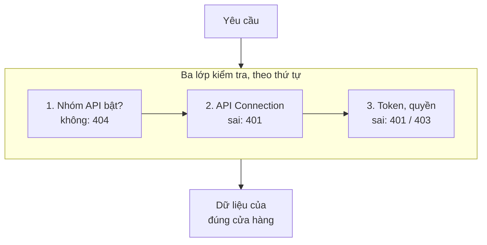

> 🌐 **Ngôn ngữ:** 🇻🇳 Tiếng Việt (hiện tại) · [🇬🇧 English](./api-concepts.md) · [🇯🇵 日本語](./api-concepts_ja.md)

# Khái niệm cần biết khi tích hợp API GP247

## Giới thiệu

Trang này giải thích bằng lời thường những khái niệm của GP247 làm thay đổi kết quả API: hai nhóm API, quyền theo màn quản trị,
cửa hàng (store), công tắc bật/tắt API và lớp khóa API Connection. Dành cho lập trình viên tích hợp chưa quen Laravel hay GP247 và chủ
site muốn mở API cho đối tác. Đọc xong, bạn hiểu vì sao cùng một lệnh gọi lại trả `403`, `404` hay danh sách rỗng — mà không cần đọc mã nguồn.

## Nhìn nhanh

Một yêu cầu đi qua bốn lớp kiểm tra trước khi có dữ liệu:



- **Công tắc API** do chủ site bật/tắt trên trang quản trị — nhóm tắt trả `404 api_disabled`.
- **API Connection** là lớp khóa tùy chọn cho riêng ứng dụng của bạn.
- **Quyền của token** đúng bằng quyền của tài khoản trên màn quản trị — không hơn.
- **Dữ liệu luôn theo cửa hàng**: tên miền gọi (front) hoặc cửa hàng của tài khoản quản trị (core).

## Bảng thuật ngữ

| Thuật ngữ | Nghĩa đời thường |
| --- | --- |
| **API / endpoint** | "Quầy giao dịch" của site; mỗi endpoint là một địa chỉ làm một việc, ví dụ `GET /api/v2/front/product/list` |
| **JSON** | Định dạng dữ liệu dạng chữ mà máy đọc được; mọi phản hồi của API là JSON |
| **Header** | Thông tin đi kèm yêu cầu, ví dụ `Accept: application/json` hay `Authorization: Bearer …` |
| **Token (Bearer)** | Chuỗi ký tự nhận được khi đăng nhập, gửi lại ở mỗi yêu cầu để chứng minh bạn là ai |
| **Refresh token** | Token thứ hai dùng để xin token mới khi token chính hết hạn, không cần mật khẩu |
| **Cửa hàng (store)** | Một site GP247 có thể có nhiều cửa hàng (tên miền); dữ liệu luôn thuộc một cửa hàng |
| **Quyền (RBAC)** | Vai trò và quyền của tài khoản quản trị trên từng màn; API dùng lại đúng các quyền đó |
| **Plugin** | Phần mở rộng cài thêm vào site; plugin có thể thêm endpoint của riêng nó |
| **ETag / `304`** | Dấu phiên bản của dữ liệu; gửi lại dấu này, nếu không đổi API trả `304` và không gửi lại dữ liệu |
| **Webhook** | Site chủ động gọi sang hệ thống của bạn khi có thay đổi (thay vì bạn phải hỏi liên tục) |
| **v1 / v2** | Hai phiên bản API; v2 là bản hiện hành, v1 đã ngưng phát triển |

## Hai nhóm API

Hệ thống GP247 chia API thành **hai nhóm**, phục vụ hai đối tượng khác nhau:

| Nhóm | Tiền tố địa chỉ (prefix) | Dành cho | Ai đăng nhập |
| --- | --- | --- | --- |
| **API Core (Admin)** | `api/v2/core` | Quản trị hệ thống từ xa (app quản lý, dashboard riêng) | Tài khoản **quản trị viên** (admin) |
| **API Front (Storefront)** | `api/v2/front` | Hiển thị dữ liệu cửa hàng, tài khoản khách, giỏ hàng và đặt đơn | Khách/thành viên, hoặc **không cần đăng nhập** với dữ liệu công khai |

- **`api/v2/core`** do gói `gp247/core` cung cấp phần đăng nhập/thông tin admin; `gp247/shop` và
  `gp247/front` bổ sung các endpoint đọc dữ liệu quản trị (khách hàng, đơn hàng, sản phẩm, banner…).
- **`api/v2/front`** do gói `gp247/front` và `gp247/shop` cung cấp — dữ liệu "mặt tiền" cửa hàng như
  danh sách sản phẩm, danh mục, thương hiệu, trang nội dung, banner, cùng tài khoản, giỏ hàng và đơn hàng của khách.

> ℹ️ **Có từ:** gp247/core, gp247/front, gp247/shop 3.3.0

> **Địa chỉ đầy đủ** = tên miền site + tiền tố + đường dẫn. Ví dụ nếu site của bạn là
> `https://shop.example.com` thì endpoint lấy danh sách sản phẩm là:
> `https://shop.example.com/api/v2/front/product/list`.

## Phân quyền và phạm vi dữ liệu của API Core

> ℹ️ **Có từ:** gp247/core 3.2.3, gp247/shop 3.2.3, gp247/front 3.2.3

API Core **không cho xem nhiều hơn màn hình quản trị**. Mỗi endpoint đọc dữ liệu gắn với một màn
hình admin; quản trị viên chỉ gọi được endpoint khi tài khoản có quyền mở màn hình đó (phân quyền ở
**Quản trị → Vai trò / Quyền**). Không có quyền → HTTP `403`.

| Endpoint (tiền tố `api/v2/core`) | Quyền cần có (màn hình admin) |
| --- | --- |
| `customer/list`, `customer/detail/{id}` | Danh sách khách hàng |
| `customer/{id}` (`PATCH`) | **Quyền sửa** trên màn Danh sách khách hàng ([Luồng làm việc API Core (Admin)](./api-admin_vi.md#luồng-làm-việc-api-core-admin)) |
| `order/list` | Danh sách đơn hàng |
| `order/detail/{id}` | Chi tiết đơn hàng |
| `order/{id}/status`, `order/{id}/shipping`, `order/{id}/notes` | **Quyền sửa** trên màn Danh sách đơn hàng ([Luồng làm việc API Core (Admin)](./api-admin_vi.md#luồng-làm-việc-api-core-admin)) |
| `product/*` | Danh sách sản phẩm |
| `product/{id}` (`PATCH`), `product/{id}/stock`, `stock/batch` | **Quyền sửa** trên màn Danh sách sản phẩm ([Luồng làm việc API Core (Admin)](./api-admin_vi.md#luồng-làm-việc-api-core-admin)) |
| `category/*`, `brand/*`, `supplier/*` | Danh sách danh mục / thương hiệu / nhà cung cấp |
| `banner/*`, `page/*` | Danh sách banner / trang nội dung |
| `logout`, `info`, `sessions` | Chỉ cần token hợp lệ |
| `login`, `login/challenge`, `refresh` | Không cần token |

- Vai trò `administrator` gọi được mọi endpoint; vai trò `view.all` chỉ đọc.
- **Dữ liệu theo cửa hàng:** trên site nhiều cửa hàng, quản trị viên được gắn với một cửa hàng chỉ
  thấy dữ liệu của cửa hàng đó và chỉ gọi được API trên **tên miền của cửa hàng mình** (giống khi đăng
  nhập trang quản trị). Bản ghi của cửa hàng khác trả về `404`.
- Tài khoản quản trị bị tắt (`status = 0`) thì token cũ không dùng được nữa (`401`).

## Lớp bảo vệ kết nối (API Connection) — tùy chọn

Ngoài token, GP247 còn có **một lớp khóa bổ sung** đứng trước tất cả API, gọi là **API Connection**.
Đây là "chốt bảo vệ" thứ hai, giúp chỉ những ứng dụng được cấp phép mới gọi được API — kể cả các
endpoint công khai.

- Lớp này **mặc định tắt**, bật/tắt bằng cấu hình `api_connection_required` trong quản trị.
- **Khi bật:** mọi yêu cầu phải kèm thêm **hai header**:

  ```
  apiconnection: <mã kết nối>
  apikey: <khóa bí mật>
  ```

- Cặp `apiconnection`/`apikey` được tạo và quản lý trong **trang quản trị GP247** (mục quản lý
  API Connection), mỗi cặp có thể đặt ngày hết hạn (`expire`) và trạng thái bật/tắt (`status`).
- Nếu thiếu, sai, hết hạn hoặc đã tắt, API trả về HTTP `401` với `"code": "api_connection_invalid"`.

> ℹ️ **Có từ:** gp247/core 3.2.3 — khóa được **lưu dạng băm**: màn quản trị chỉ hiện khóa **một lần**
> ngay sau khi tạo/sinh lại, hãy sao chép ngay. Khi sửa một kết nối, để trống ô khóa để giữ khóa cũ.
> Khóa đang dùng từ trước vẫn chạy sau khi nâng cấp (`php artisan gp247:update`); hãy **sinh lại** các khóa cũ
> khi thuận tiện để xoá bản lưu thường còn sót lại. Khóa tự nhập phải dài ít nhất 32 ký tự.

> ℹ️ **Có từ:** gp247/core 3.4.0 — `php artisan gp247:update` **xoá hẳn** bản lưu khóa dạng thường; khóa đang dùng
> vẫn chạy bình thường (so khớp qua bản băm). Bản lưu thường không khôi phục được, nên hãy **sao lưu cơ sở dữ liệu**
> trước khi nâng cấp nếu bạn cần giữ nó.

> Thứ tự các lớp kiểm tra (middleware) là: **gắn mã yêu cầu `X-Request-Id` → kiểm tra công tắc bật/tắt API ([Bật/tắt API](#bậttắt-api))
> → trả JSON → kiểm tra API Connection → giới hạn tần suất**, rồi mới đến đăng nhập/phân quyền của từng endpoint.
> Đây là thứ tự cố định, không nên đổi. *(Hai lớp đầu: từ gp247/core 3.3.1 và 3.4.0.)*

## Bật/tắt API

> ℹ️ **Có từ:** gp247/core 3.3.1

Chủ site bật/tắt API ngay trên **màn quản lý API** của trang quản trị (cùng màn với API Connection), không cần sửa
file cấu hình hay chạy lệnh trên máy chủ. Thay đổi có hiệu lực ngay ở yêu cầu kế tiếp.

| Công tắc | Áp dụng cho |
| --- | --- |
| **REST API (tất cả nhóm)** | Mọi endpoint API (kể cả API do plugin thêm qua cơ chế chuẩn) |
| **v2 · API quản trị (core)** | `api/v2/core/*` |
| **v2 · API công khai & khách hàng (front)** | `api/v2/front/*` |
| **Nhật ký sự kiện cho đồng bộ (ERP)** *(từ gp247/core 3.7.0)* | Ghi lại thay đổi để ERP / công cụ đồng bộ đọc qua `api/v2/core/events` ([Định dạng phản hồi, tham số danh sách & mã lỗi](./api-conventions_vi.md#định-dạng-phản-hồi-tham-số-danh-sách--mã-lỗi)) — **mặc định tắt** |

Màn này còn hai công tắc cho API v1 (đã ngưng phát triển) — xem [API v1, mục 2](./api-v1_vi.md). Riêng việc đặt đơn qua API
có thêm công tắc **Đặt đơn qua API** dưới nhóm v2 front ([Đặt đơn](./api-storefront_vi.md#đặt-đơn)).

- Mỗi công tắc nhóm nằm ngay trên danh sách endpoint của nhóm đó; nhóm đang tắt hiện chữ "đang tắt".
- Gọi vào nhóm đang tắt → HTTP `404` với `"code": "api_disabled"` ([Định dạng phản hồi, tham số danh sách & mã lỗi](./api-conventions_vi.md#định-dạng-phản-hồi-tham-số-danh-sách--mã-lỗi)) — kể cả khi chưa gửi token *(từ gp247/core
  3.4.0; bản 3.3.1 trả `401` nếu thiếu token)*.
- **Cài mới** bật sẵn **v2**. Site **nâng cấp** từ bản cũ giữ nguyên mọi nhóm đang bật.
- **Nhật ký sự kiện cho đồng bộ (ERP)** tắt sẵn trên cả site cài mới lẫn site nâng cấp. Khi tắt, không có sự kiện nào được
  ghi và đọc `api/v2/core/events` trả `409 event_log_disabled`. Chỉ bật khi có ERP hay công cụ đồng bộ đọc nó. Webhook
  ([Định dạng phản hồi, tham số danh sách & mã lỗi](./api-conventions_vi.md#định-dạng-phản-hồi-tham-số-danh-sách--mã-lỗi)) gửi đi các sự kiện của nhật ký này nên cũng cần công tắc này bật.
- Biến môi trường `GP247_API_MODE=0` vẫn là **công tắc ở tầng máy chủ**: khi đó không có endpoint API nào và các công tắc
  trên màn bị khoá — dành cho đơn vị hosting/kỹ thuật muốn tắt hẳn API.
- API dùng cơ chế riêng (ví dụ máy chủ MCP, `gp247/mcp`) **không** chịu công tắc v1 / v2 và có công tắc riêng trên màn của nó; công tắc tổng ở trên vẫn tắt luôn máy chủ MCP.
- **Site có cache route** (`php artisan route:cache`): `php artisan gp247:update` tự dựng lại cache sau khi nâng cấp. Nếu bạn chỉ
  chạy `composer update`, công tắc có thể chưa có hiệu lực — `php artisan gp247:doctor` báo ở mục `api_route_gate`
  *(từ gp247/core 3.4.0)*; chạy `php artisan gp247:cache-rebuild` để sửa.

## Hỏi & Đáp (Q&A)

**Câu 1: Tôi nên dùng nhóm API nào?**

→ Nếu bạn xây app/khách hàng cho cửa hàng (xem sản phẩm, tài khoản, giỏ hàng, đặt đơn) → dùng **API Front**
(`api/v2/front`). Nếu bạn xây công cụ quản trị từ xa cho admin → dùng **API Core** (`api/v2/core`).

**Câu 2: `apiconnection`/`apikey` khác gì với `access_token`?**

→ `access_token` xác thực **người dùng** (bạn là ai). `apiconnection`/`apikey` xác thực **ứng dụng**
(app nào được phép gọi API) và là **lớp tùy chọn** — chỉ bắt buộc khi admin bật
`api_connection_required`.

**Câu 3: Gọi endpoint công khai có cần token không?**

→ Không. Các endpoint `meta` và danh sách/chi tiết sản phẩm, danh mục, thương hiệu, banner, trang nội dung
là công khai. Nhưng nếu lớp API Connection đang bật, bạn vẫn phải gửi header `apiconnection`/`apikey`.

**Câu 4: Vì sao API công khai không trả giá vốn hay số tồn kho?**

→ Đó là dữ liệu kinh doanh nội bộ. API công khai chỉ trả những gì khách thấy trên cửa hàng (sản phẩm chỉ có
`stock_status` còn/hết hàng). Ứng dụng nội bộ cần các số liệu này hãy dùng API Core (`api/v2/core/product/*`) với
tài khoản có quyền.

**Câu 5: Tôi có cần biết Laravel để dùng API không?**

→ Không. API là các địa chỉ web trả JSON; ứng dụng viết bằng ngôn ngữ nào cũng gọi được. Laravel chỉ là nền tảng chạy site.

---

<sub>📅 **Cập nhật lần cuối:** 2026-11-04 · ✍️ **Tác giả (Author):** GP247</sub>
