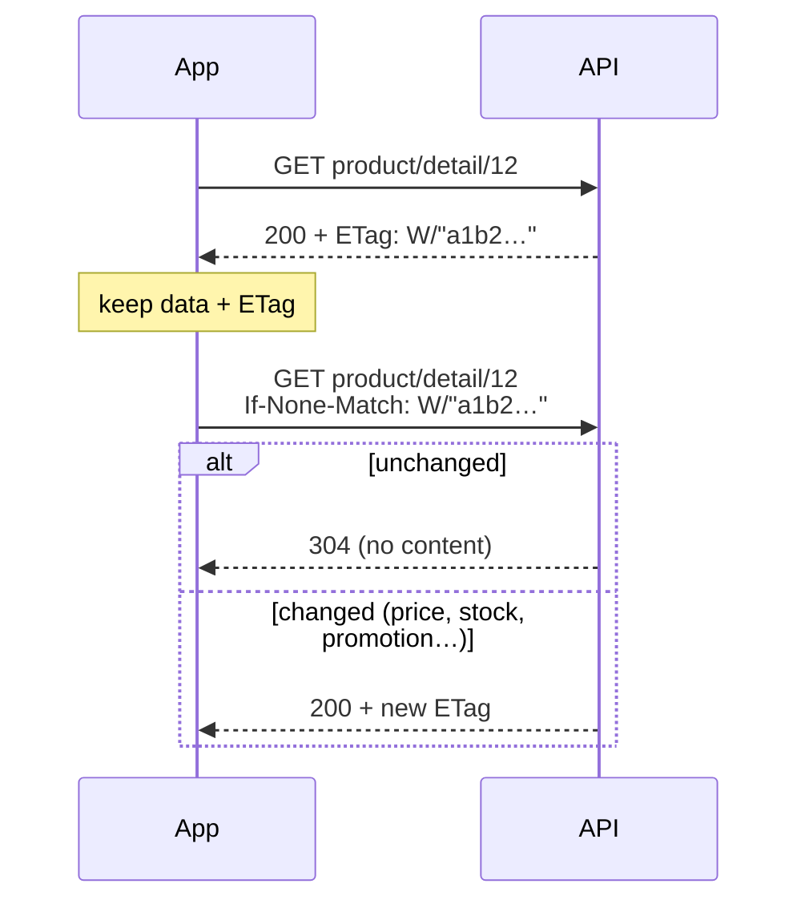

> 🌐 **Language:** [🇻🇳 Tiếng Việt](./api-conventions_vi.md) · 🇬🇧 English (current) · [🇯🇵 日本語](./api-conventions_ja.md)

# Conventions of REST API v2

## Introduction

This page gathers the rules shared by **every** v2 endpoint: response shape, pagination, filtering and sorting, choosing fields (`fields`) and
embedding related records (`include`), caching with `304`, the error code table, the `X-Request-Id` request id, the deprecation policy and how to generate client code from
`openapi.json`. Learn these rules once and you can read every Reference page without relearning each endpoint.

## Response format, list parameters & error codes

This section helps your app read results correctly, filter/sort lists and handle errors in one single way for every endpoint.

### Successful responses

- **Every response is JSON**, even when the app does not send the `Accept: application/json` header.

> ℹ️ **Available since:** gp247/core 3.6.0 — before this release, calling a signed-in endpoint without a token **and**
> without `Accept: application/json` (the default of curl, Postman and many SDKs) got HTTP `500` instead of `401 unauthenticated`.

| Case | Response shape |
| --- | --- |
| A single record | `{"data": {...}}` |
| A list | `{"data": [...], "meta": {...}, "links": {...}}` — `meta` has `current_page`, `per_page`, `total`, `last_page`; `links` has `first`, `last`, `prev`, `next` |
| Product/category/page name and description | `name`, `description`… in the language chosen with `lang` |
| Price | `price` and `price_final` (the price the customer pays on the store, promotions applied) |
| Text (names, addresses, notes…) | Exactly as the person entered it — `&`, `<`, `"` come back unchanged, **not** HTML-encoded. Escape text yourself when you put it into HTML; HTML fields written in the editor (`description`, `content`) are HTML — display them as far as you trust that content |

> ℹ️ **Available since:** gp247/core 3.12.0, gp247/front 3.8.0, gp247/shop 3.10.0 — before these releases, text with `&`, `<`, `>`, `"` came back encoded (`Free &amp; Pro`). `gp247:update` converts existing data once.

### Parameters for every list endpoint

| Parameter | Meaning | Example |
| --- | --- | --- |
| `filter[<name>]` | Filter by a field allowed for that kind of data (see the table below) | `filter[brand_id]=5` |
| `sort` | Sort ascending; prefix with `-` for descending | `sort=-price` |
| `q` | Search (name, SKU, email… depending on the kind of data) | `q=ao-thun` |
| `lang` | Language of names/descriptions; an invalid code → the site's default language | `lang=vi` |
| `page[number]`, `page[size]` | Page and records per page (default 20, maximum 100) | `page[size]=50` |

A filter name or sort field that is **not in the list** → HTTP `422` (`validation_failed`); the response lists
the allowed names.

| Data | `filter[...]` | `sort` |
| --- | --- | --- |
| Products | `category_id`, `brand_id`, `kind`, `product_type`, `price_min`, `price_max` (+ admin: `status`, `approve`, `supplier_id`) | `price`, `created_at`, `sort`, `sku` |
| Categories | `parent`, `top` (admin: `parent`, `status`) | `sort`, `created_at` |
| Brands, suppliers | (admin: `status`) | `sort`, `name` |
| Customers (admin) | `status`, `group` | `created_at`, `email` |
| Orders (admin) | `status`, `payment_status`, `shipping_status`, `customer_id` | `created_at`, `total` |
| Customer's own orders | `status` | `created_at`, `total` |
| Banners | `type` | `sort`, `created_at` |
| Content pages | — | `created_at` |

### Choosing fields (`fields`) and embedding related records (`include`)

> ℹ️ **Available since:** gp247/core 3.8.0, gp247/shop 3.7.0, gp247/front 3.5.0

An app screen usually needs only a few fields. Send `fields[<type>]` to get exactly those — the answer is lighter and the
server skips heavy data you do not use (product variants, for example). Send `include` to get related records in the same
call instead of one extra call per record.

| Parameter | Meaning | Example |
| --- | --- | --- |
| `fields[<type>]` | Return only the listed fields (`id` is always there). `<type>`: `product`, `category`, `brand`, `supplier`, `customer`, `order`, `banner`, `page`, or the type of an included record | `fields[product]=name,image,price_final` |
| `include` | Embed related records — one level, at most 3 per call (`GP247_API_MAX_INCLUDE`) | `include=brand,categories` |

| Data | Allowed `include` | Type for choosing the fields of included records |
| --- | --- | --- |
| Products (storefront) | `images`, `brand` (enabled brands only), `categories` (visible categories only) | `brand`, `category` |
| Products (admin) | `images`, `brand`, `categories` | `brand`, `category` |
| Orders (admin) | `transactions` (payment ledger), `histories` (processing history, plain text without HTML) | `transaction`, `history` |
| Other data | — | — |

```bash
curl "https://your-domain.com/api/v2/front/product/list?fields[product]=name,image,price_final,brand&include=brand&fields[brand]=name"
```

- Without `fields` / `include` the answer is exactly what it was.
- A type, field or `include` that is not listed, a nested `include` (`brand.products`) or too many of them → `422`
  (`validation_failed`); the answer names the valid ones.
- Choosing fields never opens a hidden field: the public API still returns neither cost price nor stock quantity.
- Works in the `updated_since` sync mode too (next section).

### Caching and `304 Not Modified`

> ℹ️ **Available since:** gp247/core 3.8.0, gp247/shop 3.7.0, gp247/front 3.5.0

Every successful `GET` answer has an `ETag` header — a "fingerprint" of the content. The app keeps it with the data and
next time sends `If-None-Match: <ETag>`. If nothing changed, the API answers `304` with no content and the app uses its copy.



- The `ETag` is computed from the exact content returned, so any change the app would see — even a promotion that has just
  started — gives a new `ETag`. The API does not use `Last-Modified`.
- `304` saves the customer's bandwidth; the server still reads the data to compare.
- Products, categories, brands, banners and content pages called **without a token** carry `Cache-Control: public,
  max-age=<N>` with `Vary: Authorization`, so a browser or CDN may keep a copy. `N` defaults to `0` (always ask the server
  again, `304` when unchanged); the site owner raises it with `GP247_API_PUBLIC_MAX_AGE` (seconds) — in exchange a new price
  may show up to `N` seconds late.
- Calls with a token, the cart, ordering, customer accounts and the admin API are **never** cached publicly.

### Error codes

> ℹ️ **Available since:** gp247/core 3.2.3 — **every error** has the same shape and a **meaningful
> HTTP code**:
>
> ```json
> { "error": 1, "msg": "Not found", "code": "not_found" }
> ```

| HTTP | `code` | When |
| --- | --- | --- |
| `401` | `unauthenticated` | Missing/invalid token, expired token, account disabled/locked, wrong password on `login` |
| `401` | `api_connection_invalid` | API Connection is enabled but the `apiconnection`/`apikey` pair is missing/wrong |
| `403` | `forbidden` | Logged in but without permission ([Permissions and data scope of the Core API](./api-concepts.md#permissions-and-data-scope-of-the-core-api)), or the wrong type of token |
| `404` | `not_found` | The record does not exist or you are not allowed to see it; the API path does not exist |
| `404` | `api_disabled` | This API group is **turned off** on the site's API management screen ([Turning the API on and off](./api-concepts.md#turning-the-api-on-and-off)) — since gp247/core 3.3.1 |
| `401` | `refresh_token_invalid` | Refresh token wrong, expired, or its session was signed out ([Refresh tokens — stay signed in with short-lived tokens](./api-authentication.md#refresh-tokens--stay-signed-in-with-short-lived-tokens)) — since gp247/core 3.6.0 |
| `401` | `refresh_token_reused` | A used refresh token was sent again: the session was signed out for safety — sign in again ([Refresh tokens — stay signed in with short-lived tokens](./api-authentication.md#refresh-tokens--stay-signed-in-with-short-lived-tokens)) |
| `409` | `refresh_in_progress` | The refresh token was used seconds ago — use the new pair you received ([Refresh tokens — stay signed in with short-lived tokens](./api-authentication.md#refresh-tokens--stay-signed-in-with-short-lived-tokens)) |
| `409` | `event_log_disabled` | The event log is turned off on the API management screen (sections 5, 6) — since gp247/core 3.7.0 |
| `410` | `cursor_expired` | The `after` cursor is older than the cleaned part of the event log — resync through `updated_since`, then read events from the start ([Response format, list parameters & error codes](#response-format-list-parameters--error-codes)) |
| `400` | `idempotency_key_required` | The `Idempotency-Key` header is malformed (8–255 printable characters needed), or missing on an endpoint that requires it (placing an order — [Placing the order](./api-storefront.md#placing-the-order); stock writes — [Core API workflow (Admin)](./api-admin.md#core-api-workflow-admin)) |
| `409` | `idempotency_key_reused` | The `Idempotency-Key` was already used for another request — use a new key (sections 7, 10.2) |
| `409` | `idempotency_in_progress` | A request with the same `Idempotency-Key` is still being processed — wait, then send again ([Core API workflow (Admin)](./api-admin.md#core-api-workflow-admin)) — since gp247/core 3.7.0 |
| `503` | `idempotency_unavailable` | The site has not run `php artisan gp247:update`, so it cannot take admin writes with an `Idempotency-Key` yet ([Core API workflow (Admin)](./api-admin.md#core-api-workflow-admin)) — since gp247/core 3.7.0 |
| `401` | `challenge_required` | The account needs an extra verification step (OTP…) provided by a plugin; the body has a `challenge` key ([Two-factor authentication (MFA) through a plugin](./api-authentication.md#two-factor-authentication-mfa-through-a-plugin)) |
| `401` | `challenge_invalid` | Verification ticket wrong/expired or wrong verification code ([Two-factor authentication (MFA) through a plugin](./api-authentication.md#two-factor-authentication-mfa-through-a-plugin)) |
| `422` | `validation_failed` | The submitted data is invalid — see the `errors` key for each field |
| `422` | `stock_would_be_negative` | An issue of goods would take the stock below 0 — nothing changes ([Core API workflow (Admin)](./api-admin.md#core-api-workflow-admin)) — since gp247/shop 3.6.0 |
| `422` | `stock_managed_by_components` | A build product (combo) takes its stock from its components; its stock cannot be written directly ([Core API workflow (Admin)](./api-admin.md#core-api-workflow-admin)) — since gp247/shop 3.6.0 |
| `429` | `too_many_attempts` | Too many calls — wait as indicated by the `Retry-After` header |
| `405` | `method_not_allowed` | Wrong HTTP method for the path (for example `GET` instead of `POST`) |
| other | `http_error` | Any other HTTP error — read `msg` |
| `500` | `server_error` | Server error — details are only shown when the site has debug mode on |

The cart and ordering have their own extra error codes ([Cart & checkout through the API](./api-storefront.md#cart--checkout-through-the-api)); a refused order write answers `409` with a reason code; each line of `stock/batch` has its own result code ([Core API workflow (Admin)](./api-admin.md#core-api-workflow-admin)). Check the **HTTP code** first, then read `code` to
handle each case; `msg` is a message to show or log.

### Request id `X-Request-Id`

> ℹ️ **Available since:** gp247/core 3.4.0

Every GP247 API response — error responses included — carries an **`X-Request-Id`** header. When you report a problem to
the site's administrator, include this id: they use it to find the matching lines in the system log.

- Your app may **send its own** `X-Request-Id` (letters, digits, `.`, `_`, `-` only; 8–128 characters): the site reuses
  that exact id, which makes it easy to join your app's logs with the site's.
- Missing or malformed → the site generates a new id (UUID).
- A path that matches no endpoint (404 before reaching the API) may not carry this header.

## Deprecation policy & clients generated from OpenAPI

### Deprecating part of the API

> ℹ️ **Available since:** gp247/core 3.8.0

GP247 never removes an endpoint or parameter in use without notice:

- At least **12 months and 2 minor releases** of notice before it is removed.
- During that time every answer of the deprecated part (errors included) carries these headers:

| Header | Meaning | Example |
| --- | --- | --- |
| `Deprecation` | When it was deprecated (RFC 9745, as `@<unix time>`) | `Deprecation: @1793491200` |
| `Sunset` | The day it stops working (RFC 8594) | `Sunset: Fri, 31 Dec 2027 00:00:00 GMT` |
| `Link` | The migration guide | `Link: <https://gp247.net/en/docs/api/about-api-gp247.html#…>; rel="deprecation"` |

- Every change by release is listed in **Change history** at the end of this page.
- API v1 is no longer developed but **has no sunset date yet**; `GET logout` of v1 still answers `Deprecation: true` as before.

Apps should log every `Deprecation` header they meet, so there is time to move to the new way.

### Generating a TypeScript client from `openapi.json`

GP247 does not ship its own SDK — [`openapi.json`](./openapi.json) is enough to generate types and a client for your app.
Download the file, then run, for example with `openapi-typescript`:

```bash
npx openapi-typescript ./openapi.json -o gp247-api.d.ts
```

Other languages (Kotlin, Swift, Dart…) use [OpenAPI Generator](https://openapi-generator.tech/) with the same file. Each time you
upgrade gp247/core, gp247/shop or gp247/front, download `openapi.json` again and regenerate the client.

## Q&A

**Q1: What should my app base its error handling on?**

→ On the `code` key in the error body (for example `not_found`, `validation_failed`), not on the wording of `msg`. The meaning of each code
is in [Troubleshooting](./api-troubleshooting.md).

**Q2: Is there a limit on rows per page in a list?**

→ Yes: 20 by default, at most 100 rows per page (`page[size]`). Read on with the address in `links.next`.

---

<sub>📅 **Last updated:** 2026-11-13 · ✍️ **Author:** GP247</sub>
