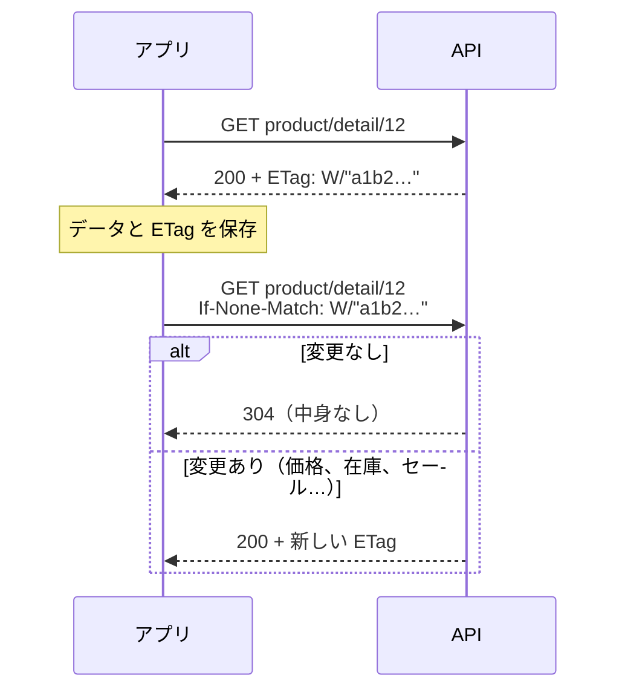

> 🌐 **言語:** [🇻🇳 Tiếng Việt](./api-conventions_vi.md) · [🇬🇧 English](./api-conventions.md) · 🇯🇵 日本語（現在）

# REST API v2 の共通ルール

## はじめに

このページは、v2 の**すべての**エンドポイントに共通するルールをまとめたものです：レスポンスの形式、ページ分割、絞り込みと並べ替え、項目の選択（`fields`）と
関連データの同時取得（`include`）、`304` によるキャッシュ、エラーコード一覧、リクエスト ID `X-Request-Id`、非推奨ポリシー、そして
`openapi.json` からのクライアントコードの生成です。これらのルールを一度押さえれば、エンドポイントごとに覚え直さなくても、どのリファレンスページも読めます。

## レスポンスの形式、一覧のパラメーター、エラーコード

このセクションでは、すべてのエンドポイントに共通する方法で、結果を正しく読み、一覧を絞り込み／並べ替え、エラーを処理する方法を説明します。

### 成功時のレスポンス

- **レスポンスはすべて JSON です。** アプリが `Accept: application/json` ヘッダーを送らない場合も同じです。

> ℹ️ **対応バージョン:** gp247/core 3.6.0 — これより前は、ログインが必要なエンドポイントをトークンなし**かつ**
> `Accept: application/json` なし（curl、Postman、多くの SDK の既定）で呼ぶと、`401 unauthenticated` ではなく HTTP `500` が返っていました。

| ケース | レスポンスの形 |
| --- | --- |
| 1 件 | `{"data": {...}}` |
| 一覧 | `{"data": [...], "meta": {...}, "links": {...}}` — `meta` には `current_page`、`per_page`、`total`、`last_page`、`links` には `first`、`last`、`prev`、`next` |
| 商品／カテゴリー／ページの名前と説明 | `lang` で選んだ言語の `name`、`description` など |
| 価格 | `price` と `price_final`（ストアで顧客が支払う価格。プロモーション適用後） |
| 文字列（名前、住所、メモなど） | 入力されたとおり — `&`、`<`、`"` はそのまま返り、HTML エスケープ**されません**。HTML に埋め込むときはアプリ側でエスケープしてください。エディターで作成した HTML 項目（`description`、`content`）は HTML です。その内容をどこまで信頼するかに応じて表示してください |

> ℹ️ **対応バージョン:** gp247/core 3.12.0、gp247/front 3.8.0、gp247/shop 3.10.0 — それ以前は、`&`、`<`、`>`、`"` を含む文字列はエンコードされた形（`Free &amp; Pro`）で返っていました。既存データは `gp247:update` が 1 回だけ変換します。

### すべての一覧エンドポイントで使えるパラメーター

| パラメーター | 意味 | 例 |
| --- | --- | --- |
| `filter[<名前>]` | データの種類ごとに許可された項目で絞り込む（下の表を参照） | `filter[brand_id]=5` |
| `sort` | 昇順で並べ替え。先頭に `-` を付けると降順 | `sort=-price` |
| `q` | 検索（名前、SKU、メールアドレスなど。データの種類による） | `q=ao-thun` |
| `lang` | 名前／説明の言語。無効なコードの場合はサイトの既定の言語 | `lang=vi` |
| `page[number]`, `page[size]` | ページと 1 ページあたりの件数（既定 20、最大 100） | `page[size]=50` |

**一覧にない**絞り込み名や並べ替え項目を指定すると → HTTP `422`（`validation_failed`）。レスポンスに許可されている名前が示されます。

| データ | `filter[...]` | `sort` |
| --- | --- | --- |
| 商品 | `category_id`, `brand_id`, `kind`, `product_type`, `price_min`, `price_max`（＋ 管理: `status`, `approve`, `supplier_id`） | `price`, `created_at`, `sort`, `sku` |
| カテゴリー | `parent`, `top`（管理: `parent`, `status`） | `sort`, `created_at` |
| ブランド、仕入先 | （管理: `status`） | `sort`, `name` |
| 顧客（管理） | `status`, `group` | `created_at`, `email` |
| 注文（管理） | `status`, `payment_status`, `shipping_status`, `customer_id` | `created_at`, `total` |
| 顧客自身の注文 | `status` | `created_at`, `total` |
| バナー | `type` | `sort`, `created_at` |
| コンテンツページ | — | `created_at` |

### 項目の選択（`fields`）と関連データの同時取得（`include`）

> ℹ️ **対応バージョン:** gp247/core 3.8.0, gp247/shop 3.7.0, gp247/front 3.5.0

アプリの画面が必要とする項目は、たいてい一部だけです。`fields[<種類>]` を送ると、その項目だけが返ります — レスポンスが軽くなり、
サーバーも使わない重いデータ（商品のバリエーションなど）を読みません。`include` を送ると、レコードごとに追加で呼び出す代わりに、
関連データを同じ呼び出しで受け取れます。

| パラメーター | 意味 | 例 |
| --- | --- | --- |
| `fields[<種類>]` | 指定した項目だけを返します（`id` は常に含まれます）。`<種類>`: `product`、`category`、`brand`、`supplier`、`customer`、`order`、`banner`、`page`、または同時取得したデータの種類 | `fields[product]=name,image,price_final` |
| `include` | 関連データを同時に取得 — 1 階層のみ、1 回の呼び出しで最大 3 つ（`GP247_API_MAX_INCLUDE`） | `include=brand,categories` |

| データ | 使える `include` | 同時取得したデータの項目を選ぶ種類 |
| --- | --- | --- |
| 商品（ストア） | `images`、`brand`（有効なブランドのみ）、`categories`（表示中のカテゴリーのみ） | `brand`、`category` |
| 商品（管理） | `images`、`brand`、`categories` | `brand`、`category` |
| 注文（管理） | `transactions`（入金台帳）、`histories`（処理履歴、HTML を含まないテキスト） | `transaction`、`history` |
| その他のデータ | — | — |

```bash
curl "https://your-domain.com/api/v2/front/product/list?fields[product]=name,image,price_final,brand&include=brand&fields[brand]=name"
```

- `fields` / `include` を送らなければ、レスポンスはこれまでとまったく同じです。
- 一覧にない種類・項目・`include`、入れ子の `include`（`brand.products`）、上限を超える数 → `422`（`validation_failed`）。
  レスポンスに有効な名前が示されます。
- 項目を選んでも隠れた項目は開きません: 公開 API は引き続き原価や在庫数を返しません。
- 同期モード `updated_since`（次の項）でも使えます。

### キャッシュと `304 Not Modified`

> ℹ️ **対応バージョン:** gp247/core 3.8.0, gp247/shop 3.7.0, gp247/front 3.5.0

成功した `GET` のレスポンスには、内容の「指紋」である `ETag` ヘッダーが付きます。アプリはデータと一緒に保存し、次回は
`If-None-Match: <ETag>` を送ります。データが変わっていなければ API は中身のない `304` を返し、アプリは保存したデータを使います。



- `ETag` は実際に返す内容から計算するので、アプリから見える変更は — 始まったばかりのセールも含めて — すべて新しい `ETag` になります。
  API は `Last-Modified` を使いません。
- `304` は購入者の通信量を節約します。サーバーは比較のためにデータを読みます。
- 商品、カテゴリー、ブランド、バナー、コンテンツページを **トークンなし** で呼ぶと、`Cache-Control: public, max-age=<N>` と
  `Vary: Authorization` が付くので、ブラウザーや CDN がコピーを保持できます。`N` の既定値は `0`（毎回サーバーに確認し、
  変更がなければ `304`）。サイトのオーナーは `GP247_API_PUBLIC_MAX_AGE`（秒）で引き上げられます — その代わり、新しい価格の
  表示が最大 `N` 秒遅れることがあります。
- トークン付きの呼び出し、カート、注文、顧客アカウント、管理 API は **決して** 公開キャッシュされません。

### エラーコード

> ℹ️ **対応バージョン:** gp247/core 3.2.3 — **すべてのエラー**は同じ形式で、**意味の正しい HTTP コード**を返します。
>
> ```json
> { "error": 1, "msg": "Not found", "code": "not_found" }
> ```

| HTTP | `code` | 発生する場面 |
| --- | --- | --- |
| `401` | `unauthenticated` | トークンがない／誤り、トークンの期限切れ、アカウントが無効／ロック、`login` でのパスワード誤り |
| `401` | `api_connection_invalid` | API Connection がオンなのに、`apiconnection`／`apikey` のペアがない／誤り |
| `403` | `forbidden` | ログイン済みだが権限がない（[Core API の権限とデータの範囲](./api-concepts_ja.md#core-api-の権限とデータの範囲)）、またはトークンの種類が違う |
| `404` | `not_found` | レコードが存在しない、または閲覧を許可されていない。API のパスが存在しない |
| `404` | `api_disabled` | この API グループがサイトの API 管理画面で**オフ**になっている（[API のオン／オフ](./api-concepts_ja.md#api-のオンオフ)）— gp247/core 3.3.1 から |
| `401` | `refresh_token_invalid` | リフレッシュトークンが誤り／期限切れ、またはセッションがサインアウト済み（[リフレッシュトークン — 短命なトークンでサインイン状態を保つ](./api-authentication_ja.md#リフレッシュトークン--短命なトークンでサインイン状態を保つ)）— gp247/core 3.6.0 から |
| `401` | `refresh_token_reused` | 使用済みのリフレッシュトークンが再送された：安全のためセッションをサインアウト — 再度サインイン（[リフレッシュトークン — 短命なトークンでサインイン状態を保つ](./api-authentication_ja.md#リフレッシュトークン--短命なトークンでサインイン状態を保つ)） |
| `409` | `refresh_in_progress` | リフレッシュトークンが数秒前に使われた — 受け取った新しい組を使う（[リフレッシュトークン — 短命なトークンでサインイン状態を保つ](./api-authentication_ja.md#リフレッシュトークン--短命なトークンでサインイン状態を保つ)） |
| `409` | `event_log_disabled` | イベントログが API 管理画面でオフになっている（[API のオン／オフ](./api-concepts_ja.md#api-のオンオフ)、6）— gp247/core 3.7.0 から |
| `410` | `cursor_expired` | `after` カーソルがイベントログの削除済み部分より古い — `updated_since` で同期し直し、イベントを最初から読む（[レスポンスの形式、一覧のパラメーター、エラーコード](#レスポンスの形式一覧のパラメーターエラーコード)） |
| `400` | `idempotency_key_required` | `Idempotency-Key` ヘッダーの形式が不正（印字可能な 8〜255 文字が必要）、またはキー必須のエンドポイント（注文の確定 — [注文の確定](./api-storefront_ja.md#注文の確定)、在庫の書き込み — [Core API（管理）の処理の流れ](./api-admin_ja.md#core-api管理の処理の流れ)）でキーがない |
| `409` | `idempotency_key_reused` | その `Idempotency-Key` は別のリクエストに使用済み — 新しいキーを使う（[Core API（管理）の処理の流れ](./api-admin_ja.md#core-api管理の処理の流れ)、10.2） |
| `409` | `idempotency_in_progress` | 同じ `Idempotency-Key` のリクエストがまだ処理中 — 待ってから再送する（[Core API（管理）の処理の流れ](./api-admin_ja.md#core-api管理の処理の流れ)）— gp247/core 3.7.0 から |
| `503` | `idempotency_unavailable` | サイトが `php artisan gp247:update` を実行していないため、`Idempotency-Key` 付きの管理の書き込みをまだ受け付けられない（[Core API（管理）の処理の流れ](./api-admin_ja.md#core-api管理の処理の流れ)）— gp247/core 3.7.0 から |
| `401` | `challenge_required` | プラグインによる追加の確認ステップ（OTP など）が必要。本文に `challenge` キーがある（[プラグインによる二要素認証（MFA）](./api-authentication_ja.md#プラグインによる二要素認証mfa)） |
| `401` | `challenge_invalid` | 確認チケットが誤り／期限切れ、または確認コードが誤り（[プラグインによる二要素認証（MFA）](./api-authentication_ja.md#プラグインによる二要素認証mfa)） |
| `422` | `validation_failed` | 送信したデータが不正 — 項目ごとの `errors` キーも確認してください |
| `422` | `stock_would_be_negative` | 出庫すると在庫が 0 未満になる — 何も変更されない（[Core API（管理）の処理の流れ](./api-admin_ja.md#core-api管理の処理の流れ)）— gp247/shop 3.6.0 から |
| `422` | `stock_managed_by_components` | ビルド商品（セット商品）は構成商品から在庫を求めるため、在庫を直接書き込めない（[Core API（管理）の処理の流れ](./api-admin_ja.md#core-api管理の処理の流れ)）— gp247/shop 3.6.0 から |
| `429` | `too_many_attempts` | 呼び出し回数が多すぎる — `Retry-After` ヘッダーに従って待ってください |
| `405` | `method_not_allowed` | パスに対して HTTP メソッドが違う（例: `POST` の代わりに `GET`） |
| その他 | `http_error` | その他の HTTP エラー — `msg` を確認してください |
| `500` | `server_error` | サーバーエラー — 詳細はサイトがデバッグモードのときだけ表示されます |

カートと注文には独自のエラーコードもあります（[API によるカートと注文](./api-storefront_ja.md#api-によるカートと注文)）。拒否された注文の書き込みは理由コード付きの `409` を返し、`stock/batch` は行ごとに結果コードを返します（[Core API（管理）の処理の流れ](./api-admin_ja.md#core-api管理の処理の流れ)）。まず **HTTP コード**を確認し、次に `code` を読んでケースごとに
処理してください。`msg` は表示やログ用のメッセージです。

### リクエスト ID `X-Request-Id`

> ℹ️ **対応バージョン:** gp247/core 3.4.0

GP247 API のすべてのレスポンス（エラーレスポンスを含む）には **`X-Request-Id`** ヘッダーが付きます。サイトの管理者に
問題を報告するときは、この ID を添えてください。管理者はこれでシステムログの該当行を探せます。

- アプリが**独自の** `X-Request-Id`（英数字、`.`、`_`、`-` のみ、8〜128 文字）を送ることもできます。サイトはその ID を
  そのまま使うので、アプリのログとサイトのログを突き合わせやすくなります。
- ない、または形式が正しくない場合 → サイトが新しい ID（UUID）を生成します。
- どのエンドポイントにも一致しないパス（API に届く前の 404）には、このヘッダーが付かないことがあります。

## 非推奨ポリシーと OpenAPI からのクライアント生成

### API の一部を非推奨にする

> ℹ️ **対応バージョン:** gp247/core 3.8.0

GP247 は、使われているエンドポイントやパラメーターを予告なしに削除しません:

- 削除の **少なくとも 12 か月前、かつ 2 つ以上のマイナーリリース前** に予告します。
- その間、非推奨になった部分のすべてのレスポンス（エラーを含む）に次のヘッダーが付きます:

| ヘッダー | 意味 | 例 |
| --- | --- | --- |
| `Deprecation` | 非推奨になった時点（RFC 9745、`@<unix 時刻>` 形式） | `Deprecation: @1793491200` |
| `Sunset` | 動作が止まる日（RFC 8594） | `Sunset: Fri, 31 Dec 2027 00:00:00 GMT` |
| `Link` | 移行ガイド | `Link: <https://gp247.net/ja/docs/api/about-api-gp247.html#…>; rel="deprecation"` |

- リリースごとの変更は、このページ末尾の **変更履歴** に記載します。
- API v1 は開発を終了していますが、**停止日はまだ決まっていません**。v1 の `GET logout` は従来どおり `Deprecation: true` を返します。

アプリは `Deprecation` ヘッダーを受け取るたびにログに記録し、新しい方法へ移行する時間を確保してください。

### `openapi.json` から TypeScript クライアントを生成する

GP247 は独自の SDK を提供していません — [`openapi.json`](./openapi.json) があれば、アプリ用の型とクライアントを生成できます。
ファイルをダウンロードして、たとえば `openapi-typescript` で次のように実行します:

```bash
npx openapi-typescript ./openapi.json -o gp247-api.d.ts
```

ほかの言語（Kotlin、Swift、Dart など）は、同じファイルで [OpenAPI Generator](https://openapi-generator.tech/) を使います。
gp247/core、gp247/shop、gp247/front をアップグレードするたびに、`openapi.json` をダウンロードし直してクライアントを再生成してください。

## よくある質問（Q&A）

**Q1: アプリは何を基準にエラーを処理すべきですか？**

→ エラー本文の `code` キー（例: `not_found`、`validation_failed`）を基準にし、`msg` の文言には頼らないでください。各コードの意味は
[トラブルシューティング](./api-troubleshooting_ja.md)にあります。

**Q2: 一覧の 1 ページあたりの件数に上限はありますか？**

→ あります：既定は 20 件、最大は 1 ページ 100 件です（`page[size]`）。続きは `links.next` のアドレスで読みます。

---

<sub>📅 **最終更新:** 2026-11-13 · ✍️ **作成者 (Author):** GP247</sub>
