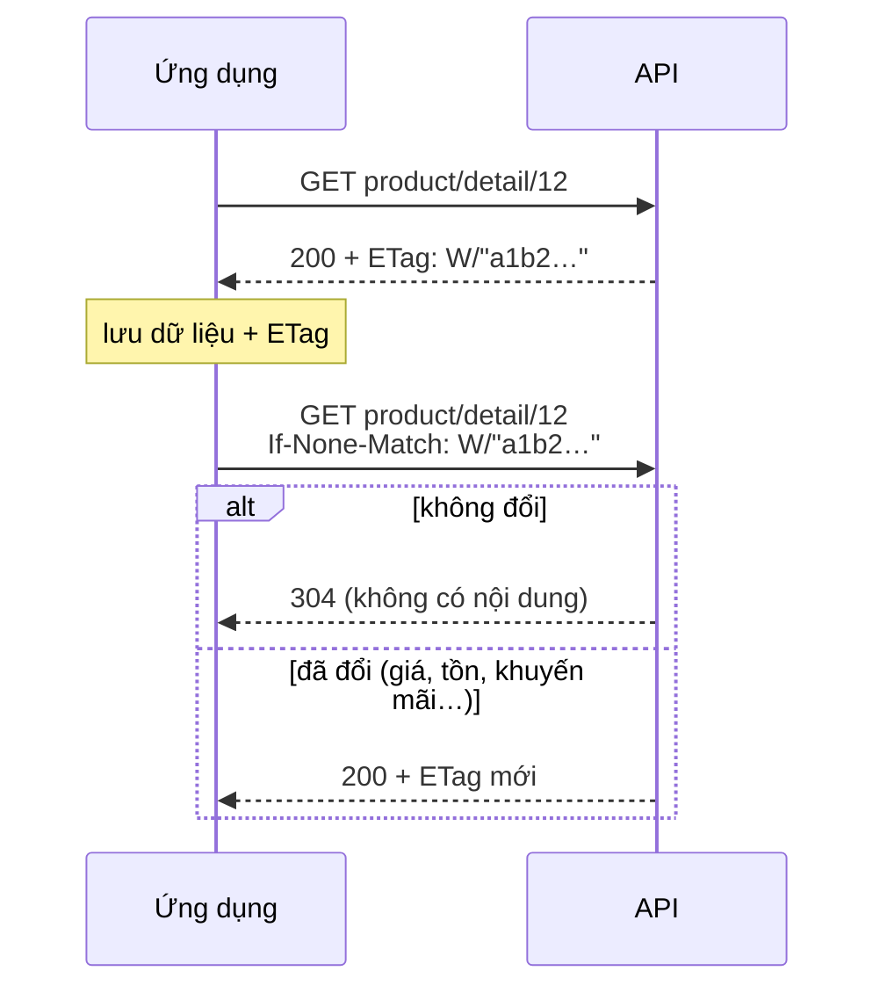

> 🌐 **Ngôn ngữ:** 🇻🇳 Tiếng Việt (hiện tại) · [🇬🇧 English](./api-conventions.md) · [🇯🇵 日本語](./api-conventions_ja.md)

# Quy ước chung của REST API v2

## Giới thiệu

Trang này gom các quy tắc dùng chung cho **mọi** endpoint v2: hình dạng phản hồi, phân trang, lọc và sắp xếp, chọn trường (`fields`) và
lấy kèm (`include`), lưu tạm với `304`, bảng mã lỗi, mã yêu cầu `X-Request-Id`, chính sách ngừng hỗ trợ và cách sinh code client từ
`openapi.json`. Nắm các quy tắc này một lần, bạn đọc được mọi trang Tham chiếu mà không phải học lại từng endpoint.

## Định dạng phản hồi, tham số danh sách & mã lỗi

Mục này giúp ứng dụng đọc đúng kết quả, lọc/sắp xếp danh sách và xử lý lỗi theo một cách duy nhất cho mọi endpoint.

### Phản hồi thành công

- **Mọi phản hồi đều là JSON**, kể cả khi ứng dụng không gửi header `Accept: application/json`.

> ℹ️ **Có từ:** gp247/core 3.6.0 — trước bản này, gọi endpoint cần đăng nhập mà thiếu token **và** không gửi
> `Accept: application/json` (mặc định của curl, Postman, nhiều SDK) nhận HTTP `500` thay cho `401 unauthenticated`.

| Trường hợp | Dạng phản hồi |
| --- | --- |
| Một bản ghi | `{"data": {...}}` |
| Danh sách | `{"data": [...], "meta": {...}, "links": {...}}` — `meta` có `current_page`, `per_page`, `total`, `last_page`; `links` có `first`, `last`, `prev`, `next` |
| Tên, mô tả sản phẩm/danh mục/trang | `name`, `description`… theo ngôn ngữ chọn bằng `lang` |
| Giá | `price` và `price_final` (giá khách trả trên cửa hàng, đã tính khuyến mãi) |

### Tham số cho mọi endpoint danh sách

| Tham số | Ý nghĩa | Ví dụ |
| --- | --- | --- |
| `filter[<tên>]` | Lọc theo trường được phép của từng loại dữ liệu (xem bảng dưới) | `filter[brand_id]=5` |
| `sort` | Sắp xếp tăng dần; thêm `-` phía trước để giảm dần | `sort=-price` |
| `q` | Tìm kiếm (tên, SKU, email… tùy loại dữ liệu) | `q=ao-thun` |
| `lang` | Ngôn ngữ của tên/mô tả; mã không hợp lệ → ngôn ngữ mặc định của site | `lang=vi` |
| `page[number]`, `page[size]` | Trang và số bản ghi mỗi trang (mặc định 20, tối đa 100) | `page[size]=50` |

Tên lọc hoặc trường sắp xếp **không có trong danh sách** → HTTP `422` (`validation_failed`), phản hồi nêu các
tên được phép.

| Dữ liệu | `filter[...]` | `sort` |
| --- | --- | --- |
| Sản phẩm | `category_id`, `brand_id`, `kind`, `product_type`, `price_min`, `price_max` (+ admin: `status`, `approve`, `supplier_id`) | `price`, `created_at`, `sort`, `sku` |
| Danh mục | `parent`, `top` (admin: `parent`, `status`) | `sort`, `created_at` |
| Thương hiệu, nhà cung cấp | (admin: `status`) | `sort`, `name` |
| Khách hàng (admin) | `status`, `group` | `created_at`, `email` |
| Đơn hàng (admin) | `status`, `payment_status`, `shipping_status`, `customer_id` | `created_at`, `total` |
| Đơn hàng của khách | `status` | `created_at`, `total` |
| Banner | `type` | `sort`, `created_at` |
| Trang nội dung | — | `created_at` |

### Chọn trường (`fields`) và lấy kèm (`include`)

> ℹ️ **Có từ:** gp247/core 3.8.0, gp247/shop 3.7.0, gp247/front 3.5.0

Màn hình của ứng dụng thường chỉ cần vài trường. Gửi `fields[<loại>]` để nhận đúng các trường đó — phản hồi nhẹ hơn và máy chủ
không phải đọc dữ liệu nặng bạn không dùng (ví dụ biến thể sản phẩm). Gửi `include` để lấy kèm dữ liệu liên quan trong cùng một
lần gọi, thay vì gọi thêm cho từng bản ghi.

| Tham số | Ý nghĩa | Ví dụ |
| --- | --- | --- |
| `fields[<loại>]` | Chỉ trả các trường liệt kê (luôn kèm `id`). `<loại>`: `product`, `category`, `brand`, `supplier`, `customer`, `order`, `banner`, `page`, hoặc loại của dữ liệu lấy kèm | `fields[product]=name,image,price_final` |
| `include` | Lấy kèm dữ liệu liên quan — một cấp, tối đa 3 mỗi lần gọi (`GP247_API_MAX_INCLUDE`) | `include=brand,categories` |

| Dữ liệu | `include` được phép | Loại để chọn trường của dữ liệu kèm |
| --- | --- | --- |
| Sản phẩm (cửa hàng) | `images`, `brand` (chỉ thương hiệu đang bật), `categories` (chỉ danh mục đang hiển thị) | `brand`, `category` |
| Sản phẩm (quản trị) | `images`, `brand`, `categories` | `brand`, `category` |
| Đơn hàng (quản trị) | `transactions` (sổ thanh toán), `histories` (lịch sử xử lý, văn bản thuần không HTML) | `transaction`, `history` |
| Dữ liệu khác | — | — |

```bash
curl "https://your-domain.com/api/v2/front/product/list?fields[product]=name,image,price_final,brand&include=brand&fields[brand]=name"
```

- Không gửi `fields` / `include` → phản hồi y hệt như trước.
- Loại, tên trường hay `include` không có trong danh sách, `include` lồng (`brand.products`) hoặc quá số cho phép → `422`
  (`validation_failed`), phản hồi nêu các tên hợp lệ.
- Chọn trường không mở thêm trường bị ẩn: API công khai vẫn không trả giá vốn hay số tồn kho.
- Dùng được cả trong chế độ đồng bộ `updated_since` (mục dưới).

### Lưu tạm và `304 Not Modified`

> ℹ️ **Có từ:** gp247/core 3.8.0, gp247/shop 3.7.0, gp247/front 3.5.0

Mỗi phản hồi `GET` thành công có header `ETag` — "dấu vân tay" của nội dung. Ứng dụng lưu nó cùng dữ liệu; lần sau gửi
`If-None-Match: <ETag>`. Dữ liệu không đổi thì API trả `304` không có nội dung, ứng dụng dùng bản đã lưu.



- `ETag` tính từ đúng nội dung trả về, nên mọi thay đổi ứng dụng nhìn thấy — kể cả khuyến mãi vừa bắt đầu — đều cho `ETag`
  mới. API không dùng `Last-Modified`.
- `304` tiết kiệm đường truyền cho khách; máy chủ vẫn đọc dữ liệu để so.
- Sản phẩm, danh mục, thương hiệu, banner, trang nội dung gọi **không token** có `Cache-Control: public, max-age=<N>` kèm
  `Vary: Authorization`, nên trình duyệt hoặc CDN được giữ bản sao. `N` mặc định `0` (luôn hỏi lại máy chủ, nhận `304` khi
  không đổi); chủ site tăng bằng `GP247_API_PUBLIC_MAX_AGE` (giây) — đổi lại, giá mới có thể hiện chậm tối đa `N` giây.
- Gọi có token, giỏ hàng, đặt đơn, tài khoản khách và API quản trị **không bao giờ** được lưu công khai.

### Mã lỗi

> ℹ️ **Có từ:** gp247/core 3.2.3 — **mọi lỗi** có cùng một dạng và **mã HTTP đúng nghĩa**:
>
> ```json
> { "error": 1, "msg": "Not found", "code": "not_found" }
> ```

| HTTP | `code` | Khi nào |
| --- | --- | --- |
| `401` | `unauthenticated` | Thiếu/sai token, token hết hạn, tài khoản bị tắt/khoá, sai mật khẩu khi `login` |
| `401` | `api_connection_invalid` | API Connection đang bật mà thiếu/sai cặp `apiconnection`/`apikey` |
| `403` | `forbidden` | Đã đăng nhập nhưng không có quyền ([Phân quyền và phạm vi dữ liệu của API Core](./api-concepts_vi.md#phân-quyền-và-phạm-vi-dữ-liệu-của-api-core)) hoặc token sai loại |
| `404` | `not_found` | Bản ghi không tồn tại hoặc bạn không được xem; đường dẫn API không tồn tại |
| `404` | `api_disabled` | Nhóm API này đang **tắt** trên màn quản lý API của site ([Bật/tắt API](./api-concepts_vi.md#bậttắt-api)) — từ gp247/core 3.3.1 |
| `401` | `refresh_token_invalid` | Refresh token sai, hết hạn hoặc phiên đã bị đăng xuất ([Refresh token — giữ đăng nhập mà token ngắn hạn](./api-authentication_vi.md#refresh-token--giữ-đăng-nhập-mà-token-ngắn-hạn)) — từ gp247/core 3.6.0 |
| `401` | `refresh_token_reused` | Refresh token đã dùng rồi bị gửi lại: phiên bị đăng xuất để an toàn — đăng nhập lại ([Refresh token — giữ đăng nhập mà token ngắn hạn](./api-authentication_vi.md#refresh-token--giữ-đăng-nhập-mà-token-ngắn-hạn)) |
| `409` | `refresh_in_progress` | Refresh token vừa được dùng vài giây trước — dùng cặp token mới đã nhận ([Refresh token — giữ đăng nhập mà token ngắn hạn](./api-authentication_vi.md#refresh-token--giữ-đăng-nhập-mà-token-ngắn-hạn)) |
| `409` | `event_log_disabled` | Nhật ký sự kiện đang tắt trên màn quản lý API ([Bật/tắt API](./api-concepts_vi.md#bậttắt-api), 6) — từ gp247/core 3.7.0 |
| `410` | `cursor_expired` | Con trỏ `after` cũ hơn phần nhật ký sự kiện đã dọn — đồng bộ lại bằng `updated_since`, rồi đọc sự kiện từ đầu ([Định dạng phản hồi, tham số danh sách & mã lỗi](#định-dạng-phản-hồi-tham-số-danh-sách--mã-lỗi)) |
| `400` | `idempotency_key_required` | Header `Idempotency-Key` sai dạng (cần 8–255 ký tự in được), hoặc thiếu ở endpoint bắt buộc khoá (đặt đơn — [Đặt đơn](./api-storefront_vi.md#đặt-đơn); ghi tồn kho — [Luồng làm việc API Core (Admin)](./api-admin_vi.md#luồng-làm-việc-api-core-admin)) |
| `409` | `idempotency_key_reused` | `Idempotency-Key` đã dùng cho một yêu cầu khác — dùng khoá mới ([Luồng làm việc API Core (Admin)](./api-admin_vi.md#luồng-làm-việc-api-core-admin), 10.2) |
| `409` | `idempotency_in_progress` | Yêu cầu cùng `Idempotency-Key` vẫn đang được xử lý — chờ rồi gửi lại ([Luồng làm việc API Core (Admin)](./api-admin_vi.md#luồng-làm-việc-api-core-admin)) — từ gp247/core 3.7.0 |
| `503` | `idempotency_unavailable` | Site chưa chạy `php artisan gp247:update` nên chưa nhận lệnh ghi quản trị có `Idempotency-Key` ([Luồng làm việc API Core (Admin)](./api-admin_vi.md#luồng-làm-việc-api-core-admin)) — từ gp247/core 3.7.0 |
| `401` | `challenge_required` | Tài khoản cần thêm bước xác thực (mã OTP…) do plugin cung cấp; thân có khoá `challenge` ([Xác thực hai lớp (MFA) qua plugin](./api-authentication_vi.md#xác-thực-hai-lớp-mfa-qua-plugin)) |
| `401` | `challenge_invalid` | Vé xác thực sai/hết hạn hoặc mã xác thực sai ([Xác thực hai lớp (MFA) qua plugin](./api-authentication_vi.md#xác-thực-hai-lớp-mfa-qua-plugin)) |
| `422` | `validation_failed` | Dữ liệu gửi lên không hợp lệ — xem thêm khoá `errors` theo từng trường |
| `422` | `stock_would_be_negative` | Lệnh xuất kho làm tồn kho xuống dưới 0 — không thay đổi gì ([Luồng làm việc API Core (Admin)](./api-admin_vi.md#luồng-làm-việc-api-core-admin)) — từ gp247/shop 3.6.0 |
| `422` | `stock_managed_by_components` | Sản phẩm dạng build (combo) lấy tồn kho từ các thành phần, không ghi tồn kho trực tiếp được ([Luồng làm việc API Core (Admin)](./api-admin_vi.md#luồng-làm-việc-api-core-admin)) — từ gp247/shop 3.6.0 |
| `429` | `too_many_attempts` | Gọi quá nhiều lần — chờ theo header `Retry-After` |
| `405` | `method_not_allowed` | Sai phương thức HTTP cho đường dẫn (ví dụ `GET` thay cho `POST`) |
| khác | `http_error` | Lỗi HTTP khác — đọc `msg` |
| `500` | `server_error` | Lỗi máy chủ — nội dung chi tiết chỉ hiện khi site bật chế độ debug |

Giỏ hàng và đặt đơn có thêm mã lỗi riêng ([Giỏ hàng & đặt đơn qua API](./api-storefront_vi.md#giỏ-hàng--đặt-đơn-qua-api)); lệnh ghi đơn hàng bị từ chối trả `409` kèm mã lý do; mỗi dòng của `stock/batch` có mã kết quả riêng ([Luồng làm việc API Core (Admin)](./api-admin_vi.md#luồng-làm-việc-api-core-admin)). Hãy kiểm tra **mã HTTP** trước rồi mới đọc `code` để xử lý từng
trường hợp; `msg` là thông điệp để hiển thị hoặc ghi log.

### Mã yêu cầu `X-Request-Id`

> ℹ️ **Có từ:** gp247/core 3.4.0

Mọi phản hồi của API GP247 — kể cả phản hồi lỗi — có header **`X-Request-Id`**. Khi báo lỗi cho quản trị viên site,
hãy gửi kèm mã này: họ dùng nó để tìm đúng dòng trong nhật ký hệ thống.

- Ứng dụng có thể **tự gửi** `X-Request-Id` (chỉ gồm chữ, số, `.`, `_`, `-`; dài 8–128 ký tự): site dùng lại đúng mã
  đó, tiện nối nhật ký của ứng dụng với nhật ký của site.
- Thiếu hoặc sai định dạng → site tự sinh mã mới (UUID).
- Đường dẫn không khớp endpoint nào (404 trước khi vào API) có thể không có header này.

## Chính sách ngừng hỗ trợ & sinh client từ OpenAPI

### Ngừng hỗ trợ một phần API

> ℹ️ **Có từ:** gp247/core 3.8.0

GP247 không gỡ endpoint hay tham số đang được dùng mà không báo trước:

- Báo trước **ít nhất 12 tháng và ít nhất 2 bản minor** trước khi gỡ hẳn.
- Trong thời gian đó, mọi phản hồi của phần sắp ngừng (kể cả lỗi) có các header sau:

| Header | Ý nghĩa | Ví dụ |
| --- | --- | --- |
| `Deprecation` | Thời điểm bắt đầu ngừng hỗ trợ (RFC 9745, dạng `@<unix time>`) | `Deprecation: @1793491200` |
| `Sunset` | Ngày ngừng hẳn (RFC 8594) | `Sunset: Fri, 31 Dec 2027 00:00:00 GMT` |
| `Link` | Hướng dẫn chuyển đổi | `Link: <https://gp247.net/vi/docs/api/about-api-gp247.html#…>; rel="deprecation"` |

- Mọi thay đổi theo phiên bản ghi ở mục **Lịch sử thay đổi** cuối trang.
- API v1 đã ngưng phát triển nhưng **chưa có ngày ngừng hẳn**; `GET logout` của v1 vẫn trả `Deprecation: true` như trước.

Ứng dụng nên ghi log mỗi khi gặp header `Deprecation` để kịp chuyển sang cách mới.

### Sinh client TypeScript từ `openapi.json`

GP247 không phát hành SDK riêng — [`openapi.json`](./openapi.json) đủ để tự sinh kiểu dữ liệu và client cho ứng dụng của bạn.
Tải file về rồi chạy, ví dụ với `openapi-typescript`:

```bash
npx openapi-typescript ./openapi.json -o gp247-api.d.ts
```

Ngôn ngữ khác (Kotlin, Swift, Dart…) dùng [OpenAPI Generator](https://openapi-generator.tech/) với cùng file. Mỗi khi nâng cấp
gp247/core, gp247/shop, gp247/front, hãy tải lại `openapi.json` và sinh lại client.

## Hỏi & Đáp (Q&A)

**Câu 1: Ứng dụng nên xử lý lỗi dựa vào gì?**

→ Dựa vào khoá `code` trong thân lỗi (ví dụ `not_found`, `validation_failed`), không dựa vào câu chữ trong `msg`. Ý nghĩa từng mã
ở [Xử lý sự cố](./api-troubleshooting_vi.md).

**Câu 2: Danh sách có giới hạn số dòng mỗi trang không?**

→ Có: mặc định 20, tối đa 100 dòng mỗi trang (`page[size]`). Đọc tiếp bằng địa chỉ trong `links.next`.

---

<sub>📅 **Cập nhật lần cuối:** 2026-11-03 · ✍️ **Tác giả (Author):** GP247</sub>
