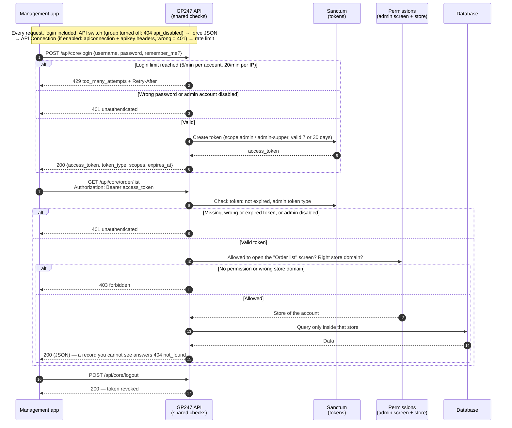
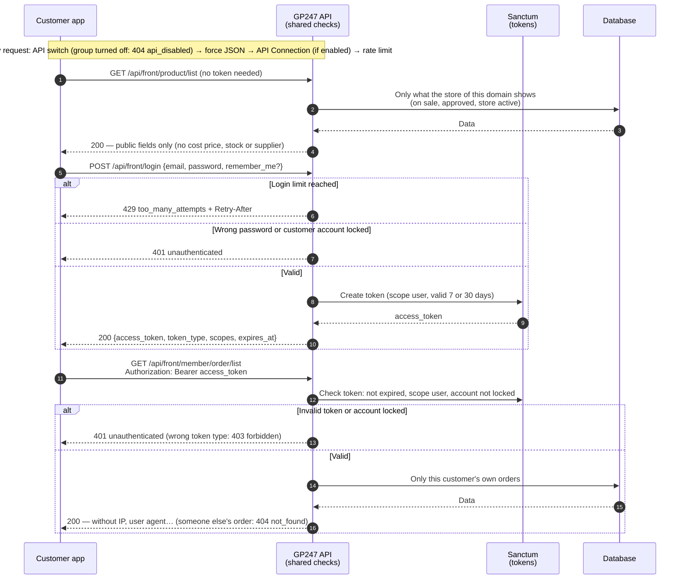
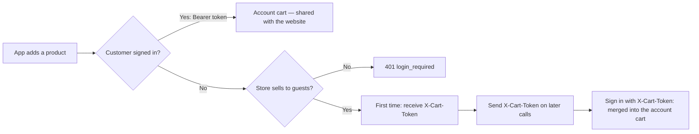
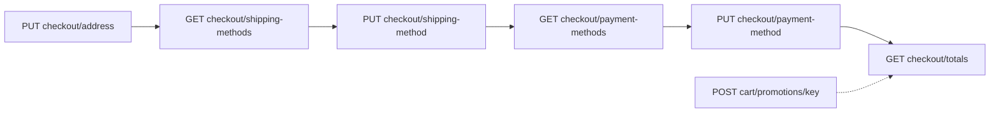
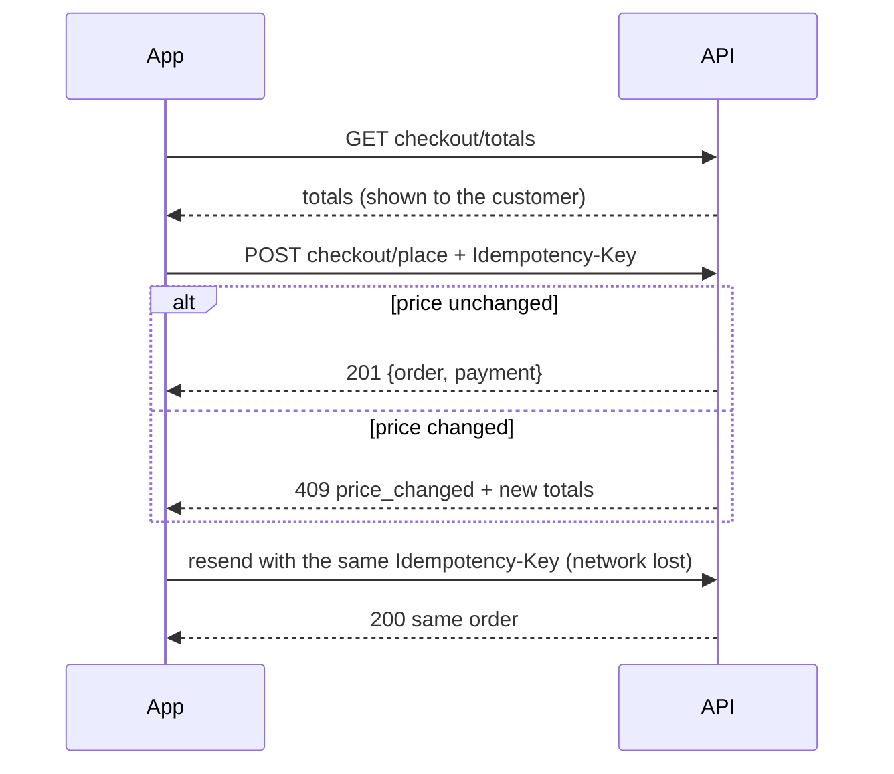
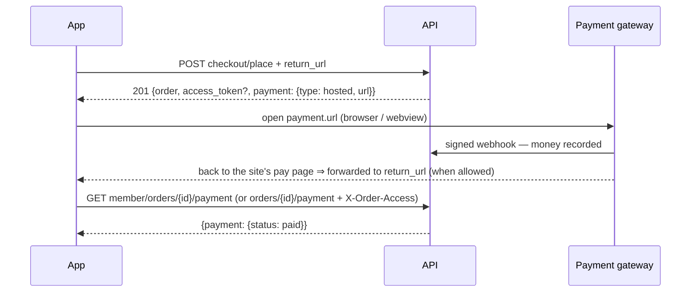

> 🌐 **Language:** [🇻🇳 Tiếng Việt](./api-introduction_vi.md) · 🇬🇧 English (current) · [🇯🇵 日本語](./api-introduction_ja.md)

# Introduction to the GP247 System API

## Introduction

This document introduces the **GP247 API (Application Programming Interface) system** — how external
applications (mobile apps, other websites, management software, third-party integrations…) can "talk"
to your GP247 site to fetch data. It is written for **integration developers** and **site
administrators** who want a big-picture view of what the API offers, how it is grouped, how
authentication (login) and permissions work, how errors are returned, and how to try it out. After
reading, you will know **which API does what, at which address, what key it needs, and which data it
lets you see**, with copy-and-run examples.

> ℹ️ **What is an API (in plain terms):** think of the API as a "service counter" for your site.
> External apps don't reach straight into the data store; they send a request to the counter
> (a URL address), the counter checks the credentials (token/key), then returns the result as
> **JSON** (a text-based data format that computers can read). The whole exchange happens over
> the ordinary web protocol (HTTP).

> 📄 **Machine-readable specification:** every endpoint, parameter and error sample is in the file
> [`openapi.json`](./openapi.json) (OpenAPI 3.1) — load it into Postman, Insomnia or Swagger UI to try
> calls or generate client code.

---

## 1. The two main API groups

The GP247 system splits its API into **two groups**, serving two different audiences:

| Group | Address prefix | For | Who logs in |
| --- | --- | --- | --- |
| **Core API (Admin)** | `api/core` | Remote system administration (management apps, custom dashboards) | **Administrator** accounts |
| **Front API (Storefront)** | `api/front` | Displaying store data, customer accounts | Guests/members, or **no login needed** for public data |

- **`api/core`**: the `gp247/core` package provides the admin login/info part; `gp247/shop` and
  `gp247/front` add endpoints that read admin data (customers, orders, products, banners…).
- **`api/front`** is provided by the `gp247/front` and `gp247/shop` packages — "storefront" data such
  as product lists, categories, brands, content pages, banners, and customer accounts/orders.

> ℹ️ **Available since:** gp247/core, gp247/front, gp247/shop 3.3.0 — there is also an **API v2** with the
> prefixes `api/v2/core` and `api/v2/front` (section 8). The `api/core` and `api/front` prefixes above are
> **v1** and keep working as before.

> The **full address** = your site domain + prefix + path. For example, if your site is
> `https://shop.example.com`, the endpoint for the product list is:
> `https://shop.example.com/api/front/product/list`.

---

## 2. Authentication (logging in to the API)

GP247 uses **Laravel Sanctum** to issue a **token** (a long string that acts as an "entry ticket").
The mechanism is the same for both groups:

1. The app sends **username/email + password** to the `login` endpoint.
2. If correct, the system returns an **`access_token`** (a Bearer token) with an expiry (`expires_at`).
3. From then on, every request that requires login attaches this token in the **header**:

   ```
   Authorization: Bearer <access_token>
   ```

4. To sign out, call **`POST logout`** to **revoke the token** (the old token becomes invalid
   immediately).

### Scopes (abilities)

Each token is issued with a **scope** that tells whose token it is:

| Scope | Meaning |
| --- | --- |
| `admin` | Administrator token (Core API) |
| `admin-supper` | Token of an administrator with the `administrator` role (Core API) |
| `user` | Member token (Front API) |

> ℹ️ **Available since:** gp247/core 3.2.3 — the scope only tells the **account type**. **Which data
> you can see** is decided by the account's own permissions (section 3). The `user-guest` scope is no
> longer issued: a customer account that is locked cannot log in.

### Token lifetime

> ℹ️ **Available since:** gp247/core 3.2.3

Every token has an expiry (`expires_at`):

| Token type | Without `remember_me` | With `remember_me = true` |
| --- | --- | --- |
| Administrator | 7 days (`GP247_API_TOKEN_EXPIRE_ADMIN_DEFAULT`) | 30 days (`GP247_API_RECOMMEMBER_ADMIN`) |
| Member | 7 days (`GP247_API_TOKEN_EXPIRE_DEFAULT`) | 30 days (`GP247_API_RECOMMEMBER`) |

> ℹ️ **Available since:** gp247/core 3.3.0 — the environment variables have correctly spelled names:
> `GP247_API_REMEMBER`, `GP247_API_REMEMBER_ADMIN`, `GP247_API_SCOPE_ADMIN_SUPER`. The old names
> (`GP247_API_RECOMMEMBER`…) still work; if both are set, the new name wins. `php artisan gp247:doctor` reports
> old names that are still in use (check `api_config_legacy_names`). Tokens carrying the `admin-super` scope are
> also accepted alongside `admin-supper`.

An expired token returns `401`; when that happens, call `login` to get a new token. Tokens that expired
long ago (more than 7 days) are cleaned up automatically the next time the same account logs in — no
cron needed.

> ℹ️ **Available since:** gp247/core 3.4.0 — tokens issued **before 3.2.3** (they had no expiry then) get one when you
> run `php artisan gp247:update`: the token's real age plus the "remember" lifetime (admins: `GP247_API_REMEMBER_ADMIN`,
> members: `GP247_API_REMEMBER`), but **never sooner than 7 days** after the upgrade. Apps holding an old token have at
> least 7 days before they must log in again — make sure your app answers a `401` by calling `login`.

> ℹ️ **Available since:** gp247/core 3.6.0, gp247/shop 3.4.0 — on API v2, an app that signs in with `with_refresh: true`
> gets an access token living **60 minutes** plus a *refresh token* to renew it (section 10). Changing or resetting a
> customer's password (on the website or through the API) ends **every token** of that customer, v1 tokens included. The same
> goes for **administrators**: changing the password on the **Users** screen, in **Account settings** or through "forgot password"
> ends every API token of that admin.

### Login attempt limits

> ℹ️ **Available since:** gp247/core 3.2.3

To block password guessing, `api/core/login`, `api/front/login` and the admin login form limit the number of attempts.
The admin login form and `api/core/login` share one counter: failed attempts on one count for the other.

| Limit | Default | Change with environment variable |
| --- | --- | --- |
| Per account (from the same IP) | 5 attempts / minute | `GP247_LOGIN_THROTTLE` (format `attempts,minutes`) |
| Per IP, across all accounts | 20 attempts / minute | `GP247_LOGIN_IP_THROTTLE` |

> ⚠️ **Renamed in gp247/core 3.5.0:** the old names `GP247_API_LOGIN_THROTTLE` and `GP247_API_LOGIN_IP_THROTTLE`
> are no longer read. If you set them, rename them in your `.env`, otherwise the defaults above apply.

Over the limit → HTTP `429` with a `Retry-After` header (the number of seconds to wait). A successful
login clears the counter for that account. In addition, every API endpoint has a general limit of 1000
requests/minute per IP (`GP247_API_THROTTLE`).

---

## 3. Permissions and data scope of the Core API

> ℹ️ **Available since:** gp247/core 3.2.3, gp247/shop 3.2.3, gp247/front 3.2.3

The Core API **never shows more than the admin screens do**. Each data-reading endpoint is tied to an
admin screen; an administrator can only call the endpoint if the account is allowed to open that screen
(permissions are set under **Admin → Roles / Permissions**). No permission → HTTP `403`.

| Endpoint | Permission required (admin screen) |
| --- | --- |
| `customer/list`, `customer/detail/{id}` | Customer list |
| `order/list` | Order list |
| `order/detail/{id}` | Order details |
| `product/*` | Product list |
| `category/*`, `brand/*`, `supplier/*` | Category / brand / supplier list |
| `banner/*`, `page/*` | Banner / content page list |
| `login`, `logout`, `info` | Only a valid token |

- The `administrator` role can call every endpoint; the `view.all` role is read-only.
- **Per-store data:** on a multi-store site, an administrator assigned to one store only sees that
  store's data and can only call the API on **their own store's domain** (just like logging in to the
  admin area). Records of other stores return `404`.
- If an administrator account is disabled (`status = 0`), its old tokens no longer work (`401`).

---

## 4. The API Connection protection layer — optional

Beyond the token, GP247 also has **an extra lock** standing in front of all APIs, called the
**API Connection**. It is a second "gatekeeper" ensuring only authorized applications can call the
API — even the public endpoints.

- This layer is **off by default**; turn it on/off with the `api_connection_required` setting in the
  admin area.
- **When enabled:** every request must additionally carry **two headers**:

  ```
  apiconnection: <connection code>
  apikey: <secret key>
  ```

- The `apiconnection`/`apikey` pair is created and managed in the **GP247 admin area** (the API
  Connection management section); each pair can have an expiry date (`expire`) and an on/off status
  (`status`).
- If it is missing, wrong, expired or disabled, the API returns HTTP `401` with
  `"code": "api_connection_invalid"`.

> ℹ️ **Available since:** gp247/core 3.2.3 — keys are **stored hashed**: the admin screen shows a key
> **only once**, right after it is created/regenerated, so copy it immediately. When editing a
> connection, leave the key field empty to keep the old key. Keys already in use keep working after the
> upgrade (`php artisan gp247:update`); **regenerate** older keys when convenient to remove the plain copy still
> stored. A key you type yourself must be at least 32 characters long.

> ℹ️ **Available since:** gp247/core 3.4.0 — `php artisan gp247:update` **removes** the plain copy of the keys for good;
> keys in use keep working (they are matched through the hash). The plain copy cannot be recovered, so **back up the
> database** before upgrading if you need it.

> The order of the checking layers (middleware) is: **attach the request id `X-Request-Id` → check the API on/off switch
> (section 9) → return JSON → check API Connection → rate limit**, then the login/permission checks of each endpoint.
> This order is fixed and should not be changed. *(The first two layers: since gp247/core 3.3.1 and 3.4.0.)*

---

## 5. Core API workflow (Admin)

The diagram below shows a management app signing in and then reading data through the Core API. Every request
goes through the checks in the order shown; the first check that refuses answers with an error straight away.



Takeaway: a token is **not enough** to read data — the account also needs permission to open the matching admin
screen, and it only sees the data of its own store (section 3).

**Login & account endpoints** (prefix `api/core`):

| Method | Path | Login required | Function |
| --- | --- | --- | --- |
| `POST` | `api/core/login` | No | Admin login, returns `access_token` |
| `POST` | `api/core/logout` | Yes (Bearer) | Log out, revoke the current token |
| `GET` | `api/core/logout` | Yes (Bearer) | Same as above — **deprecated**, the response carries a `Deprecation` header; switch to `POST` |
| `GET` | `api/core/info` | Yes (Bearer) | Get the currently logged-in administrator's info |

**Admin data endpoints** (prefix `api/core`, token + permission from section 3 required):

| Method | Path | Function |
| --- | --- | --- |
| `GET` | `api/core/customer/list` | Customer list |
| `GET` | `api/core/customer/detail/{id}` | A customer's details |
| `GET` | `api/core/order/list` | Order list (with order lines and totals) |
| `GET` | `api/core/order/detail/{id}` | An order's details |
| `GET` | `api/core/product/list` | Product list |
| `GET` | `api/core/product/detail/{id}` | A product's details |
| `GET` | `api/core/category/list` | Category list |
| `GET` | `api/core/category/detail/{id}` | A category's details |
| `GET` | `api/core/brand/list` | Brand list |
| `GET` | `api/core/brand/detail/{id}` | A brand's details |
| `GET` | `api/core/supplier/list` | Supplier list |
| `GET` | `api/core/supplier/detail/{id}` | A supplier's details |
| `GET` | `api/core/banner/list` | Banner list |
| `GET` | `api/core/banner/detail/{id}` | A banner's details |
| `GET` | `api/core/page/list` | Content page list |
| `GET` | `api/core/page/detail/{id}` | A content page's details |

Example admin login (using `curl` in a Terminal):

```bash
curl -X POST "https://shop.example.com/api/core/login" \
  -H "Content-Type: application/json" \
  -d '{"username":"admin","password":"your-password","remember_me":true}'
```

On success, you receive JSON like:

```json
{
  "access_token": "1|aBcD...very-long...XyZ",
  "token_type": "Bearer",
  "scopes": ["admin-supper"],
  "expires_at": "2026-11-25 10:00:00"
}
```

Then fetch the order list using the token you just received:

```bash
curl -X GET "https://shop.example.com/api/core/order/list" \
  -H "Authorization: Bearer 1|aBcD...very-long...XyZ"
```

---

## 6. Front API workflow (Storefront)

The Front API serves two kinds of data: **public data** (no login needed — product lists,
categories…) and **customer-private data** (login required — orders, personal info).

The diagram below shows the two ways to use the Front API: reading public data without signing in, and a customer
signing in to see their own orders.



Takeaway: public data on the API **matches what shoppers see in the store**, and private data goes only to its
owner. API v2 (section 8) goes through the same checks; only the response shape differs.

**Public endpoints** (prefix `api/front`, no token needed):

| Method | Path | Function |
| --- | --- | --- |
| `GET` | `api/front/product/list` | Product list |
| `GET` | `api/front/product/detail/{id}` | A product's details |
| `GET` | `api/front/category/list` | Category list |
| `GET` | `api/front/category/detail/{id}` | A category's details (with products) |
| `GET` | `api/front/brand/list` | Brand list |
| `GET` | `api/front/brand/detail/{id}` | A brand's details |
| `GET` | `api/front/banner/list` | Banner list |
| `GET` | `api/front/banner/detail/{id}` | A banner's details |
| `GET` | `api/front/page/list` | Content page list |
| `GET` | `api/front/page/detail/{id}` | A content page's details |

> ℹ️ **Available since:** gp247/shop 3.2.3, gp247/front 3.2.3 — public data is **exactly what the
> store is showing** on the domain you call: hidden products, products not yet approved, or products
> belonging to another store do not appear. Responses contain only public fields — no cost price,
> supplier, or stock/sold counts. If you need those figures, use the Core API with an account that has
> permission.

**Customer account endpoints** (prefix `api/front`, customer token required):

| Method | Path | Login required | Function |
| --- | --- | --- | --- |
| `POST` | `api/front/login` | No | Log in with customer email/password, returns a token |
| `POST` | `api/front/logout` | Yes (Bearer) | Log out the customer |
| `GET` | `api/front/logout` | Yes (Bearer) | Same as above — **deprecated**, switch to `POST` |
| `GET` | `api/front/info` | Yes (Bearer) | Customer account info |
| `GET` | `api/front/member/order/list` | Yes (Bearer) | The customer's order list |
| `GET` | `api/front/member/order/detail/{id}` | Yes (Bearer) | An order's details |

Example fetching the product list (public, no token needed):

```bash
curl -X GET "https://shop.example.com/api/front/product/list" \
  -H "Accept: application/json"
```

Example logging in a customer and viewing their orders:

```bash
# 1) Customer login
curl -X POST "https://shop.example.com/api/front/login" \
  -H "Content-Type: application/json" \
  -d '{"email":"customer@example.com","password":"your-password"}'

# 2) Use the returned token to fetch the order list
curl -X GET "https://shop.example.com/api/front/member/order/list" \
  -H "Authorization: Bearer 2|zzz...customer-token...zzz"
```

---

## 7. Response format & error codes

- **Every response is JSON**, even when the app does not send the `Accept: application/json` header.

> ℹ️ **Available since:** gp247/core 3.5.2 — before this release, calling a signed-in endpoint without a token **and**
> without `Accept: application/json` (the default of curl, Postman and many SDKs) got HTTP `500` instead of `401 unauthenticated`.
- List endpoints return Laravel's standard pagination shape (with `data`, `current_page`, `total`…);
  pick a page with `page[number]` and `page[size]`.
- Success: the data is returned directly (an object, or a page of data).

> ℹ️ **Available since:** gp247/core 3.2.3 — **every error** has the same shape and a **meaningful
> HTTP code**:
>
> ```json
> { "error": 1, "msg": "Not found", "code": "not_found" }
> ```

| HTTP | `code` | When |
| --- | --- | --- |
| `401` | `unauthenticated` | Missing/invalid token, expired token, account disabled/locked, wrong password on `login` |
| `401` | `api_connection_invalid` | API Connection is enabled but the `apiconnection`/`apikey` pair is missing/wrong |
| `403` | `forbidden` | Logged in but without permission (section 3), or the wrong type of token |
| `404` | `not_found` | The record does not exist or you are not allowed to see it; the API path does not exist |
| `404` | `api_disabled` | This API group is **turned off** on the site's API management screen (section 9) — since gp247/core 3.3.1 |
| `401` | `refresh_token_invalid` | Refresh token wrong, expired, or its session was signed out (section 10) — since gp247/core 3.6.0 |
| `401` | `refresh_token_reused` | A used refresh token was sent again: the session was signed out for safety — sign in again (section 10) |
| `409` | `refresh_in_progress` | The refresh token was used seconds ago — use the new pair you received (section 10) |
| `401` | `challenge_required` | The account needs an extra verification step (OTP…) provided by a plugin; the body has a `challenge` key (section 10) |
| `401` | `challenge_invalid` | Verification ticket wrong/expired or wrong verification code (section 10) |
| `422` | `validation_failed` | The submitted data is invalid — see the `errors` key for each field |
| `429` | `too_many_attempts` | Too many calls — wait as indicated by the `Retry-After` header |
| `405` | `method_not_allowed` | Wrong HTTP method for the path (for example `GET` instead of `POST`) |
| other | `http_error` | Any other HTTP error — read `msg` |
| `500` | `server_error` | Server error — details are only shown when the site has debug mode on |

> Older apps that read the `error`/`msg` keys keep working as before; check the **HTTP code** first,
> then read `code` to handle each case.

### Request id `X-Request-Id`

> ℹ️ **Available since:** gp247/core 3.4.0

Every GP247 API response — error responses included — carries an **`X-Request-Id`** header. When you report a problem to
the site's administrator, include this id: they use it to find the matching lines in the system log.

- Your app may **send its own** `X-Request-Id` (letters, digits, `.`, `_`, `-` only; 8–128 characters): the site reuses
  that exact id, which makes it easy to join your app's logs with the site's.
- Missing or malformed → the site generates a new id (UUID).
- A path that matches no endpoint (404 before reaching the API) may not carry this header.

---

## 8. API v2

> ℹ️ **Available since:** gp247/core, gp247/front, gp247/shop 3.3.0

API v2 serves **the same data with the same permissions** as v1 (sections 2–4 and 7: tokens, admin-screen
permissions, per-store data, login limits, error codes), but its responses have a **fixed structure** and it
supports filtering, sorting and searching. v1 is kept unchanged so existing apps don't break — new apps should
use v2.

| Difference | v1 | v2 |
| --- | --- | --- |
| Prefix | `api/core`, `api/front` | `api/v2/core`, `api/v2/front` |
| Success (single record) | The object directly | `{"data": {...}}` |
| Success (list) | Laravel pagination (`data`, `current_page`, `total`… at the same level) | `{"data": [...], "meta": {...}, "links": {...}}` |
| Product/category/page name and description | A `descriptions` array with every language | `name`, `description`… in the language chosen with `lang` |
| Price | `price` | `price` and `price_final` (the price the customer pays on the store, promotions applied) |
| Logout | `POST` (and the deprecated `GET`) | `POST` only |

**Parameters for every list endpoint:**

| Parameter | Meaning | Example |
| --- | --- | --- |
| `filter[<name>]` | Filter by a field allowed for that kind of data (see the table below) | `filter[brand_id]=5` |
| `sort` | Sort ascending; prefix with `-` for descending | `sort=-price` |
| `q` | Search (name, SKU, email… depending on the kind of data) | `q=ao-thun` |
| `lang` | Language of names/descriptions; an invalid code → the site's default language | `lang=vi` |
| `page[number]`, `page[size]` | Page and records per page (default 20, maximum 100) | `page[size]=50` |

A filter name or sort field that is **not in the list** → HTTP `422` (`validation_failed`); the response lists
the allowed names.

| Data | `filter[...]` | `sort` |
| --- | --- | --- |
| Products | `category_id`, `brand_id`, `kind`, `product_type`, `price_min`, `price_max` (+ admin: `status`, `approve`, `supplier_id`) | `price`, `created_at`, `sort`, `sku` |
| Categories | `parent`, `top` (admin: `parent`, `status`) | `sort`, `created_at` |
| Brands, suppliers | (admin: `status`) | `sort`, `name` |
| Customers (admin) | `status`, `group` | `created_at`, `email` |
| Orders (admin) | `status`, `payment_status`, `shipping_status`, `customer_id` | `created_at`, `total` |
| Customer's own orders | `status` | `created_at`, `total` |
| Banners | `type` | `sort`, `created_at` |
| Content pages | — | `created_at` |

**API v2 endpoints:**

| Method | Path | Login required | Function |
| --- | --- | --- | --- |
| `POST` | `api/v2/core/login` | No | Admin login (optional `with_refresh` — section 10) |
| `POST` | `api/v2/core/login/challenge` | No | Finish a sign-in that needs an extra verification step (section 10) |
| `POST` | `api/v2/core/refresh` | No (send the refresh token) | Exchange a refresh token for a new token pair |
| `POST` | `api/v2/core/logout` | Yes (admin) | Sign the current session out (refresh token included) |
| `GET` | `api/v2/core/info` | Yes (admin) | Admin info (with roles) |
| `GET` | `api/v2/core/sessions` | Yes (admin) | The admin's API sign-in sessions (devices) |
| `DELETE` | `api/v2/core/sessions/{id}` | Yes (admin) | Sign one session out |
| `GET` | `api/v2/core/customer/list` | Yes (admin + permission) | Customer list |
| `GET` | `api/v2/core/customer/detail/{id}` | Yes (admin + permission) | Customer details |
| `GET` | `api/v2/core/order/list` | Yes (admin + permission) | Order list |
| `GET` | `api/v2/core/order/detail/{id}` | Yes (admin + permission) | Order details |
| `GET` | `api/v2/core/product/list` | Yes (admin + permission) | Product list (with stock and cost price) |
| `GET` | `api/v2/core/product/detail/{id}` | Yes (admin + permission) | Product details |
| `GET` | `api/v2/core/category/list` | Yes (admin + permission) | Category list |
| `GET` | `api/v2/core/category/detail/{id}` | Yes (admin + permission) | Category details |
| `GET` | `api/v2/core/brand/list` | Yes (admin + permission) | Brand list |
| `GET` | `api/v2/core/brand/detail/{id}` | Yes (admin + permission) | Brand details |
| `GET` | `api/v2/core/supplier/list` | Yes (admin + permission) | Supplier list |
| `GET` | `api/v2/core/supplier/detail/{id}` | Yes (admin + permission) | Supplier details |
| `GET` | `api/v2/core/banner/list` | Yes (admin + permission) | Banner list |
| `GET` | `api/v2/core/banner/detail/{id}` | Yes (admin + permission) | Banner details |
| `GET` | `api/v2/core/page/list` | Yes (admin + permission) | Content page list |
| `GET` | `api/v2/core/page/detail/{id}` | Yes (admin + permission) | Content page details |
| `GET` | `api/v2/front/meta` | No | API version, installed packages, languages, stores |
| `GET` | `api/v2/front/product/list` | No | Product list |
| `GET` | `api/v2/front/product/detail/{id}` | No | Product details |
| `GET` | `api/v2/front/category/list` | No | Category list |
| `GET` | `api/v2/front/category/detail/{id}` | No | Category details |
| `GET` | `api/v2/front/brand/list` | No | Brand list |
| `GET` | `api/v2/front/brand/detail/{id}` | No | Brand details |
| `GET` | `api/v2/front/banner/list` | No | Banner list |
| `GET` | `api/v2/front/banner/detail/{id}` | No | Banner details |
| `GET` | `api/v2/front/page/list` | No | Content page list |
| `GET` | `api/v2/front/page/detail/{id}` | No | Content page details |
| `POST` | `api/v2/front/register` | No | Create a customer account and sign it in (section 10) |
| `POST` | `api/v2/front/password/forgot` | No | Send the password-reset e-mail |
| `POST` | `api/v2/front/password/reset` | No | Set a new password with the code from the e-mail |
| `POST` | `api/v2/front/login` | No | Customer login (optional `with_refresh` — section 10) |
| `POST` | `api/v2/front/login/challenge` | No | Finish a sign-in that needs an extra verification step |
| `POST` | `api/v2/front/refresh` | No (send the refresh token) | Exchange a refresh token for a new token pair |
| `POST` | `api/v2/front/logout` | Yes (customer) | Sign the current session out (refresh token included) |
| `GET` | `api/v2/front/info` | Yes (customer) | Customer account info |
| `GET` | `api/v2/front/member/profile` | Yes (customer) | Full profile: e-mail verification state, default address |
| `PUT` | `api/v2/front/member/profile` | Yes (customer) | Edit the profile |
| `PUT` | `api/v2/front/member/password` | Yes (customer) | Change the password (signs every other device out) |
| `POST` | `api/v2/front/member/email/verify` | Yes (customer) | Send the verification e-mail again |
| `GET` | `api/v2/front/member/address/list` | Yes (customer) | Address book |
| `POST` | `api/v2/front/member/address` | Yes (customer) | Add an address |
| `PUT` | `api/v2/front/member/address/{id}` | Yes (customer) | Edit an address |
| `DELETE` | `api/v2/front/member/address/{id}` | Yes (customer) | Delete an address (not the default one) |
| `GET` | `api/v2/front/member/sessions` | Yes (customer) | The customer's API sign-in sessions (devices) |
| `DELETE` | `api/v2/front/member/sessions/{id}` | Yes (customer) | Sign one session out |
| `GET` | `api/v2/front/member/order/list` | Yes (customer) | The customer's orders |
| `GET` | `api/v2/front/member/order/detail/{id}` | Yes (customer) | Details of one of the customer's orders |
| `GET` | `api/v2/front/cart` | Yes (customer) or `X-Cart-Token` | Read the cart (section 11) |
| `POST` | `api/v2/front/cart/items` | Yes (customer) or guest | Add a product to the cart |
| `PATCH` | `api/v2/front/cart/items/{rowId}` | Yes (customer) or `X-Cart-Token` | Change a line quantity (≤ 0 removes the line) |
| `DELETE` | `api/v2/front/cart/items/{rowId}` | Yes (customer) or `X-Cart-Token` | Remove a line |
| `POST` | `api/v2/front/cart/promotions/{pluginKey}` | Yes (customer) or `X-Cart-Token` | Apply a coupon / promotion |
| `DELETE` | `api/v2/front/cart/promotions/{pluginKey}` | Yes (customer) or `X-Cart-Token` | Remove a promotion |
| `GET` | `api/v2/front/checkout` | Yes (customer) or `X-Cart-Token` | Checkout state (store, address, chosen methods — section 11.1) |
| `PUT` | `api/v2/front/checkout/address` | Yes (customer) or `X-Cart-Token` | Set the delivery address |
| `GET` | `api/v2/front/checkout/shipping-methods` | Yes (customer) or `X-Cart-Token` | Delivery options quoted for the address |
| `PUT` | `api/v2/front/checkout/shipping-method` | Yes (customer) or `X-Cart-Token` | Choose a delivery option |
| `GET` | `api/v2/front/checkout/payment-methods` | Yes (customer) or `X-Cart-Token` | Payment methods usable through the API |
| `PUT` | `api/v2/front/checkout/payment-method` | Yes (customer) or `X-Cart-Token` | Choose a payment method |
| `GET` | `api/v2/front/checkout/totals` | Yes (customer) or `X-Cart-Token` | Totals that will be charged |
| `POST` | `api/v2/front/checkout/place` | Yes (customer) or `X-Cart-Token` + `Idempotency-Key` | Place the order (section 11.2) |
| `GET` | `api/v2/front/member/orders/{id}/payment` | Yes (customer) | Payment status of the customer's order (section 11.3) |
| `GET` | `api/v2/front/orders/{id}/payment` | `X-Order-Access` | Payment status of a guest order (section 11.3) |

Example: the 20 most expensive products of brand 5, with names in Vietnamese:

```bash
curl -X GET "https://shop.example.com/api/v2/front/product/list?filter[brand_id]=5&sort=-price&lang=vi&page[size]=20" \
  -H "Accept: application/json"
```

Shortened response:

```json
{
  "data": [
    { "id": "PRD-AbC12", "sku": "TSHIRT-01", "name": "T-shirt", "price": 250000, "price_final": 199000 }
  ],
  "meta": { "current_page": 1, "per_page": 20, "total": 1, "last_page": 1 },
  "links": { "first": "…", "last": "…", "prev": null, "next": null }
}
```

---

## 9. Turning the API on and off

> ℹ️ **Available since:** gp247/core 3.3.1

The site owner turns the API on and off right on the **API management screen** of the admin (the same screen as API
Connection), with no configuration file to edit and no command to run on the server. A change takes effect on the next
request.

| Switch | Applies to |
| --- | --- |
| **REST API (all groups)** | Every API endpoint (including APIs added by plugins through the standard mechanism) |
| **v1 · Admin API (core)** | `api/core/*` |
| **v1 · Public & customer API (front)** | `api/front/*` |
| **v2 · Admin API (core)** | `api/v2/core/*` |
| **v2 · Public & customer API (front)** | `api/v2/front/*` |

- Each group switch sits right on top of that group's endpoint list; a group that is off is marked "off".
- Calling a group that is off → HTTP `404` with `"code": "api_disabled"` (section 7) — even without a token *(since
  gp247/core 3.4.0; 3.3.1 answers `401` when the token is missing)*.
- A **fresh install** turns on **v2** only; v1 is off. A site **upgraded** from an older version keeps every group that was
  on. Apps written for v1 need the administrator to turn the matching v1 group back on.
- The environment variable `GP247_API_MODE=0` is still the **server-level switch**: then no API endpoint exists and the
  switches on the screen are locked — meant for hosting/technical staff who want the API off for good.
- Plugin APIs that use their own mechanism (for example the MCP server) are **not** covered by these switches and have
  their own switch on the plugin's screen.
- **Sites with a route cache** (`php artisan route:cache`): `php artisan gp247:update` rebuilds the cache after upgrading.
  If you only run `composer update`, the switches may not take effect yet — `php artisan gp247:doctor` reports it under
  `api_route_gate` *(since gp247/core 3.4.0)*; run `php artisan gp247:cache-rebuild` to fix it.

---

## 10. Customer accounts & sign-in sessions (API v2)

> ℹ️ **Available since:** gp247/core 3.6.0, gp247/shop 3.4.0

A shopping app can run the whole customer-account cycle through `api/v2/front`, with **the same rules as the forms on the
website**: required fields, custom fields, password strength and captcha all follow the store's settings. These endpoints
exist in v2 only.

### 10.1. Register, forgotten password, profile, address book

- **`POST register`** — send the fields of the registration form (`first_name`, `email`, `password`,
  `password_confirmation`, plus the fields the store turned on, such as `address1`, `phone`…). Success → HTTP `201` with
  `customer` and the same tokens as `login`. A customer cannot set their own `status`. **The password is required**: a
  missing or empty `password` → `422` (`errors.password`), and no account is created.
- **`POST password/forgot`** — sends the password-reset e-mail. Always answers `{"data": {"sent": true}}`, whether the
  e-mail has an account or not, so nobody can find out which e-mails are registered.
- **`POST password/reset`** — send `email`, `token` (from the e-mail), `password`, `password_confirmation`. On success
  **every API token** of the customer is revoked; the app calls `login` with the new password.
- **`GET` / `PUT member/profile`** — the profile with `email_verified`, `email_verification_required` and the default
  address. The password cannot be changed here.
- **`PUT member/password`** — send `password_old`, `password`, `password_confirmation`. The calling session stays signed in,
  **every other device** is signed out. A wrong old password counts against the account's login limit. A missing or
  empty new password → `422` (`errors.password`), and the old password stays.

> ℹ️ **Available since:** gp247/shop 3.5.0 — `register` and `member/password` always require a password (before, a body
> without the `password` key got HTTP `500`, and an empty password was accepted). A JSON body missing a required field now
> always gets `422`.
- **`member/address`** — add/edit/delete addresses; send `"default": true` to make one the default. The default address
  cannot be deleted (HTTP `422`) — make another address the default first.
- **`POST member/email/verify`** — sends the verification e-mail again when the store turned on *Need verify email*. The
  customer clicks the link in any browser and is done — **no** website sign-in needed.

`register`, `password/*` and `member/email/verify` have their own limit: **5 requests/minute per IP**
(`GP247_API_ACCOUNT_THROTTLE`, format `attempts,minutes`).

> ⚠️ If the store turned captcha on for the *Register* or *Forgot password* page (**Captcha** tab), the API also requires
> the field of the active captcha plugin — missing/wrong → `422` (`errors.captcha_field`). The app gets the captcha
> answer from the captcha provider's SDK, or the administrator unticks that page.

### 10.2. Refresh tokens — stay signed in with short-lived tokens

Send `with_refresh: true` (and optionally `device_name`) to `login`, `register` or `login/challenge`:

| | Without `with_refresh` | With `with_refresh` |
| --- | --- | --- |
| Access token | 7 days (30 with `remember_me`) | **60 minutes** (`GP247_API_ACCESS_MINUTES`) |
| Refresh token | — | Customer 30 days (`GP247_API_REFRESH_DAYS`), admin 7 days (`GP247_API_REFRESH_ADMIN_DAYS`), from sign-in |

When the access token expires (`401`), call `POST refresh` with `{"refresh_token": "…"}` → you get a **new pair**. Each
refresh token works **once**:

- Sending a used refresh token again → `401 refresh_token_reused` and **the whole session is signed out** (a sign that the
  token was stolen).
- Exception: sent again within 10 seconds (flaky network, duplicate request) → `409 refresh_in_progress`, the session
  stays. Make the app call `refresh` **one at a time**, not in parallel.
- Refreshing does not extend the session; when it ends, sign in again.

```bash
curl -X POST "https://shop.example.com/api/v2/front/login" -H "Content-Type: application/json" \
  -d '{"email":"customer@example.com","password":"Secret#123","with_refresh":true,"device_name":"Anna iPhone"}'
curl -X POST "https://shop.example.com/api/v2/front/refresh" -H "Content-Type: application/json" \
  -d '{"refresh_token":"<refresh_token you received>"}'
```

### 10.3. Managing sign-in sessions

Each v2 sign-in is a **session**. `GET member/sessions` (customer) and `GET sessions` (admin) list the device name, IP,
last use and which session is the current one (`current`). `DELETE …/sessions/{id}` signs one device out.
`POST logout` (v2) signs the current session out, including its refresh token. Changing a password (customer or administrator,
on the website or through the API) signs **every** API session and token of that account out; the website session in use stays.

### 10.4. Two-factor authentication (MFA) through a plugin

Core does not send OTP codes itself; a security plugin can add a verification step. Then `login` with the right password
answers:

```json
{ "error": 1, "code": "challenge_required", "msg": "…",
  "challenge": { "ticket": "…", "method": "totp", "meta": {}, "expires_in": 300 } }
```

The app asks the user for the code, then calls `POST login/challenge` with the `ticket` and the fields the plugin needs
(for example `code`). A ticket works once and expires after 5 minutes; wrong codes count against the login limit. API v1
does not support this step: an account that needs MFA gets `401 challenge_required` on v1 — use v2. GP247's free **MFA**
plugin (from version 2.3.0) uses this mechanism for customers and admins who turned two-factor authentication on (TOTP
or recovery code). Plugin developers:
see [How to create an API — section 7](./create-api.md).

### 10.5. Admin API access log

Every Core API call (v1 and v2, except `login`) is written to the admin **Operation log** — as for actions on the admin
screens: user, path, IP, device; passwords/keys are masked and response bodies are not stored. Calls refused for missing
permission (`403`) are logged too. It is switched off together with the admin log (`GP247_ADMIN_LOG=0`). Sync tools that
call the API constantly make the log grow quickly — clean it regularly on the **Operation log** screen.

## 11. Cart through the API (API v2)

> ℹ️ **Available since:** gp247/shop 3.5.0

The store's own mobile app or headless website keeps a **cart** through the API with the website's rules: prices and
attribute surcharges computed by the server, the quantity rules (positive, decimals as configured), one line per variant.



- **Signed-in customers** send their token as for any customer API. The cart is the **account cart** — add in the app,
  sign in on the website and it is there, and the other way round.
- **Guests** (only when the store allows guest checkout): the first time a product is added, the response carries an
  **`X-Cart-Token`** header — keep it and send it with every later cart call. It is given **once**; a wrong token, or a
  cart unchanged for **30 days**, reads as no cart.
- **Signing in / registering with `X-Cart-Token`**: the guest cart is **merged** into the account cart (same product +
  variant adds up), the old cart token stops working; the response has `cart_merge: {merged, dropped}`.
- **Adding a product** (`POST cart/items`): `product_id`, `qty`, and `options` = `{"<attribute group id>": "<option name>"}`
  when the product has attributes — **every group** must be chosen; surcharges always come from the product, a price
  sent by the app is ignored.
- **Cart answer**: lines **grouped by store** (`stores[].lines[]`) with `unit_price`, `line_total`, `subtotal`; a line
  that can no longer be bought has `purchasable: false` and a `reason` (`not_for_sale`, `missing_options`) and is left
  out of `subtotal`.

| Error code | HTTP | Meaning |
| --- | --- | --- |
| `login_required` | 401 | The store does not sell to guests — sign in first |
| `validation_failed` | 422 | Missing / wrong `qty`, not every attribute chosen (`errors.options`) |
| `product_not_for_sale` | 422 | The product cannot be bought (not on sale, not available yet…) |
| `insufficient_stock` | 422 | More than the stock while the store does not sell beyond stock |
| `cart_line_limit` | 422 | The cart already holds **100 lines** |
| `cart_conflict` | 409 | The cart was changed elsewhere meanwhile — read it again and retry |
| `not_found` | 404 | The line is not in your cart |

Limit: **60 calls per minute** per customer or per cart token (`gp247-config.api.throttle.cart`).

### 11.1. Checkout steps

Once there is a cart, the app walks the checkout steps for **one store** of the cart (send `store_id` when the cart holds several
stores; choosing another store starts the choices again). Every choice is kept between calls for the cart owner (customer or cart
token) — **with the website's rules**.



- **Address** (`PUT checkout/address`): the same required fields as the website form (the store's customer settings); or send
  `address_id` to use an address from the customer's own address book (someone else's address → `404`). A signed-in customer sends
  `"save_address": true` to keep it as a new address when ordering. Changing the address means choosing delivery again.
- **Delivery** (`GET checkout/shipping-methods`): prices quoted for that address + cart; one row per service (`id` is `<plugin>` or
  `<plugin>:<service>`); a carrier that cannot quote is listed in `unquotable`. A store without delivery answers `required: false`.
- **Payment** (`GET checkout/payment-methods`): only methods usable through the API — `type: none` (no payment step: cash on
  delivery, bank transfer…) or `type: hosted` (a gateway with a hosted payment page). A method with only a website payment step is
  not listed.
- **Promotions** (`POST cart/promotions/{pluginKey}` with `{"payload": {...}}` as the plugin expects, e.g. `{"code": "SUMMER"}`):
  one way for every promotion plugin of the checkout contract; refused → `422 promotion_refused` with the plugin's message.
- **Totals** (`GET checkout/totals`): rows `subtotal`, `shipping`, `discount`, `tax`, `total`… the same figures the website computes
  for the same cart — these are the figures "shown to the customer".

| Error code | HTTP | Meaning |
| --- | --- | --- |
| `cart_empty` | 422 | Nothing to order in the cart (of the chosen store) |
| `store_required` | 422 | The cart holds several stores — send `store_id` |
| `address_required` | 422 | The delivery address is not set yet |
| `method_unavailable` | 422 | The method does not exist / cannot be used for this checkout |
| `promotion_refused` | 422 | The promotion plugin refused (wrong code, expired…) |
| `invalid_quantity` | 422 | A cart line has a quantity that cannot be ordered |

### 11.2. Placing the order

`POST checkout/place` places the order of the store being checked out. Before calling it:

1. The store owner **turns on "Ordering through the API"** on the **API management** screen (under the v2 public & customer API group). It is
   **off by default** — on fresh installs and on upgrades; while off, `POST checkout/place` answers `403 api_checkout_disabled`, the other
   cart / checkout steps keep working.
2. The app has called `GET checkout/totals` and shown those totals to the customer — the order is only created when the totals computed at
   ordering time **match** what was shown.

Each time the customer taps *Place order*, the app generates **one** `Idempotency-Key` (8–255 characters, e.g. a UUID) and sends it as a
header. On a flaky network, resend with the **same key**: you get the order already placed back (HTTP `200`), no second order, no second
stock movement or charge. A new order needs a new key.



Success: `201 {"data": {"order": {id, store_id, status, payment_status, total, balance, currency}, "access_token"?, "payment": {"type": "none" | "hosted", "url"?}}}`.
The order is completed right away: the ordered lines leave the cart and the order confirmation email is sent, as for an order placed on
the website.

| Error code | HTTP | Meaning |
| --- | --- | --- |
| `idempotency_key_required` | 400 | Missing / malformed `Idempotency-Key` header |
| `api_checkout_disabled` | 403 | The store has not turned on ordering through the API |
| `idempotency_key_reused` | 409 | This key was used for an order of another store (a different `store_id` was sent) |
| `price_changed` | 409 | The totals changed since they were shown — the error body has the new `totals`; show them again, then order with a new key |
| `address_required` · `shipping_method_required` · `payment_method_required` | 422 | A checkout step the store requires is missing |
| `minimum_not_met` | 422 | A product is below its minimum quantity (`minimums`: product id → minimum) |
| `shipping_unquotable` · `invalid_quantity` · `cart_empty` | 422 | Cannot be delivered, invalid quantity, empty cart |
| — | 429 | More than **10 orders per minute** per customer or IP (`gp247-config.api.throttle.checkout_place`) |

### 11.3. Online payment and payment status

A method with `type: "hosted"` (for example Stripe, PayPal) collects through the **gateway's payment page**:

1. When placing the order, the app may send a `return_url` — where the payer goes back to the app after paying (a deep link such as
   `myshop://checkout/done`, or a web page of the app).
2. The order result has `payment.url`: open it in a browser / webview for the payer to pay.
3. After paying (or cancelling), the gateway sends the payer back to the site's pay page; when `return_url` is on the **allowed list**, the
   site forwards them to it right away.
4. The app reads the status: `GET member/orders/{id}/payment` (signed-in customer) or `GET orders/{id}/payment` with the
   `X-Order-Access` header (guest — the `access_token` returned when the order was placed).



The **allowed list** is set in the site's `.env`, comma separated:

```bash
GP247_PAYMENT_RETURN_URLS="myshop://checkout, https://app.example.com/return"
```

The site matches the **exact** scheme + host (+ port) and a path starting with the listed path (`https://app.example.com/return/ok`
matches, `https://app.example.com.evil/return` does not). The list is **empty by default**: the payer stays on the site's pages. An address
that does not match is ignored and the order is placed as usual. On a site that uses `php artisan config:cache`, run it again after
editing `.env`.

- **Money is recorded only when the gateway confirms it** (signed webhook or the gateway's return page). Parameters on `return_url` never
  change the order — always read the status through the API.
- **Payer cancels at the gateway**: the order stays *awaiting payment*. Resend `POST checkout/place` with the **same** `Idempotency-Key`
  to get a new `payment.url` for that same order. `payment.url` is `null` when the gateway is temporarily failing — resend the same key to
  retry.
- **`access_token`** is only in the order result of a guest; the app keeps it to read the status. It opens only the status and amounts of
  that one order (no address); another person's order or a wrong token ⇒ `404`.
- For an order placed through the API, the "order success" event and the confirmation email run **when the order is placed** (not when
  the payer pays). A plugin that must act *after payment* relies on the order's payment status, not on this event.

Status response: `{"data": {"order": {id, store_id, status, payment_status, total, received, balance, currency}, "payment": {"type": "none" | "hosted", "status": "unpaid" | "partially_paid" | "paid" | "refunded"}}}`.

### 11.4. Product data for buying

The v2 product (`product/list`, `product/detail/{id}`) has three more fields for the app to build the variant picker and the buy button — the
existing fields stay as they are:

| Field | Meaning |
| --- | --- |
| `attributes` | Attribute groups: `group_id`, `name`, `required` (always `true` — one value of every group must be chosen to add to the cart), `options` with `value` (sent back in `options[group_id]` of `POST cart/items`) and `add_price` (surcharge, same unit as `price_final`; the cart charges exactly this) |
| `image_sizes` | Main image in its sizes: `original`, `thumb` (absolute URLs; no image ⇒ the site's placeholder image) |
| `stock_status` | `in_stock` or `out_of_stock` — never the stock quantity. A store that does not track stock or sells out of stock ⇒ always `in_stock` |

When the store hides prices, `add_price` is `null` (like `price`).

```json
{
  "data": {
    "id": "PRD-AbC12",
    "price_final": 199000,
    "stock_status": "in_stock",
    "image_sizes": { "original": "https://shop.example.com/data/product/tshirt.jpg", "thumb": "https://shop.example.com/data/product/thumb/tshirt.jpg" },
    "attributes": [
      { "group_id": "2", "name": "Color", "required": true,
        "options": [ { "value": "Red", "add_price": 0 }, { "value": "Blue", "add_price": 20000 } ] }
    ]
  }
}
```

### 11.5. The whole buying flow

The table below lists every call for one order, in order (prefix `api/v2/front/`). A signed-in customer sends `Authorization: Bearer <token>` at
every step; a guest sends `X-Cart-Token` instead.

| Step | Call | Extra header | See |
| --- | --- | --- | --- |
| 1. Choose products | `GET product/list`, `GET product/detail/{id}` | — | 11.4 |
| 2. Keep a cart | `POST cart/items`, `GET cart`, `PATCH` / `DELETE cart/items/{rowId}` | `X-Cart-Token` received on the first add (guest) | 11 |
| 3. Address, delivery, payment | `PUT checkout/address` → `GET` + `PUT checkout/shipping-method(s)` → `GET` + `PUT checkout/payment-method(s)` | — | 11.1 |
| 4. Promotion (optional) | `POST` / `DELETE cart/promotions/{pluginKey}` | — | 11.1 |
| 5. Show the total to the customer | `GET checkout/totals` | — | 11.1 |
| 6. Place the order | `POST checkout/place` (+ `return_url` when paying through a gateway) | `Idempotency-Key` (one key per *Place order* tap) | 11.2 |
| 7. Pay (when `payment.type = hosted`) | open `payment.url` | — | 11.3 |
| 8. Payment status | `GET member/orders/{id}/payment` or `GET orders/{id}/payment` | `X-Order-Access` (guest) | 11.3 |

Checklist before the app sells for real:

- The store owner has turned on **Ordering through the API** (section 11.2) and — for online payment — listed the return addresses in
  `GP247_PAYMENT_RETURN_URLS` (section 11.3).
- The app keeps `X-Cart-Token` and `access_token` in the device's secure storage and never logs them.
- The app handles `409 price_changed` (show the new total) and resends the **same** `Idempotency-Key` when the network drops while placing.
- The site's plugins that handle website orders (splitting orders by vendor, commissions, notifications…) receive app orders through the same
  hooks — see [How to build an API — section 8](./create-api.md).

---

## Q&A

**Q1: Which API group should I use?**

→ If you're building an app/customer client for the store (browse products, view orders) → use the
**Front API** (`api/front`). If you're building a remote admin tool for administrators → use the
**Core API** (`api/core`).

**Q2: Where do I get a token and how long does it last?**

→ The token is issued by the `login` endpoint. By default it expires after 7 days; with
`remember_me = true` it lasts 30 days. Change these via the environment variables in section 2. When it
expires, call `login` again. A v2 app should sign in with `with_refresh: true` to use 60-minute tokens renewed
by a refresh token (section 10). To log out safely, call `POST logout` with the current token — that token is
deleted and can no longer be reused.

**Q3: How is `apiconnection`/`apikey` different from `access_token`?**

→ The `access_token` authenticates the **user** (who you are). The `apiconnection`/`apikey`
authenticates the **application** (which app is allowed to call the API) and is an **optional layer**
— only required when the admin enables `api_connection_required`.

**Q4: Do public endpoints need a token?**

→ No. The product, category, brand, banner and content-page list/detail endpoints are public. But if
the API Connection layer is enabled, you must still send the `apiconnection`/`apikey` headers.

**Q5: I get a `401` error even with the right password?**

→ The account must be active: an admin needs `status = 1`, and a locked customer cannot log in. Send
the right field: Core uses `username`, Front uses `email`. If you just failed many times, you will get
`429` — wait as indicated by `Retry-After`.

**Q6: I can log in, but calling `api/core/order/list` returns `403`?**

→ The admin account is not yet allowed to open the **Orders** screen. Ask your administrator to grant
permission for that screen under **Roles / Permissions** — the API uses exactly the same permissions as
the admin area (section 3).

**Q7: Why do I get an `api_connection_invalid` error?**

→ The API Connection layer is enabled and your `apiconnection`/`apikey` pair is wrong, expired
(`expire`), or disabled (`status`). The key is shown only once when it is created — if you have lost
it, go to the API Connection management section to generate a new key.

**Q8: Why doesn't the public API return cost price or stock counts?**

→ That is internal business data. The public API only returns what customers see on the store. Internal
apps that need these figures should use the Core API (`api/core/product/*`) with an account that has
permission.

**Q9: Why does my API call answer `404` with `"code": "api_disabled"`?**

→ The API group you call is **turned off** on the site's API management screen (section 9). A fresh install turns on
v2 only — if your app uses `api/core` or `api/front` (v1), ask the administrator to turn the matching v1 group on, or
move to v2.

**Q10: I need an endpoint that isn't in the list?**

→ A developer can extend the API by declaring routes in a separate plugin — without modifying the core
code. See [How to create an API the right way](./create-api.md).

---

## Change history
<!-- Only when logic/behavior changed. Newest row on top. One row per day: merge same-day changes into the existing row, never add a new row for the same date. -->

| Date | GP247 version | Change |
| --- | --- | --- |
| 2026-10-31 | gp247/core 3.5.2, gp247/shop 3.5.0 | Every response is JSON even without `Accept: application/json` (missing token → `401`, no more `500`); `register` and `member/password` require a password, a body missing a required field → `422` (sections 7, 10.1) |
| 2026-10-30 | gp247/shop 3.5.0 | Cart through API v2 (`api/v2/front/cart`, `cart/items`): account cart shared with the website, guest cart with `X-Cart-Token` (30 days), guest cart merged at sign-in / registration (`cart_merge`), at most 100 lines, 60 calls per minute; checkout steps through API v2 (`checkout`, `checkout/address`, `checkout/shipping-methods` + `shipping-method`, `checkout/payment-methods` + `payment-method`, `checkout/totals`) and promotions (`cart/promotions/{pluginKey}`); ordering through API v2 (`checkout/place`): `Idempotency-Key` required (resend ⇒ same order), `409 price_changed` with the new totals, **Ordering through the API** switch on the API management screen (off by default), 10 orders per minute; online payment through the API (`payment.url`, payer sent back to the app through a `return_url` on the allowed list `GP247_PAYMENT_RETURN_URLS`, empty by default) and payment status (`member/orders/{id}/payment`, `orders/{id}/payment` + `X-Order-Access`); v2 product adds `attributes`, `image_sizes`, `stock_status` |
| 2026-10-29 | gp247/core 3.6.0 | Changing/resetting an **administrator** password (Users screen, Account settings, forgot password) signs every API token and session of that admin out |
| 2026-10-28 | gp247/core 3.3.1; `X-Request-Id`, legacy token expiry, plain keys removed, `api_route_gate`: 3.4.0; customer accounts & sessions: core 3.6.0, shop 3.4.0 | API on/off on the API management screen (all + v1/v2 × core/front), fresh installs turn on v2 only, a group that is off answers `404 api_disabled` (3.3.1); a group that is off answers `api_disabled` even without a token; `X-Request-Id` header on every response; tokens issued before 3.2.3 get an expiry at `gp247:update` (at least 7 days); `gp247:update` removes the plain copy of API Connection keys; `gp247:doctor` checks the route cache (3.4.0); customer accounts through API v2 (register, forgotten/reset password, profile, password change, address book, resend verification e-mail), optional rotating refresh tokens (60-minute tokens), session management, v2 `logout` ends the whole session, extra verification step through a plugin (`challenge_required`), changing/resetting a password revokes every API token, the e-mail verification link works without a website sign-in, admin API access log (core 3.6.0, shop 3.4.0) |
| 2026-10-26 | gp247/core, gp247/front, gp247/shop 3.2.3; API v2 and new environment variable names: 3.3.0 | Added API v2 (`api/v2/...`: `{data, meta, links}` responses, `filter`/`sort`/`q`/`lang`, `price_final`, `meta`) and correctly spelled environment variable names (3.3.0); Core API follows admin-screen permissions and store scope; login attempt limits; tokens always expire, added `POST logout`; locked customers cannot log in; public API only returns data the store is currently showing, internal fields removed; API Connection keys stored hashed; every error has a meaningful HTTP code and the `{error, msg, code}` shape; added `openapi.json` |

---

<sub>📅 **Last updated:** 2026-10-31 · ✍️ **Author:** GP247</sub>
