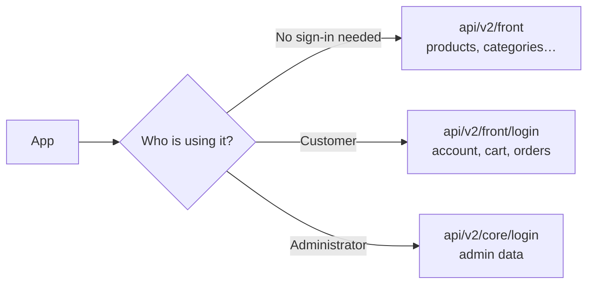

> 🌐 **Language:** [🇻🇳 Tiếng Việt](./api-introduction_vi.md) · 🇬🇧 English (current) · [🇯🇵 日本語](./api-introduction_ja.md)

# Introduction to the GP247 System API

## Introduction

This document introduces the **GP247 API (Application Programming Interface) system** — how external
applications (mobile apps, other websites, management software, third-party integrations…) can "talk"
to your GP247 site to fetch data, keep a cart and place orders. It is written for **integration developers** and **site
administrators** who want a big-picture view of what the API offers, how it is grouped, how
authentication (login) and permissions work, how errors are returned, and how to try it out. After
reading, you will know **which API does what, at which address, what key it needs, and which data it
lets you see**, with copy-and-run examples.

> ⚠️ **This document covers API v2 only** (`api/v2/core`, `api/v2/front`). **API v1** (`api/core`, `api/front`) is
> **no longer developed**: it still runs for existing apps, but it is off on fresh installs, gets no new features and only
> receives security fixes. New apps should use v2. Maintaining an older app? See [API v1 (no longer developed)](./api-v1.md).

> ℹ️ **What is an API (in plain terms):** think of the API as a "service counter" for your site.
> External apps don't reach straight into the data store; they send a request to the counter
> (a URL address), the counter checks the credentials (token/key), then returns the result as
> **JSON** (a text-based data format that computers can read). The whole exchange happens over
> the ordinary web protocol (HTTP).

> 📄 **Machine-readable specification:** every endpoint, parameter and error sample is in the file
> [`openapi.json`](./openapi.json) (OpenAPI 3.1) — load it into Postman, Insomnia or Swagger UI to try
> calls or generate client code.

> 🤖 **Want to use an AI agent (Claude, Cursor, VS Code…) with your shop?** No code needed — use the **MCP server** built into S-Cart:
> [Introduction to the MCP server](../mcp/mcp-introduction.md).

## At a glance

An app picks the API group by the job to do and by who is behind it:

- **Two groups** — `api/v2/front` for the store and its customers, `api/v2/core` for administrators ([Concepts you need](./api-concepts.md)).
- **Sign in with a token** — `login` issues a token you send back in the `Authorization: Bearer …` header ([Sign-in & tokens](./api-authentication.md)).
- **Never more than the screens show** — the admin API follows the account's own permissions and store ([Concepts you need](./api-concepts.md)).
- **The site owner turns each group on or off** on the API management screen; a group that is off answers `404 api_disabled` ([Concepts you need](./api-concepts.md)).
- **Fixed response shape** — always a `data` key; lists add `meta` and `links`; errors always have a `code` ([Conventions](./api-conventions.md)).

## Where to start — reading paths by role

Each role only needs a few pages, in the order below. Everyone should start with **Quick start**.

| You are building | Read in this order |
| --- | --- |
| **A mobile app / shopping website** for customers | [Quick start](./api-quickstart.md) → [Concepts you need](./api-concepts.md) → [Sign-in & tokens](./api-authentication.md) → [Storefront API](./api-storefront.md) → [Reference — Front](./api-reference-front.md) |
| **An ERP, warehouse software, CRM** connected to the site | [Quick start](./api-quickstart.md) → [Concepts you need](./api-concepts.md) → [Admin API](./api-admin.md) → [Data sync](./api-sync.md) → [Reference — Admin](./api-reference-admin.md) |
| **A site owner** turning on the API for a partner | [Concepts you need](./api-concepts.md) (API switches, API Connection, permissions) → [Troubleshooting](./api-troubleshooting.md) |
| **A plugin author** adding endpoints | [Conventions](./api-conventions.md) → [Creating an API for a plugin](./create-api.md) |

## The API v2 document set

| Page | Helps you |
| --- | --- |
| [Quick start](./api-quickstart.md) | Make your first API call in a few minutes, with copy-and-run steps |
| [Concepts you need](./api-concepts.md) | Understand why the API answers the way it does: API groups, permissions, stores, switches, API Connection |
| [Sign-in & tokens](./api-authentication.md) | Get a token, lifetime, refresh tokens, sign-in sessions, two-factor authentication, customer accounts |
| [Conventions](./api-conventions.md) | Response format, pagination, filters, `fields`/`include`, `304`, error codes, deprecation, generated clients |
| [Admin API](./api-admin.md) | Working with `api/v2/core` and its write calls (orders, products, stock, customers) |
| [Storefront API](./api-storefront.md) | Working with `api/v2/front`: catalog, cart, checkout, payment |
| [Data sync](./api-sync.md) | ERP sync: `updated_since`, event log, webhooks |
| [Troubleshooting](./api-troubleshooting.md) | Look up errors by symptom and by error code |
| [Reference — Front](./api-reference-front.md) · [Reference — Admin](./api-reference-admin.md) | Every endpoint: who can call it, parameters, examples, returned data (generated from `openapi.json`) |

## Swagger-style lookup and trying calls

Every endpoint, parameter, returned field and error code is in the file [`openapi.json`](./openapi.json) (OpenAPI 3.1). The two **Reference** pages
above are generated from this same file, so they always match.

- **Want the Swagger interface or to try calls** — load `openapi.json` into **Postman**, **Insomnia** or **Swagger Editor** on your own computer
  (how-to in [Quick start](./api-quickstart.md)).
- **Your site does not serve** `openapi.json` or any Swagger page — on purpose, so the site does not expose more attack surface.

> ⚠️ **Note:** only enter a token (especially an admin token) into a tool running on your own computer, never paste it into a web page.

## Looking for an old section?

This page used to hold the whole guide, split into 11 numbered sections. That content now lives in the topic pages:

| Old section | Now in |
| --- | --- |
| 1 | [The two API groups](./api-concepts.md#the-two-api-groups) |
| 2 | [Authentication (logging in to the API)](./api-authentication.md#authentication-logging-in-to-the-api) |
| 3 | [Permissions and data scope of the Core API](./api-concepts.md#permissions-and-data-scope-of-the-core-api) |
| 4 | [The API Connection protection layer — optional](./api-concepts.md#the-api-connection-protection-layer--optional) |
| 5 | [Turning the API on and off](./api-concepts.md#turning-the-api-on-and-off) |
| 6 | [Response format, list parameters & error codes](./api-conventions.md#response-format-list-parameters--error-codes) |
| 7 | [Core API workflow (Admin)](./api-admin.md#core-api-workflow-admin) |
| 8 | [Front API workflow (Storefront)](./api-storefront.md#front-api-workflow-storefront) |
| 9 | [Customer accounts & sign-in sessions](./api-authentication.md#customer-accounts--sign-in-sessions) |
| 9.1 | [Register, forgotten password, profile, address book](./api-authentication.md#register-forgotten-password-profile-address-book) |
| 9.2 | [Refresh tokens — stay signed in with short-lived tokens](./api-authentication.md#refresh-tokens--stay-signed-in-with-short-lived-tokens) |
| 9.3 | [Managing sign-in sessions](./api-authentication.md#managing-sign-in-sessions) |
| 9.4 | [Two-factor authentication (MFA) through a plugin](./api-authentication.md#two-factor-authentication-mfa-through-a-plugin) |
| 9.5 | [Admin API access log](./api-authentication.md#admin-api-access-log) |
| 10 | [Cart & checkout through the API](./api-storefront.md#cart--checkout-through-the-api) |
| 10.1 | [Checkout steps](./api-storefront.md#checkout-steps) |
| 10.2 | [Placing the order](./api-storefront.md#placing-the-order) |
| 10.3 | [Online payment and payment status](./api-storefront.md#online-payment-and-payment-status) |
| 10.4 | [Product data for buying](./api-storefront.md#product-data-for-buying) |
| 10.5 | [The whole buying flow](./api-storefront.md#the-whole-buying-flow) |
| 11 | [Deprecation policy & clients generated from OpenAPI](./api-conventions.md#deprecation-policy--clients-generated-from-openapi) |

## Change history
<!-- Only when logic/behavior changed. Newest row on top. One row per day: merge same-day changes into the existing row, never add a new row for the same date. -->

| Date | GP247 version | Change |
| --- | --- | --- |
| 2026-11-13 | gp247/core 3.12.0, gp247/front 3.8.0, gp247/shop 3.10.0 | Text comes back exactly as entered, not HTML-encoded (`Free & Pro`, no longer `Free &amp; Pro`); escape it yourself when you put it into HTML ([Response format, list parameters & error codes](./api-conventions.md#response-format-list-parameters--error-codes)) |
| 2026-11-02 | gp247/core 3.8.0, gp247/shop 3.7.0, gp247/front 3.5.0 | `ETag` + `If-None-Match` → `304` for every v2 `GET`; `Cache-Control: public` (default `max-age=0`, `GP247_API_PUBLIC_MAX_AGE`) for products, categories, brands, banners and content pages called without a token; `fields[<type>]` and `include` (at most 3, `GP247_API_MAX_INCLUDE`) ([Response format, list parameters & error codes](./api-conventions.md#response-format-list-parameters--error-codes)); the general limit of 1000 requests/minute is counted per account once signed in ([Authentication (logging in to the API)](./api-authentication.md#authentication-logging-in-to-the-api)); deprecation policy (`Deprecation` / `Sunset` / `Link`) and clients generated from `openapi.json` ([Deprecation policy & clients generated from OpenAPI](./api-conventions.md#deprecation-policy--clients-generated-from-openapi)) |
| 2026-11-01 | gp247/core 3.7.0, gp247/shop 3.6.0 | Lock / unlock a customer through the admin API: `PATCH api/v2/core/customer/{id}` (`{"status": 0 / 1}`, any other field → `422`; change permission on the Customer list screen; a lock refuses the customer's API tokens at once and signs the customer out on the storefront; optional `Idempotency-Key`, shared write limit) (sections 3, 7); the event log has 8 store event types: `order.created`, `order.status_changed`, `order.payment_status_changed`, `stock.changed`, `product.updated`, `product.deleted`, `customer.created`, `customer.updated` — recorded whatever the source of the change, each type readable with the permission of its admin screen ([Response format, list parameters & error codes](./api-conventions.md#response-format-list-parameters--error-codes)); editing a product's / category's texts now moves `updated_at`, while saving without changes and product page views do not ([Response format, list parameters & error codes](./api-conventions.md#response-format-list-parameters--error-codes)); webhooks for the ERP: each event of the log is `POST`ed right away to an `https` URL registered on the API management screen (administrators only, needs the event log on), signed with `X-GP247-Signature`, retried up to 5 times then given up, no cron needed (sections 5, 6) |
| 2026-10-31 | gp247/core 3.6.0, gp247/shop 3.5.0 / 3.5.1; change sync: gp247/core 3.7.0, gp247/shop 3.6.0, gp247/front 3.4.0; event log: gp247/core 3.7.0; order writes through the admin API: gp247/core 3.7.0, gp247/shop 3.6.0; product and stock writes through the admin API: gp247/shop 3.6.0 | Product and stock writes through the admin API: `PATCH api/v2/core/product/{id}` (selling price, cost price, status — following the field switches of the product settings), `product/{id}/stock` (`delta` receives/issues atomically, never below 0, sold counter untouched; `set` after a stock count, administrators only), `stock/batch` (1–100 lines, one result per line) — change permission on the Product list screen, `Idempotency-Key` required for stock writes, `422 stock_would_be_negative` / `stock_managed_by_components` (sections 3, 6, 7); Order writes through the admin API for ERP / warehouse tools: `api/v2/core/order/{id}/status`, `order/{id}/shipping` (shipping status + manual shipment tracking number), `order/{id}/notes` — change permission on the Order list screen, write limit 300 per minute per account (`GP247_API_WRITE_THROTTLE`), optional `Idempotency-Key` (retry ⇒ first result; `409 idempotency_key_reused` / `idempotency_in_progress`, `503 idempotency_unavailable` before `gp247:update`) (sections 3, 6, 7); Event log for ERP `api/v2/core/events` (`after` cursor, oldest first, limited by admin-screen permission and store; off by default — **Event log for sync (ERP)** switch on the API management screen, `409 event_log_disabled` while off; kept 30 days, a too-old cursor gets `410 cursor_expired`) (sections 5, 6); Admin v2 lists gain a change-sync mode: `updated_since` + `page[after]` cursor, `meta.next_after` / `has_more` / `sync_until` ([Response format, list parameters & error codes](./api-conventions.md#response-format-list-parameters--error-codes)); The document now covers API v2 only; API v1 moved to its own document ([API v1](./api-v1.md)); shop 3.5.1: cancelling an unpaid app order (`orders/{id}/cancel`, `member/orders/{id}/cancel`), gateway orders unpaid after 24 hours cancel themselves, paid / fully refunded orders follow the gateway's status, orders of a store without its own domain are paid through the gateway ([Online payment and payment status](./api-storefront.md#online-payment-and-payment-status)); Every response is JSON even without `Accept: application/json` (missing token → `401`, no more `500`); `register` and `member/password` require a password, a body missing a required field → `422` (sections 6, 9.1) |
| 2026-10-30 | gp247/shop 3.5.0 | Cart through API v2 (`api/v2/front/cart`, `cart/items`): account cart shared with the website, guest cart with `X-Cart-Token` (30 days), guest cart merged at sign-in / registration (`cart_merge`), at most 100 lines, 60 calls per minute; checkout steps through API v2 (`checkout`, `checkout/address`, `checkout/shipping-methods` + `shipping-method`, `checkout/payment-methods` + `payment-method`, `checkout/totals`) and promotions (`cart/promotions/{pluginKey}`); ordering through API v2 (`checkout/place`): `Idempotency-Key` required (resend ⇒ same order), `409 price_changed` with the new totals, **Ordering through the API** switch on the API management screen (off by default), 10 orders per minute; online payment through the API (`payment.url`, payer sent back to the app through a `return_url` on the allowed list `GP247_PAYMENT_RETURN_URLS`, empty by default) and payment status (`member/orders/{id}/payment`, `orders/{id}/payment` + `X-Order-Access`); v2 product adds `attributes`, `image_sizes`, `stock_status` |
| 2026-10-29 | gp247/core 3.6.0 | Changing/resetting an **administrator** password (Users screen, Account settings, forgot password) signs every API token and session of that admin out |
| 2026-10-28 | gp247/core 3.3.1; `X-Request-Id`, legacy token expiry, plain keys removed, `api_route_gate`: 3.4.0; customer accounts & sessions: core 3.6.0, shop 3.4.0 | API on/off on the API management screen (all + v1/v2 × core/front), fresh installs turn on v2 only, a group that is off answers `404 api_disabled` (3.3.1); a group that is off answers `api_disabled` even without a token; `X-Request-Id` header on every response; tokens issued before 3.2.3 get an expiry at `gp247:update` (at least 7 days); `gp247:update` removes the plain copy of API Connection keys; `gp247:doctor` checks the route cache (3.4.0); customer accounts through API v2 (register, forgotten/reset password, profile, password change, address book, resend verification e-mail), optional rotating refresh tokens (60-minute tokens), session management, v2 `logout` ends the whole session, extra verification step through a plugin (`challenge_required`), changing/resetting a password revokes every API token, the e-mail verification link works without a website sign-in, admin API access log (core 3.6.0, shop 3.4.0) |
| 2026-10-26 | gp247/core, gp247/front, gp247/shop 3.2.3; API v2 and new environment variable names: 3.3.0 | Added API v2 (`api/v2/...`: `{data, meta, links}` responses, `filter`/`sort`/`q`/`lang`, `price_final`, `meta`) and correctly spelled environment variable names (3.3.0); Core API follows admin-screen permissions and store scope; login attempt limits; tokens always expire, added `POST logout`; locked customers cannot log in; public API only returns data the store is currently showing, internal fields removed; API Connection keys stored hashed; every error has a meaningful HTTP code and the `{error, msg, code}` shape; added `openapi.json` |

## Q&A

**Q1: I need an endpoint that isn't in the list?**

→ A developer can extend the API by declaring routes in a separate plugin — without modifying the core
code. See [How to create an API the right way](./create-api.md).

**Q2: Which GP247 release does this documentation describe?**

→ The latest release of gp247/core, gp247/front and gp247/shop. Every endpoint on the Reference pages has a **Since** entry; a site running
an older release may not have that endpoint yet — see [Troubleshooting](./api-troubleshooting.md).

**Q3: Is there a Swagger page to browse the API?**

→ The two Reference pages show the same content as Swagger, in your language. For the actual Swagger interface, open `openapi.json`
in Swagger Editor, Postman or Insomnia on your computer.

---

📅 **Last updated:** 2026-11-13 · ✍️ **Author:** GP247
