> 🌐 **言語:** [🇻🇳 Tiếng Việt](./api-introduction_vi.md) · [🇬🇧 English](./api-introduction.md) · 🇯🇵 日本語（現在）

# GP247 システムの API 入門

## はじめに

このドキュメントでは、**GP247 の API（アプリケーション・プログラミング・インターフェース）システム**を紹介します。
外部のアプリケーション（モバイルアプリ、別の Web サイト、管理ソフト、サードパーティ連携など）が、
あなたの GP247 サイトと「会話」してデータを取得し、カートを扱い、注文する方法を説明します。
対象読者は、API の全体像を知りたい**連携開発者**と**サイト管理者**です。
API にどんな機能があるか、いくつのグループに分かれるか、認証（ログイン）と権限の仕組み、
エラーがどう返るか、試し方を扱います。
読み終えると、**どの API が何をするのか、どのアドレスで呼ぶのか、どんな鍵が必要か、どのデータを見られるのか**がわかります。
コピーしてすぐ動かせる例も載せています。

> ⚠️ **このドキュメントは API v2 のみを扱います**（`api/v2/core`、`api/v2/front`）。**API v1**（`api/core`、`api/front`）は
> **開発を終了**しました。利用中のアプリでは引き続き動作しますが、新規インストールでは最初からオフで、新機能は追加されず、
> セキュリティ修正だけを受けます。新しいアプリは v2 を使ってください。古いアプリを保守している場合は
> [API v1（開発終了）](./api-v1_ja.md)を参照してください。

> ℹ️ **API とは（身近なたとえ）：** API はサイトの「窓口」のようなものです。
> 外部アプリはデータの保管庫に直接入りません。窓口（URL アドレス）にリクエストを送ります。
> 窓口は書類（トークン／キー）を確認し、結果を **JSON**（コンピューターが読めるテキスト形式のデータ）で返します。
> やり取りはすべて、通常の Web の通信方式（HTTP）で行われます。

> 📄 **機械可読な仕様書：** すべてのエンドポイント、パラメーター、エラーの例はファイル
> [`openapi.json`](./openapi.json)（OpenAPI 3.1）にまとめています。Postman、Insomnia、Swagger UI に読み込んで
> 試しに呼び出したり、クライアントのコードを生成したりできます。

## ひと目でわかる

アプリは、行う処理と利用者に応じて API グループを選びます。

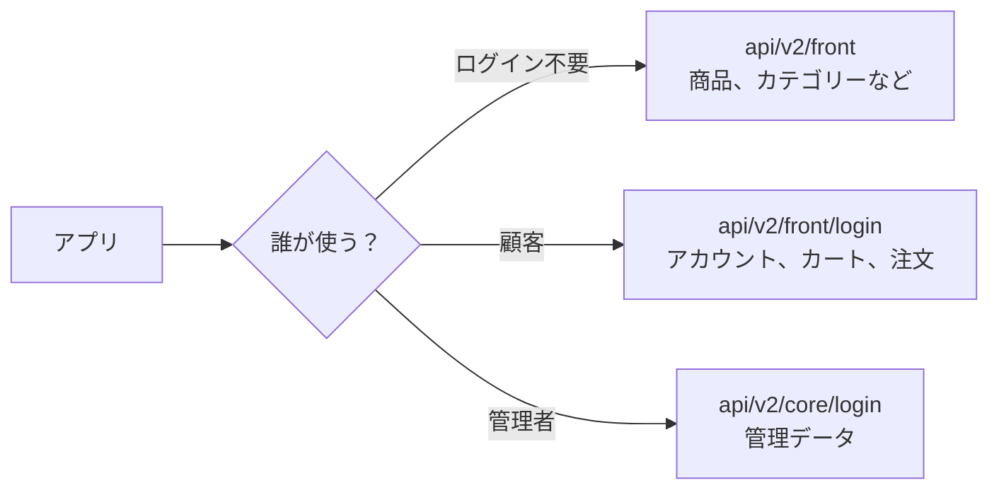

- **2 つのグループ** — ストアと顧客向けの `api/v2/front`、管理者向けの `api/v2/core` です（セクション 1）。
- **トークンでログイン** — `login` が発行したトークンを `Authorization: Bearer …` ヘッダーで送ります（セクション 2）。
- **画面で見られる以上は見せない** — 管理 API はアカウント自身の権限とストアに従います（セクション 3）。
- **サイトのオーナーがグループごとにオン／オフ** — API 管理画面で切り替え、オフのグループは `404 api_disabled` を返します（セクション 5）。
- **固定されたレスポンス形式** — 常に `data` キーがあり、一覧には `meta` と `links` が付きます（セクション 6）。
- **軽くて速い** — 必要な項目だけ取得（`fields`）、関連データを同時に取得（`include`）、変わっていないデータの再読み込みには `304`（セクション 6）。

## このページの内容

- [1. 2 つの主要 API グループ](#1-2-つの主要-api-グループ) — アプリに合ったグループを選ぶ
- [2. 認証](#2-認証api-へのログイン) — トークンの取得、有効期限、ログイン回数の制限
- [3. 権限](#3-core-api-の権限とデータの範囲) — 有効なトークンでも `403` になる理由
- [4. API Connection](#4-接続保護レイヤーapi-connection-任意) — アプリ用の追加の鍵
- [5. API のオン／オフ](#5-api-のオンオフ) — API 管理画面のスイッチ
- [6. レスポンス、パラメーター、エラー](#6-レスポンスの形式一覧のパラメーターエラーコード) — 結果の読み方、絞り込み、並べ替え、項目の選択と関連データ、キャッシュと `304`、変更の同期、イベントログ、Webhook、ERP 同期の全体の流れ、エラー処理
- [7. Core API（管理）](#7-core-api管理の処理の流れ) — 管理の流れとエンドポイント、ERP／CRM／倉庫ソフト向けの注文・商品・在庫の書き込み、顧客のロック
- [8. Front API（ストアフロント）](#8-front-apiストアフロントの処理の流れ) — 公開データと顧客アカウントの流れとエンドポイント
- [9. 顧客アカウントとセッション](#9-顧客アカウントとサインインセッション) — 会員登録、リフレッシュトークン、MFA
- [10. カートと注文](#10-api-によるカートと注文) — カート、チェックアウト、支払い
- [11. 非推奨とクライアント生成](#11-非推奨ポリシーと-openapi-からのクライアント生成) — 廃止前の予告、`Deprecation` ヘッダー、TypeScript クライアント

---

## 1. 2 つの主要 API グループ

GP247 システムは API を **2 つのグループ**に分けています。それぞれ利用者が異なります。

| グループ | アドレスの接頭辞（prefix） | 用途 | ログインする人 |
| --- | --- | --- | --- |
| **Core API（管理）** | `api/v2/core` | リモートからのシステム管理（管理アプリ、独自ダッシュボード） | **管理者**（admin）アカウント |
| **Front API（ストアフロント）** | `api/v2/front` | ストアのデータ表示、顧客アカウント、カートと注文 | 顧客／会員。公開データは**ログイン不要** |

- **`api/v2/core`** は、ログイン／管理者情報の部分を `gp247/core` パッケージが提供します。
  `gp247/shop` と `gp247/front` が、管理データ（顧客、注文、商品、バナーなど）を読み取るエンドポイントを追加します。
- **`api/v2/front`** は `gp247/front` と `gp247/shop` パッケージが提供します。商品一覧、カテゴリー、
  ブランド、コンテンツページ、バナー、そして顧客のアカウント／カート／注文など、ストアの「表側」のデータです。

> ℹ️ **対応バージョン:** gp247/core, gp247/front, gp247/shop 3.3.0

> **完全なアドレス** ＝ サイトのドメイン ＋ 接頭辞 ＋ パス です。たとえばサイトが
> `https://shop.example.com` の場合、商品一覧を取得するエンドポイントは次のとおりです。
> `https://shop.example.com/api/v2/front/product/list`

---

## 2. 認証（API へのログイン）

GP247 は **Laravel Sanctum** を使って**トークン**（「入場券」の役割をする長い文字列）を発行します。
仕組みは両グループで共通です。

1. アプリがログイン情報を `login` エンドポイントに送ります。管理者は **`username` ＋ `password`** を `api/v2/core/login` に、
   顧客は **`email` ＋ `password`** を `api/v2/front/login` に送ります。
2. 正しければ、システムは `data` キーの中に **`access_token`**（Bearer 形式のトークン）と有効期限
   （`expires_at`、および秒単位の `expires_in`）を返します。
3. 以降、ログインが必要なリクエストには、このトークンを **ヘッダー** に付けて送ります。

   ```
   Authorization: Bearer <access_token>
   ```

4. 終了するときは **`POST logout`** を呼び、**現在のセッションをサインアウト**します（古いトークンとそのリフレッシュトークンはすぐに使えなくなります）。

### 権限の範囲（scope / ability）

各トークンには、誰のトークンかを示す**権限の範囲**が付きます。

| Scope | 意味 |
| --- | --- |
| `admin` | 管理者のトークン（Core API） |
| `admin-supper` | `administrator` ロールを持つ管理者のトークン（Core API） |
| `user` | 会員のトークン（Front API） |

> ℹ️ **対応バージョン:** gp247/core 3.2.3 — scope は**アカウントの種類**だけを区別します。**どのデータを見られるか**は、
> アカウント自身の権限設定で決まります（セクション 3）。scope `user-guest` は発行されなくなりました。
> ロックされている顧客アカウントはログインできません。

### トークンの有効期限

> ℹ️ **対応バージョン:** gp247/core 3.2.3

すべてのトークンには有効期限（`expires_at`）があります。

| トークンの種類 | `remember_me` を送らない場合 | `remember_me = true` を送る場合 |
| --- | --- | --- |
| 管理者 | 7 日（`GP247_API_TOKEN_EXPIRE_ADMIN_DEFAULT`） | 30 日（`GP247_API_RECOMMEMBER_ADMIN`） |
| 会員 | 7 日（`GP247_API_TOKEN_EXPIRE_DEFAULT`） | 30 日（`GP247_API_RECOMMEMBER`） |

`with_refresh: true` を付けてログインすると、アクセストークンの有効期間は **60 分**だけになり、更新用の*リフレッシュトークン*が
付きます（セクション 9.2）。モバイルアプリにはこの方法をおすすめします。

> ℹ️ **対応バージョン:** gp247/core 3.3.0 — 環境変数に正しい綴りの名前ができました：`GP247_API_REMEMBER`、
> `GP247_API_REMEMBER_ADMIN`、`GP247_API_SCOPE_ADMIN_SUPER`。旧名（`GP247_API_RECOMMEMBER` など）も引き続き使えます。
> 両方を設定した場合は新しい名前が優先されます。`php artisan gp247:doctor` は、まだ使われている旧名を報告します
> （チェック項目 `api_config_legacy_names`）。scope `admin-super` を持つトークンも、`admin-supper` と同様に受け付けられます。

期限切れのトークンは `401` を返します。その場合は `refresh`（`with_refresh` 付きでログインした場合）または `login` を呼んで
新しいトークンを取得してください。期限切れから長く経った（7 日を超えた）トークンは、同じアカウントが次にログインしたときに
自動で削除されます。cron は不要です。

> ℹ️ **対応バージョン:** gp247/core 3.4.0 — **3.2.3 より前**に発行されたトークン（当時は有効期限がありませんでした）には、
> `php artisan gp247:update` を実行したときに有効期限が設定されます。トークンの実際の経過日数に「remember」の期間
> （管理者: `GP247_API_REMEMBER_ADMIN`、会員: `GP247_API_REMEMBER`）を加えた日時ですが、アップグレードから
> **7 日より早くはなりません**。古いトークンを持つアプリには、再ログインが必要になるまで少なくとも 7 日あります。
> アプリが `401` を受けたら `login` を呼ぶようにしておいてください。

> ℹ️ **対応バージョン:** gp247/core 3.6.0、gp247/shop 3.4.0 — 顧客のパスワードを変更または再設定すると（ウェブサイトでも API でも）、
> その顧客の**すべてのトークン**が無効になります。**管理者**も同様です：**ユーザー**画面、**アカウント設定**、または
> 「パスワードを忘れた場合」でパスワードを変更すると、その管理者のすべての API トークンが無効になります。

### ログイン試行回数の制限

> ℹ️ **対応バージョン:** gp247/core 3.2.3

パスワードの総当たりを防ぐため、`api/v2/core/login`、`api/v2/front/login` と管理画面のログインフォームは試行回数を制限しています。
管理画面のログインフォームと `api/v2/core/login` は同じカウンターを共有し、一方での失敗はもう一方にも数えられます。

| 制限 | 既定値 | 変更する環境変数 |
| --- | --- | --- |
| アカウントごと（同じ IP から） | 1 分あたり 5 回 | `GP247_LOGIN_THROTTLE`（形式 `回数,分`） |
| IP ごと（すべてのアカウント合計） | 1 分あたり 20 回 | `GP247_LOGIN_IP_THROTTLE` |

> ⚠️ **gp247/core 3.5.0 で名称変更:** 旧名 `GP247_API_LOGIN_THROTTLE` と `GP247_API_LOGIN_IP_THROTTLE` は
> 読み込まれなくなりました。設定している場合は `.env` で名前を変更してください。変更しない場合は上記の既定値が使われます。

制限を超えると → HTTP `429` と `Retry-After` ヘッダー（待つ必要がある秒数）が返ります。
正しくログインすると、そのアカウントのカウンターはリセットされます。
このほか、すべての API エンドポイントには 1 分あたり 1000 回の共通制限があります（`GP247_API_THROTTLE`）。ログイン済みなら
**アカウントごと**、未ログインなら IP ごとに数えます。

> ℹ️ **対応バージョン:** gp247/core 3.8.0 — それ以前は共通制限を IP ごとに数えていたため、同じネットワーク（携帯回線や
> オフィスの NAT）の背後にいる多くのアプリ利用者が 1 つのカウンターを共有していました。複数のツールが **1 つのアカウントを共有**
> している場合は、今後そのカウンターを共有します — ツールごとにアカウントを分けるか、`GP247_API_THROTTLE` を引き上げてください。

---

## 3. Core API の権限とデータの範囲

> ℹ️ **対応バージョン:** gp247/core 3.2.3, gp247/shop 3.2.3, gp247/front 3.2.3

Core API は**管理画面で見られる以上のデータを見せません**。データを読み取る各エンドポイントは 1 つの管理画面に対応しており、
管理者はアカウントがその画面を開く権限を持っている場合にだけ呼び出せます
（権限は **管理 → ロール／権限** で設定します）。権限がなければ → HTTP `403`。

| エンドポイント（接頭辞 `api/v2/core`） | 必要な権限（管理画面） |
| --- | --- |
| `customer/list`, `customer/detail/{id}` | 顧客一覧 |
| `customer/{id}`（`PATCH`） | 顧客一覧画面の**変更権限**（セクション 7） |
| `order/list` | 注文一覧 |
| `order/detail/{id}` | 注文の詳細 |
| `order/{id}/status`, `order/{id}/shipping`, `order/{id}/notes` | 注文一覧画面の**変更権限**（セクション 7） |
| `product/*` | 商品一覧 |
| `product/{id}`（`PATCH`）, `product/{id}/stock`, `stock/batch` | 商品一覧画面の**変更権限**（セクション 7） |
| `category/*`, `brand/*`, `supplier/*` | カテゴリー／ブランド／仕入先一覧 |
| `banner/*`, `page/*` | バナー／コンテンツページ一覧 |
| `logout`, `info`, `sessions` | 有効なトークンのみ |
| `login`, `login/challenge`, `refresh` | トークン不要 |

- `administrator` ロールはすべてのエンドポイントを呼び出せます。`view.all` ロールは閲覧のみです。
- **ストアごとのデータ：** 複数ストアのサイトでは、1 つのストアに割り当てられた管理者はそのストアのデータだけを見られ、
  **自分のストアのドメイン**でしか API を呼び出せません（管理画面にログインするときと同じです）。
  他のストアのレコードは `404` を返します。
- 管理者アカウントが無効（`status = 0`）になると、古いトークンは使えなくなります（`401`）。

---

## 4. 接続保護レイヤー（API Connection）— 任意

トークンに加えて、GP247 にはすべての API の前に立つ**追加の鍵**があります。これを **API Connection** と呼びます。
これは 2 つ目の「門番」です。許可されたアプリケーションだけが API を呼べるようにします。
公開エンドポイントも対象です。

- このレイヤーは**既定でオフ**です。管理画面の設定 `api_connection_required` でオン／オフを切り替えます。
- **オンの場合：** すべてのリクエストに、さらに**2 つのヘッダー**を付ける必要があります。

  ```
  apiconnection: <接続コード>
  apikey: <秘密キー>
  ```

- `apiconnection`／`apikey` のペアは **GP247 の管理画面**（API Connection の管理項目）で作成・管理します。
  ペアごとに有効期限（`expire`）とオン／オフの状態（`status`）を設定できます。
- 不足している、誤っている、期限切れ、または無効になっている場合、API は HTTP `401` と
  `"code": "api_connection_invalid"` を返します。

> ℹ️ **対応バージョン:** gp247/core 3.2.3 — キーは**ハッシュ化して保存**されます。管理画面にキーが表示されるのは、
> 作成／再生成した直後の**1 回だけ**なので、すぐにコピーしてください。接続を編集するとき、キーの欄を空のままにすると
> 古いキーがそのまま残ります。以前から使っているキーは、アップグレード（`php artisan gp247:update`）後も引き続き使えます。
> 保存されたままの平文のコピーを消すため、都合のよいときに古いキーを**再生成**してください。手入力するキーは 32 文字以上が必要です。

> ℹ️ **対応バージョン:** gp247/core 3.4.0 — `php artisan gp247:update` がキーの平文のコピーを**完全に削除**します。
> 使用中のキーは引き続き使えます（ハッシュで照合します）。平文のコピーは復元できないため、必要な場合はアップグレード前に
> **データベースをバックアップ**してください。

> チェックレイヤー（ミドルウェア）の順序は **リクエスト ID `X-Request-Id` を付ける → API のオン／オフスイッチを確認
> （セクション 5）→ JSON を返す → API Connection を確認 → レート制限** で、その後に各エンドポイントのログイン／権限の
> チェックが続きます。この順序は固定で、変更しないでください。*（先頭の 2 つ: gp247/core 3.3.1 と 3.4.0 から。）*

---

## 5. API のオン／オフ

> ℹ️ **対応バージョン:** gp247/core 3.3.1

サイトのオーナーは、管理画面の **API 管理画面**（API Connection と同じ画面）で API をオン／オフできます。設定ファイルの
編集やサーバーでのコマンド実行は不要で、変更は次のリクエストからすぐに反映されます。

| スイッチ | 対象 |
| --- | --- |
| **REST API（全グループ）** | すべての API エンドポイント（標準の仕組みでプラグインが追加した API を含む） |
| **v2 · 管理API (core)** | `api/v2/core/*` |
| **v2 · 公開・顧客API (front)** | `api/v2/front/*` |
| **同期用イベントログ（ERP）** *（gp247/core 3.7.0 から）* | 変更を記録し、ERP／同期ツールが `api/v2/core/events` で読めるようにする（セクション 6）— **既定はオフ** |

この画面には API v1（開発終了）用のスイッチも 2 つあります — [API v1 のセクション 2](./api-v1_ja.md) を参照してください。
API による注文には、v2 front グループの下にもう 1 つ **「API経由の注文」** スイッチがあります（セクション 10.2）。

- 各グループのスイッチは、そのグループのエンドポイント一覧のすぐ上にあります。オフのグループには「オフ」と表示されます。
- オフのグループを呼ぶと → HTTP `404`、`"code": "api_disabled"`（セクション 6）— トークンがなくても同じです
  *（gp247/core 3.4.0 から。3.3.1 ではトークンがないと `401` を返します）*。
- **新規インストール**では **v2** がオンです。古いバージョンから**アップグレード**したサイトは、オンだったグループをそのまま維持します。
- **同期用イベントログ（ERP）** は、新規インストールでもアップグレードしたサイトでもオフです。オフの間はイベントが一切記録されず、
  `api/v2/core/events` を読むと `409 event_log_disabled` が返ります。ERP や同期ツールが読む場合にだけオンにしてください。
  Webhook（セクション 6）はこのログのイベントを送るため、このスイッチがオンである必要があります。
- 環境変数 `GP247_API_MODE=0` は引き続き**サーバーレベルのスイッチ**です。この場合 API エンドポイントは存在せず、
  画面のスイッチはロックされます。API を完全に止めたいホスティング／技術担当者向けです。
- 独自の仕組みを使うプラグインの API（例: MCP サーバー）はこれらのスイッチの**対象外**で、プラグインの画面に専用の
  スイッチがあります。
- **ルートキャッシュを使うサイト**（`php artisan route:cache`）: `php artisan gp247:update` がアップグレード後にキャッシュを
  再構築します。`composer update` だけを実行した場合はスイッチがまだ効かないことがあり、`php artisan gp247:doctor` の
  `api_route_gate` で報告されます *（gp247/core 3.4.0 から）*。`php artisan gp247:cache-rebuild` を実行して直してください。

---

## 6. レスポンスの形式、一覧のパラメーター、エラーコード

このセクションでは、すべてのエンドポイントに共通する方法で、結果を正しく読み、一覧を絞り込み／並べ替え、エラーを処理する方法を説明します。

### 成功時のレスポンス

- **レスポンスはすべて JSON です。** アプリが `Accept: application/json` ヘッダーを送らない場合も同じです。

> ℹ️ **対応バージョン:** gp247/core 3.6.0 — これより前は、ログインが必要なエンドポイントをトークンなし**かつ**
> `Accept: application/json` なし（curl、Postman、多くの SDK の既定）で呼ぶと、`401 unauthenticated` ではなく HTTP `500` が返っていました。

| ケース | レスポンスの形 |
| --- | --- |
| 1 件 | `{"data": {...}}` |
| 一覧 | `{"data": [...], "meta": {...}, "links": {...}}` — `meta` には `current_page`、`per_page`、`total`、`last_page`、`links` には `first`、`last`、`prev`、`next` |
| 商品／カテゴリー／ページの名前と説明 | `lang` で選んだ言語の `name`、`description` など |
| 価格 | `price` と `price_final`（ストアで顧客が支払う価格。プロモーション適用後） |

### すべての一覧エンドポイントで使えるパラメーター

| パラメーター | 意味 | 例 |
| --- | --- | --- |
| `filter[<名前>]` | データの種類ごとに許可された項目で絞り込む（下の表を参照） | `filter[brand_id]=5` |
| `sort` | 昇順で並べ替え。先頭に `-` を付けると降順 | `sort=-price` |
| `q` | 検索（名前、SKU、メールアドレスなど。データの種類による） | `q=ao-thun` |
| `lang` | 名前／説明の言語。無効なコードの場合はサイトの既定の言語 | `lang=vi` |
| `page[number]`, `page[size]` | ページと 1 ページあたりの件数（既定 20、最大 100） | `page[size]=50` |

**一覧にない**絞り込み名や並べ替え項目を指定すると → HTTP `422`（`validation_failed`）。レスポンスに許可されている名前が示されます。

| データ | `filter[...]` | `sort` |
| --- | --- | --- |
| 商品 | `category_id`, `brand_id`, `kind`, `product_type`, `price_min`, `price_max`（＋ 管理: `status`, `approve`, `supplier_id`） | `price`, `created_at`, `sort`, `sku` |
| カテゴリー | `parent`, `top`（管理: `parent`, `status`） | `sort`, `created_at` |
| ブランド、仕入先 | （管理: `status`） | `sort`, `name` |
| 顧客（管理） | `status`, `group` | `created_at`, `email` |
| 注文（管理） | `status`, `payment_status`, `shipping_status`, `customer_id` | `created_at`, `total` |
| 顧客自身の注文 | `status` | `created_at`, `total` |
| バナー | `type` | `sort`, `created_at` |
| コンテンツページ | — | `created_at` |

### 項目の選択（`fields`）と関連データの同時取得（`include`）

> ℹ️ **対応バージョン:** gp247/core 3.8.0, gp247/shop 3.7.0, gp247/front 3.5.0

アプリの画面が必要とする項目は、たいてい一部だけです。`fields[<種類>]` を送ると、その項目だけが返ります — レスポンスが軽くなり、
サーバーも使わない重いデータ（商品のバリエーションなど）を読みません。`include` を送ると、レコードごとに追加で呼び出す代わりに、
関連データを同じ呼び出しで受け取れます。

| パラメーター | 意味 | 例 |
| --- | --- | --- |
| `fields[<種類>]` | 指定した項目だけを返します（`id` は常に含まれます）。`<種類>`: `product`、`category`、`brand`、`supplier`、`customer`、`order`、`banner`、`page`、または同時取得したデータの種類 | `fields[product]=name,image,price_final` |
| `include` | 関連データを同時に取得 — 1 階層のみ、1 回の呼び出しで最大 3 つ（`GP247_API_MAX_INCLUDE`） | `include=brand,categories` |

| データ | 使える `include` | 同時取得したデータの項目を選ぶ種類 |
| --- | --- | --- |
| 商品（ストア） | `images`、`brand`（有効なブランドのみ）、`categories`（表示中のカテゴリーのみ） | `brand`、`category` |
| 商品（管理） | `images`、`brand`、`categories` | `brand`、`category` |
| 注文（管理） | `transactions`（入金台帳）、`histories`（処理履歴、HTML を含まないテキスト） | `transaction`、`history` |
| その他のデータ | — | — |

```bash
curl "https://your-domain.com/api/v2/front/product/list?fields[product]=name,image,price_final,brand&include=brand&fields[brand]=name"
```

- `fields` / `include` を送らなければ、レスポンスはこれまでとまったく同じです。
- 一覧にない種類・項目・`include`、入れ子の `include`（`brand.products`）、上限を超える数 → `422`（`validation_failed`）。
  レスポンスに有効な名前が示されます。
- 項目を選んでも隠れた項目は開きません: 公開 API は引き続き原価や在庫数を返しません。
- 同期モード `updated_since`（次の項）でも使えます。

### キャッシュと `304 Not Modified`

> ℹ️ **対応バージョン:** gp247/core 3.8.0, gp247/shop 3.7.0, gp247/front 3.5.0

成功した `GET` のレスポンスには、内容の「指紋」である `ETag` ヘッダーが付きます。アプリはデータと一緒に保存し、次回は
`If-None-Match: <ETag>` を送ります。データが変わっていなければ API は中身のない `304` を返し、アプリは保存したデータを使います。

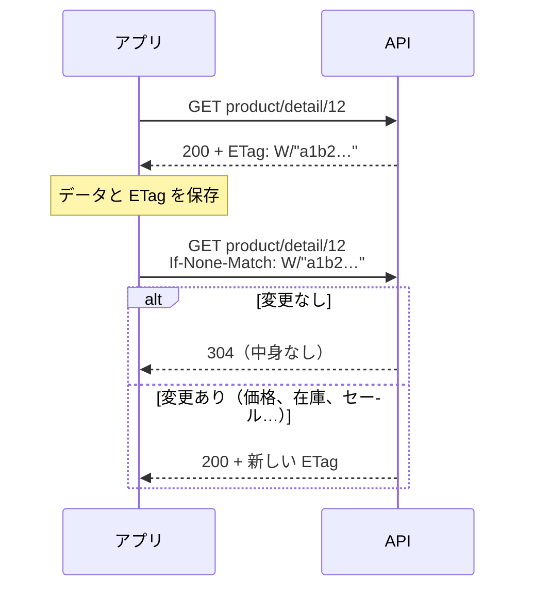

- `ETag` は実際に返す内容から計算するので、アプリから見える変更は — 始まったばかりのセールも含めて — すべて新しい `ETag` になります。
  API は `Last-Modified` を使いません。
- `304` は購入者の通信量を節約します。サーバーは比較のためにデータを読みます。
- 商品、カテゴリー、ブランド、バナー、コンテンツページを **トークンなし** で呼ぶと、`Cache-Control: public, max-age=<N>` と
  `Vary: Authorization` が付くので、ブラウザーや CDN がコピーを保持できます。`N` の既定値は `0`（毎回サーバーに確認し、
  変更がなければ `304`）。サイトのオーナーは `GP247_API_PUBLIC_MAX_AGE`（秒）で引き上げられます — その代わり、新しい価格の
  表示が最大 `N` 秒遅れることがあります。
- トークン付きの呼び出し、カート、注文、顧客アカウント、管理 API は **決して** 公開キャッシュされません。

### 変更の同期（`updated_since`）

> ℹ️ **対応バージョン:** gp247/core 3.7.0, gp247/shop 3.6.0, gp247/front 3.4.0

ERP、会計ソフト、同期ツール向けの機能です。毎回すべてを取り直す代わりに、前回の読み取り以降に**変更されたレコードだけ**を
取得できます。対象は 8 つの管理用一覧 `api/v2/core/{product,category,brand,supplier,customer,order,banner,page}/list` です。
公開用の一覧（`api/v2/front/...`）にはこのモードはありません。`updated_since` を送らなければ、一覧はこれまでとまったく同じに応答します。

| パラメーター | 意味 |
| --- | --- |
| `updated_since` | ISO-8601 形式の日時。例: `2026-10-31T08:00:00+07:00`。日付のみ、またはオフセットなし → サイトのタイムゾーン。`updated_at >= updated_since` のレコードを、**変更の古い順**（`updated_at`、次に `id`）で返します |
| `page[after]` | ページのカーソル。前のページの `meta.next_after` を使います。`page[number]` はありません |
| `page[size]` | 1 ページあたりの件数。既定 20、最大 100 |
| `filter[...]`, `q` | 通常どおり使えます。ストアの範囲と管理画面の権限は変わりません（3 章） |

レスポンスには `total`、`last_page`、`current_page` はありません。`meta` には `per_page`、`next_after`（最後のレコードの
カーソル。ページが空なら `null`）、`has_more`（次のページがあるか）、`sync_until`（最後のレコードの `updated_at`、ISO-8601。
ページが空なら `null`）が入ります。`links` は `next` のみです（最後のページでは `null`）。

```bash
curl -G "https://shop.example.com/api/v2/core/product/list" \
  --data-urlencode "updated_since=2026-10-31T08:00:00+07:00" \
  --data-urlencode "page[size]=100" \
  -H "Accept: application/json" \
  -H "Authorization: Bearer 1|aBcD...very-long...XyZ"
```

レスポンス（抜粋）:

```json
{
  "data": [
    { "id": "PRD-AbC12", "sku": "TSHIRT-01", "name": "Tシャツ" }
  ],
  "meta": { "per_page": 100, "next_after": "MjAyNi0xMC0z…", "has_more": true, "sync_until": "2026-10-31T08:15:42+07:00" },
  "links": { "next": "https://shop.example.com/api/v2/core/product/list?updated_since=…&page[size]=100&page[after]=MjAyNi0xMC0z…" }
}
```

> 💡 パラメーターは URL エンコードして送ってください（上の `--data-urlencode` のように）。オフセットの `+` をそのまま URL に入れると空白になります。

推奨する同期ループ:

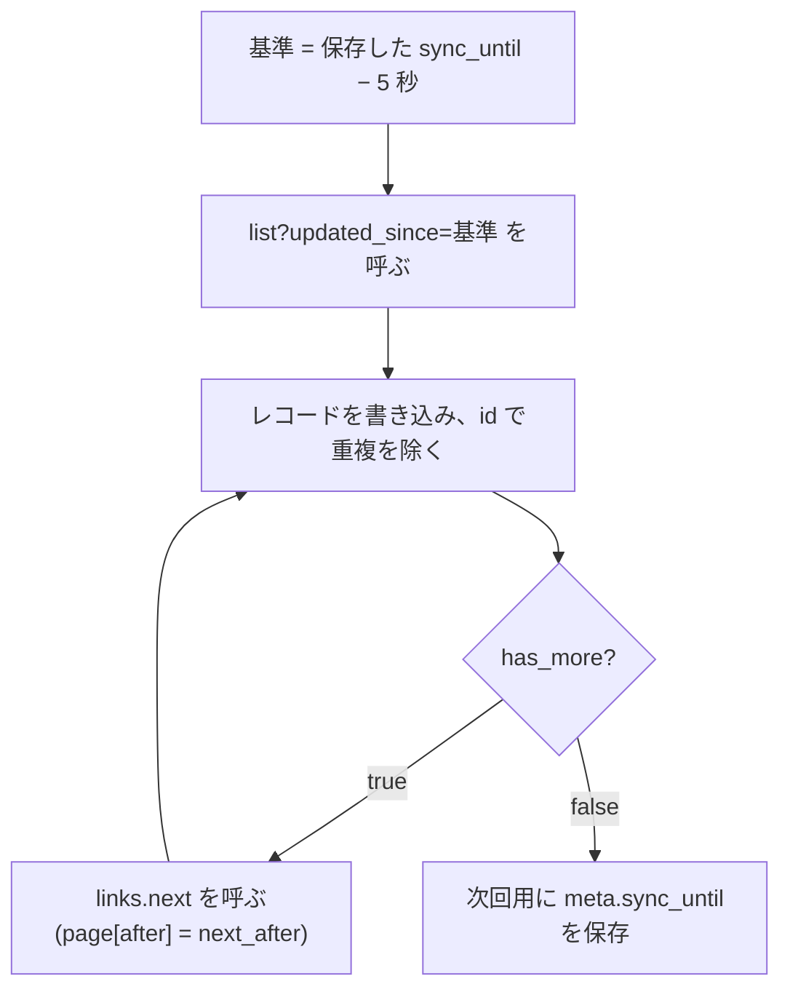

- すべてのページを読み終えてから（`has_more = false` まで）`meta.sync_until` を保存します。次回は `updated_since` =
  `sync_until` **の数秒前**（5 秒）を送り、`id` で重複を除きます。時刻の精度は 1 秒なので、いくつかのレコードが再度返ります。
  新しいレコードがない（`sync_until` が `null`）→ 前回の基準をそのまま使います。
- HTTP `422`（`validation_failed`）になるのは: `updated_since` が ISO-8601 でない場合、`page[after]` が一覧の返したカーソルでない
  場合、`sort` または `page[number]` を `updated_since` と一緒に送った場合です。
- **実際の変更だけが `updated_at` を動かします** *（gp247/shop 3.6.0 から）*: 商品またはカテゴリーの多言語テキスト（名前、
  説明）を編集しても `updated_at` が変わります。何も変えずにフォームを保存した場合や、顧客が商品ページを閲覧した場合は
  **変わりません**。
- **削除されたレコードはここには現れません:** 一覧が返せるのは、まだ存在するレコードだけです。どのレコードが削除されたかを
  知るには、イベントログ（すぐ下の節）を読んでください。
- アップグレードするサイトでは `php artisan gp247:update` を実行してください（これらのテーブルの `updated_at` 列にインデックスを追加します）。

### イベントログ（`events`）

> ℹ️ **対応バージョン:** gp247/core 3.7.0

**すべての変更を起きた順に**知る必要がある ERP や同期ツール向けの機能です。`updated_since` の一覧では分からない**削除された**
レコードも含みます（削除されたレコードは返すものが残っていないため）。変更の 1 件 1 件が**イベント**で、アプリは
カーソル `after` ＝ 最後に処理したイベントの `id` を使って順に読みます。

- **既定はオフ**です（新規インストールでもアップグレードしたサイトでも）。サイトのオーナーが API 管理画面の
  **同期用イベントログ（ERP）** スイッチでオンにします（セクション 5）。オフのときに読むと → `409 event_log_disabled`。
  イベントは**オンの間だけ記録されます** — オフの間に起きた変更は、ログに一切現れません。
- **イベントの種類:** gp247/core 3.7.0 がログの仕組みを提供し、gp247/shop 3.6.0 が注文、在庫、商品、顧客について 8 種類の
  イベントを記録します — [ストアのイベントの種類](#ストアのイベントの種類) を参照。プラグインが独自のイベントの種類を追加する
  こともできます。

`GET api/v2/core/events` — 管理者のトークンが必要です（セクション 2）。

| パラメーター | 意味 |
| --- | --- |
| `after` | アプリが最後に処理したイベントの `id`。それより後のイベントを返します。省略 → まだ保持されている最も古いイベントから |
| `filter[type]` | これらのイベントの種類だけ（カンマ区切り） |
| `page[size]` | 1 回に読むイベント数。既定 100、最大 500 |

レスポンスは `{"data": [...], "meta": {...}}` で、**古いイベントから順**に並びます。`meta` には `per_page`、`next_after`
（ページの最後のイベントの `id` — 次の読み取りで `after` として送ります。ページが空なら送った `after` と同じ）、`has_more`
（すぐに読める続きのイベントがあるか）が入ります。

| フィールド | 意味 |
| --- | --- |
| `id` | 増え続ける番号 — `after` のカーソルとして使います |
| `type` | イベントの種類。`<リソース>.<操作>` の形式 |
| `subject_id` | 変更されたレコードのキー |
| `store_id` | レコードのストア |
| `source` | 変更の発生元: `api`、`admin`（管理画面）、`web`（ストアフロント）、`system`（コマンド、バックグラウンド処理） |
| `actor` | 変更した人: `{type, id}`（`type` は `admin` または `customer`）。いない場合は `null`（例: `system`） |
| `data` | そのイベントの種類で宣言された少数の値だけ — 個人データは**決して**含みません。レコード全体が必要なら詳細エンドポイントで読み直してください |
| `occurred_at` | 発生日時（ISO-8601） |

```bash
curl -G "https://shop.example.com/api/v2/core/events" \
  --data-urlencode "after=1520" \
  --data-urlencode "page[size]=100" \
  -H "Accept: application/json" \
  -H "Authorization: Bearer 1|aBcD...very-long...XyZ"
```

レスポンス（抜粋）:

```json
{
  "data": [
    {
      "id": 1521,
      "type": "stock.changed",
      "subject_id": "AbC12",
      "store_id": "1",
      "source": "admin",
      "actor": { "type": "admin", "id": "1" },
      "data": { "delta": -2, "stock": 13 },
      "occurred_at": "2026-10-31T08:15:42+07:00"
    }
  ],
  "meta": { "per_page": 100, "next_after": 1521, "has_more": false }
}
```

推奨する追従ループ:

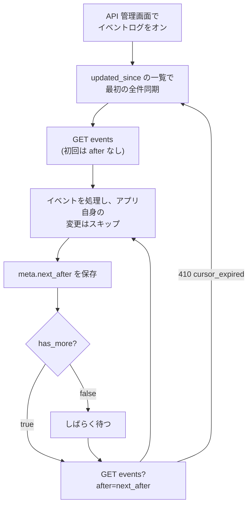

- **イベントを取りこぼさない:** イベントは発生から約 **5 秒**後に現れます（環境変数 `GP247_API_EVENT_SETTLE_SECONDS`）。
  そのため、同時にコミットされた 2 つの変更があっても、`after` で追従するアプリがどちらかを飛ばすことはありません。
  `next_after` はページ全体を処理し終えてから保存してください。中断した場合は前の `after` から読み直します — 同じイベントを
  2 回適用しても問題が起きないように処理してください。
- **権限:** アカウントが見られるのは、開くことを許された管理画面に対応するイベントの種類と、自分のストアのイベントだけです
  （セクション 3）。`filter[type]` はその範囲の中で絞り込むだけです。どのイベントの種類の画面にも権限がない（サイトにまだ
  イベントの種類がない場合も含む）→ `403 forbidden`。
- **自分の変更はスキップ:** アプリがサイトにデータを書き込むこともある場合は、`source` と `actor` で自分が起こしたイベントを
  見分けてスキップし、変更が行ったり来たりしないようにしてください。
- **保持期間は 30 日**（環境変数 `GP247_API_EVENT_DAYS`）。サイトが通常のリクエストを処理する間に少しずつ削除されるので、
  cron は不要です。削除済みの部分より古い `after` カーソル → `410 cursor_expired`: `updated_since` で同期し直してから、
  イベントを最初から（`after` なしで）読み直してください。古いイベントが削除されていない場合は、`php artisan gp247:doctor`
  が `api_event_retention` で報告します。
- `after` がイベントの `id` でない、または `filter[type]` の形式が不正 → `422 validation_failed`。
- アップグレードするサイトでは `php artisan gp247:update` を実行してください（イベントログのテーブルを作成します）。

#### ストアのイベントの種類

> ℹ️ **対応バージョン:** gp247/shop 3.6.0

イベントの種類はそれぞれ 1 つの管理画面に対応します。アカウントがその種類を読めるのは、対応する画面を開く権限がある
場合だけです（セクション 3）。

| `type` | いつ | `data` | 読める人（画面を開ける管理者） |
| --- | --- | --- | --- |
| `order.created` | 新しい注文（ストアでの注文、API での注文、管理画面の *注文作成*、プラグイン） | `status`, `payment_status`, `channel`, `total`, `currency` | 注文一覧画面 |
| `order.status_changed` | 注文ステータスまたは配送ステータスが変わった | `field`（`status` または `shipping_status`）, `from`, `to` | 注文一覧画面 |
| `order.payment_status_changed` | 支払いステータスが変わった（入金／返金の入力、決済ゲートウェイの確認、注文合計の再計算） | `from`, `to`, `received`, `balance` | 注文一覧画面 |
| `stock.changed` | 商品の在庫が動いた（販売とキャンセル、商品フォームでの在庫編集、API の在庫コマンド、入荷伝票などのプラグイン） | `delta`（正: 入庫、負: 出庫）, `stock`（変動後の在庫） | 商品一覧画面 |
| `product.updated` | 商品が編集された | `fields`（変わった列の**名前**。値は決して含まない。商品のテキストが変わったときは `descriptions`）, `status` | 商品一覧画面 |
| `product.deleted` | 商品が削除された | `sku` | 商品一覧画面 |
| `customer.created` | 顧客が会員登録した、または作成された（ストア、API、管理画面、プラグイン） | `status` | 顧客一覧画面 |
| `customer.updated` | 顧客の情報が変わった | `fields`（変わった列の名前。値もパスワードも決して含まない）, `status` | 顧客一覧画面 |

- **`order.created`** は**注文作成時点**の値を持ちます。管理画面で作成した注文は空（合計 0）で始まり、その後に明細行が
  追加されます — 最終的な数値は注文の詳細（`order/detail/{id}`）を読んでください。
- **`stock.changed`** は商品ごとに 1 件記録されます。ビルド（セット）商品を販売すると各構成品の在庫も動く → 構成品ごとに
  1 件。在庫の変動だけなら `stock.changed` になり、`product.updated` には**なりません**。
- **`product.deleted`** は商品が削除されたことを知る唯一の方法です（削除されたレコードは一覧に現れません）。
- イベントは変更が**どこから来ても**記録されます: ストア、管理画面、API、ショップのモデル経由で保存するプラグイン。
- **何も変えずに**フォームを保存した場合や、顧客が**商品ページを閲覧**した場合は、イベントは記録されず `updated_at` も
  変わりません — そのため `updated_since` の一覧も実際の変更だけを返します。
- **SQL でデータベースに直接**書き込んだ変更（ショップを経由しない）は検知されません。プラグインの開発者は、ERP が変更を
  受け取れるよう、ショップのモデル経由でデータを保存してください。

### Webhook（イベントの発生時にすぐ受け取る）

> ℹ️ **対応バージョン:** gp247/core 3.7.0

`events` を定期的に問い合わせるだけでなく、ERP は **Webhook** を登録できます。サイトはログのイベントを、発生するとすぐに
ERP のアドレスへ 1 件ずつ送ります。Webhook で**より早く**受け取れますが、ログの読み取りの代わりにはなりません —
[重複、順序、取りこぼしの補完](#重複順序取りこぼしの補完) を参照してください。

#### Webhook の登録

API 管理画面のブロック **「同期用 Webhook（ERP）」** で行います — このブロックを表示・管理できるのは **administrator** だけです。
Webhook はログのイベントを送るため、**同期用イベントログ（ERP）** スイッチ（セクション 5）がオンである必要があります。

| 項目 | 意味 |
| --- | --- |
| 受信 URL | インターネット上の公開アドレスを指す `https` の URL。拒否されるもの: ローカルマシン、内部／プライベートネットワーク、リンクローカルやクラウドのメタデータのアドレス、それらのアドレスに解決されるホスト名、`user:password` を含む URL、443 以外の 1024 未満のポート |
| 追跡するイベントの種類 | 登録済みのすべてのイベントの種類を並べたチェックボックス（例: [ストアの 8 種類](#ストアのイベントの種類)） |
| オン／オフ | Webhook を削除せずに送信を一時停止します |

- 作成時に、画面に**署名用シークレットが一度だけ**表示されます — すぐにコピーしてください。シークレットは暗号化して保存されます。
  なくした場合は新しく生成します（古いシークレットはすぐに無効になります）。
- ブロックには Webhook の一覧と、それぞれの**直近 20 件の送信**が表示されます: イベント ID、状態（待機中／再送予定、送信済み、
  断念）、試行回数、最後の試行の HTTP コードまたはエラー。
- Webhook は**すべてのストア**のイベントを受け取ります（administrator はすべてのストアを見られるため）— 1 つのストアだけを
  追う場合は、受け取った本文の `store_id` で絞り込んでください。
- アップグレードするサイトでは `php artisan gp247:update` を実行してください（Webhook のテーブルを作成します）。

#### 送信される内容

1 件のイベントが 1 回の `HTTP POST` リクエストです。本文は `GET api/v2/core/events` の `data` の **1 要素とまったく同じ** JSON
です（`id`、`type`、`subject_id`、`store_id`、`source`、`actor`、`data`、`occurred_at` — フィールドの表は
[イベントログ](#イベントログevents) を参照）。

| ヘッダー | 値 |
| --- | --- |
| `Content-Type` | `application/json` |
| `User-Agent` | `GP247-Webhook/1.0` |
| `X-GP247-Event-Id` | イベントの `id` |
| `X-GP247-Event-Type` | イベントの `type` |
| `X-GP247-Signature` | `t=<UNIX 時刻>,v1=<署名>` — 署名は文字列 `<t>.<加工前のリクエスト本文>` をシークレットで計算した HMAC-SHA256（16 進数） |

#### 署名の検証

本文を信用する前に: `X-GP247-Signature` ヘッダーから `t` と `v1` を取り出し、`t` + `.` + **加工前の**リクエスト本文（JSON を
デコードする前）で HMAC を計算し直し、処理時間の差が出ない比較（`hash_equals`）で照合し、`t` が現在時刻から **5 分**以上
ずれていれば拒否します（古いリクエストの再送を防ぐため）。

```php
$secret = getenv('WEBHOOK_SECRET');            // Webhook 作成時にコピーしたシークレット（ERP の設定に保管）
$body   = file_get_contents('php://input');     // 加工前のリクエスト本文

$sig = [];
foreach (explode(',', $_SERVER['HTTP_X_GP247_SIGNATURE'] ?? '') as $pair) {
    [$key, $value] = array_pad(explode('=', $pair, 2), 2, '');
    $sig[$key] = $value;
}
$t  = $sig['t'] ?? '';
$v1 = $sig['v1'] ?? '';

$valid = ctype_digit($t)
    && abs(time() - (int) $t) <= 300
    && hash_equals(hash_hmac('sha256', $t . '.' . $body, $secret), $v1);

if (! $valid) {
    http_response_code(401);
    exit;
}

// イベントを保存し（X-GP247-Event-Id が既知ならスキップ）、処理は後で行い、すぐに応答する
http_response_code(204);
```

#### 応答と再送

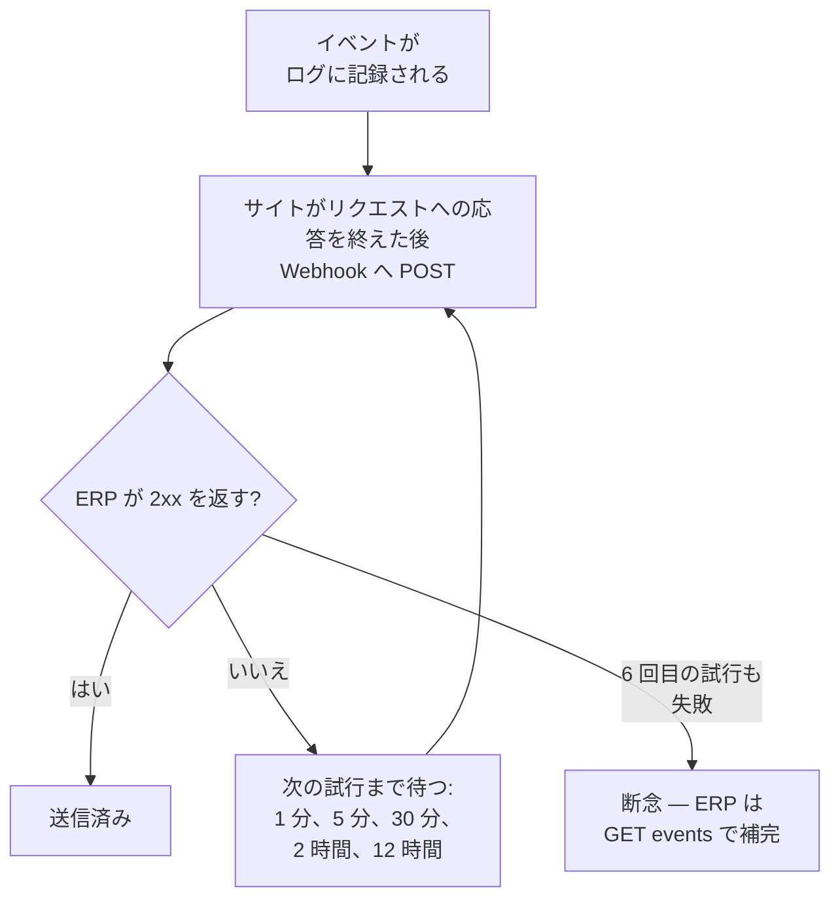

- 受け取ったことを知らせるため、**任意の 2xx** をすぐに返してください — イベントを保存し、処理は後で行います。それ以外の応答は、
  リダイレクトも含めて失敗として扱われます（サイトはリダイレクトを**決して**たどりません）。
- 失敗すると、1 分、5 分、30 分、2 時間、12 時間後に再送します。6 回目の試行も失敗すると、その送信は**断念**されます（画面に
  表示されます）。
- **50 回連続で**失敗した Webhook は**自動的にオフ**になります（画面に理由が表示されます）。オンに戻すと回数はリセットされます。
- **cron やワーカーは不要:** 送信はサイトがリクエストに応答し終えた直後に行われます — イベントを起こしたリクエスト、または
  再送の時刻が来た後のサイトへの任意のリクエストです。1 リクエストあたり最大 5 件、約 2 秒まで。そのため、アクセスがとても
  少ないサイトでは再送が次のアクセスまで待つことになり、受信のタイミングは**保証されません**。
- サーバーに **PHP の cURL が必要**です（確認済みのアドレスにだけ接続するため）。cURL がない場合は送信されず、送信履歴に `curl_missing` と表示されます。

#### 重複、順序、取りこぼしの補完

- 同じイベントが**複数回**届くことがあり（例: ERP は保存したがタイムアウト後に応答した）、**順番どおりとは限りません** →
  `X-GP247-Event-Id` で重複を除き、`id` で並べ替えてください。
- Webhook は**早く受け取るための仕組み**で、正となるデータ源ではありません: 取りこぼしたイベントや断念されたイベントを補うため、
  カーソル `after` を使った `GET api/v2/core/events` のループ（図は [イベントログ](#イベントログevents)）を続けてください —
  Webhook があれば、そのループの間隔は長くできます。

### ERP 同期の全体の流れ

> ℹ️ **対応バージョン:** gp247/core 3.7.0, gp247/shop 3.6.0

ERP や同期ツール向けの短いチェックリストです。上から順に進めてください。各ステップは詳しく説明しているセクションを指しています —
パラメーター、制限、エラーコードはそちらを参照してください。

1. **イベントログをオンにする:** API 管理画面で **同期用イベントログ（ERP）** のスイッチをオンにします
   （[セクション 5](#5-api-のオンオフ)）。オフの間の変更はログに一切残らないため、最初の同期より前にオンにしてください。
   イベントの発生時にすぐ受け取りたい場合は、Webhook も登録します（管理者のみ — [Webhook の登録](#webhook-の登録)）。
2. **最初の全件同期:** 必要な管理一覧（`product/list`、`order/list`、`customer/list`、`category/list`、…）を、
   `updated_since` に十分に古い日時（例: `2000-01-01`）を指定して読み、`has_more` が `false` になるまで `page[after]`
   （`links.next`）をたどります。その後、一覧ごとに `meta.sync_until` を保存します（[変更の同期](#変更の同期updated_since)）。
3. **イベントのカーソルを取得する:** `GET api/v2/core/events` を **`after` なし**で 1 回呼び出し（保持されている最も古いイベントから始まります）、
   ステップ 4 と同じように処理してから、`meta.next_after` をカーソルとして保存します（[イベントログ](#イベントログevents)）。
4. **継続して追跡する:** カーソルより後のイベントを読み（`after` = カーソル）、ページ全体を処理してから `meta.next_after` を保存します。
   `has_more` が `false` なら、しばらく待ってから再び読みます。Webhook を使う場合も、取りこぼしを補うためにこのループは
   続けてください（間隔は長くて構いません — [重複、順序、取りこぼしの補完](#重複順序取りこぼしの補完)）。各イベントについて:
   - レコード全体が必要なときは、詳細エンドポイント（例: `order/detail/{id}`）で読み直します — `data` にはいくつかの値しかありません。
   - `product.deleted` → ERP 側でその商品を削除します（[ストアのイベントの種類](#ストアのイベントの種類)）。
   - ERP 自身の書き込みによるイベントはスキップします: `source` が `api` で、`actor` が ERP の使う管理アカウントのもの。
5. **サイトへ書き戻す:** 注文のステータス、配送、メモ／商品の価格と在庫／顧客のロック
   （[管理 API によるデータの書き込み](#管理-api-によるデータの書き込み)）。書き込みの**たびに**新しい `Idempotency-Key` を送ってください
   （在庫の書き込みでは必須、ほかの書き込みでも送ることをおすすめします — [`Idempotency-Key` で安全に再送する](#idempotency-key-で安全に再送する)）。
   `429` が返ったら `Retry-After` に従って待ちます（[書き込みの回数制限](#書き込みの回数制限)）。
6. **カーソルが古すぎる場合:** イベントの読み取りで `410 cursor_expired` が返ったら、保存した `sync_until`（同期ループと同じく
   5 秒引いた値）から `updated_since` で同期し直し、`after` なしでイベントを最初から読み直します（[エラーコード](#エラーコード)）。
   さらに、安全策として最新の `sync_until` からステップ 2 を定期的に実行し直してください。

### エラーコード

> ℹ️ **対応バージョン:** gp247/core 3.2.3 — **すべてのエラー**は同じ形式で、**意味の正しい HTTP コード**を返します。
>
> ```json
> { "error": 1, "msg": "Not found", "code": "not_found" }
> ```

| HTTP | `code` | 発生する場面 |
| --- | --- | --- |
| `401` | `unauthenticated` | トークンがない／誤り、トークンの期限切れ、アカウントが無効／ロック、`login` でのパスワード誤り |
| `401` | `api_connection_invalid` | API Connection がオンなのに、`apiconnection`／`apikey` のペアがない／誤り |
| `403` | `forbidden` | ログイン済みだが権限がない（セクション 3）、またはトークンの種類が違う |
| `404` | `not_found` | レコードが存在しない、または閲覧を許可されていない。API のパスが存在しない |
| `404` | `api_disabled` | この API グループがサイトの API 管理画面で**オフ**になっている（セクション 5）— gp247/core 3.3.1 から |
| `401` | `refresh_token_invalid` | リフレッシュトークンが誤り／期限切れ、またはセッションがサインアウト済み（セクション 9.2）— gp247/core 3.6.0 から |
| `401` | `refresh_token_reused` | 使用済みのリフレッシュトークンが再送された：安全のためセッションをサインアウト — 再度サインイン（セクション 9.2） |
| `409` | `refresh_in_progress` | リフレッシュトークンが数秒前に使われた — 受け取った新しい組を使う（セクション 9.2） |
| `409` | `event_log_disabled` | イベントログが API 管理画面でオフになっている（セクション 5、6）— gp247/core 3.7.0 から |
| `410` | `cursor_expired` | `after` カーソルがイベントログの削除済み部分より古い — `updated_since` で同期し直し、イベントを最初から読む（セクション 6） |
| `400` | `idempotency_key_required` | `Idempotency-Key` ヘッダーの形式が不正（印字可能な 8〜255 文字が必要）、またはキー必須のエンドポイント（注文の確定 — セクション 10.2、在庫の書き込み — セクション 7）でキーがない |
| `409` | `idempotency_key_reused` | その `Idempotency-Key` は別のリクエストに使用済み — 新しいキーを使う（セクション 7、10.2） |
| `409` | `idempotency_in_progress` | 同じ `Idempotency-Key` のリクエストがまだ処理中 — 待ってから再送する（セクション 7）— gp247/core 3.7.0 から |
| `503` | `idempotency_unavailable` | サイトが `php artisan gp247:update` を実行していないため、`Idempotency-Key` 付きの管理の書き込みをまだ受け付けられない（セクション 7）— gp247/core 3.7.0 から |
| `401` | `challenge_required` | プラグインによる追加の確認ステップ（OTP など）が必要。本文に `challenge` キーがある（セクション 9.4） |
| `401` | `challenge_invalid` | 確認チケットが誤り／期限切れ、または確認コードが誤り（セクション 9.4） |
| `422` | `validation_failed` | 送信したデータが不正 — 項目ごとの `errors` キーも確認してください |
| `422` | `stock_would_be_negative` | 出庫すると在庫が 0 未満になる — 何も変更されない（セクション 7）— gp247/shop 3.6.0 から |
| `422` | `stock_managed_by_components` | ビルド商品（セット商品）は構成商品から在庫を求めるため、在庫を直接書き込めない（セクション 7）— gp247/shop 3.6.0 から |
| `429` | `too_many_attempts` | 呼び出し回数が多すぎる — `Retry-After` ヘッダーに従って待ってください |
| `405` | `method_not_allowed` | パスに対して HTTP メソッドが違う（例: `POST` の代わりに `GET`） |
| その他 | `http_error` | その他の HTTP エラー — `msg` を確認してください |
| `500` | `server_error` | サーバーエラー — 詳細はサイトがデバッグモードのときだけ表示されます |

カートと注文には独自のエラーコードもあります（セクション 10）。拒否された注文の書き込みは理由コード付きの `409` を返し、`stock/batch` は行ごとに結果コードを返します（セクション 7）。まず **HTTP コード**を確認し、次に `code` を読んでケースごとに
処理してください。`msg` は表示やログ用のメッセージです。

### リクエスト ID `X-Request-Id`

> ℹ️ **対応バージョン:** gp247/core 3.4.0

GP247 API のすべてのレスポンス（エラーレスポンスを含む）には **`X-Request-Id`** ヘッダーが付きます。サイトの管理者に
問題を報告するときは、この ID を添えてください。管理者はこれでシステムログの該当行を探せます。

- アプリが**独自の** `X-Request-Id`（英数字、`.`、`_`、`-` のみ、8〜128 文字）を送ることもできます。サイトはその ID を
  そのまま使うので、アプリのログとサイトのログを突き合わせやすくなります。
- ない、または形式が正しくない場合 → サイトが新しい ID（UUID）を生成します。
- どのエンドポイントにも一致しないパス（API に届く前の 404）には、このヘッダーが付かないことがあります。

---

## 7. Core API（管理）の処理の流れ

下の図は、管理アプリがログインしてから Core API でデータを読む順序を示しています。すべてのリクエストは図の順に
チェックを通り、どこかで拒否されるとその場でエラーを返し、先へは進みません。

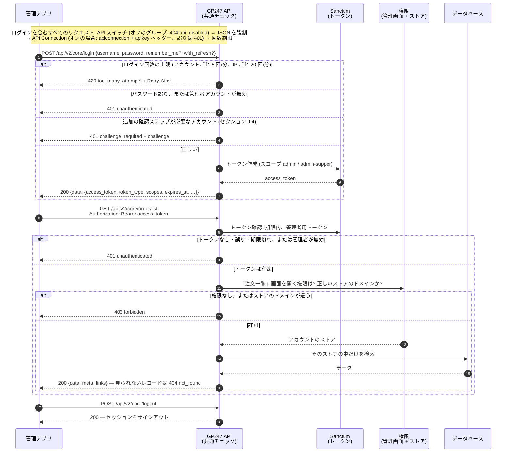

ポイント: トークンがあるだけではデータを読めません。対応する管理画面を開く権限が必要で、見えるのは自分のストアの
データだけです（セクション 3）。

**ログインとセッションのエンドポイント**（接頭辞 `api/v2/core`）：

| メソッド | パス | ログイン必要 | 機能 |
| --- | --- | --- | --- |
| `POST` | `api/v2/core/login` | 不要 | 管理者ログイン、`access_token` を受け取る（`with_refresh` は任意 — セクション 9.2） |
| `POST` | `api/v2/core/login/challenge` | 不要 | 追加の確認ステップが必要なサインインを完了（セクション 9.4） |
| `POST` | `api/v2/core/refresh` | 不要（リフレッシュトークンを送る） | リフレッシュトークンを新しいトークンの組と交換（セクション 9.2） |
| `POST` | `api/v2/core/logout` | 必要（Bearer） | 現在のセッションをサインアウト（リフレッシュトークンを含む） |
| `GET` | `api/v2/core/info` | 必要（Bearer） | ログイン中の管理者情報を取得（ロールを含む） |
| `GET` | `api/v2/core/sessions` | 必要（Bearer） | 管理者の API サインインセッション（端末）（セクション 9.3） |
| `DELETE` | `api/v2/core/sessions/{id}` | 必要（Bearer） | 1 つのセッションをサインアウト |

**管理データのエンドポイント**（接頭辞 `api/v2/core`、トークン ＋ セクション 3 の権限が必要）：

| メソッド | パス | 機能 |
| --- | --- | --- |
| `GET` | `api/v2/core/customer/list` | 顧客一覧 |
| `GET` | `api/v2/core/customer/detail/{id}` | 顧客 1 件の詳細 |
| `GET` | `api/v2/core/order/list` | 注文一覧 |
| `GET` | `api/v2/core/order/detail/{id}` | 注文 1 件の詳細 |
| `GET` | `api/v2/core/product/list` | 商品一覧（在庫数と原価を含む） |
| `GET` | `api/v2/core/product/detail/{id}` | 商品 1 件の詳細 |
| `GET` | `api/v2/core/category/list` | カテゴリー一覧 |
| `GET` | `api/v2/core/category/detail/{id}` | カテゴリー 1 件の詳細 |
| `GET` | `api/v2/core/brand/list` | ブランド一覧 |
| `GET` | `api/v2/core/brand/detail/{id}` | ブランド 1 件の詳細 |
| `GET` | `api/v2/core/supplier/list` | 仕入先一覧 |
| `GET` | `api/v2/core/supplier/detail/{id}` | 仕入先 1 件の詳細 |
| `GET` | `api/v2/core/banner/list` | バナー一覧 |
| `GET` | `api/v2/core/banner/detail/{id}` | バナー 1 件の詳細 |
| `GET` | `api/v2/core/page/list` | コンテンツページ一覧 |
| `GET` | `api/v2/core/page/detail/{id}` | コンテンツページ 1 件の詳細 |
| `GET` | `api/v2/core/events` | ERP／同期ツール向けのイベントログ（セクション 6） |
| `POST` | `api/v2/core/order/{id}/status` | 注文ステータスを変更（[管理 API によるデータの書き込み](#管理-api-によるデータの書き込み)） |
| `POST` | `api/v2/core/order/{id}/shipping` | 配送ステータスを変更し、追跡番号を保存 |
| `POST` | `api/v2/core/order/{id}/notes` | 注文履歴にメモを追加 |
| `PATCH` | `api/v2/core/product/{id}` | 商品の販売価格・原価・ステータスを変更（[管理 API によるデータの書き込み](#管理-api-によるデータの書き込み)） |
| `POST` | `api/v2/core/product/{id}/stock` | 入庫／出庫、棚卸し後に在庫を設定 |
| `POST` | `api/v2/core/stock/batch` | 複数商品の在庫を一度に書き込む（最大 100 行） |
| `PATCH` | `api/v2/core/customer/{id}` | 顧客をロック／ロック解除（[顧客](#顧客)） |

管理者ログインの例（ターミナルで `curl` を使用）：

```bash
curl -X POST "https://shop.example.com/api/v2/core/login" \
  -H "Content-Type: application/json" \
  -d '{"username":"admin","password":"your-password","remember_me":true}'
```

成功すると、次のような JSON が返ります（抜粋）。

```json
{
  "data": {
    "access_token": "1|aBcD...very-long...XyZ",
    "token_type": "Bearer",
    "scopes": ["admin-supper"],
    "expires_at": "2026-11-25 10:00:00",
    "expires_in": 2592000
  }
}
```

続いて、受け取ったトークン（`data.access_token`）で最新の注文を取得します。

```bash
curl -X GET "https://shop.example.com/api/v2/core/order/list?sort=-created_at&page[size]=20" \
  -H "Accept: application/json" \
  -H "Authorization: Bearer 1|aBcD...very-long...XyZ"
```

### 管理 API によるデータの書き込み

> ℹ️ **対応バージョン:** gp247/core 3.7.0, gp247/shop 3.6.0

ERP、CRM や倉庫管理ソフトは、管理画面で手作業する代わりに API で注文、商品の価格と在庫を更新し、顧客をロック／
ロック解除できます。注文の各書き込みは
注文詳細画面の対応する操作と**同じ効果**を持ちます。在庫の増減も注文履歴の行も同じです。

| メソッド | パス | リクエスト本文（JSON） | 効果 |
| --- | --- | --- | --- |
| `POST` | `api/v2/core/order/{id}/status` | `{"status": …}` | 注文ステータスを変更 |
| `POST` | `api/v2/core/order/{id}/shipping` | `{"shipping_status"?, "tracking_number"?, "tracking_url"?}` | 配送ステータスを変更し、追跡番号を保存 |
| `POST` | `api/v2/core/order/{id}/notes` | `{"content": "…"}` | 注文履歴にメモを追加 |
| `PATCH` | `api/v2/core/product/{id}` | `{"price"?, "cost"?, "status"?}` | 商品の販売価格・原価・ステータスを変更 |
| `POST` | `api/v2/core/product/{id}/stock` | `{"delta": …}` または `{"set": …}` | 入庫／出庫、または棚卸し後に在庫を設定 |
| `POST` | `api/v2/core/stock/batch` | `{"items": [{"id" または "sku", "delta" または "set"}, …]}` | 複数商品の在庫を書き込む（1〜100 行） |
| `PATCH` | `api/v2/core/customer/{id}` | `{"status": 0}` または `{"status": 1}` | 顧客をロック／ロック解除 |

**共通のルール（注文の 3 つのエンドポイント）：**

- **権限：** アカウントには **注文一覧** 画面の **変更権限** が必要で、その画面で操作するときとまったく同じように確認されます —
  画面で注文を変更できる人は API でも変更できます。閲覧のみのアカウント（`view.all` ロールを含む）→ `403 forbidden`。
- 自分のストアの注文のみ（セクション 3）。他のストアの注文 → `404 not_found`。
- 成功 → `200 {"data": <注文>}`。`order/detail/{id}` と同じ形で、書き込んだ変更が反映済みです。
- データが不正 → `422 validation_failed`（`errors` 付き）。
- すべての書き込みは、管理 API のほかの呼び出しと同じく **操作ログ** に記録されます（セクション 9.5）。

**注文ステータス — `order/{id}/status`：**

- `status` はサイトの注文ステータスの ID。存在しない ID → `422`。
- 管理画面でステータスを変えたときと同じ効果です：キャンセルすると商品が在庫に戻り、キャンセル済みの注文を再開すると
  再び在庫から引かれ、変更のたびに注文履歴に 1 行追加されます。完了済み・キャンセル済みの注文も、画面と同じく再開できます。
- 注文がすでに送ったステータスになっている → `200`、何も書き込みません。
- 再開できない（例: 在庫不足）→ `409`。`code` が理由コードです（例: `admin.order.reopen_blocked_stock`）。

**配送 — `order/{id}/shipping`：**

- `shipping_status` か `tracking_number` の少なくとも一方を送ります。`tracking_url` は `tracking_number` と一緒に送り、
  `http(s)` のアドレスである必要があります。
- `shipping_status`：サイトの配送ステータスの ID。変更すると注文履歴に 1 行追加されます。
- `tracking_number`：注文の **手動の送り状** として保存されます（注文ごとに 1 つ。別の番号を送るとその送り状を更新）。
  注文詳細画面に表示されます。
- `payment_status` を送る → `422`：支払いステータスは常に注文の支払いに従い、手動では設定できません。

**メモ — `order/{id}/notes`：**

- `content` は 1〜1000 文字。メモは作成者とラベル `[API]` 付きで注文履歴に追加されます。
- 本文はプレーンテキストとして表示されます：HTML タグは書いたとおりに表示され、実行されません。

例：ERP が、注文を配送業者に引き渡したことを追跡番号とともに知らせる場合。

```bash
curl -X POST "https://shop.example.com/api/v2/core/order/ORDER-ID/shipping" \
  -H "Accept: application/json" \
  -H "Content-Type: application/json" \
  -H "Authorization: Bearer 1|aBcD...very-long...XyZ" \
  -H "Idempotency-Key: 6f1c2a7e-0b9d-4c51-9e3a-2d8f4b7c1a90" \
  -d '{"shipping_status":2,"tracking_number":"VN123456789","tracking_url":"https://tracking.example.com/VN123456789"}'
```

結果（抜粋）：

```json
{
  "data": {
    "id": "ORDER-ID",
    "status": 2,
    "payment_status": 3,
    "shipping_status": 2,
    "total": 350000,
    "balance": 0,
    "updated_at": "2026-10-31T09:15:00+07:00"
  }
}
```

#### 商品と在庫

**共通のルール（商品・在庫の 3 つのエンドポイント）：**

- **権限：** アカウントには **商品一覧** 画面の **変更権限** が必要で、注文の書き込みが注文一覧画面で確認されるのと同じ方法で
  確認されます。閲覧のみのアカウント → `403 forbidden`。
- 自分のストアの商品のみ。他のストアの商品 → `404 not_found`（`stock/batch` では `not_found` の行）。
- データが不正 → `422 validation_failed`（`errors` 付き）。

**価格とステータス — `PATCH product/{id}`：**

- `price`、`cost`（0 以上の数値）、`status`（`0` または `1`）のうち少なくとも 1 つを送ります。本文が空 → `422`。
- それ以外の項目（例: `sku`、`stock`）→ `422 validation_failed`。黙って無視はされません。在庫は下記の在庫コマンドで書き込みます。
- ストアの **商品設定** でオフになっている項目（**価格を使用** / **原価を使用**）→ `422`：API は管理画面の商品フォームと
  同じ項目スイッチに、その商品のストアの設定で従います。
- 成功 → `200 {"data": <商品>}`。`product/detail/{id}` と同じ形です。
- `Idempotency-Key` は注文の書き込みと同じく任意です。

**1 商品の在庫 — `product/{id}/stock`：** 本文には 2 つの項目のうち **ちょうど 1 つ** を送ります。

| 項目 | 意味 | ルール |
| --- | --- | --- |
| `delta` | 入庫（正の数）または出庫（負の数） | 0 以外。商品設定で **小数の数量を許可** がオンでない限り整数。在庫は 0 未満にならない → `422 stock_would_be_negative`、何も変更されない |
| `set` | 棚卸し後に在庫をそのまま設定 | 0 以上。**administrator** ロールのアカウントのみ（それ以外 → `403`） |

- 両方送る、またはどちらも送らない → `422 validation_failed`。
- `delta` はアトミックに加減算されます：同じ瞬間に入った注文の分が失われることはありません。商品の **販売数** は変わりません
  — 販売ではないためです。
- ビルド商品（構成商品から在庫を求めるセット商品）→ `422 stock_managed_by_components`。
- `Idempotency-Key` ヘッダーは **必須** です（なし → `400 idempotency_key_required`）：同じキーで再送しても在庫は 1 回だけ
  動き、最初の結果がヘッダー `Idempotent-Replayed: true` 付きで返ります。
- 成功 → `200 {"data": {"id": "…", "sku": "…", "stock": 15}}`。

> 💡 **新しい在庫数ではなく `delta` を送るのはなぜ？** ERP が在庫を読んでから新しい数を送るまでの間に、お客様が注文するかも
> しれません。新しい在庫数を送るとその注文で減った分を上書きしてしまいますが、`delta`（入庫 +20、出庫 −3）なら現在の数に
> 対して加減算されます。`set` は実地棚卸しの直後にだけ使ってください。

例：倉庫ソフトが 20 個の入庫を知らせる場合。

```bash
curl -X POST "https://shop.example.com/api/v2/core/product/PRODUCT-ID/stock" \
  -H "Accept: application/json" \
  -H "Content-Type: application/json" \
  -H "Authorization: Bearer 1|aBcD...very-long...XyZ" \
  -H "Idempotency-Key: 3b9e7d10-5c2f-4a8e-b1d4-7f0a6c2e9b35" \
  -d '{"delta":20}'
```

結果：

```json
{ "data": { "id": "PRODUCT-ID", "sku": "TSHIRT-01", "stock": 35 } }
```

**複数商品を一度に — `stock/batch`：**

- `items` は 1〜100 行。各行に商品の `id` **または** `sku` と、`delta` **または** `set`（ルールは上と同じ）を指定します。
  100 行を超える、または形式が不正な行（例: `delta` も `set` もない）→ `422`、どの行も実行されません。
- 行ごとに結果があり、エラーの行があってもほかの行は止まりません。一部の行が失敗しても HTTP は `200` です — `ok` / `failed`
  と各結果を確認してください。
- `results` は `items` と同じ順で、各結果にはその行の `id` または `sku` が入ります。
- `Idempotency-Key` は **必須**：同じバッチを再送しても在庫は二重に動かず、同じ本文が返ります。

| 行の `code` | 発生する場合 |
| --- | --- |
| `not_found` | その `id` がアカウントのストアにない |
| `sku_not_found` | その SKU の商品がない |
| `sku_ambiguous` | 複数の商品が同じ SKU を持つ — `id` を送る |
| `forbidden` | administrator ではないアカウントによる `set` |
| `stock_would_be_negative` | 出庫すると在庫が 0 未満になる — この行は実行されない |
| `stock_managed_by_components` | ビルド商品。在庫は構成商品から求められる |

例：

```bash
curl -X POST "https://shop.example.com/api/v2/core/stock/batch" \
  -H "Accept: application/json" \
  -H "Content-Type: application/json" \
  -H "Authorization: Bearer 1|aBcD...very-long...XyZ" \
  -H "Idempotency-Key: 9a4d2c61-7e3b-4f05-8c1a-0b6e5d3f2a78" \
  -d '{"items":[{"id":"PRODUCT-ID","delta":20},{"sku":"MUG-07","delta":-3}]}'
```

結果：

```json
{
  "data": {
    "results": [
      { "id": "PRODUCT-ID", "ok": true, "stock": 35 },
      { "sku": "MUG-07", "ok": false, "code": "sku_not_found", "msg": "No product has this SKU" }
    ],
    "ok": 1,
    "failed": 1
  }
}
```

#### 顧客

CRM や ERP は `PATCH customer/{id}` で顧客アカウントをロックし（例: 不正行為、支払い遅延）、再びロック解除できます。

- 本文は `status`（必須）だけです: `0` でロック、`1` でロック解除。`0`／`1` 以外の値 → `422`。
- それ以外のフィールド（例: `email`、`first_name`）→ `422 validation_failed`: 個人情報は顧客自身または管理画面で変更する
  もので、同期ツールが変更することはありません。
- **権限：** **顧客一覧** 画面の **変更権限** が必要で、その画面と同じ方法で確認されます。閲覧のみのアカウント →
  `403 forbidden`。
- 自分のストアの顧客のみ。他のストアの顧客 → `404 not_found`。
- **ロックはすぐに効きます：** 次のリクエストから顧客の API トークンは拒否され（`401`）、ストアにサインイン中の顧客は
  サインアウトされます。
- 成功 → `200 {"data": <顧客>}`、`customer/detail/{id}` と同じ形式。
- `Idempotency-Key` は注文の書き込みと同じく任意です。

CRM が顧客をロックする例：

```bash
curl -X PATCH "https://shop.example.com/api/v2/core/customer/CUSTOMER-ID" \
  -H "Accept: application/json" \
  -H "Content-Type: application/json" \
  -H "Authorization: Bearer 1|aBcD...very-long...XyZ" \
  -H "Idempotency-Key: 5d8e1f02-a6b4-4c37-9e2d-1b7c0a4f6e93" \
  -d '{"status":0}'
```

結果（抜粋）：

```json
{
  "data": {
    "id": "CUSTOMER-ID",
    "email": "customer@example.com",
    "status": 0,
    "updated_at": "2026-11-01T10:20:00+07:00"
  }
}
```

#### `Idempotency-Key` で安全に再送する

通信が不安定だと、アプリは書き込みが実行されたかどうか分かりません。`Idempotency-Key` ヘッダー（印字可能な 8〜255 文字、
例: UUID）を付けて送れば、二重に書き込む心配なく再送できます。注文の 3 つのエンドポイント、`PATCH product/{id}` と
`PATCH customer/{id}` ではキーは **任意**、`product/{id}/stock` と `stock/batch` では **必須** です（キーなし → `400 idempotency_key_required`）。

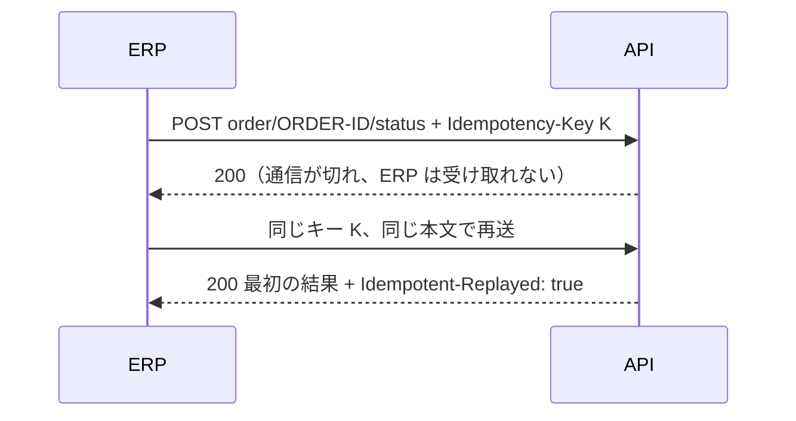

| 状況 | 結果 |
| --- | --- |
| 同じキー、同じ本文で再送 | 最初の結果がもう一度返り、ヘッダー `Idempotent-Replayed: true` が付く。再実行はされない |
| 同じキー、別のリクエスト（本文またはパスが違う） | `409 idempotency_key_reused` |
| 同じキー、最初のリクエストがまだ処理中 | `409 idempotency_in_progress` — 待ってから再送 |
| 最初のリクエストがサーバーエラー（`5xx`） | キーは解放され、再送すると実際に実行される |
| キーの形式が不正、または在庫の書き込みでキーがない | `400 idempotency_key_required` |
| サイトが `php artisan gp247:update` を未実行 | `503 idempotency_unavailable`（キーを送ったときのみ） |

- キーは管理者アカウントごとに別々で、**24 時間** 保持されます。新しい書き込みには新しいキーが必要です。
- `4xx` の結果（例: `409`、`422`）も保存されます：同じキーで再送すると同じエラーが返ります — データを直したら新しいキーを
  使ってください。

#### 書き込みの回数制限

- 書き込みは **管理者アカウントごと** に数えます：既定は **1 分あたり 300 リクエスト**。環境変数
  `GP247_API_WRITE_THROTTLE` に `リクエスト数,分数` の形で設定して変更できます（例: `600,1`）。
- 商品・在庫・注文・顧客の書き込みはこの制限を共有します。`stock/batch` 1 回は **1** リクエストと数えます。
- 上限を超える → `429 too_many_attempts`（`Retry-After` ヘッダー付き）。
- 読み取りは従来どおり IP ごとの共通の制限に従います。

---

## 8. Front API（ストアフロント）の処理の流れ

Front API は 2 種類のデータを扱います。**公開データ**（ログイン不要 — 商品一覧、カテゴリーなど）と、
**顧客個人のデータ**（ログイン必要 — 注文、プロフィール、住所録）です。

下の図は Front API の 2 つの使い方を示しています。ログインなしで公開データを読む方法と、顧客がログインして自分の
注文を見る方法です。

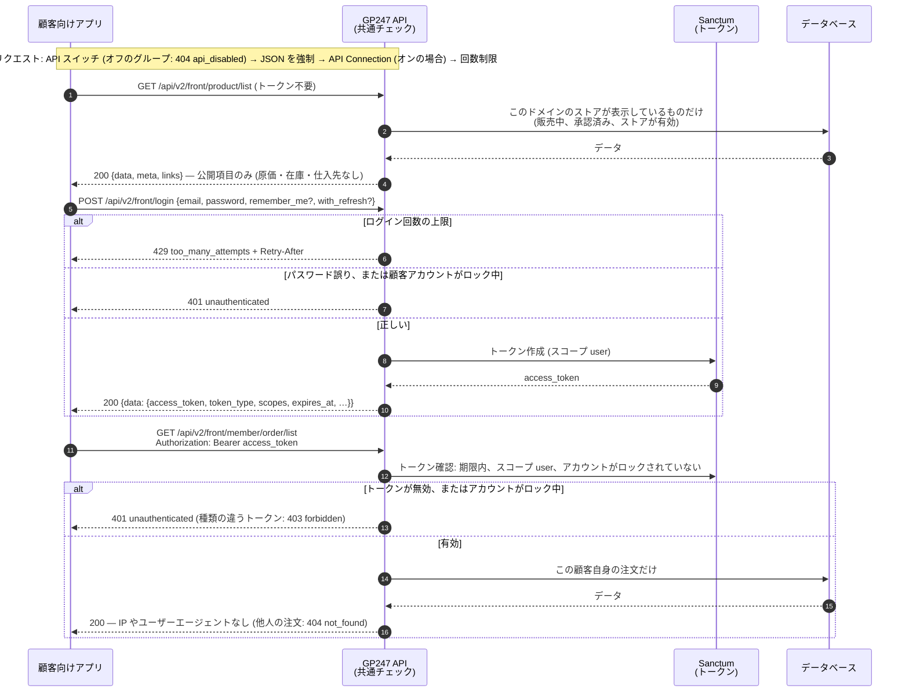

ポイント: API の公開データは**ストアで顧客が見ている内容と一致**し、個人のデータは本人にだけ返されます。

**公開エンドポイント**（接頭辞 `api/v2/front`、トークン不要）：

| メソッド | パス | 機能 |
| --- | --- | --- |
| `GET` | `api/v2/front/meta` | API のバージョン、インストール済みパッケージ、言語、ストア |
| `GET` | `api/v2/front/product/list` | 商品一覧 |
| `GET` | `api/v2/front/product/detail/{id}` | 商品 1 件の詳細（購入に必要なデータを含む — セクション 10.4） |
| `GET` | `api/v2/front/category/list` | カテゴリー一覧 |
| `GET` | `api/v2/front/category/detail/{id}` | カテゴリー 1 件の詳細 |
| `GET` | `api/v2/front/brand/list` | ブランド一覧 |
| `GET` | `api/v2/front/brand/detail/{id}` | ブランド 1 件の詳細 |
| `GET` | `api/v2/front/banner/list` | バナー一覧 |
| `GET` | `api/v2/front/banner/detail/{id}` | バナー 1 件の詳細 |
| `GET` | `api/v2/front/page/list` | コンテンツページ一覧 |
| `GET` | `api/v2/front/page/detail/{id}` | コンテンツページ 1 件の詳細 |

> ℹ️ **対応バージョン:** gp247/shop 3.2.3, gp247/front 3.2.3 — 公開データは、呼び出したドメインで
> **ストアが表示している内容とまったく同じ**です。非表示の商品、未承認の商品、他のストアに属する商品は含まれません。
> レスポンスには公開項目だけが入り、原価、仕入先、在庫数／販売数は含まれません。
> これらの数値が必要な場合は、権限のあるアカウントで Core API を使ってください。

**顧客アカウントのエンドポイント**（接頭辞 `api/v2/front`。詳細はセクション 9）：

| メソッド | パス | ログイン必要 | 機能 |
| --- | --- | --- | --- |
| `POST` | `api/v2/front/register` | 不要 | 顧客アカウントを作成してサインイン（セクション 9.1） |
| `POST` | `api/v2/front/password/forgot` | 不要 | パスワード再設定メールを送信 |
| `POST` | `api/v2/front/password/reset` | 不要 | メールのコードで新しいパスワードを設定 |
| `POST` | `api/v2/front/login` | 不要 | 顧客のメールアドレス／パスワードでログイン（`with_refresh` は任意 — セクション 9.2） |
| `POST` | `api/v2/front/login/challenge` | 不要 | 追加の確認ステップが必要なサインインを完了（セクション 9.4） |
| `POST` | `api/v2/front/refresh` | 不要（リフレッシュトークンを送る） | リフレッシュトークンを新しいトークンの組と交換 |
| `POST` | `api/v2/front/logout` | 必要（Bearer） | 現在のセッションをサインアウト（リフレッシュトークンを含む） |
| `GET` | `api/v2/front/info` | 必要（Bearer） | 顧客アカウントの情報 |
| `GET` | `api/v2/front/member/profile` | 必要（Bearer） | プロフィール全体：メール確認の状態、既定の住所 |
| `PUT` | `api/v2/front/member/profile` | 必要（Bearer） | プロフィールを編集 |
| `PUT` | `api/v2/front/member/password` | 必要（Bearer） | パスワードを変更（ほかの端末はすべてサインアウト） |
| `POST` | `api/v2/front/member/email/verify` | 必要（Bearer） | 確認メールを再送 |
| `GET` | `api/v2/front/member/address/list` | 必要（Bearer） | 住所録 |
| `POST` | `api/v2/front/member/address` | 必要（Bearer） | 住所を追加 |
| `PUT` | `api/v2/front/member/address/{id}` | 必要（Bearer） | 住所を編集 |
| `DELETE` | `api/v2/front/member/address/{id}` | 必要（Bearer） | 住所を削除（既定の住所は不可） |
| `GET` | `api/v2/front/member/sessions` | 必要（Bearer） | 顧客の API サインインセッション（端末）（セクション 9.3） |
| `DELETE` | `api/v2/front/member/sessions/{id}` | 必要（Bearer） | 1 つのセッションをサインアウト |
| `GET` | `api/v2/front/member/order/list` | 必要（Bearer） | 顧客の注文一覧 |
| `GET` | `api/v2/front/member/order/detail/{id}` | 必要（Bearer） | 顧客の注文 1 件の詳細 |

カート、チェックアウト、支払いのエンドポイントはセクション 10 にあります。

例：ブランド 5 の商品を価格の高い順に 20 件、名前をベトナム語で取得します（公開データ、トークン不要）。

```bash
curl -X GET "https://shop.example.com/api/v2/front/product/list?filter[brand_id]=5&sort=-price&lang=vi&page[size]=20" \
  -H "Accept: application/json"
```

レスポンス（抜粋）：

```json
{
  "data": [
    { "id": "PRD-AbC12", "sku": "TSHIRT-01", "name": "Tシャツ", "price": 250000, "price_final": 199000 }
  ],
  "meta": { "current_page": 1, "per_page": 20, "total": 1, "last_page": 1 },
  "links": { "first": "…", "last": "…", "prev": null, "next": null }
}
```

顧客としてログインし、注文を確認する例：

```bash
# 1) 顧客ログイン
curl -X POST "https://shop.example.com/api/v2/front/login" \
  -H "Content-Type: application/json" \
  -d '{"email":"customer@example.com","password":"your-password"}'

# 2) 受け取ったトークン（data.access_token）で注文一覧を取得
curl -X GET "https://shop.example.com/api/v2/front/member/order/list" \
  -H "Accept: application/json" \
  -H "Authorization: Bearer 2|zzz...customer-token...zzz"
```

---

## 9. 顧客アカウントとサインインセッション

> ℹ️ **対応バージョン:** gp247/core 3.6.0、gp247/shop 3.4.0

ショッピングアプリは `api/v2/front` で顧客アカウントの一連の操作をすべて行えます。ルールは**ウェブサイトのフォームと同じ**
です：必須項目、カスタム項目、パスワードの強度、captcha はすべてストアの設定に従います。エンドポイントの一覧は
セクション 8 にあります。

### 9.1. 会員登録、パスワードを忘れた場合、プロフィール、住所録

- **`POST register`** — 登録フォームと同じ項目（`first_name`、`email`、`password`、`password_confirmation`、
  およびストアで有効にした `address1`、`phone` などの項目）を送ります。成功すると HTTP `201` で、`customer` と `login` と
  同じトークンを返します。顧客は自分の `status` を設定できません。**パスワードは必須**です。`password` がない、
  または空の場合は `422`（`errors.password`）で、アカウントは作成されません。
- **`POST password/forgot`** — パスワード再設定メールを送ります。メールアドレスにアカウントがあってもなくても常に
  `{"data": {"sent": true}}` を返すため、どのメールアドレスが登録済みかを調べることはできません。
- **`POST password/reset`** — `email`、`token`（メールに記載）、`password`、`password_confirmation` を送ります。成功すると
  顧客の**すべての API トークン**が無効になります。アプリは新しいパスワードで `login` を呼びます。
- **`GET` / `PUT member/profile`** — `email_verified`、`email_verification_required`、既定の住所を含むプロフィール。
  ここではパスワードを変更できません。
- **`PUT member/password`** — `password_old`、`password`、`password_confirmation` を送ります。呼び出したセッションは
  サインインしたまま、**ほかのすべての端末**はサインアウトされます。古いパスワードの誤りはアカウントのログイン制限に数えられます。
  新しいパスワードがない、または空の場合は `422`（`errors.password`）で、古いパスワードはそのままです。

> ℹ️ **対応バージョン:** gp247/shop 3.5.0 — `register` と `member/password` は常にパスワードが必要です（以前は `password`
> キーのない本文に HTTP `500` が返り、空のパスワードは受け付けられていました）。必須項目のない JSON 本文には常に `422` を返します。
- **`member/address`** — 住所の追加／編集／削除。`"default": true` を送ると既定の住所になります。既定の住所は削除できません
  （HTTP `422`）— 先に別の住所を既定にしてください。
- **`POST member/email/verify`** — ストアで *メールアドレスの確認を必須にする* がオンのとき、確認メールを再送します。顧客は
  どのブラウザーでもメールのリンクをクリックすれば完了します。ウェブサイトへのサインインは**不要**です。

`register`、`password/*`、`member/email/verify` には専用の制限があります：**IP ごとに 1 分あたり 5 回**
（`GP247_API_ACCOUNT_THROTTLE`、形式は `回数,分`）。

> ⚠️ ストアが *会員登録* または *パスワードを忘れた場合* のページで captcha をオンにしている場合（**Captcha** タブ）、API でも
> 使用中の captcha プラグインの項目が必要です — ない／誤り → `422`（`errors.captcha_field`）。アプリは captcha 提供元の
> SDK で回答を取得するか、管理者がそのページの選択を外します。

### 9.2. リフレッシュトークン — 短命なトークンでサインイン状態を保つ

`login`、`register`、`login/challenge` に `with_refresh: true`（任意で `device_name`）を送ります：

| | `with_refresh` なし | `with_refresh` あり |
| --- | --- | --- |
| アクセストークン | 7 日（`remember_me` で 30 日） | **60 分**（`GP247_API_ACCESS_MINUTES`） |
| リフレッシュトークン | — | 顧客 30 日（`GP247_API_REFRESH_DAYS`）、管理者 7 日（`GP247_API_REFRESH_ADMIN_DAYS`）、サインイン時から |

アクセストークンが期限切れ（`401`）になったら、`{"refresh_token": "…"}` で `POST refresh` を呼ぶと**新しいトークンの組**を
受け取れます。リフレッシュトークンは**1 回だけ**使えます：

- 使用済みのリフレッシュトークンを再送 → `401 refresh_token_reused` となり、**セッション全体がサインアウト**されます
  （トークンが盗まれた兆候）。
- 例外：10 秒以内の再送（不安定な通信、重複リクエスト）→ `409 refresh_in_progress`、セッションは残ります。アプリでは
  `refresh` を並行ではなく**1 つずつ**呼んでください。
- リフレッシュしてもセッションの期限は延びません。期限が切れたら再度サインインしてください。

```bash
curl -X POST "https://shop.example.com/api/v2/front/login" -H "Content-Type: application/json" \
  -d '{"email":"customer@example.com","password":"Secret#123","with_refresh":true,"device_name":"Hanako の iPhone"}'
curl -X POST "https://shop.example.com/api/v2/front/refresh" -H "Content-Type: application/json" \
  -d '{"refresh_token":"<受け取った refresh_token>"}'
```

### 9.3. サインインセッションの管理

サインインはそれぞれ 1 つの**セッション**です。`GET member/sessions`（顧客）と `GET sessions`（管理者）は、端末名、IP、
最終利用日時、どれが現在のセッションか（`current`）を一覧表示します。`DELETE …/sessions/{id}` で 1 台の端末をサインアウト
します。`POST logout` は現在のセッションをリフレッシュトークンも含めてサインアウトします。パスワードを変更すると（顧客でも
管理者でも、ウェブサイトでも API でも）、そのアカウントの**すべての** API セッションとトークンがサインアウトされます。使用中の
ウェブサイトのセッションはそのままです。

### 9.4. プラグインによる二要素認証（MFA）

core 自体は OTP コードを送りません。セキュリティプラグインが確認ステップを追加できます。その場合、正しいパスワードでの
`login` は次のように応答します：

```json
{ "error": 1, "code": "challenge_required", "msg": "…",
  "challenge": { "ticket": "…", "method": "totp", "meta": {}, "expires_in": 300 } }
```

アプリはユーザーにコードを尋ね、`ticket` とプラグインが求める項目（例：`code`）を付けて `POST login/challenge` を呼びます。
チケットは 1 回限りで 5 分で失効し、誤ったコードはログイン制限に数えられます（API v1 にはこのステップが
ありません — [API v1](./api-v1_ja.md) を参照）。GP247 の無料 **MFA** プラグイン
（2.3.0 から）は、二要素認証を有効にした顧客と管理者に対してこの仕組みを使います（TOTP またはリカバリーコード）。プラグイン開発者は
[API の作り方 — セクション 7](./create-api_ja.md) を参照してください。

### 9.5. 管理 API のアクセスログ

Core API の呼び出し（`login` を除く）はすべて管理画面の**操作ログ**に記録されます — 管理画面での操作と同じく、
ユーザー、パス、IP、端末を記録し、パスワード／キーは伏せられ、レスポンス本文は保存されません。権限不足で拒否された呼び出し
（`403`）も記録されます。管理画面のログと一緒にオフにできます（`GP247_ADMIN_LOG=0`）。API を頻繁に呼ぶ同期ツールではログが
早く増えます — **操作ログ**画面で定期的に削除してください。

---

## 10. API によるカートと注文

> ℹ️ **対応バージョン:** gp247/shop 3.5.0

ストア自身のモバイルアプリやヘッドレスサイトは、API で **カート** をウェブサイトと同じルールで扱えます。価格と属性の追加料金は
サーバーが計算し、数量ルール（正の数、小数は設定どおり）、バリエーションごとに 1 行です。

**カート、チェックアウト、支払いのエンドポイント**（接頭辞 `api/v2/front`）：

| メソッド | パス | ログイン必要 | 機能 |
| --- | --- | --- | --- |
| `GET` | `api/v2/front/cart` | あり（顧客）または `X-Cart-Token` | カートを表示 |
| `POST` | `api/v2/front/cart/items` | あり（顧客）またはゲスト | カートに商品を追加 |
| `PATCH` | `api/v2/front/cart/items/{rowId}` | あり（顧客）または `X-Cart-Token` | 行の数量を変更（0 以下で行を削除） |
| `DELETE` | `api/v2/front/cart/items/{rowId}` | あり（顧客）または `X-Cart-Token` | 行を削除 |
| `POST` | `api/v2/front/cart/promotions/{pluginKey}` | あり（顧客）または `X-Cart-Token` | クーポン / プロモーションを適用 |
| `DELETE` | `api/v2/front/cart/promotions/{pluginKey}` | あり（顧客）または `X-Cart-Token` | プロモーションを解除 |
| `GET` | `api/v2/front/checkout` | あり（顧客）または `X-Cart-Token` | チェックアウトの状態（ストア、住所、選択済みの方法 — 10.1 節） |
| `PUT` | `api/v2/front/checkout/address` | あり（顧客）または `X-Cart-Token` | 配送先住所を設定 |
| `GET` | `api/v2/front/checkout/shipping-methods` | あり（顧客）または `X-Cart-Token` | 住所に対して見積もった配送方法 |
| `PUT` | `api/v2/front/checkout/shipping-method` | あり（顧客）または `X-Cart-Token` | 配送方法を選択 |
| `GET` | `api/v2/front/checkout/payment-methods` | あり（顧客）または `X-Cart-Token` | API で使える支払い方法 |
| `PUT` | `api/v2/front/checkout/payment-method` | あり（顧客）または `X-Cart-Token` | 支払い方法を選択 |
| `GET` | `api/v2/front/checkout/totals` | あり（顧客）または `X-Cart-Token` | 請求される合計 |
| `POST` | `api/v2/front/checkout/place` | あり（顧客）または `X-Cart-Token` + `Idempotency-Key` | 注文を確定（10.2 節） |
| `GET` | `api/v2/front/member/orders/{id}/payment` | あり（顧客） | 顧客の注文の支払い状況（10.3 節） |
| `GET` | `api/v2/front/orders/{id}/payment` | `X-Order-Access` | ゲスト注文の支払い状況（10.3 節） |
| `POST` | `api/v2/front/member/orders/{id}/cancel` | あり（顧客） | アプリから行った未払い注文のキャンセル（10.3 節） |
| `POST` | `api/v2/front/orders/{id}/cancel` | `X-Order-Access` | ゲストの未払い注文のキャンセル（10.3 節） |

カートが誰のものになるかは、顧客がログインしているかどうかで決まります。

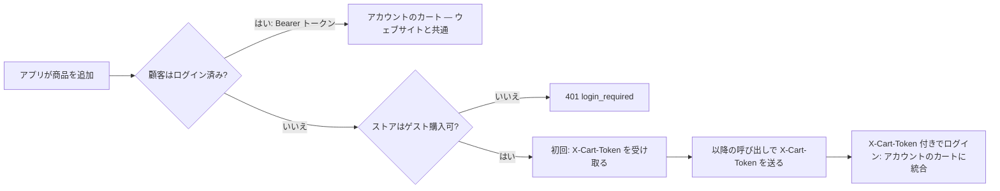

- **ログイン済みの顧客** は他の顧客 API と同じくトークンを送ります。カートは **アカウントのカート** です。アプリで追加すると
  ウェブサイトにログインしたときにも表示され、その逆も同じです。
- **ゲスト**（ストアがゲスト購入を許可している場合のみ）: 最初に商品を追加したとき、レスポンスに **`X-Cart-Token`** ヘッダーが
  付きます。保存して、以降のカート呼び出しすべてに付けてください。**一度だけ** 渡されます。誤ったトークンや **30 日** 変更の
  ないカートは「カートなし」として扱われます。
- **`X-Cart-Token` 付きのログイン / 登録**: ゲストのカートはアカウントのカートに **統合** され（同じ商品 + バリエーションは数量を
  合算）、古いカートトークンは無効になります。レスポンスに `cart_merge: {merged, dropped}` が含まれます。
- **商品の追加**（`POST cart/items`）: `product_id`、`qty`、商品に属性がある場合は `options` = `{"<属性グループ ID>": "<選択肢名>"}`。
  **すべてのグループ** を選ぶ必要があります。追加料金は常に商品から取得し、アプリが送った価格は無視されます。
- **カートの応答**: 行は **ストアごと** にまとめられ（`stores[].lines[]`）、`unit_price`、`line_total`、`subtotal` を持ちます。もう購入
  できない行は `purchasable: false` と `reason`（`not_for_sale`、`missing_options`）を持ち、`subtotal` に含まれません。

| エラーコード | HTTP | 意味 |
| --- | --- | --- |
| `login_required` | 401 | ストアがゲストに販売しない — 先にログイン |
| `validation_failed` | 422 | `qty` がない / 不正、属性が未選択（`errors.options`） |
| `product_not_for_sale` | 422 | 商品を購入できない（販売停止、販売開始前など） |
| `insufficient_stock` | 422 | 在庫超過販売をしないストアで在庫を超えた |
| `cart_line_limit` | 422 | カートがすでに **100 行** |
| `cart_conflict` | 409 | カートが別の場所で変更された — 読み直して再試行 |
| `not_found` | 404 | その行はあなたのカートにない |

制限: 顧客ごと、またはカートトークンごとに **1 分あたり 60 回**（`gp247-config.api.throttle.cart`）。

### 10.1. チェックアウトの手順

カートができたら、アプリはカートの **1 つのストア** についてチェックアウトの手順を進めます（カートに複数ストアの商品がある場合は
`store_id` を送信。別のストアを選ぶと選択はやり直しになります）。すべての選択はカートの所有者（顧客またはカートトークン）ごとに
呼び出しの間で保持されます — **ウェブサイトと同じルール** です。

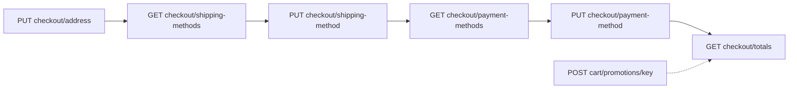

- **住所**（`PUT checkout/address`）: ウェブサイトのフォームと同じ必須項目（ストアの顧客設定どおり）。または顧客自身の住所録の住所を
  `address_id` で指定します（他人の住所 → `404`）。ログイン済みの顧客は `"save_address": true` で注文時に新しい住所として保存できます。
  住所を変えると配送方法の選び直しが必要です。
- **配送**（`GET checkout/shipping-methods`）: その住所 + カートに対する見積もり。サービスごとに 1 行（`id` は `<plugin>` または
  `<plugin>:<service>`）。見積もりできない配送会社は `unquotable` に入ります。配送を使わないストアは `required: false`。
- **支払い**（`GET checkout/payment-methods`）: API で使える方法のみ — `type: none`（決済画面なし: 代金引換、振込など）または
  `type: hosted`（決済ページを持つゲートウェイ）。ウェブサイト上の決済手順しかない方法は表示されません。
- **プロモーション**（`POST cart/promotions/{pluginKey}`、プラグインに合わせた `{"payload": {...}}`、例 `{"code": "SUMMER"}`）:
  チェックアウト契約に従うすべてのプロモーションプラグインに共通の方法。拒否されると `422 promotion_refused` とプラグインのメッセージ。
- **合計**（`GET checkout/totals`）: `subtotal`、`shipping`、`discount`、`tax`、`total` などの行。同じカートでウェブサイトが計算する金額と
  同じで、これが「顧客に表示した金額」です。

| エラーコード | HTTP | 意味 |
| --- | --- | --- |
| `cart_empty` | 422 | （選んだストアの）カートに注文できるものがない |
| `store_required` | 422 | カートに複数のストア — `store_id` を送信 |
| `address_required` | 422 | 配送先住所が未設定 |
| `method_unavailable` | 422 | その方法がない / このチェックアウトでは使えない |
| `promotion_refused` | 422 | プロモーションプラグインが拒否（コード誤り、期限切れなど） |
| `invalid_quantity` | 422 | 注文できない数量のカート行がある |

### 10.2. 注文の確定

`POST checkout/place` はチェックアウト中のストアの注文を確定します。呼び出す前に:

1. ストアのオーナーが **API 管理** 画面で **「API経由の注文」をオン** にします（v2 公開・顧客 API グループの下）。この設定は **既定でオフ** です
   （新規インストールでもアップグレードでも）。オフの間、`POST checkout/place` は `403 api_checkout_disabled` を返し、他のカート / チェックアウトの
   手順はそのまま使えます。
2. アプリは `GET checkout/totals` を呼び出して合計を顧客に表示しておきます — 注文時に再計算した合計が表示した金額と **一致** した場合のみ注文が作成されます。

顧客が *注文する* を押すたびに、アプリは `Idempotency-Key`（8〜255 文字、例: UUID）を **1 つ** 生成してヘッダーで送ります。通信が不安定な
ときは **同じキー** で再送してください。作成済みの注文が返り（HTTP `200`）、2 件目の注文や在庫の再減算、再請求は発生しません。新しい注文には
新しいキーが必要です。

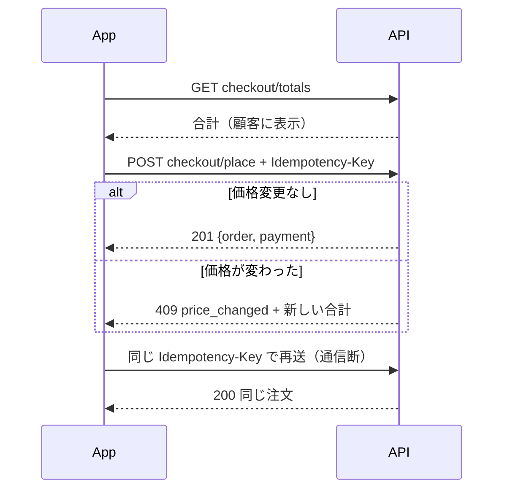

成功: `201 {"data": {"order": {id, store_id, status, payment_status, total, balance, currency}, "access_token"?, "payment": {"type": "none" | "hosted", "url"?}}}`。
注文はすぐに完了します。注文した行はカートから外れ、ウェブサイトで注文したときと同じく注文確認メールが送られます。

| エラーコード | HTTP | 意味 |
| --- | --- | --- |
| `idempotency_key_required` | 400 | `Idempotency-Key` ヘッダーがない / 不正 |
| `api_checkout_disabled` | 403 | ストアが API 経由の注文をオンにしていない |
| `idempotency_key_reused` | 409 | このキーは別のストアの注文に使われた（異なる `store_id` を送信） |
| `price_changed` | 409 | 表示後に合計が変わった — エラー本文に新しい `totals`。再表示してから新しいキーで注文 |
| `address_required` · `shipping_method_required` · `payment_method_required` | 422 | ストアが必要とするチェックアウトの手順が未完了 |
| `minimum_not_met` | 422 | 最低数量に満たない商品がある（`minimums`: 商品 ID → 最低数量） |
| `shipping_unquotable` · `invalid_quantity` · `cart_empty` | 422 | 配送不可、不正な数量、カートが空 |
| — | 429 | 顧客または IP ごとに **1 分あたり 10 件** を超えた（`gp247-config.api.throttle.checkout_place`） |

### 10.3. オンライン決済と支払い状況

`type: "hosted"` の支払い方法（例: Stripe、PayPal）は **ゲートウェイの決済ページ** で支払いを受けます。

1. 注文の確定時、アプリは `return_url` を送れます — 支払い後に購入者をアプリへ戻す先（`myshop://checkout/done` のような
   ディープリンク、またはアプリの Web ページ）。
2. 注文結果に `payment.url` が入ります。ブラウザ / WebView で開き、購入者に支払ってもらいます。
3. 支払い（またはキャンセル）の後、ゲートウェイは購入者をサイトの支払いページへ戻します。`return_url` が **許可リスト** にあれば、
   サイトはすぐにそのアドレスへ転送します。
4. アプリは状況を問い合わせます: `GET member/orders/{id}/payment`（サインイン済みの顧客）、または `X-Order-Access` ヘッダー付きの
   `GET orders/{id}/payment`（ゲスト — 注文確定時に受け取った `access_token`）。

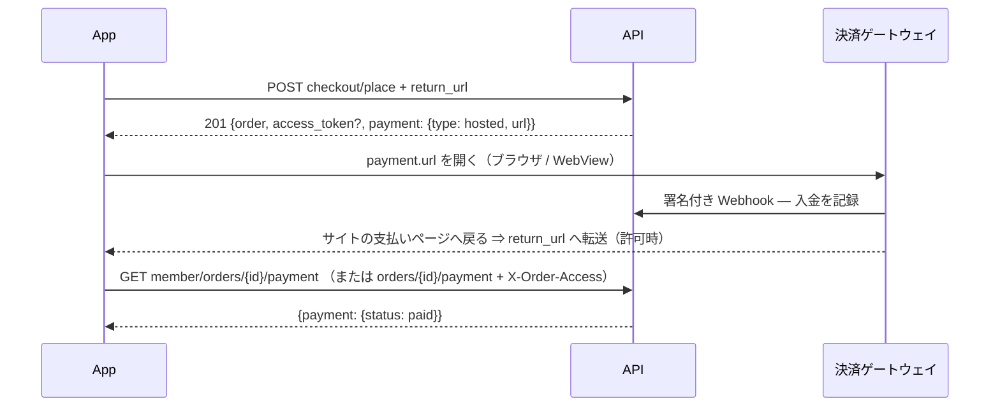

**許可リスト** はサイトの `.env` にカンマ区切りで設定します。

```bash
GP247_PAYMENT_RETURN_URLS="myshop://checkout, https://app.example.com/return"
```

サイトはスキーム + ホスト（+ ポート）の **完全一致** と、登録したパスで始まるパスを照合します（`https://app.example.com/return/ok` は
一致、`https://app.example.com.evil/return` は不一致）。リストは **既定で空** で、購入者はサイトのページに留まります。一致しない
アドレスは無視され、注文は通常どおり確定します。`php artisan config:cache` を使うサイトでは、`.env` の編集後にもう一度実行します。

- **入金はゲートウェイが確認したときだけ記録** されます（署名付き Webhook またはゲートウェイの戻りページ）。`return_url` 上のパラメーターで
  注文が変わることはありません — 状況は必ず API で問い合わせます。
- **購入者がゲートウェイでキャンセル**: 注文は *支払い待ち* のまま残ります。**同じ** `Idempotency-Key` で `POST checkout/place` を再送すると、
  同じ注文の新しい `payment.url` を受け取れます。ゲートウェイが一時的に失敗したときは `payment.url` が `null` — 同じキーで再送して
  再試行します。
- **未払い注文のキャンセル**: 購入者の気が変わったら、アプリは `POST member/orders/{id}/cancel`（ログイン済みの顧客）または
  `X-Order-Access` 付きの `POST orders/{id}/cancel`（ゲスト）を呼びます。キャンセルできるのは、アプリから行われ、入金がなく、ショップが
  まだ処理していない注文だけで、在庫は戻ります。それ以外の注文 ⇒ `409 order_not_cancellable`。キャンセル済みの注文に再度呼んでも `200` です。
- **放置された注文の自動キャンセル**: ゲートウェイ払いの注文が **24 時間** 経っても未払いのままなら、次にアプリから注文が入ったときに
  キャンセルされます（在庫は戻る）— cron 不要。期限は `GP247_API_UNPAID_ORDER_MINUTES`（分、`0` = 自動キャンセルしない）で変更できます。
  その後にゲートウェイが知らせた入金も記録されるので、ショップが返金できます。
- **支払い後の注文ステータス**: ゲートウェイで全額支払われると、そのゲートウェイがウェブの注文に使うステータス（例: *処理中* — Stripe /
  PayPal プラグインの設定）になり、全額返金されるとゲートウェイの *返金済み* ステータスになります。
- **単一ドメインのマルチベンダーマーケットプレイス**（MultiVendor）: 出店者ストアの注文もメインストアと同じようにゲートウェイで支払えます。

> ℹ️ **対応バージョン:** gp247/shop 3.5.1（StripePayment 1.1.4、PaypalExpress 3.2.4 と併用）— 未払い注文のキャンセル、放置された注文の自動
> キャンセル、支払い / 返金後の注文ステータス、独自ドメインのないストアの注文のゲートウェイ払い。PaypalExpress 3.2.4 は
> `CHECKOUT.ORDER.APPROVED` Webhook を受け取った時点で入金を確定します — サイトの PayPal Webhook にこのイベントを追加してください。
- **`access_token`** はゲストの注文結果にだけ入ります。アプリは状況の問い合わせ用に保存します。この注文の状況と金額だけを開き（住所なし）、
  他人の注文や誤ったトークン ⇒ `404`。
- API 経由の注文では、「注文成功」イベントと確認メールは **注文確定時** に実行されます（支払いを待ちません）。*支払い後* に処理する
  プラグインは、このイベントではなく注文の支払い状況を使います。

状況のレスポンス: `{"data": {"order": {id, store_id, status, payment_status, total, received, balance, currency}, "payment": {"type": "none" | "hosted", "status": "unpaid" | "partially_paid" | "paid" | "refunded"}}}`。

### 10.4. 購入用の商品データ

v2 の商品（`product/list`、`product/detail/{id}`）には、アプリがバリエーション選択と購入ボタンを作るための 3 つのフィールドが追加されます。
既存のフィールドはそのままです。

| フィールド | 意味 |
| --- | --- |
| `attributes` | 属性グループ: `group_id`、`name`、`required`（常に `true` — カートに追加するには各グループから 1 つ選ぶ必要がある）、`options` には `value`（`POST cart/items` の `options[group_id]` に送り返す値）と `add_price`（追加料金。`price_final` と同じ単位で、カートはこの金額を請求） |
| `image_sizes` | メイン画像のサイズ別 URL: `original`、`thumb`（絶対 URL。画像なし ⇒ サイトの既定画像） |
| `stock_status` | `in_stock` または `out_of_stock` — 在庫数は返しません。在庫を管理しない、または在庫切れでも販売するストア ⇒ 常に `in_stock` |

価格を非表示にしているストアでは、`add_price` は `null` です（`price` と同じ）。

```json
{
  "data": {
    "id": "PRD-AbC12",
    "price_final": 199000,
    "stock_status": "in_stock",
    "image_sizes": { "original": "https://shop.example.com/data/product/tshirt.jpg", "thumb": "https://shop.example.com/data/product/thumb/tshirt.jpg" },
    "attributes": [
      { "group_id": "2", "name": "Color", "required": true,
        "options": [ { "value": "Red", "add_price": 0 }, { "value": "Blue", "add_price": 20000 } ] }
    ]
  }
}
```

### 10.5. 購入フロー全体

下の表は、1 件の注文に必要な呼び出しを順番にまとめたものです（接頭辞 `api/v2/front/`）。ログイン済みの顧客はすべてのステップで
`Authorization: Bearer <token>` を送り、ゲストは代わりに `X-Cart-Token` を送ります。

| ステップ | 呼び出し | 追加ヘッダー | 参照 |
| --- | --- | --- | --- |
| 1. 商品を選ぶ | `GET product/list`、`GET product/detail/{id}` | — | 10.4 |
| 2. カートを保持する | `POST cart/items`、`GET cart`、`PATCH` / `DELETE cart/items/{rowId}` | 最初の追加で受け取る `X-Cart-Token`（ゲスト） | 10 |
| 3. 住所・配送・支払い | `PUT checkout/address` → `GET` + `PUT checkout/shipping-method(s)` → `GET` + `PUT checkout/payment-method(s)` | — | 10.1 |
| 4. プロモーション（任意） | `POST` / `DELETE cart/promotions/{pluginKey}` | — | 10.1 |
| 5. 顧客に合計を表示する | `GET checkout/totals` | — | 10.1 |
| 6. 注文する | `POST checkout/place`（決済ゲートウェイで支払う場合は `return_url` も） | `Idempotency-Key`（*注文する* を押すごとに 1 つ） | 10.2 |
| 7. 支払う（`payment.type = hosted` の場合） | `payment.url` を開く | — | 10.3 |
| 8. 支払い状況 | `GET member/orders/{id}/payment` または `GET orders/{id}/payment` | `X-Order-Access`（ゲスト） | 10.3 |

本番で販売を始める前のチェックリスト:

- ストアのオーナーが **「API経由の注文」** をオンにしている（10.2）。オンライン決済を使う場合は、戻り先アドレスを
  `GP247_PAYMENT_RETURN_URLS` に登録している（10.3）。
- アプリは `X-Cart-Token` と `access_token` を端末の安全な保存領域に保管し、ログに書き出さない。
- アプリは `409 price_changed`（新しい合計を表示）に対応し、注文中に通信が切れたら **同じ** `Idempotency-Key` で再送する。
- ウェブの注文を処理するサイトのプラグイン（出品者ごとの注文分割、手数料、通知など）は、同じフックでアプリからの注文も受け取ります —
  [API の作り方 — 8 章](./create-api_ja.md) を参照。

---

## 11. 非推奨ポリシーと OpenAPI からのクライアント生成

### API の一部を非推奨にする

> ℹ️ **対応バージョン:** gp247/core 3.8.0

GP247 は、使われているエンドポイントやパラメーターを予告なしに削除しません:

- 削除の **少なくとも 12 か月前、かつ 2 つ以上のマイナーリリース前** に予告します。
- その間、非推奨になった部分のすべてのレスポンス（エラーを含む）に次のヘッダーが付きます:

| ヘッダー | 意味 | 例 |
| --- | --- | --- |
| `Deprecation` | 非推奨になった時点（RFC 9745、`@<unix 時刻>` 形式） | `Deprecation: @1793491200` |
| `Sunset` | 動作が止まる日（RFC 8594） | `Sunset: Fri, 31 Dec 2027 00:00:00 GMT` |
| `Link` | 移行ガイド | `Link: <https://gp247.net/ja/docs/api/about-api-gp247.html#…>; rel="deprecation"` |

- リリースごとの変更は、このページ末尾の **変更履歴** に記載します。
- API v1 は開発を終了していますが、**停止日はまだ決まっていません**。v1 の `GET logout` は従来どおり `Deprecation: true` を返します。

アプリは `Deprecation` ヘッダーを受け取るたびにログに記録し、新しい方法へ移行する時間を確保してください。

### `openapi.json` から TypeScript クライアントを生成する

GP247 は独自の SDK を提供していません — [`openapi.json`](./openapi.json) があれば、アプリ用の型とクライアントを生成できます。
ファイルをダウンロードして、たとえば `openapi-typescript` で次のように実行します:

```bash
npx openapi-typescript ./openapi.json -o gp247-api.d.ts
```

ほかの言語（Kotlin、Swift、Dart など）は、同じファイルで [OpenAPI Generator](https://openapi-generator.tech/) を使います。
gp247/core、gp247/shop、gp247/front をアップグレードするたびに、`openapi.json` をダウンロードし直してクライアントを再生成してください。

---

## よくある質問（Q&A）

**Q1: どちらの API グループを使えばよいですか？**

→ ストア向けのアプリ／顧客クライアント（商品の閲覧、アカウント、カート、注文）を作るなら **Front API**
（`api/v2/front`）を使います。管理者向けのリモート管理ツールを作るなら **Core API**（`api/v2/core`）を使います。

**Q2: トークンはどこで取得し、どのくらい有効ですか？**

→ トークンは `login` エンドポイントが発行します。既定では 7 日後に失効し、`remember_me = true` を送ると 30 日になります。
セクション 2 の環境変数で変更できます。モバイルアプリは `with_refresh: true` でサインインし、60 分のトークンをリフレッシュ
トークンで更新することをおすすめします（セクション 9.2）。安全にログアウトするには、現在のトークンで `POST logout` を呼びます。
そのセッションはサインアウトされ、トークンは再利用できなくなります。

**Q3: `apiconnection`／`apikey` と `access_token` の違いは何ですか？**

→ `access_token` は**ユーザー**（あなたが誰か）を認証します。`apiconnection`／`apikey` は**アプリケーション**
（どのアプリが API を呼べるか）を認証します。こちらは**任意のレイヤー**で、
管理者が `api_connection_required` をオンにした場合だけ必須です。

**Q4: 公開エンドポイントを呼ぶのにトークンは必要ですか？**

→ 不要です。`meta` エンドポイントと、商品、カテゴリー、ブランド、バナー、コンテンツページの一覧／詳細エンドポイントは
公開されています。ただし API Connection レイヤーがオンの場合は、`apiconnection`／`apikey` ヘッダーを送る必要があります。

**Q5: パスワードが正しいのに `401` エラーになるのはなぜですか？**

→ アカウントが有効である必要があります。管理者は `status = 1` が必要で、ロックされた顧客はログインできません。
正しい項目名で送ってください。Core は `username`、Front は `email` を使います。`code` が `challenge_required` の場合は、
アカウントで二要素認証が有効になっています — 続けて `login/challenge` を呼んでください（セクション 9.4）。
直前に何度も失敗した場合は `429` が返ります。`Retry-After` に従って待ってください。

**Q6: ログインはできるのに、`api/v2/core/order/list` を呼ぶと `403` になるのはなぜですか？**

→ 管理者アカウントに **注文** 画面を開く権限がまだありません。管理者に **ロール／権限** でその画面の権限を
付与してもらってください。API は管理画面とまったく同じ権限設定を使います（セクション 3）。

**Q7: `api_connection_invalid` エラーになるのはなぜですか？**

→ API Connection レイヤーがオンで、`apiconnection`／`apikey` のペアが誤っている、期限切れ（`expire`）、
または無効（`status`）になっています。キーは作成時に 1 回だけ表示されます。紛失した場合は、
API Connection の管理項目で新しいキーを生成してください。

**Q8: 公開 API が原価や在庫数を返さないのはなぜですか？**

→ それらは社内のビジネスデータだからです。公開 API は、顧客がストアで見られる内容だけを返します（商品には在庫あり／なしを
示す `stock_status` だけがあります）。これらの数値が必要な社内アプリは、権限のあるアカウントで Core API
（`api/v2/core/product/*`）を使ってください。

**Q9: API を呼ぶと `404`（`"code": "api_disabled"`）が返るのはなぜですか？**

→ 呼んでいる API グループが、サイトの API 管理画面で**オフ**になっています（セクション 5）。管理者にオンにしてもらってください。
アプリが `api/core` や `api/front`（API v1）を呼んでいる場合：新規インストールでは v1 は最初からオフです。一時的にオンに戻す方法と
v2 への移行方法は [API v1（開発終了）](./api-v1_ja.md)を参照してください。

**Q10: 一覧にないエンドポイントが必要な場合は？**

→ 開発者は独自のプラグインでルートを宣言して拡張できます。コアのコードは変更しません。
[正しい API の作り方ガイド](./create-api_ja.md)をご覧ください。

---

## 変更履歴
<!-- ロジック/動作が変わった場合のみ記載。最新の行を一番上に。1 日 1 行：同じ日の変更は既存の行にまとめ、同じ日付の行を追加しない。 -->

| 日付 | GP247 バージョン | 変更内容 |
| --- | --- | --- |
| 2026-11-02 | gp247/core 3.8.0, gp247/shop 3.7.0, gp247/front 3.5.0 | v2 のすべての `GET` に `ETag` + `If-None-Match` → `304`。トークンなしで呼んだ商品、カテゴリー、ブランド、バナー、コンテンツページに `Cache-Control: public`（既定 `max-age=0`、`GP247_API_PUBLIC_MAX_AGE`）。`fields[<種類>]` と `include`（最大 3、`GP247_API_MAX_INCLUDE`）（セクション 6）。1 分あたり 1000 回の共通制限をログイン済みならアカウントごとに数える（セクション 2）。非推奨ポリシー（`Deprecation` / `Sunset` / `Link`）と `openapi.json` からのクライアント生成（セクション 11） |
| 2026-11-01 | gp247/core 3.7.0, gp247/shop 3.6.0 | 管理 API による顧客のロック／ロック解除: `PATCH api/v2/core/customer/{id}`（`{"status": 0 / 1}`、それ以外のフィールド → `422`。顧客一覧画面の変更権限。ロックすると顧客の API トークンはすぐに拒否され、ストアではサインアウトされる。`Idempotency-Key` は任意、書き込みの回数制限を共有）（セクション 3、7）; イベントログにストアの 8 種類のイベント: `order.created`、`order.status_changed`、`order.payment_status_changed`、`stock.changed`、`product.updated`、`product.deleted`、`customer.created`、`customer.updated` — 変更元を問わず記録、各種類は対応する管理画面の権限で読める（セクション 6）; 商品／カテゴリーのテキストの編集で `updated_at` が変わるようになり、変更なしの保存と商品ページの閲覧では変わらない（セクション 6）; ERP 向け Webhook: ログのイベントを、API 管理画面で登録した `https` の URL にすぐ `POST`（administrator のみ、イベントログのオンが必要）、`X-GP247-Signature` で署名、最大 5 回再送した後は断念、cron 不要（セクション 5、6） |
| 2026-10-31 | gp247/core 3.6.0, gp247/shop 3.5.0 / 3.5.1; 変更の同期: gp247/core 3.7.0, gp247/shop 3.6.0, gp247/front 3.4.0; イベントログ: gp247/core 3.7.0; 管理 API による注文の書き込み: gp247/core 3.7.0, gp247/shop 3.6.0; 管理 API による商品・在庫の書き込み: gp247/shop 3.6.0 | 管理 API による商品・在庫の書き込みを追加: `PATCH api/v2/core/product/{id}`（販売価格・原価・ステータス — 商品設定の項目スイッチに従う）、`product/{id}/stock`（`delta` はアトミックな入庫／出庫で 0 未満にならず販売数は変わらない、`set` は棚卸し後で administrator のみ）、`stock/batch`（1〜100 行、行ごとの結果）— 商品一覧画面の変更権限、在庫の書き込みは `Idempotency-Key` 必須、`422 stock_would_be_negative` / `stock_managed_by_components`（セクション 3、6、7）; ERP／倉庫ソフト向けに管理 API による注文の書き込みを追加: `api/v2/core/order/{id}/status`、`order/{id}/shipping`（配送ステータス ＋ 手動の送り状の追跡番号）、`order/{id}/notes` — 注文一覧画面の変更権限、書き込みはアカウントごとに 1 分 300 回まで（`GP247_API_WRITE_THROTTLE`）、`Idempotency-Key` は任意（再送 ⇒ 最初の結果。`409 idempotency_key_reused` / `idempotency_in_progress`、`gp247:update` 前は `503 idempotency_unavailable`）（セクション 3、6、7）; ERP 向けのイベントログ `api/v2/core/events` を追加（カーソル `after`、古い順、管理画面の権限とストアで制限。既定はオフ — API 管理画面の **同期用イベントログ（ERP）** スイッチ、オフの間は `409 event_log_disabled`。保持 30 日、古すぎるカーソルは `410 cursor_expired`）（セクション 5、6）; 管理用の v2 一覧に変更の同期モードを追加: `updated_since` ＋ カーソル `page[after]`、`meta.next_after` / `has_more` / `sync_until`（6 章）; ドキュメントは API v2 のみを扱うように変更し、API v1 は別ドキュメント（[API v1](./api-v1_ja.md)）に移動; shop 3.5.1: アプリからの未払い注文のキャンセル（`orders/{id}/cancel`、`member/orders/{id}/cancel`）、24 時間未払いのゲートウェイ注文の自動キャンセル、支払い / 全額返金後の注文ステータスをゲートウェイに合わせる、独自ドメインのないストアの注文のゲートウェイ払い（10.3 節）; `Accept: application/json` を送らなくてもレスポンスはすべて JSON（トークンなし → `401`、`500` は返らない）。`register` と `member/password` はパスワード必須、必須項目のない本文 → `422`（6 章、9.1） |
| 2026-10-30 | gp247/shop 3.5.0 | API v2 によるカート（`api/v2/front/cart`、`cart/items`）: ウェブサイトと共通のアカウントのカート、`X-Cart-Token` によるゲストのカート（30 日）、ログイン / 登録時のカート統合（`cart_merge`）、最大 100 行、1 分あたり 60 回; API v2 によるチェックアウトの手順（`checkout`、`checkout/address`、`checkout/shipping-methods` + `shipping-method`、`checkout/payment-methods` + `payment-method`、`checkout/totals`）とプロモーション（`cart/promotions/{pluginKey}`）; API v2 による注文（`checkout/place`）: `Idempotency-Key` 必須（再送 ⇒ 同じ注文）、新しい合計付きの `409 price_changed`、API 管理画面の **API経由の注文** スイッチ（既定でオフ）、1 分あたり 10 件; API によるオンライン決済（`payment.url`、許可リスト `GP247_PAYMENT_RETURN_URLS`（既定で空）にある `return_url` で購入者をアプリへ戻す）と支払い状況（`member/orders/{id}/payment`、`orders/{id}/payment` + `X-Order-Access`）; v2 の商品に `attributes`、`image_sizes`、`stock_status` を追加 |
| 2026-10-29 | gp247/core 3.6.0 | **管理者**のパスワードの変更／再設定（ユーザー画面、アカウント設定、パスワードを忘れた場合）で、その管理者のすべての API トークンとセッションをサインアウト |
| 2026-10-28 | gp247/core 3.3.1。`X-Request-Id`、古いトークンの有効期限、平文キーの削除、`api_route_gate`：3.4.0。顧客アカウントとセッション：core 3.6.0、shop 3.4.0 | API 管理画面で API をオン／オフ（全体 + v1/v2 × core/front）、新規インストールは v2 のみオン、オフのグループは `404 api_disabled` を返す（3.3.1）。オフのグループはトークンがなくても `api_disabled` を返す。すべてのレスポンスに `X-Request-Id` ヘッダー。3.2.3 より前に発行されたトークンに `gp247:update` で有効期限を設定（最低 7 日）。`gp247:update` が API Connection キーの平文のコピーを削除。`gp247:doctor` がルートキャッシュを確認（3.4.0）。API v2 による顧客アカウント（会員登録、パスワードの再設定、プロフィール、パスワード変更、住所録、確認メールの再送）、任意のローテーション式リフレッシュトークン（60 分のトークン）、セッション管理、v2 の `logout` でセッション全体を終了、プラグインによる追加の確認ステップ（`challenge_required`）、パスワードの変更／再設定ですべての API トークンを無効化、メール確認リンクはウェブサイトへのサインイン不要、管理 API のアクセスログ（core 3.6.0、shop 3.4.0） |
| 2026-10-26 | gp247/core, gp247/front, gp247/shop 3.2.3。API v2 と新しい環境変数名：3.3.0 | API v2 を追加（`api/v2/...`：`{data, meta, links}` 形式のレスポンス、`filter`／`sort`／`q`／`lang`、`price_final`、`meta`）、正しい綴りの環境変数名を追加（3.3.0）。Core API が管理画面の権限とストアの範囲に従うように変更。ログイン試行回数の制限を追加。トークンは常に有効期限付きになり、`POST logout` を追加。ロックされた顧客はログイン不可に。公開 API はストアが表示中のデータだけを返し、社内向けの項目を削除。API Connection のキーをハッシュ化して保存。すべてのエラーが意味の正しい HTTP コードと `{error, msg, code}` 形式を持つように変更。`openapi.json` を追加 |

---

<sub>📅 **最終更新:** 2026-11-02 · ✍️ **作成者 (Author):** GP247</sub>
