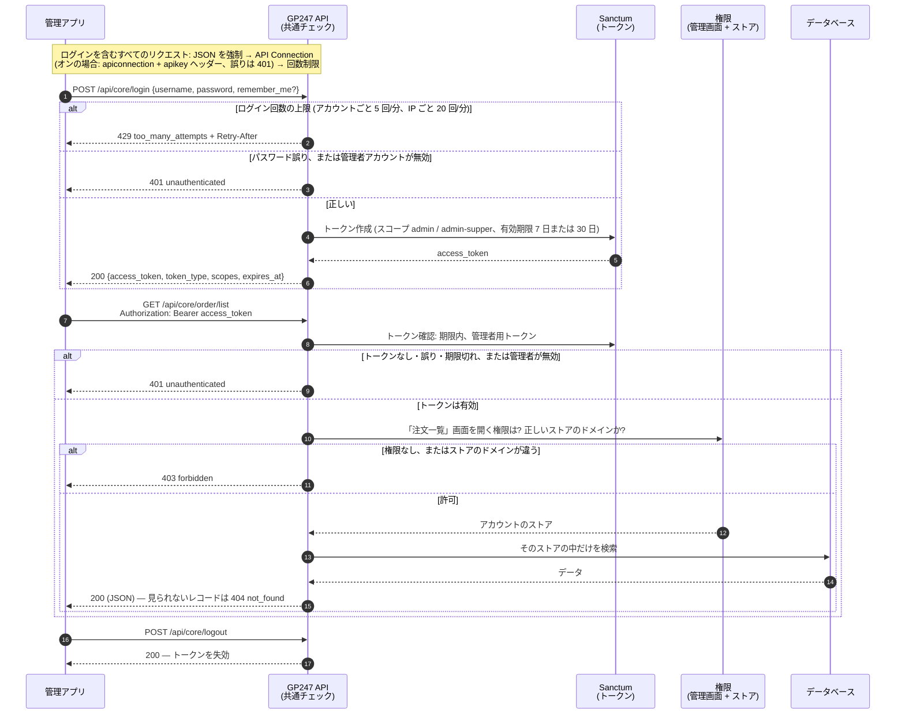
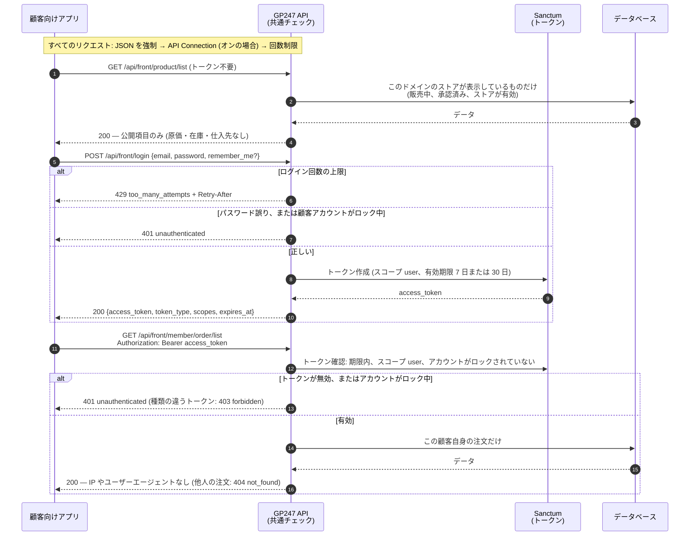

> 🌐 **言語:** [🇻🇳 Tiếng Việt](./api-introduction_vi.md) · [🇬🇧 English](./api-introduction.md) · 🇯🇵 日本語（現在）

# GP247 システムの API 入門

## はじめに

このドキュメントでは、**GP247 の API（アプリケーション・プログラミング・インターフェース）システム**を紹介します。
外部のアプリケーション（モバイルアプリ、別の Web サイト、管理ソフト、サードパーティ連携など）が、
あなたの GP247 サイトと「会話」してデータを取得する方法を説明します。
対象読者は、API の全体像を知りたい**連携開発者**と**サイト管理者**です。
API にどんな機能があるか、いくつのグループに分かれるか、認証（ログイン）と権限の仕組み、
エラーがどう返るか、試し方を扱います。
読み終えると、**どの API が何をするのか、どのアドレスで呼ぶのか、どんな鍵が必要か、どのデータを見られるのか**がわかります。
コピーしてすぐ動かせる例も載せています。

> ℹ️ **API とは（身近なたとえ）：** API はサイトの「窓口」のようなものです。
> 外部アプリはデータの保管庫に直接入りません。窓口（URL アドレス）にリクエストを送ります。
> 窓口は書類（トークン／キー）を確認し、結果を **JSON**（コンピューターが読めるテキスト形式のデータ）で返します。
> やり取りはすべて、通常の Web の通信方式（HTTP）で行われます。

> 📄 **機械可読な仕様書：** すべてのエンドポイント、パラメーター、エラーの例はファイル
> [`openapi.json`](./openapi.json)（OpenAPI 3.1）にまとめています。Postman、Insomnia、Swagger UI に読み込んで
> 試しに呼び出したり、クライアントのコードを生成したりできます。

---

## 1. 2 つの主要 API グループ

GP247 システムは API を **2 つのグループ**に分けています。それぞれ利用者が異なります。

| グループ | アドレスの接頭辞（prefix） | 用途 | ログインする人 |
| --- | --- | --- | --- |
| **Core API（管理）** | `api/core` | リモートからのシステム管理（管理アプリ、独自ダッシュボード） | **管理者**（admin）アカウント |
| **Front API（ストアフロント）** | `api/front` | ストアのデータ表示、顧客アカウント | 顧客／会員。公開データは**ログイン不要** |

- **`api/core`** は、ログイン／管理者情報の部分を `gp247/core` パッケージが提供します。
  `gp247/shop` と `gp247/front` が、管理データ（顧客、注文、商品、バナーなど）を読み取るエンドポイントを追加します。
- **`api/front`** は `gp247/front` と `gp247/shop` パッケージが提供します。商品一覧、カテゴリー、
  ブランド、コンテンツページ、バナー、顧客のアカウント／注文など、ストアの「表側」のデータです。

> ℹ️ **対応バージョン:** gp247/core, gp247/front, gp247/shop 3.3.0 — 接頭辞 `api/v2/core` と `api/v2/front` を持つ
> **API v2** が追加されました（セクション 8）。上の接頭辞 `api/core`、`api/front` は **v1** で、これまでどおり動作します。

> **完全なアドレス** ＝ サイトのドメイン ＋ 接頭辞 ＋ パス です。たとえばサイトが
> `https://shop.example.com` の場合、商品一覧を取得するエンドポイントは次のとおりです。
> `https://shop.example.com/api/front/product/list`

---

## 2. 認証（API へのログイン）

GP247 は **Laravel Sanctum** を使って**トークン**（「入場券」の役割をする長い文字列）を発行します。
仕組みは両グループで共通です。

1. アプリが **ユーザー名／メールアドレス ＋ パスワード** を `login` エンドポイントに送ります。
2. 正しければ、システムは **`access_token`**（Bearer 形式のトークン）と有効期限（`expires_at`）を返します。
3. 以降、ログインが必要なリクエストには、このトークンを **ヘッダー** に付けて送ります。

   ```
   Authorization: Bearer <access_token>
   ```

4. 終了するときは **`POST logout`** を呼び、**トークンを失効**させます（古いトークンはすぐに使えなくなります）。

### 権限の範囲（scope / ability）

各トークンには、誰のトークンかを示す**権限の範囲**が付きます。

| Scope | 意味 |
| --- | --- |
| `admin` | 管理者のトークン（Core API） |
| `admin-supper` | `administrator` ロールを持つ管理者のトークン（Core API） |
| `user` | 会員のトークン（Front API） |

> ℹ️ **対応バージョン:** gp247/core 3.2.3 — scope は**アカウントの種類**だけを区別します。**どのデータを見られるか**は、
> アカウント自身の権限設定で決まります（セクション 3）。scope `user-guest` は発行されなくなりました。
> ロックされている顧客アカウントはログインできません。

### トークンの有効期限

> ℹ️ **対応バージョン:** gp247/core 3.2.3

すべてのトークンには有効期限（`expires_at`）があります。

| トークンの種類 | `remember_me` を送らない場合 | `remember_me = true` を送る場合 |
| --- | --- | --- |
| 管理者 | 7 日（`GP247_API_TOKEN_EXPIRE_ADMIN_DEFAULT`） | 30 日（`GP247_API_RECOMMEMBER_ADMIN`） |
| 会員 | 7 日（`GP247_API_TOKEN_EXPIRE_DEFAULT`） | 30 日（`GP247_API_RECOMMEMBER`） |

> ℹ️ **対応バージョン:** gp247/core 3.3.0 — 環境変数に正しい綴りの名前ができました：`GP247_API_REMEMBER`、
> `GP247_API_REMEMBER_ADMIN`、`GP247_API_SCOPE_ADMIN_SUPER`。旧名（`GP247_API_RECOMMEMBER` など）も引き続き使えます。
> 両方を設定した場合は新しい名前が優先されます。`php artisan gp247:doctor` は、まだ使われている旧名を報告します
> （チェック項目 `api_config_legacy_names`）。scope `admin-super` を持つトークンも、`admin-supper` と同様に受け付けられます。

期限切れのトークンは `401` を返します。その場合は `login` を呼んで新しいトークンを取得してください。
期限切れから長く経った（7 日を超えた）トークンは、同じアカウントが次にログインしたときに自動で削除されます。cron は不要です。

### ログイン試行回数の制限

> ℹ️ **対応バージョン:** gp247/core 3.2.3

パスワードの総当たりを防ぐため、`api/core/login`、`api/front/login` と管理画面のログインフォームは試行回数を制限しています。
管理画面のログインフォームと `api/core/login` は同じカウンターを共有し、一方での失敗はもう一方にも数えられます。

| 制限 | 既定値 | 変更する環境変数 |
| --- | --- | --- |
| アカウントごと（同じ IP から） | 1 分あたり 5 回 | `GP247_LOGIN_THROTTLE`（形式 `回数,分`） |
| IP ごと（すべてのアカウント合計） | 1 分あたり 20 回 | `GP247_LOGIN_IP_THROTTLE` |

> ⚠️ **gp247/core 3.4.0 より後で名称変更:** 旧名 `GP247_API_LOGIN_THROTTLE` と `GP247_API_LOGIN_IP_THROTTLE` は
> 読み込まれなくなりました。設定している場合は `.env` で名前を変更してください。変更しない場合は上記の既定値が使われます。

制限を超えると → HTTP `429` と `Retry-After` ヘッダー（待つ必要がある秒数）が返ります。
正しくログインすると、そのアカウントのカウンターはリセットされます。
このほか、すべての API エンドポイントには IP ごとに 1 分あたり 1000 回の共通制限があります（`GP247_API_THROTTLE`）。

---

## 3. Core API の権限とデータの範囲

> ℹ️ **対応バージョン:** gp247/core 3.2.3, gp247/shop 3.2.3, gp247/front 3.2.3

Core API は**管理画面で見られる以上のデータを見せません**。データを読み取る各エンドポイントは 1 つの管理画面に対応しており、
管理者はアカウントがその画面を開く権限を持っている場合にだけ呼び出せます
（権限は **管理 → ロール／権限** で設定します）。権限がなければ → HTTP `403`。

| エンドポイント | 必要な権限（管理画面） |
| --- | --- |
| `customer/list`, `customer/detail/{id}` | 顧客一覧 |
| `order/list` | 注文一覧 |
| `order/detail/{id}` | 注文の詳細 |
| `product/*` | 商品一覧 |
| `category/*`, `brand/*`, `supplier/*` | カテゴリー／ブランド／仕入先一覧 |
| `banner/*`, `page/*` | バナー／コンテンツページ一覧 |
| `login`, `logout`, `info` | 有効なトークンのみ |

- `administrator` ロールはすべてのエンドポイントを呼び出せます。`view.all` ロールは閲覧のみです。
- **ストアごとのデータ：** 複数ストアのサイトでは、1 つのストアに割り当てられた管理者はそのストアのデータだけを見られ、
  **自分のストアのドメイン**でしか API を呼び出せません（管理画面にログインするときと同じです）。
  他のストアのレコードは `404` を返します。
- 管理者アカウントが無効（`status = 0`）になると、古いトークンは使えなくなります（`401`）。

---

## 4. 接続保護レイヤー（API Connection）— 任意

トークンに加えて、GP247 にはすべての API の前に立つ**追加の鍵**があります。これを **API Connection** と呼びます。
これは 2 つ目の「門番」です。許可されたアプリケーションだけが API を呼べるようにします。
公開エンドポイントも対象です。

- このレイヤーは**既定でオフ**です。管理画面の設定 `api_connection_required` でオン／オフを切り替えます。
- **オンの場合：** すべてのリクエストに、さらに**2 つのヘッダー**を付ける必要があります。

  ```
  apiconnection: <接続コード>
  apikey: <秘密キー>
  ```

- `apiconnection`／`apikey` のペアは **GP247 の管理画面**（API Connection の管理項目）で作成・管理します。
  ペアごとに有効期限（`expire`）とオン／オフの状態（`status`）を設定できます。
- 不足している、誤っている、期限切れ、または無効になっている場合、API は HTTP `401` と
  `"code": "api_connection_invalid"` を返します。

> ℹ️ **対応バージョン:** gp247/core 3.2.3 — キーは**ハッシュ化して保存**されます。管理画面にキーが表示されるのは、
> 作成／再生成した直後の**1 回だけ**なので、すぐにコピーしてください。接続を編集するとき、キーの欄を空のままにすると
> 古いキーがそのまま残ります。以前から使っているキーは、アップグレード（`php artisan gp247:update`）後も引き続き使えます。
> 保存されたままの平文のコピーを消すため、都合のよいときに古いキーを**再生成**してください。手入力するキーは 32 文字以上が必要です。

> チェックレイヤー（ミドルウェア）の順序は **JSON を返す → API Connection を確認 → レート制限** です。
> この順序は固定で、変更しないでください。

---

## 5. Core API（管理）の処理の流れ

下の図は、管理アプリがログインしてから Core API でデータを読む順序を示しています。すべてのリクエストは図の順に
チェックを通り、どこかで拒否されるとその場でエラーを返し、先へは進みません。



ポイント: トークンがあるだけではデータを読めません。対応する管理画面を開く権限が必要で、見えるのは自分のストアの
データだけです（3 章）。

**ログインとアカウントのエンドポイント**（接頭辞 `api/core`）：

| メソッド | パス | ログイン必要 | 機能 |
| --- | --- | --- | --- |
| `POST` | `api/core/login` | 不要 | 管理者ログイン、`access_token` を受け取る |
| `POST` | `api/core/logout` | 必要（Bearer） | ログアウト、現在のトークンを失効 |
| `GET` | `api/core/logout` | 必要（Bearer） | 上と同じ — **非推奨**。レスポンスに `Deprecation` ヘッダーが付きます。`POST` に切り替えてください |
| `GET` | `api/core/info` | 必要（Bearer） | ログイン中の管理者情報を取得 |

**管理データのエンドポイント**（接頭辞 `api/core`、トークン ＋ セクション 3 の権限が必要）：

| メソッド | パス | 機能 |
| --- | --- | --- |
| `GET` | `api/core/customer/list` | 顧客一覧 |
| `GET` | `api/core/customer/detail/{id}` | 顧客 1 件の詳細 |
| `GET` | `api/core/order/list` | 注文一覧（明細行と合計金額を含む） |
| `GET` | `api/core/order/detail/{id}` | 注文 1 件の詳細 |
| `GET` | `api/core/product/list` | 商品一覧 |
| `GET` | `api/core/product/detail/{id}` | 商品 1 件の詳細 |
| `GET` | `api/core/category/list` | カテゴリー一覧 |
| `GET` | `api/core/category/detail/{id}` | カテゴリー 1 件の詳細 |
| `GET` | `api/core/brand/list` | ブランド一覧 |
| `GET` | `api/core/brand/detail/{id}` | ブランド 1 件の詳細 |
| `GET` | `api/core/supplier/list` | 仕入先一覧 |
| `GET` | `api/core/supplier/detail/{id}` | 仕入先 1 件の詳細 |
| `GET` | `api/core/banner/list` | バナー一覧 |
| `GET` | `api/core/banner/detail/{id}` | バナー 1 件の詳細 |
| `GET` | `api/core/page/list` | コンテンツページ一覧 |
| `GET` | `api/core/page/detail/{id}` | コンテンツページ 1 件の詳細 |

管理者ログインの例（ターミナルで `curl` を使用）：

```bash
curl -X POST "https://shop.example.com/api/core/login" \
  -H "Content-Type: application/json" \
  -d '{"username":"admin","password":"your-password","remember_me":true}'
```

成功すると、次のような JSON が返ります。

```json
{
  "access_token": "1|aBcD...very-long...XyZ",
  "token_type": "Bearer",
  "scopes": ["admin-supper"],
  "expires_at": "2026-11-25 10:00:00"
}
```

続いて、受け取ったトークンで注文一覧を取得します。

```bash
curl -X GET "https://shop.example.com/api/core/order/list" \
  -H "Authorization: Bearer 1|aBcD...very-long...XyZ"
```

---

## 6. Front API（ストアフロント）の処理の流れ

Front API は 2 種類のデータを扱います。**公開データ**（ログイン不要 — 商品一覧、カテゴリーなど）と、
**顧客個人のデータ**（ログイン必要 — 注文、個人情報）です。

下の図は Front API の 2 つの使い方を示しています。ログインなしで公開データを読む方法と、顧客がログインして自分の
注文を見る方法です。



ポイント: API の公開データは**ストアで顧客が見ている内容と一致**し、個人のデータは本人にだけ返されます。API v2
（8 章）も同じチェックを通り、違うのはレスポンスの形だけです。

**公開エンドポイント**（接頭辞 `api/front`、トークン不要）：

| メソッド | パス | 機能 |
| --- | --- | --- |
| `GET` | `api/front/product/list` | 商品一覧 |
| `GET` | `api/front/product/detail/{id}` | 商品 1 件の詳細 |
| `GET` | `api/front/category/list` | カテゴリー一覧 |
| `GET` | `api/front/category/detail/{id}` | カテゴリー 1 件の詳細（商品を含む） |
| `GET` | `api/front/brand/list` | ブランド一覧 |
| `GET` | `api/front/brand/detail/{id}` | ブランド 1 件の詳細 |
| `GET` | `api/front/banner/list` | バナー一覧 |
| `GET` | `api/front/banner/detail/{id}` | バナー 1 件の詳細 |
| `GET` | `api/front/page/list` | コンテンツページ一覧 |
| `GET` | `api/front/page/detail/{id}` | コンテンツページ 1 件の詳細 |

> ℹ️ **対応バージョン:** gp247/shop 3.2.3, gp247/front 3.2.3 — 公開データは、呼び出したドメインで
> **ストアが表示している内容とまったく同じ**です。非表示の商品、未承認の商品、他のストアに属する商品は含まれません。
> レスポンスには公開項目だけが入り、原価、仕入先、在庫数／販売数は含まれません。
> これらの数値が必要な場合は、権限のあるアカウントで Core API を使ってください。

**顧客アカウントのエンドポイント**（接頭辞 `api/front`、顧客のトークンが必要）：

| メソッド | パス | ログイン必要 | 機能 |
| --- | --- | --- | --- |
| `POST` | `api/front/login` | 不要 | 顧客のメールアドレス／パスワードでログインし、トークンを受け取る |
| `POST` | `api/front/logout` | 必要（Bearer） | 顧客のログアウト |
| `GET` | `api/front/logout` | 必要（Bearer） | 上と同じ — **非推奨**。`POST` に切り替えてください |
| `GET` | `api/front/info` | 必要（Bearer） | 顧客アカウントの情報 |
| `GET` | `api/front/member/order/list` | 必要（Bearer） | 顧客の注文一覧 |
| `GET` | `api/front/member/order/detail/{id}` | 必要（Bearer） | 注文 1 件の詳細 |

商品一覧を取得する例（公開データ、トークン不要）：

```bash
curl -X GET "https://shop.example.com/api/front/product/list" \
  -H "Accept: application/json"
```

顧客としてログインし、注文を確認する例：

```bash
# 1) 顧客ログイン
curl -X POST "https://shop.example.com/api/front/login" \
  -H "Content-Type: application/json" \
  -d '{"email":"customer@example.com","password":"your-password"}'

# 2) 受け取ったトークンで注文一覧を取得
curl -X GET "https://shop.example.com/api/front/member/order/list" \
  -H "Authorization: Bearer 2|zzz...customer-token...zzz"
```

---

## 7. レスポンスの形式とエラーコード

- **レスポンスはすべて JSON です。**
- 一覧のエンドポイントは、Laravel 標準のページ分割形式で返ります（`data`、`current_page`、`total` などを含みます）。
  ページは `page[number]` と `page[size]` で指定します。
- 成功時：データがそのまま返ります（1 つのオブジェクト、または 1 ページ分のデータ）。

> ℹ️ **対応バージョン:** gp247/core 3.2.3 — **すべてのエラー**は同じ形式で、**意味の正しい HTTP コード**を返します。
>
> ```json
> { "error": 1, "msg": "Not found", "code": "not_found" }
> ```

| HTTP | `code` | 発生する場面 |
| --- | --- | --- |
| `401` | `unauthenticated` | トークンがない／誤り、トークンの期限切れ、アカウントが無効／ロック、`login` でのパスワード誤り |
| `401` | `api_connection_invalid` | API Connection がオンなのに、`apiconnection`／`apikey` のペアがない／誤り |
| `403` | `forbidden` | ログイン済みだが権限がない（セクション 3）、またはトークンの種類が違う |
| `404` | `not_found` | レコードが存在しない、または閲覧を許可されていない。API のパスが存在しない |
| `422` | `validation_failed` | 送信したデータが不正 — 項目ごとの `errors` キーも確認してください |
| `429` | `too_many_attempts` | 呼び出し回数が多すぎる — `Retry-After` ヘッダーに従って待ってください |
| `405` | `method_not_allowed` | パスに対して HTTP メソッドが違う（例: `POST` の代わりに `GET`） |
| その他 | `http_error` | その他の HTTP エラー — `msg` を確認してください |
| `500` | `server_error` | サーバーエラー — 詳細はサイトがデバッグモードのときだけ表示されます |

> `error`／`msg` キーを読む古いアプリも、これまでどおり動作します。まず **HTTP コード**を確認し、
> 次に `code` を読んでケースごとに処理してください。

---

## 8. API v2

> ℹ️ **対応バージョン:** gp247/core, gp247/front, gp247/shop 3.3.0

API v2 は v1 と**同じデータを同じ権限で**提供します（セクション 2〜4、7：トークン、管理画面の権限、ストアごとのデータ、
ログイン試行回数の制限、エラーコード）。ただし、レスポンスは**固定された構造**を持ち、絞り込み／並べ替え／検索に対応しています。
既存のアプリが壊れないよう v1 はそのまま残しています。新しいアプリは v2 を使ってください。

| 違い | v1 | v2 |
| --- | --- | --- |
| 接頭辞 | `api/core`, `api/front` | `api/v2/core`, `api/v2/front` |
| 成功時（1 件） | オブジェクトをそのまま返す | `{"data": {...}}` |
| 成功時（一覧） | Laravel のページ分割（`data`、`current_page`、`total` などが同じ階層） | `{"data": [...], "meta": {...}, "links": {...}}` |
| 商品／カテゴリー／ページの名前と説明 | 全言語分の配列 `descriptions` | `lang` で選んだ言語の `name`、`description` など |
| 価格 | `price` | `price` と `price_final`（ストアで顧客が支払う価格。プロモーション適用後） |
| ログアウト | `POST`（および非推奨の `GET`） | `POST` のみ |

**すべての一覧エンドポイントで使えるパラメーター：**

| パラメーター | 意味 | 例 |
| --- | --- | --- |
| `filter[<名前>]` | データの種類ごとに許可された項目で絞り込む（下の表を参照） | `filter[brand_id]=5` |
| `sort` | 昇順で並べ替え。先頭に `-` を付けると降順 | `sort=-price` |
| `q` | 検索（名前、SKU、メールアドレスなど。データの種類による） | `q=ao-thun` |
| `lang` | 名前／説明の言語。無効なコードの場合はサイトの既定の言語 | `lang=vi` |
| `page[number]`, `page[size]` | ページと 1 ページあたりの件数（既定 20、最大 100） | `page[size]=50` |

**一覧にない**絞り込み名や並べ替え項目を指定すると → HTTP `422`（`validation_failed`）。レスポンスに許可されている名前が示されます。

| データ | `filter[...]` | `sort` |
| --- | --- | --- |
| 商品 | `category_id`, `brand_id`, `kind`, `product_type`, `price_min`, `price_max`（＋ 管理: `status`, `approve`, `supplier_id`） | `price`, `created_at`, `sort`, `sku` |
| カテゴリー | `parent`, `top`（管理: `parent`, `status`） | `sort`, `created_at` |
| ブランド、仕入先 | （管理: `status`） | `sort`, `name` |
| 顧客（管理） | `status`, `group` | `created_at`, `email` |
| 注文（管理） | `status`, `payment_status`, `shipping_status`, `customer_id` | `created_at`, `total` |
| 顧客自身の注文 | `status` | `created_at`, `total` |
| バナー | `type` | `sort`, `created_at` |
| コンテンツページ | — | `created_at` |

**API v2 のエンドポイント：**

| メソッド | パス | ログイン必要 | 機能 |
| --- | --- | --- | --- |
| `POST` | `api/v2/core/login` | 不要 | 管理者ログイン |
| `POST` | `api/v2/core/logout` | 必要（管理者） | 管理者ログアウト |
| `GET` | `api/v2/core/info` | 必要（管理者） | 管理者情報（ロールを含む） |
| `GET` | `api/v2/core/customer/list` | 必要（管理者 ＋ 権限） | 顧客一覧 |
| `GET` | `api/v2/core/customer/detail/{id}` | 必要（管理者 ＋ 権限） | 顧客の詳細 |
| `GET` | `api/v2/core/order/list` | 必要（管理者 ＋ 権限） | 注文一覧 |
| `GET` | `api/v2/core/order/detail/{id}` | 必要（管理者 ＋ 権限） | 注文の詳細 |
| `GET` | `api/v2/core/product/list` | 必要（管理者 ＋ 権限） | 商品一覧（在庫数と原価を含む） |
| `GET` | `api/v2/core/product/detail/{id}` | 必要（管理者 ＋ 権限） | 商品の詳細 |
| `GET` | `api/v2/core/category/list` | 必要（管理者 ＋ 権限） | カテゴリー一覧 |
| `GET` | `api/v2/core/category/detail/{id}` | 必要（管理者 ＋ 権限） | カテゴリーの詳細 |
| `GET` | `api/v2/core/brand/list` | 必要（管理者 ＋ 権限） | ブランド一覧 |
| `GET` | `api/v2/core/brand/detail/{id}` | 必要（管理者 ＋ 権限） | ブランドの詳細 |
| `GET` | `api/v2/core/supplier/list` | 必要（管理者 ＋ 権限） | 仕入先一覧 |
| `GET` | `api/v2/core/supplier/detail/{id}` | 必要（管理者 ＋ 権限） | 仕入先の詳細 |
| `GET` | `api/v2/core/banner/list` | 必要（管理者 ＋ 権限） | バナー一覧 |
| `GET` | `api/v2/core/banner/detail/{id}` | 必要（管理者 ＋ 権限） | バナーの詳細 |
| `GET` | `api/v2/core/page/list` | 必要（管理者 ＋ 権限） | コンテンツページ一覧 |
| `GET` | `api/v2/core/page/detail/{id}` | 必要（管理者 ＋ 権限） | コンテンツページの詳細 |
| `GET` | `api/v2/front/meta` | 不要 | API のバージョン、インストール済みパッケージ、言語、ストア |
| `GET` | `api/v2/front/product/list` | 不要 | 商品一覧 |
| `GET` | `api/v2/front/product/detail/{id}` | 不要 | 商品の詳細 |
| `GET` | `api/v2/front/category/list` | 不要 | カテゴリー一覧 |
| `GET` | `api/v2/front/category/detail/{id}` | 不要 | カテゴリーの詳細 |
| `GET` | `api/v2/front/brand/list` | 不要 | ブランド一覧 |
| `GET` | `api/v2/front/brand/detail/{id}` | 不要 | ブランドの詳細 |
| `GET` | `api/v2/front/banner/list` | 不要 | バナー一覧 |
| `GET` | `api/v2/front/banner/detail/{id}` | 不要 | バナーの詳細 |
| `GET` | `api/v2/front/page/list` | 不要 | コンテンツページ一覧 |
| `GET` | `api/v2/front/page/detail/{id}` | 不要 | コンテンツページの詳細 |
| `POST` | `api/v2/front/login` | 不要 | 顧客ログイン |
| `POST` | `api/v2/front/logout` | 必要（顧客） | 顧客ログアウト |
| `GET` | `api/v2/front/info` | 必要（顧客） | 顧客アカウントの情報 |
| `GET` | `api/v2/front/member/order/list` | 必要（顧客） | 顧客の注文 |
| `GET` | `api/v2/front/member/order/detail/{id}` | 必要（顧客） | 顧客の注文 1 件の詳細 |

例：ブランド 5 の商品を価格の高い順に 20 件、名前をベトナム語で取得します。

```bash
curl -X GET "https://shop.example.com/api/v2/front/product/list?filter[brand_id]=5&sort=-price&lang=vi&page[size]=20" \
  -H "Accept: application/json"
```

レスポンス（抜粋）：

```json
{
  "data": [
    { "id": "PRD-AbC12", "sku": "TSHIRT-01", "name": "Tシャツ", "price": 250000, "price_final": 199000 }
  ],
  "meta": { "current_page": 1, "per_page": 20, "total": 1, "last_page": 1 },
  "links": { "first": "…", "last": "…", "prev": null, "next": null }
}
```

---

## よくある質問（Q&A）

**Q1: どちらの API グループを使えばよいですか？**

→ ストア向けのアプリ／顧客クライアント（商品の閲覧、注文の確認）を作るなら **Front API**
（`api/front`）を使います。管理者向けのリモート管理ツールを作るなら **Core API**（`api/core`）を使います。

**Q2: トークンはどこで取得し、どのくらい有効ですか？**

→ トークンは `login` エンドポイントが発行します。既定では 7 日後に失効し、`remember_me = true` を送ると 30 日になります。
セクション 2 の環境変数で変更できます。期限が切れたら、もう一度 `login` を呼んでください。

**Q3: `apiconnection`／`apikey` と `access_token` の違いは何ですか？**

→ `access_token` は**ユーザー**（あなたが誰か）を認証します。`apiconnection`／`apikey` は**アプリケーション**
（どのアプリが API を呼べるか）を認証します。こちらは**任意のレイヤー**で、
管理者が `api_connection_required` をオンにした場合だけ必須です。

**Q4: 公開エンドポイントを呼ぶのにトークンは必要ですか？**

→ 不要です。商品、カテゴリー、ブランド、バナー、コンテンツページの一覧／詳細エンドポイントは公開されています。
ただし API Connection レイヤーがオンの場合は、`apiconnection`／`apikey` ヘッダーを送る必要があります。

**Q5: パスワードが正しいのに `401` エラーになるのはなぜですか？**

→ アカウントが有効である必要があります。管理者は `status = 1` が必要で、ロックされた顧客はログインできません。
正しい項目名で送ってください。Core は `username`、Front は `email` を使います。
直前に何度も失敗した場合は `429` が返ります。`Retry-After` に従って待ってください。

**Q6: ログインはできるのに、`api/core/order/list` を呼ぶと `403` になるのはなぜですか？**

→ 管理者アカウントに **注文** 画面を開く権限がまだありません。管理者に **ロール／権限** でその画面の権限を
付与してもらってください。API は管理画面とまったく同じ権限設定を使います（セクション 3）。

**Q7: `api_connection_invalid` エラーになるのはなぜですか？**

→ API Connection レイヤーがオンで、`apiconnection`／`apikey` のペアが誤っている、期限切れ（`expire`）、
または無効（`status`）になっています。キーは作成時に 1 回だけ表示されます。紛失した場合は、
API Connection の管理項目で新しいキーを生成してください。

**Q8: 公開 API が原価や在庫数を返さないのはなぜですか？**

→ それらは社内のビジネスデータだからです。公開 API は、顧客がストアで見られる内容だけを返します。
これらの数値が必要な社内アプリは、権限のあるアカウントで Core API（`api/core/product/*`）を使ってください。

**Q9: 安全にログアウトするには？**

→ 現在のトークンで `POST api/core/logout` または `POST api/front/logout` を呼びます。
システムはそのトークンを**削除**するため、古いトークンは再利用できなくなります。

**Q10: 一覧にないエンドポイントが必要な場合は？**

→ 開発者は独自のプラグインでルートを宣言して拡張できます。コアのコードは変更しません。
[正しい API の作り方ガイド](./create-api_ja.md)をご覧ください。

---

## 変更履歴
<!-- ロジック/動作が変わった場合のみ記載。最新の行を一番上に。1 日 1 行：同じ日の変更は既存の行にまとめ、同じ日付の行を追加しない。 -->

| 日付 | GP247 バージョン | 変更内容 |
| --- | --- | --- |
| 2026-10-26 | gp247/core, gp247/front, gp247/shop 3.2.3。API v2 と新しい環境変数名：3.3.0 | API v2 を追加（`api/v2/...`：`{data, meta, links}` 形式のレスポンス、`filter`／`sort`／`q`／`lang`、`price_final`、`meta`）、正しい綴りの環境変数名を追加（3.3.0）。Core API が管理画面の権限とストアの範囲に従うように変更。ログイン試行回数の制限を追加。トークンは常に有効期限付きになり、`POST logout` を追加。ロックされた顧客はログイン不可に。公開 API はストアが表示中のデータだけを返し、社内向けの項目を削除。API Connection のキーをハッシュ化して保存。すべてのエラーが意味の正しい HTTP コードと `{error, msg, code}` 形式を持つように変更。`openapi.json` を追加 |

---

<sub>📅 **最終更新:** 2026-10-27 · ✍️ **作成者 (Author):** GP247</sub>
