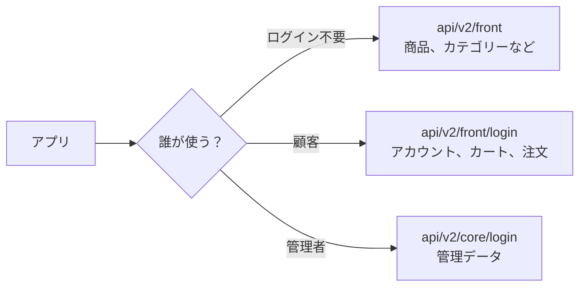

> 🌐 **言語:** [🇻🇳 Tiếng Việt](./api-introduction_vi.md) · [🇬🇧 English](./api-introduction.md) · 🇯🇵 日本語（現在）

# GP247 システムの API 入門

## はじめに

このドキュメントでは、**GP247 の API（アプリケーション・プログラミング・インターフェース）システム**を紹介します。
外部のアプリケーション（モバイルアプリ、別の Web サイト、管理ソフト、サードパーティ連携など）が、
あなたの GP247 サイトと「会話」してデータを取得し、カートを扱い、注文する方法を説明します。
対象読者は、API の全体像を知りたい**連携開発者**と**サイト管理者**です。
API にどんな機能があるか、いくつのグループに分かれるか、認証（ログイン）と権限の仕組み、
エラーがどう返るか、試し方を扱います。
読み終えると、**どの API が何をするのか、どのアドレスで呼ぶのか、どんな鍵が必要か、どのデータを見られるのか**がわかります。
コピーしてすぐ動かせる例も載せています。

> ⚠️ **このドキュメントは API v2 のみを扱います**（`api/v2/core`、`api/v2/front`）。**API v1**（`api/core`、`api/front`）は
> **開発を終了**しました。利用中のアプリでは引き続き動作しますが、新規インストールでは最初からオフで、新機能は追加されず、
> セキュリティ修正だけを受けます。新しいアプリは v2 を使ってください。古いアプリを保守している場合は
> [API v1（開発終了）](./api-v1_ja.md)を参照してください。

> ℹ️ **API とは（身近なたとえ）：** API はサイトの「窓口」のようなものです。
> 外部アプリはデータの保管庫に直接入りません。窓口（URL アドレス）にリクエストを送ります。
> 窓口は書類（トークン／キー）を確認し、結果を **JSON**（コンピューターが読めるテキスト形式のデータ）で返します。
> やり取りはすべて、通常の Web の通信方式（HTTP）で行われます。

> 📄 **機械可読な仕様書：** すべてのエンドポイント、パラメーター、エラーの例はファイル
> [`openapi.json`](./openapi.json)（OpenAPI 3.1）にまとめています。Postman、Insomnia、Swagger UI に読み込んで
> 試しに呼び出したり、クライアントのコードを生成したりできます。

> 🤖 **AI エージェント（Claude、Cursor、VS Code など）をショップで使いたい場合は？** コードは不要です。S-Cart に組み込まれた **MCP サーバー**をお使いください：
> [MCP サーバーの紹介](../mcp/mcp-introduction_ja.md)。

## ひと目でわかる

アプリは、行う処理と利用者に応じて API グループを選びます。

- **2 つのグループ** — ストアと顧客向けの `api/v2/front`、管理者向けの `api/v2/core` です（[知っておくべき概念](./api-concepts_ja.md)）。
- **トークンでログイン** — `login` が発行したトークンを `Authorization: Bearer …` ヘッダーで送ります（[ログインとトークン](./api-authentication_ja.md)）。
- **画面で見られる以上は見せない** — 管理 API はアカウント自身の権限とストアに従います（[知っておくべき概念](./api-concepts_ja.md)）。
- **サイトのオーナーがグループごとにオン／オフ** — API 管理画面で切り替え、オフのグループは `404 api_disabled` を返します（[知っておくべき概念](./api-concepts_ja.md)）。
- **固定されたレスポンス形式** — 常に `data` キーがあり、一覧には `meta` と `links` が付き、エラーには常に `code` があります（[共通ルール](./api-conventions_ja.md)）。

## どこから始めるか — 役割別の読み順

役割ごとに数ページを、下の順で読むだけで十分です。どなたもまず **クイックスタート** から始めてください。

| あなたが作るもの | 読む順番 |
| --- | --- |
| 顧客向けの**モバイルアプリ／販売サイト** | [クイックスタート](./api-quickstart_ja.md) → [知っておくべき概念](./api-concepts_ja.md) → [ログインとトークン](./api-authentication_ja.md) → [ストアフロント API](./api-storefront_ja.md) → [リファレンス — Front](./api-reference-front_ja.md) |
| サイトと連携する **ERP、倉庫ソフト、CRM** | [クイックスタート](./api-quickstart_ja.md) → [知っておくべき概念](./api-concepts_ja.md) → [管理 API](./api-admin_ja.md) → [データ同期](./api-sync_ja.md) → [リファレンス — Admin](./api-reference-admin_ja.md) |
| パートナーに API を開放する**サイトのオーナー** | [知っておくべき概念](./api-concepts_ja.md)（API のスイッチ、API Connection、権限）→ [トラブルシューティング](./api-troubleshooting_ja.md) |
| エンドポイントを追加する**プラグイン作者** | [共通ルール](./api-conventions_ja.md) → [プラグインの API 作成](./create-api_ja.md) |

## API v2 ドキュメント一覧

| ページ | 役立つこと |
| --- | --- |
| [クイックスタート](./api-quickstart_ja.md) | 数分で初めての API 呼び出しを成功させる。手順をコピーするだけで動きます |
| [知っておくべき概念](./api-concepts_ja.md) | API がなぜその結果を返すのかを理解する：API グループ、権限、ストア、スイッチ、API Connection |
| [ログインとトークン](./api-authentication_ja.md) | トークンの取得、有効期限、リフレッシュトークン、サインインセッション、二要素認証、顧客アカウント |
| [共通ルール](./api-conventions_ja.md) | レスポンスの形式、ページ分割、絞り込み、`fields`／`include`、`304`、エラーコード、非推奨、クライアント生成 |
| [管理 API](./api-admin_ja.md) | `api/v2/core` での処理の流れと書き込み（注文、商品、在庫、顧客） |
| [ストアフロント API](./api-storefront_ja.md) | `api/v2/front` での処理の流れ：カタログ、カート、チェックアウト、支払い |
| [データ同期](./api-sync_ja.md) | ERP との同期：`updated_since`、イベントログ、Webhook |
| [トラブルシューティング](./api-troubleshooting_ja.md) | 症状別、エラーコード別にエラーを調べる |
| [リファレンス — Front](./api-reference-front_ja.md) · [リファレンス — Admin](./api-reference-admin_ja.md) | エンドポイントごとの、呼べる人、パラメーター、例、返されるデータ（`openapi.json` から自動生成） |

## Swagger 形式での参照と試し呼び出し

すべてのエンドポイント、パラメーター、返されるデータ、エラーコードはファイル [`openapi.json`](./openapi.json)（OpenAPI 3.1）にあります。上の 2 つの**リファレンス**
ページはこのファイルから生成しているため、常に内容が一致します。

- **Swagger の画面で見たい、試しに呼び出したい** — `openapi.json` を、お使いのパソコンの **Postman**、**Insomnia**、**Swagger Editor** に読み込みます
  （手順は[クイックスタート](./api-quickstart_ja.md)にあります）。
- **あなたのサイトは** `openapi.json` も Swagger ページも**提供しません** — サイトの攻撃対象を増やさないための意図的な設計です。

> ⚠️ **注意:** トークン（特に管理者のトークン）は、お使いのパソコンで動くツールにだけ入力し、Web ページには貼り付けないでください。

## 以前のセクションをお探しですか？

このページには以前、番号付きの 11 のセクションに分けてすべての説明が載っていました。現在の内容は各トピックのページにあります。

| 以前のセクション | 現在の場所 |
| --- | --- |
| 1 | [2 つの主要 API グループ](./api-concepts_ja.md#2-つの主要-api-グループ) |
| 2 | [認証（API へのログイン）](./api-authentication_ja.md#認証api-へのログイン) |
| 3 | [Core API の権限とデータの範囲](./api-concepts_ja.md#core-api-の権限とデータの範囲) |
| 4 | [接続保護レイヤー（API Connection）— 任意](./api-concepts_ja.md#接続保護レイヤーapi-connection-任意) |
| 5 | [API のオン／オフ](./api-concepts_ja.md#api-のオンオフ) |
| 6 | [レスポンスの形式、一覧のパラメーター、エラーコード](./api-conventions_ja.md#レスポンスの形式一覧のパラメーターエラーコード) |
| 7 | [Core API（管理）の処理の流れ](./api-admin_ja.md#core-api管理の処理の流れ) |
| 8 | [Front API（ストアフロント）の処理の流れ](./api-storefront_ja.md#front-apiストアフロントの処理の流れ) |
| 9 | [顧客アカウントとサインインセッション](./api-authentication_ja.md#顧客アカウントとサインインセッション) |
| 9.1 | [会員登録、パスワードを忘れた場合、プロフィール、住所録](./api-authentication_ja.md#会員登録パスワードを忘れた場合プロフィール住所録) |
| 9.2 | [リフレッシュトークン — 短命なトークンでサインイン状態を保つ](./api-authentication_ja.md#リフレッシュトークン--短命なトークンでサインイン状態を保つ) |
| 9.3 | [サインインセッションの管理](./api-authentication_ja.md#サインインセッションの管理) |
| 9.4 | [プラグインによる二要素認証（MFA）](./api-authentication_ja.md#プラグインによる二要素認証mfa) |
| 9.5 | [管理 API のアクセスログ](./api-authentication_ja.md#管理-api-のアクセスログ) |
| 10 | [API によるカートと注文](./api-storefront_ja.md#api-によるカートと注文) |
| 10.1 | [チェックアウトの手順](./api-storefront_ja.md#チェックアウトの手順) |
| 10.2 | [注文の確定](./api-storefront_ja.md#注文の確定) |
| 10.3 | [オンライン決済と支払い状況](./api-storefront_ja.md#オンライン決済と支払い状況) |
| 10.4 | [購入用の商品データ](./api-storefront_ja.md#購入用の商品データ) |
| 10.5 | [購入フロー全体](./api-storefront_ja.md#購入フロー全体) |
| 11 | [非推奨ポリシーと OpenAPI からのクライアント生成](./api-conventions_ja.md#非推奨ポリシーと-openapi-からのクライアント生成) |

## 変更履歴
<!-- ロジック/動作が変わった場合のみ記載。最新の行を一番上に。1 日 1 行：同じ日の変更は既存の行にまとめ、同じ日付の行を追加しない。 -->

| 日付 | GP247 バージョン | 変更内容 |
| --- | --- | --- |
| 2026-11-13 | gp247/core 3.12.0, gp247/front 3.8.0, gp247/shop 3.10.0 | 文字列は入力されたとおりに返り、HTML エスケープされません（`Free &amp; Pro` ではなく `Free & Pro`）。HTML に埋め込むときはアプリ側でエスケープしてください（[レスポンスの形式、一覧のパラメーター、エラーコード](./api-conventions_ja.md#レスポンスの形式一覧のパラメーターエラーコード)） |
| 2026-11-02 | gp247/core 3.8.0, gp247/shop 3.7.0, gp247/front 3.5.0 | v2 のすべての `GET` に `ETag` + `If-None-Match` → `304`。トークンなしで呼んだ商品、カテゴリー、ブランド、バナー、コンテンツページに `Cache-Control: public`（既定 `max-age=0`、`GP247_API_PUBLIC_MAX_AGE`）。`fields[<種類>]` と `include`（最大 3、`GP247_API_MAX_INCLUDE`）（[レスポンスの形式、一覧のパラメーター、エラーコード](./api-conventions_ja.md#レスポンスの形式一覧のパラメーターエラーコード)）。1 分あたり 1000 回の共通制限をログイン済みならアカウントごとに数える（[認証（API へのログイン）](./api-authentication_ja.md#認証api-へのログイン)）。非推奨ポリシー（`Deprecation` / `Sunset` / `Link`）と `openapi.json` からのクライアント生成（[非推奨ポリシーと OpenAPI からのクライアント生成](./api-conventions_ja.md#非推奨ポリシーと-openapi-からのクライアント生成)） |
| 2026-11-01 | gp247/core 3.7.0, gp247/shop 3.6.0 | 管理 API による顧客のロック／ロック解除: `PATCH api/v2/core/customer/{id}`（`{"status": 0 / 1}`、それ以外のフィールド → `422`。顧客一覧画面の変更権限。ロックすると顧客の API トークンはすぐに拒否され、ストアではサインアウトされる。`Idempotency-Key` は任意、書き込みの回数制限を共有）（[Core API の権限とデータの範囲](./api-concepts_ja.md#core-api-の権限とデータの範囲)、7）; イベントログにストアの 8 種類のイベント: `order.created`、`order.status_changed`、`order.payment_status_changed`、`stock.changed`、`product.updated`、`product.deleted`、`customer.created`、`customer.updated` — 変更元を問わず記録、各種類は対応する管理画面の権限で読める（[レスポンスの形式、一覧のパラメーター、エラーコード](./api-conventions_ja.md#レスポンスの形式一覧のパラメーターエラーコード)）; 商品／カテゴリーのテキストの編集で `updated_at` が変わるようになり、変更なしの保存と商品ページの閲覧では変わらない（[レスポンスの形式、一覧のパラメーター、エラーコード](./api-conventions_ja.md#レスポンスの形式一覧のパラメーターエラーコード)）; ERP 向け Webhook: ログのイベントを、API 管理画面で登録した `https` の URL にすぐ `POST`（administrator のみ、イベントログのオンが必要）、`X-GP247-Signature` で署名、最大 5 回再送した後は断念、cron 不要（[API のオン／オフ](./api-concepts_ja.md#api-のオンオフ)、6） |
| 2026-10-31 | gp247/core 3.6.0, gp247/shop 3.5.0 / 3.5.1; 変更の同期: gp247/core 3.7.0, gp247/shop 3.6.0, gp247/front 3.4.0; イベントログ: gp247/core 3.7.0; 管理 API による注文の書き込み: gp247/core 3.7.0, gp247/shop 3.6.0; 管理 API による商品・在庫の書き込み: gp247/shop 3.6.0 | 管理 API による商品・在庫の書き込みを追加: `PATCH api/v2/core/product/{id}`（販売価格・原価・ステータス — 商品設定の項目スイッチに従う）、`product/{id}/stock`（`delta` はアトミックな入庫／出庫で 0 未満にならず販売数は変わらない、`set` は棚卸し後で administrator のみ）、`stock/batch`（1〜100 行、行ごとの結果）— 商品一覧画面の変更権限、在庫の書き込みは `Idempotency-Key` 必須、`422 stock_would_be_negative` / `stock_managed_by_components`（[Core API の権限とデータの範囲](./api-concepts_ja.md#core-api-の権限とデータの範囲)、6、7）; ERP／倉庫ソフト向けに管理 API による注文の書き込みを追加: `api/v2/core/order/{id}/status`、`order/{id}/shipping`（配送ステータス ＋ 手動の送り状の追跡番号）、`order/{id}/notes` — 注文一覧画面の変更権限、書き込みはアカウントごとに 1 分 300 回まで（`GP247_API_WRITE_THROTTLE`）、`Idempotency-Key` は任意（再送 ⇒ 最初の結果。`409 idempotency_key_reused` / `idempotency_in_progress`、`gp247:update` 前は `503 idempotency_unavailable`）（[Core API の権限とデータの範囲](./api-concepts_ja.md#core-api-の権限とデータの範囲)、6、7）; ERP 向けのイベントログ `api/v2/core/events` を追加（カーソル `after`、古い順、管理画面の権限とストアで制限。既定はオフ — API 管理画面の **同期用イベントログ（ERP）** スイッチ、オフの間は `409 event_log_disabled`。保持 30 日、古すぎるカーソルは `410 cursor_expired`）（[API のオン／オフ](./api-concepts_ja.md#api-のオンオフ)、6）; 管理用の v2 一覧に変更の同期モードを追加: `updated_since` ＋ カーソル `page[after]`、`meta.next_after` / `has_more` / `sync_until`（6 章）; ドキュメントは API v2 のみを扱うように変更し、API v1 は別ドキュメント（[API v1](./api-v1_ja.md)）に移動; shop 3.5.1: アプリからの未払い注文のキャンセル（`orders/{id}/cancel`、`member/orders/{id}/cancel`）、24 時間未払いのゲートウェイ注文の自動キャンセル、支払い / 全額返金後の注文ステータスをゲートウェイに合わせる、独自ドメインのないストアの注文のゲートウェイ払い（10.3 節）; `Accept: application/json` を送らなくてもレスポンスはすべて JSON（トークンなし → `401`、`500` は返らない）。`register` と `member/password` はパスワード必須、必須項目のない本文 → `422`（6 章、9.1） |
| 2026-10-30 | gp247/shop 3.5.0 | API v2 によるカート（`api/v2/front/cart`、`cart/items`）: ウェブサイトと共通のアカウントのカート、`X-Cart-Token` によるゲストのカート（30 日）、ログイン / 登録時のカート統合（`cart_merge`）、最大 100 行、1 分あたり 60 回; API v2 によるチェックアウトの手順（`checkout`、`checkout/address`、`checkout/shipping-methods` + `shipping-method`、`checkout/payment-methods` + `payment-method`、`checkout/totals`）とプロモーション（`cart/promotions/{pluginKey}`）; API v2 による注文（`checkout/place`）: `Idempotency-Key` 必須（再送 ⇒ 同じ注文）、新しい合計付きの `409 price_changed`、API 管理画面の **API経由の注文** スイッチ（既定でオフ）、1 分あたり 10 件; API によるオンライン決済（`payment.url`、許可リスト `GP247_PAYMENT_RETURN_URLS`（既定で空）にある `return_url` で購入者をアプリへ戻す）と支払い状況（`member/orders/{id}/payment`、`orders/{id}/payment` + `X-Order-Access`）; v2 の商品に `attributes`、`image_sizes`、`stock_status` を追加 |
| 2026-10-29 | gp247/core 3.6.0 | **管理者**のパスワードの変更／再設定（ユーザー画面、アカウント設定、パスワードを忘れた場合）で、その管理者のすべての API トークンとセッションをサインアウト |
| 2026-10-28 | gp247/core 3.3.1。`X-Request-Id`、古いトークンの有効期限、平文キーの削除、`api_route_gate`：3.4.0。顧客アカウントとセッション：core 3.6.0、shop 3.4.0 | API 管理画面で API をオン／オフ（全体 + v1/v2 × core/front）、新規インストールは v2 のみオン、オフのグループは `404 api_disabled` を返す（3.3.1）。オフのグループはトークンがなくても `api_disabled` を返す。すべてのレスポンスに `X-Request-Id` ヘッダー。3.2.3 より前に発行されたトークンに `gp247:update` で有効期限を設定（最低 7 日）。`gp247:update` が API Connection キーの平文のコピーを削除。`gp247:doctor` がルートキャッシュを確認（3.4.0）。API v2 による顧客アカウント（会員登録、パスワードの再設定、プロフィール、パスワード変更、住所録、確認メールの再送）、任意のローテーション式リフレッシュトークン（60 分のトークン）、セッション管理、v2 の `logout` でセッション全体を終了、プラグインによる追加の確認ステップ（`challenge_required`）、パスワードの変更／再設定ですべての API トークンを無効化、メール確認リンクはウェブサイトへのサインイン不要、管理 API のアクセスログ（core 3.6.0、shop 3.4.0） |
| 2026-10-26 | gp247/core, gp247/front, gp247/shop 3.2.3。API v2 と新しい環境変数名：3.3.0 | API v2 を追加（`api/v2/...`：`{data, meta, links}` 形式のレスポンス、`filter`／`sort`／`q`／`lang`、`price_final`、`meta`）、正しい綴りの環境変数名を追加（3.3.0）。Core API が管理画面の権限とストアの範囲に従うように変更。ログイン試行回数の制限を追加。トークンは常に有効期限付きになり、`POST logout` を追加。ロックされた顧客はログイン不可に。公開 API はストアが表示中のデータだけを返し、社内向けの項目を削除。API Connection のキーをハッシュ化して保存。すべてのエラーが意味の正しい HTTP コードと `{error, msg, code}` 形式を持つように変更。`openapi.json` を追加 |

## よくある質問（Q&A）

**Q1: 一覧にないエンドポイントが必要な場合は？**

→ 開発者は独自のプラグインでルートを宣言して拡張できます。コアのコードは変更しません。
[正しい API の作り方ガイド](./create-api_ja.md)をご覧ください。

**Q2: このドキュメントは GP247 のどのバージョンを説明していますか？**

→ gp247/core、gp247/front、gp247/shop の最新リリースです。リファレンスページの各エンドポイントには**導入バージョン**の列があります。
それより古いバージョンのサイトでは、そのエンドポイントがまだない場合があります — [トラブルシューティング](./api-troubleshooting_ja.md)を参照してください。

**Q3: API を見られる Swagger ページはありますか？**

→ 2 つのリファレンスページが、Swagger と同じ内容をあなたの言語で表示します。Swagger そのものの画面が必要なら、`openapi.json` を
お使いのパソコンの Swagger Editor、Postman、Insomnia で開いてください。

---

📅 **最終更新:** 2026-11-13 · ✍️ **作成者 (Author):** GP247
