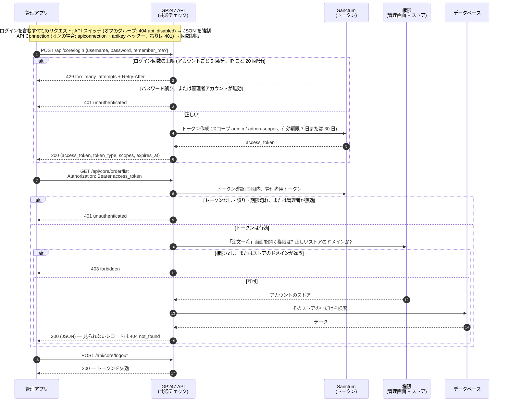
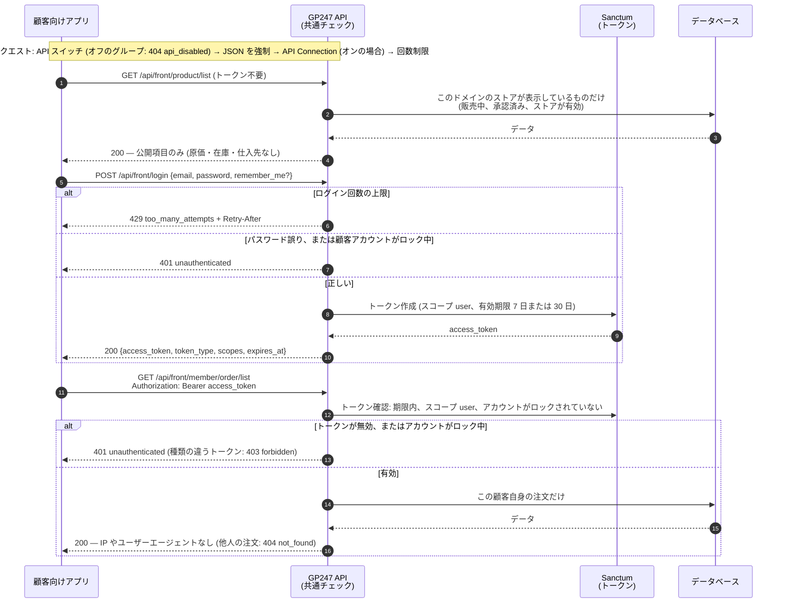
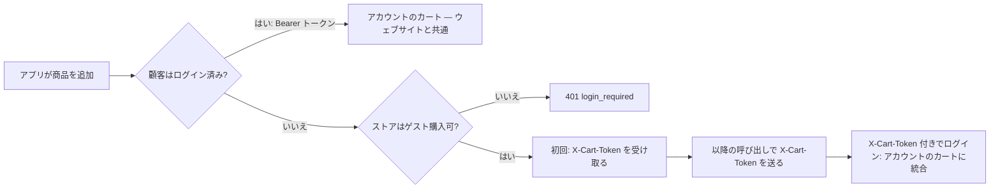
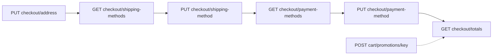
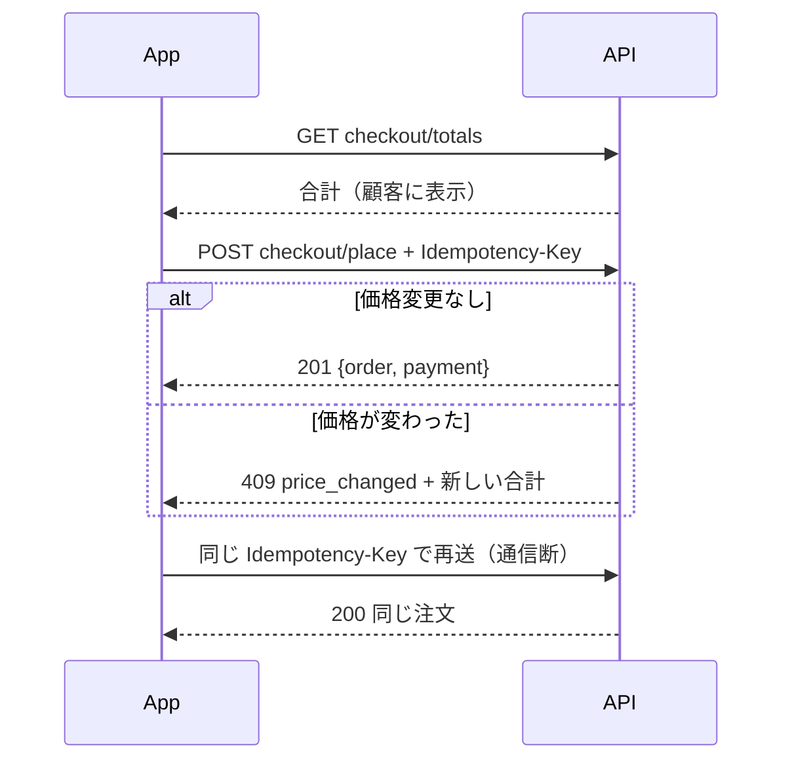
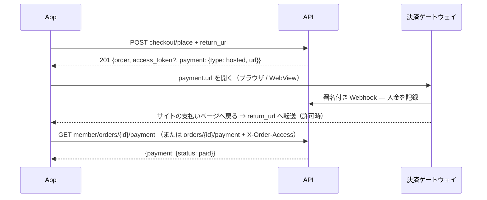

> 🌐 **言語:** [🇻🇳 Tiếng Việt](./api-introduction_vi.md) · [🇬🇧 English](./api-introduction.md) · 🇯🇵 日本語（現在）

# GP247 システムの API 入門

## はじめに

このドキュメントでは、**GP247 の API（アプリケーション・プログラミング・インターフェース）システム**を紹介します。
外部のアプリケーション（モバイルアプリ、別の Web サイト、管理ソフト、サードパーティ連携など）が、
あなたの GP247 サイトと「会話」してデータを取得する方法を説明します。
対象読者は、API の全体像を知りたい**連携開発者**と**サイト管理者**です。
API にどんな機能があるか、いくつのグループに分かれるか、認証（ログイン）と権限の仕組み、
エラーがどう返るか、試し方を扱います。
読み終えると、**どの API が何をするのか、どのアドレスで呼ぶのか、どんな鍵が必要か、どのデータを見られるのか**がわかります。
コピーしてすぐ動かせる例も載せています。

> ℹ️ **API とは（身近なたとえ）：** API はサイトの「窓口」のようなものです。
> 外部アプリはデータの保管庫に直接入りません。窓口（URL アドレス）にリクエストを送ります。
> 窓口は書類（トークン／キー）を確認し、結果を **JSON**（コンピューターが読めるテキスト形式のデータ）で返します。
> やり取りはすべて、通常の Web の通信方式（HTTP）で行われます。

> 📄 **機械可読な仕様書：** すべてのエンドポイント、パラメーター、エラーの例はファイル
> [`openapi.json`](./openapi.json)（OpenAPI 3.1）にまとめています。Postman、Insomnia、Swagger UI に読み込んで
> 試しに呼び出したり、クライアントのコードを生成したりできます。

---

## 1. 2 つの主要 API グループ

GP247 システムは API を **2 つのグループ**に分けています。それぞれ利用者が異なります。

| グループ | アドレスの接頭辞（prefix） | 用途 | ログインする人 |
| --- | --- | --- | --- |
| **Core API（管理）** | `api/core` | リモートからのシステム管理（管理アプリ、独自ダッシュボード） | **管理者**（admin）アカウント |
| **Front API（ストアフロント）** | `api/front` | ストアのデータ表示、顧客アカウント | 顧客／会員。公開データは**ログイン不要** |

- **`api/core`** は、ログイン／管理者情報の部分を `gp247/core` パッケージが提供します。
  `gp247/shop` と `gp247/front` が、管理データ（顧客、注文、商品、バナーなど）を読み取るエンドポイントを追加します。
- **`api/front`** は `gp247/front` と `gp247/shop` パッケージが提供します。商品一覧、カテゴリー、
  ブランド、コンテンツページ、バナー、顧客のアカウント／注文など、ストアの「表側」のデータです。

> ℹ️ **対応バージョン:** gp247/core, gp247/front, gp247/shop 3.3.0 — 接頭辞 `api/v2/core` と `api/v2/front` を持つ
> **API v2** が追加されました（セクション 8）。上の接頭辞 `api/core`、`api/front` は **v1** で、これまでどおり動作します。

> **完全なアドレス** ＝ サイトのドメイン ＋ 接頭辞 ＋ パス です。たとえばサイトが
> `https://shop.example.com` の場合、商品一覧を取得するエンドポイントは次のとおりです。
> `https://shop.example.com/api/front/product/list`

---

## 2. 認証（API へのログイン）

GP247 は **Laravel Sanctum** を使って**トークン**（「入場券」の役割をする長い文字列）を発行します。
仕組みは両グループで共通です。

1. アプリが **ユーザー名／メールアドレス ＋ パスワード** を `login` エンドポイントに送ります。
2. 正しければ、システムは **`access_token`**（Bearer 形式のトークン）と有効期限（`expires_at`）を返します。
3. 以降、ログインが必要なリクエストには、このトークンを **ヘッダー** に付けて送ります。

   ```
   Authorization: Bearer <access_token>
   ```

4. 終了するときは **`POST logout`** を呼び、**トークンを失効**させます（古いトークンはすぐに使えなくなります）。

### 権限の範囲（scope / ability）

各トークンには、誰のトークンかを示す**権限の範囲**が付きます。

| Scope | 意味 |
| --- | --- |
| `admin` | 管理者のトークン（Core API） |
| `admin-supper` | `administrator` ロールを持つ管理者のトークン（Core API） |
| `user` | 会員のトークン（Front API） |

> ℹ️ **対応バージョン:** gp247/core 3.2.3 — scope は**アカウントの種類**だけを区別します。**どのデータを見られるか**は、
> アカウント自身の権限設定で決まります（セクション 3）。scope `user-guest` は発行されなくなりました。
> ロックされている顧客アカウントはログインできません。

### トークンの有効期限

> ℹ️ **対応バージョン:** gp247/core 3.2.3

すべてのトークンには有効期限（`expires_at`）があります。

| トークンの種類 | `remember_me` を送らない場合 | `remember_me = true` を送る場合 |
| --- | --- | --- |
| 管理者 | 7 日（`GP247_API_TOKEN_EXPIRE_ADMIN_DEFAULT`） | 30 日（`GP247_API_RECOMMEMBER_ADMIN`） |
| 会員 | 7 日（`GP247_API_TOKEN_EXPIRE_DEFAULT`） | 30 日（`GP247_API_RECOMMEMBER`） |

> ℹ️ **対応バージョン:** gp247/core 3.3.0 — 環境変数に正しい綴りの名前ができました：`GP247_API_REMEMBER`、
> `GP247_API_REMEMBER_ADMIN`、`GP247_API_SCOPE_ADMIN_SUPER`。旧名（`GP247_API_RECOMMEMBER` など）も引き続き使えます。
> 両方を設定した場合は新しい名前が優先されます。`php artisan gp247:doctor` は、まだ使われている旧名を報告します
> （チェック項目 `api_config_legacy_names`）。scope `admin-super` を持つトークンも、`admin-supper` と同様に受け付けられます。

期限切れのトークンは `401` を返します。その場合は `login` を呼んで新しいトークンを取得してください。
期限切れから長く経った（7 日を超えた）トークンは、同じアカウントが次にログインしたときに自動で削除されます。cron は不要です。

> ℹ️ **対応バージョン:** gp247/core 3.4.0 — **3.2.3 より前**に発行されたトークン（当時は有効期限がありませんでした）には、
> `php artisan gp247:update` を実行したときに有効期限が設定されます。トークンの実際の経過日数に「remember」の期間
> （管理者: `GP247_API_REMEMBER_ADMIN`、会員: `GP247_API_REMEMBER`）を加えた日時ですが、アップグレードから
> **7 日より早くはなりません**。古いトークンを持つアプリには、再ログインが必要になるまで少なくとも 7 日あります。
> アプリが `401` を受けたら `login` を呼ぶようにしておいてください。

> ℹ️ **対応バージョン:** gp247/core 3.6.0、gp247/shop 3.4.0 — API v2 で `with_refresh: true` を付けてサインインしたアプリは、
> **60 分**有効なアクセストークンと、更新用の*リフレッシュトークン*を受け取ります（セクション 10）。顧客のパスワードを変更または
> 再設定すると（ウェブサイトでも API でも）、その顧客の**すべてのトークン**が v1 トークンも含めて無効になります。**管理者**も同様です：
> **ユーザー**画面、**アカウント設定**、または「パスワードを忘れた場合」でパスワードを変更すると、その管理者のすべての API トークンが無効になります。

### ログイン試行回数の制限

> ℹ️ **対応バージョン:** gp247/core 3.2.3

パスワードの総当たりを防ぐため、`api/core/login`、`api/front/login` と管理画面のログインフォームは試行回数を制限しています。
管理画面のログインフォームと `api/core/login` は同じカウンターを共有し、一方での失敗はもう一方にも数えられます。

| 制限 | 既定値 | 変更する環境変数 |
| --- | --- | --- |
| アカウントごと（同じ IP から） | 1 分あたり 5 回 | `GP247_LOGIN_THROTTLE`（形式 `回数,分`） |
| IP ごと（すべてのアカウント合計） | 1 分あたり 20 回 | `GP247_LOGIN_IP_THROTTLE` |

> ⚠️ **gp247/core 3.5.0 で名称変更:** 旧名 `GP247_API_LOGIN_THROTTLE` と `GP247_API_LOGIN_IP_THROTTLE` は
> 読み込まれなくなりました。設定している場合は `.env` で名前を変更してください。変更しない場合は上記の既定値が使われます。

制限を超えると → HTTP `429` と `Retry-After` ヘッダー（待つ必要がある秒数）が返ります。
正しくログインすると、そのアカウントのカウンターはリセットされます。
このほか、すべての API エンドポイントには IP ごとに 1 分あたり 1000 回の共通制限があります（`GP247_API_THROTTLE`）。

---

## 3. Core API の権限とデータの範囲

> ℹ️ **対応バージョン:** gp247/core 3.2.3, gp247/shop 3.2.3, gp247/front 3.2.3

Core API は**管理画面で見られる以上のデータを見せません**。データを読み取る各エンドポイントは 1 つの管理画面に対応しており、
管理者はアカウントがその画面を開く権限を持っている場合にだけ呼び出せます
（権限は **管理 → ロール／権限** で設定します）。権限がなければ → HTTP `403`。

| エンドポイント | 必要な権限（管理画面） |
| --- | --- |
| `customer/list`, `customer/detail/{id}` | 顧客一覧 |
| `order/list` | 注文一覧 |
| `order/detail/{id}` | 注文の詳細 |
| `product/*` | 商品一覧 |
| `category/*`, `brand/*`, `supplier/*` | カテゴリー／ブランド／仕入先一覧 |
| `banner/*`, `page/*` | バナー／コンテンツページ一覧 |
| `login`, `logout`, `info` | 有効なトークンのみ |

- `administrator` ロールはすべてのエンドポイントを呼び出せます。`view.all` ロールは閲覧のみです。
- **ストアごとのデータ：** 複数ストアのサイトでは、1 つのストアに割り当てられた管理者はそのストアのデータだけを見られ、
  **自分のストアのドメイン**でしか API を呼び出せません（管理画面にログインするときと同じです）。
  他のストアのレコードは `404` を返します。
- 管理者アカウントが無効（`status = 0`）になると、古いトークンは使えなくなります（`401`）。

---

## 4. 接続保護レイヤー（API Connection）— 任意

トークンに加えて、GP247 にはすべての API の前に立つ**追加の鍵**があります。これを **API Connection** と呼びます。
これは 2 つ目の「門番」です。許可されたアプリケーションだけが API を呼べるようにします。
公開エンドポイントも対象です。

- このレイヤーは**既定でオフ**です。管理画面の設定 `api_connection_required` でオン／オフを切り替えます。
- **オンの場合：** すべてのリクエストに、さらに**2 つのヘッダー**を付ける必要があります。

  ```
  apiconnection: <接続コード>
  apikey: <秘密キー>
  ```

- `apiconnection`／`apikey` のペアは **GP247 の管理画面**（API Connection の管理項目）で作成・管理します。
  ペアごとに有効期限（`expire`）とオン／オフの状態（`status`）を設定できます。
- 不足している、誤っている、期限切れ、または無効になっている場合、API は HTTP `401` と
  `"code": "api_connection_invalid"` を返します。

> ℹ️ **対応バージョン:** gp247/core 3.2.3 — キーは**ハッシュ化して保存**されます。管理画面にキーが表示されるのは、
> 作成／再生成した直後の**1 回だけ**なので、すぐにコピーしてください。接続を編集するとき、キーの欄を空のままにすると
> 古いキーがそのまま残ります。以前から使っているキーは、アップグレード（`php artisan gp247:update`）後も引き続き使えます。
> 保存されたままの平文のコピーを消すため、都合のよいときに古いキーを**再生成**してください。手入力するキーは 32 文字以上が必要です。

> ℹ️ **対応バージョン:** gp247/core 3.4.0 — `php artisan gp247:update` がキーの平文のコピーを**完全に削除**します。
> 使用中のキーは引き続き使えます（ハッシュで照合します）。平文のコピーは復元できないため、必要な場合はアップグレード前に
> **データベースをバックアップ**してください。

> チェックレイヤー（ミドルウェア）の順序は **リクエスト ID `X-Request-Id` を付ける → API のオン／オフスイッチを確認
> （セクション 9）→ JSON を返す → API Connection を確認 → レート制限** で、その後に各エンドポイントのログイン／権限の
> チェックが続きます。この順序は固定で、変更しないでください。*（先頭の 2 つ: gp247/core 3.3.1 と 3.4.0 から。）*

---

## 5. Core API（管理）の処理の流れ

下の図は、管理アプリがログインしてから Core API でデータを読む順序を示しています。すべてのリクエストは図の順に
チェックを通り、どこかで拒否されるとその場でエラーを返し、先へは進みません。



ポイント: トークンがあるだけではデータを読めません。対応する管理画面を開く権限が必要で、見えるのは自分のストアの
データだけです（3 章）。

**ログインとアカウントのエンドポイント**（接頭辞 `api/core`）：

| メソッド | パス | ログイン必要 | 機能 |
| --- | --- | --- | --- |
| `POST` | `api/core/login` | 不要 | 管理者ログイン、`access_token` を受け取る |
| `POST` | `api/core/logout` | 必要（Bearer） | ログアウト、現在のトークンを失効 |
| `GET` | `api/core/logout` | 必要（Bearer） | 上と同じ — **非推奨**。レスポンスに `Deprecation` ヘッダーが付きます。`POST` に切り替えてください |
| `GET` | `api/core/info` | 必要（Bearer） | ログイン中の管理者情報を取得 |

**管理データのエンドポイント**（接頭辞 `api/core`、トークン ＋ セクション 3 の権限が必要）：

| メソッド | パス | 機能 |
| --- | --- | --- |
| `GET` | `api/core/customer/list` | 顧客一覧 |
| `GET` | `api/core/customer/detail/{id}` | 顧客 1 件の詳細 |
| `GET` | `api/core/order/list` | 注文一覧（明細行と合計金額を含む） |
| `GET` | `api/core/order/detail/{id}` | 注文 1 件の詳細 |
| `GET` | `api/core/product/list` | 商品一覧 |
| `GET` | `api/core/product/detail/{id}` | 商品 1 件の詳細 |
| `GET` | `api/core/category/list` | カテゴリー一覧 |
| `GET` | `api/core/category/detail/{id}` | カテゴリー 1 件の詳細 |
| `GET` | `api/core/brand/list` | ブランド一覧 |
| `GET` | `api/core/brand/detail/{id}` | ブランド 1 件の詳細 |
| `GET` | `api/core/supplier/list` | 仕入先一覧 |
| `GET` | `api/core/supplier/detail/{id}` | 仕入先 1 件の詳細 |
| `GET` | `api/core/banner/list` | バナー一覧 |
| `GET` | `api/core/banner/detail/{id}` | バナー 1 件の詳細 |
| `GET` | `api/core/page/list` | コンテンツページ一覧 |
| `GET` | `api/core/page/detail/{id}` | コンテンツページ 1 件の詳細 |

管理者ログインの例（ターミナルで `curl` を使用）：

```bash
curl -X POST "https://shop.example.com/api/core/login" \
  -H "Content-Type: application/json" \
  -d '{"username":"admin","password":"your-password","remember_me":true}'
```

成功すると、次のような JSON が返ります。

```json
{
  "access_token": "1|aBcD...very-long...XyZ",
  "token_type": "Bearer",
  "scopes": ["admin-supper"],
  "expires_at": "2026-11-25 10:00:00"
}
```

続いて、受け取ったトークンで注文一覧を取得します。

```bash
curl -X GET "https://shop.example.com/api/core/order/list" \
  -H "Authorization: Bearer 1|aBcD...very-long...XyZ"
```

---

## 6. Front API（ストアフロント）の処理の流れ

Front API は 2 種類のデータを扱います。**公開データ**（ログイン不要 — 商品一覧、カテゴリーなど）と、
**顧客個人のデータ**（ログイン必要 — 注文、個人情報）です。

下の図は Front API の 2 つの使い方を示しています。ログインなしで公開データを読む方法と、顧客がログインして自分の
注文を見る方法です。



ポイント: API の公開データは**ストアで顧客が見ている内容と一致**し、個人のデータは本人にだけ返されます。API v2
（8 章）も同じチェックを通り、違うのはレスポンスの形だけです。

**公開エンドポイント**（接頭辞 `api/front`、トークン不要）：

| メソッド | パス | 機能 |
| --- | --- | --- |
| `GET` | `api/front/product/list` | 商品一覧 |
| `GET` | `api/front/product/detail/{id}` | 商品 1 件の詳細 |
| `GET` | `api/front/category/list` | カテゴリー一覧 |
| `GET` | `api/front/category/detail/{id}` | カテゴリー 1 件の詳細（商品を含む） |
| `GET` | `api/front/brand/list` | ブランド一覧 |
| `GET` | `api/front/brand/detail/{id}` | ブランド 1 件の詳細 |
| `GET` | `api/front/banner/list` | バナー一覧 |
| `GET` | `api/front/banner/detail/{id}` | バナー 1 件の詳細 |
| `GET` | `api/front/page/list` | コンテンツページ一覧 |
| `GET` | `api/front/page/detail/{id}` | コンテンツページ 1 件の詳細 |

> ℹ️ **対応バージョン:** gp247/shop 3.2.3, gp247/front 3.2.3 — 公開データは、呼び出したドメインで
> **ストアが表示している内容とまったく同じ**です。非表示の商品、未承認の商品、他のストアに属する商品は含まれません。
> レスポンスには公開項目だけが入り、原価、仕入先、在庫数／販売数は含まれません。
> これらの数値が必要な場合は、権限のあるアカウントで Core API を使ってください。

**顧客アカウントのエンドポイント**（接頭辞 `api/front`、顧客のトークンが必要）：

| メソッド | パス | ログイン必要 | 機能 |
| --- | --- | --- | --- |
| `POST` | `api/front/login` | 不要 | 顧客のメールアドレス／パスワードでログインし、トークンを受け取る |
| `POST` | `api/front/logout` | 必要（Bearer） | 顧客のログアウト |
| `GET` | `api/front/logout` | 必要（Bearer） | 上と同じ — **非推奨**。`POST` に切り替えてください |
| `GET` | `api/front/info` | 必要（Bearer） | 顧客アカウントの情報 |
| `GET` | `api/front/member/order/list` | 必要（Bearer） | 顧客の注文一覧 |
| `GET` | `api/front/member/order/detail/{id}` | 必要（Bearer） | 注文 1 件の詳細 |

商品一覧を取得する例（公開データ、トークン不要）：

```bash
curl -X GET "https://shop.example.com/api/front/product/list" \
  -H "Accept: application/json"
```

顧客としてログインし、注文を確認する例：

```bash
# 1) 顧客ログイン
curl -X POST "https://shop.example.com/api/front/login" \
  -H "Content-Type: application/json" \
  -d '{"email":"customer@example.com","password":"your-password"}'

# 2) 受け取ったトークンで注文一覧を取得
curl -X GET "https://shop.example.com/api/front/member/order/list" \
  -H "Authorization: Bearer 2|zzz...customer-token...zzz"
```

---

## 7. レスポンスの形式とエラーコード

- **レスポンスはすべて JSON です。** アプリが `Accept: application/json` ヘッダーを送らない場合も同じです。

> ℹ️ **対応バージョン:** gp247/core 3.6.0 — これより前は、ログインが必要なエンドポイントをトークンなし**かつ**
> `Accept: application/json` なし（curl、Postman、多くの SDK の既定）で呼ぶと、`401 unauthenticated` ではなく HTTP `500` が返っていました。
- 一覧のエンドポイントは、Laravel 標準のページ分割形式で返ります（`data`、`current_page`、`total` などを含みます）。
  ページは `page[number]` と `page[size]` で指定します。
- 成功時：データがそのまま返ります（1 つのオブジェクト、または 1 ページ分のデータ）。

> ℹ️ **対応バージョン:** gp247/core 3.2.3 — **すべてのエラー**は同じ形式で、**意味の正しい HTTP コード**を返します。
>
> ```json
> { "error": 1, "msg": "Not found", "code": "not_found" }
> ```

| HTTP | `code` | 発生する場面 |
| --- | --- | --- |
| `401` | `unauthenticated` | トークンがない／誤り、トークンの期限切れ、アカウントが無効／ロック、`login` でのパスワード誤り |
| `401` | `api_connection_invalid` | API Connection がオンなのに、`apiconnection`／`apikey` のペアがない／誤り |
| `403` | `forbidden` | ログイン済みだが権限がない（セクション 3）、またはトークンの種類が違う |
| `404` | `not_found` | レコードが存在しない、または閲覧を許可されていない。API のパスが存在しない |
| `404` | `api_disabled` | この API グループがサイトの API 管理画面で**オフ**になっている（セクション 9）— gp247/core 3.3.1 から |
| `401` | `refresh_token_invalid` | リフレッシュトークンが誤り／期限切れ、またはセッションがサインアウト済み（セクション 10）— gp247/core 3.6.0 から |
| `401` | `refresh_token_reused` | 使用済みのリフレッシュトークンが再送された：安全のためセッションをサインアウト — 再度サインイン（セクション 10） |
| `409` | `refresh_in_progress` | リフレッシュトークンが数秒前に使われた — 受け取った新しい組を使う（セクション 10） |
| `401` | `challenge_required` | プラグインによる追加の確認ステップ（OTP など）が必要。本文に `challenge` キーがある（セクション 10） |
| `401` | `challenge_invalid` | 確認チケットが誤り／期限切れ、または確認コードが誤り（セクション 10） |
| `422` | `validation_failed` | 送信したデータが不正 — 項目ごとの `errors` キーも確認してください |
| `429` | `too_many_attempts` | 呼び出し回数が多すぎる — `Retry-After` ヘッダーに従って待ってください |
| `405` | `method_not_allowed` | パスに対して HTTP メソッドが違う（例: `POST` の代わりに `GET`） |
| その他 | `http_error` | その他の HTTP エラー — `msg` を確認してください |
| `500` | `server_error` | サーバーエラー — 詳細はサイトがデバッグモードのときだけ表示されます |

> `error`／`msg` キーを読む古いアプリも、これまでどおり動作します。まず **HTTP コード**を確認し、
> 次に `code` を読んでケースごとに処理してください。

### リクエスト ID `X-Request-Id`

> ℹ️ **対応バージョン:** gp247/core 3.4.0

GP247 API のすべてのレスポンス（エラーレスポンスを含む）には **`X-Request-Id`** ヘッダーが付きます。サイトの管理者に
問題を報告するときは、この ID を添えてください。管理者はこれでシステムログの該当行を探せます。

- アプリが**独自の** `X-Request-Id`（英数字、`.`、`_`、`-` のみ、8〜128 文字）を送ることもできます。サイトはその ID を
  そのまま使うので、アプリのログとサイトのログを突き合わせやすくなります。
- ない、または形式が正しくない場合 → サイトが新しい ID（UUID）を生成します。
- どのエンドポイントにも一致しないパス（API に届く前の 404）には、このヘッダーが付かないことがあります。

---

## 8. API v2

> ℹ️ **対応バージョン:** gp247/core, gp247/front, gp247/shop 3.3.0

API v2 は v1 と**同じデータを同じ権限で**提供します（セクション 2〜4、7：トークン、管理画面の権限、ストアごとのデータ、
ログイン試行回数の制限、エラーコード）。ただし、レスポンスは**固定された構造**を持ち、絞り込み／並べ替え／検索に対応しています。
既存のアプリが壊れないよう v1 はそのまま残しています。新しいアプリは v2 を使ってください。

| 違い | v1 | v2 |
| --- | --- | --- |
| 接頭辞 | `api/core`, `api/front` | `api/v2/core`, `api/v2/front` |
| 成功時（1 件） | オブジェクトをそのまま返す | `{"data": {...}}` |
| 成功時（一覧） | Laravel のページ分割（`data`、`current_page`、`total` などが同じ階層） | `{"data": [...], "meta": {...}, "links": {...}}` |
| 商品／カテゴリー／ページの名前と説明 | 全言語分の配列 `descriptions` | `lang` で選んだ言語の `name`、`description` など |
| 価格 | `price` | `price` と `price_final`（ストアで顧客が支払う価格。プロモーション適用後） |
| ログアウト | `POST`（および非推奨の `GET`） | `POST` のみ |

**すべての一覧エンドポイントで使えるパラメーター：**

| パラメーター | 意味 | 例 |
| --- | --- | --- |
| `filter[<名前>]` | データの種類ごとに許可された項目で絞り込む（下の表を参照） | `filter[brand_id]=5` |
| `sort` | 昇順で並べ替え。先頭に `-` を付けると降順 | `sort=-price` |
| `q` | 検索（名前、SKU、メールアドレスなど。データの種類による） | `q=ao-thun` |
| `lang` | 名前／説明の言語。無効なコードの場合はサイトの既定の言語 | `lang=vi` |
| `page[number]`, `page[size]` | ページと 1 ページあたりの件数（既定 20、最大 100） | `page[size]=50` |

**一覧にない**絞り込み名や並べ替え項目を指定すると → HTTP `422`（`validation_failed`）。レスポンスに許可されている名前が示されます。

| データ | `filter[...]` | `sort` |
| --- | --- | --- |
| 商品 | `category_id`, `brand_id`, `kind`, `product_type`, `price_min`, `price_max`（＋ 管理: `status`, `approve`, `supplier_id`） | `price`, `created_at`, `sort`, `sku` |
| カテゴリー | `parent`, `top`（管理: `parent`, `status`） | `sort`, `created_at` |
| ブランド、仕入先 | （管理: `status`） | `sort`, `name` |
| 顧客（管理） | `status`, `group` | `created_at`, `email` |
| 注文（管理） | `status`, `payment_status`, `shipping_status`, `customer_id` | `created_at`, `total` |
| 顧客自身の注文 | `status` | `created_at`, `total` |
| バナー | `type` | `sort`, `created_at` |
| コンテンツページ | — | `created_at` |

**API v2 のエンドポイント：**

| メソッド | パス | ログイン必要 | 機能 |
| --- | --- | --- | --- |
| `POST` | `api/v2/core/login` | 不要 | 管理者ログイン（`with_refresh` は任意 — セクション 10） |
| `POST` | `api/v2/core/login/challenge` | 不要 | 追加の確認ステップが必要なサインインを完了（セクション 10） |
| `POST` | `api/v2/core/refresh` | 不要（リフレッシュトークンを送る） | リフレッシュトークンを新しいトークンの組と交換 |
| `POST` | `api/v2/core/logout` | 必要（管理者） | 現在のセッションをサインアウト（リフレッシュトークンを含む） |
| `GET` | `api/v2/core/info` | 必要（管理者） | 管理者情報（ロールを含む） |
| `GET` | `api/v2/core/sessions` | 必要（管理者） | 管理者の API サインインセッション（端末） |
| `DELETE` | `api/v2/core/sessions/{id}` | 必要（管理者） | 1 つのセッションをサインアウト |
| `GET` | `api/v2/core/customer/list` | 必要（管理者 ＋ 権限） | 顧客一覧 |
| `GET` | `api/v2/core/customer/detail/{id}` | 必要（管理者 ＋ 権限） | 顧客の詳細 |
| `GET` | `api/v2/core/order/list` | 必要（管理者 ＋ 権限） | 注文一覧 |
| `GET` | `api/v2/core/order/detail/{id}` | 必要（管理者 ＋ 権限） | 注文の詳細 |
| `GET` | `api/v2/core/product/list` | 必要（管理者 ＋ 権限） | 商品一覧（在庫数と原価を含む） |
| `GET` | `api/v2/core/product/detail/{id}` | 必要（管理者 ＋ 権限） | 商品の詳細 |
| `GET` | `api/v2/core/category/list` | 必要（管理者 ＋ 権限） | カテゴリー一覧 |
| `GET` | `api/v2/core/category/detail/{id}` | 必要（管理者 ＋ 権限） | カテゴリーの詳細 |
| `GET` | `api/v2/core/brand/list` | 必要（管理者 ＋ 権限） | ブランド一覧 |
| `GET` | `api/v2/core/brand/detail/{id}` | 必要（管理者 ＋ 権限） | ブランドの詳細 |
| `GET` | `api/v2/core/supplier/list` | 必要（管理者 ＋ 権限） | 仕入先一覧 |
| `GET` | `api/v2/core/supplier/detail/{id}` | 必要（管理者 ＋ 権限） | 仕入先の詳細 |
| `GET` | `api/v2/core/banner/list` | 必要（管理者 ＋ 権限） | バナー一覧 |
| `GET` | `api/v2/core/banner/detail/{id}` | 必要（管理者 ＋ 権限） | バナーの詳細 |
| `GET` | `api/v2/core/page/list` | 必要（管理者 ＋ 権限） | コンテンツページ一覧 |
| `GET` | `api/v2/core/page/detail/{id}` | 必要（管理者 ＋ 権限） | コンテンツページの詳細 |
| `GET` | `api/v2/front/meta` | 不要 | API のバージョン、インストール済みパッケージ、言語、ストア |
| `GET` | `api/v2/front/product/list` | 不要 | 商品一覧 |
| `GET` | `api/v2/front/product/detail/{id}` | 不要 | 商品の詳細 |
| `GET` | `api/v2/front/category/list` | 不要 | カテゴリー一覧 |
| `GET` | `api/v2/front/category/detail/{id}` | 不要 | カテゴリーの詳細 |
| `GET` | `api/v2/front/brand/list` | 不要 | ブランド一覧 |
| `GET` | `api/v2/front/brand/detail/{id}` | 不要 | ブランドの詳細 |
| `GET` | `api/v2/front/banner/list` | 不要 | バナー一覧 |
| `GET` | `api/v2/front/banner/detail/{id}` | 不要 | バナーの詳細 |
| `GET` | `api/v2/front/page/list` | 不要 | コンテンツページ一覧 |
| `GET` | `api/v2/front/page/detail/{id}` | 不要 | コンテンツページの詳細 |
| `POST` | `api/v2/front/register` | 不要 | 顧客アカウントを作成してサインイン（セクション 10） |
| `POST` | `api/v2/front/password/forgot` | 不要 | パスワード再設定メールを送信 |
| `POST` | `api/v2/front/password/reset` | 不要 | メールのコードで新しいパスワードを設定 |
| `POST` | `api/v2/front/login` | 不要 | 顧客ログイン（`with_refresh` は任意 — セクション 10） |
| `POST` | `api/v2/front/login/challenge` | 不要 | 追加の確認ステップが必要なサインインを完了 |
| `POST` | `api/v2/front/refresh` | 不要（リフレッシュトークンを送る） | リフレッシュトークンを新しいトークンの組と交換 |
| `POST` | `api/v2/front/logout` | 必要（顧客） | 現在のセッションをサインアウト（リフレッシュトークンを含む） |
| `GET` | `api/v2/front/info` | 必要（顧客） | 顧客アカウントの情報 |
| `GET` | `api/v2/front/member/profile` | 必要（顧客） | プロフィール全体：メール確認の状態、既定の住所 |
| `PUT` | `api/v2/front/member/profile` | 必要（顧客） | プロフィールを編集 |
| `PUT` | `api/v2/front/member/password` | 必要（顧客） | パスワードを変更（ほかの端末はすべてサインアウト） |
| `POST` | `api/v2/front/member/email/verify` | 必要（顧客） | 確認メールを再送 |
| `GET` | `api/v2/front/member/address/list` | 必要（顧客） | 住所録 |
| `POST` | `api/v2/front/member/address` | 必要（顧客） | 住所を追加 |
| `PUT` | `api/v2/front/member/address/{id}` | 必要（顧客） | 住所を編集 |
| `DELETE` | `api/v2/front/member/address/{id}` | 必要（顧客） | 住所を削除（既定の住所は不可） |
| `GET` | `api/v2/front/member/sessions` | 必要（顧客） | 顧客の API サインインセッション（端末） |
| `DELETE` | `api/v2/front/member/sessions/{id}` | 必要（顧客） | 1 つのセッションをサインアウト |
| `GET` | `api/v2/front/member/order/list` | 必要（顧客） | 顧客の注文 |
| `GET` | `api/v2/front/member/order/detail/{id}` | 必要（顧客） | 顧客の注文 1 件の詳細 |
| `GET` | `api/v2/front/cart` | あり（顧客）または `X-Cart-Token` | カートを表示（11 章） |
| `POST` | `api/v2/front/cart/items` | あり（顧客）またはゲスト | カートに商品を追加 |
| `PATCH` | `api/v2/front/cart/items/{rowId}` | あり（顧客）または `X-Cart-Token` | 行の数量を変更（0 以下で行を削除） |
| `DELETE` | `api/v2/front/cart/items/{rowId}` | あり（顧客）または `X-Cart-Token` | 行を削除 |
| `POST` | `api/v2/front/cart/promotions/{pluginKey}` | あり（顧客）または `X-Cart-Token` | クーポン / プロモーションを適用 |
| `DELETE` | `api/v2/front/cart/promotions/{pluginKey}` | あり（顧客）または `X-Cart-Token` | プロモーションを解除 |
| `GET` | `api/v2/front/checkout` | あり（顧客）または `X-Cart-Token` | チェックアウトの状態（ストア、住所、選択済みの方法 — 11.1 節） |
| `PUT` | `api/v2/front/checkout/address` | あり（顧客）または `X-Cart-Token` | 配送先住所を設定 |
| `GET` | `api/v2/front/checkout/shipping-methods` | あり（顧客）または `X-Cart-Token` | 住所に対して見積もった配送方法 |
| `PUT` | `api/v2/front/checkout/shipping-method` | あり（顧客）または `X-Cart-Token` | 配送方法を選択 |
| `GET` | `api/v2/front/checkout/payment-methods` | あり（顧客）または `X-Cart-Token` | API で使える支払い方法 |
| `PUT` | `api/v2/front/checkout/payment-method` | あり（顧客）または `X-Cart-Token` | 支払い方法を選択 |
| `GET` | `api/v2/front/checkout/totals` | あり（顧客）または `X-Cart-Token` | 請求される合計 |
| `POST` | `api/v2/front/checkout/place` | あり（顧客）または `X-Cart-Token` + `Idempotency-Key` | 注文を確定（11.2 節） |
| `GET` | `api/v2/front/member/orders/{id}/payment` | あり（顧客） | 顧客の注文の支払い状況（11.3 節） |
| `GET` | `api/v2/front/orders/{id}/payment` | `X-Order-Access` | ゲスト注文の支払い状況（11.3 節） |

例：ブランド 5 の商品を価格の高い順に 20 件、名前をベトナム語で取得します。

```bash
curl -X GET "https://shop.example.com/api/v2/front/product/list?filter[brand_id]=5&sort=-price&lang=vi&page[size]=20" \
  -H "Accept: application/json"
```

レスポンス（抜粋）：

```json
{
  "data": [
    { "id": "PRD-AbC12", "sku": "TSHIRT-01", "name": "Tシャツ", "price": 250000, "price_final": 199000 }
  ],
  "meta": { "current_page": 1, "per_page": 20, "total": 1, "last_page": 1 },
  "links": { "first": "…", "last": "…", "prev": null, "next": null }
}
```

---

## 9. API のオン／オフ

> ℹ️ **対応バージョン:** gp247/core 3.3.1

サイトのオーナーは、管理画面の **API 管理画面**（API Connection と同じ画面）で API をオン／オフできます。設定ファイルの
編集やサーバーでのコマンド実行は不要で、変更は次のリクエストからすぐに反映されます。

| スイッチ | 対象 |
| --- | --- |
| **REST API（全グループ）** | すべての API エンドポイント（標準の仕組みでプラグインが追加した API を含む） |
| **v1 · 管理API (core)** | `api/core/*` |
| **v1 · 公開・顧客API (front)** | `api/front/*` |
| **v2 · 管理API (core)** | `api/v2/core/*` |
| **v2 · 公開・顧客API (front)** | `api/v2/front/*` |

- 各グループのスイッチは、そのグループのエンドポイント一覧のすぐ上にあります。オフのグループには「オフ」と表示されます。
- オフのグループを呼ぶと → HTTP `404`、`"code": "api_disabled"`（セクション 7）— トークンがなくても同じです
  *（gp247/core 3.4.0 から。3.3.1 ではトークンがないと `401` を返します）*。
- **新規インストール**では **v2** のみがオンで、v1 はオフです。古いバージョンから**アップグレード**したサイトは、オンだった
  グループをそのまま維持します。v1 で作られたアプリは、管理者に該当する v1 グループをオンにしてもらう必要があります。
- 環境変数 `GP247_API_MODE=0` は引き続き**サーバーレベルのスイッチ**です。この場合 API エンドポイントは存在せず、
  画面のスイッチはロックされます。API を完全に止めたいホスティング／技術担当者向けです。
- 独自の仕組みを使うプラグインの API（例: MCP サーバー）はこれらのスイッチの**対象外**で、プラグインの画面に専用の
  スイッチがあります。
- **ルートキャッシュを使うサイト**（`php artisan route:cache`）: `php artisan gp247:update` がアップグレード後にキャッシュを
  再構築します。`composer update` だけを実行した場合はスイッチがまだ効かないことがあり、`php artisan gp247:doctor` の
  `api_route_gate` で報告されます *（gp247/core 3.4.0 から）*。`php artisan gp247:cache-rebuild` を実行して直してください。

---

## 10. 顧客アカウントとサインインセッション（API v2）

> ℹ️ **対応バージョン:** gp247/core 3.6.0、gp247/shop 3.4.0

ショッピングアプリは `api/v2/front` で顧客アカウントの一連の操作をすべて行えます。ルールは**ウェブサイトのフォームと同じ**
です：必須項目、カスタム項目、パスワードの強度、captcha はすべてストアの設定に従います。これらのエンドポイントは v2 にのみ
あります。

### 10.1. 会員登録、パスワードを忘れた場合、プロフィール、住所録

- **`POST register`** — 登録フォームと同じ項目（`first_name`、`email`、`password`、`password_confirmation`、
  およびストアで有効にした `address1`、`phone` などの項目）を送ります。成功すると HTTP `201` で、`customer` と `login` と
  同じトークンを返します。顧客は自分の `status` を設定できません。**パスワードは必須**です。`password` がない、
  または空の場合は `422`（`errors.password`）で、アカウントは作成されません。
- **`POST password/forgot`** — パスワード再設定メールを送ります。メールアドレスにアカウントがあってもなくても常に
  `{"data": {"sent": true}}` を返すため、どのメールアドレスが登録済みかを調べることはできません。
- **`POST password/reset`** — `email`、`token`（メールに記載）、`password`、`password_confirmation` を送ります。成功すると
  顧客の**すべての API トークン**が無効になります。アプリは新しいパスワードで `login` を呼びます。
- **`GET` / `PUT member/profile`** — `email_verified`、`email_verification_required`、既定の住所を含むプロフィール。
  ここではパスワードを変更できません。
- **`PUT member/password`** — `password_old`、`password`、`password_confirmation` を送ります。呼び出したセッションは
  サインインしたまま、**ほかのすべての端末**はサインアウトされます。古いパスワードの誤りはアカウントのログイン制限に数えられます。
  新しいパスワードがない、または空の場合は `422`（`errors.password`）で、古いパスワードはそのままです。

> ℹ️ **対応バージョン:** gp247/shop 3.5.0 — `register` と `member/password` は常にパスワードが必要です（以前は `password`
> キーのない本文に HTTP `500` が返り、空のパスワードは受け付けられていました）。必須項目のない JSON 本文には常に `422` を返します。
- **`member/address`** — 住所の追加／編集／削除。`"default": true` を送ると既定の住所になります。既定の住所は削除できません
  （HTTP `422`）— 先に別の住所を既定にしてください。
- **`POST member/email/verify`** — ストアで *メールアドレスの確認を必須にする* がオンのとき、確認メールを再送します。顧客は
  どのブラウザーでもメールのリンクをクリックすれば完了します。ウェブサイトへのサインインは**不要**です。

`register`、`password/*`、`member/email/verify` には専用の制限があります：**IP ごとに 1 分あたり 5 回**
（`GP247_API_ACCOUNT_THROTTLE`、形式は `回数,分`）。

> ⚠️ ストアが *会員登録* または *パスワードを忘れた場合* のページで captcha をオンにしている場合（**Captcha** タブ）、API でも
> 使用中の captcha プラグインの項目が必要です — ない／誤り → `422`（`errors.captcha_field`）。アプリは captcha 提供元の
> SDK で回答を取得するか、管理者がそのページの選択を外します。

### 10.2. リフレッシュトークン — 短命なトークンでサインイン状態を保つ

`login`、`register`、`login/challenge` に `with_refresh: true`（任意で `device_name`）を送ります：

| | `with_refresh` なし | `with_refresh` あり |
| --- | --- | --- |
| アクセストークン | 7 日（`remember_me` で 30 日） | **60 分**（`GP247_API_ACCESS_MINUTES`） |
| リフレッシュトークン | — | 顧客 30 日（`GP247_API_REFRESH_DAYS`）、管理者 7 日（`GP247_API_REFRESH_ADMIN_DAYS`）、サインイン時から |

アクセストークンが期限切れ（`401`）になったら、`{"refresh_token": "…"}` で `POST refresh` を呼ぶと**新しいトークンの組**を
受け取れます。リフレッシュトークンは**1 回だけ**使えます：

- 使用済みのリフレッシュトークンを再送 → `401 refresh_token_reused` となり、**セッション全体がサインアウト**されます
  （トークンが盗まれた兆候）。
- 例外：10 秒以内の再送（不安定な通信、重複リクエスト）→ `409 refresh_in_progress`、セッションは残ります。アプリでは
  `refresh` を並行ではなく**1 つずつ**呼んでください。
- リフレッシュしてもセッションの期限は延びません。期限が切れたら再度サインインしてください。

```bash
curl -X POST "https://shop.example.com/api/v2/front/login" -H "Content-Type: application/json" \
  -d '{"email":"customer@example.com","password":"Secret#123","with_refresh":true,"device_name":"Hanako の iPhone"}'
curl -X POST "https://shop.example.com/api/v2/front/refresh" -H "Content-Type: application/json" \
  -d '{"refresh_token":"<受け取った refresh_token>"}'
```

### 10.3. サインインセッションの管理

v2 のサインインはそれぞれ 1 つの**セッション**です。`GET member/sessions`（顧客）と `GET sessions`（管理者）は、端末名、IP、
最終利用日時、どれが現在のセッションか（`current`）を一覧表示します。`DELETE …/sessions/{id}` で 1 台の端末をサインアウト
します。`POST logout`（v2）は現在のセッションをリフレッシュトークンも含めてサインアウトします。パスワードを変更すると（顧客でも
管理者でも、ウェブサイトでも API でも）、そのアカウントの**すべての** API セッションとトークンがサインアウトされます。使用中の
ウェブサイトのセッションはそのままです。

### 10.4. プラグインによる二要素認証（MFA）

core 自体は OTP コードを送りません。セキュリティプラグインが確認ステップを追加できます。その場合、正しいパスワードでの
`login` は次のように応答します：

```json
{ "error": 1, "code": "challenge_required", "msg": "…",
  "challenge": { "ticket": "…", "method": "totp", "meta": {}, "expires_in": 300 } }
```

アプリはユーザーにコードを尋ね、`ticket` とプラグインが求める項目（例：`code`）を付けて `POST login/challenge` を呼びます。
チケットは 1 回限りで 5 分で失効し、誤ったコードはログイン制限に数えられます。API v1 はこのステップに対応していません：MFA が
必要なアカウントは v1 で `401 challenge_required` になります — v2 を使ってください。GP247 の無料 **MFA** プラグイン
（2.3.0 から）は、二要素認証を有効にした顧客と管理者に対してこの仕組みを使います（TOTP またはリカバリーコード）。プラグイン開発者は
[API の作り方 — セクション 7](./create-api_ja.md) を参照してください。

### 10.5. 管理 API のアクセスログ

Core API の呼び出し（v1 と v2、`login` を除く）はすべて管理画面の**操作ログ**に記録されます — 管理画面での操作と同じく、
ユーザー、パス、IP、端末を記録し、パスワード／キーは伏せられ、レスポンス本文は保存されません。権限不足で拒否された呼び出し
（`403`）も記録されます。管理画面のログと一緒にオフにできます（`GP247_ADMIN_LOG=0`）。API を頻繁に呼ぶ同期ツールではログが
早く増えます — **操作ログ**画面で定期的に削除してください。

## 11. API によるカート（API v2）

> ℹ️ **対応バージョン:** gp247/shop 3.5.0

ストア自身のモバイルアプリやヘッドレスサイトは、API で **カート** をウェブサイトと同じルールで扱えます。価格と属性の追加料金は
サーバーが計算し、数量ルール（正の数、小数は設定どおり）、バリエーションごとに 1 行です。



- **ログイン済みの顧客** は他の顧客 API と同じくトークンを送ります。カートは **アカウントのカート** です。アプリで追加すると
  ウェブサイトにログインしたときにも表示され、その逆も同じです。
- **ゲスト**（ストアがゲスト購入を許可している場合のみ）: 最初に商品を追加したとき、レスポンスに **`X-Cart-Token`** ヘッダーが
  付きます。保存して、以降のカート呼び出しすべてに付けてください。**一度だけ** 渡されます。誤ったトークンや **30 日** 変更の
  ないカートは「カートなし」として扱われます。
- **`X-Cart-Token` 付きのログイン / 登録**: ゲストのカートはアカウントのカートに **統合** され（同じ商品 + バリエーションは数量を
  合算）、古いカートトークンは無効になります。レスポンスに `cart_merge: {merged, dropped}` が含まれます。
- **商品の追加**（`POST cart/items`）: `product_id`、`qty`、商品に属性がある場合は `options` = `{"<属性グループ ID>": "<選択肢名>"}`。
  **すべてのグループ** を選ぶ必要があります。追加料金は常に商品から取得し、アプリが送った価格は無視されます。
- **カートの応答**: 行は **ストアごと** にまとめられ（`stores[].lines[]`）、`unit_price`、`line_total`、`subtotal` を持ちます。もう購入
  できない行は `purchasable: false` と `reason`（`not_for_sale`、`missing_options`）を持ち、`subtotal` に含まれません。

| エラーコード | HTTP | 意味 |
| --- | --- | --- |
| `login_required` | 401 | ストアがゲストに販売しない — 先にログイン |
| `validation_failed` | 422 | `qty` がない / 不正、属性が未選択（`errors.options`） |
| `product_not_for_sale` | 422 | 商品を購入できない（販売停止、販売開始前など） |
| `insufficient_stock` | 422 | 在庫超過販売をしないストアで在庫を超えた |
| `cart_line_limit` | 422 | カートがすでに **100 行** |
| `cart_conflict` | 409 | カートが別の場所で変更された — 読み直して再試行 |
| `not_found` | 404 | その行はあなたのカートにない |

制限: 顧客ごと、またはカートトークンごとに **1 分あたり 60 回**（`gp247-config.api.throttle.cart`）。

### 11.1. チェックアウトの手順

カートができたら、アプリはカートの **1 つのストア** についてチェックアウトの手順を進めます（カートに複数ストアの商品がある場合は
`store_id` を送信。別のストアを選ぶと選択はやり直しになります）。すべての選択はカートの所有者（顧客またはカートトークン）ごとに
呼び出しの間で保持されます — **ウェブサイトと同じルール** です。



- **住所**（`PUT checkout/address`）: ウェブサイトのフォームと同じ必須項目（ストアの顧客設定どおり）。または顧客自身の住所録の住所を
  `address_id` で指定します（他人の住所 → `404`）。ログイン済みの顧客は `"save_address": true` で注文時に新しい住所として保存できます。
  住所を変えると配送方法の選び直しが必要です。
- **配送**（`GET checkout/shipping-methods`）: その住所 + カートに対する見積もり。サービスごとに 1 行（`id` は `<plugin>` または
  `<plugin>:<service>`）。見積もりできない配送会社は `unquotable` に入ります。配送を使わないストアは `required: false`。
- **支払い**（`GET checkout/payment-methods`）: API で使える方法のみ — `type: none`（決済画面なし: 代金引換、振込など）または
  `type: hosted`（決済ページを持つゲートウェイ）。ウェブサイト上の決済手順しかない方法は表示されません。
- **プロモーション**（`POST cart/promotions/{pluginKey}`、プラグインに合わせた `{"payload": {...}}`、例 `{"code": "SUMMER"}`）:
  チェックアウト契約に従うすべてのプロモーションプラグインに共通の方法。拒否されると `422 promotion_refused` とプラグインのメッセージ。
- **合計**（`GET checkout/totals`）: `subtotal`、`shipping`、`discount`、`tax`、`total` などの行。同じカートでウェブサイトが計算する金額と
  同じで、これが「顧客に表示した金額」です。

| エラーコード | HTTP | 意味 |
| --- | --- | --- |
| `cart_empty` | 422 | （選んだストアの）カートに注文できるものがない |
| `store_required` | 422 | カートに複数のストア — `store_id` を送信 |
| `address_required` | 422 | 配送先住所が未設定 |
| `method_unavailable` | 422 | その方法がない / このチェックアウトでは使えない |
| `promotion_refused` | 422 | プロモーションプラグインが拒否（コード誤り、期限切れなど） |
| `invalid_quantity` | 422 | 注文できない数量のカート行がある |

### 11.2. 注文の確定

`POST checkout/place` はチェックアウト中のストアの注文を確定します。呼び出す前に:

1. ストアのオーナーが **API 管理** 画面で **「API経由の注文」をオン** にします（v2 公開・顧客 API グループの下）。この設定は **既定でオフ** です
   （新規インストールでもアップグレードでも）。オフの間、`POST checkout/place` は `403 api_checkout_disabled` を返し、他のカート / チェックアウトの
   手順はそのまま使えます。
2. アプリは `GET checkout/totals` を呼び出して合計を顧客に表示しておきます — 注文時に再計算した合計が表示した金額と **一致** した場合のみ注文が作成されます。

顧客が *注文する* を押すたびに、アプリは `Idempotency-Key`（8〜255 文字、例: UUID）を **1 つ** 生成してヘッダーで送ります。通信が不安定な
ときは **同じキー** で再送してください。作成済みの注文が返り（HTTP `200`）、2 件目の注文や在庫の再減算、再請求は発生しません。新しい注文には
新しいキーが必要です。



成功: `201 {"data": {"order": {id, store_id, status, payment_status, total, balance, currency}, "access_token"?, "payment": {"type": "none" | "hosted", "url"?}}}`。
注文はすぐに完了します。注文した行はカートから外れ、ウェブサイトで注文したときと同じく注文確認メールが送られます。

| エラーコード | HTTP | 意味 |
| --- | --- | --- |
| `idempotency_key_required` | 400 | `Idempotency-Key` ヘッダーがない / 不正 |
| `api_checkout_disabled` | 403 | ストアが API 経由の注文をオンにしていない |
| `idempotency_key_reused` | 409 | このキーは別のストアの注文に使われた（異なる `store_id` を送信） |
| `price_changed` | 409 | 表示後に合計が変わった — エラー本文に新しい `totals`。再表示してから新しいキーで注文 |
| `address_required` · `shipping_method_required` · `payment_method_required` | 422 | ストアが必要とするチェックアウトの手順が未完了 |
| `minimum_not_met` | 422 | 最低数量に満たない商品がある（`minimums`: 商品 ID → 最低数量） |
| `shipping_unquotable` · `invalid_quantity` · `cart_empty` | 422 | 配送不可、不正な数量、カートが空 |
| — | 429 | 顧客または IP ごとに **1 分あたり 10 件** を超えた（`gp247-config.api.throttle.checkout_place`） |

### 11.3. オンライン決済と支払い状況

`type: "hosted"` の支払い方法（例: Stripe、PayPal）は **ゲートウェイの決済ページ** で支払いを受けます。

1. 注文の確定時、アプリは `return_url` を送れます — 支払い後に購入者をアプリへ戻す先（`myshop://checkout/done` のような
   ディープリンク、またはアプリの Web ページ）。
2. 注文結果に `payment.url` が入ります。ブラウザ / WebView で開き、購入者に支払ってもらいます。
3. 支払い（またはキャンセル）の後、ゲートウェイは購入者をサイトの支払いページへ戻します。`return_url` が **許可リスト** にあれば、
   サイトはすぐにそのアドレスへ転送します。
4. アプリは状況を問い合わせます: `GET member/orders/{id}/payment`（サインイン済みの顧客）、または `X-Order-Access` ヘッダー付きの
   `GET orders/{id}/payment`（ゲスト — 注文確定時に受け取った `access_token`）。



**許可リスト** はサイトの `.env` にカンマ区切りで設定します。

```bash
GP247_PAYMENT_RETURN_URLS="myshop://checkout, https://app.example.com/return"
```

サイトはスキーム + ホスト（+ ポート）の **完全一致** と、登録したパスで始まるパスを照合します（`https://app.example.com/return/ok` は
一致、`https://app.example.com.evil/return` は不一致）。リストは **既定で空** で、購入者はサイトのページに留まります。一致しない
アドレスは無視され、注文は通常どおり確定します。`php artisan config:cache` を使うサイトでは、`.env` の編集後にもう一度実行します。

- **入金はゲートウェイが確認したときだけ記録** されます（署名付き Webhook またはゲートウェイの戻りページ）。`return_url` 上のパラメーターで
  注文が変わることはありません — 状況は必ず API で問い合わせます。
- **購入者がゲートウェイでキャンセル**: 注文は *支払い待ち* のまま残ります。**同じ** `Idempotency-Key` で `POST checkout/place` を再送すると、
  同じ注文の新しい `payment.url` を受け取れます。ゲートウェイが一時的に失敗したときは `payment.url` が `null` — 同じキーで再送して
  再試行します。
- **`access_token`** はゲストの注文結果にだけ入ります。アプリは状況の問い合わせ用に保存します。この注文の状況と金額だけを開き（住所なし）、
  他人の注文や誤ったトークン ⇒ `404`。
- API 経由の注文では、「注文成功」イベントと確認メールは **注文確定時** に実行されます（支払いを待ちません）。*支払い後* に処理する
  プラグインは、このイベントではなく注文の支払い状況を使います。

状況のレスポンス: `{"data": {"order": {id, store_id, status, payment_status, total, received, balance, currency}, "payment": {"type": "none" | "hosted", "status": "unpaid" | "partially_paid" | "paid" | "refunded"}}}`。

### 11.4. 購入用の商品データ

v2 の商品（`product/list`、`product/detail/{id}`）には、アプリがバリエーション選択と購入ボタンを作るための 3 つのフィールドが追加されます。
既存のフィールドはそのままです。

| フィールド | 意味 |
| --- | --- |
| `attributes` | 属性グループ: `group_id`、`name`、`required`（常に `true` — カートに追加するには各グループから 1 つ選ぶ必要がある）、`options` には `value`（`POST cart/items` の `options[group_id]` に送り返す値）と `add_price`（追加料金。`price_final` と同じ単位で、カートはこの金額を請求） |
| `image_sizes` | メイン画像のサイズ別 URL: `original`、`thumb`（絶対 URL。画像なし ⇒ サイトの既定画像） |
| `stock_status` | `in_stock` または `out_of_stock` — 在庫数は返しません。在庫を管理しない、または在庫切れでも販売するストア ⇒ 常に `in_stock` |

価格を非表示にしているストアでは、`add_price` は `null` です（`price` と同じ）。

```json
{
  "data": {
    "id": "PRD-AbC12",
    "price_final": 199000,
    "stock_status": "in_stock",
    "image_sizes": { "original": "https://shop.example.com/data/product/tshirt.jpg", "thumb": "https://shop.example.com/data/product/thumb/tshirt.jpg" },
    "attributes": [
      { "group_id": "2", "name": "Color", "required": true,
        "options": [ { "value": "Red", "add_price": 0 }, { "value": "Blue", "add_price": 20000 } ] }
    ]
  }
}
```

### 11.5. 購入フロー全体

下の表は、1 件の注文に必要な呼び出しを順番にまとめたものです（接頭辞 `api/v2/front/`）。ログイン済みの顧客はすべてのステップで
`Authorization: Bearer <token>` を送り、ゲストは代わりに `X-Cart-Token` を送ります。

| ステップ | 呼び出し | 追加ヘッダー | 参照 |
| --- | --- | --- | --- |
| 1. 商品を選ぶ | `GET product/list`、`GET product/detail/{id}` | — | 11.4 |
| 2. カートを保持する | `POST cart/items`、`GET cart`、`PATCH` / `DELETE cart/items/{rowId}` | 最初の追加で受け取る `X-Cart-Token`（ゲスト） | 11 |
| 3. 住所・配送・支払い | `PUT checkout/address` → `GET` + `PUT checkout/shipping-method(s)` → `GET` + `PUT checkout/payment-method(s)` | — | 11.1 |
| 4. プロモーション（任意） | `POST` / `DELETE cart/promotions/{pluginKey}` | — | 11.1 |
| 5. 顧客に合計を表示する | `GET checkout/totals` | — | 11.1 |
| 6. 注文する | `POST checkout/place`（決済ゲートウェイで支払う場合は `return_url` も） | `Idempotency-Key`（*注文する* を押すごとに 1 つ） | 11.2 |
| 7. 支払う（`payment.type = hosted` の場合） | `payment.url` を開く | — | 11.3 |
| 8. 支払い状況 | `GET member/orders/{id}/payment` または `GET orders/{id}/payment` | `X-Order-Access`（ゲスト） | 11.3 |

本番で販売を始める前のチェックリスト:

- ストアのオーナーが **「API経由の注文」** をオンにしている（11.2）。オンライン決済を使う場合は、戻り先アドレスを
  `GP247_PAYMENT_RETURN_URLS` に登録している（11.3）。
- アプリは `X-Cart-Token` と `access_token` を端末の安全な保存領域に保管し、ログに書き出さない。
- アプリは `409 price_changed`（新しい合計を表示）に対応し、注文中に通信が切れたら **同じ** `Idempotency-Key` で再送する。
- ウェブの注文を処理するサイトのプラグイン（出品者ごとの注文分割、手数料、通知など）は、同じフックでアプリからの注文も受け取ります —
  [API の作り方 — 8 章](./create-api_ja.md) を参照。

---

## よくある質問（Q&A）

**Q1: どちらの API グループを使えばよいですか？**

→ ストア向けのアプリ／顧客クライアント（商品の閲覧、注文の確認）を作るなら **Front API**
（`api/front`）を使います。管理者向けのリモート管理ツールを作るなら **Core API**（`api/core`）を使います。

**Q2: トークンはどこで取得し、どのくらい有効ですか？**

→ トークンは `login` エンドポイントが発行します。既定では 7 日後に失効し、`remember_me = true` を送ると 30 日になります。
セクション 2 の環境変数で変更できます。期限が切れたら、もう一度 `login` を呼んでください。v2 のアプリは
`with_refresh: true` でサインインし、60 分のトークンをリフレッシュトークンで更新することをおすすめします（セクション 10）。安全にログアウトするには、
現在のトークンで `POST logout` を呼びます。そのトークンは削除され、再利用できなくなります。

**Q3: `apiconnection`／`apikey` と `access_token` の違いは何ですか？**

→ `access_token` は**ユーザー**（あなたが誰か）を認証します。`apiconnection`／`apikey` は**アプリケーション**
（どのアプリが API を呼べるか）を認証します。こちらは**任意のレイヤー**で、
管理者が `api_connection_required` をオンにした場合だけ必須です。

**Q4: 公開エンドポイントを呼ぶのにトークンは必要ですか？**

→ 不要です。商品、カテゴリー、ブランド、バナー、コンテンツページの一覧／詳細エンドポイントは公開されています。
ただし API Connection レイヤーがオンの場合は、`apiconnection`／`apikey` ヘッダーを送る必要があります。

**Q5: パスワードが正しいのに `401` エラーになるのはなぜですか？**

→ アカウントが有効である必要があります。管理者は `status = 1` が必要で、ロックされた顧客はログインできません。
正しい項目名で送ってください。Core は `username`、Front は `email` を使います。
直前に何度も失敗した場合は `429` が返ります。`Retry-After` に従って待ってください。

**Q6: ログインはできるのに、`api/core/order/list` を呼ぶと `403` になるのはなぜですか？**

→ 管理者アカウントに **注文** 画面を開く権限がまだありません。管理者に **ロール／権限** でその画面の権限を
付与してもらってください。API は管理画面とまったく同じ権限設定を使います（セクション 3）。

**Q7: `api_connection_invalid` エラーになるのはなぜですか？**

→ API Connection レイヤーがオンで、`apiconnection`／`apikey` のペアが誤っている、期限切れ（`expire`）、
または無効（`status`）になっています。キーは作成時に 1 回だけ表示されます。紛失した場合は、
API Connection の管理項目で新しいキーを生成してください。

**Q8: 公開 API が原価や在庫数を返さないのはなぜですか？**

→ それらは社内のビジネスデータだからです。公開 API は、顧客がストアで見られる内容だけを返します。
これらの数値が必要な社内アプリは、権限のあるアカウントで Core API（`api/core/product/*`）を使ってください。

**Q9: API を呼ぶと `404`（`"code": "api_disabled"`）が返るのはなぜですか？**

→ 呼んでいる API グループが、サイトの API 管理画面で**オフ**になっています（セクション 9）。新規インストールでは v2 のみが
オンです。アプリが `api/core` や `api/front`（v1）を使う場合は、管理者に該当する v1 グループをオンにしてもらうか、v2 に
移行してください。

**Q10: 一覧にないエンドポイントが必要な場合は？**

→ 開発者は独自のプラグインでルートを宣言して拡張できます。コアのコードは変更しません。
[正しい API の作り方ガイド](./create-api_ja.md)をご覧ください。

---

## 変更履歴
<!-- ロジック/動作が変わった場合のみ記載。最新の行を一番上に。1 日 1 行：同じ日の変更は既存の行にまとめ、同じ日付の行を追加しない。 -->

| 日付 | GP247 バージョン | 変更内容 |
| --- | --- | --- |
| 2026-10-31 | gp247/core 3.6.0, gp247/shop 3.5.0 | `Accept: application/json` を送らなくてもレスポンスはすべて JSON（トークンなし → `401`、`500` は返らない）。`register` と `member/password` はパスワード必須、必須項目のない本文 → `422`（7 章、10.1） |
| 2026-10-30 | gp247/shop 3.5.0 | API v2 によるカート（`api/v2/front/cart`、`cart/items`）: ウェブサイトと共通のアカウントのカート、`X-Cart-Token` によるゲストのカート（30 日）、ログイン / 登録時のカート統合（`cart_merge`）、最大 100 行、1 分あたり 60 回; API v2 によるチェックアウトの手順（`checkout`、`checkout/address`、`checkout/shipping-methods` + `shipping-method`、`checkout/payment-methods` + `payment-method`、`checkout/totals`）とプロモーション（`cart/promotions/{pluginKey}`）; API v2 による注文（`checkout/place`）: `Idempotency-Key` 必須（再送 ⇒ 同じ注文）、新しい合計付きの `409 price_changed`、API 管理画面の **API経由の注文** スイッチ（既定でオフ）、1 分あたり 10 件; API によるオンライン決済（`payment.url`、許可リスト `GP247_PAYMENT_RETURN_URLS`（既定で空）にある `return_url` で購入者をアプリへ戻す）と支払い状況（`member/orders/{id}/payment`、`orders/{id}/payment` + `X-Order-Access`）; v2 の商品に `attributes`、`image_sizes`、`stock_status` を追加 |
| 2026-10-29 | gp247/core 3.6.0 | **管理者**のパスワードの変更／再設定（ユーザー画面、アカウント設定、パスワードを忘れた場合）で、その管理者のすべての API トークンとセッションをサインアウト |
| 2026-10-28 | gp247/core 3.3.1。`X-Request-Id`、古いトークンの有効期限、平文キーの削除、`api_route_gate`：3.4.0。顧客アカウントとセッション：core 3.6.0、shop 3.4.0 | API 管理画面で API をオン／オフ（全体 + v1/v2 × core/front）、新規インストールは v2 のみオン、オフのグループは `404 api_disabled` を返す（3.3.1）。オフのグループはトークンがなくても `api_disabled` を返す。すべてのレスポンスに `X-Request-Id` ヘッダー。3.2.3 より前に発行されたトークンに `gp247:update` で有効期限を設定（最低 7 日）。`gp247:update` が API Connection キーの平文のコピーを削除。`gp247:doctor` がルートキャッシュを確認（3.4.0）。API v2 による顧客アカウント（会員登録、パスワードの再設定、プロフィール、パスワード変更、住所録、確認メールの再送）、任意のローテーション式リフレッシュトークン（60 分のトークン）、セッション管理、v2 の `logout` でセッション全体を終了、プラグインによる追加の確認ステップ（`challenge_required`）、パスワードの変更／再設定ですべての API トークンを無効化、メール確認リンクはウェブサイトへのサインイン不要、管理 API のアクセスログ（core 3.6.0、shop 3.4.0） |
| 2026-10-26 | gp247/core, gp247/front, gp247/shop 3.2.3。API v2 と新しい環境変数名：3.3.0 | API v2 を追加（`api/v2/...`：`{data, meta, links}` 形式のレスポンス、`filter`／`sort`／`q`／`lang`、`price_final`、`meta`）、正しい綴りの環境変数名を追加（3.3.0）。Core API が管理画面の権限とストアの範囲に従うように変更。ログイン試行回数の制限を追加。トークンは常に有効期限付きになり、`POST logout` を追加。ロックされた顧客はログイン不可に。公開 API はストアが表示中のデータだけを返し、社内向けの項目を削除。API Connection のキーをハッシュ化して保存。すべてのエラーが意味の正しい HTTP コードと `{error, msg, code}` 形式を持つように変更。`openapi.json` を追加 |

---

<sub>📅 **最終更新:** 2026-10-31 · ✍️ **作成者 (Author):** GP247</sub>
