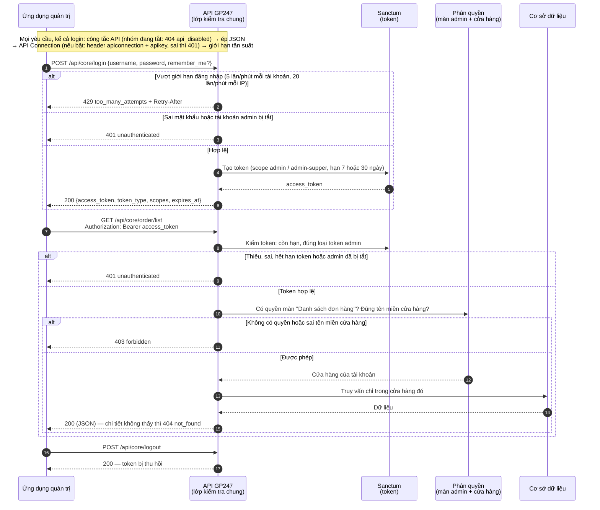
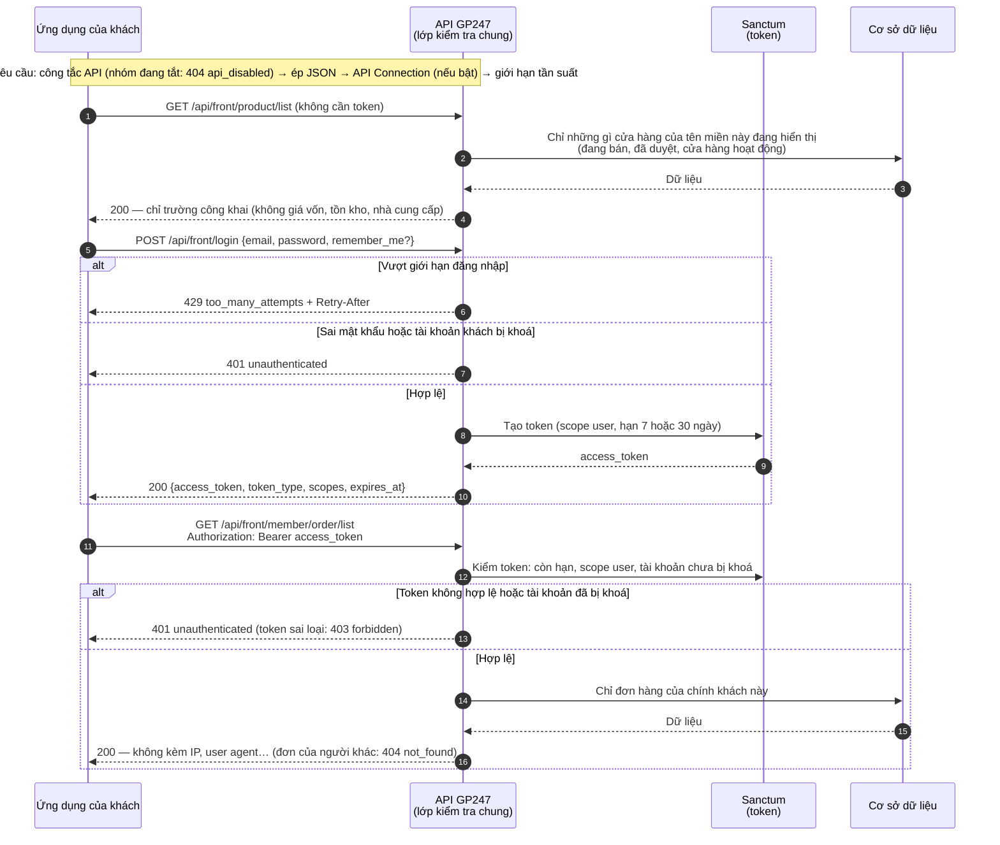

> 🌐 **Ngôn ngữ:** 🇻🇳 Tiếng Việt (hiện tại) · [🇬🇧 English](./api-introduction.md) · [🇯🇵 日本語](./api-introduction_ja.md)

# Giới thiệu API trong hệ thống GP247

## Giới thiệu

Tài liệu này giới thiệu **hệ thống API (giao diện lập trình ứng dụng) của GP247** — cách các
ứng dụng bên ngoài (app di động, website khác, phần mềm quản lý, tích hợp bên thứ ba…) có thể
"nói chuyện" với site GP247 của bạn để lấy dữ liệu. Tài liệu dành cho **lập trình viên tích hợp**
và **người quản trị site** muốn hiểu tổng quan API gồm những gì, chia làm mấy nhóm, xác thực
(đăng nhập) và phân quyền ra sao, lỗi trả về thế nào và gọi thử như thế nào. Đọc xong, bạn biết
**API nào dùng để làm gì, gọi ở địa chỉ nào, cần chìa khóa gì, được xem dữ liệu nào**, và có ví dụ
copy chạy được ngay.

> ℹ️ **API là gì (giải thích đời thường):** hãy hình dung API như một "quầy giao dịch" của site.
> Ứng dụng bên ngoài không vào thẳng kho dữ liệu, mà gửi yêu cầu tới quầy (một địa chỉ URL), quầy
> kiểm tra giấy tờ (token/khóa) rồi trả về kết quả dưới dạng **JSON** (một định dạng dữ liệu dạng
> văn bản mà máy tính đọc được). Toàn bộ trao đổi diễn ra qua giao thức web thông thường (HTTP).

> 📄 **Đặc tả máy đọc được:** toàn bộ endpoint, tham số và mẫu lỗi có trong file
> [`openapi.json`](./openapi.json) (OpenAPI 3.1) — nạp vào Postman, Insomnia hay Swagger UI để gọi thử
> hoặc sinh code client.

---

## 1. Hai nhóm API chính

Hệ thống GP247 chia API thành **hai nhóm**, phục vụ hai đối tượng khác nhau:

| Nhóm | Tiền tố địa chỉ (prefix) | Dành cho | Ai đăng nhập |
| --- | --- | --- | --- |
| **API Core (Admin)** | `api/core` | Quản trị hệ thống từ xa (app quản lý, dashboard riêng) | Tài khoản **quản trị viên** (admin) |
| **API Front (Storefront)** | `api/front` | Hiển thị dữ liệu cửa hàng, tài khoản khách | Khách/thành viên, hoặc **không cần đăng nhập** với dữ liệu công khai |

- **`api/core`** do gói `gp247/core` cung cấp phần đăng nhập/thông tin admin; `gp247/shop` và
  `gp247/front` bổ sung các endpoint đọc dữ liệu quản trị (khách hàng, đơn hàng, sản phẩm, banner…).
- **`api/front`** do gói `gp247/front` và `gp247/shop` cung cấp — dữ liệu "mặt tiền" cửa hàng như
  danh sách sản phẩm, danh mục, thương hiệu, trang nội dung, banner, và tài khoản/đơn hàng của khách.

> ℹ️ **Có từ:** gp247/core, gp247/front, gp247/shop 3.3.0 — có thêm **API v2** với tiền tố `api/v2/core` và
> `api/v2/front` (mục 8). Các tiền tố `api/core`, `api/front` ở trên là **v1**, vẫn chạy như cũ.

> **Địa chỉ đầy đủ** = tên miền site + tiền tố + đường dẫn. Ví dụ nếu site của bạn là
> `https://shop.example.com` thì endpoint lấy danh sách sản phẩm là:
> `https://shop.example.com/api/front/product/list`.

---

## 2. Xác thực (đăng nhập vào API)

GP247 dùng **Laravel Sanctum** để cấp **token** (một chuỗi ký tự dài đóng vai trò "vé vào cửa").
Cơ chế hoạt động chung cho cả hai nhóm:

1. Ứng dụng gửi **username/email + password** tới endpoint `login`.
2. Nếu đúng, hệ thống trả về một **`access_token`** (token dạng Bearer) kèm hạn dùng (`expires_at`).
3. Từ đó về sau, mọi yêu cầu cần đăng nhập đều gắn kèm token này trong phần **header**:

   ```
   Authorization: Bearer <access_token>
   ```

4. Khi muốn thoát, gọi **`POST logout`** để **thu hồi token** (token cũ hết hiệu lực ngay).

### Phạm vi quyền (scope / ability)

Mỗi token được cấp kèm **phạm vi** cho biết nó là token của ai:

| Scope | Ý nghĩa |
| --- | --- |
| `admin` | Token của quản trị viên (API Core) |
| `admin-supper` | Token của quản trị viên có vai trò `administrator` (API Core) |
| `user` | Token của thành viên (API Front) |

> ℹ️ **Có từ:** gp247/core 3.2.3 — scope chỉ phân biệt **loại tài khoản**. **Được xem dữ liệu nào**
> do phân quyền của chính tài khoản quyết định (mục 3). Scope `user-guest` không còn được cấp:
> tài khoản khách đang bị khoá không đăng nhập được.

### Thời hạn token

> ℹ️ **Có từ:** gp247/core 3.2.3

Mọi token đều có hạn dùng (`expires_at`):

| Loại token | Không gửi `remember_me` | Gửi `remember_me = true` |
| --- | --- | --- |
| Quản trị viên | 7 ngày (`GP247_API_TOKEN_EXPIRE_ADMIN_DEFAULT`) | 30 ngày (`GP247_API_RECOMMEMBER_ADMIN`) |
| Thành viên | 7 ngày (`GP247_API_TOKEN_EXPIRE_DEFAULT`) | 30 ngày (`GP247_API_RECOMMEMBER`) |

> ℹ️ **Có từ:** gp247/core 3.3.0 — biến môi trường có tên viết đúng: `GP247_API_REMEMBER`,
> `GP247_API_REMEMBER_ADMIN`, `GP247_API_SCOPE_ADMIN_SUPER`. Tên cũ (`GP247_API_RECOMMEMBER`…) vẫn dùng được;
> khai cả hai thì tên mới thắng. `php artisan gp247:doctor` báo tên cũ còn dùng (mục `api_config_legacy_names`).
> Token mang scope `admin-super` cũng được chấp nhận bên cạnh `admin-supper`.

Token hết hạn trả về `401`; khi đó gọi `login` để lấy token mới. Token đã hết hạn lâu (quá 7 ngày)
được tự dọn ở lần đăng nhập kế tiếp của cùng tài khoản — không cần cron.

> ℹ️ **Có từ:** gp247/core 3.4.0 — token cấp **trước bản 3.2.3** (lúc đó chưa có hạn) được đặt hạn khi chạy
> `php artisan gp247:update`: tuổi thật của token cộng thời hạn "remember" (quản trị viên: `GP247_API_REMEMBER_ADMIN`,
> thành viên: `GP247_API_REMEMBER`), nhưng **không sớm hơn 7 ngày** kể từ lúc nâng cấp. Ứng dụng đang giữ token cũ
> có ít nhất 7 ngày trước khi phải đăng nhập lại — hãy chắc chắn ứng dụng xử lý `401` bằng cách gọi `login`.

### Giới hạn số lần đăng nhập

> ℹ️ **Có từ:** gp247/core 3.2.3

Để chống dò mật khẩu, `api/core/login`, `api/front/login` và form đăng nhập quản trị giới hạn số lần thử.
Form đăng nhập quản trị và `api/core/login` dùng chung một bộ đếm: lần sai ở bên này được tính cho bên kia.

| Giới hạn | Mặc định | Đổi bằng biến môi trường |
| --- | --- | --- |
| Mỗi tài khoản (từ cùng một IP) | 5 lần / phút | `GP247_LOGIN_THROTTLE` (dạng `số_lần,phút`) |
| Mỗi IP, trên mọi tài khoản | 20 lần / phút | `GP247_LOGIN_IP_THROTTLE` |

> ⚠️ **Đổi tên ở gp247/core 3.5.0:** tên cũ `GP247_API_LOGIN_THROTTLE` và `GP247_API_LOGIN_IP_THROTTLE`
> không còn được đọc. Nếu bạn đã đặt chúng, hãy đổi tên trong `.env`; nếu không, giá trị mặc định ở trên được dùng.

Vượt giới hạn → HTTP `429` kèm header `Retry-After` (số giây cần chờ). Đăng nhập đúng sẽ xoá bộ đếm của
tài khoản đó. Ngoài ra, mọi endpoint API có giới hạn chung 1000 lần/phút mỗi IP (`GP247_API_THROTTLE`).

---

## 3. Phân quyền và phạm vi dữ liệu của API Core

> ℹ️ **Có từ:** gp247/core 3.2.3, gp247/shop 3.2.3, gp247/front 3.2.3

API Core **không cho xem nhiều hơn màn hình quản trị**. Mỗi endpoint đọc dữ liệu gắn với một màn
hình admin; quản trị viên chỉ gọi được endpoint khi tài khoản có quyền mở màn hình đó (phân quyền ở
**Quản trị → Vai trò / Quyền**). Không có quyền → HTTP `403`.

| Endpoint | Quyền cần có (màn hình admin) |
| --- | --- |
| `customer/list`, `customer/detail/{id}` | Danh sách khách hàng |
| `order/list` | Danh sách đơn hàng |
| `order/detail/{id}` | Chi tiết đơn hàng |
| `product/*` | Danh sách sản phẩm |
| `category/*`, `brand/*`, `supplier/*` | Danh sách danh mục / thương hiệu / nhà cung cấp |
| `banner/*`, `page/*` | Danh sách banner / trang nội dung |
| `login`, `logout`, `info` | Chỉ cần token hợp lệ |

- Vai trò `administrator` gọi được mọi endpoint; vai trò `view.all` chỉ đọc.
- **Dữ liệu theo cửa hàng:** trên site nhiều cửa hàng, quản trị viên được gắn với một cửa hàng chỉ
  thấy dữ liệu của cửa hàng đó và chỉ gọi được API trên **tên miền của cửa hàng mình** (giống khi đăng
  nhập trang quản trị). Bản ghi của cửa hàng khác trả về `404`.
- Tài khoản quản trị bị tắt (`status = 0`) thì token cũ không dùng được nữa (`401`).

---

## 4. Lớp bảo vệ kết nối (API Connection) — tùy chọn

Ngoài token, GP247 còn có **một lớp khóa bổ sung** đứng trước tất cả API, gọi là **API Connection**.
Đây là "chốt bảo vệ" thứ hai, giúp chỉ những ứng dụng được cấp phép mới gọi được API — kể cả các
endpoint công khai.

- Lớp này **mặc định tắt**, bật/tắt bằng cấu hình `api_connection_required` trong quản trị.
- **Khi bật:** mọi yêu cầu phải kèm thêm **hai header**:

  ```
  apiconnection: <mã kết nối>
  apikey: <khóa bí mật>
  ```

- Cặp `apiconnection`/`apikey` được tạo và quản lý trong **trang quản trị GP247** (mục quản lý
  API Connection), mỗi cặp có thể đặt ngày hết hạn (`expire`) và trạng thái bật/tắt (`status`).
- Nếu thiếu, sai, hết hạn hoặc đã tắt, API trả về HTTP `401` với `"code": "api_connection_invalid"`.

> ℹ️ **Có từ:** gp247/core 3.2.3 — khóa được **lưu dạng băm**: màn quản trị chỉ hiện khóa **một lần**
> ngay sau khi tạo/sinh lại, hãy sao chép ngay. Khi sửa một kết nối, để trống ô khóa để giữ khóa cũ.
> Khóa đang dùng từ trước vẫn chạy sau khi nâng cấp (`php artisan gp247:update`); hãy **sinh lại** các khóa cũ
> khi thuận tiện để xoá bản lưu thường còn sót lại. Khóa tự nhập phải dài ít nhất 32 ký tự.

> ℹ️ **Có từ:** gp247/core 3.4.0 — `php artisan gp247:update` **xoá hẳn** bản lưu khóa dạng thường; khóa đang dùng
> vẫn chạy bình thường (so khớp qua bản băm). Bản lưu thường không khôi phục được, nên hãy **sao lưu cơ sở dữ liệu**
> trước khi nâng cấp nếu bạn cần giữ nó.

> Thứ tự các lớp kiểm tra (middleware) là: **gắn mã yêu cầu `X-Request-Id` → kiểm tra công tắc bật/tắt API (mục 9)
> → trả JSON → kiểm tra API Connection → giới hạn tần suất**, rồi mới đến đăng nhập/phân quyền của từng endpoint.
> Đây là thứ tự cố định, không nên đổi. *(Hai lớp đầu: từ gp247/core 3.3.1 và 3.4.0.)*

---

## 5. Luồng làm việc API Core (Admin)

Sơ đồ dưới đây mô tả trình tự một ứng dụng quản trị đăng nhập rồi đọc dữ liệu qua API Core. Mỗi yêu cầu đi
qua các lớp kiểm tra theo đúng thứ tự trong sơ đồ; lớp nào từ chối thì trả lỗi ngay, không đi tiếp.



Điểm rút ra: có token **chưa đủ** để đọc dữ liệu — tài khoản còn phải có quyền mở màn hình quản trị tương ứng, và
chỉ thấy dữ liệu của cửa hàng mình (mục 3).

**Endpoint đăng nhập & tài khoản** (tiền tố `api/core`):

| Phương thức | Đường dẫn | Cần đăng nhập | Chức năng |
| --- | --- | --- | --- |
| `POST` | `api/core/login` | Không | Đăng nhập admin, nhận `access_token` |
| `POST` | `api/core/logout` | Có (Bearer) | Đăng xuất, thu hồi token hiện tại |
| `GET` | `api/core/logout` | Có (Bearer) | Như trên — **đã lỗi thời**, phản hồi kèm header `Deprecation`; hãy chuyển sang `POST` |
| `GET` | `api/core/info` | Có (Bearer) | Lấy thông tin quản trị viên đang đăng nhập |

**Endpoint dữ liệu quản trị** (tiền tố `api/core`, cần token + quyền ở mục 3):

| Phương thức | Đường dẫn | Chức năng |
| --- | --- | --- |
| `GET` | `api/core/customer/list` | Danh sách khách hàng |
| `GET` | `api/core/customer/detail/{id}` | Chi tiết một khách hàng |
| `GET` | `api/core/order/list` | Danh sách đơn hàng (kèm dòng hàng và tổng tiền) |
| `GET` | `api/core/order/detail/{id}` | Chi tiết một đơn hàng |
| `GET` | `api/core/product/list` | Danh sách sản phẩm |
| `GET` | `api/core/product/detail/{id}` | Chi tiết một sản phẩm |
| `GET` | `api/core/category/list` | Danh sách danh mục |
| `GET` | `api/core/category/detail/{id}` | Chi tiết một danh mục |
| `GET` | `api/core/brand/list` | Danh sách thương hiệu |
| `GET` | `api/core/brand/detail/{id}` | Chi tiết một thương hiệu |
| `GET` | `api/core/supplier/list` | Danh sách nhà cung cấp |
| `GET` | `api/core/supplier/detail/{id}` | Chi tiết một nhà cung cấp |
| `GET` | `api/core/banner/list` | Danh sách banner |
| `GET` | `api/core/banner/detail/{id}` | Chi tiết một banner |
| `GET` | `api/core/page/list` | Danh sách trang nội dung |
| `GET` | `api/core/page/detail/{id}` | Chi tiết một trang nội dung |

Ví dụ đăng nhập admin (dùng `curl` trong Terminal):

```bash
curl -X POST "https://shop.example.com/api/core/login" \
  -H "Content-Type: application/json" \
  -d '{"username":"admin","password":"your-password","remember_me":true}'
```

Nếu thành công, bạn nhận về JSON dạng:

```json
{
  "access_token": "1|aBcD...rất-dài...XyZ",
  "token_type": "Bearer",
  "scopes": ["admin-supper"],
  "expires_at": "2026-11-25 10:00:00"
}
```

Sau đó lấy danh sách đơn hàng bằng token vừa nhận:

```bash
curl -X GET "https://shop.example.com/api/core/order/list" \
  -H "Authorization: Bearer 1|aBcD...rất-dài...XyZ"
```

---

## 6. Luồng làm việc API Front (Storefront)

API Front phục vụ hai loại dữ liệu: **dữ liệu công khai** (không cần đăng nhập — danh sách sản
phẩm, danh mục…) và **dữ liệu riêng của khách** (cần đăng nhập — đơn hàng, thông tin cá nhân).

Sơ đồ dưới đây mô tả hai cách dùng API Front: đọc dữ liệu công khai không cần đăng nhập, và khách đăng nhập để
xem đơn hàng của mình.



Điểm rút ra: dữ liệu công khai trên API **khớp với những gì khách thấy trên cửa hàng**, còn dữ liệu riêng chỉ trả về
cho đúng chủ tài khoản. API v2 (mục 8) đi qua cùng các bước kiểm tra này, chỉ khác dạng phản hồi.

**Các endpoint công khai** (tiền tố `api/front`, không cần token):

| Phương thức | Đường dẫn | Chức năng |
| --- | --- | --- |
| `GET` | `api/front/product/list` | Danh sách sản phẩm |
| `GET` | `api/front/product/detail/{id}` | Chi tiết một sản phẩm |
| `GET` | `api/front/category/list` | Danh sách danh mục |
| `GET` | `api/front/category/detail/{id}` | Chi tiết một danh mục (kèm sản phẩm) |
| `GET` | `api/front/brand/list` | Danh sách thương hiệu |
| `GET` | `api/front/brand/detail/{id}` | Chi tiết một thương hiệu |
| `GET` | `api/front/banner/list` | Danh sách banner |
| `GET` | `api/front/banner/detail/{id}` | Chi tiết một banner |
| `GET` | `api/front/page/list` | Danh sách trang nội dung |
| `GET` | `api/front/page/detail/{id}` | Chi tiết một trang nội dung |

> ℹ️ **Có từ:** gp247/shop 3.2.3, gp247/front 3.2.3 — dữ liệu công khai **giống hệt những gì cửa hàng
> đang hiển thị** trên tên miền bạn gọi: sản phẩm ẩn, chưa được duyệt hoặc thuộc cửa hàng khác không
> xuất hiện. Phản hồi chỉ gồm các trường công khai — không có giá vốn, nhà cung cấp, số tồn/đã bán.
> Cần các số liệu đó thì dùng API Core với tài khoản có quyền.

**Các endpoint tài khoản khách** (tiền tố `api/front`, cần token của khách):

| Phương thức | Đường dẫn | Cần đăng nhập | Chức năng |
| --- | --- | --- | --- |
| `POST` | `api/front/login` | Không | Đăng nhập bằng email/mật khẩu khách, nhận token |
| `POST` | `api/front/logout` | Có (Bearer) | Đăng xuất khách |
| `GET` | `api/front/logout` | Có (Bearer) | Như trên — **đã lỗi thời**, hãy chuyển sang `POST` |
| `GET` | `api/front/info` | Có (Bearer) | Thông tin tài khoản khách |
| `GET` | `api/front/member/order/list` | Có (Bearer) | Danh sách đơn hàng của khách |
| `GET` | `api/front/member/order/detail/{id}` | Có (Bearer) | Chi tiết một đơn hàng |

Ví dụ lấy danh sách sản phẩm (công khai, không cần token):

```bash
curl -X GET "https://shop.example.com/api/front/product/list" \
  -H "Accept: application/json"
```

Ví dụ đăng nhập khách rồi xem đơn hàng:

```bash
# 1) Đăng nhập khách
curl -X POST "https://shop.example.com/api/front/login" \
  -H "Content-Type: application/json" \
  -d '{"email":"customer@example.com","password":"your-password"}'

# 2) Dùng token nhận được để lấy danh sách đơn hàng
curl -X GET "https://shop.example.com/api/front/member/order/list" \
  -H "Authorization: Bearer 2|zzz...token-khach...zzz"
```

---

## 7. Định dạng phản hồi & mã lỗi

- **Mọi phản hồi đều là JSON.**
- Endpoint danh sách trả về theo chuẩn phân trang của Laravel (có `data`, `current_page`, `total`…);
  chọn trang bằng `page[number]` và `page[size]`.
- Thành công: trả thẳng dữ liệu (một object, hoặc trang dữ liệu).

> ℹ️ **Có từ:** gp247/core 3.2.3 — **mọi lỗi** có cùng một dạng và **mã HTTP đúng nghĩa**:
>
> ```json
> { "error": 1, "msg": "Not found", "code": "not_found" }
> ```

| HTTP | `code` | Khi nào |
| --- | --- | --- |
| `401` | `unauthenticated` | Thiếu/sai token, token hết hạn, tài khoản bị tắt/khoá, sai mật khẩu khi `login` |
| `401` | `api_connection_invalid` | API Connection đang bật mà thiếu/sai cặp `apiconnection`/`apikey` |
| `403` | `forbidden` | Đã đăng nhập nhưng không có quyền (mục 3) hoặc token sai loại |
| `404` | `not_found` | Bản ghi không tồn tại hoặc bạn không được xem; đường dẫn API không tồn tại |
| `404` | `api_disabled` | Nhóm API này đang **tắt** trên màn quản lý API của site (mục 9) — từ gp247/core 3.3.1 |
| `422` | `validation_failed` | Dữ liệu gửi lên không hợp lệ — xem thêm khoá `errors` theo từng trường |
| `429` | `too_many_attempts` | Gọi quá nhiều lần — chờ theo header `Retry-After` |
| `405` | `method_not_allowed` | Sai phương thức HTTP cho đường dẫn (ví dụ `GET` thay cho `POST`) |
| khác | `http_error` | Lỗi HTTP khác — đọc `msg` |
| `500` | `server_error` | Lỗi máy chủ — nội dung chi tiết chỉ hiện khi site bật chế độ debug |

> Ứng dụng cũ đọc khoá `error`/`msg` vẫn chạy bình thường; hãy kiểm tra **mã HTTP** trước rồi mới đọc
> `code` để xử lý từng trường hợp.

### Mã yêu cầu `X-Request-Id`

> ℹ️ **Có từ:** gp247/core 3.4.0

Mọi phản hồi của API GP247 — kể cả phản hồi lỗi — có header **`X-Request-Id`**. Khi báo lỗi cho quản trị viên site,
hãy gửi kèm mã này: họ dùng nó để tìm đúng dòng trong nhật ký hệ thống.

- Ứng dụng có thể **tự gửi** `X-Request-Id` (chỉ gồm chữ, số, `.`, `_`, `-`; dài 8–128 ký tự): site dùng lại đúng mã
  đó, tiện nối nhật ký của ứng dụng với nhật ký của site.
- Thiếu hoặc sai định dạng → site tự sinh mã mới (UUID).
- Đường dẫn không khớp endpoint nào (404 trước khi vào API) có thể không có header này.

---

## 8. API v2

> ℹ️ **Có từ:** gp247/core, gp247/front, gp247/shop 3.3.0

API v2 phục vụ **cùng dữ liệu, cùng phân quyền** với v1 (mục 2–4, 7: token, quyền màn admin, dữ liệu theo
cửa hàng, giới hạn đăng nhập, mã lỗi), nhưng phản hồi có **cấu trúc cố định** và hỗ trợ lọc/sắp xếp/tìm
kiếm. v1 được giữ nguyên để ứng dụng cũ không vỡ — ứng dụng mới nên dùng v2.

| Khác biệt | v1 | v2 |
| --- | --- | --- |
| Tiền tố | `api/core`, `api/front` | `api/v2/core`, `api/v2/front` |
| Thành công (một bản ghi) | Trả thẳng object | `{"data": {...}}` |
| Thành công (danh sách) | Phân trang Laravel (`data`, `current_page`, `total`… cùng tầng) | `{"data": [...], "meta": {...}, "links": {...}}` |
| Tên, mô tả sản phẩm/danh mục/trang | Mảng `descriptions` mọi ngôn ngữ | `name`, `description`… theo ngôn ngữ chọn bằng `lang` |
| Giá | `price` | `price` và `price_final` (giá khách trả trên cửa hàng, đã tính khuyến mãi) |
| Đăng xuất | `POST` (và `GET` đã lỗi thời) | Chỉ `POST` |

**Tham số cho mọi endpoint danh sách:**

| Tham số | Ý nghĩa | Ví dụ |
| --- | --- | --- |
| `filter[<tên>]` | Lọc theo trường được phép của từng loại dữ liệu (xem bảng dưới) | `filter[brand_id]=5` |
| `sort` | Sắp xếp tăng dần; thêm `-` phía trước để giảm dần | `sort=-price` |
| `q` | Tìm kiếm (tên, SKU, email… tùy loại dữ liệu) | `q=ao-thun` |
| `lang` | Ngôn ngữ của tên/mô tả; mã không hợp lệ → ngôn ngữ mặc định của site | `lang=vi` |
| `page[number]`, `page[size]` | Trang và số bản ghi mỗi trang (mặc định 20, tối đa 100) | `page[size]=50` |

Tên lọc hoặc trường sắp xếp **không có trong danh sách** → HTTP `422` (`validation_failed`), phản hồi nêu các
tên được phép.

| Dữ liệu | `filter[...]` | `sort` |
| --- | --- | --- |
| Sản phẩm | `category_id`, `brand_id`, `kind`, `product_type`, `price_min`, `price_max` (+ admin: `status`, `approve`, `supplier_id`) | `price`, `created_at`, `sort`, `sku` |
| Danh mục | `parent`, `top` (admin: `parent`, `status`) | `sort`, `created_at` |
| Thương hiệu, nhà cung cấp | (admin: `status`) | `sort`, `name` |
| Khách hàng (admin) | `status`, `group` | `created_at`, `email` |
| Đơn hàng (admin) | `status`, `payment_status`, `shipping_status`, `customer_id` | `created_at`, `total` |
| Đơn hàng của khách | `status` | `created_at`, `total` |
| Banner | `type` | `sort`, `created_at` |
| Trang nội dung | — | `created_at` |

**Endpoint API v2:**

| Phương thức | Đường dẫn | Cần đăng nhập | Chức năng |
| --- | --- | --- | --- |
| `POST` | `api/v2/core/login` | Không | Đăng nhập admin |
| `POST` | `api/v2/core/logout` | Có (admin) | Đăng xuất admin |
| `GET` | `api/v2/core/info` | Có (admin) | Thông tin admin (kèm vai trò) |
| `GET` | `api/v2/core/customer/list` | Có (admin + quyền) | Danh sách khách hàng |
| `GET` | `api/v2/core/customer/detail/{id}` | Có (admin + quyền) | Chi tiết khách hàng |
| `GET` | `api/v2/core/order/list` | Có (admin + quyền) | Danh sách đơn hàng |
| `GET` | `api/v2/core/order/detail/{id}` | Có (admin + quyền) | Chi tiết đơn hàng |
| `GET` | `api/v2/core/product/list` | Có (admin + quyền) | Danh sách sản phẩm (kèm tồn kho, giá vốn) |
| `GET` | `api/v2/core/product/detail/{id}` | Có (admin + quyền) | Chi tiết sản phẩm |
| `GET` | `api/v2/core/category/list` | Có (admin + quyền) | Danh sách danh mục |
| `GET` | `api/v2/core/category/detail/{id}` | Có (admin + quyền) | Chi tiết danh mục |
| `GET` | `api/v2/core/brand/list` | Có (admin + quyền) | Danh sách thương hiệu |
| `GET` | `api/v2/core/brand/detail/{id}` | Có (admin + quyền) | Chi tiết thương hiệu |
| `GET` | `api/v2/core/supplier/list` | Có (admin + quyền) | Danh sách nhà cung cấp |
| `GET` | `api/v2/core/supplier/detail/{id}` | Có (admin + quyền) | Chi tiết nhà cung cấp |
| `GET` | `api/v2/core/banner/list` | Có (admin + quyền) | Danh sách banner |
| `GET` | `api/v2/core/banner/detail/{id}` | Có (admin + quyền) | Chi tiết banner |
| `GET` | `api/v2/core/page/list` | Có (admin + quyền) | Danh sách trang nội dung |
| `GET` | `api/v2/core/page/detail/{id}` | Có (admin + quyền) | Chi tiết trang nội dung |
| `GET` | `api/v2/front/meta` | Không | Phiên bản API, gói đã cài, ngôn ngữ, cửa hàng |
| `GET` | `api/v2/front/product/list` | Không | Danh sách sản phẩm |
| `GET` | `api/v2/front/product/detail/{id}` | Không | Chi tiết sản phẩm |
| `GET` | `api/v2/front/category/list` | Không | Danh sách danh mục |
| `GET` | `api/v2/front/category/detail/{id}` | Không | Chi tiết danh mục |
| `GET` | `api/v2/front/brand/list` | Không | Danh sách thương hiệu |
| `GET` | `api/v2/front/brand/detail/{id}` | Không | Chi tiết thương hiệu |
| `GET` | `api/v2/front/banner/list` | Không | Danh sách banner |
| `GET` | `api/v2/front/banner/detail/{id}` | Không | Chi tiết banner |
| `GET` | `api/v2/front/page/list` | Không | Danh sách trang nội dung |
| `GET` | `api/v2/front/page/detail/{id}` | Không | Chi tiết trang nội dung |
| `POST` | `api/v2/front/login` | Không | Đăng nhập khách |
| `POST` | `api/v2/front/logout` | Có (khách) | Đăng xuất khách |
| `GET` | `api/v2/front/info` | Có (khách) | Thông tin tài khoản khách |
| `GET` | `api/v2/front/member/order/list` | Có (khách) | Đơn hàng của khách |
| `GET` | `api/v2/front/member/order/detail/{id}` | Có (khách) | Chi tiết một đơn hàng của khách |

Ví dụ: 20 sản phẩm đắt nhất của thương hiệu số 5, tên bằng tiếng Việt:

```bash
curl -X GET "https://shop.example.com/api/v2/front/product/list?filter[brand_id]=5&sort=-price&lang=vi&page[size]=20" \
  -H "Accept: application/json"
```

Phản hồi rút gọn:

```json
{
  "data": [
    { "id": "PRD-AbC12", "sku": "TSHIRT-01", "name": "Áo thun", "price": 250000, "price_final": 199000 }
  ],
  "meta": { "current_page": 1, "per_page": 20, "total": 1, "last_page": 1 },
  "links": { "first": "…", "last": "…", "prev": null, "next": null }
}
```

---

## 9. Bật/tắt API

> ℹ️ **Có từ:** gp247/core 3.3.1

Chủ site bật/tắt API ngay trên **màn quản lý API** của trang quản trị (cùng màn với API Connection), không cần sửa
file cấu hình hay chạy lệnh trên máy chủ. Thay đổi có hiệu lực ngay ở yêu cầu kế tiếp.

| Công tắc | Áp dụng cho |
| --- | --- |
| **REST API (tất cả nhóm)** | Mọi endpoint API (kể cả API do plugin thêm qua cơ chế chuẩn) |
| **v1 · API quản trị (core)** | `api/core/*` |
| **v1 · API công khai & khách hàng (front)** | `api/front/*` |
| **v2 · API quản trị (core)** | `api/v2/core/*` |
| **v2 · API công khai & khách hàng (front)** | `api/v2/front/*` |

- Mỗi công tắc nhóm nằm ngay trên danh sách endpoint của nhóm đó; nhóm đang tắt hiện chữ "đang tắt".
- Gọi vào nhóm đang tắt → HTTP `404` với `"code": "api_disabled"` (mục 7) — kể cả khi chưa gửi token *(từ gp247/core
  3.4.0; bản 3.3.1 trả `401` nếu thiếu token)*.
- **Cài mới** chỉ bật sẵn **v2**; v1 tắt. Site **nâng cấp** từ bản cũ giữ nguyên mọi nhóm đang bật. Ứng dụng viết theo v1
  cần quản trị viên bật lại nhóm v1 tương ứng.
- Biến môi trường `GP247_API_MODE=0` vẫn là **công tắc ở tầng máy chủ**: khi đó không có endpoint API nào và các công tắc
  trên màn bị khoá — dành cho đơn vị hosting/kỹ thuật muốn tắt hẳn API.
- API của plugin dùng cơ chế riêng (ví dụ máy chủ MCP) **không** chịu các công tắc này và có công tắc riêng trên màn của plugin.
- **Site có cache route** (`php artisan route:cache`): `php artisan gp247:update` tự dựng lại cache sau khi nâng cấp. Nếu bạn chỉ
  chạy `composer update`, công tắc có thể chưa có hiệu lực — `php artisan gp247:doctor` báo ở mục `api_route_gate`
  *(từ gp247/core 3.4.0)*; chạy `php artisan gp247:cache-rebuild` để sửa.

---

## Hỏi & Đáp (Q&A)

**Câu 1: Tôi nên dùng nhóm API nào?**

→ Nếu bạn xây app/khách hàng cho cửa hàng (xem sản phẩm, xem đơn) → dùng **API Front**
(`api/front`). Nếu bạn xây công cụ quản trị từ xa cho admin → dùng **API Core** (`api/core`).

**Câu 2: Token lấy ở đâu và tồn tại bao lâu?**

→ Token do endpoint `login` cấp. Mặc định hết hạn sau 7 ngày; gửi `remember_me = true` thì 30 ngày.
Đổi qua biến môi trường ở mục 2. Hết hạn thì gọi `login` lại. Muốn thoát an toàn, gọi `POST logout` với token hiện
tại — token đó bị xoá và không dùng lại được nữa.

**Câu 3: `apiconnection`/`apikey` khác gì với `access_token`?**

→ `access_token` xác thực **người dùng** (bạn là ai). `apiconnection`/`apikey` xác thực **ứng dụng**
(app nào được phép gọi API) và là **lớp tùy chọn** — chỉ bắt buộc khi admin bật
`api_connection_required`.

**Câu 4: Gọi endpoint công khai có cần token không?**

→ Không. Các endpoint danh sách/chi tiết sản phẩm, danh mục, thương hiệu, banner, trang nội dung
là công khai. Nhưng nếu lớp API Connection đang bật, bạn vẫn phải gửi header `apiconnection`/`apikey`.

**Câu 5: Tôi bị lỗi `401` dù gõ đúng mật khẩu?**

→ Tài khoản phải đang hoạt động: admin cần `status = 1`, khách bị khoá không đăng nhập được. Gửi đúng
trường: Core dùng `username`, Front dùng `email`. Nếu vừa thử sai nhiều lần, bạn sẽ nhận `429` — chờ
theo `Retry-After`.

**Câu 6: Đăng nhập được nhưng gọi `api/core/order/list` bị `403`?**

→ Tài khoản admin chưa có quyền mở màn **Đơn hàng**. Nhờ người quản trị cấp quyền màn đó trong
**Vai trò / Quyền** — API dùng đúng phân quyền của trang quản trị (mục 3).

**Câu 7: Vì sao tôi nhận lỗi `api_connection_invalid`?**

→ Lớp API Connection đang bật và cặp `apiconnection`/`apikey` của bạn sai, hết hạn (`expire`) hoặc bị
tắt (`status`). Khóa chỉ hiện một lần lúc tạo — nếu đã mất, vào mục quản lý API Connection để sinh
khóa mới.

**Câu 8: Vì sao API công khai không trả giá vốn hay số tồn kho?**

→ Đó là dữ liệu kinh doanh nội bộ. API công khai chỉ trả những gì khách thấy trên cửa hàng. Ứng dụng
nội bộ cần các số liệu này hãy dùng API Core (`api/core/product/*`) với tài khoản có quyền.

**Câu 9: Vì sao gọi API nhận `404` với `"code": "api_disabled"`?**

→ Nhóm API bạn gọi đang **tắt** trên màn quản lý API của site (mục 9). Site cài mới chỉ bật sẵn v2 — nếu ứng dụng
dùng `api/core` hoặc `api/front` (v1), nhờ quản trị viên bật nhóm v1 tương ứng, hoặc chuyển sang v2.

**Câu 10: Tôi cần thêm endpoint không có trong danh sách?**

→ Lập trình viên có thể mở rộng bằng cách khai báo route trong plugin riêng — không sửa code lõi.
Xem [Hướng dẫn tạo API đúng chuẩn](./create-api_vi.md).

---

## Lịch sử thay đổi
<!-- Chỉ ghi khi có thay đổi về logic/hành vi. Dòng mới nhất ở trên cùng. Mỗi ngày một dòng: cùng ngày thì gộp vào dòng có sẵn, không tách dòng mới. -->

| Ngày | Phiên bản GP247 | Thay đổi |
| --- | --- | --- |
| 2026-10-28 | gp247/core 3.3.1; `X-Request-Id`, hạn token cũ, xoá khóa thường, `api_route_gate`: 3.4.0 | Bật/tắt API trên màn quản lý API (tổng + v1/v2 × core/front), cài mới chỉ bật v2, nhóm tắt trả `404 api_disabled` (3.3.1); nhóm tắt trả `api_disabled` cả khi chưa có token; header `X-Request-Id` trên mọi phản hồi; token cấp trước 3.2.3 được đặt hạn khi `gp247:update` (ít nhất 7 ngày); `gp247:update` xoá bản lưu khóa API Connection dạng thường; `gp247:doctor` kiểm cache route (3.4.0) |
| 2026-10-26 | gp247/core, gp247/front, gp247/shop 3.2.3; API v2 và tên biến môi trường mới: 3.3.0 | Thêm API v2 (`api/v2/...`: phản hồi `{data, meta, links}`, `filter`/`sort`/`q`/`lang`, `price_final`, `meta`) và tên biến môi trường viết đúng (3.3.0); API Core theo phân quyền màn admin và theo cửa hàng; giới hạn số lần đăng nhập; token luôn có hạn, thêm `POST logout`; khách bị khoá không đăng nhập được; API công khai chỉ trả dữ liệu cửa hàng đang hiển thị, bỏ trường nội bộ; khóa API Connection lưu dạng băm; mọi lỗi có mã HTTP đúng nghĩa và dạng `{error, msg, code}`; thêm `openapi.json` |

---

<sub>📅 **Cập nhật lần cuối:** 2026-10-28 · ✍️ **Tác giả (Author):** GP247</sub>
