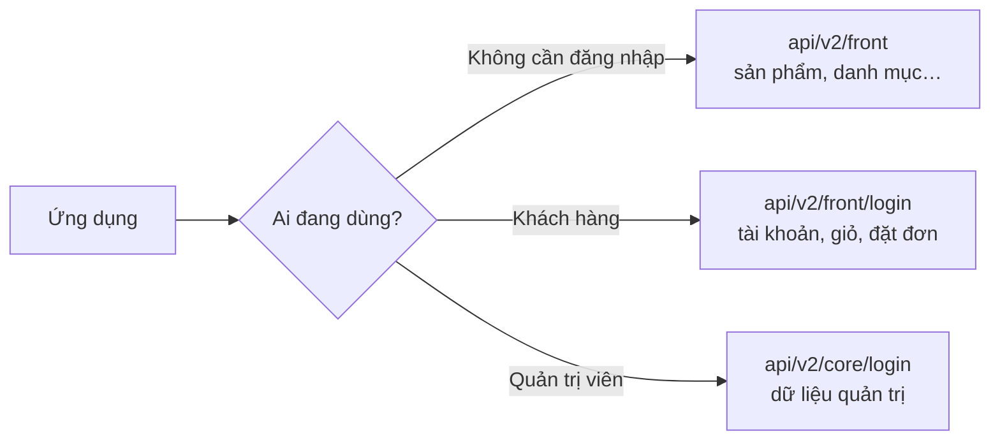
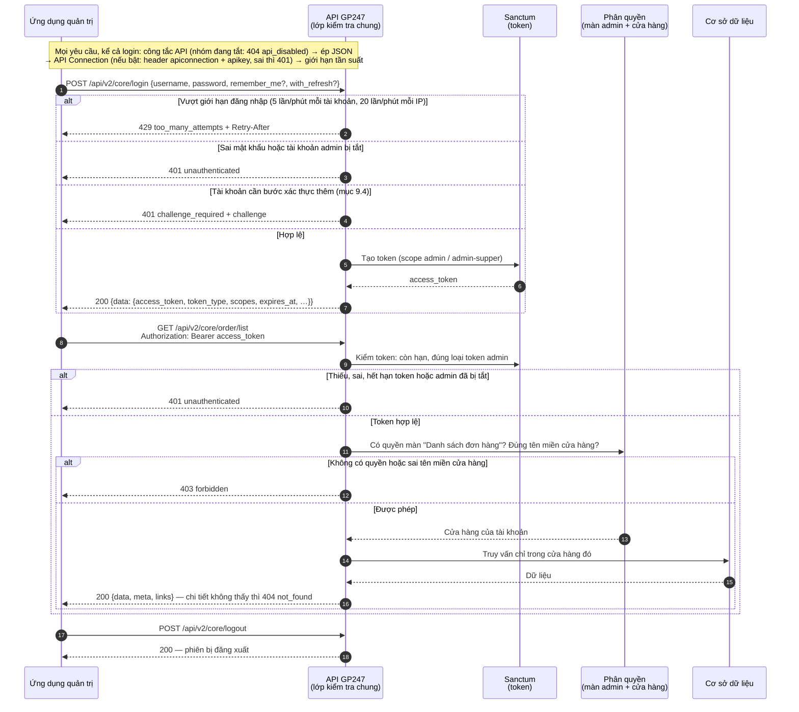
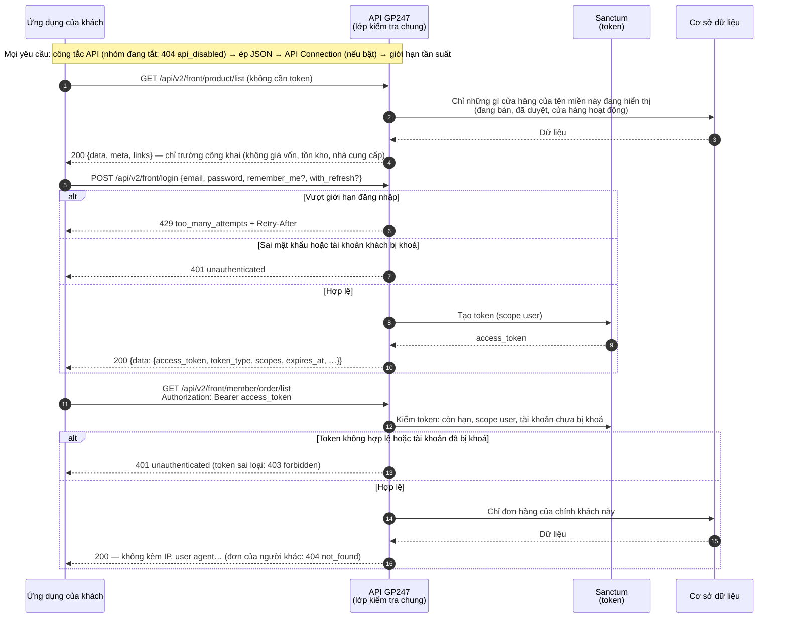
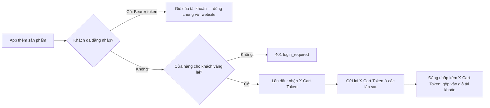
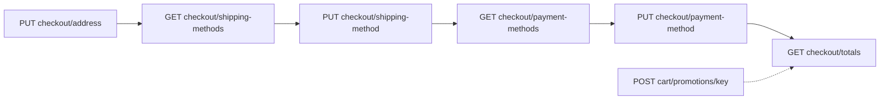
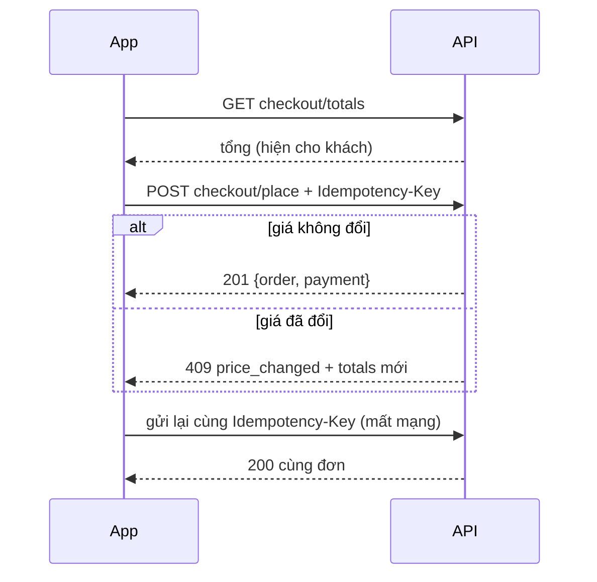
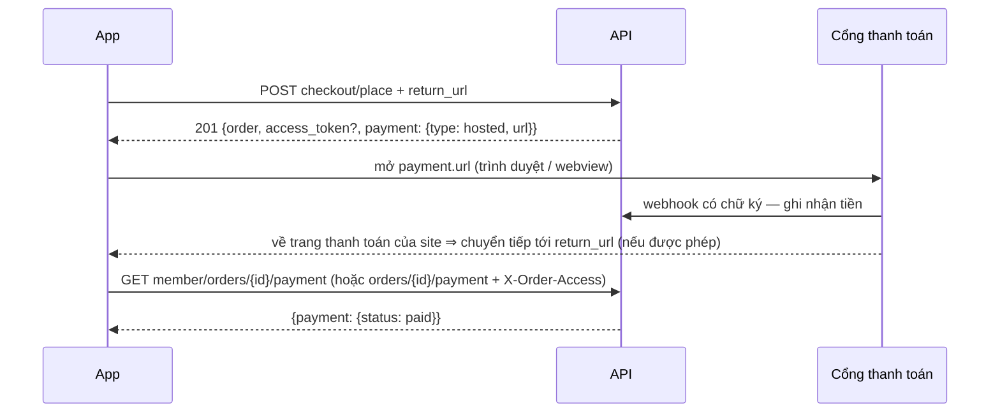

> 🌐 **Ngôn ngữ:** 🇻🇳 Tiếng Việt (hiện tại) · [🇬🇧 English](./api-introduction.md) · [🇯🇵 日本語](./api-introduction_ja.md)

# Giới thiệu API trong hệ thống GP247

## Giới thiệu

Tài liệu này giới thiệu **hệ thống API (giao diện lập trình ứng dụng) của GP247** — cách các
ứng dụng bên ngoài (app di động, website khác, phần mềm quản lý, tích hợp bên thứ ba…) có thể
"nói chuyện" với site GP247 của bạn để lấy dữ liệu, giữ giỏ hàng và đặt đơn. Tài liệu dành cho **lập trình viên tích hợp**
và **người quản trị site** muốn hiểu tổng quan API gồm những gì, chia làm mấy nhóm, xác thực
(đăng nhập) và phân quyền ra sao, lỗi trả về thế nào và gọi thử như thế nào. Đọc xong, bạn biết
**API nào dùng để làm gì, gọi ở địa chỉ nào, cần chìa khóa gì, được xem dữ liệu nào**, và có ví dụ
copy chạy được ngay.

> ⚠️ **Tài liệu này chỉ nói về API v2** (`api/v2/core`, `api/v2/front`). **API v1** (`api/core`, `api/front`) đã
> **ngưng phát triển**: vẫn chạy cho ứng dụng đang dùng nhưng tắt sẵn trên site cài mới, không có tính năng mới và chỉ
> nhận bản vá bảo mật. Ứng dụng mới hãy dùng v2. Đang duy trì ứng dụng cũ? Xem [API v1 (đã ngưng phát triển)](./api-v1_vi.md).

> ℹ️ **API là gì (giải thích đời thường):** hãy hình dung API như một "quầy giao dịch" của site.
> Ứng dụng bên ngoài không vào thẳng kho dữ liệu, mà gửi yêu cầu tới quầy (một địa chỉ URL), quầy
> kiểm tra giấy tờ (token/khóa) rồi trả về kết quả dưới dạng **JSON** (một định dạng dữ liệu dạng
> văn bản mà máy tính đọc được). Toàn bộ trao đổi diễn ra qua giao thức web thông thường (HTTP).

> 📄 **Đặc tả máy đọc được:** toàn bộ endpoint, tham số và mẫu lỗi có trong file
> [`openapi.json`](./openapi.json) (OpenAPI 3.1) — nạp vào Postman, Insomnia hay Swagger UI để gọi thử
> hoặc sinh code client.

## Nhìn nhanh

Ứng dụng chọn nhóm API theo việc cần làm và người dùng đứng sau nó:



- **Hai nhóm** — `api/v2/front` cho cửa hàng và khách, `api/v2/core` cho quản trị viên (mục 1).
- **Đăng nhập bằng token** — `login` cấp token, gửi lại trong header `Authorization: Bearer …` (mục 2).
- **Không xem nhiều hơn màn hình** — API quản trị theo đúng phân quyền và cửa hàng của tài khoản (mục 3).
- **Chủ site bật/tắt từng nhóm** trên màn quản lý API; nhóm tắt trả `404 api_disabled` (mục 5).
- **Phản hồi cố định** — luôn có khoá `data`; danh sách thêm `meta`, `links` (mục 6).

## Trong trang này

- [1. Hai nhóm API](#1-hai-nhóm-api) — chọn đúng nhóm cho ứng dụng của bạn
- [2. Xác thực](#2-xác-thực-đăng-nhập-vào-api) — lấy token, thời hạn, giới hạn đăng nhập
- [3. Phân quyền](#3-phân-quyền-và-phạm-vi-dữ-liệu-của-api-core) — vì sao có token vẫn bị `403`
- [4. API Connection](#4-lớp-bảo-vệ-kết-nối-api-connection--tùy-chọn) — khóa bổ sung cho ứng dụng
- [5. Bật/tắt API](#5-bậttắt-api) — công tắc trên màn quản lý API
- [6. Phản hồi, tham số & mã lỗi](#6-định-dạng-phản-hồi-tham-số-danh-sách--mã-lỗi) — đọc kết quả, lọc, sắp xếp, xử lý lỗi
- [7. API Core (Admin)](#7-luồng-làm-việc-api-core-admin) — luồng và endpoint quản trị
- [8. API Front (Storefront)](#8-luồng-làm-việc-api-front-storefront) — luồng và endpoint công khai, tài khoản khách
- [9. Tài khoản khách & phiên](#9-tài-khoản-khách--phiên-đăng-nhập) — đăng ký, refresh token, MFA
- [10. Giỏ hàng & đặt đơn](#10-giỏ-hàng--đặt-đơn-qua-api) — giỏ, checkout, thanh toán

---

## 1. Hai nhóm API

Hệ thống GP247 chia API thành **hai nhóm**, phục vụ hai đối tượng khác nhau:

| Nhóm | Tiền tố địa chỉ (prefix) | Dành cho | Ai đăng nhập |
| --- | --- | --- | --- |
| **API Core (Admin)** | `api/v2/core` | Quản trị hệ thống từ xa (app quản lý, dashboard riêng) | Tài khoản **quản trị viên** (admin) |
| **API Front (Storefront)** | `api/v2/front` | Hiển thị dữ liệu cửa hàng, tài khoản khách, giỏ hàng và đặt đơn | Khách/thành viên, hoặc **không cần đăng nhập** với dữ liệu công khai |

- **`api/v2/core`** do gói `gp247/core` cung cấp phần đăng nhập/thông tin admin; `gp247/shop` và
  `gp247/front` bổ sung các endpoint đọc dữ liệu quản trị (khách hàng, đơn hàng, sản phẩm, banner…).
- **`api/v2/front`** do gói `gp247/front` và `gp247/shop` cung cấp — dữ liệu "mặt tiền" cửa hàng như
  danh sách sản phẩm, danh mục, thương hiệu, trang nội dung, banner, cùng tài khoản, giỏ hàng và đơn hàng của khách.

> ℹ️ **Có từ:** gp247/core, gp247/front, gp247/shop 3.3.0

> **Địa chỉ đầy đủ** = tên miền site + tiền tố + đường dẫn. Ví dụ nếu site của bạn là
> `https://shop.example.com` thì endpoint lấy danh sách sản phẩm là:
> `https://shop.example.com/api/v2/front/product/list`.

---

## 2. Xác thực (đăng nhập vào API)

GP247 dùng **Laravel Sanctum** để cấp **token** (một chuỗi ký tự dài đóng vai trò "vé vào cửa").
Cơ chế hoạt động chung cho cả hai nhóm:

1. Ứng dụng gửi thông tin đăng nhập tới endpoint `login`: quản trị viên gửi **`username` + `password`** tới
   `api/v2/core/login`, khách gửi **`email` + `password`** tới `api/v2/front/login`.
2. Nếu đúng, hệ thống trả về trong khoá `data` một **`access_token`** (token dạng Bearer) kèm hạn dùng
   (`expires_at`, và `expires_in` tính bằng giây).
3. Từ đó về sau, mọi yêu cầu cần đăng nhập đều gắn kèm token này trong phần **header**:

   ```
   Authorization: Bearer <access_token>
   ```

4. Khi muốn thoát, gọi **`POST logout`** để **đăng xuất phiên hiện tại** (token cũ và refresh token của nó hết hiệu lực ngay).

### Phạm vi quyền (scope / ability)

Mỗi token được cấp kèm **phạm vi** cho biết nó là token của ai:

| Scope | Ý nghĩa |
| --- | --- |
| `admin` | Token của quản trị viên (API Core) |
| `admin-supper` | Token của quản trị viên có vai trò `administrator` (API Core) |
| `user` | Token của thành viên (API Front) |

> ℹ️ **Có từ:** gp247/core 3.2.3 — scope chỉ phân biệt **loại tài khoản**. **Được xem dữ liệu nào**
> do phân quyền của chính tài khoản quyết định (mục 3). Scope `user-guest` không còn được cấp:
> tài khoản khách đang bị khoá không đăng nhập được.

### Thời hạn token

> ℹ️ **Có từ:** gp247/core 3.2.3

Mọi token đều có hạn dùng (`expires_at`):

| Loại token | Không gửi `remember_me` | Gửi `remember_me = true` |
| --- | --- | --- |
| Quản trị viên | 7 ngày (`GP247_API_TOKEN_EXPIRE_ADMIN_DEFAULT`) | 30 ngày (`GP247_API_RECOMMEMBER_ADMIN`) |
| Thành viên | 7 ngày (`GP247_API_TOKEN_EXPIRE_DEFAULT`) | 30 ngày (`GP247_API_RECOMMEMBER`) |

Đăng nhập kèm `with_refresh: true` thì token truy cập chỉ sống **60 phút** và đi cùng một *refresh token* để tự gia hạn
(mục 9.2) — cách được khuyên dùng cho ứng dụng di động.

> ℹ️ **Có từ:** gp247/core 3.3.0 — biến môi trường có tên viết đúng: `GP247_API_REMEMBER`,
> `GP247_API_REMEMBER_ADMIN`, `GP247_API_SCOPE_ADMIN_SUPER`. Tên cũ (`GP247_API_RECOMMEMBER`…) vẫn dùng được;
> khai cả hai thì tên mới thắng. `php artisan gp247:doctor` báo tên cũ còn dùng (mục `api_config_legacy_names`).
> Token mang scope `admin-super` cũng được chấp nhận bên cạnh `admin-supper`.

Token hết hạn trả về `401`; khi đó gọi `refresh` (nếu đăng nhập kèm `with_refresh`) hoặc `login` để lấy token mới. Token đã
hết hạn lâu (quá 7 ngày) được tự dọn ở lần đăng nhập kế tiếp của cùng tài khoản — không cần cron.

> ℹ️ **Có từ:** gp247/core 3.4.0 — token cấp **trước bản 3.2.3** (lúc đó chưa có hạn) được đặt hạn khi chạy
> `php artisan gp247:update`: tuổi thật của token cộng thời hạn "remember" (quản trị viên: `GP247_API_REMEMBER_ADMIN`,
> thành viên: `GP247_API_REMEMBER`), nhưng **không sớm hơn 7 ngày** kể từ lúc nâng cấp. Ứng dụng đang giữ token cũ
> có ít nhất 7 ngày trước khi phải đăng nhập lại — hãy chắc chắn ứng dụng xử lý `401` bằng cách gọi `login`.

> ℹ️ **Có từ:** gp247/core 3.6.0, gp247/shop 3.4.0 — đổi hoặc đặt lại mật khẩu của khách (trên website hay qua API) làm
> **mọi token** của khách đó hết hiệu lực. Với **quản trị viên** cũng vậy: đổi mật khẩu ở màn **Người dùng**, ở **Cài đặt tài
> khoản** hoặc qua "quên mật khẩu" làm mọi token API của admin đó hết hiệu lực.

### Giới hạn số lần đăng nhập

> ℹ️ **Có từ:** gp247/core 3.2.3

Để chống dò mật khẩu, `api/v2/core/login`, `api/v2/front/login` và form đăng nhập quản trị giới hạn số lần thử.
Form đăng nhập quản trị và `api/v2/core/login` dùng chung một bộ đếm: lần sai ở bên này được tính cho bên kia.

| Giới hạn | Mặc định | Đổi bằng biến môi trường |
| --- | --- | --- |
| Mỗi tài khoản (từ cùng một IP) | 5 lần / phút | `GP247_LOGIN_THROTTLE` (dạng `số_lần,phút`) |
| Mỗi IP, trên mọi tài khoản | 20 lần / phút | `GP247_LOGIN_IP_THROTTLE` |

> ⚠️ **Đổi tên ở gp247/core 3.5.0:** tên cũ `GP247_API_LOGIN_THROTTLE` và `GP247_API_LOGIN_IP_THROTTLE`
> không còn được đọc. Nếu bạn đã đặt chúng, hãy đổi tên trong `.env`; nếu không, giá trị mặc định ở trên được dùng.

Vượt giới hạn → HTTP `429` kèm header `Retry-After` (số giây cần chờ). Đăng nhập đúng sẽ xoá bộ đếm của
tài khoản đó. Ngoài ra, mọi endpoint API có giới hạn chung 1000 lần/phút mỗi IP (`GP247_API_THROTTLE`).

---

## 3. Phân quyền và phạm vi dữ liệu của API Core

> ℹ️ **Có từ:** gp247/core 3.2.3, gp247/shop 3.2.3, gp247/front 3.2.3

API Core **không cho xem nhiều hơn màn hình quản trị**. Mỗi endpoint đọc dữ liệu gắn với một màn
hình admin; quản trị viên chỉ gọi được endpoint khi tài khoản có quyền mở màn hình đó (phân quyền ở
**Quản trị → Vai trò / Quyền**). Không có quyền → HTTP `403`.

| Endpoint (tiền tố `api/v2/core`) | Quyền cần có (màn hình admin) |
| --- | --- |
| `customer/list`, `customer/detail/{id}` | Danh sách khách hàng |
| `order/list` | Danh sách đơn hàng |
| `order/detail/{id}` | Chi tiết đơn hàng |
| `product/*` | Danh sách sản phẩm |
| `category/*`, `brand/*`, `supplier/*` | Danh sách danh mục / thương hiệu / nhà cung cấp |
| `banner/*`, `page/*` | Danh sách banner / trang nội dung |
| `logout`, `info`, `sessions` | Chỉ cần token hợp lệ |
| `login`, `login/challenge`, `refresh` | Không cần token |

- Vai trò `administrator` gọi được mọi endpoint; vai trò `view.all` chỉ đọc.
- **Dữ liệu theo cửa hàng:** trên site nhiều cửa hàng, quản trị viên được gắn với một cửa hàng chỉ
  thấy dữ liệu của cửa hàng đó và chỉ gọi được API trên **tên miền của cửa hàng mình** (giống khi đăng
  nhập trang quản trị). Bản ghi của cửa hàng khác trả về `404`.
- Tài khoản quản trị bị tắt (`status = 0`) thì token cũ không dùng được nữa (`401`).

---

## 4. Lớp bảo vệ kết nối (API Connection) — tùy chọn

Ngoài token, GP247 còn có **một lớp khóa bổ sung** đứng trước tất cả API, gọi là **API Connection**.
Đây là "chốt bảo vệ" thứ hai, giúp chỉ những ứng dụng được cấp phép mới gọi được API — kể cả các
endpoint công khai.

- Lớp này **mặc định tắt**, bật/tắt bằng cấu hình `api_connection_required` trong quản trị.
- **Khi bật:** mọi yêu cầu phải kèm thêm **hai header**:

  ```
  apiconnection: <mã kết nối>
  apikey: <khóa bí mật>
  ```

- Cặp `apiconnection`/`apikey` được tạo và quản lý trong **trang quản trị GP247** (mục quản lý
  API Connection), mỗi cặp có thể đặt ngày hết hạn (`expire`) và trạng thái bật/tắt (`status`).
- Nếu thiếu, sai, hết hạn hoặc đã tắt, API trả về HTTP `401` với `"code": "api_connection_invalid"`.

> ℹ️ **Có từ:** gp247/core 3.2.3 — khóa được **lưu dạng băm**: màn quản trị chỉ hiện khóa **một lần**
> ngay sau khi tạo/sinh lại, hãy sao chép ngay. Khi sửa một kết nối, để trống ô khóa để giữ khóa cũ.
> Khóa đang dùng từ trước vẫn chạy sau khi nâng cấp (`php artisan gp247:update`); hãy **sinh lại** các khóa cũ
> khi thuận tiện để xoá bản lưu thường còn sót lại. Khóa tự nhập phải dài ít nhất 32 ký tự.

> ℹ️ **Có từ:** gp247/core 3.4.0 — `php artisan gp247:update` **xoá hẳn** bản lưu khóa dạng thường; khóa đang dùng
> vẫn chạy bình thường (so khớp qua bản băm). Bản lưu thường không khôi phục được, nên hãy **sao lưu cơ sở dữ liệu**
> trước khi nâng cấp nếu bạn cần giữ nó.

> Thứ tự các lớp kiểm tra (middleware) là: **gắn mã yêu cầu `X-Request-Id` → kiểm tra công tắc bật/tắt API (mục 5)
> → trả JSON → kiểm tra API Connection → giới hạn tần suất**, rồi mới đến đăng nhập/phân quyền của từng endpoint.
> Đây là thứ tự cố định, không nên đổi. *(Hai lớp đầu: từ gp247/core 3.3.1 và 3.4.0.)*

---

## 5. Bật/tắt API

> ℹ️ **Có từ:** gp247/core 3.3.1

Chủ site bật/tắt API ngay trên **màn quản lý API** của trang quản trị (cùng màn với API Connection), không cần sửa
file cấu hình hay chạy lệnh trên máy chủ. Thay đổi có hiệu lực ngay ở yêu cầu kế tiếp.

| Công tắc | Áp dụng cho |
| --- | --- |
| **REST API (tất cả nhóm)** | Mọi endpoint API (kể cả API do plugin thêm qua cơ chế chuẩn) |
| **v2 · API quản trị (core)** | `api/v2/core/*` |
| **v2 · API công khai & khách hàng (front)** | `api/v2/front/*` |

Màn này còn hai công tắc cho API v1 (đã ngưng phát triển) — xem [API v1, mục 2](./api-v1_vi.md). Riêng việc đặt đơn qua API
có thêm công tắc **Đặt đơn qua API** dưới nhóm v2 front (mục 10.2).

- Mỗi công tắc nhóm nằm ngay trên danh sách endpoint của nhóm đó; nhóm đang tắt hiện chữ "đang tắt".
- Gọi vào nhóm đang tắt → HTTP `404` với `"code": "api_disabled"` (mục 6) — kể cả khi chưa gửi token *(từ gp247/core
  3.4.0; bản 3.3.1 trả `401` nếu thiếu token)*.
- **Cài mới** bật sẵn **v2**. Site **nâng cấp** từ bản cũ giữ nguyên mọi nhóm đang bật.
- Biến môi trường `GP247_API_MODE=0` vẫn là **công tắc ở tầng máy chủ**: khi đó không có endpoint API nào và các công tắc
  trên màn bị khoá — dành cho đơn vị hosting/kỹ thuật muốn tắt hẳn API.
- API của plugin dùng cơ chế riêng (ví dụ máy chủ MCP) **không** chịu các công tắc này và có công tắc riêng trên màn của plugin.
- **Site có cache route** (`php artisan route:cache`): `php artisan gp247:update` tự dựng lại cache sau khi nâng cấp. Nếu bạn chỉ
  chạy `composer update`, công tắc có thể chưa có hiệu lực — `php artisan gp247:doctor` báo ở mục `api_route_gate`
  *(từ gp247/core 3.4.0)*; chạy `php artisan gp247:cache-rebuild` để sửa.

---

## 6. Định dạng phản hồi, tham số danh sách & mã lỗi

Mục này giúp ứng dụng đọc đúng kết quả, lọc/sắp xếp danh sách và xử lý lỗi theo một cách duy nhất cho mọi endpoint.

### Phản hồi thành công

- **Mọi phản hồi đều là JSON**, kể cả khi ứng dụng không gửi header `Accept: application/json`.

> ℹ️ **Có từ:** gp247/core 3.6.0 — trước bản này, gọi endpoint cần đăng nhập mà thiếu token **và** không gửi
> `Accept: application/json` (mặc định của curl, Postman, nhiều SDK) nhận HTTP `500` thay cho `401 unauthenticated`.

| Trường hợp | Dạng phản hồi |
| --- | --- |
| Một bản ghi | `{"data": {...}}` |
| Danh sách | `{"data": [...], "meta": {...}, "links": {...}}` — `meta` có `current_page`, `per_page`, `total`, `last_page`; `links` có `first`, `last`, `prev`, `next` |
| Tên, mô tả sản phẩm/danh mục/trang | `name`, `description`… theo ngôn ngữ chọn bằng `lang` |
| Giá | `price` và `price_final` (giá khách trả trên cửa hàng, đã tính khuyến mãi) |

### Tham số cho mọi endpoint danh sách

| Tham số | Ý nghĩa | Ví dụ |
| --- | --- | --- |
| `filter[<tên>]` | Lọc theo trường được phép của từng loại dữ liệu (xem bảng dưới) | `filter[brand_id]=5` |
| `sort` | Sắp xếp tăng dần; thêm `-` phía trước để giảm dần | `sort=-price` |
| `q` | Tìm kiếm (tên, SKU, email… tùy loại dữ liệu) | `q=ao-thun` |
| `lang` | Ngôn ngữ của tên/mô tả; mã không hợp lệ → ngôn ngữ mặc định của site | `lang=vi` |
| `page[number]`, `page[size]` | Trang và số bản ghi mỗi trang (mặc định 20, tối đa 100) | `page[size]=50` |

Tên lọc hoặc trường sắp xếp **không có trong danh sách** → HTTP `422` (`validation_failed`), phản hồi nêu các
tên được phép.

| Dữ liệu | `filter[...]` | `sort` |
| --- | --- | --- |
| Sản phẩm | `category_id`, `brand_id`, `kind`, `product_type`, `price_min`, `price_max` (+ admin: `status`, `approve`, `supplier_id`) | `price`, `created_at`, `sort`, `sku` |
| Danh mục | `parent`, `top` (admin: `parent`, `status`) | `sort`, `created_at` |
| Thương hiệu, nhà cung cấp | (admin: `status`) | `sort`, `name` |
| Khách hàng (admin) | `status`, `group` | `created_at`, `email` |
| Đơn hàng (admin) | `status`, `payment_status`, `shipping_status`, `customer_id` | `created_at`, `total` |
| Đơn hàng của khách | `status` | `created_at`, `total` |
| Banner | `type` | `sort`, `created_at` |
| Trang nội dung | — | `created_at` |

### Mã lỗi

> ℹ️ **Có từ:** gp247/core 3.2.3 — **mọi lỗi** có cùng một dạng và **mã HTTP đúng nghĩa**:
>
> ```json
> { "error": 1, "msg": "Not found", "code": "not_found" }
> ```

| HTTP | `code` | Khi nào |
| --- | --- | --- |
| `401` | `unauthenticated` | Thiếu/sai token, token hết hạn, tài khoản bị tắt/khoá, sai mật khẩu khi `login` |
| `401` | `api_connection_invalid` | API Connection đang bật mà thiếu/sai cặp `apiconnection`/`apikey` |
| `403` | `forbidden` | Đã đăng nhập nhưng không có quyền (mục 3) hoặc token sai loại |
| `404` | `not_found` | Bản ghi không tồn tại hoặc bạn không được xem; đường dẫn API không tồn tại |
| `404` | `api_disabled` | Nhóm API này đang **tắt** trên màn quản lý API của site (mục 5) — từ gp247/core 3.3.1 |
| `401` | `refresh_token_invalid` | Refresh token sai, hết hạn hoặc phiên đã bị đăng xuất (mục 9.2) — từ gp247/core 3.6.0 |
| `401` | `refresh_token_reused` | Refresh token đã dùng rồi bị gửi lại: phiên bị đăng xuất để an toàn — đăng nhập lại (mục 9.2) |
| `409` | `refresh_in_progress` | Refresh token vừa được dùng vài giây trước — dùng cặp token mới đã nhận (mục 9.2) |
| `401` | `challenge_required` | Tài khoản cần thêm bước xác thực (mã OTP…) do plugin cung cấp; thân có khoá `challenge` (mục 9.4) |
| `401` | `challenge_invalid` | Vé xác thực sai/hết hạn hoặc mã xác thực sai (mục 9.4) |
| `422` | `validation_failed` | Dữ liệu gửi lên không hợp lệ — xem thêm khoá `errors` theo từng trường |
| `429` | `too_many_attempts` | Gọi quá nhiều lần — chờ theo header `Retry-After` |
| `405` | `method_not_allowed` | Sai phương thức HTTP cho đường dẫn (ví dụ `GET` thay cho `POST`) |
| khác | `http_error` | Lỗi HTTP khác — đọc `msg` |
| `500` | `server_error` | Lỗi máy chủ — nội dung chi tiết chỉ hiện khi site bật chế độ debug |

Giỏ hàng và đặt đơn có thêm mã lỗi riêng (mục 10). Hãy kiểm tra **mã HTTP** trước rồi mới đọc `code` để xử lý từng
trường hợp; `msg` là thông điệp để hiển thị hoặc ghi log.

### Mã yêu cầu `X-Request-Id`

> ℹ️ **Có từ:** gp247/core 3.4.0

Mọi phản hồi của API GP247 — kể cả phản hồi lỗi — có header **`X-Request-Id`**. Khi báo lỗi cho quản trị viên site,
hãy gửi kèm mã này: họ dùng nó để tìm đúng dòng trong nhật ký hệ thống.

- Ứng dụng có thể **tự gửi** `X-Request-Id` (chỉ gồm chữ, số, `.`, `_`, `-`; dài 8–128 ký tự): site dùng lại đúng mã
  đó, tiện nối nhật ký của ứng dụng với nhật ký của site.
- Thiếu hoặc sai định dạng → site tự sinh mã mới (UUID).
- Đường dẫn không khớp endpoint nào (404 trước khi vào API) có thể không có header này.

---

## 7. Luồng làm việc API Core (Admin)

Sơ đồ dưới đây mô tả trình tự một ứng dụng quản trị đăng nhập rồi đọc dữ liệu qua API Core. Mỗi yêu cầu đi
qua các lớp kiểm tra theo đúng thứ tự trong sơ đồ; lớp nào từ chối thì trả lỗi ngay, không đi tiếp.



Điểm rút ra: có token **chưa đủ** để đọc dữ liệu — tài khoản còn phải có quyền mở màn hình quản trị tương ứng, và
chỉ thấy dữ liệu của cửa hàng mình (mục 3).

**Endpoint đăng nhập & phiên** (tiền tố `api/v2/core`):

| Phương thức | Đường dẫn | Cần đăng nhập | Chức năng |
| --- | --- | --- | --- |
| `POST` | `api/v2/core/login` | Không | Đăng nhập admin, nhận `access_token` (`with_refresh` tuỳ chọn — mục 9.2) |
| `POST` | `api/v2/core/login/challenge` | Không | Hoàn tất đăng nhập cần bước xác thực thêm (mục 9.4) |
| `POST` | `api/v2/core/refresh` | Không (gửi refresh token) | Đổi refresh token lấy cặp token mới (mục 9.2) |
| `POST` | `api/v2/core/logout` | Có (Bearer) | Đăng xuất phiên hiện tại (cả refresh token) |
| `GET` | `api/v2/core/info` | Có (Bearer) | Thông tin quản trị viên đang đăng nhập (kèm vai trò) |
| `GET` | `api/v2/core/sessions` | Có (Bearer) | Các phiên đăng nhập API (thiết bị) của admin (mục 9.3) |
| `DELETE` | `api/v2/core/sessions/{id}` | Có (Bearer) | Đăng xuất một phiên |

**Endpoint dữ liệu quản trị** (tiền tố `api/v2/core`, cần token + quyền ở mục 3):

| Phương thức | Đường dẫn | Chức năng |
| --- | --- | --- |
| `GET` | `api/v2/core/customer/list` | Danh sách khách hàng |
| `GET` | `api/v2/core/customer/detail/{id}` | Chi tiết một khách hàng |
| `GET` | `api/v2/core/order/list` | Danh sách đơn hàng |
| `GET` | `api/v2/core/order/detail/{id}` | Chi tiết một đơn hàng |
| `GET` | `api/v2/core/product/list` | Danh sách sản phẩm (kèm tồn kho, giá vốn) |
| `GET` | `api/v2/core/product/detail/{id}` | Chi tiết một sản phẩm |
| `GET` | `api/v2/core/category/list` | Danh sách danh mục |
| `GET` | `api/v2/core/category/detail/{id}` | Chi tiết một danh mục |
| `GET` | `api/v2/core/brand/list` | Danh sách thương hiệu |
| `GET` | `api/v2/core/brand/detail/{id}` | Chi tiết một thương hiệu |
| `GET` | `api/v2/core/supplier/list` | Danh sách nhà cung cấp |
| `GET` | `api/v2/core/supplier/detail/{id}` | Chi tiết một nhà cung cấp |
| `GET` | `api/v2/core/banner/list` | Danh sách banner |
| `GET` | `api/v2/core/banner/detail/{id}` | Chi tiết một banner |
| `GET` | `api/v2/core/page/list` | Danh sách trang nội dung |
| `GET` | `api/v2/core/page/detail/{id}` | Chi tiết một trang nội dung |

Ví dụ đăng nhập admin (dùng `curl` trong Terminal):

```bash
curl -X POST "https://shop.example.com/api/v2/core/login" \
  -H "Content-Type: application/json" \
  -d '{"username":"admin","password":"your-password","remember_me":true}'
```

Nếu thành công, bạn nhận về JSON dạng (rút gọn):

```json
{
  "data": {
    "access_token": "1|aBcD...rất-dài...XyZ",
    "token_type": "Bearer",
    "scopes": ["admin-supper"],
    "expires_at": "2026-11-25 10:00:00",
    "expires_in": 2592000
  }
}
```

Sau đó lấy các đơn hàng mới nhất bằng token vừa nhận (`data.access_token`):

```bash
curl -X GET "https://shop.example.com/api/v2/core/order/list?sort=-created_at&page[size]=20" \
  -H "Accept: application/json" \
  -H "Authorization: Bearer 1|aBcD...rất-dài...XyZ"
```

---

## 8. Luồng làm việc API Front (Storefront)

API Front phục vụ hai loại dữ liệu: **dữ liệu công khai** (không cần đăng nhập — danh sách sản
phẩm, danh mục…) và **dữ liệu riêng của khách** (cần đăng nhập — đơn hàng, hồ sơ, sổ địa chỉ).

Sơ đồ dưới đây mô tả hai cách dùng API Front: đọc dữ liệu công khai không cần đăng nhập, và khách đăng nhập để
xem đơn hàng của mình.



Điểm rút ra: dữ liệu công khai trên API **khớp với những gì khách thấy trên cửa hàng**, còn dữ liệu riêng chỉ trả về
cho đúng chủ tài khoản.

**Các endpoint công khai** (tiền tố `api/v2/front`, không cần token):

| Phương thức | Đường dẫn | Chức năng |
| --- | --- | --- |
| `GET` | `api/v2/front/meta` | Phiên bản API, gói đã cài, ngôn ngữ, cửa hàng |
| `GET` | `api/v2/front/product/list` | Danh sách sản phẩm |
| `GET` | `api/v2/front/product/detail/{id}` | Chi tiết một sản phẩm (kèm dữ liệu để mua — mục 10.4) |
| `GET` | `api/v2/front/category/list` | Danh sách danh mục |
| `GET` | `api/v2/front/category/detail/{id}` | Chi tiết một danh mục |
| `GET` | `api/v2/front/brand/list` | Danh sách thương hiệu |
| `GET` | `api/v2/front/brand/detail/{id}` | Chi tiết một thương hiệu |
| `GET` | `api/v2/front/banner/list` | Danh sách banner |
| `GET` | `api/v2/front/banner/detail/{id}` | Chi tiết một banner |
| `GET` | `api/v2/front/page/list` | Danh sách trang nội dung |
| `GET` | `api/v2/front/page/detail/{id}` | Chi tiết một trang nội dung |

> ℹ️ **Có từ:** gp247/shop 3.2.3, gp247/front 3.2.3 — dữ liệu công khai **giống hệt những gì cửa hàng
> đang hiển thị** trên tên miền bạn gọi: sản phẩm ẩn, chưa được duyệt hoặc thuộc cửa hàng khác không
> xuất hiện. Phản hồi chỉ gồm các trường công khai — không có giá vốn, nhà cung cấp, số tồn/đã bán.
> Cần các số liệu đó thì dùng API Core với tài khoản có quyền.

**Các endpoint tài khoản khách** (tiền tố `api/v2/front`; chi tiết ở mục 9):

| Phương thức | Đường dẫn | Cần đăng nhập | Chức năng |
| --- | --- | --- | --- |
| `POST` | `api/v2/front/register` | Không | Đăng ký tài khoản khách và đăng nhập luôn (mục 9.1) |
| `POST` | `api/v2/front/password/forgot` | Không | Gửi email đặt lại mật khẩu |
| `POST` | `api/v2/front/password/reset` | Không | Đặt mật khẩu mới bằng mã trong email |
| `POST` | `api/v2/front/login` | Không | Đăng nhập bằng email/mật khẩu khách (`with_refresh` tuỳ chọn — mục 9.2) |
| `POST` | `api/v2/front/login/challenge` | Không | Hoàn tất đăng nhập cần bước xác thực thêm (mục 9.4) |
| `POST` | `api/v2/front/refresh` | Không (gửi refresh token) | Đổi refresh token lấy cặp token mới |
| `POST` | `api/v2/front/logout` | Có (Bearer) | Đăng xuất phiên hiện tại (cả refresh token) |
| `GET` | `api/v2/front/info` | Có (Bearer) | Thông tin tài khoản khách |
| `GET` | `api/v2/front/member/profile` | Có (Bearer) | Hồ sơ đầy đủ: trạng thái xác minh email, địa chỉ mặc định |
| `PUT` | `api/v2/front/member/profile` | Có (Bearer) | Sửa hồ sơ |
| `PUT` | `api/v2/front/member/password` | Có (Bearer) | Đổi mật khẩu (đăng xuất mọi thiết bị khác) |
| `POST` | `api/v2/front/member/email/verify` | Có (Bearer) | Gửi lại email xác minh |
| `GET` | `api/v2/front/member/address/list` | Có (Bearer) | Sổ địa chỉ |
| `POST` | `api/v2/front/member/address` | Có (Bearer) | Thêm địa chỉ |
| `PUT` | `api/v2/front/member/address/{id}` | Có (Bearer) | Sửa địa chỉ |
| `DELETE` | `api/v2/front/member/address/{id}` | Có (Bearer) | Xoá địa chỉ (không xoá được địa chỉ mặc định) |
| `GET` | `api/v2/front/member/sessions` | Có (Bearer) | Các phiên đăng nhập API (thiết bị) của khách (mục 9.3) |
| `DELETE` | `api/v2/front/member/sessions/{id}` | Có (Bearer) | Đăng xuất một phiên |
| `GET` | `api/v2/front/member/order/list` | Có (Bearer) | Danh sách đơn hàng của khách |
| `GET` | `api/v2/front/member/order/detail/{id}` | Có (Bearer) | Chi tiết một đơn hàng của khách |

Endpoint giỏ hàng, checkout và thanh toán nằm ở mục 10.

Ví dụ: 20 sản phẩm đắt nhất của thương hiệu số 5, tên bằng tiếng Việt (công khai, không cần token):

```bash
curl -X GET "https://shop.example.com/api/v2/front/product/list?filter[brand_id]=5&sort=-price&lang=vi&page[size]=20" \
  -H "Accept: application/json"
```

Phản hồi rút gọn:

```json
{
  "data": [
    { "id": "PRD-AbC12", "sku": "TSHIRT-01", "name": "Áo thun", "price": 250000, "price_final": 199000 }
  ],
  "meta": { "current_page": 1, "per_page": 20, "total": 1, "last_page": 1 },
  "links": { "first": "…", "last": "…", "prev": null, "next": null }
}
```

Ví dụ đăng nhập khách rồi xem đơn hàng:

```bash
# 1) Đăng nhập khách
curl -X POST "https://shop.example.com/api/v2/front/login" \
  -H "Content-Type: application/json" \
  -d '{"email":"customer@example.com","password":"your-password"}'

# 2) Dùng token nhận được (data.access_token) để lấy danh sách đơn hàng
curl -X GET "https://shop.example.com/api/v2/front/member/order/list" \
  -H "Accept: application/json" \
  -H "Authorization: Bearer 2|zzz...token-khach...zzz"
```

---

## 9. Tài khoản khách & phiên đăng nhập

> ℹ️ **Có từ:** gp247/core 3.6.0, gp247/shop 3.4.0

Ứng dụng mua sắm làm được trọn vòng tài khoản khách qua `api/v2/front`, với **đúng luật của form trên website**:
trường bắt buộc, trường tuỳ chỉnh, độ mạnh mật khẩu và captcha đều theo cấu hình của cửa hàng. Danh sách endpoint ở
mục 8.

### 9.1. Đăng ký, quên mật khẩu, hồ sơ, sổ địa chỉ

- **`POST register`** — gửi các trường như form đăng ký (`first_name`, `email`, `password`, `password_confirmation`,
  cùng các trường cửa hàng bật như `address1`, `phone`…). Thành công → HTTP `201`, thân gồm `customer` và token như
  `login`. Không đặt được `status` của chính mình. **Mật khẩu bắt buộc**: thiếu hoặc để trống `password` → `422`
  (`errors.password`), không tạo tài khoản.
- **`POST password/forgot`** — gửi email đặt lại mật khẩu. Luôn trả `{"data": {"sent": true}}`, dù email có tài khoản
  hay không, để không ai dò được email nào đã đăng ký.
- **`POST password/reset`** — gửi `email`, `token` (trong email), `password`, `password_confirmation`. Thành công thì
  **mọi token API** của khách bị huỷ; ứng dụng gọi `login` với mật khẩu mới.
- **`GET` / `PUT member/profile`** — hồ sơ kèm `email_verified`, `email_verification_required` và địa chỉ mặc định.
  Mật khẩu không đổi được ở đây.
- **`PUT member/password`** — gửi `password_old`, `password`, `password_confirmation`. Phiên đang gọi được giữ, **mọi
  thiết bị khác** bị đăng xuất. Mật khẩu cũ sai được tính vào giới hạn đăng nhập của tài khoản. Thiếu hoặc để trống
  mật khẩu mới → `422` (`errors.password`), mật khẩu cũ giữ nguyên.

> ℹ️ **Có từ:** gp247/shop 3.5.0 — `register` và `member/password` luôn đòi mật khẩu (trước đây thân thiếu khoá `password`
> trả HTTP `500`, còn mật khẩu rỗng được chấp nhận). Thân JSON thiếu hẳn một trường bắt buộc nay luôn trả `422`.
- **`member/address`** — thêm/sửa/xoá địa chỉ; gửi `"default": true` để đặt làm mặc định. Không xoá được địa chỉ
  mặc định (HTTP `422`) — hãy đặt địa chỉ khác làm mặc định trước.
- **`POST member/email/verify`** — gửi lại email xác minh khi cửa hàng bật *Cần xác thực email*. Khách bấm link trong
  email ở bất kỳ trình duyệt nào là xong, **không cần** đăng nhập website.

`register`, `password/*` và `member/email/verify` có giới hạn riêng: **5 lần/phút mỗi IP** (`GP247_API_ACCOUNT_THROTTLE`,
dạng `số_lần,phút`).

> ⚠️ Nếu cửa hàng bật captcha cho trang *Đăng ký* hoặc *Quên mật khẩu* (tab **Captcha**), API cũng đòi trường captcha
> của plugin captcha đang dùng — thiếu/sai → `422` (`errors.captcha_field`). Ứng dụng cần lấy mã captcha bằng SDK
> của nhà cung cấp captcha, hoặc quản trị viên bỏ chọn trang đó.

### 9.2. Refresh token — giữ đăng nhập mà token ngắn hạn

Gửi `with_refresh: true` (và tuỳ chọn `device_name`) khi `login`, `register` hoặc `login/challenge`:

| | Không `with_refresh` | Có `with_refresh` |
| --- | --- | --- |
| Token truy cập | 7 ngày (30 với `remember_me`) | **60 phút** (`GP247_API_ACCESS_MINUTES`) |
| Refresh token | — | Khách 30 ngày (`GP247_API_REFRESH_DAYS`), admin 7 ngày (`GP247_API_REFRESH_ADMIN_DAYS`), tính từ lúc đăng nhập |

Khi token truy cập hết hạn (`401`), gọi `POST refresh` với `{"refresh_token": "…"}` → nhận **cặp token mới**. Mỗi
refresh token chỉ dùng được **một lần**:

- Gửi lại refresh token đã dùng → `401 refresh_token_reused` và **cả phiên bị đăng xuất** (dấu hiệu token bị đánh cắp).
- Ngoại lệ: gửi lại trong vòng 10 giây (mạng chập chờn, ứng dụng gửi trùng) → `409 refresh_in_progress`, phiên vẫn còn.
  Hãy cho ứng dụng gọi `refresh` **lần lượt**, không song song.
- Hạn của phiên không kéo dài khi refresh; hết hạn thì đăng nhập lại.

```bash
curl -X POST "https://shop.example.com/api/v2/front/login" -H "Content-Type: application/json" \
  -d '{"email":"khach@example.com","password":"MatKhau#123","with_refresh":true,"device_name":"iPhone của Lan"}'
curl -X POST "https://shop.example.com/api/v2/front/refresh" -H "Content-Type: application/json" \
  -d '{"refresh_token":"<refresh_token nhận được>"}'
```

### 9.3. Quản lý phiên đăng nhập

Mỗi lần đăng nhập là một **phiên**. `GET member/sessions` (khách) và `GET sessions` (admin) liệt kê tên thiết bị,
IP, lần dùng cuối và phiên nào là phiên hiện tại (`current`). `DELETE …/sessions/{id}` đăng xuất một thiết bị.
`POST logout` đăng xuất phiên hiện tại, kể cả refresh token của nó. Đổi mật khẩu (khách hoặc quản trị viên, trên website hay
qua API) đăng xuất **mọi** phiên và token API của tài khoản đó; phiên đăng nhập website đang dùng vẫn giữ.

### 9.4. Xác thực hai lớp (MFA) qua plugin

Core không tự gửi mã OTP; plugin bảo mật có thể gắn thêm bước xác thực. Khi đó `login` đúng mật khẩu trả:

```json
{ "error": 1, "code": "challenge_required", "msg": "…",
  "challenge": { "ticket": "…", "method": "totp", "meta": {}, "expires_in": 300 } }
```

Ứng dụng hỏi mã của người dùng rồi gọi `POST login/challenge` với `ticket` và các trường plugin yêu cầu (ví dụ `code`).
Vé dùng một lần, hết hạn sau 5 phút; mã sai được tính vào giới hạn đăng nhập (API v1 không có bước này — xem
[API v1](./api-v1_vi.md)). Plugin **MFA** miễn phí của GP247 (từ bản 2.3.0) dùng sẵn cơ
chế này cho khách và quản trị viên đã bật xác thực hai lớp (mã TOTP hoặc mã khôi phục). Lập trình viên plugin xem
[Hướng dẫn tạo API — mục 7](./create-api_vi.md).

### 9.5. Nhật ký truy cập API quản trị

Mỗi lần gọi API Core (trừ `login`) được ghi vào **Nhật ký thao tác** của trang quản trị — như khi thao tác trên
màn admin: người dùng, đường dẫn, IP, thiết bị; mật khẩu/khoá bị che, nội dung phản hồi không được lưu. Lần gọi bị từ chối
quyền (`403`) cũng được ghi. Tắt cùng nhật ký của trang quản trị (`GP247_ADMIN_LOG=0`). Công cụ đồng bộ gọi API liên tục sẽ
làm nhật ký tăng nhanh — dọn định kỳ ở màn **Nhật ký thao tác**.

---

## 10. Giỏ hàng & đặt đơn qua API

> ℹ️ **Có từ:** gp247/shop 3.5.0

Ứng dụng di động hoặc website headless của chính cửa hàng giữ **giỏ hàng** qua API, với đúng luật của website: giá và
phụ phí thuộc tính do máy chủ tính, luật số lượng (số dương, số lẻ theo cấu hình), mỗi biến thể một dòng.

**Endpoint giỏ hàng, checkout và thanh toán** (tiền tố `api/v2/front`):

| Phương thức | Đường dẫn | Cần đăng nhập | Chức năng |
| --- | --- | --- | --- |
| `GET` | `api/v2/front/cart` | Có (khách) hoặc `X-Cart-Token` | Xem giỏ hàng |
| `POST` | `api/v2/front/cart/items` | Có (khách) hoặc khách vãng lai | Thêm sản phẩm vào giỏ |
| `PATCH` | `api/v2/front/cart/items/{rowId}` | Có (khách) hoặc `X-Cart-Token` | Đổi số lượng một dòng (≤ 0 = xoá dòng) |
| `DELETE` | `api/v2/front/cart/items/{rowId}` | Có (khách) hoặc `X-Cart-Token` | Xoá một dòng |
| `POST` | `api/v2/front/cart/promotions/{pluginKey}` | Có (khách) hoặc `X-Cart-Token` | Áp mã giảm giá / khuyến mãi |
| `DELETE` | `api/v2/front/cart/promotions/{pluginKey}` | Có (khách) hoặc `X-Cart-Token` | Gỡ khuyến mãi |
| `GET` | `api/v2/front/checkout` | Có (khách) hoặc `X-Cart-Token` | Trạng thái checkout (cửa hàng, địa chỉ, phương thức đã chọn — mục 10.1) |
| `PUT` | `api/v2/front/checkout/address` | Có (khách) hoặc `X-Cart-Token` | Đặt địa chỉ giao hàng |
| `GET` | `api/v2/front/checkout/shipping-methods` | Có (khách) hoặc `X-Cart-Token` | Phương thức giao hàng có báo giá cho địa chỉ |
| `PUT` | `api/v2/front/checkout/shipping-method` | Có (khách) hoặc `X-Cart-Token` | Chọn phương thức giao hàng |
| `GET` | `api/v2/front/checkout/payment-methods` | Có (khách) hoặc `X-Cart-Token` | Phương thức thanh toán dùng được qua API |
| `PUT` | `api/v2/front/checkout/payment-method` | Có (khách) hoặc `X-Cart-Token` | Chọn phương thức thanh toán |
| `GET` | `api/v2/front/checkout/totals` | Có (khách) hoặc `X-Cart-Token` | Tổng tiền sẽ thu |
| `POST` | `api/v2/front/checkout/place` | Có (khách) hoặc `X-Cart-Token` + `Idempotency-Key` | Đặt đơn (mục 10.2) |
| `GET` | `api/v2/front/member/orders/{id}/payment` | Có (khách) | Trạng thái thanh toán đơn của khách (mục 10.3) |
| `GET` | `api/v2/front/orders/{id}/payment` | `X-Order-Access` | Trạng thái thanh toán đơn của khách vãng lai (mục 10.3) |
| `POST` | `api/v2/front/member/orders/{id}/cancel` | Có (khách) | Huỷ đơn chưa trả đặt qua ứng dụng (mục 10.3) |
| `POST` | `api/v2/front/orders/{id}/cancel` | `X-Order-Access` | Huỷ đơn chưa trả của khách vãng lai (mục 10.3) |

Giỏ thuộc về ai tuỳ theo khách đã đăng nhập hay chưa:



- **Khách đã đăng nhập** gửi token như mọi API khách. Giỏ là **giỏ của tài khoản** — thêm trên app, mở website đăng nhập
  là thấy, và ngược lại.
- **Khách vãng lai** (chỉ khi cửa hàng bật *cho phép khách vãng lai*): lần thêm sản phẩm đầu tiên, phản hồi có header
  **`X-Cart-Token`** — lưu lại và gửi kèm ở mọi lần gọi giỏ sau. Mã chỉ trao **một lần**; mã sai hoặc giỏ quá **30 ngày**
  không thay đổi thì coi như chưa có giỏ.
- **Đăng nhập / đăng ký kèm `X-Cart-Token`**: giỏ khách vãng lai được **gộp** vào giỏ tài khoản (cùng sản phẩm + biến thể thì
  cộng số lượng), mã giỏ cũ hết hiệu lực; phản hồi có `cart_merge: {merged, dropped}`.
- **Thêm sản phẩm** (`POST cart/items`): `product_id`, `qty`, và `options` = `{"<mã nhóm thuộc tính>": "<tên lựa chọn>"}`
  khi sản phẩm có thuộc tính — phải chọn **đủ mọi nhóm**; phụ phí luôn lấy từ sản phẩm, giá app gửi bị bỏ qua.
- **Phản hồi giỏ**: các dòng **nhóm theo cửa hàng** (`stores[].lines[]`) với `unit_price`, `line_total`, `subtotal`;
  dòng không còn mua được có `purchasable: false` và `reason` (`not_for_sale`, `missing_options`) và không tính vào `subtotal`.

| Mã lỗi | HTTP | Ý nghĩa |
| --- | --- | --- |
| `login_required` | 401 | Cửa hàng không bán cho khách vãng lai — đăng nhập trước |
| `validation_failed` | 422 | Thiếu / sai `qty`, chưa chọn đủ thuộc tính (`errors.options`) |
| `product_not_for_sale` | 422 | Sản phẩm không bán được (ngừng bán, chưa mở bán…) |
| `insufficient_stock` | 422 | Vượt tồn kho khi cửa hàng không bán vượt tồn |
| `cart_line_limit` | 422 | Giỏ đã đủ **100 dòng** |
| `cart_conflict` | 409 | Giỏ vừa bị đổi ở nơi khác — đọc lại rồi thử lại |
| `not_found` | 404 | Dòng không thuộc giỏ của bạn |

Giới hạn: **60 lần/phút** cho mỗi khách hoặc mỗi mã giỏ (`gp247-config.api.throttle.cart`).

### 10.1. Các bước checkout

Sau khi có giỏ, ứng dụng đi các bước checkout cho **một cửa hàng** của giỏ (giỏ có hàng của nhiều cửa hàng thì gửi `store_id`;
đổi cửa hàng thì các lựa chọn bắt đầu lại). Mọi lựa chọn được giữ giữa các lần gọi cho chủ giỏ (khách hoặc mã giỏ) — **cùng luật
với website**.



- **Địa chỉ** (`PUT checkout/address`): cùng trường bắt buộc như form website (theo cài đặt khách hàng của cửa hàng); hoặc gửi
  `address_id` để dùng một địa chỉ trong sổ địa chỉ của chính khách (địa chỉ của người khác → `404`). Khách đã đăng nhập gửi
  `"save_address": true` để lưu thành địa chỉ mới khi đặt đơn. Đổi địa chỉ thì phải chọn lại phương thức giao hàng.
- **Giao hàng** (`GET checkout/shipping-methods`): giá báo cho đúng địa chỉ + giỏ; mỗi dịch vụ một dòng (`id` dạng `<plugin>` hoặc
  `<plugin>:<dịch vụ>`); hãng không báo giá được nằm trong `unquotable`. Cửa hàng không dùng giao hàng → `required: false`.
- **Thanh toán** (`GET checkout/payment-methods`): chỉ phương thức dùng được qua API — `type: none` (không qua cổng: thu tiền khi
  giao, chuyển khoản…) hoặc `type: hosted` (cổng có trang thanh toán). Phương thức chỉ có bước thanh toán trên website không hiện.
- **Khuyến mãi** (`POST cart/promotions/{pluginKey}` với `{"payload": {...}}` theo plugin, ví dụ `{"code": "SUMMER"}`): dùng chung
  cho mọi plugin khuyến mãi theo hợp đồng checkout; bị từ chối → `422 promotion_refused` kèm thông điệp của plugin.
- **Tổng tiền** (`GET checkout/totals`): các dòng `subtotal`, `shipping`, `discount`, `tax`, `total`… đúng số website tính cho cùng
  giỏ — đây là số "đã hiển thị cho khách".

| Mã lỗi | HTTP | Ý nghĩa |
| --- | --- | --- |
| `cart_empty` | 422 | Giỏ (của cửa hàng đã chọn) không có gì để đặt |
| `store_required` | 422 | Giỏ có nhiều cửa hàng — gửi `store_id` |
| `address_required` | 422 | Chưa đặt địa chỉ giao hàng |
| `method_unavailable` | 422 | Phương thức không có / không dùng được cho checkout này |
| `promotion_refused` | 422 | Plugin khuyến mãi từ chối (mã sai, hết hạn…) |
| `invalid_quantity` | 422 | Có dòng giỏ với số lượng không đặt được |

### 10.2. Đặt đơn

`POST checkout/place` đặt đơn cho cửa hàng đang checkout. Trước khi gọi:

1. Chủ cửa hàng **bật "Đặt đơn qua API"** trên màn **Quản lý API** (dưới nhóm API công khai & khách hàng v2). Công tắc này **mặc định tắt** — cả khi
   cài mới lẫn khi nâng cấp; tắt thì `POST checkout/place` trả `403 api_checkout_disabled`, các bước giỏ / checkout khác vẫn dùng được.
2. Ứng dụng đã gọi `GET checkout/totals` và hiện tổng đó cho khách — đơn chỉ được tạo khi tổng tính lại lúc đặt **khớp** số đã hiện.

Mỗi lần khách bấm *Đặt hàng*, ứng dụng sinh **một** `Idempotency-Key` (8–255 ký tự, ví dụ UUID) và gửi trong header. Mạng chập chờn thì
gửi lại **cùng khoá**: nhận lại đúng đơn đã tạo (HTTP `200`), không tạo đơn thứ hai, không trừ kho hay thu tiền lần nữa. Lần đặt mới cần
khoá mới.



Thành công: `201 {"data": {"order": {id, store_id, status, payment_status, total, balance, currency}, "access_token"?, "payment": {"type": "none" | "hosted", "url"?}}}`.
Đơn được hoàn tất ngay: dòng đã đặt rời giỏ, email xác nhận đơn được gửi như đơn đặt trên website.

| Mã lỗi | HTTP | Ý nghĩa |
| --- | --- | --- |
| `idempotency_key_required` | 400 | Thiếu / sai header `Idempotency-Key` |
| `api_checkout_disabled` | 403 | Cửa hàng chưa bật đặt đơn qua API |
| `idempotency_key_reused` | 409 | Khoá này đã dùng cho đơn của cửa hàng khác (`store_id` gửi lên khác) |
| `price_changed` | 409 | Tổng đã đổi so với số đã hiện — thân lỗi có `totals` mới; hiện lại cho khách rồi đặt với khoá mới |
| `address_required` · `shipping_method_required` · `payment_method_required` | 422 | Thiếu bước checkout cửa hàng yêu cầu |
| `minimum_not_met` | 422 | Có sản phẩm chưa đủ số lượng tối thiểu (`minimums`: mã sản phẩm → số tối thiểu) |
| `shipping_unquotable` · `invalid_quantity` · `cart_empty` | 422 | Không giao được, số lượng không hợp lệ, giỏ trống |
| — | 429 | Quá **10 lần đặt / phút** cho mỗi khách hoặc IP (`gp247-config.api.throttle.checkout_place`) |

### 10.3. Thanh toán online và trạng thái thanh toán

Phương thức có `type: "hosted"` (ví dụ Stripe, PayPal) thu tiền qua **trang thanh toán của cổng**:

1. Khi đặt đơn, ứng dụng có thể gửi kèm `return_url` — địa chỉ đưa khách về ứng dụng sau khi thanh toán (deep link như
   `myshop://checkout/done` hoặc trang web của ứng dụng).
2. Kết quả đặt đơn có `payment.url`: mở trang này trong trình duyệt / webview để khách thanh toán.
3. Trả tiền xong (hoặc huỷ), cổng đưa khách về trang thanh toán của site; nếu `return_url` nằm trong **danh sách cho phép**, site chuyển
   tiếp ngay về địa chỉ đó.
4. Ứng dụng hỏi trạng thái: `GET member/orders/{id}/payment` (khách đã đăng nhập) hoặc `GET orders/{id}/payment` kèm header
   `X-Order-Access` (khách vãng lai — dùng `access_token` nhận được lúc đặt đơn).



**Danh sách cho phép** khai trong `.env` của site, cách nhau bằng dấu phẩy:

```bash
GP247_PAYMENT_RETURN_URLS="myshop://checkout, https://app.example.com/return"
```

Site so khớp **đúng** scheme + host (+ cổng) và đường dẫn bắt đầu bằng đường dẫn đã khai (`https://app.example.com/return/ok` khớp,
`https://app.example.com.evil/return` không khớp). Danh sách **mặc định rỗng**: khách ở lại trang của site. Địa chỉ không khớp bị bỏ qua,
đơn vẫn đặt bình thường. Site dùng `php artisan config:cache` thì chạy lại lệnh đó sau khi sửa `.env`.

- **Tiền chỉ ghi khi cổng xác nhận** (webhook có chữ ký hoặc trang quay về của cổng). Tham số trên `return_url` không bao giờ đổi trạng
  thái đơn — luôn hỏi lại trạng thái qua API.
- **Khách huỷ ở cổng**: đơn giữ *chờ thanh toán*. Gửi lại `POST checkout/place` với **cùng** `Idempotency-Key` để nhận `payment.url` mới
  cho chính đơn đó. `payment.url` là `null` khi cổng tạm lỗi — gửi lại cùng khoá để thử lại.
- **Huỷ đơn chưa trả**: khách đổi ý thì ứng dụng gọi `POST member/orders/{id}/cancel` (khách đã đăng nhập) hoặc `POST orders/{id}/cancel`
  kèm `X-Order-Access` (khách vãng lai). Chỉ huỷ được đơn đặt qua ứng dụng, chưa nhận đồng nào và chưa được cửa hàng xử lý; hàng được trả
  lại kho. Đơn khác ⇒ `409 order_not_cancellable`. Gọi lại khi đơn đã huỷ vẫn trả `200`.
- **Đơn bỏ dở tự huỷ**: đơn thanh toán qua cổng mà sau **24 giờ** vẫn chưa trả được huỷ (trả hàng về kho) khi có đơn mới đặt qua ứng dụng —
  không cần cron. Đổi thời hạn bằng `GP247_API_UNPAID_ORDER_MINUTES` (phút, `0` = không tự huỷ). Tiền cổng báo về sau đó vẫn được ghi để
  cửa hàng hoàn lại.
- **Trạng thái đơn sau khi trả**: trả đủ qua cổng ⇒ đơn chuyển sang trạng thái mà cổng dùng cho đơn web (vd *Đang xử lý* — cấu hình của
  plugin Stripe / PayPal); hoàn hết ⇒ trạng thái *đã hoàn* của cổng.
- **Sàn nhiều người bán một tên miền** (MultiVendor): đơn của gian hàng trả qua cổng như đơn của cửa hàng chính.

> ℹ️ **Có từ:** gp247/shop 3.5.1 (cùng StripePayment 1.1.4, PaypalExpress 3.2.4) — huỷ đơn chưa trả, đơn bỏ dở tự huỷ, trạng thái đơn sau
> khi trả / hoàn, đơn của gian hàng không có tên miền riêng trả được qua cổng. PaypalExpress 3.2.4 còn thu tiền ngay khi nhận webhook
> `CHECKOUT.ORDER.APPROVED` — bật thêm sự kiện này trong webhook PayPal của site.
- **`access_token`** chỉ có trong kết quả đặt đơn của khách vãng lai; ứng dụng lưu lại để hỏi trạng thái. Mã này chỉ mở trạng thái và số
  tiền của đúng đơn đó (không có địa chỉ); đơn của người khác hoặc mã sai ⇒ `404`.
- Với đơn qua API, sự kiện "đơn thành công" và email xác nhận chạy **ngay khi đặt** (không đợi khách trả tiền). Plugin cần làm việc *sau
  khi đã trả tiền* thì dựa vào trạng thái thanh toán của đơn, không dựa vào sự kiện này.

Phản hồi trạng thái: `{"data": {"order": {id, store_id, status, payment_status, total, received, balance, currency}, "payment": {"type": "none" | "hosted", "status": "unpaid" | "partially_paid" | "paid" | "refunded"}}}`.

### 10.4. Dữ liệu sản phẩm để mua

Sản phẩm v2 (`product/list`, `product/detail/{id}`) có thêm ba trường để ứng dụng dựng màn chọn biến thể và nút mua — các trường cũ giữ nguyên:

| Trường | Ý nghĩa |
| --- | --- |
| `attributes` | Nhóm thuộc tính: `group_id`, `name`, `required` (luôn `true` — mỗi nhóm phải chọn một giá trị khi thêm vào giỏ), `options` gồm `value` (gửi lại trong `options[group_id]` của `POST cart/items`) và `add_price` (phụ phí, cùng đơn vị với `price_final`; giỏ tính đúng số này) |
| `image_sizes` | Ảnh chính theo kích thước: `original`, `thumb` (URL đầy đủ; không có ảnh ⇒ ảnh mặc định của site) |
| `stock_status` | `in_stock` hoặc `out_of_stock` — không bao giờ là số tồn kho. Cửa hàng không quản lý tồn kho hoặc cho bán khi hết hàng ⇒ luôn `in_stock` |

Cửa hàng ẩn giá thì `add_price` là `null` (như `price`).

```json
{
  "data": {
    "id": "PRD-AbC12",
    "price_final": 199000,
    "stock_status": "in_stock",
    "image_sizes": { "original": "https://shop.example.com/data/product/tshirt.jpg", "thumb": "https://shop.example.com/data/product/thumb/tshirt.jpg" },
    "attributes": [
      { "group_id": "2", "name": "Color", "required": true,
        "options": [ { "value": "Red", "add_price": 0 }, { "value": "Blue", "add_price": 20000 } ] }
    ]
  }
}
```

### 10.5. Luồng mua hàng trọn vẹn

Bảng dưới gom mọi lần gọi theo thứ tự cho một đơn (tiền tố `api/v2/front/`). Khách đã đăng nhập gửi `Authorization: Bearer <token>` ở mọi
bước; khách vãng lai gửi `X-Cart-Token` thay cho token.

| Bước | Gọi | Header riêng | Xem |
| --- | --- | --- | --- |
| 1. Chọn sản phẩm | `GET product/list`, `GET product/detail/{id}` | — | 10.4 |
| 2. Giữ giỏ | `POST cart/items`, `GET cart`, `PATCH` / `DELETE cart/items/{rowId}` | `X-Cart-Token` nhận ở lần thêm đầu (khách vãng lai) | 10 |
| 3. Địa chỉ, giao hàng, thanh toán | `PUT checkout/address` → `GET` + `PUT checkout/shipping-method(s)` → `GET` + `PUT checkout/payment-method(s)` | — | 10.1 |
| 4. Khuyến mãi (tuỳ chọn) | `POST` / `DELETE cart/promotions/{pluginKey}` | — | 10.1 |
| 5. Hiện tổng cho khách | `GET checkout/totals` | — | 10.1 |
| 6. Đặt đơn | `POST checkout/place` (+ `return_url` nếu trả qua cổng) | `Idempotency-Key` (một khoá cho mỗi lần bấm *Đặt hàng*) | 10.2 |
| 7. Trả tiền (nếu `payment.type = hosted`) | mở `payment.url` | — | 10.3 |
| 8. Trạng thái thanh toán | `GET member/orders/{id}/payment` hoặc `GET orders/{id}/payment` | `X-Order-Access` (khách vãng lai) | 10.3 |

Danh sách kiểm tra trước khi đưa ứng dụng vào bán thật:

- Chủ cửa hàng đã bật **Đặt đơn qua API** (mục 10.2) và — nếu dùng thanh toán online — khai địa chỉ quay về trong `GP247_PAYMENT_RETURN_URLS` (mục 10.3).
- Ứng dụng lưu `X-Cart-Token` và `access_token` ở nơi an toàn của thiết bị, không ghi vào log.
- Ứng dụng xử lý `409 price_changed` (hiện tổng mới) và gửi lại **cùng** `Idempotency-Key` khi mất mạng lúc đặt đơn.
- Plugin của site xử lý đơn web (tách đơn theo nhà bán, hoa hồng, thông báo…) nhận đơn từ ứng dụng qua cùng điểm cắm — xem
  [Hướng dẫn tạo API — mục 8](./create-api_vi.md).

---

## Hỏi & Đáp (Q&A)

**Câu 1: Tôi nên dùng nhóm API nào?**

→ Nếu bạn xây app/khách hàng cho cửa hàng (xem sản phẩm, tài khoản, giỏ hàng, đặt đơn) → dùng **API Front**
(`api/v2/front`). Nếu bạn xây công cụ quản trị từ xa cho admin → dùng **API Core** (`api/v2/core`).

**Câu 2: Token lấy ở đâu và tồn tại bao lâu?**

→ Token do endpoint `login` cấp. Mặc định hết hạn sau 7 ngày; gửi `remember_me = true` thì 30 ngày.
Đổi qua biến môi trường ở mục 2. Ứng dụng di động nên đăng nhập kèm `with_refresh: true` để dùng token 60 phút và tự
gia hạn bằng refresh token (mục 9.2). Muốn thoát an toàn, gọi `POST logout` với token hiện tại — phiên đó bị đăng xuất
và token không dùng lại được nữa.

**Câu 3: `apiconnection`/`apikey` khác gì với `access_token`?**

→ `access_token` xác thực **người dùng** (bạn là ai). `apiconnection`/`apikey` xác thực **ứng dụng**
(app nào được phép gọi API) và là **lớp tùy chọn** — chỉ bắt buộc khi admin bật
`api_connection_required`.

**Câu 4: Gọi endpoint công khai có cần token không?**

→ Không. Các endpoint `meta` và danh sách/chi tiết sản phẩm, danh mục, thương hiệu, banner, trang nội dung
là công khai. Nhưng nếu lớp API Connection đang bật, bạn vẫn phải gửi header `apiconnection`/`apikey`.

**Câu 5: Tôi bị lỗi `401` dù gõ đúng mật khẩu?**

→ Tài khoản phải đang hoạt động: admin cần `status = 1`, khách bị khoá không đăng nhập được. Gửi đúng
trường: Core dùng `username`, Front dùng `email`. Nếu `code` là `challenge_required`, tài khoản đã bật xác thực hai lớp —
gọi tiếp `login/challenge` (mục 9.4). Nếu vừa thử sai nhiều lần, bạn sẽ nhận `429` — chờ theo `Retry-After`.

**Câu 6: Đăng nhập được nhưng gọi `api/v2/core/order/list` bị `403`?**

→ Tài khoản admin chưa có quyền mở màn **Đơn hàng**. Nhờ người quản trị cấp quyền màn đó trong
**Vai trò / Quyền** — API dùng đúng phân quyền của trang quản trị (mục 3).

**Câu 7: Vì sao tôi nhận lỗi `api_connection_invalid`?**

→ Lớp API Connection đang bật và cặp `apiconnection`/`apikey` của bạn sai, hết hạn (`expire`) hoặc bị
tắt (`status`). Khóa chỉ hiện một lần lúc tạo — nếu đã mất, vào mục quản lý API Connection để sinh
khóa mới.

**Câu 8: Vì sao API công khai không trả giá vốn hay số tồn kho?**

→ Đó là dữ liệu kinh doanh nội bộ. API công khai chỉ trả những gì khách thấy trên cửa hàng (sản phẩm chỉ có
`stock_status` còn/hết hàng). Ứng dụng nội bộ cần các số liệu này hãy dùng API Core (`api/v2/core/product/*`) với
tài khoản có quyền.

**Câu 9: Vì sao gọi API nhận `404` với `"code": "api_disabled"`?**

→ Nhóm API bạn gọi đang **tắt** trên màn quản lý API của site (mục 5) — nhờ quản trị viên bật lại. Nếu ứng dụng gọi
`api/core` hoặc `api/front` (API v1): site cài mới tắt sẵn v1; xem [API v1 (đã ngưng phát triển)](./api-v1_vi.md) để bật
lại tạm thời và cách chuyển sang v2.

**Câu 10: Tôi cần thêm endpoint không có trong danh sách?**

→ Lập trình viên có thể mở rộng bằng cách khai báo route trong plugin riêng — không sửa code lõi.
Xem [Hướng dẫn tạo API đúng chuẩn](./create-api_vi.md).

---

## Lịch sử thay đổi
<!-- Chỉ ghi khi có thay đổi về logic/hành vi. Dòng mới nhất ở trên cùng. Mỗi ngày một dòng: cùng ngày thì gộp vào dòng có sẵn, không tách dòng mới. -->

| Ngày | Phiên bản GP247 | Thay đổi |
| --- | --- | --- |
| 2026-10-31 | gp247/core 3.6.0, gp247/shop 3.5.0 / 3.5.1 | Tài liệu chỉ còn API v2; API v1 chuyển sang tài liệu riêng ([API v1](./api-v1_vi.md)); shop 3.5.1: huỷ đơn chưa trả qua ứng dụng (`orders/{id}/cancel`, `member/orders/{id}/cancel`), đơn qua cổng chưa trả sau 24 giờ tự huỷ, đơn trả xong / hoàn hết chuyển trạng thái theo cổng, đơn của gian hàng không tên miền trả được qua cổng (mục 10.3); Mọi phản hồi là JSON kể cả khi không gửi `Accept: application/json` (thiếu token → `401`, không còn `500`); `register` và `member/password` bắt buộc mật khẩu, thân thiếu trường bắt buộc → `422` (mục 6, 9.1) |
| 2026-10-30 | gp247/shop 3.5.0 | Giỏ hàng qua API v2 (`api/v2/front/cart`, `cart/items`): giỏ của tài khoản dùng chung website, giỏ khách vãng lai bằng `X-Cart-Token` (30 ngày), gộp giỏ khi đăng nhập / đăng ký (`cart_merge`), tối đa 100 dòng, 60 lần/phút; các bước checkout qua API v2 (`checkout`, `checkout/address`, `checkout/shipping-methods` + `shipping-method`, `checkout/payment-methods` + `payment-method`, `checkout/totals`) và khuyến mãi (`cart/promotions/{pluginKey}`); đặt đơn qua API v2 (`checkout/place`): `Idempotency-Key` bắt buộc (gửi lại ⇒ cùng đơn), `409 price_changed` kèm tổng mới, công tắc **Đặt đơn qua API** trên màn Quản lý API (mặc định tắt), 10 lần đặt/phút; thanh toán online qua API (`payment.url`, đưa khách về ứng dụng qua `return_url` trong danh sách cho phép `GP247_PAYMENT_RETURN_URLS`, mặc định rỗng) và trạng thái thanh toán (`member/orders/{id}/payment`, `orders/{id}/payment` + `X-Order-Access`); sản phẩm v2 thêm `attributes`, `image_sizes`, `stock_status` |
| 2026-10-29 | gp247/core 3.6.0 | Đổi/đặt lại mật khẩu **quản trị viên** (màn Người dùng, Cài đặt tài khoản, quên mật khẩu) đăng xuất mọi token và phiên API của admin đó |
| 2026-10-28 | gp247/core 3.3.1; `X-Request-Id`, hạn token cũ, xoá khóa thường, `api_route_gate`: 3.4.0; tài khoản khách & phiên: core 3.6.0, shop 3.4.0 | Bật/tắt API trên màn quản lý API (tổng + v1/v2 × core/front), cài mới chỉ bật v2, nhóm tắt trả `404 api_disabled` (3.3.1); nhóm tắt trả `api_disabled` cả khi chưa có token; header `X-Request-Id` trên mọi phản hồi; token cấp trước 3.2.3 được đặt hạn khi `gp247:update` (ít nhất 7 ngày); `gp247:update` xoá bản lưu khóa API Connection dạng thường; `gp247:doctor` kiểm cache route (3.4.0); tài khoản khách qua API v2 (đăng ký, quên/đặt lại mật khẩu, hồ sơ, đổi mật khẩu, sổ địa chỉ, gửi lại email xác minh), refresh token xoay vòng tuỳ chọn (token 60 phút), quản lý phiên, `logout` v2 huỷ cả phiên, bước xác thực thêm qua plugin (`challenge_required`), đổi/đặt lại mật khẩu huỷ mọi token API, link xác minh email không cần đăng nhập website, nhật ký truy cập API quản trị (core 3.6.0, shop 3.4.0) |
| 2026-10-26 | gp247/core, gp247/front, gp247/shop 3.2.3; API v2 và tên biến môi trường mới: 3.3.0 | Thêm API v2 (`api/v2/...`: phản hồi `{data, meta, links}`, `filter`/`sort`/`q`/`lang`, `price_final`, `meta`) và tên biến môi trường viết đúng (3.3.0); API Core theo phân quyền màn admin và theo cửa hàng; giới hạn số lần đăng nhập; token luôn có hạn, thêm `POST logout`; khách bị khoá không đăng nhập được; API công khai chỉ trả dữ liệu cửa hàng đang hiển thị, bỏ trường nội bộ; khóa API Connection lưu dạng băm; mọi lỗi có mã HTTP đúng nghĩa và dạng `{error, msg, code}`; thêm `openapi.json` |

---

<sub>📅 **Cập nhật lần cuối:** 2026-10-31 · ✍️ **Tác giả (Author):** GP247</sub>
