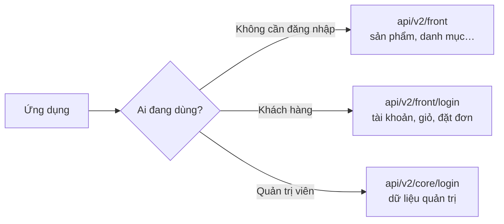

> 🌐 **Ngôn ngữ:** 🇻🇳 Tiếng Việt (hiện tại) · [🇬🇧 English](./api-introduction.md) · [🇯🇵 日本語](./api-introduction_ja.md)

# Giới thiệu API trong hệ thống GP247

## Giới thiệu

Tài liệu này giới thiệu **hệ thống API (giao diện lập trình ứng dụng) của GP247** — cách các
ứng dụng bên ngoài (app di động, website khác, phần mềm quản lý, tích hợp bên thứ ba…) có thể
"nói chuyện" với site GP247 của bạn để lấy dữ liệu, giữ giỏ hàng và đặt đơn. Tài liệu dành cho **lập trình viên tích hợp**
và **người quản trị site** muốn hiểu tổng quan API gồm những gì, chia làm mấy nhóm, xác thực
(đăng nhập) và phân quyền ra sao, lỗi trả về thế nào và gọi thử như thế nào. Đọc xong, bạn biết
**API nào dùng để làm gì, gọi ở địa chỉ nào, cần chìa khóa gì, được xem dữ liệu nào**, và có ví dụ
copy chạy được ngay.

> ⚠️ **Tài liệu này chỉ nói về API v2** (`api/v2/core`, `api/v2/front`). **API v1** (`api/core`, `api/front`) đã
> **ngưng phát triển**: vẫn chạy cho ứng dụng đang dùng nhưng tắt sẵn trên site cài mới, không có tính năng mới và chỉ
> nhận bản vá bảo mật. Ứng dụng mới hãy dùng v2. Đang duy trì ứng dụng cũ? Xem [API v1 (đã ngưng phát triển)](./api-v1_vi.md).

> ℹ️ **API là gì (giải thích đời thường):** hãy hình dung API như một "quầy giao dịch" của site.
> Ứng dụng bên ngoài không vào thẳng kho dữ liệu, mà gửi yêu cầu tới quầy (một địa chỉ URL), quầy
> kiểm tra giấy tờ (token/khóa) rồi trả về kết quả dưới dạng **JSON** (một định dạng dữ liệu dạng
> văn bản mà máy tính đọc được). Toàn bộ trao đổi diễn ra qua giao thức web thông thường (HTTP).

> 📄 **Đặc tả máy đọc được:** toàn bộ endpoint, tham số và mẫu lỗi có trong file
> [`openapi.json`](./openapi.json) (OpenAPI 3.1) — nạp vào Postman, Insomnia hay Swagger UI để gọi thử
> hoặc sinh code client.

> 🤖 **Muốn dùng AI agent (Claude, Cursor, VS Code…) với cửa hàng?** Không cần viết code — dùng **MCP server** có sẵn trong S-Cart:
> [Giới thiệu MCP server](../mcp/mcp-introduction_vi.md).

## Nhìn nhanh

Ứng dụng chọn nhóm API theo việc cần làm và người dùng đứng sau nó:

- **Hai nhóm** — `api/v2/front` cho cửa hàng và khách, `api/v2/core` cho quản trị viên ([Khái niệm cần biết](./api-concepts_vi.md)).
- **Đăng nhập bằng token** — `login` cấp token, gửi lại trong header `Authorization: Bearer …` ([Đăng nhập & token](./api-authentication_vi.md)).
- **Không xem nhiều hơn màn hình** — API quản trị theo đúng phân quyền và cửa hàng của tài khoản ([Khái niệm cần biết](./api-concepts_vi.md)).
- **Chủ site bật/tắt từng nhóm** trên màn quản lý API; nhóm tắt trả `404 api_disabled` ([Khái niệm cần biết](./api-concepts_vi.md)).
- **Phản hồi cố định** — luôn có khoá `data`; danh sách thêm `meta`, `links`; lỗi luôn có `code` ([Quy ước chung](./api-conventions_vi.md)).

## Bắt đầu từ đâu — lộ trình theo vai trò

Mỗi vai trò chỉ cần đọc vài trang, theo thứ tự dưới đây. Ai cũng nên bắt đầu bằng **Bắt đầu nhanh**.

| Bạn đang làm | Đọc theo thứ tự |
| --- | --- |
| **App di động / website bán hàng** cho khách | [Bắt đầu nhanh](./api-quickstart_vi.md) → [Khái niệm cần biết](./api-concepts_vi.md) → [Đăng nhập & token](./api-authentication_vi.md) → [API cửa hàng](./api-storefront_vi.md) → [Tham chiếu — Front](./api-reference-front_vi.md) |
| **ERP, phần mềm kho, CRM** nối với site | [Bắt đầu nhanh](./api-quickstart_vi.md) → [Khái niệm cần biết](./api-concepts_vi.md) → [API quản trị](./api-admin_vi.md) → [Đồng bộ dữ liệu](./api-sync_vi.md) → [Tham chiếu — Admin](./api-reference-admin_vi.md) |
| **Chủ site** bật API cho đối tác | [Khái niệm cần biết](./api-concepts_vi.md) (công tắc API, API Connection, phân quyền) → [Xử lý sự cố](./api-troubleshooting_vi.md) |
| **Tác giả plugin** thêm endpoint | [Quy ước chung](./api-conventions_vi.md) → [Tạo API cho plugin](./create-api_vi.md) |

## Bộ tài liệu API v2

| Trang | Giúp bạn |
| --- | --- |
| [Bắt đầu nhanh](./api-quickstart_vi.md) | Gọi được API lần đầu trong vài phút, từng bước copy là chạy |
| [Khái niệm cần biết](./api-concepts_vi.md) | Hiểu vì sao API trả kết quả như vậy: nhóm API, quyền, cửa hàng, công tắc, API Connection |
| [Đăng nhập & token](./api-authentication_vi.md) | Lấy token, thời hạn, refresh token, phiên đăng nhập, xác thực hai lớp, tài khoản khách |
| [Quy ước chung](./api-conventions_vi.md) | Định dạng phản hồi, phân trang, lọc, `fields`/`include`, `304`, mã lỗi, ngừng hỗ trợ, sinh client |
| [API quản trị](./api-admin_vi.md) | Luồng làm việc với `api/v2/core` và các lệnh ghi (đơn, sản phẩm, tồn kho, khách) |
| [API cửa hàng](./api-storefront_vi.md) | Luồng làm việc với `api/v2/front`: danh mục, giỏ hàng, checkout, thanh toán |
| [Đồng bộ dữ liệu](./api-sync_vi.md) | Đồng bộ ERP: `updated_since`, nhật ký sự kiện, webhook |
| [Xử lý sự cố](./api-troubleshooting_vi.md) | Tra lỗi theo triệu chứng và theo từng mã lỗi |
| [Tham chiếu — Front](./api-reference-front_vi.md) · [Tham chiếu — Admin](./api-reference-admin_vi.md) | Từng endpoint: ai gọi được, tham số, ví dụ, dữ liệu trả về (sinh tự động từ `openapi.json`) |

## Tra cứu kiểu Swagger và gọi thử

Toàn bộ endpoint, tham số, dữ liệu trả về và mã lỗi có trong file [`openapi.json`](./openapi.json) (OpenAPI 3.1). Hai trang **Tham chiếu**
ở trên được sinh từ chính file này, nên luôn khớp nhau.

- **Muốn giao diện Swagger hay gọi thử** — nạp `openapi.json` vào **Postman**, **Insomnia** hoặc **Swagger Editor** trên máy của bạn
  (cách làm ở [Bắt đầu nhanh](./api-quickstart_vi.md)).
- **Site của bạn không phục vụ** `openapi.json` hay trang Swagger nào — có chủ đích, để site không lộ thêm bề mặt tấn công.

> ⚠️ **Lưu ý:** chỉ nhập token (nhất là token quản trị) vào công cụ chạy trên máy của bạn, không dán vào một trang web nào.

## Bạn đang tìm mục cũ?

Trang này trước đây chứa toàn bộ hướng dẫn, chia thành 11 mục đánh số. Nội dung nay nằm ở các trang chủ đề:

| Mục cũ | Nay ở |
| --- | --- |
| 1 | [Hai nhóm API](./api-concepts_vi.md#hai-nhóm-api) |
| 2 | [Xác thực (đăng nhập vào API)](./api-authentication_vi.md#xác-thực-đăng-nhập-vào-api) |
| 3 | [Phân quyền và phạm vi dữ liệu của API Core](./api-concepts_vi.md#phân-quyền-và-phạm-vi-dữ-liệu-của-api-core) |
| 4 | [Lớp bảo vệ kết nối (API Connection) — tùy chọn](./api-concepts_vi.md#lớp-bảo-vệ-kết-nối-api-connection--tùy-chọn) |
| 5 | [Bật/tắt API](./api-concepts_vi.md#bậttắt-api) |
| 6 | [Định dạng phản hồi, tham số danh sách & mã lỗi](./api-conventions_vi.md#định-dạng-phản-hồi-tham-số-danh-sách--mã-lỗi) |
| 7 | [Luồng làm việc API Core (Admin)](./api-admin_vi.md#luồng-làm-việc-api-core-admin) |
| 8 | [Luồng làm việc API Front (Storefront)](./api-storefront_vi.md#luồng-làm-việc-api-front-storefront) |
| 9 | [Tài khoản khách & phiên đăng nhập](./api-authentication_vi.md#tài-khoản-khách--phiên-đăng-nhập) |
| 9.1 | [Đăng ký, quên mật khẩu, hồ sơ, sổ địa chỉ](./api-authentication_vi.md#đăng-ký-quên-mật-khẩu-hồ-sơ-sổ-địa-chỉ) |
| 9.2 | [Refresh token — giữ đăng nhập mà token ngắn hạn](./api-authentication_vi.md#refresh-token--giữ-đăng-nhập-mà-token-ngắn-hạn) |
| 9.3 | [Quản lý phiên đăng nhập](./api-authentication_vi.md#quản-lý-phiên-đăng-nhập) |
| 9.4 | [Xác thực hai lớp (MFA) qua plugin](./api-authentication_vi.md#xác-thực-hai-lớp-mfa-qua-plugin) |
| 9.5 | [Nhật ký truy cập API quản trị](./api-authentication_vi.md#nhật-ký-truy-cập-api-quản-trị) |
| 10 | [Giỏ hàng & đặt đơn qua API](./api-storefront_vi.md#giỏ-hàng--đặt-đơn-qua-api) |
| 10.1 | [Các bước checkout](./api-storefront_vi.md#các-bước-checkout) |
| 10.2 | [Đặt đơn](./api-storefront_vi.md#đặt-đơn) |
| 10.3 | [Thanh toán online và trạng thái thanh toán](./api-storefront_vi.md#thanh-toán-online-và-trạng-thái-thanh-toán) |
| 10.4 | [Dữ liệu sản phẩm để mua](./api-storefront_vi.md#dữ-liệu-sản-phẩm-để-mua) |
| 10.5 | [Luồng mua hàng trọn vẹn](./api-storefront_vi.md#luồng-mua-hàng-trọn-vẹn) |
| 11 | [Chính sách ngừng hỗ trợ & sinh client từ OpenAPI](./api-conventions_vi.md#chính-sách-ngừng-hỗ-trợ--sinh-client-từ-openapi) |

## Lịch sử thay đổi
<!-- Chỉ ghi khi có thay đổi về logic/hành vi. Dòng mới nhất ở trên cùng. Mỗi ngày một dòng: cùng ngày thì gộp vào dòng có sẵn, không tách dòng mới. -->

| Ngày | Phiên bản GP247 | Thay đổi |
| --- | --- | --- |
| 2026-11-02 | gp247/core 3.8.0, gp247/shop 3.7.0, gp247/front 3.5.0 | `ETag` + `If-None-Match` → `304` cho mọi `GET` v2; `Cache-Control: public` (mặc định `max-age=0`, `GP247_API_PUBLIC_MAX_AGE`) cho sản phẩm, danh mục, thương hiệu, banner, trang nội dung gọi không token; `fields[<loại>]` và `include` (tối đa 3, `GP247_API_MAX_INCLUDE`) ([Định dạng phản hồi, tham số danh sách & mã lỗi](./api-conventions_vi.md#định-dạng-phản-hồi-tham-số-danh-sách--mã-lỗi)); giới hạn chung 1000 lần/phút đếm theo tài khoản khi đã đăng nhập ([Xác thực (đăng nhập vào API)](./api-authentication_vi.md#xác-thực-đăng-nhập-vào-api)); chính sách ngừng hỗ trợ (`Deprecation` / `Sunset` / `Link`) và sinh client từ `openapi.json` ([Chính sách ngừng hỗ trợ & sinh client từ OpenAPI](./api-conventions_vi.md#chính-sách-ngừng-hỗ-trợ--sinh-client-từ-openapi)) |
| 2026-11-01 | gp247/core 3.7.0, gp247/shop 3.6.0 | Khoá / mở khoá khách hàng qua API quản trị: `PATCH api/v2/core/customer/{id}` (`{"status": 0 / 1}`, trường khác → `422`; quyền sửa trên màn Danh sách khách hàng; khoá làm token API của khách bị từ chối ngay và đăng xuất khách trên website; `Idempotency-Key` tuỳ chọn, chung giới hạn ghi) ([Phân quyền và phạm vi dữ liệu của API Core](./api-concepts_vi.md#phân-quyền-và-phạm-vi-dữ-liệu-của-api-core), 7); nhật ký sự kiện có 8 loại sự kiện của cửa hàng: `order.created`, `order.status_changed`, `order.payment_status_changed`, `stock.changed`, `product.updated`, `product.deleted`, `customer.created`, `customer.updated` — ghi bất kể nguồn thay đổi, mỗi loại đọc được theo quyền màn quản trị tương ứng ([Định dạng phản hồi, tham số danh sách & mã lỗi](./api-conventions_vi.md#định-dạng-phản-hồi-tham-số-danh-sách--mã-lỗi)); sửa phần chữ của sản phẩm / danh mục nay đổi `updated_at`, lưu không đổi gì và lượt xem trang sản phẩm thì không ([Định dạng phản hồi, tham số danh sách & mã lỗi](./api-conventions_vi.md#định-dạng-phản-hồi-tham-số-danh-sách--mã-lỗi)); webhook cho ERP: mỗi sự kiện của nhật ký được `POST` ngay tới URL `https` đăng ký trên màn quản lý API (chỉ administrator, cần bật nhật ký sự kiện), ký bằng `X-GP247-Signature`, gửi lại tối đa 5 lần rồi bỏ, không cần cron ([Bật/tắt API](./api-concepts_vi.md#bậttắt-api), 6) |
| 2026-10-31 | gp247/core 3.6.0, gp247/shop 3.5.0 / 3.5.1; đồng bộ thay đổi: gp247/core 3.7.0, gp247/shop 3.6.0, gp247/front 3.4.0; nhật ký sự kiện: gp247/core 3.7.0; ghi đơn hàng qua API quản trị: gp247/core 3.7.0, gp247/shop 3.6.0; ghi sản phẩm & tồn kho qua API quản trị: gp247/shop 3.6.0 | Ghi sản phẩm & tồn kho qua API quản trị: `PATCH api/v2/core/product/{id}` (giá bán, giá vốn, trạng thái — theo công tắc trường của Cấu hình sản phẩm), `product/{id}/stock` (`delta` nhập/xuất nguyên tử, không xuống dưới 0, không đổi số đã bán; `set` sau kiểm kê, chỉ administrator), `stock/batch` (1–100 dòng, kết quả theo từng dòng) — quyền sửa trên màn Danh sách sản phẩm, `Idempotency-Key` bắt buộc cho lệnh tồn kho, `422 stock_would_be_negative` / `stock_managed_by_components` ([Phân quyền và phạm vi dữ liệu của API Core](./api-concepts_vi.md#phân-quyền-và-phạm-vi-dữ-liệu-của-api-core), 6, 7); Ghi đơn hàng qua API quản trị cho ERP / phần mềm kho: `api/v2/core/order/{id}/status`, `order/{id}/shipping` (trạng thái giao hàng + mã vận đơn thủ công), `order/{id}/notes` — quyền sửa trên màn Danh sách đơn hàng, giới hạn ghi 300 lần/phút mỗi tài khoản (`GP247_API_WRITE_THROTTLE`), `Idempotency-Key` tuỳ chọn (gửi lại ⇒ kết quả lần đầu; `409 idempotency_key_reused` / `idempotency_in_progress`, `503 idempotency_unavailable` khi chưa `gp247:update`) ([Phân quyền và phạm vi dữ liệu của API Core](./api-concepts_vi.md#phân-quyền-và-phạm-vi-dữ-liệu-của-api-core), 6, 7); Nhật ký sự kiện cho ERP `api/v2/core/events` (con trỏ `after`, cũ nhất trước, theo quyền màn quản trị và cửa hàng; mặc định tắt — công tắc **Nhật ký sự kiện cho đồng bộ (ERP)** trên màn quản lý API, đang tắt trả `409 event_log_disabled`; giữ 30 ngày, con trỏ quá cũ trả `410 cursor_expired`) ([Bật/tắt API](./api-concepts_vi.md#bậttắt-api), 6); Danh sách quản trị v2 có chế độ đồng bộ thay đổi: `updated_since` + con trỏ `page[after]`, `meta.next_after` / `has_more` / `sync_until` ([Định dạng phản hồi, tham số danh sách & mã lỗi](./api-conventions_vi.md#định-dạng-phản-hồi-tham-số-danh-sách--mã-lỗi)); Tài liệu chỉ còn API v2; API v1 chuyển sang tài liệu riêng ([API v1](./api-v1_vi.md)); shop 3.5.1: huỷ đơn chưa trả qua ứng dụng (`orders/{id}/cancel`, `member/orders/{id}/cancel`), đơn qua cổng chưa trả sau 24 giờ tự huỷ, đơn trả xong / hoàn hết chuyển trạng thái theo cổng, đơn của gian hàng không tên miền trả được qua cổng ([Thanh toán online và trạng thái thanh toán](./api-storefront_vi.md#thanh-toán-online-và-trạng-thái-thanh-toán)); Mọi phản hồi là JSON kể cả khi không gửi `Accept: application/json` (thiếu token → `401`, không còn `500`); `register` và `member/password` bắt buộc mật khẩu, thân thiếu trường bắt buộc → `422` ([Định dạng phản hồi, tham số danh sách & mã lỗi](./api-conventions_vi.md#định-dạng-phản-hồi-tham-số-danh-sách--mã-lỗi), 9.1) |
| 2026-10-30 | gp247/shop 3.5.0 | Giỏ hàng qua API v2 (`api/v2/front/cart`, `cart/items`): giỏ của tài khoản dùng chung website, giỏ khách vãng lai bằng `X-Cart-Token` (30 ngày), gộp giỏ khi đăng nhập / đăng ký (`cart_merge`), tối đa 100 dòng, 60 lần/phút; các bước checkout qua API v2 (`checkout`, `checkout/address`, `checkout/shipping-methods` + `shipping-method`, `checkout/payment-methods` + `payment-method`, `checkout/totals`) và khuyến mãi (`cart/promotions/{pluginKey}`); đặt đơn qua API v2 (`checkout/place`): `Idempotency-Key` bắt buộc (gửi lại ⇒ cùng đơn), `409 price_changed` kèm tổng mới, công tắc **Đặt đơn qua API** trên màn Quản lý API (mặc định tắt), 10 lần đặt/phút; thanh toán online qua API (`payment.url`, đưa khách về ứng dụng qua `return_url` trong danh sách cho phép `GP247_PAYMENT_RETURN_URLS`, mặc định rỗng) và trạng thái thanh toán (`member/orders/{id}/payment`, `orders/{id}/payment` + `X-Order-Access`); sản phẩm v2 thêm `attributes`, `image_sizes`, `stock_status` |
| 2026-10-29 | gp247/core 3.6.0 | Đổi/đặt lại mật khẩu **quản trị viên** (màn Người dùng, Cài đặt tài khoản, quên mật khẩu) đăng xuất mọi token và phiên API của admin đó |
| 2026-10-28 | gp247/core 3.3.1; `X-Request-Id`, hạn token cũ, xoá khóa thường, `api_route_gate`: 3.4.0; tài khoản khách & phiên: core 3.6.0, shop 3.4.0 | Bật/tắt API trên màn quản lý API (tổng + v1/v2 × core/front), cài mới chỉ bật v2, nhóm tắt trả `404 api_disabled` (3.3.1); nhóm tắt trả `api_disabled` cả khi chưa có token; header `X-Request-Id` trên mọi phản hồi; token cấp trước 3.2.3 được đặt hạn khi `gp247:update` (ít nhất 7 ngày); `gp247:update` xoá bản lưu khóa API Connection dạng thường; `gp247:doctor` kiểm cache route (3.4.0); tài khoản khách qua API v2 (đăng ký, quên/đặt lại mật khẩu, hồ sơ, đổi mật khẩu, sổ địa chỉ, gửi lại email xác minh), refresh token xoay vòng tuỳ chọn (token 60 phút), quản lý phiên, `logout` v2 huỷ cả phiên, bước xác thực thêm qua plugin (`challenge_required`), đổi/đặt lại mật khẩu huỷ mọi token API, link xác minh email không cần đăng nhập website, nhật ký truy cập API quản trị (core 3.6.0, shop 3.4.0) |
| 2026-10-26 | gp247/core, gp247/front, gp247/shop 3.2.3; API v2 và tên biến môi trường mới: 3.3.0 | Thêm API v2 (`api/v2/...`: phản hồi `{data, meta, links}`, `filter`/`sort`/`q`/`lang`, `price_final`, `meta`) và tên biến môi trường viết đúng (3.3.0); API Core theo phân quyền màn admin và theo cửa hàng; giới hạn số lần đăng nhập; token luôn có hạn, thêm `POST logout`; khách bị khoá không đăng nhập được; API công khai chỉ trả dữ liệu cửa hàng đang hiển thị, bỏ trường nội bộ; khóa API Connection lưu dạng băm; mọi lỗi có mã HTTP đúng nghĩa và dạng `{error, msg, code}`; thêm `openapi.json` |

## Hỏi & Đáp (Q&A)

**Câu 1: Tôi cần thêm endpoint không có trong danh sách?**

→ Lập trình viên có thể mở rộng bằng cách khai báo route trong plugin riêng — không sửa code lõi.
Xem [Hướng dẫn tạo API đúng chuẩn](./create-api_vi.md).

**Câu 2: Tài liệu này mô tả bản GP247 nào?**

→ Bản phát hành mới nhất của gp247/core, gp247/front và gp247/shop. Mỗi endpoint trong trang Tham chiếu ghi cột **Có từ**; site chạy
bản cũ hơn có thể chưa có endpoint đó — xem [Xử lý sự cố](./api-troubleshooting_vi.md).

**Câu 3: Có trang Swagger để xem API không?**

→ Hai trang Tham chiếu hiển thị cùng nội dung với Swagger, bằng ngôn ngữ của bạn. Muốn đúng giao diện Swagger thì mở `openapi.json`
trong Swagger Editor, Postman hoặc Insomnia trên máy.

---

📅 **Cập nhật lần cuối:** 2026-11-03 · ✍️ **Tác giả (Author):** GP247
