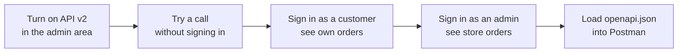

> 🌐 **Language:** [🇻🇳 Tiếng Việt](./api-quickstart_vi.md) · 🇬🇧 English (current) · [🇯🇵 日本語](./api-quickstart_ja.md)

# Quick start with REST API v2

## Introduction

This page takes you from a freshly installed S-Cart / GP247 site to **three successful API calls**: list products, sign in as a customer to see
their orders, sign in as an administrator to see the store's orders. No need to know Laravel or how GP247 works inside — just copy each command.
After reading, you know how to send a request, attach a token and read the result, then load the whole API into Postman to keep exploring.

## At a glance

The whole process has five steps and takes about 10–15 minutes:



- **Each request is a web address** like `https://<domain>/api/v2/...`; the result comes back as **JSON**.
- **Always send the `Accept: application/json` header** to get JSON back (errors included).
- **Sign in to get a token**, then send the token in the `Authorization: Bearer <token>` header on the following requests.

## Before you start

1. **A running S-Cart / GP247 site**, gp247/core 3.3.0 or later (the release with API v2). In this guide the sample domain is
   `shop.example.com` — replace it with your own domain.
2. **An administrator account** (to turn on the API and call the admin API) and **a customer account** already registered on the store.
3. **The `curl` command** to send requests. macOS and Linux have it built in; Windows 10/11 also has it — run the commands below in **Git Bash**
   or **WSL** (Command Prompt handles quotes differently, so the commands fail there). Prefer not to use the command line? See step 5 (Postman).

> 💡 **Tip:** `curl` is a program that sends web requests from the command line. Each `-H "…"` line is a **header** (extra information sent with the request);
> `-d '…'` is the **body** sent up; the `\` at the end of a line only breaks the line to make it easier to read.

## Step 1 — Turn on API v2 in the admin area

1. Sign in to the admin area, open the menu **System config → API manager → API config**.
2. Turn on **REST API (all groups)**, **v2 · Public & customer API (front)** and **v2 · Admin API (core)**.
   A fresh install already has both v2 groups on.
3. Look at the **API Connection** switch: if it is on, every request must also send the two headers `apiconnection` and `apikey` — for this exercise,
   leave it off (see [Concepts you need](./api-concepts.md) to learn when to turn it on).

If it worked, the v2 groups no longer show the word "off".

## Step 2 — Try a call without signing in

1. Open a terminal and run the following command (replace the domain):

   ```bash
   curl "https://shop.example.com/api/v2/front/product/list" \
     -H "Accept: application/json"
   ```

2. If it worked, you see a block of JSON starting with `{"data":[` — the product list, with `meta` (current page, total count)
   and `links` (the address of the next page).
3. Also try the address that tells what the site offers (API version, languages, the store that is answering):

   ```bash
   curl "https://shop.example.com/api/v2/front/meta" \
     -H "Accept: application/json"
   ```

> ⚠️ **Note:** got an **HTML** page instead of JSON? Check the domain, the `Accept` header and step 1 again —
> see [Troubleshooting](./api-troubleshooting.md).

## Step 3 — Sign in as a customer and see your own orders

1. Send the e-mail and password of the customer account:

   ```bash
   curl -X POST "https://shop.example.com/api/v2/front/login" \
     -H "Accept: application/json" \
     -H "Content-Type: application/json" \
     -d '{"email": "customer@example.com", "password": "your-password"}'
   ```

2. If it worked, the result has `"access_token": "…"` inside `data` — this is the customer's **token** (entry ticket), valid for
   7 days by default. Copy that value.
3. Call the customer's order list, replacing `<token>` with the value you just copied:

   ```bash
   curl "https://shop.example.com/api/v2/front/member/order/list" \
     -H "Accept: application/json" \
     -H "Authorization: Bearer <token>"
   ```

4. The result is the orders of **this customer only** (an empty list `"data":[]` if the customer has not placed an order yet).

## Step 4 — Sign in as an administrator and see the store's orders

1. An administrator signs in with a **username** (not an e-mail):

   ```bash
   curl -X POST "https://shop.example.com/api/v2/core/login" \
     -H "Accept: application/json" \
     -H "Content-Type: application/json" \
     -d '{"username": "admin", "password": "your-password"}'
   ```

2. Copy the `access_token` from the result, then call the store's order list:

   ```bash
   curl "https://shop.example.com/api/v2/core/order/list" \
     -H "Accept: application/json" \
     -H "Authorization: Bearer <admin-token>"
   ```

3. Got `403` with `"code": "forbidden"`? This account is not allowed to see the **Orders** screen in the admin area — the API never shows
   more than the screens do (see [Concepts you need](./api-concepts.md)).
4. When you are done, sign out so the token stops working right away:

   ```bash
   curl -X POST "https://shop.example.com/api/v2/core/logout" \
     -H "Accept: application/json" \
     -H "Authorization: Bearer <admin-token>"
   ```

## Step 5 — Load the whole API into Postman, Insomnia or Swagger Editor

Instead of typing commands, you can load the `openapi.json` specification to see every endpoint, parameter and example in one interface.

1. Copy the address of the specification:

   ```
   https://raw.githubusercontent.com/gp247net/gp247-docs/main/api/openapi.json
   ```

2. Pick a tool:
   - **Postman** (installed on your computer): **Import** → paste the address above → **Import**. Postman creates a collection with every endpoint.
   - **Insomnia** (installed on your computer): **Import** → **From URL** → paste the address.
   - **Swagger Editor** (`editor.swagger.io`): **File → Import URL** → paste the address — only to **view** a Swagger-style interface.
3. Set the `domain` variable to your site's domain (for example `shop.example.com`).
4. For endpoints that need sign-in, choose the **Bearer Token** auth type and paste the token from step 3 or 4.

> ⚠️ **Note:** try calls with Postman or Insomnia installed on your computer. Never paste a token, especially an admin token, into a web page.

## Conditions & Rules (know before you act)

- **Every request needs the `Accept: application/json` header** — without it, some errors may come back as an HTML page instead of JSON.
- **Customer tokens and administrator tokens are different** — a customer token cannot call `api/v2/core`, and the other way round.
- **Tokens expire** (7 days by default; only 60 minutes when signing in with `with_refresh`) — when one expires, sign in again or use the refresh token
  ([Sign-in & tokens](./api-authentication.md)).
- **Too many failed sign-ins are blocked for a while** (`429 too_many_attempts`) — to stop password guessing.
- **The documentation describes the latest release** — a site on an older release may not have some endpoints yet; the **Since** entry on the Reference pages tells you from which release.

## Q&A

**Q1: I don't know which GP247 release the site is running?**

→ The server administrator runs `php artisan gp247:info`. Without server access, ask whoever runs the site.

**Q2: The `curl` command fails in the Windows Command Prompt?**

→ Command Prompt handles quotes differently from Git Bash. Run it in Git Bash or WSL, or use Postman (step 5).

**Q3: I get `404` with `"code": "api_disabled"`?**

→ That API group is off on the **API config** screen — go back to step 1.

**Q4: Is calling from a mobile app any different?**

→ No. The app sends exactly the requests above, stores the token safely on the device and sends it back in the `Authorization` header.

**Q5: What should I read next?**

→ [Concepts you need](./api-concepts.md), then the page that fits your job in the reading paths on the [main page](./api-introduction.md).

---

<sub>📅 **Last updated:** 2026-11-03 · ✍️ **Author:** GP247</sub>
