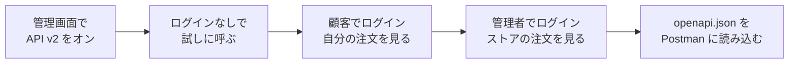

> 🌐 **言語:** [🇻🇳 Tiếng Việt](./api-quickstart_vi.md) · [🇬🇧 English](./api-quickstart.md) · 🇯🇵 日本語（現在）

# REST API v2 クイックスタート

## はじめに

このページでは、インストールしたばかりの S-Cart / GP247 サイトで **3 回の API 呼び出しを成功させる**ところまでを案内します：商品の閲覧、顧客としてログインして自分の注文を見る、
管理者としてログインしてストアの注文を見る、の 3 つです。Laravel や GP247 の内部構造を知る必要はなく、各コマンドをコピーするだけです。読み終えると、
リクエストの送り方、トークンの付け方、結果の読み方がわかり、さらに API 全体を Postman に読み込んで試し続けられます。

## ひと目でわかる

全体は 5 つのステップで、10〜15 分ほどかかります。



- **各リクエストは 1 つの Web アドレス**で、形式は `https://<ドメイン>/api/v2/...` です。結果は **JSON** で返ります。
- **常に `Accept: application/json` ヘッダーを送って**、JSON で受け取ります（エラーの場合も同様です）。
- **ログインしてトークンを取得**し、以降のリクエストではトークンを `Authorization: Bearer <token>` ヘッダーで送ります。

## 準備

1. **稼働中の S-Cart / GP247 サイト**（gp247/core 3.3.0 以上、API v2 を含むバージョン）。このドキュメントでは例のドメインを
   `shop.example.com` としています — ご自分のドメインに置き換えてください。
2. **管理者アカウント 1 つ**（API をオンにし、管理 API を呼ぶため）と、ストアに登録済みの**顧客アカウント 1 つ**。
3. リクエストを送る **`curl` コマンド**。macOS と Linux には標準で入っています。Windows 10/11 にも入っています — 以下のコマンドは **Git Bash**
   または **WSL** で実行してください（コマンドプロンプトは引用符の扱いが異なり、エラーになります）。コマンドラインを使いたくない場合は、ステップ 5（Postman）を参照してください。

> 💡 **ヒント:** `curl` はコマンドラインから Web リクエストを送るプログラムです。`-H "…"` の各行は**ヘッダー**（リクエストに付ける情報）、
> `-d '…'` は送信する**内容**です。行末の `\` は読みやすく改行するためだけのものです。

## ステップ 1 — 管理画面で API v2 をオンにする

1. 管理画面にログインし、メニュー **システム設定 → API管理 → API設定** を開きます。
2. **REST API（全グループ）**、**v2 · 公開・顧客API (front)**、**v2 · 管理API (core)** をオンにします。
   新規インストールのサイトでは、2 つの v2 グループは最初からオンです。
3. **API Connection** のスイッチを確認します：オンの場合、すべてのリクエストに `apiconnection` と `apikey` の 2 つのヘッダーが必要です — この練習では
   オフのままにしてください（いつオンにすべきかは[知っておくべき概念](./api-concepts_ja.md)を参照）。

成功すると、v2 グループに「オフ」の表示がなくなります。

## ステップ 2 — ログインなしで試しに呼ぶ

1. ターミナルを開き、次のコマンドを実行します（ドメインを置き換えてください）。

   ```bash
   curl "https://shop.example.com/api/v2/front/product/list" \
     -H "Accept: application/json"
   ```

2. 成功すると、`{"data":[` で始まる JSON が表示されます — 商品一覧に、`meta`（現在のページ、総件数）
   と `links`（次のページのアドレス）が付いています。
3. サイトの情報（API のバージョン、言語、応答しているストア）を返すアドレスも試してみましょう。

   ```bash
   curl "https://shop.example.com/api/v2/front/meta" \
     -H "Accept: application/json"
   ```

> ⚠️ **注意:** JSON ではなく **HTML** ページが返ってきましたか？ ドメイン、`Accept` ヘッダー、ステップ 1 を確認してください —
> [トラブルシューティング](./api-troubleshooting_ja.md)を参照してください。

## ステップ 3 — 顧客でログインして自分の注文を見る

1. 顧客アカウントのメールアドレスとパスワードを送ります。

   ```bash
   curl -X POST "https://shop.example.com/api/v2/front/login" \
     -H "Accept: application/json" \
     -H "Content-Type: application/json" \
     -d '{"email": "customer@example.com", "password": "your-password"}'
   ```

2. 成功すると、`data` の中に `"access_token": "…"` が含まれます — これが顧客の**トークン**（入場券）で、既定では
   7 日間使えます。その値をコピーします。
3. 顧客の注文一覧を呼びます。`<token>` をコピーした値に置き換えてください。

   ```bash
   curl "https://shop.example.com/api/v2/front/member/order/list" \
     -H "Accept: application/json" \
     -H "Authorization: Bearer <token>"
   ```

4. 結果は**この顧客自身**の注文です（顧客がまだ注文していなければ空の一覧 `"data":[]` になります）。

## ステップ 4 — 管理者でログインしてストアの注文を見る

1. 管理者は**ユーザー名**（メールアドレスではありません）でログインします。

   ```bash
   curl -X POST "https://shop.example.com/api/v2/core/login" \
     -H "Accept: application/json" \
     -H "Content-Type: application/json" \
     -d '{"username": "admin", "password": "your-password"}'
   ```

2. 結果の `access_token` をコピーし、ストアの注文一覧を呼びます。

   ```bash
   curl "https://shop.example.com/api/v2/core/order/list" \
     -H "Accept: application/json" \
     -H "Authorization: Bearer <admin-token>"
   ```

3. `403` と `"code": "forbidden"` が返りましたか？ このアカウントには管理画面の **注文** 画面を見る権限がありません — API は
   画面で見られる以上を見せません（[知っておくべき概念](./api-concepts_ja.md)を参照）。
4. 作業が終わったらログアウトして、トークンをすぐに無効にします。

   ```bash
   curl -X POST "https://shop.example.com/api/v2/core/logout" \
     -H "Accept: application/json" \
     -H "Authorization: Bearer <admin-token>"
   ```

## ステップ 5 — API 全体を Postman、Insomnia、Swagger Editor に読み込む

コマンドを入力する代わりに、仕様書 `openapi.json` を読み込めば、すべてのエンドポイント、パラメーター、例を 1 つの画面で見られます。

1. 仕様書のアドレスをコピーします。

   ```
   https://raw.githubusercontent.com/gp247net/gp247-docs/main/api/openapi.json
   ```

2. ツールを 1 つ選びます。
   - **Postman**（パソコンにインストール）：**Import** → 上のアドレスを貼り付け → **Import**。すべてのエンドポイントを含むコレクションが作成されます。
   - **Insomnia**（パソコンにインストール）：**Import** → **From URL** → アドレスを貼り付け。
   - **Swagger Editor**（`editor.swagger.io`）：**File → Import URL** → アドレスを貼り付け — Swagger 形式の画面を**見る**ためだけに使います。
3. 変数 `domain` をあなたのサイトのドメイン（例: `shop.example.com`）に設定します。
4. ログインが必要なエンドポイントでは、認証の種類に **Bearer Token** を選び、ステップ 3 または 4 で取得したトークンを貼り付けます。

> ⚠️ **注意:** 試し呼び出しは、パソコンにインストールした Postman や Insomnia で行ってください。トークン、特に管理者のトークンを Web ページに貼り付けないでください。

## 条件と制約（操作の前に確認）

- **すべてのリクエストに `Accept: application/json` ヘッダーが必要です** — ないと、一部のエラーが JSON ではなく HTML ページで返ることがあります。
- **顧客のトークンと管理者のトークンは別物です** — 顧客のトークンでは `api/v2/core` を呼べず、その逆も同様です。
- **トークンには有効期限があります**（既定 7 日。`with_refresh` を付けてログインした場合は 60 分のみ）— 期限が切れたら再ログインするか、リフレッシュトークンを使います
  （[ログインとトークン](./api-authentication_ja.md)）。
- **ログインに何度も失敗すると一時的にブロックされます**（`429 too_many_attempts`）— パスワードの総当たりを防ぐためです。
- **ドキュメントは最新版を説明しています** — 古いバージョンのサイトには一部のエンドポイントがない場合があります。リファレンスページの**導入バージョン**列で、どのバージョンからあるかがわかります。

## よくある質問（Q&A）

**Q1: サイトで動いている GP247 のバージョンがわからない場合は？**

→ サーバーの管理者が `php artisan gp247:info` を実行します。サーバーの権限がない場合は、サイトを運用している担当者に問い合わせてください。

**Q2: Windows のコマンドプロンプトで `curl` コマンドがエラーになるのはなぜですか？**

→ コマンドプロンプトは Git Bash と引用符の扱いが異なります。Git Bash または WSL で実行するか、Postman を使ってください（ステップ 5）。

**Q3: `404` と `"code": "api_disabled"` が返るのはなぜですか？**

→ その API グループが **API設定** 画面でオフになっています — ステップ 1 を確認してください。

**Q4: モバイルアプリから呼ぶ場合に違いはありますか？**

→ ありません。アプリは上と同じリクエストを送り、トークンを端末に安全に保存して `Authorization` ヘッダーで送り返します。

**Q5: 次に何を読めばよいですか？**

→ [知っておくべき概念](./api-concepts_ja.md)、そして[メインページ](./api-introduction_ja.md)の読み順にある、あなたの作業に合ったページです。

---

<sub>📅 **最終更新:** 2026-11-03 · ✍️ **作成者 (Author):** GP247</sub>
