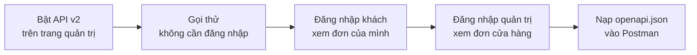

> 🌐 **Ngôn ngữ:** 🇻🇳 Tiếng Việt (hiện tại) · [🇬🇧 English](./api-quickstart.md) · [🇯🇵 日本語](./api-quickstart_ja.md)

# Bắt đầu nhanh với REST API v2

## Giới thiệu

Trang này đưa bạn từ một site S-Cart / GP247 vừa cài tới **ba lần gọi API thành công**: xem sản phẩm, đăng nhập khách xem đơn,
đăng nhập quản trị viên xem đơn của cửa hàng. Không cần biết Laravel hay cấu trúc bên trong GP247 — chỉ cần copy từng lệnh. Đọc xong,
bạn biết cách gửi yêu cầu, gắn token và đọc kết quả, rồi nạp toàn bộ API vào Postman để thử tiếp.

## Nhìn nhanh

Cả quá trình gồm năm bước, mất khoảng 10–15 phút:



- **Mỗi yêu cầu là một địa chỉ web** dạng `https://<tên-miền>/api/v2/...`; kết quả trả về dạng **JSON**.
- **Luôn gửi header `Accept: application/json`** để nhận JSON (kể cả khi lỗi).
- **Đăng nhập để lấy token**, rồi gửi token trong header `Authorization: Bearer <token>` ở các yêu cầu sau.

## Chuẩn bị

1. **Một site S-Cart / GP247 đang chạy**, gp247/core từ 3.3.0 trở lên (bản có API v2). Trong tài liệu, tên miền mẫu là
   `shop.example.com` — hãy thay bằng tên miền của bạn.
2. **Một tài khoản quản trị** (để bật API và gọi API quản trị) và **một tài khoản khách** đã đăng ký trên cửa hàng.
3. **Lệnh `curl`** để gửi yêu cầu. macOS và Linux có sẵn; Windows 10/11 cũng có sẵn — hãy chạy các lệnh dưới đây trong **Git Bash**
   hoặc **WSL** (cách đặt dấu nháy của Command Prompt khác, lệnh sẽ báo lỗi). Không muốn dùng dòng lệnh? Xem bước 5 (Postman).

> 💡 **Mẹo:** `curl` là chương trình gửi yêu cầu web từ dòng lệnh. Mỗi dòng `-H "…"` là một **header** (thông tin đi kèm yêu cầu);
> `-d '…'` là **nội dung** gửi lên; dấu `\` ở cuối dòng chỉ để xuống dòng cho dễ đọc.

## Bước 1 — Bật API v2 trên trang quản trị

1. Đăng nhập trang quản trị, mở menu **Cấu hình hệ thống → Quản lý API → Cấu hình API**.
2. Bật **REST API (tất cả nhóm)**, **v2 · API công khai & khách hàng (front)** và **v2 · API quản trị (core)**.
   Site cài mới đã bật sẵn hai nhóm v2.
3. Xem công tắc **API Connection**: nếu đang bật, mọi yêu cầu phải gửi thêm hai header `apiconnection` và `apikey` — với bài tập này,
   hãy để tắt (xem [Khái niệm cần biết](./api-concepts_vi.md) để hiểu khi nào nên bật).

Nếu thành công, các nhóm v2 không còn chữ "đang tắt".

## Bước 2 — Gọi thử không cần đăng nhập

1. Mở terminal, chạy lệnh sau (thay tên miền):

   ```bash
   curl "https://shop.example.com/api/v2/front/product/list" \
     -H "Accept: application/json"
   ```

2. Nếu thành công, bạn thấy một khối JSON bắt đầu bằng `{"data":[` — danh sách sản phẩm, kèm `meta` (trang hiện tại, tổng số)
   và `links` (địa chỉ trang sau).
3. Thử thêm địa chỉ cho biết site có những gì (phiên bản API, ngôn ngữ, cửa hàng đang trả lời):

   ```bash
   curl "https://shop.example.com/api/v2/front/meta" \
     -H "Accept: application/json"
   ```

> ⚠️ **Lưu ý:** nhận về một trang **HTML** thay vì JSON? Kiểm tra lại tên miền, header `Accept` và bước 1 —
> xem [Xử lý sự cố](./api-troubleshooting_vi.md).

## Bước 3 — Đăng nhập khách và xem đơn của mình

1. Gửi email và mật khẩu của tài khoản khách:

   ```bash
   curl -X POST "https://shop.example.com/api/v2/front/login" \
     -H "Accept: application/json" \
     -H "Content-Type: application/json" \
     -d '{"email": "khach@example.com", "password": "mat-khau-cua-ban"}'
   ```

2. Nếu thành công, kết quả có `"access_token": "…"` bên trong `data` — đây là **token** (vé vào cửa) của khách, mặc định dùng được
   7 ngày. Copy giá trị đó.
3. Gọi danh sách đơn của khách, thay `<token>` bằng giá trị vừa copy:

   ```bash
   curl "https://shop.example.com/api/v2/front/member/order/list" \
     -H "Accept: application/json" \
     -H "Authorization: Bearer <token>"
   ```

4. Kết quả là các đơn của **chính khách này** (danh sách rỗng `"data":[]` nếu khách chưa đặt đơn).

## Bước 4 — Đăng nhập quản trị viên và xem đơn của cửa hàng

1. Quản trị viên đăng nhập bằng **tên đăng nhập** (không phải email):

   ```bash
   curl -X POST "https://shop.example.com/api/v2/core/login" \
     -H "Accept: application/json" \
     -H "Content-Type: application/json" \
     -d '{"username": "admin", "password": "mat-khau-cua-ban"}'
   ```

2. Copy `access_token` trong kết quả, rồi gọi danh sách đơn của cửa hàng:

   ```bash
   curl "https://shop.example.com/api/v2/core/order/list" \
     -H "Accept: application/json" \
     -H "Authorization: Bearer <token-quan-tri>"
   ```

3. Nhận `403` với `"code": "forbidden"`? Tài khoản này không có quyền xem màn **Đơn hàng** trên trang quản trị — API không cho xem
   nhiều hơn màn hình (xem [Khái niệm cần biết](./api-concepts_vi.md)).
4. Xong việc thì đăng xuất để token hết hiệu lực ngay:

   ```bash
   curl -X POST "https://shop.example.com/api/v2/core/logout" \
     -H "Accept: application/json" \
     -H "Authorization: Bearer <token-quan-tri>"
   ```

## Bước 5 — Nạp toàn bộ API vào Postman, Insomnia hoặc Swagger Editor

Thay vì gõ lệnh, bạn có thể nạp đặc tả `openapi.json` để thấy mọi endpoint, tham số và ví dụ trong một giao diện.

1. Copy địa chỉ của đặc tả:

   ```
   https://raw.githubusercontent.com/gp247net/gp247-docs/main/api/openapi.json
   ```

2. Chọn một công cụ:
   - **Postman** (cài trên máy): **Import** → dán địa chỉ trên → **Import**. Postman tạo một bộ sưu tập có sẵn mọi endpoint.
   - **Insomnia** (cài trên máy): **Import** → **From URL** → dán địa chỉ.
   - **Swagger Editor** (`editor.swagger.io`): **File → Import URL** → dán địa chỉ — chỉ để **xem** giao diện kiểu Swagger.
3. Đặt biến `domain` thành tên miền của site bạn (ví dụ `shop.example.com`).
4. Với endpoint cần đăng nhập, chọn kiểu xác thực **Bearer Token** và dán token lấy ở bước 3 hoặc 4.

> ⚠️ **Lưu ý:** gọi thử bằng Postman hoặc Insomnia cài trên máy. Không dán token, nhất là token quản trị, vào một trang web.

## Điều kiện & ràng buộc (hiểu trước khi thao tác)

- **Mọi yêu cầu cần header `Accept: application/json`** — thiếu nó, một số lỗi có thể trả về trang HTML thay vì JSON.
- **Token của khách và của quản trị viên khác nhau** — token khách không gọi được `api/v2/core`, và ngược lại.
- **Token có hạn** (mặc định 7 ngày; chỉ 60 phút nếu đăng nhập kèm `with_refresh`) — hết hạn thì đăng nhập lại hoặc dùng refresh token
  ([Đăng nhập & token](./api-authentication_vi.md)).
- **Đăng nhập sai nhiều lần bị chặn tạm thời** (`429 too_many_attempts`) — để chống dò mật khẩu.
- **Tài liệu mô tả bản mới nhất** — site chạy bản cũ có thể chưa có một số endpoint; cột **Có từ** ở trang Tham chiếu cho biết từ bản nào.

## Hỏi & Đáp (Q&A)

**Câu 1: Tôi không biết site đang chạy GP247 bản nào?**

→ Người quản trị máy chủ chạy `php artisan gp247:info`. Không có quyền máy chủ thì hỏi đơn vị đang vận hành site.

**Câu 2: Lệnh `curl` báo lỗi trên Windows Command Prompt?**

→ Command Prompt xử lý dấu nháy khác Git Bash. Hãy chạy trong Git Bash hoặc WSL, hoặc dùng Postman (bước 5).

**Câu 3: Tôi nhận `404` với `"code": "api_disabled"`?**

→ Nhóm API đó đang tắt trên màn **Cấu hình API** — xem lại bước 1.

**Câu 4: Gọi từ app di động có khác gì không?**

→ Không. App gửi đúng các yêu cầu như trên, lưu token an toàn trên máy và gửi lại trong header `Authorization`.

**Câu 5: Tiếp theo tôi nên đọc gì?**

→ [Khái niệm cần biết](./api-concepts_vi.md), rồi trang phù hợp với việc của bạn trong lộ trình ở [trang chính](./api-introduction_vi.md).

---

<sub>📅 **Cập nhật lần cuối:** 2026-11-03 · ✍️ **Tác giả (Author):** GP247</sub>
