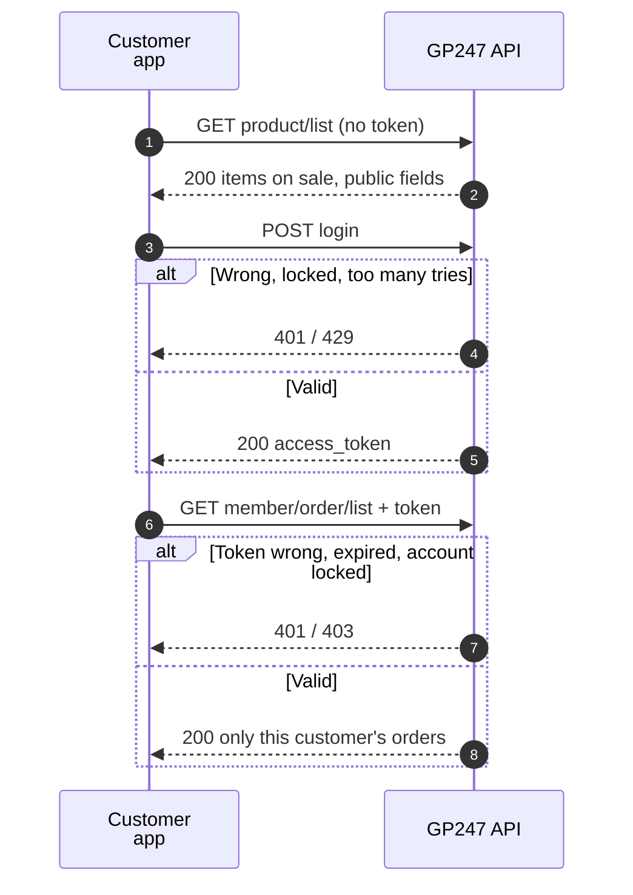
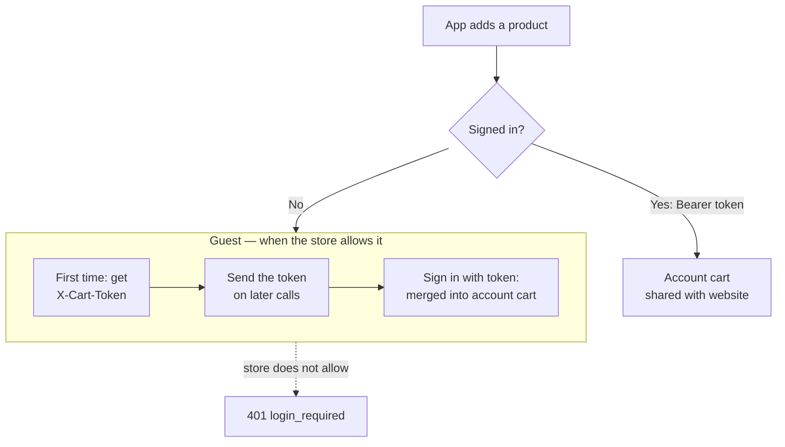
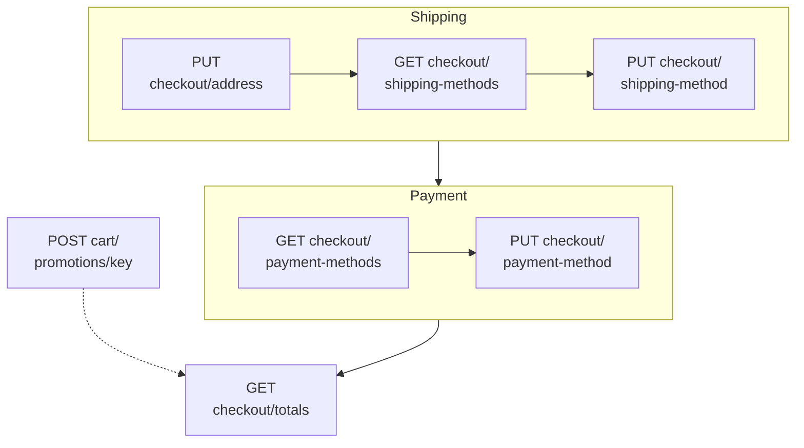
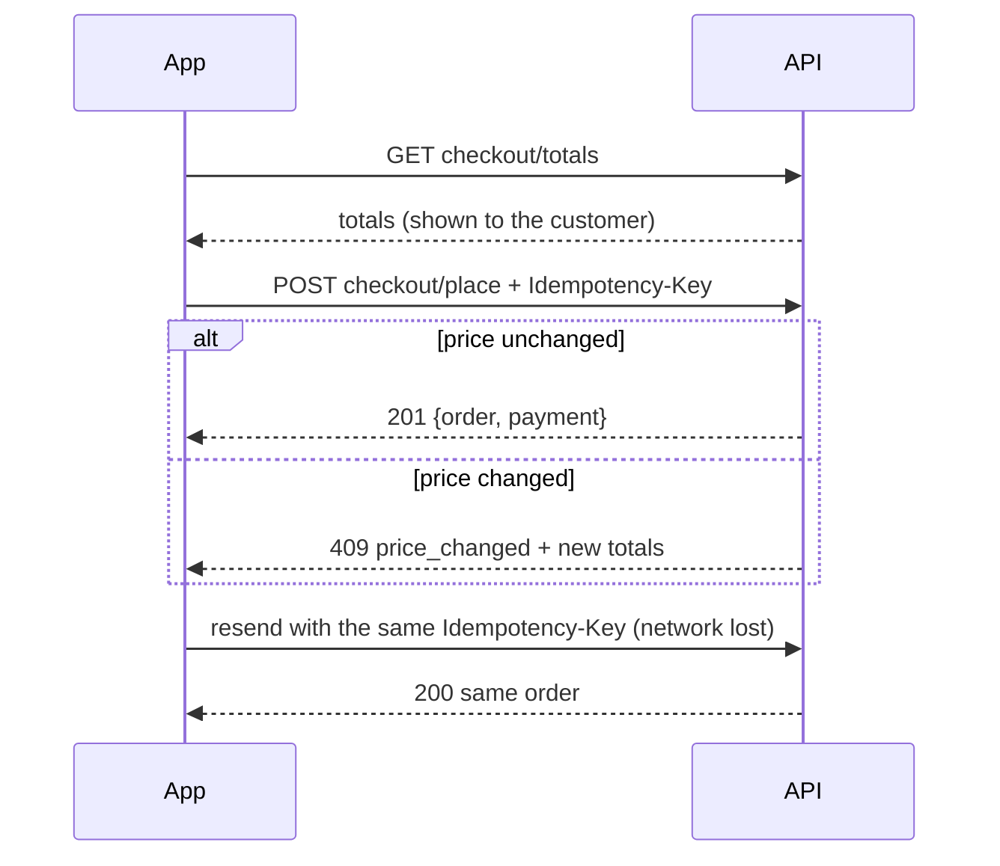
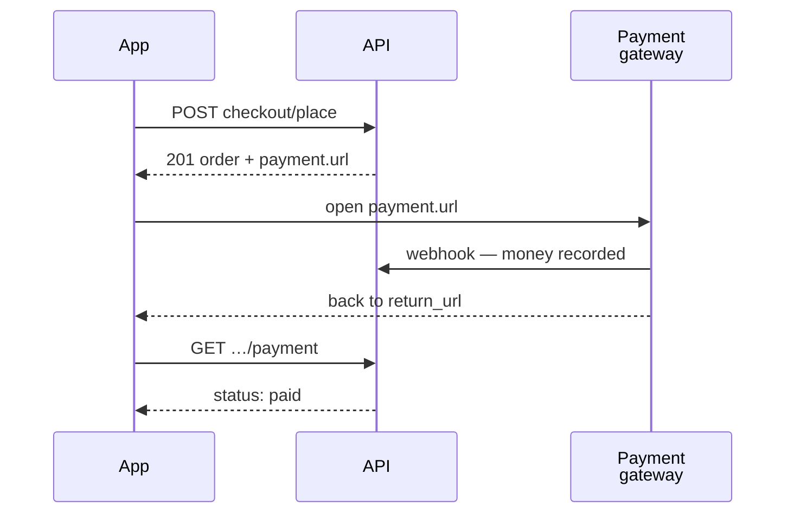

> 🌐 **Language:** [🇻🇳 Tiếng Việt](./api-storefront_vi.md) · 🇬🇧 English (current) · [🇯🇵 日本語](./api-storefront_ja.md)

# Storefront API (`api/v2/front`): catalog, cart and ordering

## Introduction

This page shows how to work with the storefront API: read products, categories and content without signing in, then the cart, checkout, placing orders
and payment for signed-in customers or guests. It is for people building a shopping mobile app or another website that uses the site's data.
Customer accounts (register, profile, address book) are in [Sign-in & tokens](./api-authentication.md); details of each endpoint are in
[Reference — Front](./api-reference-front.md).

## Front API workflow (Storefront)

The Front API serves two kinds of data: **public data** (no login needed — product lists,
categories…) and **customer-private data** (login required — orders, profile, address book).

The diagram below shows the two ways to use the Front API: reading public data without signing in, and a customer
signing in to see their own orders. Before the steps in the diagram, every request has already passed the API switch,
API Connection (if enabled) and the rate limit ([At a glance](./api-concepts.md#at-a-glance)).



Takeaway: public data on the API **matches what shoppers see in the store**, and private data goes only to its
owner.

**Public endpoints** (prefix `api/v2/front`, no token needed):

| Method | Path | Function |
| --- | --- | --- |
| `GET` | `api/v2/front/meta` | API version, installed packages, languages, stores |
| `GET` | `api/v2/front/product/list` | Product list |
| `GET` | `api/v2/front/product/detail/{id}` | A product's details (with the data needed to buy — [Product data for buying](#product-data-for-buying)) |
| `GET` | `api/v2/front/category/list` | Category list |
| `GET` | `api/v2/front/category/detail/{id}` | A category's details |
| `GET` | `api/v2/front/brand/list` | Brand list |
| `GET` | `api/v2/front/brand/detail/{id}` | A brand's details |
| `GET` | `api/v2/front/banner/list` | Banner list |
| `GET` | `api/v2/front/banner/detail/{id}` | A banner's details |
| `GET` | `api/v2/front/page/list` | Content page list |
| `GET` | `api/v2/front/page/detail/{id}` | A content page's details |

> ℹ️ **Available since:** gp247/shop 3.2.3, gp247/front 3.2.3 — public data is **exactly what the
> store is showing** on the domain you call: hidden products, products not yet approved, or products
> belonging to another store do not appear. Responses contain only public fields — no cost price,
> supplier, or stock/sold counts. If you need those figures, use the Core API with an account that has
> permission.

**Customer account endpoints** (prefix `api/v2/front`; details in [Customer accounts & sign-in sessions](./api-authentication.md#customer-accounts--sign-in-sessions)):

| Method | Path | Login required | Function |
| --- | --- | --- | --- |
| `POST` | `api/v2/front/register` | No | Create a customer account and sign it in ([Register, forgotten password, profile, address book](./api-authentication.md#register-forgotten-password-profile-address-book)) |
| `POST` | `api/v2/front/password/forgot` | No | Send the password-reset e-mail |
| `POST` | `api/v2/front/password/reset` | No | Set a new password with the code from the e-mail |
| `POST` | `api/v2/front/login` | No | Log in with customer email/password (optional `with_refresh` — [Refresh tokens — stay signed in with short-lived tokens](./api-authentication.md#refresh-tokens--stay-signed-in-with-short-lived-tokens)) |
| `POST` | `api/v2/front/login/challenge` | No | Finish a sign-in that needs an extra verification step ([Two-factor authentication (MFA) through a plugin](./api-authentication.md#two-factor-authentication-mfa-through-a-plugin)) |
| `POST` | `api/v2/front/refresh` | No (send the refresh token) | Exchange a refresh token for a new token pair |
| `POST` | `api/v2/front/logout` | Yes (Bearer) | Sign the current session out (refresh token included) |
| `GET` | `api/v2/front/info` | Yes (Bearer) | Customer account info |
| `GET` | `api/v2/front/member/profile` | Yes (Bearer) | Full profile: e-mail verification state, default address |
| `PUT` | `api/v2/front/member/profile` | Yes (Bearer) | Edit the profile |
| `PUT` | `api/v2/front/member/password` | Yes (Bearer) | Change the password (signs every other device out) |
| `POST` | `api/v2/front/member/email/verify` | Yes (Bearer) | Send the verification e-mail again |
| `GET` | `api/v2/front/member/address/list` | Yes (Bearer) | Address book |
| `POST` | `api/v2/front/member/address` | Yes (Bearer) | Add an address |
| `PUT` | `api/v2/front/member/address/{id}` | Yes (Bearer) | Edit an address |
| `DELETE` | `api/v2/front/member/address/{id}` | Yes (Bearer) | Delete an address (not the default one) |
| `GET` | `api/v2/front/member/sessions` | Yes (Bearer) | The customer's API sign-in sessions (devices) ([Managing sign-in sessions](./api-authentication.md#managing-sign-in-sessions)) |
| `DELETE` | `api/v2/front/member/sessions/{id}` | Yes (Bearer) | Sign one session out |
| `GET` | `api/v2/front/member/order/list` | Yes (Bearer) | The customer's order list |
| `GET` | `api/v2/front/member/order/detail/{id}` | Yes (Bearer) | Details of one of the customer's orders |

The cart, checkout and payment endpoints are in [Cart & checkout through the API](#cart--checkout-through-the-api).

Example: the 20 most expensive products of brand 5, with names in Vietnamese (public, no token needed):

```bash
curl -X GET "https://shop.example.com/api/v2/front/product/list?filter[brand_id]=5&sort=-price&lang=vi&page[size]=20" \
  -H "Accept: application/json"
```

Shortened response:

```json
{
  "data": [
    { "id": "PRD-AbC12", "sku": "TSHIRT-01", "name": "T-shirt", "price": 250000, "price_final": 199000 }
  ],
  "meta": { "current_page": 1, "per_page": 20, "total": 1, "last_page": 1 },
  "links": { "first": "…", "last": "…", "prev": null, "next": null }
}
```

Example logging in a customer and viewing their orders:

```bash
# 1) Customer login
curl -X POST "https://shop.example.com/api/v2/front/login" \
  -H "Content-Type: application/json" \
  -d '{"email":"customer@example.com","password":"your-password"}'

# 2) Use the returned token (data.access_token) to fetch the order list
curl -X GET "https://shop.example.com/api/v2/front/member/order/list" \
  -H "Accept: application/json" \
  -H "Authorization: Bearer 2|zzz...customer-token...zzz"
```

## Cart & checkout through the API

> ℹ️ **Available since:** gp247/shop 3.5.0

The store's own mobile app or headless website keeps a **cart** through the API with the website's rules: prices and
attribute surcharges computed by the server, the quantity rules (positive, decimals as configured), one line per variant.

**Cart, checkout and payment endpoints** (prefix `api/v2/front`):

| Method | Path | Login required | Function |
| --- | --- | --- | --- |
| `GET` | `api/v2/front/cart` | Yes (customer) or `X-Cart-Token` | Read the cart |
| `POST` | `api/v2/front/cart/items` | Yes (customer) or guest | Add a product to the cart |
| `PATCH` | `api/v2/front/cart/items/{rowId}` | Yes (customer) or `X-Cart-Token` | Change a line quantity (≤ 0 removes the line) |
| `DELETE` | `api/v2/front/cart/items/{rowId}` | Yes (customer) or `X-Cart-Token` | Remove a line |
| `POST` | `api/v2/front/cart/promotions/{pluginKey}` | Yes (customer) or `X-Cart-Token` | Apply a coupon / promotion |
| `DELETE` | `api/v2/front/cart/promotions/{pluginKey}` | Yes (customer) or `X-Cart-Token` | Remove a promotion |
| `GET` | `api/v2/front/checkout` | Yes (customer) or `X-Cart-Token` | Checkout state (store, address, chosen methods — [Checkout steps](#checkout-steps)) |
| `PUT` | `api/v2/front/checkout/address` | Yes (customer) or `X-Cart-Token` | Set the delivery address |
| `GET` | `api/v2/front/checkout/shipping-methods` | Yes (customer) or `X-Cart-Token` | Delivery options quoted for the address |
| `PUT` | `api/v2/front/checkout/shipping-method` | Yes (customer) or `X-Cart-Token` | Choose a delivery option |
| `GET` | `api/v2/front/checkout/payment-methods` | Yes (customer) or `X-Cart-Token` | Payment methods usable through the API |
| `PUT` | `api/v2/front/checkout/payment-method` | Yes (customer) or `X-Cart-Token` | Choose a payment method |
| `GET` | `api/v2/front/checkout/totals` | Yes (customer) or `X-Cart-Token` | Totals that will be charged |
| `POST` | `api/v2/front/checkout/place` | Yes (customer) or `X-Cart-Token` + `Idempotency-Key` | Place the order ([Placing the order](#placing-the-order)) |
| `GET` | `api/v2/front/member/orders/{id}/payment` | Yes (customer) | Payment status of the customer's order ([Online payment and payment status](#online-payment-and-payment-status)) |
| `GET` | `api/v2/front/orders/{id}/payment` | `X-Order-Access` | Payment status of a guest order ([Online payment and payment status](#online-payment-and-payment-status)) |
| `POST` | `api/v2/front/member/orders/{id}/cancel` | Yes (customer) | Cancel an unpaid order placed through the app ([Online payment and payment status](#online-payment-and-payment-status)) |
| `POST` | `api/v2/front/orders/{id}/cancel` | `X-Order-Access` | Cancel an unpaid guest order ([Online payment and payment status](#online-payment-and-payment-status)) |

Whose cart it is depends on whether the customer is signed in:



- **Signed-in customers** send their token as for any customer API. The cart is the **account cart** — add in the app,
  sign in on the website and it is there, and the other way round.
- **Guests** (only when the store allows guest checkout): the first time a product is added, the response carries an
  **`X-Cart-Token`** header — keep it and send it with every later cart call. It is given **once**; a wrong token, or a
  cart unchanged for **30 days**, reads as no cart.
- **Signing in / registering with `X-Cart-Token`**: the guest cart is **merged** into the account cart (same product +
  variant adds up), the old cart token stops working; the response has `cart_merge: {merged, dropped}`.
- **Adding a product** (`POST cart/items`): `product_id`, `qty`, and `options` = `{"<attribute group id>": "<option name>"}`
  when the product has attributes — **every group** must be chosen; surcharges always come from the product, a price
  sent by the app is ignored.
- **Cart answer**: lines **grouped by store** (`stores[].lines[]`) with `unit_price`, `line_total`, `subtotal`; a line
  that can no longer be bought has `purchasable: false` and a `reason` (`not_for_sale`, `missing_options`) and is left
  out of `subtotal`.

| Error code | HTTP | Meaning |
| --- | --- | --- |
| `login_required` | 401 | The store does not sell to guests — sign in first |
| `validation_failed` | 422 | Missing / wrong `qty`, not every attribute chosen (`errors.options`) |
| `product_not_for_sale` | 422 | The product cannot be bought (not on sale, not available yet…) |
| `insufficient_stock` | 422 | More than the stock while the store does not sell beyond stock |
| `cart_line_limit` | 422 | The cart already holds **100 lines** |
| `cart_conflict` | 409 | The cart was changed elsewhere meanwhile — read it again and retry |
| `not_found` | 404 | The line is not in your cart |

Limit: **60 calls per minute** per customer or per cart token (`gp247-config.api.throttle.cart`).

### Checkout steps

Once there is a cart, the app walks the checkout steps for **one store** of the cart (send `store_id` when the cart holds several
stores; choosing another store starts the choices again). Every choice is kept between calls for the cart owner (customer or cart
token) — **with the website's rules**.



- **Address** (`PUT checkout/address`): the same required fields as the website form (the store's customer settings); or send
  `address_id` to use an address from the customer's own address book (someone else's address → `404`). A signed-in customer sends
  `"save_address": true` to keep it as a new address when ordering. Changing the address means choosing delivery again.
- **Delivery** (`GET checkout/shipping-methods`): prices quoted for that address + cart; one row per service (`id` is `<plugin>` or
  `<plugin>:<service>`); a carrier that cannot quote is listed in `unquotable`. A store without delivery answers `required: false`.
- **Payment** (`GET checkout/payment-methods`): only methods usable through the API — `type: none` (no payment step: cash on
  delivery, bank transfer…) or `type: hosted` (a gateway with a hosted payment page). A method with only a website payment step is
  not listed.
- **Promotions** (`POST cart/promotions/{pluginKey}` with `{"payload": {...}}` as the plugin expects, e.g. `{"code": "SUMMER"}`):
  one way for every promotion plugin of the checkout contract; refused → `422 promotion_refused` with the plugin's message.
- **Totals** (`GET checkout/totals`): rows `subtotal`, `shipping`, `discount`, `tax`, `total`… the same figures the website computes
  for the same cart — these are the figures "shown to the customer".

| Error code | HTTP | Meaning |
| --- | --- | --- |
| `cart_empty` | 422 | Nothing to order in the cart (of the chosen store) |
| `store_required` | 422 | The cart holds several stores — send `store_id` |
| `address_required` | 422 | The delivery address is not set yet |
| `method_unavailable` | 422 | The method does not exist / cannot be used for this checkout |
| `promotion_refused` | 422 | The promotion plugin refused (wrong code, expired…) |
| `invalid_quantity` | 422 | A cart line has a quantity that cannot be ordered |

### Placing the order

`POST checkout/place` places the order of the store being checked out. Before calling it:

1. The store owner **turns on "Ordering through the API"** on the **API management** screen (under the v2 public & customer API group). It is
   **off by default** — on fresh installs and on upgrades; while off, `POST checkout/place` answers `403 api_checkout_disabled`, the other
   cart / checkout steps keep working.
2. The app has called `GET checkout/totals` and shown those totals to the customer — the order is only created when the totals computed at
   ordering time **match** what was shown.

Each time the customer taps *Place order*, the app generates **one** `Idempotency-Key` (8–255 characters, e.g. a UUID) and sends it as a
header. On a flaky network, resend with the **same key**: you get the order already placed back (HTTP `200`), no second order, no second
stock movement or charge. A new order needs a new key.



Success: `201 {"data": {"order": {id, store_id, status, payment_status, total, balance, currency}, "access_token"?, "payment": {"type": "none" | "hosted", "url"?}}}`.
The order is completed right away: the ordered lines leave the cart and the order confirmation email is sent, as for an order placed on
the website.

| Error code | HTTP | Meaning |
| --- | --- | --- |
| `idempotency_key_required` | 400 | Missing / malformed `Idempotency-Key` header |
| `api_checkout_disabled` | 403 | The store has not turned on ordering through the API |
| `idempotency_key_reused` | 409 | This key was used for an order of another store (a different `store_id` was sent) |
| `price_changed` | 409 | The totals changed since they were shown — the error body has the new `totals`; show them again, then order with a new key |
| `address_required` · `shipping_method_required` · `payment_method_required` | 422 | A checkout step the store requires is missing |
| `minimum_not_met` | 422 | A product is below its minimum quantity (`minimums`: product id → minimum) |
| `shipping_unquotable` · `invalid_quantity` · `cart_empty` | 422 | Cannot be delivered, invalid quantity, empty cart |
| — | 429 | More than **10 orders per minute** per customer or IP (`gp247-config.api.throttle.checkout_place`) |

### Online payment and payment status

A method with `type: "hosted"` (for example Stripe, PayPal) collects through the **gateway's payment page**:

1. When placing the order, the app may send a `return_url` — where the payer goes back to the app after paying (a deep link such as
   `myshop://checkout/done`, or a web page of the app).
2. The order result has `payment.url`: open it in a browser / webview for the payer to pay.
3. After paying (or cancelling), the gateway sends the payer back to the site's pay page; when `return_url` is on the **allowed list**, the
   site forwards them to it right away.
4. The app reads the status: `GET member/orders/{id}/payment` (signed-in customer) or `GET orders/{id}/payment` with the
   `X-Order-Access` header (guest — the `access_token` returned when the order was placed).



The **allowed list** is set in the site's `.env`, comma separated:

```bash
GP247_PAYMENT_RETURN_URLS="myshop://checkout, https://app.example.com/return"
```

The site matches the **exact** scheme + host (+ port) and a path starting with the listed path (`https://app.example.com/return/ok`
matches, `https://app.example.com.evil/return` does not). The list is **empty by default**: the payer stays on the site's pages. An address
that does not match is ignored and the order is placed as usual. On a site that uses `php artisan config:cache`, run it again after
editing `.env`.

- **Money is recorded only when the gateway confirms it** (signed webhook or the gateway's return page). Parameters on `return_url` never
  change the order — always read the status through the API.
- **Payer cancels at the gateway**: the order stays *awaiting payment*. Resend `POST checkout/place` with the **same** `Idempotency-Key`
  to get a new `payment.url` for that same order. `payment.url` is `null` when the gateway is temporarily failing — resend the same key to
  retry.
- **Cancelling an unpaid order**: when the shopper changes their mind, the app calls `POST member/orders/{id}/cancel` (signed-in customer)
  or `POST orders/{id}/cancel` with `X-Order-Access` (guest). Only an order placed through the app, with no money received and not yet
  handled by the shop, can be cancelled; the stock goes back. Any other order ⇒ `409 order_not_cancellable`. Calling again on a cancelled
  order still answers `200`.
- **Abandoned orders cancel themselves**: a gateway order still unpaid after **24 hours** is cancelled (stock back) when the next app order
  is placed — no cron. Change the limit with `GP247_API_UNPAID_ORDER_MINUTES` (minutes, `0` = never). Money the gateway reports afterwards is
  still recorded so the shop can refund it.
- **Order status after payment**: paid in full through the gateway ⇒ the order moves to the status the gateway uses for website orders (e.g.
  *Processing* — a setting of the Stripe / PayPal plugin); fully refunded ⇒ the gateway's *refunded* status.
- **Single-domain multi-vendor marketplace** (MultiVendor): a vendor store's order is paid through the gateway like the main store's.

> ℹ️ **Available since:** gp247/shop 3.5.1 (with StripePayment 1.1.4, PaypalExpress 3.2.4) — cancelling unpaid orders, abandoned orders
> cancelling themselves, order status after payment / refund, orders of a store without its own domain paid through the gateway.
> PaypalExpress 3.2.4 also captures as soon as it receives the `CHECKOUT.ORDER.APPROVED` webhook — add this event to the site's PayPal webhook.
- **`access_token`** is only in the order result of a guest; the app keeps it to read the status. It opens only the status and amounts of
  that one order (no address); another person's order or a wrong token ⇒ `404`.
- For an order placed through the API, the "order success" event and the confirmation email run **when the order is placed** (not when
  the payer pays). A plugin that must act *after payment* relies on the order's payment status, not on this event.

Status response: `{"data": {"order": {id, store_id, status, payment_status, total, received, balance, currency}, "payment": {"type": "none" | "hosted", "status": "unpaid" | "partially_paid" | "paid" | "refunded"}}}`.

### Product data for buying

The v2 product (`product/list`, `product/detail/{id}`) has three more fields for the app to build the variant picker and the buy button — the
existing fields stay as they are:

| Field | Meaning |
| --- | --- |
| `attributes` | Attribute groups: `group_id`, `name`, `required` (always `true` — one value of every group must be chosen to add to the cart), `options` with `value` (sent back in `options[group_id]` of `POST cart/items`) and `add_price` (surcharge, same unit as `price_final`; the cart charges exactly this) |
| `image_sizes` | Main image in its sizes: `original`, `thumb` (absolute URLs; no image ⇒ the site's placeholder image) |
| `stock_status` | `in_stock` or `out_of_stock` — never the stock quantity. A store that does not track stock or sells out of stock ⇒ always `in_stock` |

When the store hides prices, `add_price` is `null` (like `price`).

```json
{
  "data": {
    "id": "PRD-AbC12",
    "price_final": 199000,
    "stock_status": "in_stock",
    "image_sizes": { "original": "https://shop.example.com/data/product/tshirt.jpg", "thumb": "https://shop.example.com/data/product/thumb/tshirt.jpg" },
    "attributes": [
      { "group_id": "2", "name": "Color", "required": true,
        "options": [ { "value": "Red", "add_price": 0 }, { "value": "Blue", "add_price": 20000 } ] }
    ]
  }
}
```

### The whole buying flow

The table below lists every call for one order, in order (prefix `api/v2/front/`). A signed-in customer sends `Authorization: Bearer <token>` at
every step; a guest sends `X-Cart-Token` instead.

| Step | Call | Extra header | See |
| --- | --- | --- | --- |
| 1. Choose products | `GET product/list`, `GET product/detail/{id}` | — | 10.4 |
| 2. Keep a cart | `POST cart/items`, `GET cart`, `PATCH` / `DELETE cart/items/{rowId}` | `X-Cart-Token` received on the first add (guest) | 10 |
| 3. Address, delivery, payment | `PUT checkout/address` → `GET` + `PUT checkout/shipping-method(s)` → `GET` + `PUT checkout/payment-method(s)` | — | 10.1 |
| 4. Promotion (optional) | `POST` / `DELETE cart/promotions/{pluginKey}` | — | 10.1 |
| 5. Show the total to the customer | `GET checkout/totals` | — | 10.1 |
| 6. Place the order | `POST checkout/place` (+ `return_url` when paying through a gateway) | `Idempotency-Key` (one key per *Place order* tap) | 10.2 |
| 7. Pay (when `payment.type = hosted`) | open `payment.url` | — | 10.3 |
| 8. Payment status | `GET member/orders/{id}/payment` or `GET orders/{id}/payment` | `X-Order-Access` (guest) | 10.3 |

Checklist before the app sells for real:

- The store owner has turned on **Ordering through the API** ([Placing the order](#placing-the-order)) and — for online payment — listed the return addresses in
  `GP247_PAYMENT_RETURN_URLS` ([Online payment and payment status](#online-payment-and-payment-status)).
- The app keeps `X-Cart-Token` and `access_token` in the device's secure storage and never logs them.
- The app handles `409 price_changed` (show the new total) and resends the **same** `Idempotency-Key` when the network drops while placing.
- The site's plugins that handle website orders (splitting orders by vendor, commissions, notifications…) receive app orders through the same
  hooks — see [How to build an API — section 8](./create-api.md).

## Q&A

**Q1: Are prices in the API the same as on the website?**

→ Yes. The cart, totals and orders through the API go through the same business logic as the website, so the same cart gives the same amount.

**Q2: Can a customer place an order without signing in?**

→ Yes, if the store allows guest checkout: the app keeps the **cart token** (`X-Cart-Token`) and after placing the order gets an **order access token** to view or
cancel the order.

---

<sub>📅 **Last updated:** 2026-11-04 · ✍️ **Author:** GP247</sub>
