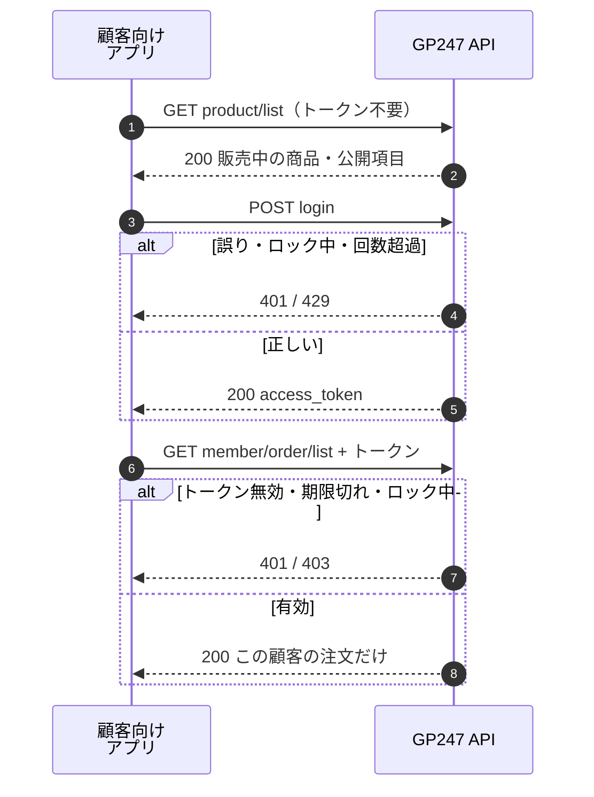
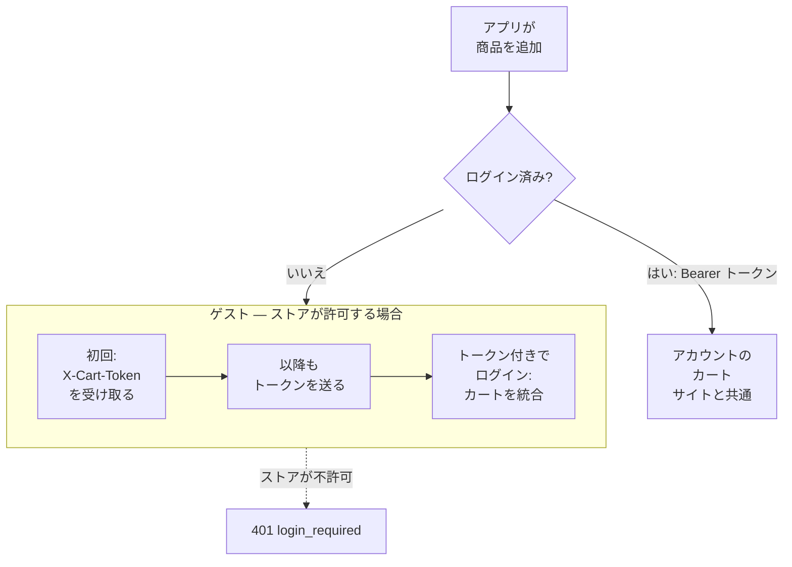
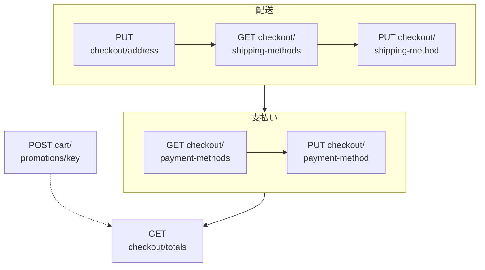
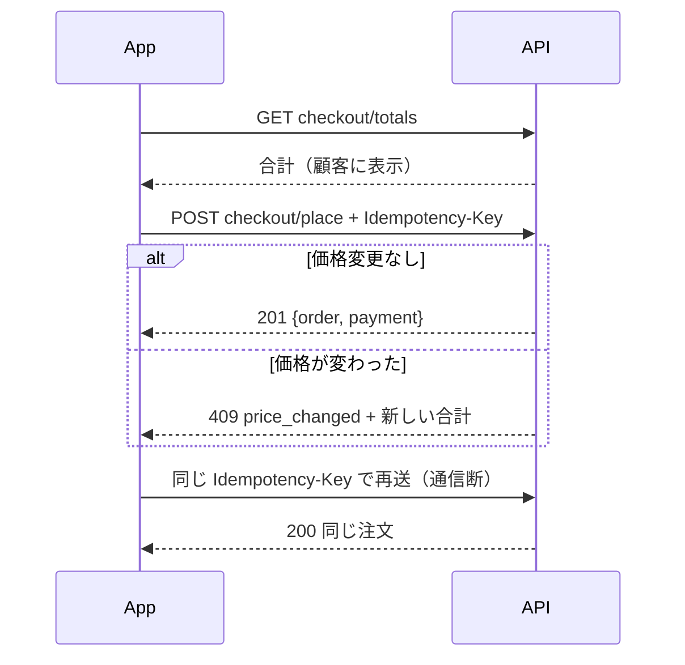
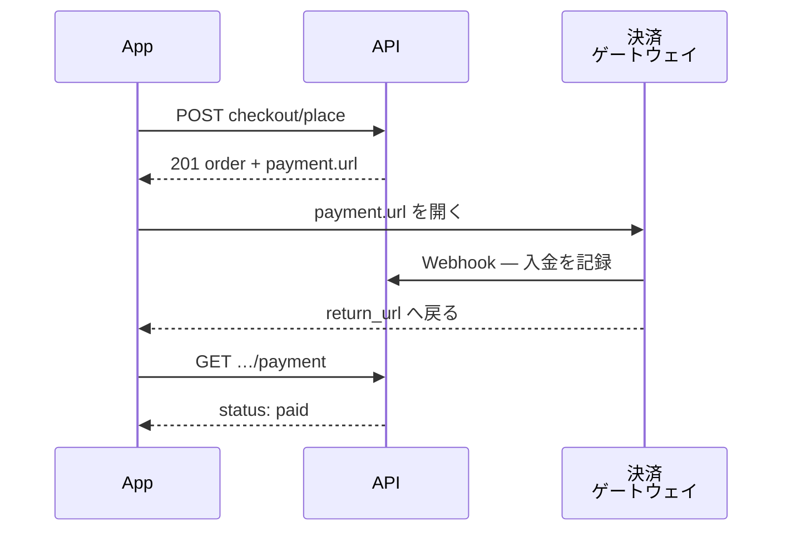

> 🌐 **言語:** [🇻🇳 Tiếng Việt](./api-storefront_vi.md) · [🇬🇧 English](./api-storefront.md) · 🇯🇵 日本語（現在）

# ストアフロント API（`api/v2/front`）：カタログ、カート、注文

## はじめに

このページでは、ストアフロント API の使い方を説明します：ログインなしで商品、カテゴリー、コンテンツを読み取り、ログイン済みの顧客またはゲストの
カート、チェックアウト、注文の確定、支払いを扱います。販売用のモバイルアプリや、サイトのデータを使う別の Web サイトを作る人向けです。
顧客アカウント（会員登録、プロフィール、住所録）は[ログインとトークン](./api-authentication_ja.md)に、エンドポイントごとの詳細は
[リファレンス — Front](./api-reference-front_ja.md)にあります。

## Front API（ストアフロント）の処理の流れ

Front API は 2 種類のデータを扱います。**公開データ**（ログイン不要 — 商品一覧、カテゴリーなど）と、
**顧客個人のデータ**（ログイン必要 — 注文、プロフィール、住所録）です。

下の図は Front API の 2 つの使い方を示しています。ログインなしで公開データを読む方法と、顧客がログインして自分の
注文を見る方法です。図の手順の前に、すべてのリクエストは API スイッチ、API Connection（オンの場合）、回数制限を通過しています
（[ひと目でわかる](./api-concepts_ja.md#ひと目でわかる)）。



ポイント: API の公開データは**ストアで顧客が見ている内容と一致**し、個人のデータは本人にだけ返されます。

**公開エンドポイント**（接頭辞 `api/v2/front`、トークン不要）：

| メソッド | パス | 機能 |
| --- | --- | --- |
| `GET` | `api/v2/front/meta` | API のバージョン、インストール済みパッケージ、言語、ストア |
| `GET` | `api/v2/front/product/list` | 商品一覧 |
| `GET` | `api/v2/front/product/detail/{id}` | 商品 1 件の詳細（購入に必要なデータを含む — [購入用の商品データ](#購入用の商品データ)） |
| `GET` | `api/v2/front/category/list` | カテゴリー一覧 |
| `GET` | `api/v2/front/category/detail/{id}` | カテゴリー 1 件の詳細 |
| `GET` | `api/v2/front/brand/list` | ブランド一覧 |
| `GET` | `api/v2/front/brand/detail/{id}` | ブランド 1 件の詳細 |
| `GET` | `api/v2/front/banner/list` | バナー一覧 |
| `GET` | `api/v2/front/banner/detail/{id}` | バナー 1 件の詳細 |
| `GET` | `api/v2/front/page/list` | コンテンツページ一覧 |
| `GET` | `api/v2/front/page/detail/{id}` | コンテンツページ 1 件の詳細 |

> ℹ️ **対応バージョン:** gp247/shop 3.2.3, gp247/front 3.2.3 — 公開データは、呼び出したドメインで
> **ストアが表示している内容とまったく同じ**です。非表示の商品、未承認の商品、他のストアに属する商品は含まれません。
> レスポンスには公開項目だけが入り、原価、仕入先、在庫数／販売数は含まれません。
> これらの数値が必要な場合は、権限のあるアカウントで Core API を使ってください。

**顧客アカウントのエンドポイント**（接頭辞 `api/v2/front`。詳細は[顧客アカウントとサインインセッション](./api-authentication_ja.md#顧客アカウントとサインインセッション)）：

| メソッド | パス | ログイン必要 | 機能 |
| --- | --- | --- | --- |
| `POST` | `api/v2/front/register` | 不要 | 顧客アカウントを作成してサインイン（[会員登録、パスワードを忘れた場合、プロフィール、住所録](./api-authentication_ja.md#会員登録パスワードを忘れた場合プロフィール住所録)） |
| `POST` | `api/v2/front/password/forgot` | 不要 | パスワード再設定メールを送信 |
| `POST` | `api/v2/front/password/reset` | 不要 | メールのコードで新しいパスワードを設定 |
| `POST` | `api/v2/front/login` | 不要 | 顧客のメールアドレス／パスワードでログイン（`with_refresh` は任意 — [リフレッシュトークン — 短命なトークンでサインイン状態を保つ](./api-authentication_ja.md#リフレッシュトークン--短命なトークンでサインイン状態を保つ)） |
| `POST` | `api/v2/front/login/challenge` | 不要 | 追加の確認ステップが必要なサインインを完了（[プラグインによる二要素認証（MFA）](./api-authentication_ja.md#プラグインによる二要素認証mfa)） |
| `POST` | `api/v2/front/refresh` | 不要（リフレッシュトークンを送る） | リフレッシュトークンを新しいトークンの組と交換 |
| `POST` | `api/v2/front/logout` | 必要（Bearer） | 現在のセッションをサインアウト（リフレッシュトークンを含む） |
| `GET` | `api/v2/front/info` | 必要（Bearer） | 顧客アカウントの情報 |
| `GET` | `api/v2/front/member/profile` | 必要（Bearer） | プロフィール全体：メール確認の状態、既定の住所 |
| `PUT` | `api/v2/front/member/profile` | 必要（Bearer） | プロフィールを編集 |
| `PUT` | `api/v2/front/member/password` | 必要（Bearer） | パスワードを変更（ほかの端末はすべてサインアウト） |
| `POST` | `api/v2/front/member/email/verify` | 必要（Bearer） | 確認メールを再送 |
| `GET` | `api/v2/front/member/address/list` | 必要（Bearer） | 住所録 |
| `POST` | `api/v2/front/member/address` | 必要（Bearer） | 住所を追加 |
| `PUT` | `api/v2/front/member/address/{id}` | 必要（Bearer） | 住所を編集 |
| `DELETE` | `api/v2/front/member/address/{id}` | 必要（Bearer） | 住所を削除（既定の住所は不可） |
| `GET` | `api/v2/front/member/sessions` | 必要（Bearer） | 顧客の API サインインセッション（端末）（[サインインセッションの管理](./api-authentication_ja.md#サインインセッションの管理)） |
| `DELETE` | `api/v2/front/member/sessions/{id}` | 必要（Bearer） | 1 つのセッションをサインアウト |
| `GET` | `api/v2/front/member/order/list` | 必要（Bearer） | 顧客の注文一覧 |
| `GET` | `api/v2/front/member/order/detail/{id}` | 必要（Bearer） | 顧客の注文 1 件の詳細 |

カート、チェックアウト、支払いのエンドポイントは[API によるカートと注文](#api-によるカートと注文) にあります。

例：ブランド 5 の商品を価格の高い順に 20 件、名前をベトナム語で取得します（公開データ、トークン不要）。

```bash
curl -X GET "https://shop.example.com/api/v2/front/product/list?filter[brand_id]=5&sort=-price&lang=vi&page[size]=20" \
  -H "Accept: application/json"
```

レスポンス（抜粋）：

```json
{
  "data": [
    { "id": "PRD-AbC12", "sku": "TSHIRT-01", "name": "Tシャツ", "price": 250000, "price_final": 199000 }
  ],
  "meta": { "current_page": 1, "per_page": 20, "total": 1, "last_page": 1 },
  "links": { "first": "…", "last": "…", "prev": null, "next": null }
}
```

顧客としてログインし、注文を確認する例：

```bash
# 1) 顧客ログイン
curl -X POST "https://shop.example.com/api/v2/front/login" \
  -H "Content-Type: application/json" \
  -d '{"email":"customer@example.com","password":"your-password"}'

# 2) 受け取ったトークン（data.access_token）で注文一覧を取得
curl -X GET "https://shop.example.com/api/v2/front/member/order/list" \
  -H "Accept: application/json" \
  -H "Authorization: Bearer 2|zzz...customer-token...zzz"
```

## API によるカートと注文

> ℹ️ **対応バージョン:** gp247/shop 3.5.0

ストア自身のモバイルアプリやヘッドレスサイトは、API で **カート** をウェブサイトと同じルールで扱えます。価格と属性の追加料金は
サーバーが計算し、数量ルール（正の数、小数は設定どおり）、バリエーションごとに 1 行です。

**カート、チェックアウト、支払いのエンドポイント**（接頭辞 `api/v2/front`）：

| メソッド | パス | ログイン必要 | 機能 |
| --- | --- | --- | --- |
| `GET` | `api/v2/front/cart` | あり（顧客）または `X-Cart-Token` | カートを表示 |
| `POST` | `api/v2/front/cart/items` | あり（顧客）またはゲスト | カートに商品を追加 |
| `PATCH` | `api/v2/front/cart/items/{rowId}` | あり（顧客）または `X-Cart-Token` | 行の数量を変更（0 以下で行を削除） |
| `DELETE` | `api/v2/front/cart/items/{rowId}` | あり（顧客）または `X-Cart-Token` | 行を削除 |
| `POST` | `api/v2/front/cart/promotions/{pluginKey}` | あり（顧客）または `X-Cart-Token` | クーポン / プロモーションを適用 |
| `DELETE` | `api/v2/front/cart/promotions/{pluginKey}` | あり（顧客）または `X-Cart-Token` | プロモーションを解除 |
| `GET` | `api/v2/front/checkout` | あり（顧客）または `X-Cart-Token` | チェックアウトの状態（ストア、住所、選択済みの方法 — 10.1 節） |
| `PUT` | `api/v2/front/checkout/address` | あり（顧客）または `X-Cart-Token` | 配送先住所を設定 |
| `GET` | `api/v2/front/checkout/shipping-methods` | あり（顧客）または `X-Cart-Token` | 住所に対して見積もった配送方法 |
| `PUT` | `api/v2/front/checkout/shipping-method` | あり（顧客）または `X-Cart-Token` | 配送方法を選択 |
| `GET` | `api/v2/front/checkout/payment-methods` | あり（顧客）または `X-Cart-Token` | API で使える支払い方法 |
| `PUT` | `api/v2/front/checkout/payment-method` | あり（顧客）または `X-Cart-Token` | 支払い方法を選択 |
| `GET` | `api/v2/front/checkout/totals` | あり（顧客）または `X-Cart-Token` | 請求される合計 |
| `POST` | `api/v2/front/checkout/place` | あり（顧客）または `X-Cart-Token` + `Idempotency-Key` | 注文を確定（10.2 節） |
| `GET` | `api/v2/front/member/orders/{id}/payment` | あり（顧客） | 顧客の注文の支払い状況（10.3 節） |
| `GET` | `api/v2/front/orders/{id}/payment` | `X-Order-Access` | ゲスト注文の支払い状況（10.3 節） |
| `POST` | `api/v2/front/member/orders/{id}/cancel` | あり（顧客） | アプリから行った未払い注文のキャンセル（10.3 節） |
| `POST` | `api/v2/front/orders/{id}/cancel` | `X-Order-Access` | ゲストの未払い注文のキャンセル（10.3 節） |

カートが誰のものになるかは、顧客がログインしているかどうかで決まります。



- **ログイン済みの顧客** は他の顧客 API と同じくトークンを送ります。カートは **アカウントのカート** です。アプリで追加すると
  ウェブサイトにログインしたときにも表示され、その逆も同じです。
- **ゲスト**（ストアがゲスト購入を許可している場合のみ）: 最初に商品を追加したとき、レスポンスに **`X-Cart-Token`** ヘッダーが
  付きます。保存して、以降のカート呼び出しすべてに付けてください。**一度だけ** 渡されます。誤ったトークンや **30 日** 変更の
  ないカートは「カートなし」として扱われます。
- **`X-Cart-Token` 付きのログイン / 登録**: ゲストのカートはアカウントのカートに **統合** され（同じ商品 + バリエーションは数量を
  合算）、古いカートトークンは無効になります。レスポンスに `cart_merge: {merged, dropped}` が含まれます。
- **商品の追加**（`POST cart/items`）: `product_id`、`qty`、商品に属性がある場合は `options` = `{"<属性グループ ID>": "<選択肢名>"}`。
  **すべてのグループ** を選ぶ必要があります。追加料金は常に商品から取得し、アプリが送った価格は無視されます。
- **カートの応答**: 行は **ストアごと** にまとめられ（`stores[].lines[]`）、`unit_price`、`line_total`、`subtotal` を持ちます。もう購入
  できない行は `purchasable: false` と `reason`（`not_for_sale`、`missing_options`）を持ち、`subtotal` に含まれません。

| エラーコード | HTTP | 意味 |
| --- | --- | --- |
| `login_required` | 401 | ストアがゲストに販売しない — 先にログイン |
| `validation_failed` | 422 | `qty` がない / 不正、属性が未選択（`errors.options`） |
| `product_not_for_sale` | 422 | 商品を購入できない（販売停止、販売開始前など） |
| `insufficient_stock` | 422 | 在庫超過販売をしないストアで在庫を超えた |
| `cart_line_limit` | 422 | カートがすでに **100 行** |
| `cart_conflict` | 409 | カートが別の場所で変更された — 読み直して再試行 |
| `not_found` | 404 | その行はあなたのカートにない |

制限: 顧客ごと、またはカートトークンごとに **1 分あたり 60 回**（`gp247-config.api.throttle.cart`）。

### チェックアウトの手順

カートができたら、アプリはカートの **1 つのストア** についてチェックアウトの手順を進めます（カートに複数ストアの商品がある場合は
`store_id` を送信。別のストアを選ぶと選択はやり直しになります）。すべての選択はカートの所有者（顧客またはカートトークン）ごとに
呼び出しの間で保持されます — **ウェブサイトと同じルール** です。



- **住所**（`PUT checkout/address`）: ウェブサイトのフォームと同じ必須項目（ストアの顧客設定どおり）。または顧客自身の住所録の住所を
  `address_id` で指定します（他人の住所 → `404`）。ログイン済みの顧客は `"save_address": true` で注文時に新しい住所として保存できます。
  住所を変えると配送方法の選び直しが必要です。
- **配送**（`GET checkout/shipping-methods`）: その住所 + カートに対する見積もり。サービスごとに 1 行（`id` は `<plugin>` または
  `<plugin>:<service>`）。見積もりできない配送会社は `unquotable` に入ります。配送を使わないストアは `required: false`。
- **支払い**（`GET checkout/payment-methods`）: API で使える方法のみ — `type: none`（決済画面なし: 代金引換、振込など）または
  `type: hosted`（決済ページを持つゲートウェイ）。ウェブサイト上の決済手順しかない方法は表示されません。
- **プロモーション**（`POST cart/promotions/{pluginKey}`、プラグインに合わせた `{"payload": {...}}`、例 `{"code": "SUMMER"}`）:
  チェックアウト契約に従うすべてのプロモーションプラグインに共通の方法。拒否されると `422 promotion_refused` とプラグインのメッセージ。
- **合計**（`GET checkout/totals`）: `subtotal`、`shipping`、`discount`、`tax`、`total` などの行。同じカートでウェブサイトが計算する金額と
  同じで、これが「顧客に表示した金額」です。

| エラーコード | HTTP | 意味 |
| --- | --- | --- |
| `cart_empty` | 422 | （選んだストアの）カートに注文できるものがない |
| `store_required` | 422 | カートに複数のストア — `store_id` を送信 |
| `address_required` | 422 | 配送先住所が未設定 |
| `method_unavailable` | 422 | その方法がない / このチェックアウトでは使えない |
| `promotion_refused` | 422 | プロモーションプラグインが拒否（コード誤り、期限切れなど） |
| `invalid_quantity` | 422 | 注文できない数量のカート行がある |

### 注文の確定

`POST checkout/place` はチェックアウト中のストアの注文を確定します。呼び出す前に:

1. ストアのオーナーが **API 管理** 画面で **「API経由の注文」をオン** にします（v2 公開・顧客 API グループの下）。この設定は **既定でオフ** です
   （新規インストールでもアップグレードでも）。オフの間、`POST checkout/place` は `403 api_checkout_disabled` を返し、他のカート / チェックアウトの
   手順はそのまま使えます。
2. アプリは `GET checkout/totals` を呼び出して合計を顧客に表示しておきます — 注文時に再計算した合計が表示した金額と **一致** した場合のみ注文が作成されます。

顧客が *注文する* を押すたびに、アプリは `Idempotency-Key`（8〜255 文字、例: UUID）を **1 つ** 生成してヘッダーで送ります。通信が不安定な
ときは **同じキー** で再送してください。作成済みの注文が返り（HTTP `200`）、2 件目の注文や在庫の再減算、再請求は発生しません。新しい注文には
新しいキーが必要です。



成功: `201 {"data": {"order": {id, store_id, status, payment_status, total, balance, currency}, "access_token"?, "payment": {"type": "none" | "hosted", "url"?}}}`。
注文はすぐに完了します。注文した行はカートから外れ、ウェブサイトで注文したときと同じく注文確認メールが送られます。

| エラーコード | HTTP | 意味 |
| --- | --- | --- |
| `idempotency_key_required` | 400 | `Idempotency-Key` ヘッダーがない / 不正 |
| `api_checkout_disabled` | 403 | ストアが API 経由の注文をオンにしていない |
| `idempotency_key_reused` | 409 | このキーは別のストアの注文に使われた（異なる `store_id` を送信） |
| `price_changed` | 409 | 表示後に合計が変わった — エラー本文に新しい `totals`。再表示してから新しいキーで注文 |
| `address_required` · `shipping_method_required` · `payment_method_required` | 422 | ストアが必要とするチェックアウトの手順が未完了 |
| `minimum_not_met` | 422 | 最低数量に満たない商品がある（`minimums`: 商品 ID → 最低数量） |
| `shipping_unquotable` · `invalid_quantity` · `cart_empty` | 422 | 配送不可、不正な数量、カートが空 |
| — | 429 | 顧客または IP ごとに **1 分あたり 10 件** を超えた（`gp247-config.api.throttle.checkout_place`） |

### オンライン決済と支払い状況

`type: "hosted"` の支払い方法（例: Stripe、PayPal）は **ゲートウェイの決済ページ** で支払いを受けます。

1. 注文の確定時、アプリは `return_url` を送れます — 支払い後に購入者をアプリへ戻す先（`myshop://checkout/done` のような
   ディープリンク、またはアプリの Web ページ）。
2. 注文結果に `payment.url` が入ります。ブラウザ / WebView で開き、購入者に支払ってもらいます。
3. 支払い（またはキャンセル）の後、ゲートウェイは購入者をサイトの支払いページへ戻します。`return_url` が **許可リスト** にあれば、
   サイトはすぐにそのアドレスへ転送します。
4. アプリは状況を問い合わせます: `GET member/orders/{id}/payment`（サインイン済みの顧客）、または `X-Order-Access` ヘッダー付きの
   `GET orders/{id}/payment`（ゲスト — 注文確定時に受け取った `access_token`）。



**許可リスト** はサイトの `.env` にカンマ区切りで設定します。

```bash
GP247_PAYMENT_RETURN_URLS="myshop://checkout, https://app.example.com/return"
```

サイトはスキーム + ホスト（+ ポート）の **完全一致** と、登録したパスで始まるパスを照合します（`https://app.example.com/return/ok` は
一致、`https://app.example.com.evil/return` は不一致）。リストは **既定で空** で、購入者はサイトのページに留まります。一致しない
アドレスは無視され、注文は通常どおり確定します。`php artisan config:cache` を使うサイトでは、`.env` の編集後にもう一度実行します。

- **入金はゲートウェイが確認したときだけ記録** されます（署名付き Webhook またはゲートウェイの戻りページ）。`return_url` 上のパラメーターで
  注文が変わることはありません — 状況は必ず API で問い合わせます。
- **購入者がゲートウェイでキャンセル**: 注文は *支払い待ち* のまま残ります。**同じ** `Idempotency-Key` で `POST checkout/place` を再送すると、
  同じ注文の新しい `payment.url` を受け取れます。ゲートウェイが一時的に失敗したときは `payment.url` が `null` — 同じキーで再送して
  再試行します。
- **未払い注文のキャンセル**: 購入者の気が変わったら、アプリは `POST member/orders/{id}/cancel`（ログイン済みの顧客）または
  `X-Order-Access` 付きの `POST orders/{id}/cancel`（ゲスト）を呼びます。キャンセルできるのは、アプリから行われ、入金がなく、ショップが
  まだ処理していない注文だけで、在庫は戻ります。それ以外の注文 ⇒ `409 order_not_cancellable`。キャンセル済みの注文に再度呼んでも `200` です。
- **放置された注文の自動キャンセル**: ゲートウェイ払いの注文が **24 時間** 経っても未払いのままなら、次にアプリから注文が入ったときに
  キャンセルされます（在庫は戻る）— cron 不要。期限は `GP247_API_UNPAID_ORDER_MINUTES`（分、`0` = 自動キャンセルしない）で変更できます。
  その後にゲートウェイが知らせた入金も記録されるので、ショップが返金できます。
- **支払い後の注文ステータス**: ゲートウェイで全額支払われると、そのゲートウェイがウェブの注文に使うステータス（例: *処理中* — Stripe /
  PayPal プラグインの設定）になり、全額返金されるとゲートウェイの *返金済み* ステータスになります。
- **単一ドメインのマルチベンダーマーケットプレイス**（MultiVendor）: 出店者ストアの注文もメインストアと同じようにゲートウェイで支払えます。

> ℹ️ **対応バージョン:** gp247/shop 3.5.1（StripePayment 1.1.4、PaypalExpress 3.2.4 と併用）— 未払い注文のキャンセル、放置された注文の自動
> キャンセル、支払い / 返金後の注文ステータス、独自ドメインのないストアの注文のゲートウェイ払い。PaypalExpress 3.2.4 は
> `CHECKOUT.ORDER.APPROVED` Webhook を受け取った時点で入金を確定します — サイトの PayPal Webhook にこのイベントを追加してください。
- **`access_token`** はゲストの注文結果にだけ入ります。アプリは状況の問い合わせ用に保存します。この注文の状況と金額だけを開き（住所なし）、
  他人の注文や誤ったトークン ⇒ `404`。
- API 経由の注文では、「注文成功」イベントと確認メールは **注文確定時** に実行されます（支払いを待ちません）。*支払い後* に処理する
  プラグインは、このイベントではなく注文の支払い状況を使います。

状況のレスポンス: `{"data": {"order": {id, store_id, status, payment_status, total, received, balance, currency}, "payment": {"type": "none" | "hosted", "status": "unpaid" | "partially_paid" | "paid" | "refunded"}}}`。

### 購入用の商品データ

v2 の商品（`product/list`、`product/detail/{id}`）には、アプリがバリエーション選択と購入ボタンを作るための 3 つのフィールドが追加されます。
既存のフィールドはそのままです。

| フィールド | 意味 |
| --- | --- |
| `attributes` | 属性グループ: `group_id`、`name`、`required`（常に `true` — カートに追加するには各グループから 1 つ選ぶ必要がある）、`options` には `value`（`POST cart/items` の `options[group_id]` に送り返す値）と `add_price`（追加料金。`price_final` と同じ単位で、カートはこの金額を請求） |
| `image_sizes` | メイン画像のサイズ別 URL: `original`、`thumb`（絶対 URL。画像なし ⇒ サイトの既定画像） |
| `stock_status` | `in_stock` または `out_of_stock` — 在庫数は返しません。在庫を管理しない、または在庫切れでも販売するストア ⇒ 常に `in_stock` |

価格を非表示にしているストアでは、`add_price` は `null` です（`price` と同じ）。

```json
{
  "data": {
    "id": "PRD-AbC12",
    "price_final": 199000,
    "stock_status": "in_stock",
    "image_sizes": { "original": "https://shop.example.com/data/product/tshirt.jpg", "thumb": "https://shop.example.com/data/product/thumb/tshirt.jpg" },
    "attributes": [
      { "group_id": "2", "name": "Color", "required": true,
        "options": [ { "value": "Red", "add_price": 0 }, { "value": "Blue", "add_price": 20000 } ] }
    ]
  }
}
```

### 購入フロー全体

下の表は、1 件の注文に必要な呼び出しを順番にまとめたものです（接頭辞 `api/v2/front/`）。ログイン済みの顧客はすべてのステップで
`Authorization: Bearer <token>` を送り、ゲストは代わりに `X-Cart-Token` を送ります。

| ステップ | 呼び出し | 追加ヘッダー | 参照 |
| --- | --- | --- | --- |
| 1. 商品を選ぶ | `GET product/list`、`GET product/detail/{id}` | — | 10.4 |
| 2. カートを保持する | `POST cart/items`、`GET cart`、`PATCH` / `DELETE cart/items/{rowId}` | 最初の追加で受け取る `X-Cart-Token`（ゲスト） | 10 |
| 3. 住所・配送・支払い | `PUT checkout/address` → `GET` + `PUT checkout/shipping-method(s)` → `GET` + `PUT checkout/payment-method(s)` | — | 10.1 |
| 4. プロモーション（任意） | `POST` / `DELETE cart/promotions/{pluginKey}` | — | 10.1 |
| 5. 顧客に合計を表示する | `GET checkout/totals` | — | 10.1 |
| 6. 注文する | `POST checkout/place`（決済ゲートウェイで支払う場合は `return_url` も） | `Idempotency-Key`（*注文する* を押すごとに 1 つ） | 10.2 |
| 7. 支払う（`payment.type = hosted` の場合） | `payment.url` を開く | — | 10.3 |
| 8. 支払い状況 | `GET member/orders/{id}/payment` または `GET orders/{id}/payment` | `X-Order-Access`（ゲスト） | 10.3 |

本番で販売を始める前のチェックリスト:

- ストアのオーナーが **「API経由の注文」** をオンにしている（10.2）。オンライン決済を使う場合は、戻り先アドレスを
  `GP247_PAYMENT_RETURN_URLS` に登録している（10.3）。
- アプリは `X-Cart-Token` と `access_token` を端末の安全な保存領域に保管し、ログに書き出さない。
- アプリは `409 price_changed`（新しい合計を表示）に対応し、注文中に通信が切れたら **同じ** `Idempotency-Key` で再送する。
- ウェブの注文を処理するサイトのプラグイン（出品者ごとの注文分割、手数料、通知など）は、同じフックでアプリからの注文も受け取ります —
  [API の作り方 — 8 章](./create-api_ja.md) を参照。

## よくある質問（Q&A）

**Q1: API の価格は Web サイトの価格と同じですか？**

→ 同じです。API のカート、合計金額、注文は Web サイトと同じ業務処理を通るため、同じカートなら同じ金額になります。

**Q2: ログインしていない顧客も注文できますか？**

→ ストアがゲスト購入を許可していればできます：アプリは**カートコード**（`X-Cart-Token`）を保持し、注文後に**注文照会コード**を受け取って、注文の確認や
キャンセルに使います。

---

<sub>📅 **最終更新:** 2026-11-04 · ✍️ **作成者 (Author):** GP247</sub>
