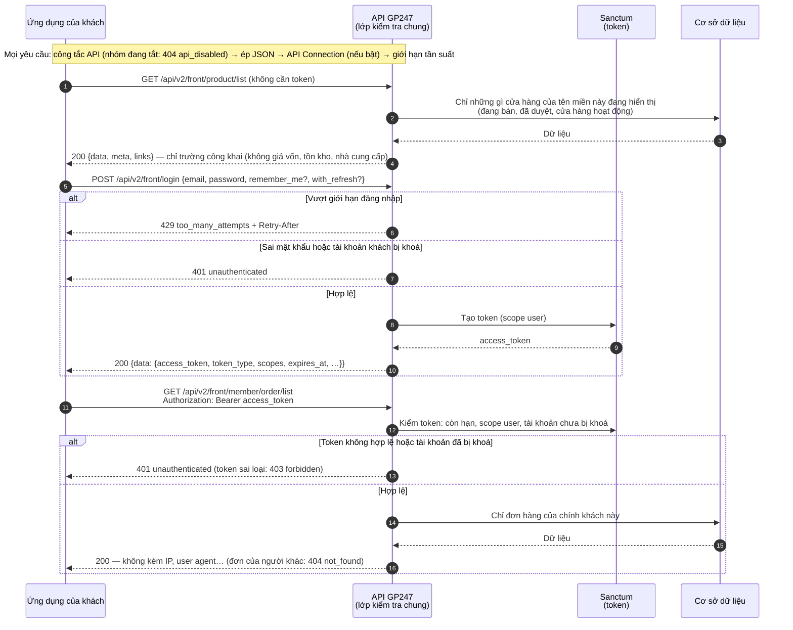
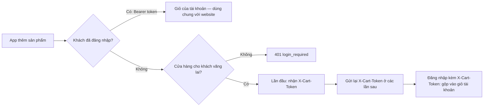
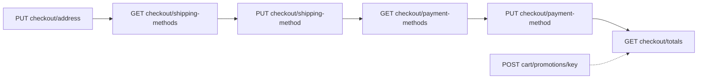
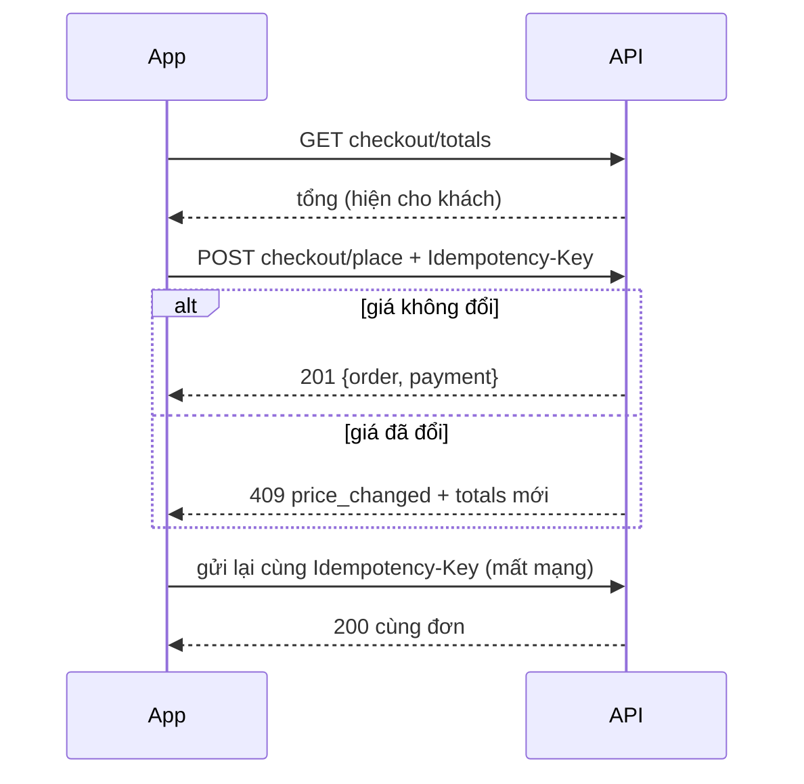
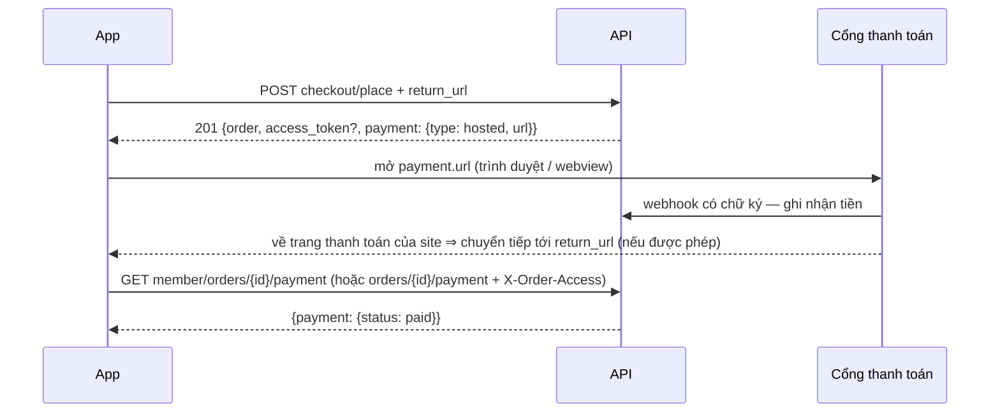

> 🌐 **Ngôn ngữ:** 🇻🇳 Tiếng Việt (hiện tại) · [🇬🇧 English](./api-storefront.md) · [🇯🇵 日本語](./api-storefront_ja.md)

# API cửa hàng (`api/v2/front`): danh mục, giỏ hàng và đặt đơn

## Giới thiệu

Trang này hướng dẫn làm việc với API cửa hàng: đọc sản phẩm, danh mục, nội dung mà không cần đăng nhập, rồi giỏ hàng, checkout, đặt đơn
và thanh toán cho khách đã đăng nhập hoặc khách vãng lai. Dành cho người làm app di động bán hàng hay website khác dùng dữ liệu của site.
Tài khoản khách (đăng ký, hồ sơ, sổ địa chỉ) ở [Đăng nhập & token](./api-authentication_vi.md); chi tiết từng endpoint ở
[Tham chiếu — Front](./api-reference-front_vi.md).

## Luồng làm việc API Front (Storefront)

API Front phục vụ hai loại dữ liệu: **dữ liệu công khai** (không cần đăng nhập — danh sách sản
phẩm, danh mục…) và **dữ liệu riêng của khách** (cần đăng nhập — đơn hàng, hồ sơ, sổ địa chỉ).

Sơ đồ dưới đây mô tả hai cách dùng API Front: đọc dữ liệu công khai không cần đăng nhập, và khách đăng nhập để
xem đơn hàng của mình.



Điểm rút ra: dữ liệu công khai trên API **khớp với những gì khách thấy trên cửa hàng**, còn dữ liệu riêng chỉ trả về
cho đúng chủ tài khoản.

**Các endpoint công khai** (tiền tố `api/v2/front`, không cần token):

| Phương thức | Đường dẫn | Chức năng |
| --- | --- | --- |
| `GET` | `api/v2/front/meta` | Phiên bản API, gói đã cài, ngôn ngữ, cửa hàng |
| `GET` | `api/v2/front/product/list` | Danh sách sản phẩm |
| `GET` | `api/v2/front/product/detail/{id}` | Chi tiết một sản phẩm (kèm dữ liệu để mua — [Dữ liệu sản phẩm để mua](#dữ-liệu-sản-phẩm-để-mua)) |
| `GET` | `api/v2/front/category/list` | Danh sách danh mục |
| `GET` | `api/v2/front/category/detail/{id}` | Chi tiết một danh mục |
| `GET` | `api/v2/front/brand/list` | Danh sách thương hiệu |
| `GET` | `api/v2/front/brand/detail/{id}` | Chi tiết một thương hiệu |
| `GET` | `api/v2/front/banner/list` | Danh sách banner |
| `GET` | `api/v2/front/banner/detail/{id}` | Chi tiết một banner |
| `GET` | `api/v2/front/page/list` | Danh sách trang nội dung |
| `GET` | `api/v2/front/page/detail/{id}` | Chi tiết một trang nội dung |

> ℹ️ **Có từ:** gp247/shop 3.2.3, gp247/front 3.2.3 — dữ liệu công khai **giống hệt những gì cửa hàng
> đang hiển thị** trên tên miền bạn gọi: sản phẩm ẩn, chưa được duyệt hoặc thuộc cửa hàng khác không
> xuất hiện. Phản hồi chỉ gồm các trường công khai — không có giá vốn, nhà cung cấp, số tồn/đã bán.
> Cần các số liệu đó thì dùng API Core với tài khoản có quyền.

**Các endpoint tài khoản khách** (tiền tố `api/v2/front`; chi tiết ở [Tài khoản khách & phiên đăng nhập](./api-authentication_vi.md#tài-khoản-khách--phiên-đăng-nhập)):

| Phương thức | Đường dẫn | Cần đăng nhập | Chức năng |
| --- | --- | --- | --- |
| `POST` | `api/v2/front/register` | Không | Đăng ký tài khoản khách và đăng nhập luôn ([Đăng ký, quên mật khẩu, hồ sơ, sổ địa chỉ](./api-authentication_vi.md#đăng-ký-quên-mật-khẩu-hồ-sơ-sổ-địa-chỉ)) |
| `POST` | `api/v2/front/password/forgot` | Không | Gửi email đặt lại mật khẩu |
| `POST` | `api/v2/front/password/reset` | Không | Đặt mật khẩu mới bằng mã trong email |
| `POST` | `api/v2/front/login` | Không | Đăng nhập bằng email/mật khẩu khách (`with_refresh` tuỳ chọn — [Refresh token — giữ đăng nhập mà token ngắn hạn](./api-authentication_vi.md#refresh-token--giữ-đăng-nhập-mà-token-ngắn-hạn)) |
| `POST` | `api/v2/front/login/challenge` | Không | Hoàn tất đăng nhập cần bước xác thực thêm ([Xác thực hai lớp (MFA) qua plugin](./api-authentication_vi.md#xác-thực-hai-lớp-mfa-qua-plugin)) |
| `POST` | `api/v2/front/refresh` | Không (gửi refresh token) | Đổi refresh token lấy cặp token mới |
| `POST` | `api/v2/front/logout` | Có (Bearer) | Đăng xuất phiên hiện tại (cả refresh token) |
| `GET` | `api/v2/front/info` | Có (Bearer) | Thông tin tài khoản khách |
| `GET` | `api/v2/front/member/profile` | Có (Bearer) | Hồ sơ đầy đủ: trạng thái xác minh email, địa chỉ mặc định |
| `PUT` | `api/v2/front/member/profile` | Có (Bearer) | Sửa hồ sơ |
| `PUT` | `api/v2/front/member/password` | Có (Bearer) | Đổi mật khẩu (đăng xuất mọi thiết bị khác) |
| `POST` | `api/v2/front/member/email/verify` | Có (Bearer) | Gửi lại email xác minh |
| `GET` | `api/v2/front/member/address/list` | Có (Bearer) | Sổ địa chỉ |
| `POST` | `api/v2/front/member/address` | Có (Bearer) | Thêm địa chỉ |
| `PUT` | `api/v2/front/member/address/{id}` | Có (Bearer) | Sửa địa chỉ |
| `DELETE` | `api/v2/front/member/address/{id}` | Có (Bearer) | Xoá địa chỉ (không xoá được địa chỉ mặc định) |
| `GET` | `api/v2/front/member/sessions` | Có (Bearer) | Các phiên đăng nhập API (thiết bị) của khách ([Quản lý phiên đăng nhập](./api-authentication_vi.md#quản-lý-phiên-đăng-nhập)) |
| `DELETE` | `api/v2/front/member/sessions/{id}` | Có (Bearer) | Đăng xuất một phiên |
| `GET` | `api/v2/front/member/order/list` | Có (Bearer) | Danh sách đơn hàng của khách |
| `GET` | `api/v2/front/member/order/detail/{id}` | Có (Bearer) | Chi tiết một đơn hàng của khách |

Endpoint giỏ hàng, checkout và thanh toán nằm ở [Giỏ hàng & đặt đơn qua API](#giỏ-hàng--đặt-đơn-qua-api).

Ví dụ: 20 sản phẩm đắt nhất của thương hiệu số 5, tên bằng tiếng Việt (công khai, không cần token):

```bash
curl -X GET "https://shop.example.com/api/v2/front/product/list?filter[brand_id]=5&sort=-price&lang=vi&page[size]=20" \
  -H "Accept: application/json"
```

Phản hồi rút gọn:

```json
{
  "data": [
    { "id": "PRD-AbC12", "sku": "TSHIRT-01", "name": "Áo thun", "price": 250000, "price_final": 199000 }
  ],
  "meta": { "current_page": 1, "per_page": 20, "total": 1, "last_page": 1 },
  "links": { "first": "…", "last": "…", "prev": null, "next": null }
}
```

Ví dụ đăng nhập khách rồi xem đơn hàng:

```bash
# 1) Đăng nhập khách
curl -X POST "https://shop.example.com/api/v2/front/login" \
  -H "Content-Type: application/json" \
  -d '{"email":"customer@example.com","password":"your-password"}'

# 2) Dùng token nhận được (data.access_token) để lấy danh sách đơn hàng
curl -X GET "https://shop.example.com/api/v2/front/member/order/list" \
  -H "Accept: application/json" \
  -H "Authorization: Bearer 2|zzz...token-khach...zzz"
```

## Giỏ hàng & đặt đơn qua API

> ℹ️ **Có từ:** gp247/shop 3.5.0

Ứng dụng di động hoặc website headless của chính cửa hàng giữ **giỏ hàng** qua API, với đúng luật của website: giá và
phụ phí thuộc tính do máy chủ tính, luật số lượng (số dương, số lẻ theo cấu hình), mỗi biến thể một dòng.

**Endpoint giỏ hàng, checkout và thanh toán** (tiền tố `api/v2/front`):

| Phương thức | Đường dẫn | Cần đăng nhập | Chức năng |
| --- | --- | --- | --- |
| `GET` | `api/v2/front/cart` | Có (khách) hoặc `X-Cart-Token` | Xem giỏ hàng |
| `POST` | `api/v2/front/cart/items` | Có (khách) hoặc khách vãng lai | Thêm sản phẩm vào giỏ |
| `PATCH` | `api/v2/front/cart/items/{rowId}` | Có (khách) hoặc `X-Cart-Token` | Đổi số lượng một dòng (≤ 0 = xoá dòng) |
| `DELETE` | `api/v2/front/cart/items/{rowId}` | Có (khách) hoặc `X-Cart-Token` | Xoá một dòng |
| `POST` | `api/v2/front/cart/promotions/{pluginKey}` | Có (khách) hoặc `X-Cart-Token` | Áp mã giảm giá / khuyến mãi |
| `DELETE` | `api/v2/front/cart/promotions/{pluginKey}` | Có (khách) hoặc `X-Cart-Token` | Gỡ khuyến mãi |
| `GET` | `api/v2/front/checkout` | Có (khách) hoặc `X-Cart-Token` | Trạng thái checkout (cửa hàng, địa chỉ, phương thức đã chọn — [Các bước checkout](#các-bước-checkout)) |
| `PUT` | `api/v2/front/checkout/address` | Có (khách) hoặc `X-Cart-Token` | Đặt địa chỉ giao hàng |
| `GET` | `api/v2/front/checkout/shipping-methods` | Có (khách) hoặc `X-Cart-Token` | Phương thức giao hàng có báo giá cho địa chỉ |
| `PUT` | `api/v2/front/checkout/shipping-method` | Có (khách) hoặc `X-Cart-Token` | Chọn phương thức giao hàng |
| `GET` | `api/v2/front/checkout/payment-methods` | Có (khách) hoặc `X-Cart-Token` | Phương thức thanh toán dùng được qua API |
| `PUT` | `api/v2/front/checkout/payment-method` | Có (khách) hoặc `X-Cart-Token` | Chọn phương thức thanh toán |
| `GET` | `api/v2/front/checkout/totals` | Có (khách) hoặc `X-Cart-Token` | Tổng tiền sẽ thu |
| `POST` | `api/v2/front/checkout/place` | Có (khách) hoặc `X-Cart-Token` + `Idempotency-Key` | Đặt đơn ([Đặt đơn](#đặt-đơn)) |
| `GET` | `api/v2/front/member/orders/{id}/payment` | Có (khách) | Trạng thái thanh toán đơn của khách ([Thanh toán online và trạng thái thanh toán](#thanh-toán-online-và-trạng-thái-thanh-toán)) |
| `GET` | `api/v2/front/orders/{id}/payment` | `X-Order-Access` | Trạng thái thanh toán đơn của khách vãng lai ([Thanh toán online và trạng thái thanh toán](#thanh-toán-online-và-trạng-thái-thanh-toán)) |
| `POST` | `api/v2/front/member/orders/{id}/cancel` | Có (khách) | Huỷ đơn chưa trả đặt qua ứng dụng ([Thanh toán online và trạng thái thanh toán](#thanh-toán-online-và-trạng-thái-thanh-toán)) |
| `POST` | `api/v2/front/orders/{id}/cancel` | `X-Order-Access` | Huỷ đơn chưa trả của khách vãng lai ([Thanh toán online và trạng thái thanh toán](#thanh-toán-online-và-trạng-thái-thanh-toán)) |

Giỏ thuộc về ai tuỳ theo khách đã đăng nhập hay chưa:



- **Khách đã đăng nhập** gửi token như mọi API khách. Giỏ là **giỏ của tài khoản** — thêm trên app, mở website đăng nhập
  là thấy, và ngược lại.
- **Khách vãng lai** (chỉ khi cửa hàng bật *cho phép khách vãng lai*): lần thêm sản phẩm đầu tiên, phản hồi có header
  **`X-Cart-Token`** — lưu lại và gửi kèm ở mọi lần gọi giỏ sau. Mã chỉ trao **một lần**; mã sai hoặc giỏ quá **30 ngày**
  không thay đổi thì coi như chưa có giỏ.
- **Đăng nhập / đăng ký kèm `X-Cart-Token`**: giỏ khách vãng lai được **gộp** vào giỏ tài khoản (cùng sản phẩm + biến thể thì
  cộng số lượng), mã giỏ cũ hết hiệu lực; phản hồi có `cart_merge: {merged, dropped}`.
- **Thêm sản phẩm** (`POST cart/items`): `product_id`, `qty`, và `options` = `{"<mã nhóm thuộc tính>": "<tên lựa chọn>"}`
  khi sản phẩm có thuộc tính — phải chọn **đủ mọi nhóm**; phụ phí luôn lấy từ sản phẩm, giá app gửi bị bỏ qua.
- **Phản hồi giỏ**: các dòng **nhóm theo cửa hàng** (`stores[].lines[]`) với `unit_price`, `line_total`, `subtotal`;
  dòng không còn mua được có `purchasable: false` và `reason` (`not_for_sale`, `missing_options`) và không tính vào `subtotal`.

| Mã lỗi | HTTP | Ý nghĩa |
| --- | --- | --- |
| `login_required` | 401 | Cửa hàng không bán cho khách vãng lai — đăng nhập trước |
| `validation_failed` | 422 | Thiếu / sai `qty`, chưa chọn đủ thuộc tính (`errors.options`) |
| `product_not_for_sale` | 422 | Sản phẩm không bán được (ngừng bán, chưa mở bán…) |
| `insufficient_stock` | 422 | Vượt tồn kho khi cửa hàng không bán vượt tồn |
| `cart_line_limit` | 422 | Giỏ đã đủ **100 dòng** |
| `cart_conflict` | 409 | Giỏ vừa bị đổi ở nơi khác — đọc lại rồi thử lại |
| `not_found` | 404 | Dòng không thuộc giỏ của bạn |

Giới hạn: **60 lần/phút** cho mỗi khách hoặc mỗi mã giỏ (`gp247-config.api.throttle.cart`).

### Các bước checkout

Sau khi có giỏ, ứng dụng đi các bước checkout cho **một cửa hàng** của giỏ (giỏ có hàng của nhiều cửa hàng thì gửi `store_id`;
đổi cửa hàng thì các lựa chọn bắt đầu lại). Mọi lựa chọn được giữ giữa các lần gọi cho chủ giỏ (khách hoặc mã giỏ) — **cùng luật
với website**.



- **Địa chỉ** (`PUT checkout/address`): cùng trường bắt buộc như form website (theo cài đặt khách hàng của cửa hàng); hoặc gửi
  `address_id` để dùng một địa chỉ trong sổ địa chỉ của chính khách (địa chỉ của người khác → `404`). Khách đã đăng nhập gửi
  `"save_address": true` để lưu thành địa chỉ mới khi đặt đơn. Đổi địa chỉ thì phải chọn lại phương thức giao hàng.
- **Giao hàng** (`GET checkout/shipping-methods`): giá báo cho đúng địa chỉ + giỏ; mỗi dịch vụ một dòng (`id` dạng `<plugin>` hoặc
  `<plugin>:<dịch vụ>`); hãng không báo giá được nằm trong `unquotable`. Cửa hàng không dùng giao hàng → `required: false`.
- **Thanh toán** (`GET checkout/payment-methods`): chỉ phương thức dùng được qua API — `type: none` (không qua cổng: thu tiền khi
  giao, chuyển khoản…) hoặc `type: hosted` (cổng có trang thanh toán). Phương thức chỉ có bước thanh toán trên website không hiện.
- **Khuyến mãi** (`POST cart/promotions/{pluginKey}` với `{"payload": {...}}` theo plugin, ví dụ `{"code": "SUMMER"}`): dùng chung
  cho mọi plugin khuyến mãi theo hợp đồng checkout; bị từ chối → `422 promotion_refused` kèm thông điệp của plugin.
- **Tổng tiền** (`GET checkout/totals`): các dòng `subtotal`, `shipping`, `discount`, `tax`, `total`… đúng số website tính cho cùng
  giỏ — đây là số "đã hiển thị cho khách".

| Mã lỗi | HTTP | Ý nghĩa |
| --- | --- | --- |
| `cart_empty` | 422 | Giỏ (của cửa hàng đã chọn) không có gì để đặt |
| `store_required` | 422 | Giỏ có nhiều cửa hàng — gửi `store_id` |
| `address_required` | 422 | Chưa đặt địa chỉ giao hàng |
| `method_unavailable` | 422 | Phương thức không có / không dùng được cho checkout này |
| `promotion_refused` | 422 | Plugin khuyến mãi từ chối (mã sai, hết hạn…) |
| `invalid_quantity` | 422 | Có dòng giỏ với số lượng không đặt được |

### Đặt đơn

`POST checkout/place` đặt đơn cho cửa hàng đang checkout. Trước khi gọi:

1. Chủ cửa hàng **bật "Đặt đơn qua API"** trên màn **Quản lý API** (dưới nhóm API công khai & khách hàng v2). Công tắc này **mặc định tắt** — cả khi
   cài mới lẫn khi nâng cấp; tắt thì `POST checkout/place` trả `403 api_checkout_disabled`, các bước giỏ / checkout khác vẫn dùng được.
2. Ứng dụng đã gọi `GET checkout/totals` và hiện tổng đó cho khách — đơn chỉ được tạo khi tổng tính lại lúc đặt **khớp** số đã hiện.

Mỗi lần khách bấm *Đặt hàng*, ứng dụng sinh **một** `Idempotency-Key` (8–255 ký tự, ví dụ UUID) và gửi trong header. Mạng chập chờn thì
gửi lại **cùng khoá**: nhận lại đúng đơn đã tạo (HTTP `200`), không tạo đơn thứ hai, không trừ kho hay thu tiền lần nữa. Lần đặt mới cần
khoá mới.



Thành công: `201 {"data": {"order": {id, store_id, status, payment_status, total, balance, currency}, "access_token"?, "payment": {"type": "none" | "hosted", "url"?}}}`.
Đơn được hoàn tất ngay: dòng đã đặt rời giỏ, email xác nhận đơn được gửi như đơn đặt trên website.

| Mã lỗi | HTTP | Ý nghĩa |
| --- | --- | --- |
| `idempotency_key_required` | 400 | Thiếu / sai header `Idempotency-Key` |
| `api_checkout_disabled` | 403 | Cửa hàng chưa bật đặt đơn qua API |
| `idempotency_key_reused` | 409 | Khoá này đã dùng cho đơn của cửa hàng khác (`store_id` gửi lên khác) |
| `price_changed` | 409 | Tổng đã đổi so với số đã hiện — thân lỗi có `totals` mới; hiện lại cho khách rồi đặt với khoá mới |
| `address_required` · `shipping_method_required` · `payment_method_required` | 422 | Thiếu bước checkout cửa hàng yêu cầu |
| `minimum_not_met` | 422 | Có sản phẩm chưa đủ số lượng tối thiểu (`minimums`: mã sản phẩm → số tối thiểu) |
| `shipping_unquotable` · `invalid_quantity` · `cart_empty` | 422 | Không giao được, số lượng không hợp lệ, giỏ trống |
| — | 429 | Quá **10 lần đặt / phút** cho mỗi khách hoặc IP (`gp247-config.api.throttle.checkout_place`) |

### Thanh toán online và trạng thái thanh toán

Phương thức có `type: "hosted"` (ví dụ Stripe, PayPal) thu tiền qua **trang thanh toán của cổng**:

1. Khi đặt đơn, ứng dụng có thể gửi kèm `return_url` — địa chỉ đưa khách về ứng dụng sau khi thanh toán (deep link như
   `myshop://checkout/done` hoặc trang web của ứng dụng).
2. Kết quả đặt đơn có `payment.url`: mở trang này trong trình duyệt / webview để khách thanh toán.
3. Trả tiền xong (hoặc huỷ), cổng đưa khách về trang thanh toán của site; nếu `return_url` nằm trong **danh sách cho phép**, site chuyển
   tiếp ngay về địa chỉ đó.
4. Ứng dụng hỏi trạng thái: `GET member/orders/{id}/payment` (khách đã đăng nhập) hoặc `GET orders/{id}/payment` kèm header
   `X-Order-Access` (khách vãng lai — dùng `access_token` nhận được lúc đặt đơn).



**Danh sách cho phép** khai trong `.env` của site, cách nhau bằng dấu phẩy:

```bash
GP247_PAYMENT_RETURN_URLS="myshop://checkout, https://app.example.com/return"
```

Site so khớp **đúng** scheme + host (+ cổng) và đường dẫn bắt đầu bằng đường dẫn đã khai (`https://app.example.com/return/ok` khớp,
`https://app.example.com.evil/return` không khớp). Danh sách **mặc định rỗng**: khách ở lại trang của site. Địa chỉ không khớp bị bỏ qua,
đơn vẫn đặt bình thường. Site dùng `php artisan config:cache` thì chạy lại lệnh đó sau khi sửa `.env`.

- **Tiền chỉ ghi khi cổng xác nhận** (webhook có chữ ký hoặc trang quay về của cổng). Tham số trên `return_url` không bao giờ đổi trạng
  thái đơn — luôn hỏi lại trạng thái qua API.
- **Khách huỷ ở cổng**: đơn giữ *chờ thanh toán*. Gửi lại `POST checkout/place` với **cùng** `Idempotency-Key` để nhận `payment.url` mới
  cho chính đơn đó. `payment.url` là `null` khi cổng tạm lỗi — gửi lại cùng khoá để thử lại.
- **Huỷ đơn chưa trả**: khách đổi ý thì ứng dụng gọi `POST member/orders/{id}/cancel` (khách đã đăng nhập) hoặc `POST orders/{id}/cancel`
  kèm `X-Order-Access` (khách vãng lai). Chỉ huỷ được đơn đặt qua ứng dụng, chưa nhận đồng nào và chưa được cửa hàng xử lý; hàng được trả
  lại kho. Đơn khác ⇒ `409 order_not_cancellable`. Gọi lại khi đơn đã huỷ vẫn trả `200`.
- **Đơn bỏ dở tự huỷ**: đơn thanh toán qua cổng mà sau **24 giờ** vẫn chưa trả được huỷ (trả hàng về kho) khi có đơn mới đặt qua ứng dụng —
  không cần cron. Đổi thời hạn bằng `GP247_API_UNPAID_ORDER_MINUTES` (phút, `0` = không tự huỷ). Tiền cổng báo về sau đó vẫn được ghi để
  cửa hàng hoàn lại.
- **Trạng thái đơn sau khi trả**: trả đủ qua cổng ⇒ đơn chuyển sang trạng thái mà cổng dùng cho đơn web (vd *Đang xử lý* — cấu hình của
  plugin Stripe / PayPal); hoàn hết ⇒ trạng thái *đã hoàn* của cổng.
- **Sàn nhiều người bán một tên miền** (MultiVendor): đơn của gian hàng trả qua cổng như đơn của cửa hàng chính.

> ℹ️ **Có từ:** gp247/shop 3.5.1 (cùng StripePayment 1.1.4, PaypalExpress 3.2.4) — huỷ đơn chưa trả, đơn bỏ dở tự huỷ, trạng thái đơn sau
> khi trả / hoàn, đơn của gian hàng không có tên miền riêng trả được qua cổng. PaypalExpress 3.2.4 còn thu tiền ngay khi nhận webhook
> `CHECKOUT.ORDER.APPROVED` — bật thêm sự kiện này trong webhook PayPal của site.
- **`access_token`** chỉ có trong kết quả đặt đơn của khách vãng lai; ứng dụng lưu lại để hỏi trạng thái. Mã này chỉ mở trạng thái và số
  tiền của đúng đơn đó (không có địa chỉ); đơn của người khác hoặc mã sai ⇒ `404`.
- Với đơn qua API, sự kiện "đơn thành công" và email xác nhận chạy **ngay khi đặt** (không đợi khách trả tiền). Plugin cần làm việc *sau
  khi đã trả tiền* thì dựa vào trạng thái thanh toán của đơn, không dựa vào sự kiện này.

Phản hồi trạng thái: `{"data": {"order": {id, store_id, status, payment_status, total, received, balance, currency}, "payment": {"type": "none" | "hosted", "status": "unpaid" | "partially_paid" | "paid" | "refunded"}}}`.

### Dữ liệu sản phẩm để mua

Sản phẩm v2 (`product/list`, `product/detail/{id}`) có thêm ba trường để ứng dụng dựng màn chọn biến thể và nút mua — các trường cũ giữ nguyên:

| Trường | Ý nghĩa |
| --- | --- |
| `attributes` | Nhóm thuộc tính: `group_id`, `name`, `required` (luôn `true` — mỗi nhóm phải chọn một giá trị khi thêm vào giỏ), `options` gồm `value` (gửi lại trong `options[group_id]` của `POST cart/items`) và `add_price` (phụ phí, cùng đơn vị với `price_final`; giỏ tính đúng số này) |
| `image_sizes` | Ảnh chính theo kích thước: `original`, `thumb` (URL đầy đủ; không có ảnh ⇒ ảnh mặc định của site) |
| `stock_status` | `in_stock` hoặc `out_of_stock` — không bao giờ là số tồn kho. Cửa hàng không quản lý tồn kho hoặc cho bán khi hết hàng ⇒ luôn `in_stock` |

Cửa hàng ẩn giá thì `add_price` là `null` (như `price`).

```json
{
  "data": {
    "id": "PRD-AbC12",
    "price_final": 199000,
    "stock_status": "in_stock",
    "image_sizes": { "original": "https://shop.example.com/data/product/tshirt.jpg", "thumb": "https://shop.example.com/data/product/thumb/tshirt.jpg" },
    "attributes": [
      { "group_id": "2", "name": "Color", "required": true,
        "options": [ { "value": "Red", "add_price": 0 }, { "value": "Blue", "add_price": 20000 } ] }
    ]
  }
}
```

### Luồng mua hàng trọn vẹn

Bảng dưới gom mọi lần gọi theo thứ tự cho một đơn (tiền tố `api/v2/front/`). Khách đã đăng nhập gửi `Authorization: Bearer <token>` ở mọi
bước; khách vãng lai gửi `X-Cart-Token` thay cho token.

| Bước | Gọi | Header riêng | Xem |
| --- | --- | --- | --- |
| 1. Chọn sản phẩm | `GET product/list`, `GET product/detail/{id}` | — | 10.4 |
| 2. Giữ giỏ | `POST cart/items`, `GET cart`, `PATCH` / `DELETE cart/items/{rowId}` | `X-Cart-Token` nhận ở lần thêm đầu (khách vãng lai) | 10 |
| 3. Địa chỉ, giao hàng, thanh toán | `PUT checkout/address` → `GET` + `PUT checkout/shipping-method(s)` → `GET` + `PUT checkout/payment-method(s)` | — | 10.1 |
| 4. Khuyến mãi (tuỳ chọn) | `POST` / `DELETE cart/promotions/{pluginKey}` | — | 10.1 |
| 5. Hiện tổng cho khách | `GET checkout/totals` | — | 10.1 |
| 6. Đặt đơn | `POST checkout/place` (+ `return_url` nếu trả qua cổng) | `Idempotency-Key` (một khoá cho mỗi lần bấm *Đặt hàng*) | 10.2 |
| 7. Trả tiền (nếu `payment.type = hosted`) | mở `payment.url` | — | 10.3 |
| 8. Trạng thái thanh toán | `GET member/orders/{id}/payment` hoặc `GET orders/{id}/payment` | `X-Order-Access` (khách vãng lai) | 10.3 |

Danh sách kiểm tra trước khi đưa ứng dụng vào bán thật:

- Chủ cửa hàng đã bật **Đặt đơn qua API** ([Đặt đơn](#đặt-đơn)) và — nếu dùng thanh toán online — khai địa chỉ quay về trong `GP247_PAYMENT_RETURN_URLS` ([Thanh toán online và trạng thái thanh toán](#thanh-toán-online-và-trạng-thái-thanh-toán)).
- Ứng dụng lưu `X-Cart-Token` và `access_token` ở nơi an toàn của thiết bị, không ghi vào log.
- Ứng dụng xử lý `409 price_changed` (hiện tổng mới) và gửi lại **cùng** `Idempotency-Key` khi mất mạng lúc đặt đơn.
- Plugin của site xử lý đơn web (tách đơn theo nhà bán, hoa hồng, thông báo…) nhận đơn từ ứng dụng qua cùng điểm cắm — xem
  [Hướng dẫn tạo API — mục 8](./create-api_vi.md).

## Hỏi & Đáp (Q&A)

**Câu 1: Giá trong API có giống giá trên website không?**

→ Có. Giỏ, tổng tiền và đơn qua API đi chung đường nghiệp vụ với website, nên cùng một giỏ ra cùng số tiền.

**Câu 2: Khách không đăng nhập có đặt đơn được không?**

→ Được, nếu cửa hàng cho phép khách vãng lai: app giữ **mã giỏ** (`X-Cart-Token`) và sau khi đặt nhận **mã tra cứu đơn** để xem hay
hủy đơn.

---

<sub>📅 **Cập nhật lần cuối:** 2026-11-03 · ✍️ **Tác giả (Author):** GP247</sub>
