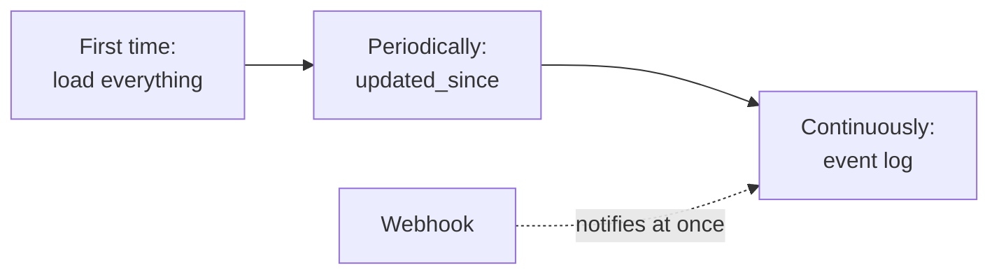
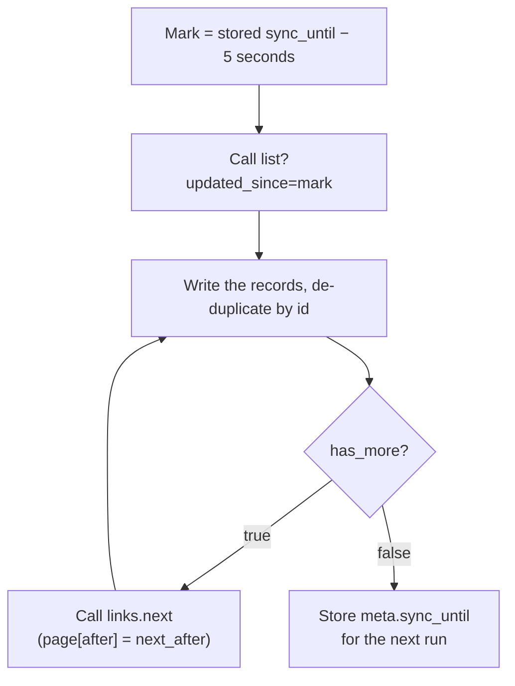
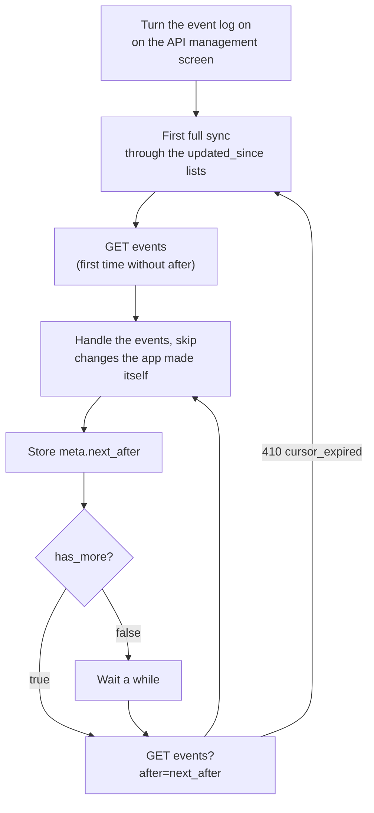
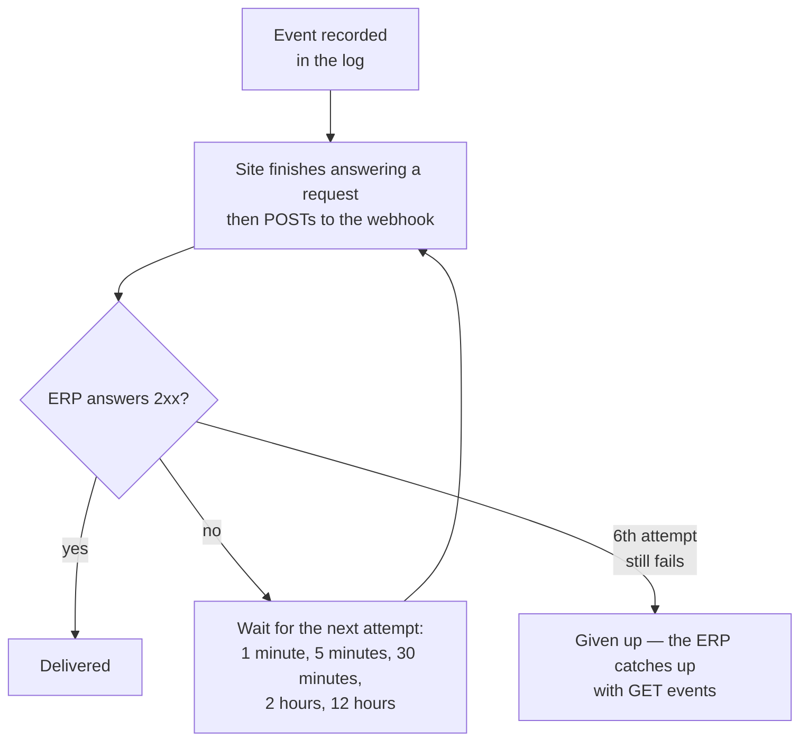

> 🌐 **Language:** [🇻🇳 Tiếng Việt](./api-sync_vi.md) · 🇬🇧 English (current) · [🇯🇵 日本語](./api-sync_ja.md)

# Syncing data with an ERP through the API

## Introduction

This page shows how to keep an ERP, warehouse software or CRM in line with the site without reloading everything: fetch what changed since a point in time
(`updated_since`), read the event log with a cursor, receive webhooks as soon as something changes, and combine the three into one complete sync
process. It is for people integrating back-office systems; you should already know how to sign in to the admin API ([Admin API](./api-admin.md)).

## At a glance

Three ways to receive changes, used together:



- **`updated_since`** — fetch records changed since a point in time; safe, used for periodic sync or to fix drift.
- **Event log** — read each change in order, nothing missed; the site owner must turn it on.
- **Webhook** — the site notifies your system right away; still read the event log to catch up on missed events.

## Syncing changes (`updated_since`)

> ℹ️ **Available since:** gp247/core 3.7.0, gp247/shop 3.6.0, gp247/front 3.4.0

For ERP, accounting software and sync tools: instead of downloading everything again, the app fetches **only the records
that changed** since its last read. Available on the 8 admin lists `api/v2/core/{product,category,brand,supplier,customer,order,banner,page}/list`;
the public lists (`api/v2/front/...`) do not have this mode. Without `updated_since` a list answers exactly as before.

| Parameter | Meaning |
| --- | --- |
| `updated_since` | An ISO-8601 point in time, e.g. `2026-10-31T08:00:00+07:00`. Date only or no offset → the site's timezone. Returns records with `updated_at >= updated_since`, **oldest change first** (by `updated_at`, then `id`) |
| `page[after]` | Page cursor: take it from `meta.next_after` of the previous page. There is no `page[number]` |
| `page[size]` | Records per page, default 20, maximum 100 |
| `filter[...]`, `q` | Still apply as usual. Store scope and the admin-screen permission are unchanged ([Permissions and data scope of the Core API](./api-concepts.md#permissions-and-data-scope-of-the-core-api)) |

The response has no `total`, `last_page` or `current_page`. `meta` holds `per_page`, `next_after` (cursor of the last
record, `null` when the page is empty), `has_more` (whether another page follows), `sync_until` (the `updated_at` of the
last record, ISO-8601, `null` when the page is empty); `links` only has `next` (`null` on the last page).

```bash
curl -G "https://shop.example.com/api/v2/core/product/list" \
  --data-urlencode "updated_since=2026-10-31T08:00:00+07:00" \
  --data-urlencode "page[size]=100" \
  -H "Accept: application/json" \
  -H "Authorization: Bearer 1|aBcD...very-long...XyZ"
```

Trimmed response:

```json
{
  "data": [
    { "id": "PRD-AbC12", "sku": "TSHIRT-01", "name": "T-shirt" }
  ],
  "meta": { "per_page": 100, "next_after": "MjAyNi0xMC0z…", "has_more": true, "sync_until": "2026-10-31T08:15:42+07:00" },
  "links": { "next": "https://shop.example.com/api/v2/core/product/list?updated_since=…&page[size]=100&page[after]=MjAyNi0xMC0z…" }
}
```

> 💡 URL-encode the parameters (as `--data-urlencode` does above): a `+` of the offset left raw in a URL turns into a space.

Recommended sync loop:



- Read every page (until `has_more = false`) before storing `meta.sync_until`; on the next run send `updated_since` =
  `sync_until` **minus a few seconds** (5 seconds) and de-duplicate by `id` — timestamps have one-second precision, so a
  few records come back again. No new records (`sync_until` is `null`) → keep the previous mark.
- HTTP `422` (`validation_failed`) when: `updated_since` is not ISO-8601; `page[after]` is not a cursor returned by the
  list; `sort` or `page[number]` is sent together with `updated_since`.
- **Only real changes move `updated_at`** *(since gp247/shop 3.6.0)*: editing the multilingual text (name, description) of
  a product or category also changes its `updated_at`; saving a form without changing anything, or a customer viewing a
  product page, does **not**.
- **Deleted records do not show up here:** a list can only return records that still exist. To learn which records were
  deleted, read the event log (the next sub-section).
- Upgrading sites must run `php artisan gp247:update` (adds an index on the `updated_at` column of these tables).

## Event log (`events`)

> ℹ️ **Available since:** gp247/core 3.7.0

For ERP and sync tools that need **every change in the order it happened**, including **deleted** records — which the
`updated_since` lists cannot show (a deleted record is no longer there to return). Each change is an **event**; the app
reads them in turn with the cursor `after` = the `id` of the last event it handled.

- **Off by default** (fresh installs and upgraded sites alike). The site owner turns it on with the **Event log for sync
  (ERP)** switch on the API management screen ([Turning the API on and off](./api-concepts.md#turning-the-api-on-and-off)). Reading while it is off → `409 event_log_disabled`. Events are
  **only recorded while it is on** — changes made while it is off never appear in the log.
- **Event types:** gp247/core 3.7.0 provides the log; gp247/shop 3.6.0 records 8 event types for orders, stock, products
  and customers — see [Store event types](#store-event-types). Plugins may add their own event types.

`GET api/v2/core/events` — needs an admin token ([Authentication (logging in to the API)](./api-authentication.md#authentication-logging-in-to-the-api)).

| Parameter | Meaning |
| --- | --- |
| `after` | `id` of the last event the app handled; returns the events after it. Omitted → starts from the oldest event still kept |
| `filter[type]` | Only these event types, comma-separated |
| `page[size]` | Events per read, default 100, maximum 500 |

The response is `{"data": [...], "meta": {...}}`, **oldest event first**. `meta` holds `per_page`, `next_after` (`id` of the
last event on the page — send it as `after` on the next read; on an empty page it equals the `after` you sent) and
`has_more` (whether more events can be read right away).

| Field | Meaning |
| --- | --- |
| `id` | Growing number — use it as the `after` cursor |
| `type` | Event type, in the form `<resource>.<action>` |
| `subject_id` | Key of the changed record |
| `store_id` | Store of the record |
| `source` | Where the change came from: `api`, `admin` (admin pages), `web` (storefront), `system` (commands, background tasks) |
| `actor` | Who made it: `{type, id}` with `type` `admin` or `customer`; `null` when there is none (for example `system`) |
| `data` | A few values declared for that event type — **never** personal data. For the full record, read it again through the detail endpoint |
| `occurred_at` | When it happened, ISO-8601 |

```bash
curl -G "https://shop.example.com/api/v2/core/events" \
  --data-urlencode "after=1520" \
  --data-urlencode "page[size]=100" \
  -H "Accept: application/json" \
  -H "Authorization: Bearer 1|aBcD...very-long...XyZ"
```

Trimmed response:

```json
{
  "data": [
    {
      "id": 1521,
      "type": "stock.changed",
      "subject_id": "AbC12",
      "store_id": "1",
      "source": "admin",
      "actor": { "type": "admin", "id": "1" },
      "data": { "delta": -2, "stock": 13 },
      "occurred_at": "2026-10-31T08:15:42+07:00"
    }
  ],
  "meta": { "per_page": 100, "next_after": 1521, "has_more": false }
}
```

Recommended follow loop:



- **No event is skipped:** an event appears about **5 seconds** after it happened (environment variable
  `GP247_API_EVENT_SETTLE_SECONDS`), so two changes committing at once never let an app following `after` skip one. Store
  `next_after` only after the whole page is handled; if interrupted, read again from the old `after` — handle events so
  that applying one twice does no harm.
- **Permissions:** an account sees only the event types of the admin screens it may open, and only its own store's events
  ([Permissions and data scope of the Core API](./api-concepts.md#permissions-and-data-scope-of-the-core-api)); `filter[type]` only narrows within that. No permission for the screen of any event type (including when the
  site has no event type yet) → `403 forbidden`.
- **Skip your own changes:** if the app also writes data to the site, use `source` and `actor` to recognise and skip the
  events it caused itself, so changes do not bounce back and forth.
- **Kept 30 days** (environment variable `GP247_API_EVENT_DAYS`), cleaned bit by bit while the site handles normal requests
  — no cron needed. An `after` cursor older than the cleaned part → `410 cursor_expired`: resync through `updated_since`,
  then read events again from the start (without `after`). `php artisan gp247:doctor` reports `api_event_retention` when
  old events are not being cleaned.
- `after` that is not an event `id`, or a malformed `filter[type]` → `422 validation_failed`.
- Upgrading sites must run `php artisan gp247:update` (creates the event log table).

### Store event types

> ℹ️ **Available since:** gp247/shop 3.6.0

Each event type belongs to an admin screen: an account can read that type only when it may open the matching screen
([Permissions and data scope of the Core API](./api-concepts.md#permissions-and-data-scope-of-the-core-api)).

| `type` | When | `data` | Who can read it (admins allowed to open the screen) |
| --- | --- | --- | --- |
| `order.created` | A new order (storefront checkout, API checkout, *Create order* on the admin area, plugins) | `status`, `payment_status`, `channel`, `total`, `currency` | Order list screen |
| `order.status_changed` | The order status or the shipping status changed | `field` (`status` or `shipping_status`), `from`, `to` | Order list screen |
| `order.payment_status_changed` | The payment status changed (payments / refunds entered, gateway confirmations, order totals recalculated) | `from`, `to`, `received`, `balance` | Order list screen |
| `stock.changed` | The stock of a product moved (sales and cancellations, stock edits on the product form, API stock commands, plugins such as goods receipts) | `delta` (positive: in, negative: out), `stock` (stock after the move) | Product list screen |
| `product.updated` | A product was edited | `fields` (the **names** of the changed columns, never the values; `descriptions` when the product texts changed), `status` | Product list screen |
| `product.deleted` | A product was deleted | `sku` | Product list screen |
| `customer.created` | A customer signed up or was created (storefront, API, admin area, plugins) | `status` | Customer list screen |
| `customer.updated` | A customer's details changed | `fields` (names of the changed columns; never the values, never the password), `status` | Customer list screen |

- **`order.created`** carries the values **at the moment the order is created**. An order created on the admin area starts
  empty (total 0) and gets its lines afterwards — for the final figures, read the order details (`order/detail/{id}`).
- **`stock.changed`** records one event per product. Selling a build (bundle) product also moves the stock of each
  component → one event per component. A stock move alone gives `stock.changed`, **not** `product.updated`.
- **`product.deleted`** is the only way to learn that a product was deleted (a deleted record no longer appears in lists).
- Events are recorded **whatever the source**: storefront, admin area, API, or plugins saving through the shop's models.
- Saving a form **without changing anything**, or a customer **viewing a product page**, records no event and does not move
  `updated_at` — so the `updated_since` lists also show only real changes.
- A change written **straight into the database with SQL** (bypassing the shop) is not seen. Plugin developers should save
  data through the shop's models so that the ERP sees the change.

## Webhooks (receive events as they happen)

> ℹ️ **Available since:** gp247/core 3.7.0

Instead of only polling `events`, an ERP can register a **webhook**: the site sends each event of the log to the ERP's
address as soon as it happens. Webhooks make delivery **faster**, but they do not replace reading the log — see
[Duplicates, order and catching up missed events](#duplicates-order-and-catching-up-missed-events).

### Registering a webhook

On the API management screen, block **Webhooks for sync (ERP)** — only **administrators** see and manage this block.
Webhooks deliver the events of the log, so the **Event log for sync (ERP)** switch ([Turning the API on and off](./api-concepts.md#turning-the-api-on-and-off)) must be on.

| Item | Meaning |
| --- | --- |
| Receiving URL | An `https` URL pointing to a public internet address. Refused: the local machine, internal / private networks, link-local or cloud metadata addresses, a host name resolving to such an address, a URL with `user:password`, a port below 1024 other than 443 |
| Event types to follow | Checkboxes listing every registered event type (for example the [8 store types](#store-event-types)) |
| On / off | Pauses delivery without deleting the webhook |

- On creation the screen shows the **signing secret only once** — copy it right away. The secret is stored encrypted; if
  you lose it, generate a new one (the old secret stops working at once).
- The block lists the webhooks and the **last 20 deliveries** of each: event id, status (waiting / will retry, delivered,
  given up), number of attempts, HTTP code or error of the last attempt.
- A webhook receives the events of **every store** (administrators see every store) — to follow a single store, filter on
  `store_id` in the body you receive.
- Upgrading sites must run `php artisan gp247:update` (creates the webhook tables).

### What is sent

Each event is one `HTTP POST` request. The body is JSON **exactly equal to one item** of `data` from
`GET api/v2/core/events` (`id`, `type`, `subject_id`, `store_id`, `source`, `actor`, `data`, `occurred_at` — see the field
table in [Event log](#event-log-events)).

| Header | Value |
| --- | --- |
| `Content-Type` | `application/json` |
| `User-Agent` | `GP247-Webhook/1.0` |
| `X-GP247-Event-Id` | The event's `id` |
| `X-GP247-Event-Type` | The event's `type` |
| `X-GP247-Signature` | `t=<unix time>,v1=<signature>` — the signature is the HMAC-SHA256 (hex) of the string `<t>.<raw request body>`, signed with the secret |

### Verifying the signature

Before trusting the body: split `t` and `v1` out of the `X-GP247-Signature` header, recompute the HMAC over `t` + `.` + the
**raw** request body (before decoding the JSON), compare in constant time (`hash_equals`), and refuse when `t` is more than
**5 minutes** away from the current time (stops an old request from being replayed).

```php
$secret = getenv('WEBHOOK_SECRET');            // secret copied when the webhook was created, kept in the ERP's config
$body   = file_get_contents('php://input');     // raw request body

$sig = [];
foreach (explode(',', $_SERVER['HTTP_X_GP247_SIGNATURE'] ?? '') as $pair) {
    [$key, $value] = array_pad(explode('=', $pair, 2), 2, '');
    $sig[$key] = $value;
}
$t  = $sig['t'] ?? '';
$v1 = $sig['v1'] ?? '';

$valid = ctype_digit($t)
    && abs(time() - (int) $t) <= 300
    && hash_equals(hash_hmac('sha256', $t . '.' . $body, $secret), $v1);

if (! $valid) {
    http_response_code(401);
    exit;
}

// Store the event (skip it if X-GP247-Event-Id is already known), handle it later, answer right away
http_response_code(204);
```

### Answering and retries



- Answer **any 2xx** quickly to acknowledge — store the event and handle it later. Any other answer, including a redirect
  (the site **never** follows redirects), counts as a failure.
- After a failure the site retries after 1 minute, 5 minutes, 30 minutes, 2 hours, 12 hours; when the 6th attempt still fails,
  the delivery is **given up** (shown on the screen).
- A webhook that fails **50 times in a row** is **turned off automatically** (the screen says why); turning it back on resets
  the count.
- **No cron or worker needed:** sends run right after the site has answered a request — the request that caused the event,
  or any later request of the site while a retry is due — at most 5 sends and about 2 seconds per request. Consequence: on a
  site with very little traffic a retry waits for the next visit; delivery time is **not guaranteed**.
- **PHP cURL is required** on the server (to connect to exactly the address that was checked). Without cURL nothing is sent; the delivery log shows `curl_missing`.

### Duplicates, order and catching up missed events

- The same event may arrive **more than once** (for example the ERP saved it but answered after the timeout) and **not always
  in order** → de-duplicate by `X-GP247-Event-Id` and sort by `id`.
- Webhooks are a **speed-up**, not the source of truth: keep the `GET api/v2/core/events` loop with the `after` cursor (diagram
  in [Event log](#event-log-events)) to catch up anything missed or given up — with webhooks that loop can simply run less
  often.

## ERP sync from start to finish

> ℹ️ **Available since:** gp247/core 3.7.0, gp247/shop 3.6.0

A short checklist for an ERP or sync tool, in the order to do it. Each step points to the section that describes it —
read the parameters, limits and error codes there.

1. **Turn the event log on:** on the API management screen, turn on **Event log for sync (ERP)**
   ([Turning the API on and off](./api-concepts.md#turning-the-api-on-and-off)) — before the first sync, because changes made while it is off never reach
   the log. To receive events as they happen, also register a webhook (administrators only —
   [Registering a webhook](#registering-a-webhook)).
2. **First full sync:** read each admin list you need (`product/list`, `order/list`, `customer/list`, `category/list`, …)
   with `updated_since` set far in the past (for example `2000-01-01`), following `page[after]` (`links.next`) until
   `has_more` is `false`, then keep the `meta.sync_until` of each list ([Syncing changes](#syncing-changes-updated_since)).
3. **Get the event cursor:** call `GET api/v2/core/events` once **without `after`** (it starts from the oldest event still
   kept), handle it as in step 4, then keep `meta.next_after` as the cursor ([Event log](#event-log-events)).
4. **Keep following:** read the events after the cursor (`after` = the cursor), handle the whole page before saving
   `meta.next_after`; when `has_more` is `false`, wait a while and read again. With a webhook, keep this loop anyway (less
   often) to catch up missed events ([Duplicates, order and catching up missed events](#duplicates-order-and-catching-up-missed-events)).
   For each event:
   - when you need the full record, read it again through its detail endpoint (for example `order/detail/{id}`) — `data`
     carries only a few values;
   - `product.deleted` → delete that product on the ERP side ([Store event types](#store-event-types));
   - skip events your own writes caused: `source` is `api` and `actor` is the admin account the ERP uses.
5. **Write back to the site:** order status, shipping and notes; product price and stock; customer lock
   ([Writing data through the admin API](./api-admin.md#writing-data-through-the-admin-api)). Send a new `Idempotency-Key` with **every**
   write (required for stock writes, worth sending on the others too —
   [Retrying safely with `Idempotency-Key`](./api-admin.md#retrying-safely-with-idempotency-key)); on `429`, wait as `Retry-After` says
   ([Write rate limit](./api-admin.md#write-rate-limit)).
6. **When the cursor is too old:** if reading events answers `410 cursor_expired`, resync with `updated_since` from your saved
   `sync_until` (minus 5 seconds, as in the sync loop), then read the events again from the start, without `after`
   ([Error codes](./api-conventions.md#error-codes)). On top of that, re-run step 2 from the latest `sync_until` from time to time as a safety net.

## Q&A

**Q1: Do I have to turn on the event log?**

→ No. `updated_since` alone is enough to sync; the event log and webhooks help you get changes faster, without asking for the whole list again.

**Q2: Can a site on shared hosting without cron use webhooks?**

→ Yes. A webhook is sent right after the site answers the request that caused the change, with no cron or queue worker needed.

---

<sub>📅 **Last updated:** 2026-11-03 · ✍️ **Author:** GP247</sub>
