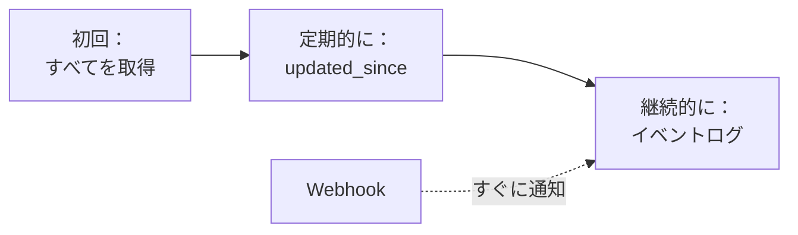
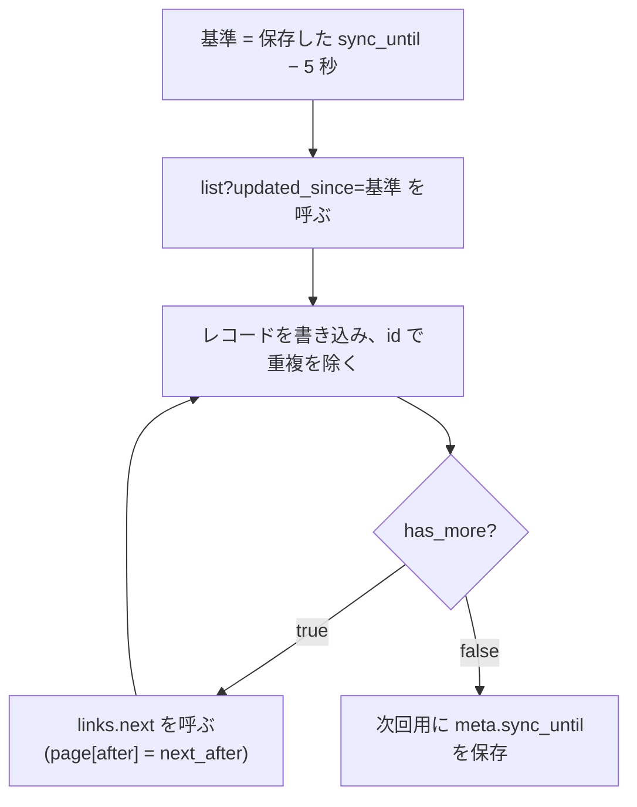
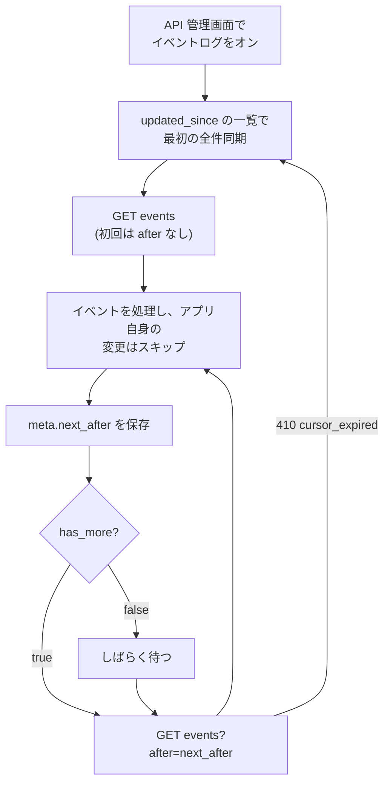
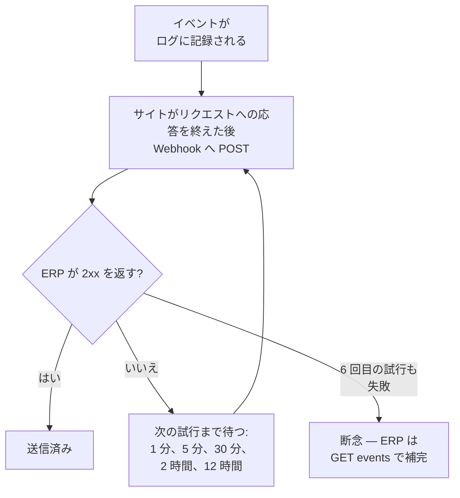

> 🌐 **言語:** [🇻🇳 Tiếng Việt](./api-sync_vi.md) · [🇬🇧 English](./api-sync.md) · 🇯🇵 日本語（現在）

# API による ERP とのデータ同期

## はじめに

このページでは、すべてを再読み込みせずに ERP、倉庫ソフト、CRM のデータをサイトと一致させる方法を説明します：ある時点からの変更を取得する
（`updated_since`）、カーソルでイベントログを読む、変更があるとすぐに Webhook を受け取る、そしてこの 3 つを組み合わせた完全な同期
の流れです。バックエンドのシステムを連携する人向けで、管理 API へのログイン方法を事前に知っている必要があります（[管理 API](./api-admin_ja.md)）。

## ひと目でわかる

変更を受け取る 3 つの方法を組み合わせて使います。



- **`updated_since`** — ある時点以降に変更されたレコードを取得します。安全で、定期的な同期やずれの修正に使います。
- **イベントログ** — 変更を順番に 1 件ずつ読み、取りこぼしがありません。サイトのオーナーがオンにする必要があります。
- **Webhook** — サイトがあなたのシステムにすぐ通知します。取りこぼしたイベントを補うため、ログも引き続き読みます。

## 変更の同期（`updated_since`）

> ℹ️ **対応バージョン:** gp247/core 3.7.0, gp247/shop 3.6.0, gp247/front 3.4.0

ERP、会計ソフト、同期ツール向けの機能です。毎回すべてを取り直す代わりに、前回の読み取り以降に**変更されたレコードだけ**を
取得できます。対象は 8 つの管理用一覧 `api/v2/core/{product,category,brand,supplier,customer,order,banner,page}/list` です。
公開用の一覧（`api/v2/front/...`）にはこのモードはありません。`updated_since` を送らなければ、一覧はこれまでとまったく同じに応答します。

| パラメーター | 意味 |
| --- | --- |
| `updated_since` | ISO-8601 形式の日時。例: `2026-10-31T08:00:00+07:00`。日付のみ、またはオフセットなし → サイトのタイムゾーン。`updated_at >= updated_since` のレコードを、**変更の古い順**（`updated_at`、次に `id`）で返します |
| `page[after]` | ページのカーソル。前のページの `meta.next_after` を使います。`page[number]` はありません |
| `page[size]` | 1 ページあたりの件数。既定 20、最大 100 |
| `filter[...]`, `q` | 通常どおり使えます。ストアの範囲と管理画面の権限は変わりません（3 章） |

レスポンスには `total`、`last_page`、`current_page` はありません。`meta` には `per_page`、`next_after`（最後のレコードの
カーソル。ページが空なら `null`）、`has_more`（次のページがあるか）、`sync_until`（最後のレコードの `updated_at`、ISO-8601。
ページが空なら `null`）が入ります。`links` は `next` のみです（最後のページでは `null`）。

```bash
curl -G "https://shop.example.com/api/v2/core/product/list" \
  --data-urlencode "updated_since=2026-10-31T08:00:00+07:00" \
  --data-urlencode "page[size]=100" \
  -H "Accept: application/json" \
  -H "Authorization: Bearer 1|aBcD...very-long...XyZ"
```

レスポンス（抜粋）:

```json
{
  "data": [
    { "id": "PRD-AbC12", "sku": "TSHIRT-01", "name": "Tシャツ" }
  ],
  "meta": { "per_page": 100, "next_after": "MjAyNi0xMC0z…", "has_more": true, "sync_until": "2026-10-31T08:15:42+07:00" },
  "links": { "next": "https://shop.example.com/api/v2/core/product/list?updated_since=…&page[size]=100&page[after]=MjAyNi0xMC0z…" }
}
```

> 💡 パラメーターは URL エンコードして送ってください（上の `--data-urlencode` のように）。オフセットの `+` をそのまま URL に入れると空白になります。

推奨する同期ループ:



- すべてのページを読み終えてから（`has_more = false` まで）`meta.sync_until` を保存します。次回は `updated_since` =
  `sync_until` **の数秒前**（5 秒）を送り、`id` で重複を除きます。時刻の精度は 1 秒なので、いくつかのレコードが再度返ります。
  新しいレコードがない（`sync_until` が `null`）→ 前回の基準をそのまま使います。
- HTTP `422`（`validation_failed`）になるのは: `updated_since` が ISO-8601 でない場合、`page[after]` が一覧の返したカーソルでない
  場合、`sort` または `page[number]` を `updated_since` と一緒に送った場合です。
- **実際の変更だけが `updated_at` を動かします** *（gp247/shop 3.6.0 から）*: 商品またはカテゴリーの多言語テキスト（名前、
  説明）を編集しても `updated_at` が変わります。何も変えずにフォームを保存した場合や、顧客が商品ページを閲覧した場合は
  **変わりません**。
- **削除されたレコードはここには現れません:** 一覧が返せるのは、まだ存在するレコードだけです。どのレコードが削除されたかを
  知るには、イベントログ（すぐ下の節）を読んでください。
- アップグレードするサイトでは `php artisan gp247:update` を実行してください（これらのテーブルの `updated_at` 列にインデックスを追加します）。

## イベントログ（`events`）

> ℹ️ **対応バージョン:** gp247/core 3.7.0

**すべての変更を起きた順に**知る必要がある ERP や同期ツール向けの機能です。`updated_since` の一覧では分からない**削除された**
レコードも含みます（削除されたレコードは返すものが残っていないため）。変更の 1 件 1 件が**イベント**で、アプリは
カーソル `after` ＝ 最後に処理したイベントの `id` を使って順に読みます。

- **既定はオフ**です（新規インストールでもアップグレードしたサイトでも）。サイトのオーナーが API 管理画面の
  **同期用イベントログ（ERP）** スイッチでオンにします（[API のオン／オフ](./api-concepts_ja.md#api-のオンオフ)）。オフのときに読むと → `409 event_log_disabled`。
  イベントは**オンの間だけ記録されます** — オフの間に起きた変更は、ログに一切現れません。
- **イベントの種類:** gp247/core 3.7.0 がログの仕組みを提供し、gp247/shop 3.6.0 が注文、在庫、商品、顧客について 8 種類の
  イベントを記録します — [ストアのイベントの種類](#ストアのイベントの種類) を参照。プラグインが独自のイベントの種類を追加する
  こともできます。

`GET api/v2/core/events` — 管理者のトークンが必要です（[認証（API へのログイン）](./api-authentication_ja.md#認証api-へのログイン)）。

| パラメーター | 意味 |
| --- | --- |
| `after` | アプリが最後に処理したイベントの `id`。それより後のイベントを返します。省略 → まだ保持されている最も古いイベントから |
| `filter[type]` | これらのイベントの種類だけ（カンマ区切り） |
| `page[size]` | 1 回に読むイベント数。既定 100、最大 500 |

レスポンスは `{"data": [...], "meta": {...}}` で、**古いイベントから順**に並びます。`meta` には `per_page`、`next_after`
（ページの最後のイベントの `id` — 次の読み取りで `after` として送ります。ページが空なら送った `after` と同じ）、`has_more`
（すぐに読める続きのイベントがあるか）が入ります。

| フィールド | 意味 |
| --- | --- |
| `id` | 増え続ける番号 — `after` のカーソルとして使います |
| `type` | イベントの種類。`<リソース>.<操作>` の形式 |
| `subject_id` | 変更されたレコードのキー |
| `store_id` | レコードのストア |
| `source` | 変更の発生元: `api`、`admin`（管理画面）、`web`（ストアフロント）、`system`（コマンド、バックグラウンド処理） |
| `actor` | 変更した人: `{type, id}`（`type` は `admin` または `customer`）。いない場合は `null`（例: `system`） |
| `data` | そのイベントの種類で宣言された少数の値だけ — 個人データは**決して**含みません。レコード全体が必要なら詳細エンドポイントで読み直してください |
| `occurred_at` | 発生日時（ISO-8601） |

```bash
curl -G "https://shop.example.com/api/v2/core/events" \
  --data-urlencode "after=1520" \
  --data-urlencode "page[size]=100" \
  -H "Accept: application/json" \
  -H "Authorization: Bearer 1|aBcD...very-long...XyZ"
```

レスポンス（抜粋）:

```json
{
  "data": [
    {
      "id": 1521,
      "type": "stock.changed",
      "subject_id": "AbC12",
      "store_id": "1",
      "source": "admin",
      "actor": { "type": "admin", "id": "1" },
      "data": { "delta": -2, "stock": 13 },
      "occurred_at": "2026-10-31T08:15:42+07:00"
    }
  ],
  "meta": { "per_page": 100, "next_after": 1521, "has_more": false }
}
```

推奨する追従ループ:



- **イベントを取りこぼさない:** イベントは発生から約 **5 秒**後に現れます（環境変数 `GP247_API_EVENT_SETTLE_SECONDS`）。
  そのため、同時にコミットされた 2 つの変更があっても、`after` で追従するアプリがどちらかを飛ばすことはありません。
  `next_after` はページ全体を処理し終えてから保存してください。中断した場合は前の `after` から読み直します — 同じイベントを
  2 回適用しても問題が起きないように処理してください。
- **権限:** アカウントが見られるのは、開くことを許された管理画面に対応するイベントの種類と、自分のストアのイベントだけです
  （[Core API の権限とデータの範囲](./api-concepts_ja.md#core-api-の権限とデータの範囲)）。`filter[type]` はその範囲の中で絞り込むだけです。どのイベントの種類の画面にも権限がない（サイトにまだ
  イベントの種類がない場合も含む）→ `403 forbidden`。
- **自分の変更はスキップ:** アプリがサイトにデータを書き込むこともある場合は、`source` と `actor` で自分が起こしたイベントを
  見分けてスキップし、変更が行ったり来たりしないようにしてください。
- **保持期間は 30 日**（環境変数 `GP247_API_EVENT_DAYS`）。サイトが通常のリクエストを処理する間に少しずつ削除されるので、
  cron は不要です。削除済みの部分より古い `after` カーソル → `410 cursor_expired`: `updated_since` で同期し直してから、
  イベントを最初から（`after` なしで）読み直してください。古いイベントが削除されていない場合は、`php artisan gp247:doctor`
  が `api_event_retention` で報告します。
- `after` がイベントの `id` でない、または `filter[type]` の形式が不正 → `422 validation_failed`。
- アップグレードするサイトでは `php artisan gp247:update` を実行してください（イベントログのテーブルを作成します）。

### ストアのイベントの種類

> ℹ️ **対応バージョン:** gp247/shop 3.6.0

イベントの種類はそれぞれ 1 つの管理画面に対応します。アカウントがその種類を読めるのは、対応する画面を開く権限がある
場合だけです（[Core API の権限とデータの範囲](./api-concepts_ja.md#core-api-の権限とデータの範囲)）。

| `type` | いつ | `data` | 読める人（画面を開ける管理者） |
| --- | --- | --- | --- |
| `order.created` | 新しい注文（ストアでの注文、API での注文、管理画面の *注文作成*、プラグイン） | `status`, `payment_status`, `channel`, `total`, `currency` | 注文一覧画面 |
| `order.status_changed` | 注文ステータスまたは配送ステータスが変わった | `field`（`status` または `shipping_status`）, `from`, `to` | 注文一覧画面 |
| `order.payment_status_changed` | 支払いステータスが変わった（入金／返金の入力、決済ゲートウェイの確認、注文合計の再計算） | `from`, `to`, `received`, `balance` | 注文一覧画面 |
| `stock.changed` | 商品の在庫が動いた（販売とキャンセル、商品フォームでの在庫編集、API の在庫コマンド、入荷伝票などのプラグイン） | `delta`（正: 入庫、負: 出庫）, `stock`（変動後の在庫） | 商品一覧画面 |
| `product.updated` | 商品が編集された | `fields`（変わった列の**名前**。値は決して含まない。商品のテキストが変わったときは `descriptions`）, `status` | 商品一覧画面 |
| `product.deleted` | 商品が削除された | `sku` | 商品一覧画面 |
| `customer.created` | 顧客が会員登録した、または作成された（ストア、API、管理画面、プラグイン） | `status` | 顧客一覧画面 |
| `customer.updated` | 顧客の情報が変わった | `fields`（変わった列の名前。値もパスワードも決して含まない）, `status` | 顧客一覧画面 |

- **`order.created`** は**注文作成時点**の値を持ちます。管理画面で作成した注文は空（合計 0）で始まり、その後に明細行が
  追加されます — 最終的な数値は注文の詳細（`order/detail/{id}`）を読んでください。
- **`stock.changed`** は商品ごとに 1 件記録されます。ビルド（セット）商品を販売すると各構成品の在庫も動く → 構成品ごとに
  1 件。在庫の変動だけなら `stock.changed` になり、`product.updated` には**なりません**。
- **`product.deleted`** は商品が削除されたことを知る唯一の方法です（削除されたレコードは一覧に現れません）。
- イベントは変更が**どこから来ても**記録されます: ストア、管理画面、API、ショップのモデル経由で保存するプラグイン。
- **何も変えずに**フォームを保存した場合や、顧客が**商品ページを閲覧**した場合は、イベントは記録されず `updated_at` も
  変わりません — そのため `updated_since` の一覧も実際の変更だけを返します。
- **SQL でデータベースに直接**書き込んだ変更（ショップを経由しない）は検知されません。プラグインの開発者は、ERP が変更を
  受け取れるよう、ショップのモデル経由でデータを保存してください。

## Webhook（イベントの発生時にすぐ受け取る）

> ℹ️ **対応バージョン:** gp247/core 3.7.0

`events` を定期的に問い合わせるだけでなく、ERP は **Webhook** を登録できます。サイトはログのイベントを、発生するとすぐに
ERP のアドレスへ 1 件ずつ送ります。Webhook で**より早く**受け取れますが、ログの読み取りの代わりにはなりません —
[重複、順序、取りこぼしの補完](#重複順序取りこぼしの補完) を参照してください。

### Webhook の登録

API 管理画面のブロック **「同期用 Webhook（ERP）」** で行います — このブロックを表示・管理できるのは **administrator** だけです。
Webhook はログのイベントを送るため、**同期用イベントログ（ERP）** スイッチ（[API のオン／オフ](./api-concepts_ja.md#api-のオンオフ)）がオンである必要があります。

| 項目 | 意味 |
| --- | --- |
| 受信 URL | インターネット上の公開アドレスを指す `https` の URL。拒否されるもの: ローカルマシン、内部／プライベートネットワーク、リンクローカルやクラウドのメタデータのアドレス、それらのアドレスに解決されるホスト名、`user:password` を含む URL、443 以外の 1024 未満のポート |
| 追跡するイベントの種類 | 登録済みのすべてのイベントの種類を並べたチェックボックス（例: [ストアの 8 種類](#ストアのイベントの種類)） |
| オン／オフ | Webhook を削除せずに送信を一時停止します |

- 作成時に、画面に**署名用シークレットが一度だけ**表示されます — すぐにコピーしてください。シークレットは暗号化して保存されます。
  なくした場合は新しく生成します（古いシークレットはすぐに無効になります）。
- ブロックには Webhook の一覧と、それぞれの**直近 20 件の送信**が表示されます: イベント ID、状態（待機中／再送予定、送信済み、
  断念）、試行回数、最後の試行の HTTP コードまたはエラー。
- Webhook は**すべてのストア**のイベントを受け取ります（administrator はすべてのストアを見られるため）— 1 つのストアだけを
  追う場合は、受け取った本文の `store_id` で絞り込んでください。
- アップグレードするサイトでは `php artisan gp247:update` を実行してください（Webhook のテーブルを作成します）。

### 送信される内容

1 件のイベントが 1 回の `HTTP POST` リクエストです。本文は `GET api/v2/core/events` の `data` の **1 要素とまったく同じ** JSON
です（`id`、`type`、`subject_id`、`store_id`、`source`、`actor`、`data`、`occurred_at` — フィールドの表は
[イベントログ](#イベントログevents) を参照）。

| ヘッダー | 値 |
| --- | --- |
| `Content-Type` | `application/json` |
| `User-Agent` | `GP247-Webhook/1.0` |
| `X-GP247-Event-Id` | イベントの `id` |
| `X-GP247-Event-Type` | イベントの `type` |
| `X-GP247-Signature` | `t=<UNIX 時刻>,v1=<署名>` — 署名は文字列 `<t>.<加工前のリクエスト本文>` をシークレットで計算した HMAC-SHA256（16 進数） |

### 署名の検証

本文を信用する前に: `X-GP247-Signature` ヘッダーから `t` と `v1` を取り出し、`t` + `.` + **加工前の**リクエスト本文（JSON を
デコードする前）で HMAC を計算し直し、処理時間の差が出ない比較（`hash_equals`）で照合し、`t` が現在時刻から **5 分**以上
ずれていれば拒否します（古いリクエストの再送を防ぐため）。

```php
$secret = getenv('WEBHOOK_SECRET');            // Webhook 作成時にコピーしたシークレット（ERP の設定に保管）
$body   = file_get_contents('php://input');     // 加工前のリクエスト本文

$sig = [];
foreach (explode(',', $_SERVER['HTTP_X_GP247_SIGNATURE'] ?? '') as $pair) {
    [$key, $value] = array_pad(explode('=', $pair, 2), 2, '');
    $sig[$key] = $value;
}
$t  = $sig['t'] ?? '';
$v1 = $sig['v1'] ?? '';

$valid = ctype_digit($t)
    && abs(time() - (int) $t) <= 300
    && hash_equals(hash_hmac('sha256', $t . '.' . $body, $secret), $v1);

if (! $valid) {
    http_response_code(401);
    exit;
}

// イベントを保存し（X-GP247-Event-Id が既知ならスキップ）、処理は後で行い、すぐに応答する
http_response_code(204);
```

### 応答と再送



- 受け取ったことを知らせるため、**任意の 2xx** をすぐに返してください — イベントを保存し、処理は後で行います。それ以外の応答は、
  リダイレクトも含めて失敗として扱われます（サイトはリダイレクトを**決して**たどりません）。
- 失敗すると、1 分、5 分、30 分、2 時間、12 時間後に再送します。6 回目の試行も失敗すると、その送信は**断念**されます（画面に
  表示されます）。
- **50 回連続で**失敗した Webhook は**自動的にオフ**になります（画面に理由が表示されます）。オンに戻すと回数はリセットされます。
- **cron やワーカーは不要:** 送信はサイトがリクエストに応答し終えた直後に行われます — イベントを起こしたリクエスト、または
  再送の時刻が来た後のサイトへの任意のリクエストです。1 リクエストあたり最大 5 件、約 2 秒まで。そのため、アクセスがとても
  少ないサイトでは再送が次のアクセスまで待つことになり、受信のタイミングは**保証されません**。
- サーバーに **PHP の cURL が必要**です（確認済みのアドレスにだけ接続するため）。cURL がない場合は送信されず、送信履歴に `curl_missing` と表示されます。

### 重複、順序、取りこぼしの補完

- 同じイベントが**複数回**届くことがあり（例: ERP は保存したがタイムアウト後に応答した）、**順番どおりとは限りません** →
  `X-GP247-Event-Id` で重複を除き、`id` で並べ替えてください。
- Webhook は**早く受け取るための仕組み**で、正となるデータ源ではありません: 取りこぼしたイベントや断念されたイベントを補うため、
  カーソル `after` を使った `GET api/v2/core/events` のループ（図は [イベントログ](#イベントログevents)）を続けてください —
  Webhook があれば、そのループの間隔は長くできます。

## ERP 同期の全体の流れ

> ℹ️ **対応バージョン:** gp247/core 3.7.0, gp247/shop 3.6.0

ERP や同期ツール向けの短いチェックリストです。上から順に進めてください。各ステップは詳しく説明しているセクションを指しています —
パラメーター、制限、エラーコードはそちらを参照してください。

1. **イベントログをオンにする:** API 管理画面で **同期用イベントログ（ERP）** のスイッチをオンにします
   （[API のオン／オフ](./api-concepts_ja.md#api-のオンオフ)）。オフの間の変更はログに一切残らないため、最初の同期より前にオンにしてください。
   イベントの発生時にすぐ受け取りたい場合は、Webhook も登録します（管理者のみ — [Webhook の登録](#webhook-の登録)）。
2. **最初の全件同期:** 必要な管理一覧（`product/list`、`order/list`、`customer/list`、`category/list`、…）を、
   `updated_since` に十分に古い日時（例: `2000-01-01`）を指定して読み、`has_more` が `false` になるまで `page[after]`
   （`links.next`）をたどります。その後、一覧ごとに `meta.sync_until` を保存します（[変更の同期](#変更の同期updated_since)）。
3. **イベントのカーソルを取得する:** `GET api/v2/core/events` を **`after` なし**で 1 回呼び出し（保持されている最も古いイベントから始まります）、
   ステップ 4 と同じように処理してから、`meta.next_after` をカーソルとして保存します（[イベントログ](#イベントログevents)）。
4. **継続して追跡する:** カーソルより後のイベントを読み（`after` = カーソル）、ページ全体を処理してから `meta.next_after` を保存します。
   `has_more` が `false` なら、しばらく待ってから再び読みます。Webhook を使う場合も、取りこぼしを補うためにこのループは
   続けてください（間隔は長くて構いません — [重複、順序、取りこぼしの補完](#重複順序取りこぼしの補完)）。各イベントについて:
   - レコード全体が必要なときは、詳細エンドポイント（例: `order/detail/{id}`）で読み直します — `data` にはいくつかの値しかありません。
   - `product.deleted` → ERP 側でその商品を削除します（[ストアのイベントの種類](#ストアのイベントの種類)）。
   - ERP 自身の書き込みによるイベントはスキップします: `source` が `api` で、`actor` が ERP の使う管理アカウントのもの。
5. **サイトへ書き戻す:** 注文のステータス、配送、メモ／商品の価格と在庫／顧客のロック
   （[管理 API によるデータの書き込み](./api-admin_ja.md#管理-api-によるデータの書き込み)）。書き込みの**たびに**新しい `Idempotency-Key` を送ってください
   （在庫の書き込みでは必須、ほかの書き込みでも送ることをおすすめします — [`Idempotency-Key` で安全に再送する](./api-admin_ja.md#idempotency-key-で安全に再送する)）。
   `429` が返ったら `Retry-After` に従って待ちます（[書き込みの回数制限](./api-admin_ja.md#書き込みの回数制限)）。
6. **カーソルが古すぎる場合:** イベントの読み取りで `410 cursor_expired` が返ったら、保存した `sync_until`（同期ループと同じく
   5 秒引いた値）から `updated_since` で同期し直し、`after` なしでイベントを最初から読み直します（[エラーコード](./api-conventions_ja.md#エラーコード)）。
   さらに、安全策として最新の `sync_until` からステップ 2 を定期的に実行し直してください。

## よくある質問（Q&A）

**Q1: イベントログは必ずオンにする必要がありますか？**

→ 必要ありません。`updated_since` だけでも同期できます。イベントログと Webhook を使うと、一覧全体を問い合わせ直さずに、より早く変更を受け取れます。

**Q2: cron のない共用ホスティングのサイトでも Webhook を使えますか？**

→ 使えます。Webhook は変更を起こしたリクエストにサイトが応答した直後に送信され、cron やキューワーカーは不要です。

---

<sub>📅 **最終更新:** 2026-11-03 · ✍️ **作成者 (Author):** GP247</sub>
