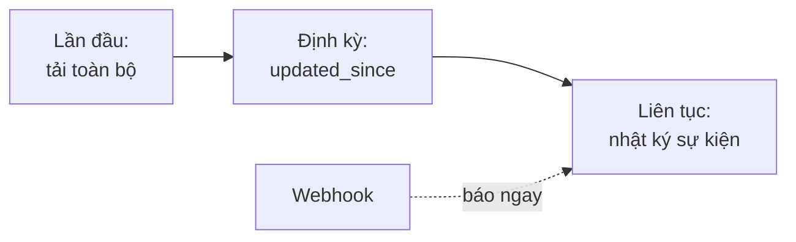
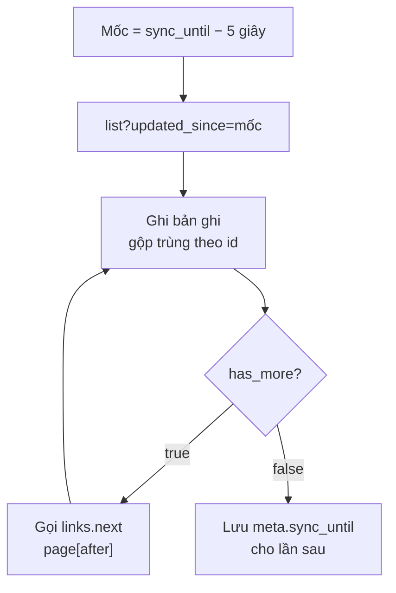
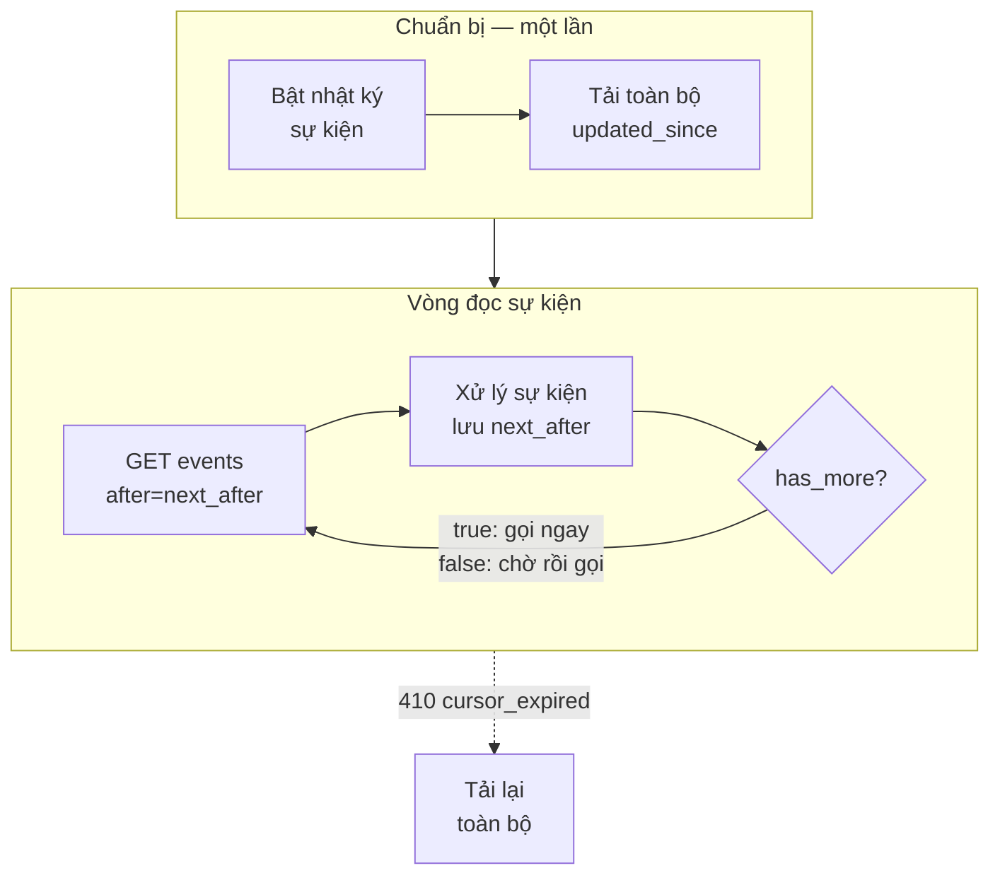
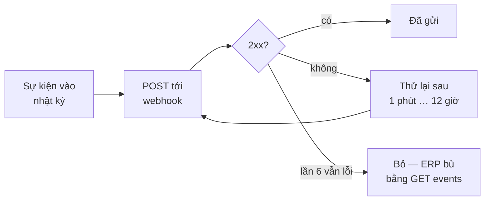

> 🌐 **Ngôn ngữ:** 🇻🇳 Tiếng Việt (hiện tại) · [🇬🇧 English](./api-sync.md) · [🇯🇵 日本語](./api-sync_ja.md)

# Đồng bộ dữ liệu với ERP qua API

## Giới thiệu

Trang này hướng dẫn giữ ERP, phần mềm kho hay CRM khớp dữ liệu với site mà không phải tải lại toàn bộ: lấy phần thay đổi từ một mốc
(`updated_since`), đọc nhật ký sự kiện theo con trỏ, nhận webhook ngay khi có thay đổi, và ghép ba cách này thành một quy trình đồng bộ
trọn vẹn. Dành cho người tích hợp hệ thống phía sau; cần biết trước cách đăng nhập API quản trị ([API quản trị](./api-admin_vi.md)).

## Nhìn nhanh

Ba cách nhận thay đổi, dùng kết hợp:



- **`updated_since`** — lấy các bản ghi đổi từ một mốc thời gian; an toàn, dùng để đồng bộ định kỳ hoặc sửa lệch.
- **Nhật ký sự kiện** — đọc từng thay đổi theo thứ tự, không bỏ sót; cần chủ site bật.
- **Webhook** — site báo ngay cho hệ thống của bạn; vẫn đọc nhật ký để bù sự kiện bị lỡ.

## Đồng bộ thay đổi (`updated_since`)

> ℹ️ **Có từ:** gp247/core 3.7.0, gp247/shop 3.6.0, gp247/front 3.4.0

Dành cho phần mềm ERP, kế toán hay công cụ đồng bộ: thay vì tải lại toàn bộ, ứng dụng chỉ lấy **những bản ghi đã đổi**
kể từ lần đọc trước. Có ở 8 danh sách quản trị `api/v2/core/{product,category,brand,supplier,customer,order,banner,page}/list`;
danh sách công khai (`api/v2/front/...`) không có chế độ này. Không gửi `updated_since` thì danh sách trả lời đúng như cũ.

| Tham số | Ý nghĩa |
| --- | --- |
| `updated_since` | Mốc thời gian ISO-8601, ví dụ `2026-10-31T08:00:00+07:00`. Chỉ có ngày hoặc không có múi giờ → theo múi giờ của site. Trả về bản ghi có `updated_at >= updated_since`, **thay đổi cũ nhất trước** (theo `updated_at`, rồi `id`) |
| `page[after]` | Con trỏ trang: lấy từ `meta.next_after` của trang trước. Không có `page[number]` |
| `page[size]` | Số bản ghi mỗi trang, mặc định 20, tối đa 100 |
| `filter[...]`, `q` | Vẫn áp dụng như thường. Phạm vi cửa hàng và quyền màn quản trị giữ nguyên ([Phân quyền và phạm vi dữ liệu của API Core](./api-concepts_vi.md#phân-quyền-và-phạm-vi-dữ-liệu-của-api-core)) |

Phản hồi không có `total`, `last_page`, `current_page`. `meta` gồm `per_page`, `next_after` (con trỏ của bản ghi cuối,
`null` khi trang rỗng), `has_more` (còn trang sau hay không), `sync_until` (thời điểm `updated_at` của bản ghi cuối, dạng
ISO-8601, `null` khi trang rỗng); `links` chỉ có `next` (`null` ở trang cuối).

```bash
curl -G "https://shop.example.com/api/v2/core/product/list" \
  --data-urlencode "updated_since=2026-10-31T08:00:00+07:00" \
  --data-urlencode "page[size]=100" \
  -H "Accept: application/json" \
  -H "Authorization: Bearer 1|aBcD...rất-dài...XyZ"
```

Phản hồi rút gọn:

```json
{
  "data": [
    { "id": "PRD-AbC12", "sku": "TSHIRT-01", "name": "Áo thun" }
  ],
  "meta": { "per_page": 100, "next_after": "MjAyNi0xMC0z…", "has_more": true, "sync_until": "2026-10-31T08:15:42+07:00" },
  "links": { "next": "https://shop.example.com/api/v2/core/product/list?updated_since=…&page[size]=100&page[after]=MjAyNi0xMC0z…" }
}
```

> 💡 Mã hoá tham số khi gửi (như `--data-urlencode` ở trên): dấu `+` của múi giờ để nguyên trong URL sẽ thành dấu cách.

Vòng đồng bộ khuyến nghị:



- Đọc hết các trang (tới khi `has_more = false`) rồi mới lưu `meta.sync_until`; lần chạy sau gửi `updated_since` =
  `sync_until` **trừ vài giây** (5 giây) và gộp trùng theo `id` — thời gian chỉ chính xác tới từng giây nên vài bản ghi sẽ
  được trả lại lần nữa. Không có bản ghi nào mới (`sync_until` là `null`) → giữ mốc cũ.
- HTTP `422` (`validation_failed`) khi: `updated_since` không đúng ISO-8601; `page[after]` không phải con trỏ do danh sách trả
  về; gửi `sort` hoặc `page[number]` cùng với `updated_since`.
- **Chỉ thay đổi thật mới đổi `updated_at`** *(từ gp247/shop 3.6.0)*: sửa phần chữ đa ngôn ngữ (tên, mô tả) của sản phẩm
  hoặc danh mục cũng làm đổi `updated_at` của nó; lưu form mà không đổi gì, hay khách xem trang sản phẩm, thì **không**.
- **Bản ghi đã xoá không xuất hiện ở đây:** danh sách chỉ trả được bản ghi còn tồn tại. Muốn biết bản ghi nào đã bị xoá,
  đọc nhật ký sự kiện (mục ngay dưới).
- Site nâng cấp phải chạy `php artisan gp247:update` (thêm chỉ mục cho cột `updated_at` của các bảng này).

## Nhật ký sự kiện (`events`)

> ℹ️ **Có từ:** gp247/core 3.7.0

Dành cho ERP và công cụ đồng bộ cần biết **từng thay đổi theo đúng thứ tự xảy ra**, kể cả bản ghi **đã bị xoá** — thứ
mà danh sách `updated_since` không cho thấy được (bản ghi đã xoá không còn để trả về). Mỗi thay đổi là một **sự kiện**;
ứng dụng đọc lần lượt bằng con trỏ `after` = `id` của sự kiện cuối cùng đã xử lý.

- **Mặc định tắt** (cả site cài mới lẫn site nâng cấp). Chủ site bật bằng công tắc **Nhật ký sự kiện cho đồng bộ (ERP)** trên
  màn quản lý API ([Bật/tắt API](./api-concepts_vi.md#bậttắt-api)). Đang tắt mà đọc → `409 event_log_disabled`. Sự kiện **chỉ được ghi khi đang bật** — thay đổi
  xảy ra lúc tắt không bao giờ có trong nhật ký.
- **Loại sự kiện:** gp247/core 3.7.0 cung cấp nhật ký; gp247/shop 3.6.0 ghi 8 loại sự kiện của đơn hàng, tồn kho, sản phẩm
  và khách hàng — xem [Loại sự kiện của cửa hàng](#loại-sự-kiện-của-cửa-hàng). Plugin có thể thêm loại sự kiện riêng.

`GET api/v2/core/events` — cần token admin ([Xác thực (đăng nhập vào API)](./api-authentication_vi.md#xác-thực-đăng-nhập-vào-api)).

| Tham số | Ý nghĩa |
| --- | --- |
| `after` | `id` của sự kiện cuối cùng ứng dụng đã xử lý; trả về các sự kiện sau nó. Không gửi → bắt đầu từ sự kiện cũ nhất còn được giữ |
| `filter[type]` | Chỉ lấy các loại sự kiện này, cách nhau bằng dấu phẩy |
| `page[size]` | Số sự kiện mỗi lần đọc, mặc định 100, tối đa 500 |

Phản hồi có dạng `{"data": [...], "meta": {...}}`, sự kiện **cũ nhất trước**. `meta` gồm `per_page`, `next_after` (`id` của
sự kiện cuối trong trang — gửi làm `after` ở lần đọc sau; trang rỗng thì bằng `after` đã gửi) và `has_more` (còn sự kiện để
đọc tiếp ngay hay không).

| Trường | Ý nghĩa |
| --- | --- |
| `id` | Số tăng dần — dùng làm con trỏ `after` |
| `type` | Loại sự kiện, dạng `<tài nguyên>.<hành động>` |
| `subject_id` | Mã của bản ghi bị thay đổi |
| `store_id` | Cửa hàng của bản ghi |
| `source` | Nơi phát sinh thay đổi: `api`, `admin` (trang quản trị), `web` (cửa hàng), `system` (lệnh, tác vụ chạy nền) |
| `actor` | Ai thực hiện: `{type, id}` với `type` là `admin` hoặc `customer`; `null` khi không có (ví dụ `system`) |
| `data` | Vài giá trị đã khai báo cho loại sự kiện đó — **không bao giờ** chứa dữ liệu cá nhân. Cần đủ thông tin thì đọc lại bản ghi qua endpoint chi tiết |
| `occurred_at` | Thời điểm xảy ra, ISO-8601 |

```bash
curl -G "https://shop.example.com/api/v2/core/events" \
  --data-urlencode "after=1520" \
  --data-urlencode "page[size]=100" \
  -H "Accept: application/json" \
  -H "Authorization: Bearer 1|aBcD...rất-dài...XyZ"
```

Phản hồi rút gọn:

```json
{
  "data": [
    {
      "id": 1521,
      "type": "stock.changed",
      "subject_id": "AbC12",
      "store_id": "1",
      "source": "admin",
      "actor": { "type": "admin", "id": "1" },
      "data": { "delta": -2, "stock": 13 },
      "occurred_at": "2026-10-31T08:15:42+07:00"
    }
  ],
  "meta": { "per_page": 100, "next_after": 1521, "has_more": false }
}
```

Vòng theo dõi khuyến nghị:



- **Không sót sự kiện:** một sự kiện chỉ xuất hiện khoảng **5 giây** sau khi xảy ra (biến môi trường
  `GP247_API_EVENT_SETTLE_SECONDS`), để hai thay đổi ghi cùng lúc không bao giờ làm ứng dụng đi theo `after` bỏ qua một sự
  kiện. Chỉ lưu `next_after` sau khi đã xử lý xong cả trang; bị gián đoạn thì đọc lại từ `after` cũ — xử lý sao cho áp lại
  một sự kiện không gây sai.
- **Quyền:** tài khoản chỉ thấy các loại sự kiện thuộc những màn quản trị nó được mở, và chỉ sự kiện của cửa hàng mình
  ([Phân quyền và phạm vi dữ liệu của API Core](./api-concepts_vi.md#phân-quyền-và-phạm-vi-dữ-liệu-của-api-core)); `filter[type]` chỉ thu hẹp trong phạm vi đó. Không có quyền màn nào ứng với một loại sự kiện (kể cả khi site chưa
  có loại sự kiện nào) → `403 forbidden`.
- **Bỏ qua thay đổi của chính mình:** nếu ứng dụng cũng ghi dữ liệu vào site, dùng `source` và `actor` để nhận ra và bỏ
  qua sự kiện do chính nó tạo ra, tránh ghi đi ghi lại vòng tròn.
- **Giữ 30 ngày** (biến môi trường `GP247_API_EVENT_DAYS`), dọn dần trong lúc site xử lý yêu cầu bình thường — không cần
  cron. Con trỏ `after` cũ hơn phần đã dọn → `410 cursor_expired`: đồng bộ lại bằng `updated_since`, rồi đọc sự kiện lại từ
  đầu (không gửi `after`). `php artisan gp247:doctor` báo ở mục `api_event_retention` khi sự kiện cũ không được dọn.
- `after` không phải `id` sự kiện hoặc `filter[type]` sai dạng → `422 validation_failed`.
- Site nâng cấp phải chạy `php artisan gp247:update` (tạo bảng nhật ký sự kiện).

### Loại sự kiện của cửa hàng

> ℹ️ **Có từ:** gp247/shop 3.6.0

Mỗi loại sự kiện gắn với một màn quản trị: tài khoản chỉ đọc được loại đó khi được mở màn tương ứng ([Phân quyền và phạm vi dữ liệu của API Core](./api-concepts_vi.md#phân-quyền-và-phạm-vi-dữ-liệu-của-api-core)).

| `type` | Khi nào | `data` | Ai đọc được (quản trị viên được mở màn) |
| --- | --- | --- | --- |
| `order.created` | Có đơn hàng mới (đặt trên cửa hàng, đặt qua API, nút *Tạo đơn* trên trang quản trị, plugin) | `status`, `payment_status`, `channel`, `total`, `currency` | Màn Danh sách đơn hàng |
| `order.status_changed` | Đổi trạng thái đơn hoặc trạng thái giao hàng | `field` (`status` hoặc `shipping_status`), `from`, `to` | Màn Danh sách đơn hàng |
| `order.payment_status_changed` | Đổi trạng thái thanh toán (nhập khoản thu / hoàn tiền, cổng thanh toán xác nhận, tính lại tổng đơn) | `from`, `to`, `received`, `balance` | Màn Danh sách đơn hàng |
| `stock.changed` | Tồn kho của một sản phẩm thay đổi (bán hàng và huỷ đơn, sửa tồn kho trên form sản phẩm, lệnh tồn kho qua API, plugin như phiếu nhập hàng) | `delta` (dương: vào kho, âm: ra kho), `stock` (tồn kho sau thay đổi) | Màn Danh sách sản phẩm |
| `product.updated` | Sửa một sản phẩm | `fields` (**tên** các cột đã đổi, không bao giờ có giá trị; `descriptions` khi phần chữ của sản phẩm đổi), `status` | Màn Danh sách sản phẩm |
| `product.deleted` | Xoá một sản phẩm | `sku` | Màn Danh sách sản phẩm |
| `customer.created` | Khách đăng ký hoặc được tạo (cửa hàng, API, trang quản trị, plugin) | `status` | Màn Danh sách khách hàng |
| `customer.updated` | Thông tin khách thay đổi | `fields` (tên các cột đã đổi; không bao giờ có giá trị, không bao giờ có mật khẩu), `status` | Màn Danh sách khách hàng |

- **`order.created`** mang giá trị **tại lúc tạo đơn**. Đơn tạo trên trang quản trị bắt đầu rỗng (tổng 0) rồi mới thêm dòng hàng
  — cần số liệu cuối cùng thì đọc chi tiết đơn (`order/detail/{id}`).
- **`stock.changed`** ghi một sự kiện cho mỗi sản phẩm. Bán một sản phẩm dạng build (combo) thì tồn kho của từng thành phần
  cũng đổi → mỗi thành phần một sự kiện. Chỉ đổi tồn kho thì có `stock.changed`, **không** có `product.updated`.
- **`product.deleted`** là cách duy nhất để biết một sản phẩm đã bị xoá (bản ghi đã xoá không còn trong danh sách).
- Sự kiện được ghi **bất kể thay đổi đến từ đâu**: cửa hàng, trang quản trị, API hay plugin lưu qua model của cửa hàng.
- Lưu form mà **không đổi gì**, hay khách **xem trang sản phẩm**, không ghi sự kiện nào và không đổi `updated_at` — danh sách
  `updated_since` cũng chỉ trả thay đổi thật.
- Thay đổi ghi **thẳng vào cơ sở dữ liệu bằng SQL** (không qua cửa hàng) không được nhận ra. Lập trình viên plugin hãy lưu
  dữ liệu qua model của cửa hàng để ERP thấy thay đổi.

## Webhook (nhận sự kiện ngay khi xảy ra)

> ℹ️ **Có từ:** gp247/core 3.7.0

Thay vì chỉ hỏi `events` định kỳ, ERP có thể đăng ký một **webhook**: site gửi ngay từng sự kiện của nhật ký tới địa chỉ
của ERP khi sự kiện xảy ra. Webhook giúp nhận **nhanh hơn**, nhưng không thay thế việc đọc nhật ký — xem
[Trùng lặp, thứ tự và bù sự kiện bị lỡ](#trùng-lặp-thứ-tự-và-bù-sự-kiện-bị-lỡ).

### Đăng ký webhook

Trên màn quản lý API, khối **Webhook cho đồng bộ (ERP)** — chỉ **administrator** thấy và quản lý khối này. Webhook gửi sự
kiện của nhật ký, nên công tắc **Nhật ký sự kiện cho đồng bộ (ERP)** ([Bật/tắt API](./api-concepts_vi.md#bậttắt-api)) phải đang bật.

| Mục | Ý nghĩa |
| --- | --- |
| Địa chỉ nhận | URL `https` trỏ tới một địa chỉ công khai trên internet. Bị từ chối: máy cục bộ, mạng nội bộ / mạng riêng, địa chỉ link-local hay địa chỉ metadata của cloud, tên máy phân giải ra các địa chỉ đó, URL có `user:password`, cổng dưới 1024 khác 443 |
| Loại sự kiện theo dõi | Ô chọn liệt kê mọi loại sự kiện đã đăng ký (ví dụ [8 loại của cửa hàng](#loại-sự-kiện-của-cửa-hàng)) |
| Bật / tắt | Tạm ngưng gửi mà không xoá webhook |

- Lúc tạo, màn hiện **khoá ký (secret) một lần duy nhất** — chép ngay. Khoá được lưu mã hoá; nếu mất, sinh lại khoá mới
  (khoá cũ hết hiệu lực ngay).
- Khối liệt kê các webhook và **20 lần gửi gần nhất** của mỗi webhook: mã sự kiện, trạng thái (đang chờ / sẽ thử lại, đã gửi,
  đã bỏ), số lần thử, mã HTTP hoặc lỗi của lần thử cuối.
- Webhook nhận sự kiện của **mọi cửa hàng** (administrator thấy mọi cửa hàng) — cần riêng một cửa hàng thì lọc theo `store_id`
  trong nội dung nhận được.
- Site nâng cấp phải chạy `php artisan gp247:update` (tạo bảng của webhook).

### Nội dung gửi đi

Mỗi sự kiện là một yêu cầu `HTTP POST`. Thân yêu cầu là JSON **đúng bằng một phần tử** trong `data` của
`GET api/v2/core/events` (`id`, `type`, `subject_id`, `store_id`, `source`, `actor`, `data`, `occurred_at` — xem bảng trường ở
[Nhật ký sự kiện](#nhật-ký-sự-kiện-events)).

| Header | Giá trị |
| --- | --- |
| `Content-Type` | `application/json` |
| `User-Agent` | `GP247-Webhook/1.0` |
| `X-GP247-Event-Id` | `id` của sự kiện |
| `X-GP247-Event-Type` | `type` của sự kiện |
| `X-GP247-Signature` | `t=<thời điểm unix>,v1=<chữ ký>` — chữ ký là HMAC-SHA256 (dạng hex) của chuỗi `<t>.<thân yêu cầu nguyên bản>`, ký bằng khoá ký |

### Kiểm chữ ký

Trước khi tin nội dung: tách `t` và `v1` từ header `X-GP247-Signature`, tính lại HMAC trên `t` + `.` + thân yêu cầu
**nguyên bản** (chưa giải mã JSON), so sánh bằng hàm so sánh không lộ thời gian (`hash_equals`), và từ chối khi `t` lệch quá
**5 phút** so với giờ hiện tại (chống gửi lại một yêu cầu cũ).

```php
$secret = getenv('WEBHOOK_SECRET');            // khoá ký đã chép lúc tạo webhook, giữ trong cấu hình của ERP
$body   = file_get_contents('php://input');     // thân yêu cầu nguyên bản

$sig = [];
foreach (explode(',', $_SERVER['HTTP_X_GP247_SIGNATURE'] ?? '') as $pair) {
    [$key, $value] = array_pad(explode('=', $pair, 2), 2, '');
    $sig[$key] = $value;
}
$t  = $sig['t'] ?? '';
$v1 = $sig['v1'] ?? '';

$valid = ctype_digit($t)
    && abs(time() - (int) $t) <= 300
    && hash_equals(hash_hmac('sha256', $t . '.' . $body, $secret), $v1);

if (! $valid) {
    http_response_code(401);
    exit;
}

// Lưu sự kiện (bỏ qua nếu X-GP247-Event-Id đã có), xử lý sau, trả lời ngay
http_response_code(204);
```

### Trả lời và gửi lại



- Trả **bất kỳ mã 2xx** thật nhanh để xác nhận đã nhận — lưu sự kiện rồi xử lý sau. Mọi mã khác, kể cả chuyển hướng (site
  **không bao giờ** đi theo chuyển hướng), đều tính là thất bại.
- Thất bại thì gửi lại sau 1 phút, 5 phút, 30 phút, 2 giờ, 12 giờ; lần thử thứ 6 vẫn thất bại thì lần gửi đó **bị bỏ** (hiện
  trên màn).
- Webhook thất bại **50 lần liên tiếp** bị **tự tắt** (màn ghi rõ lý do); bật lại thì bộ đếm về 0.
- **Không cần cron hay worker:** việc gửi chạy ngay sau khi site đã trả lời một yêu cầu — chính yêu cầu gây ra sự kiện, hoặc
  bất kỳ yêu cầu nào sau đó của site khi đến hạn gửi lại — tối đa 5 lần gửi và khoảng 2 giây cho mỗi yêu cầu. Hệ quả: site rất
  ít lượt truy cập thì lần gửi lại phải chờ tới lượt truy cập kế tiếp; thời điểm nhận **không được bảo đảm**.
- **Cần PHP cURL** trên máy chủ (để kết nối đúng địa chỉ đã kiểm). Thiếu cURL thì không gửi; nhật ký giao ghi `curl_missing`.

### Trùng lặp, thứ tự và bù sự kiện bị lỡ

- Cùng một sự kiện có thể tới **nhiều hơn một lần** (ví dụ ERP đã lưu nhưng trả lời quá thời gian chờ) và **không phải lúc nào
  cũng đúng thứ tự** → khử trùng theo `X-GP247-Event-Id` và sắp xếp theo `id`.
- Webhook là để **nhận nhanh hơn**, không phải nguồn dữ liệu chuẩn: vẫn giữ vòng đọc `GET api/v2/core/events` bằng con trỏ
  `after` (sơ đồ ở [Nhật ký sự kiện](#nhật-ký-sự-kiện-events)) để bù những sự kiện bị lỡ hoặc đã bị bỏ — có webhook thì vòng
  đó chạy thưa hơn được.

## Đồng bộ ERP từ đầu đến cuối

> ℹ️ **Có từ:** gp247/core 3.7.0, gp247/shop 3.6.0

Danh sách kiểm tra ngắn cho ERP hay công cụ đồng bộ, theo đúng thứ tự làm. Mỗi bước trỏ tới mục mô tả chi tiết — tham số,
giới hạn và mã lỗi đọc ở đó.

1. **Bật nhật ký sự kiện:** trên màn quản lý API, bật công tắc **Nhật ký sự kiện cho đồng bộ (ERP)** ([Bật/tắt API](./api-concepts_vi.md#bậttắt-api))
   — bật trước khi đồng bộ lần đầu, vì thay đổi xảy ra lúc tắt không bao giờ có trong nhật ký. Muốn nhận sự kiện ngay khi
   xảy ra thì đăng ký thêm webhook (chỉ administrator — [Đăng ký webhook](#đăng-ký-webhook)).
2. **Đồng bộ toàn bộ lần đầu:** đọc từng danh sách quản trị cần dùng (`product/list`, `order/list`, `customer/list`,
   `category/list`, …) với `updated_since` là một mốc rất xa trong quá khứ (ví dụ `2000-01-01`), đi theo `page[after]`
   (`links.next`) tới khi `has_more` là `false`, rồi lưu `meta.sync_until` của từng danh sách
   ([Đồng bộ thay đổi](#đồng-bộ-thay-đổi-updated_since)).
3. **Lấy con trỏ sự kiện:** gọi `GET api/v2/core/events` một lần **không gửi `after`** (bắt đầu từ sự kiện cũ nhất còn giữ),
   xử lý như bước 4 rồi lưu `meta.next_after` làm con trỏ ([Nhật ký sự kiện](#nhật-ký-sự-kiện-events)).
4. **Theo dõi liên tục:** đọc sự kiện sau con trỏ (`after` = con trỏ), xử lý hết trang rồi mới lưu `meta.next_after`; khi
   `has_more` là `false` thì chờ một lúc rồi đọc tiếp. Có webhook thì vẫn giữ vòng đọc này (chạy thưa hơn) để bù sự kiện bị
   lỡ ([Trùng lặp, thứ tự và bù sự kiện bị lỡ](#trùng-lặp-thứ-tự-và-bù-sự-kiện-bị-lỡ)). Với mỗi sự kiện:
   - cần đủ thông tin thì đọc lại bản ghi qua endpoint chi tiết (ví dụ `order/detail/{id}`) — `data` chỉ có vài giá trị;
   - `product.deleted` → xoá sản phẩm đó phía ERP ([Loại sự kiện của cửa hàng](#loại-sự-kiện-của-cửa-hàng));
   - bỏ qua sự kiện do chính ERP ghi: `source` là `api` và `actor` là tài khoản quản trị mà ERP dùng.
5. **Ghi ngược về site:** trạng thái, giao hàng, ghi chú của đơn hàng; giá và tồn kho sản phẩm; khoá khách hàng
   ([Ghi dữ liệu qua API quản trị](./api-admin_vi.md#ghi-dữ-liệu-qua-api-quản-trị)). Gửi một `Idempotency-Key` mới cho **mỗi** lệnh ghi
   (bắt buộc ở lệnh tồn kho, nên gửi cả ở lệnh khác — [Gửi lại an toàn với `Idempotency-Key`](./api-admin_vi.md#gửi-lại-an-toàn-với-idempotency-key));
   gặp `429` thì chờ theo `Retry-After` ([Giới hạn tần suất ghi](./api-admin_vi.md#giới-hạn-tần-suất-ghi)).
6. **Khi con trỏ quá cũ:** đọc sự kiện nhận `410 cursor_expired` → đồng bộ lại bằng `updated_since` từ `sync_until` đã lưu
   (trừ 5 giây, như vòng đồng bộ), rồi đọc sự kiện lại từ đầu, không gửi `after` ([Mã lỗi](./api-conventions_vi.md#mã-lỗi)). Ngoài ra, định kỳ
   chạy lại bước 2 từ `sync_until` gần nhất làm lưới an toàn.

## Hỏi & Đáp (Q&A)

**Câu 1: Có bắt buộc bật nhật ký sự kiện không?**

→ Không. Chỉ dùng `updated_since` cũng đồng bộ được; nhật ký sự kiện và webhook giúp nhận thay đổi nhanh hơn, không phải hỏi lại toàn bộ danh sách.

**Câu 2: Site trên shared hosting không có cron có dùng được webhook không?**

→ Được. Webhook được gửi ngay sau khi site trả lời yêu cầu gây ra thay đổi, không cần cron hay queue worker.

---

<sub>📅 **Cập nhật lần cuối:** 2026-11-04 · ✍️ **Tác giả (Author):** GP247</sub>
