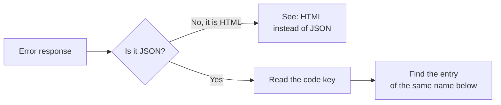

> 🌐 **Language:** [🇻🇳 Tiếng Việt](./api-troubleshooting_vi.md) · 🇬🇧 English (current) · [🇯🇵 日本語](./api-troubleshooting_ja.md)

# Troubleshooting REST API v2

## Introduction

This page helps you find the cause when an API call does not behave as expected: look up by **symptom** (HTML instead of JSON, empty list,
error in the browser…) or by the **error code** in the `code` key of the response. Each entry gives the usual cause and how to fix it. It is
for integration developers and people supporting site owners; the Reference pages link straight to each error code here.

## At a glance

Every API error has the same shape, so always start by reading `code`:

- **The error body is always** `{"error": 1, "msg": "…", "code": "…"}`; input errors add `errors` (errors per field).
- **Handle errors by `code`**, not by the wording of `msg` — the wording may change, `code` does not.
- **Every response has an `X-Request-Id` header** — include this id when asking for support.

## Look up by symptom

| Symptom | Usual cause | How to fix |
| --- | --- | --- |
| Got an **HTML** page instead of JSON | Wrong domain / path; the site sets `GP247_API_MODE=0` (API off at the server level); the site has an old route cache | Check the address `https://<domain>/api/v2/...`; ask the server administrator about `GP247_API_MODE`; run `php artisan gp247:doctor` |
| `404` with `"code": "api_disabled"` | The API group is off on the **API config** screen | The site owner turns that group on ([Concepts you need](./api-concepts.md)) |
| `401` right after signing in | Missing the word `Bearer ` before the token; a customer token used for `api/v2/core` (or the other way round); the token was revoked by a password change | Send `Authorization: Bearer <token>` to the right group; sign in again |
| Token expires after about an hour | Signed in with `with_refresh`: the main token lives only 60 minutes | Call `refresh` with the refresh token ([Sign-in & tokens](./api-authentication.md)) |
| `403` with `"code": "forbidden"` | The administrator account lacks permission for the matching screen | Grant that screen to the account's role |
| Empty list or missing records | The data belongs to another store (multi-store); the product/category is hidden; `front` called from another store's domain | Call the right store's domain; use an administrator account of the right store |
| **CORS** error in the browser | The site limits which domains may call `api/*` from a browser | The server administrator adds the app's domain to the CORS config; never put an admin token in an app that runs in the browser |
| Got `304` with no data | The app sent `If-None-Match` with an old `ETag` — the data has not changed | Use the saved copy; to reload, drop the `If-None-Match` header |
| `429` | Calling too fast or too many failed sign-ins | Wait as told by the `Retry-After` header, then call again |
| Endpoint is in the docs but the site answers `404` | The site runs an older GP247 release | Compare the **Since** entry on the Reference page with the site's version (`php artisan gp247:info`) |

## Look up by error code

Each entry below is one value of the `code` key. The matching HTTP code is in brackets.

### `unauthenticated`

(`401`) Missing token, wrong token, or expired / revoked. → Sign in again or call `refresh`; check the `Authorization: Bearer <token>` header.

### `api_connection_invalid`

(`401`) The site has **API Connection** on but the request lacks or has wrong `apiconnection` / `apikey` headers. → Get the right key pair from the site owner.

### `forbidden`

(`403`) Signed in but not allowed: a customer token calling the admin API, or an administrator account lacking permission for the matching screen. → Grant that screen.

### `not_found`

(`404`) The record does not exist, or is not visible to you (another store, hidden). → Check the id and the store.

### `api_disabled`

(`404`) The API group is off on the **API config** screen. → The site owner turns that group on.

### `validation_failed`

(`422`) The data sent is invalid; the `errors` key lists the errors per field. → Fix the fields named.

### `too_many_attempts`

(`429`) Over the limit of calls or sign-in attempts. → Wait as told by the `Retry-After` header.

### `method_not_allowed`

(`405`) Wrong HTTP method (for example `GET` on an endpoint that only accepts `POST`). → See the right method on the Reference page.

### `http_error`

(other codes) An HTTP error not covered by the codes above. → Read `msg` and the HTTP code; send `X-Request-Id` when asking for support.

### `server_error`

(`500`) An error inside the site. → Send `X-Request-Id` to the site operator to look up the log.

### `refresh_token_invalid`

(`401`) The refresh token is wrong or has expired. → Sign in again with the password.

### `refresh_token_reused`

(`401`) A refresh token that was already used was sent again — a sign it leaked, so the whole session is signed out. → Sign in again; each refresh token is used only once.

### `refresh_in_progress`

(`409`) The refresh token was used a few seconds ago (usually the app sent two requests at once). → Use the new token from the earlier refresh.

### `challenge_required`

(`401`) The account has two-factor authentication on; the response has `challenge.ticket`. → Send the verification code to `login/challenge` with the ticket.

### `challenge_invalid`

(`401`) The two-factor code or the ticket is wrong / expired. → Sign in again to get a new ticket.

### `login_required`

(`401`) The store does not let guests use the cart. → Sign the customer in before using the cart.

### `token_missing`

(`422`) Confirmation data needed for placing the order is missing. → Read `checkout` again, then place the order again.

### `input_empty`

(`422`) Checkout information is still empty (for example no address yet). → Finish the checkout steps before placing the order.

### `cart_empty`

(`422`) The cart has nothing to order (for the chosen store). → Add products to the cart.

### `cart_line_limit`

(`422`) The cart already has the maximum number of lines. → Remove lines or place the order first.

### `cart_conflict`

(`409`) The cart was just changed elsewhere (the website or another device). → Read the cart again, then retry.

### `store_required`

(`422`) The cart has items from several stores. → Send the `store_id` of the store you want to order from.

### `invalid_quantity`

(`422`) A cart line has a quantity that cannot be ordered. → Fix that line's quantity.

### `insufficient_stock`

(`422`) Not enough stock for the requested quantity. → Lower the quantity.

### `product_not_for_sale`

(`422`) The product is not for sale (hidden, sale period ended, or a type not sold on its own). → Remove the product from the cart.

### `minimum_not_met`

(`422`) A product is below its minimum purchase quantity; the `minimums` key gives the minimum for each product. → Raise the quantity.

### `promotion_refused`

(`422`) The promotion code cannot be applied; `msg` gives the reason. → Check the code or its conditions.

### `address_required`

(`422`) No shipping address yet. → Send the address (`PUT checkout/address`) first.

### `shipping_method_required`

(`422`) No shipping method chosen. → Choose one option from `checkout/shipping-methods`.

### `shipping_unquotable`

(`422`) The shipping fee cannot be calculated for this order. → Check the address or choose another shipping method.

### `payment_method_required`

(`422`) No payment method chosen. → Choose one from `checkout/payment-methods`.

### `method_unavailable`

(`422`) The chosen shipping / payment method cannot be used for this order. → Choose again from the latest list.

### `price_changed`

(`409`) The price changed since the totals were shown; the response has the new `totals`. → Show the new totals to the customer, then place the order again.

### `create_failed`

(`422`) The order could not be created; `msg` gives the reason. → Read `msg`; if it happens again, send `X-Request-Id` to the site operator.

### `api_checkout_disabled`

(`403`) Ordering through the API is off on the site. → The site owner turns on **Ordering through the API** on the **API config** screen.

### `order_not_cancellable`

(`409`) Only an unpaid order, placed through the app and not yet processed, can be cancelled. → Contact the store to cancel.

### `idempotency_key_required`

(`400`) This write call requires the `Idempotency-Key` header (8–255 characters). → Send a unique key for each change.

### `idempotency_key_reused`

(`409`) The `Idempotency-Key` was already used for a different request. → Use a new key for each new change.

### `idempotency_in_progress`

(`409`) A request with the same key is still being processed. → Wait, then resend with the same key to get the result.

### `idempotency_unavailable`

(`503`) The site has not run the upgrade step for this write call yet. → The server administrator runs `php artisan gp247:update`.

### `sku_not_found`

(in the per-line result of `stock/batch`) No product has this SKU. → Check the SKU or send the id.

### `sku_ambiguous`

(in the per-line result of `stock/batch`) Several products share this SKU. → Send the id instead of the SKU.

### `stock_would_be_negative`

(in the stock result) Not enough stock to take this quantity. → Check the stock before taking from it.

### `stock_managed_by_components`

(in the stock result) An assembled product takes its stock from its components. → Change the stock of each component.

### `event_log_disabled`

(`409`) The event log is off. → The site owner turns on **Event log for sync (ERP)** on the **API config** screen.

### `cursor_expired`

(`410`) The events after your cursor have been cleaned up. → Sync again with `updated_since`, then read the event log from the start ([Data sync](./api-sync.md)).

### `admin.order.reopen_blocked_stock`

(`409`) The order cannot be reopened because its items went back to stock and there is now not enough stock. → Check stock before changing the status.

### `admin.order.shipping_status_invalid`

(`409`) The shipping status does not exist. → Use a shipping status that exists on the site.

## When you need support

1. Write down the **address** and **method** you called (for example `POST /api/v2/front/checkout/place`).
2. Write down the **`code`** and **`msg`** in the error body.
3. Write down the value of the response's **`X-Request-Id`** header — the site operator uses it to find the right log line.
4. **Do not** send the token, password or `apikey`.

## Q&A

**Q1: I get a `401` error even with the right password?**

→ The account must be active: an admin needs `status = 1`, and a locked customer cannot log in. Send
the right field: Core uses `username`, Front uses `email`. If `code` is `challenge_required`, the account has two-factor
authentication on — continue with `login/challenge` ([Two-factor authentication (MFA) through a plugin](./api-authentication.md#two-factor-authentication-mfa-through-a-plugin)). If you just failed many times, you will get
`429` — wait as indicated by `Retry-After`.

**Q2: I can log in, but calling `api/v2/core/order/list` returns `403`?**

→ The admin account is not yet allowed to open the **Orders** screen. Ask your administrator to grant
permission for that screen under **Roles / Permissions** — the API uses exactly the same permissions as
the admin area ([Permissions and data scope of the Core API](./api-concepts.md#permissions-and-data-scope-of-the-core-api)).

**Q3: Why do I get an `api_connection_invalid` error?**

→ The API Connection layer is enabled and your `apiconnection`/`apikey` pair is wrong, expired
(`expire`), or disabled (`status`). The key is shown only once when it is created — if you have lost
it, go to the API Connection management section to generate a new key.

**Q4: Why does my API call answer `404` with `"code": "api_disabled"`?**

→ The API group you call is **turned off** on the site's API management screen ([Turning the API on and off](./api-concepts.md#turning-the-api-on-and-off)) — ask the administrator to turn
it back on. If your app calls `api/core` or `api/front` (API v1): fresh installs have v1 switched off; see
[API v1 (no longer developed)](./api-v1.md) to turn it back on for a while and to move to v2.

---

📅 **Last updated:** 2026-11-03 · ✍️ **Author:** GP247
