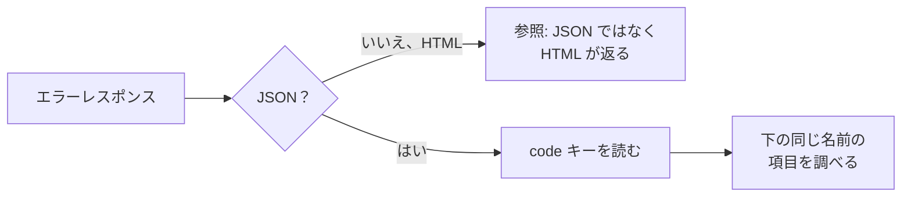

> 🌐 **言語:** [🇻🇳 Tiếng Việt](./api-troubleshooting_vi.md) · [🇬🇧 English](./api-troubleshooting.md) · 🇯🇵 日本語（現在）

# REST API v2 のトラブルシューティング

## はじめに

このページは、API の呼び出しが期待どおりに動かないときに原因を見つけるためのものです：**症状**（JSON ではなく HTML が返る、一覧が
空、ブラウザーでのエラーなど）または、レスポンスの `code` キーにある**エラーコード**から調べます。各項目に、よくある原因と直し方を載せています。連携開発者と
サイトのオーナーを支援する人向けです。リファレンスページから、各エラーコードのここの項目へ直接リンクしています。

## ひと目でわかる

API のエラーはすべて同じ形式なので、常に `code` を読むことから始めます。

- **エラー本文は常に** `{"error": 1, "msg": "…", "code": "…"}` です。入力データのエラーには `errors`（項目ごとのエラー）が加わります。
- **`code` で処理し**、`msg` の文言では処理しないでください — 文言は変わることがありますが、`code` は変わりません。
- **すべてのレスポンスに `X-Request-Id` ヘッダーがあります** — サポートを依頼するときはこの ID を添えてください。

## 症状から調べる

| 症状 | よくある原因 | 直し方 |
| --- | --- | --- |
| JSON ではなく **HTML** ページが返る | ドメイン／パスの誤り。サイトが `GP247_API_MODE=0` を設定している（サーバーレベルで API がオフ）。サイトに古いルートキャッシュがある | アドレス `https://<ドメイン>/api/v2/...` を確認する。`GP247_API_MODE` についてサーバーの管理者に問い合わせる。`php artisan gp247:doctor` を実行する |
| `404` と `"code": "api_disabled"` | その API グループが **API設定** 画面でオフになっている | サイトのオーナーがそのグループをオンにする（[知っておくべき概念](./api-concepts_ja.md)） |
| ログインした直後なのに `401` | トークンの前の `Bearer ` がない。顧客のトークンで `api/v2/core` を呼んでいる（またはその逆）。パスワード変更でトークンが失効した | 正しいグループに `Authorization: Bearer <token>` を送る。再ログインする |
| 1 時間ほどでトークンが期限切れになる | `with_refresh` を付けてログインした：メインのトークンは 60 分しか有効でない | リフレッシュトークンで `refresh` を呼ぶ（[ログインとトークン](./api-authentication_ja.md)） |
| `403` と `"code": "forbidden"` | 管理者アカウントに該当画面の権限がない | アカウントのロールにその画面の権限を与える |
| 一覧が空、またはレコードが足りない | データが別のストアに属している（複数ストア）。商品／カテゴリーが非表示。別ストアのドメインから `front` を呼んでいる | 正しいストアのドメインで呼ぶ。正しいストアの管理者アカウントを使う |
| ブラウザーで **CORS** エラー | サイトがブラウザーから `api/*` を呼べるドメインを制限している | サーバーの管理者がアプリのドメインを CORS 設定に追加する。ブラウザーで動くアプリに管理者のトークンを入れない |
| データなしで `304` が返る | アプリが古い `ETag` で `If-None-Match` を送った — データは変わっていない | 保存済みのデータを使う。再取得したい場合は `If-None-Match` ヘッダーを外す |
| `429` | 呼び出しが速すぎる、またはログインに何度も失敗した | `Retry-After` ヘッダーの時間だけ待ってから呼び直す |
| ドキュメントにあるエンドポイントでサイトが `404` を返す | サイトが古いバージョンの GP247 で動いている | リファレンスページの**導入バージョン**列をサイトのバージョン（`php artisan gp247:info`）と比べる |

## エラーコードから調べる

以下の各項目は `code` キーの値です。対応する HTTP ステータスを括弧内に記載しています。

### `unauthenticated`

（`401`）トークンがない、誤っている、または期限切れ／失効している。→ 再ログインするか `refresh` を呼ぶ。`Authorization: Bearer <token>` ヘッダーを確認する。

### `api_connection_invalid`

（`401`）サイトで **API Connection** がオンだが、リクエストの `apiconnection`／`apikey` ヘッダーがない、または誤っている。→ サイトのオーナーから正しいキーのペアを受け取る。

### `forbidden`

（`403`）ログイン済みだが権限がない：顧客のトークンで管理 API を呼んだ、または管理者アカウントに該当画面の権限がない。→ その画面の権限を与える。

### `not_found`

（`404`）レコードが存在しない、またはあなたには見えない（別のストア、非表示）。→ id とストアを確認する。

### `api_disabled`

（`404`）その API グループが **API設定** 画面でオフになっている。→ サイトのオーナーがそのグループをオンにする。

### `validation_failed`

（`422`）送信したデータが誤っている。`errors` キーに項目ごとのエラーが並ぶ。→ 示された項目を修正する。

### `too_many_attempts`

（`429`）呼び出し回数またはログイン回数の上限を超えた。→ `Retry-After` ヘッダーの時間だけ待つ。

### `method_not_allowed`

（`405`）HTTP メソッドが誤っている（例: `POST` しか受け付けないエンドポイントに `GET`）。→ リファレンスページで正しいメソッドを確認する。

### `http_error`

（その他のステータス）上記以外の HTTP エラー。→ `msg` と HTTP ステータスを読む。サポートを依頼するときは `X-Request-Id` を送る。

### `server_error`

（`500`）サイト内部のエラー。→ サイトの運用担当者に `X-Request-Id` を送り、ログを調べてもらう。

### `refresh_token_invalid`

（`401`）リフレッシュトークンが誤っている、または期限切れ。→ パスワードで再ログインする。

### `refresh_token_reused`

（`401`）使用済みのリフレッシュトークンが再送された — 漏えいの兆候のため、セッション全体がサインアウトされる。→ 再ログインする。リフレッシュトークンは 1 回しか使えない。

### `refresh_in_progress`

（`409`）リフレッシュトークンが数秒前に使われたばかり（通常はアプリが 2 つのリクエストを同時に送ったため）。→ 前回の refresh で得た新しいトークンを使う。

### `challenge_required`

（`401`）アカウントで二要素認証がオンになっている。レスポンスに `challenge.ticket` がある。→ 認証コードを ticket と一緒に `login/challenge` へ送る。

### `challenge_invalid`

（`401`）二要素認証のコードまたは ticket が誤っている／期限切れ。→ 再ログインして新しい ticket を受け取る。

### `login_required`

（`401`）ストアがゲストのカート利用を許可していない。→ カートを使う前に顧客としてログインする。

### `token_missing`

（`422`）注文の確定に必要な確認用データがない。→ `checkout` を読み直してから、もう一度注文を確定する。

### `input_empty`

（`422`）チェックアウトの情報がまだ空（例: 住所が未設定）。→ 注文を確定する前にチェックアウトの各ステップを完了する。

### `cart_empty`

（`422`）（選択したストアについて）カートに注文できるものがない。→ カートに商品を追加する。

### `cart_line_limit`

（`422`）カートの行数が上限に達している。→ 行を減らすか、先に注文を確定する。

### `cart_conflict`

（`409`）カートが別の場所（Web サイトや別の端末）で変更されたばかり。→ カートを読み直してから再試行する。

### `store_required`

（`422`）カートに複数のストアの商品がある。→ 注文したいストアの `store_id` を送る。

### `invalid_quantity`

（`422`）カートのある行の数量では注文できない。→ その行の数量を修正する。

### `insufficient_stock`

（`422`）要求した数量に対して在庫が足りない。→ 数量を減らす。

### `product_not_for_sale`

（`422`）販売していない商品（非表示、販売期間外、または単品販売しない種類）。→ その商品をカートから外す。

### `minimum_not_met`

（`422`）最小購入数量に満たない商品がある。`minimums` キーに商品ごとの最小数量がある。→ 数量を増やす。

### `promotion_refused`

（`422`）プロモーションコードを適用できない。`msg` に理由がある。→ コードまたは適用条件を確認する。

### `address_required`

（`422`）配送先住所がまだない。→ 先に住所を送る（`PUT checkout/address`）。

### `shipping_method_required`

（`422`）配送方法が選択されていない。→ `checkout/shipping-methods` の中から 1 つ選ぶ。

### `shipping_unquotable`

（`422`）この注文の送料を計算できない。→ 住所を確認するか、別の配送方法を選ぶ。

### `payment_method_required`

（`422`）支払い方法が選択されていない。→ `checkout/payment-methods` の中から 1 つ選ぶ。

### `method_unavailable`

（`422`）選択した配送／支払い方法がこの注文では使えない。→ 最新の一覧から選び直す。

### `price_changed`

（`409`）合計金額を表示した後に価格が変わった。レスポンスに新しい `totals` がある。→ 新しい合計を顧客に表示してから、もう一度注文を確定する。

### `create_failed`

（`422`）注文を作成できなかった。`msg` に理由がある。→ `msg` を読む。繰り返し起きる場合は、サイトの運用担当者に `X-Request-Id` を送る。

### `api_checkout_disabled`

（`403`）サイトで API による注文がオフになっている。→ サイトのオーナーが **API設定** 画面で **API経由の注文** をオンにする。

### `order_not_cancellable`

（`409`）キャンセルできるのは、未払いで、アプリから注文され、まだ処理されていない注文だけ。→ キャンセルはストアに問い合わせる。

### `idempotency_key_required`

（`400`）この書き込みには `Idempotency-Key` ヘッダー（8〜255 文字）が必須。→ 変更ごとに一意のキーを送る。

### `idempotency_key_reused`

（`409`）`Idempotency-Key` が別のリクエストですでに使われている。→ 新しい変更ごとに新しいキーを使う。

### `idempotency_in_progress`

（`409`）同じキーのリクエストがまだ処理中。→ 待ってから同じキーで再送し、結果を受け取る。

### `idempotency_unavailable`

（`503`）サイトがこの書き込み用のアップグレード手順をまだ実行していない。→ サーバーの管理者が `php artisan gp247:update` を実行する。

### `sku_not_found`

（`stock/batch` の行ごとの結果内）この SKU の商品がない。→ SKU を確認するか、id を送る。

### `sku_ambiguous`

（`stock/batch` の行ごとの結果内）同じ SKU の商品が複数ある。→ SKU の代わりに id を送る。

### `stock_would_be_negative`

（在庫の結果内）この数量を引くだけの在庫がない。→ 引く前に在庫数を確認する。

### `stock_managed_by_components`

（在庫の結果内）組み合わせ商品は構成品から在庫を取る。→ 各構成品の在庫を変更する。

### `event_log_disabled`

（`409`）イベントログがオフになっている。→ サイトのオーナーが **API設定** 画面で **同期用イベントログ（ERP）** をオンにする。

### `cursor_expired`

（`410`）あなたのカーソル以降のイベントが削除済み。→ `updated_since` で同期し直してから、ログを最初から読む（[データ同期](./api-sync_ja.md)）。

### `admin.order.reopen_blocked_stock`

（`409`）商品が在庫に戻され、現在は在庫が足りないため、注文を再開できない。→ ステータスを変える前に在庫を確認する。

### `admin.order.shipping_status_invalid`

（`409`）配送ステータスが存在しない。→ サイトにある配送ステータスを使う。

## サポートを依頼するとき

1. 呼び出した**アドレス**と**メソッド**を記録します（例: `POST /api/v2/front/checkout/place`）。
2. エラー本文の **`code`** と **`msg`** を記録します。
3. レスポンスの **`X-Request-Id`** ヘッダーの値を記録します — サイトの運用担当者はこれで該当するログの行を探します。
4. トークン、パスワード、`apikey` は**送らないでください**。

## よくある質問（Q&A）

**Q1: パスワードが正しいのに `401` エラーになるのはなぜですか？**

→ アカウントが有効である必要があります。管理者は `status = 1` が必要で、ロックされた顧客はログインできません。
正しい項目名で送ってください。Core は `username`、Front は `email` を使います。`code` が `challenge_required` の場合は、
アカウントで二要素認証が有効になっています — 続けて `login/challenge` を呼んでください（[プラグインによる二要素認証（MFA）](./api-authentication_ja.md#プラグインによる二要素認証mfa)）。
直前に何度も失敗した場合は `429` が返ります。`Retry-After` に従って待ってください。

**Q2: ログインはできるのに、`api/v2/core/order/list` を呼ぶと `403` になるのはなぜですか？**

→ 管理者アカウントに **注文** 画面を開く権限がまだありません。管理者に **ロール／権限** でその画面の権限を
付与してもらってください。API は管理画面とまったく同じ権限設定を使います（[Core API の権限とデータの範囲](./api-concepts_ja.md#core-api-の権限とデータの範囲)）。

**Q3: `api_connection_invalid` エラーになるのはなぜですか？**

→ API Connection レイヤーがオンで、`apiconnection`／`apikey` のペアが誤っている、期限切れ（`expire`）、
または無効（`status`）になっています。キーは作成時に 1 回だけ表示されます。紛失した場合は、
API Connection の管理項目で新しいキーを生成してください。

**Q4: API を呼ぶと `404`（`"code": "api_disabled"`）が返るのはなぜですか？**

→ 呼んでいる API グループが、サイトの API 管理画面で**オフ**になっています（[API のオン／オフ](./api-concepts_ja.md#api-のオンオフ)）。管理者にオンにしてもらってください。
アプリが `api/core` や `api/front`（API v1）を呼んでいる場合：新規インストールでは v1 は最初からオフです。一時的にオンに戻す方法と
v2 への移行方法は [API v1（開発終了）](./api-v1_ja.md)を参照してください。

---

📅 **最終更新:** 2026-11-03 · ✍️ **作成者 (Author):** GP247
