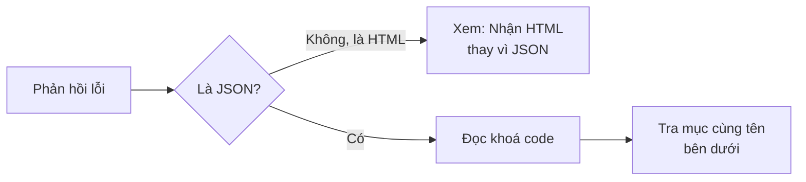

> 🌐 **Ngôn ngữ:** 🇻🇳 Tiếng Việt (hiện tại) · [🇬🇧 English](./api-troubleshooting.md) · [🇯🇵 日本語](./api-troubleshooting_ja.md)

# Xử lý sự cố REST API v2

## Giới thiệu

Trang này giúp bạn tìm ra nguyên nhân khi một lệnh gọi API không như mong đợi: tra theo **triệu chứng** (nhận HTML thay JSON, danh sách
rỗng, lỗi trên trình duyệt…) hoặc theo **mã lỗi** trong khoá `code` của phản hồi. Mỗi mục nêu nguyên nhân thường gặp và cách sửa. Dành
cho lập trình viên tích hợp và người hỗ trợ chủ site; trang Tham chiếu dẫn thẳng tới từng mã lỗi ở đây.

## Nhìn nhanh

Mọi lỗi của API đều có cùng một hình dạng, nên luôn bắt đầu bằng việc đọc `code`:

- **Thân lỗi luôn là** `{"error": 1, "msg": "…", "code": "…"}`; lỗi dữ liệu nhập có thêm `errors` (lỗi theo từng trường).
- **Xử lý theo `code`**, không theo câu chữ `msg` — câu chữ có thể đổi, `code` thì không.
- **Mỗi phản hồi có header `X-Request-Id`** — gửi kèm mã này khi nhờ hỗ trợ.

## Tra theo triệu chứng

| Triệu chứng | Nguyên nhân thường gặp | Cách sửa |
| --- | --- | --- |
| Nhận trang **HTML** thay vì JSON | Sai tên miền / đường dẫn; site đặt `GP247_API_MODE=0` (tắt API ở tầng máy chủ); site có cache route cũ | Kiểm địa chỉ `https://<tên-miền>/api/v2/...`; hỏi người quản trị máy chủ về `GP247_API_MODE`; chạy `php artisan gp247:doctor` |
| `404` với `"code": "api_disabled"` | Nhóm API đang tắt trên màn **Cấu hình API** | Chủ site bật nhóm đó ([Khái niệm cần biết](./api-concepts_vi.md)) |
| `401` dù vừa đăng nhập | Thiếu chữ `Bearer ` trước token; dùng token khách cho `api/v2/core` (hoặc ngược lại); token đã bị thu hồi do đổi mật khẩu | Gửi `Authorization: Bearer <token>` đúng nhóm; đăng nhập lại |
| Token hết hạn sau khoảng một giờ | Đăng nhập kèm `with_refresh`: token chính chỉ sống 60 phút | Gọi `refresh` với refresh token ([Đăng nhập & token](./api-authentication_vi.md)) |
| `403` với `"code": "forbidden"` | Tài khoản quản trị không có quyền màn tương ứng | Cấp quyền màn đó cho vai trò của tài khoản |
| Danh sách rỗng hoặc thiếu bản ghi | Dữ liệu thuộc cửa hàng khác (đa cửa hàng); sản phẩm/danh mục đang ẩn; gọi `front` từ tên miền của cửa hàng khác | Gọi đúng tên miền cửa hàng; dùng tài khoản quản trị của đúng cửa hàng |
| Lỗi **CORS** trong trình duyệt | Site đã giới hạn tên miền được gọi `api/*` từ trình duyệt | Người quản trị máy chủ thêm tên miền của app vào cấu hình CORS; không đưa token quản trị vào ứng dụng chạy trên trình duyệt |
| Nhận `304` mà không có dữ liệu | App gửi `If-None-Match` với `ETag` cũ — dữ liệu không đổi | Dùng bản đã lưu; muốn tải lại thì bỏ header `If-None-Match` |
| `429` | Gọi quá nhanh hoặc đăng nhập sai nhiều lần | Chờ theo header `Retry-After` rồi gọi lại |
| Endpoint trong tài liệu nhưng site trả `404` | Site chạy bản GP247 cũ hơn | So cột **Có từ** ở trang Tham chiếu với phiên bản site (`php artisan gp247:info`) |

## Tra theo mã lỗi

Mỗi mục dưới đây là một giá trị của khoá `code`. Mã HTTP đi kèm ghi trong ngoặc.

### `unauthenticated`

(`401`) Thiếu token, token sai hoặc đã hết hạn / bị thu hồi. → Đăng nhập lại hoặc gọi `refresh`; kiểm header `Authorization: Bearer <token>`.

### `api_connection_invalid`

(`401`) Site bật **API Connection** nhưng yêu cầu thiếu hoặc sai header `apiconnection` / `apikey`. → Lấy cặp khóa đúng từ chủ site.

### `forbidden`

(`403`) Đã đăng nhập nhưng không có quyền: token khách gọi API quản trị, hoặc tài khoản quản trị thiếu quyền màn tương ứng. → Cấp quyền màn đó.

### `not_found`

(`404`) Bản ghi không tồn tại, hoặc không hiển thị với bạn (khác cửa hàng, đang ẩn). → Kiểm id và cửa hàng.

### `api_disabled`

(`404`) Nhóm API đang tắt trên màn **Cấu hình API**. → Chủ site bật nhóm đó.

### `validation_failed`

(`422`) Dữ liệu gửi lên sai; khoá `errors` liệt kê lỗi theo từng trường. → Sửa đúng trường được nêu.

### `too_many_attempts`

(`429`) Quá giới hạn số lần gọi hoặc số lần đăng nhập. → Chờ theo header `Retry-After`.

### `method_not_allowed`

(`405`) Sai phương thức HTTP (ví dụ `GET` cho endpoint chỉ nhận `POST`). → Xem phương thức đúng ở trang Tham chiếu.

### `http_error`

(mã khác) Lỗi HTTP không thuộc các mã trên. → Đọc `msg` và mã HTTP; gửi `X-Request-Id` khi nhờ hỗ trợ.

### `server_error`

(`500`) Lỗi bên trong site. → Gửi `X-Request-Id` cho người vận hành site để tra nhật ký.

### `refresh_token_invalid`

(`401`) Refresh token sai hoặc đã hết hạn. → Đăng nhập lại bằng mật khẩu.

### `refresh_token_reused`

(`401`) Một refresh token đã dùng được gửi lại — dấu hiệu bị lộ, nên cả phiên bị đăng xuất. → Đăng nhập lại; mỗi refresh token chỉ dùng một lần.

### `refresh_in_progress`

(`409`) Refresh token vừa được dùng vài giây trước (thường do app gửi hai yêu cầu cùng lúc). → Dùng token mới từ lần refresh trước.

### `challenge_required`

(`401`) Tài khoản bật xác thực hai lớp; phản hồi có `challenge.ticket`. → Gửi mã xác thực tới `login/challenge` kèm ticket.

### `challenge_invalid`

(`401`) Mã xác thực hai lớp hoặc ticket sai / hết hạn. → Đăng nhập lại để nhận ticket mới.

### `login_required`

(`401`) Cửa hàng không cho khách vãng lai dùng giỏ hàng. → Đăng nhập khách trước khi dùng giỏ.

### `token_missing`

(`422`) Thiếu dữ liệu xác nhận cần cho bước đặt đơn. → Đọc lại `checkout` rồi đặt đơn lại.

### `input_empty`

(`422`) Thông tin checkout còn trống (ví dụ chưa có địa chỉ). → Hoàn tất các bước checkout trước khi đặt đơn.

### `cart_empty`

(`422`) Giỏ không có gì để đặt (cho cửa hàng đã chọn). → Thêm sản phẩm vào giỏ.

### `cart_line_limit`

(`422`) Giỏ đã đủ số dòng tối đa. → Bớt dòng hoặc đặt đơn trước.

### `cart_conflict`

(`409`) Giỏ vừa bị thay đổi ở nơi khác (website hoặc thiết bị khác). → Đọc lại giỏ rồi thử lại.

### `store_required`

(`422`) Giỏ có hàng của nhiều cửa hàng. → Gửi `store_id` của cửa hàng muốn đặt.

### `invalid_quantity`

(`422`) Một dòng trong giỏ có số lượng không đặt được. → Sửa số lượng dòng đó.

### `insufficient_stock`

(`422`) Không đủ hàng trong kho cho số lượng yêu cầu. → Giảm số lượng.

### `product_not_for_sale`

(`422`) Sản phẩm không bán (ẩn, hết hạn bán hoặc là loại không bán lẻ). → Bỏ sản phẩm khỏi giỏ.

### `minimum_not_met`

(`422`) Có sản phẩm dưới số lượng mua tối thiểu; khoá `minimums` cho biết mức tối thiểu từng sản phẩm. → Tăng số lượng.

### `promotion_refused`

(`422`) Mã khuyến mãi không áp dụng được; `msg` nêu lý do. → Kiểm lại mã hoặc điều kiện áp dụng.

### `address_required`

(`422`) Chưa có địa chỉ giao hàng. → Gửi địa chỉ (`PUT checkout/address`) trước.

### `shipping_method_required`

(`422`) Chưa chọn cách giao hàng. → Chọn một lựa chọn từ `checkout/shipping-methods`.

### `shipping_unquotable`

(`422`) Không tính được phí giao cho đơn này. → Kiểm địa chỉ hoặc chọn cách giao khác.

### `payment_method_required`

(`422`) Chưa chọn cách thanh toán. → Chọn một cách từ `checkout/payment-methods`.

### `method_unavailable`

(`422`) Cách giao / thanh toán đã chọn không dùng được cho đơn này. → Chọn lại từ danh sách mới nhất.

### `price_changed`

(`409`) Giá đổi từ lúc hiển thị tổng tiền; phản hồi có `totals` mới. → Hiển thị tổng mới cho khách rồi đặt đơn lại.

### `create_failed`

(`422`) Không tạo được đơn; `msg` nêu lý do. → Đọc `msg`; nếu lặp lại, gửi `X-Request-Id` cho người vận hành site.

### `api_checkout_disabled`

(`403`) Đặt đơn qua API đang tắt trên site. → Chủ site bật **Đặt đơn qua API** trên màn **Cấu hình API**.

### `order_not_cancellable`

(`409`) Chỉ hủy được đơn chưa thanh toán, đặt qua app và chưa được xử lý. → Liên hệ cửa hàng để hủy.

### `idempotency_key_required`

(`400`) Lệnh ghi này bắt buộc header `Idempotency-Key` (8–255 ký tự). → Gửi một khóa duy nhất cho mỗi thay đổi.

### `idempotency_key_reused`

(`409`) `Idempotency-Key` đã dùng cho một yêu cầu khác. → Mỗi thay đổi mới dùng một khóa mới.

### `idempotency_in_progress`

(`409`) Yêu cầu cùng khóa vẫn đang xử lý. → Chờ rồi gửi lại với cùng khóa để nhận kết quả.

### `idempotency_unavailable`

(`503`) Site chưa chạy bước nâng cấp cho lệnh ghi này. → Người quản trị máy chủ chạy `php artisan gp247:update`.

### `sku_not_found`

(trong kết quả từng dòng của `stock/batch`) Không có sản phẩm mang SKU này. → Kiểm SKU hoặc gửi id.

### `sku_ambiguous`

(trong kết quả từng dòng của `stock/batch`) Nhiều sản phẩm cùng SKU. → Gửi id thay cho SKU.

### `stock_would_be_negative`

(trong kết quả tồn kho) Không đủ tồn để trừ số lượng này. → Kiểm số tồn trước khi trừ.

### `stock_managed_by_components`

(trong kết quả tồn kho) Sản phẩm lắp ghép lấy tồn từ các thành phần. → Đổi tồn của từng thành phần.

### `event_log_disabled`

(`409`) Nhật ký sự kiện đang tắt. → Chủ site bật **Nhật ký sự kiện cho đồng bộ (ERP)** trên màn **Cấu hình API**.

### `cursor_expired`

(`410`) Các sự kiện sau con trỏ của bạn đã bị dọn. → Đồng bộ lại bằng `updated_since`, rồi đọc nhật ký từ đầu ([Đồng bộ dữ liệu](./api-sync_vi.md)).

### `admin.order.reopen_blocked_stock`

(`409`) Không mở lại đơn được vì hàng đã trả về kho và nay không đủ tồn. → Kiểm tồn kho trước khi đổi trạng thái.

### `admin.order.shipping_status_invalid`

(`409`) Trạng thái giao hàng không tồn tại. → Dùng một trạng thái giao hàng có trên site.

## Khi cần nhờ hỗ trợ

1. Ghi lại **địa chỉ** và **phương thức** đã gọi (ví dụ `POST /api/v2/front/checkout/place`).
2. Ghi lại **`code`** và **`msg`** trong thân lỗi.
3. Ghi lại giá trị header **`X-Request-Id`** của phản hồi — người vận hành site dùng nó để tìm đúng dòng nhật ký.
4. **Không** gửi kèm token, mật khẩu hay `apikey`.

## Hỏi & Đáp (Q&A)

**Câu 1: Tôi bị lỗi `401` dù gõ đúng mật khẩu?**

→ Tài khoản phải đang hoạt động: admin cần `status = 1`, khách bị khoá không đăng nhập được. Gửi đúng
trường: Core dùng `username`, Front dùng `email`. Nếu `code` là `challenge_required`, tài khoản đã bật xác thực hai lớp —
gọi tiếp `login/challenge` ([Xác thực hai lớp (MFA) qua plugin](./api-authentication_vi.md#xác-thực-hai-lớp-mfa-qua-plugin)). Nếu vừa thử sai nhiều lần, bạn sẽ nhận `429` — chờ theo `Retry-After`.

**Câu 2: Đăng nhập được nhưng gọi `api/v2/core/order/list` bị `403`?**

→ Tài khoản admin chưa có quyền mở màn **Đơn hàng**. Nhờ người quản trị cấp quyền màn đó trong
**Vai trò / Quyền** — API dùng đúng phân quyền của trang quản trị ([Phân quyền và phạm vi dữ liệu của API Core](./api-concepts_vi.md#phân-quyền-và-phạm-vi-dữ-liệu-của-api-core)).

**Câu 3: Vì sao tôi nhận lỗi `api_connection_invalid`?**

→ Lớp API Connection đang bật và cặp `apiconnection`/`apikey` của bạn sai, hết hạn (`expire`) hoặc bị
tắt (`status`). Khóa chỉ hiện một lần lúc tạo — nếu đã mất, vào mục quản lý API Connection để sinh
khóa mới.

**Câu 4: Vì sao gọi API nhận `404` với `"code": "api_disabled"`?**

→ Nhóm API bạn gọi đang **tắt** trên màn quản lý API của site ([Bật/tắt API](./api-concepts_vi.md#bậttắt-api)) — nhờ quản trị viên bật lại. Nếu ứng dụng gọi
`api/core` hoặc `api/front` (API v1): site cài mới tắt sẵn v1; xem [API v1 (đã ngưng phát triển)](./api-v1_vi.md) để bật
lại tạm thời và cách chuyển sang v2.

---

📅 **Cập nhật lần cuối:** 2026-11-03 · ✍️ **Tác giả (Author):** GP247
