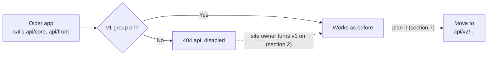

> 🌐 **Language:** [🇻🇳 Tiếng Việt](./api-v1_vi.md) · 🇬🇧 English (current) · [🇯🇵 日本語](./api-v1_ja.md)

# API v1 (no longer developed)

## Introduction

This document is for **developers maintaining an app written before API v2** — an app that calls the addresses
`api/core/...` (admin) and `api/front/...` (store, customer accounts). It explains the status of API v1, how to turn it
back on on a site, the list of endpoints, where v1 differs from v2 and how to move the app to v2. New apps do not need this
document: go straight to [Introduction to the API](./api-introduction.md).

> ⚠️ **API v1 is frozen.**
> - **It still runs** for apps that use it.
> - **Fresh installs have v1 switched off** (since gp247/core 3.3.1) — the site owner must turn it back on (section 2).
> - **No new features** since API v2 shipped (gp247/core, gp247/front, gp247/shop 3.3.0); **security fixes only**.
> - **New apps must use API v2** — see [Introduction to the API](./api-introduction.md).

## At a glance

An older app keeps working on v1 while the v1 group is on, as you gradually move to v2:



- **Fresh installs turn v1 off** — calling a group that is off answers `404 api_disabled`; turn it back on on the API management screen (section 2).
- **Same security as v2** — same tokens, permissions, API Connection, error codes (section 3).
- **Much less than v2** — no refresh tokens, no MFA, no cart / ordering, no filtering/sorting (section 3).
- **Moving to v2 is mostly changing the prefix and reading the `data` key** — mapping table in section 7.

## On this page

- [1. Status and when you still need v1](#1-status-and-when-you-still-need-v1) — how v1's life cycle differs from v2
- [2. Turning API v1 on](#2-turning-api-v1-on) — the site owner turns the v1 groups back on on the API management screen
- [3. What v1 shares with v2, and what differs](#3-what-v1-shares-with-v2-and-what-differs) — login, permissions, errors, limits
- [4. v1 admin endpoints](#4-v1-admin-endpoints-apicore) — `api/core/*`
- [5. v1 public & customer endpoints](#5-v1-public--customer-endpoints-apifront) — `api/front/*`
- [6. v1 response format](#6-v1-response-format) — reading v1 results
- [7. Moving to API v2](#7-moving-to-api-v2) — mapping table and checklist

---

## 1. Status and when you still need v1

API v1 is the first generation of the GP247 API. When API v2 shipped, v1 was kept unchanged so that running apps would not
break, but every new feature is built in v2 only.

| | API v1 | API v2 |
| --- | --- | --- |
| Prefix | `api/core`, `api/front` | `api/v2/core`, `api/v2/front` |
| Status | **Frozen** — no new features | Actively developed |
| Fresh install | **Off** (since gp247/core 3.3.1) | On |
| Site upgraded from an older version | Keeps its on/off state | Keeps its on/off state |
| Security fixes | Yes | Yes |
| For | Apps written before v2 | Every new app |

You **still need v1** when a live app calls `api/core` or `api/front` and cannot be updated right away — for example an
older mobile app version that users have not updated yet, or a third-party sync tool. Meanwhile, keep the matching v1
group on and plan the move to v2 (section 7).

---

## 2. Turning API v1 on

The site owner turns v1 on and off on the **API management screen** of the admin (the same screen as API Connection) — no
file to edit, no command to run. The screen has two switches for v1:

| Switch | Applies to |
| --- | --- |
| **v1 · Admin API (core)** | `api/core/*` |
| **v1 · Public & customer API (front)** | `api/front/*` |

Steps to turn v1 back on:

1. Sign in to the admin with an account allowed to manage the API.
2. Open the **API management screen**.
3. Check that the **REST API (all groups)** switch is on — when it is off, every group is off.
4. Turn on **v1 · Admin API (core)** if the app calls `api/core/...`, and/or **v1 · Public & customer API (front)** if the
   app calls `api/front/...`. Turn on only the groups you really need.
5. Try a call from a Terminal:

   ```bash
   curl -X GET "https://shop.example.com/api/front/product/list" -H "Accept: application/json"
   ```

   On success you receive the product list as JSON. If you still get `404` with `"code": "api_disabled"`, the group is
   still off — go back to Step 4.

- Calling a group that is off → HTTP `404` with `"code": "api_disabled"` — even without a token *(since gp247/core 3.4.0;
  3.3.1 answers `401` when the token is missing)*.
- The environment variable `GP247_API_MODE=0` turns every API off at server level and locks the switches on the screen.
- Sites with a route cache: see the note in [Introduction to the API — section 5](./api-introduction.md#5-turning-the-api-on-and-off).

> 💡 **Tip:** when no app calls v1 any more, turn the v1 groups off again — one less unused door into the site.

---

## 3. What v1 shares with v2, and what differs

v1 and v2 go through **the same checks** on the site, so most rules are identical. The table below is only a summary; read
the details in the main document.

| Topic | Same as v2 | Details |
| --- | --- | --- |
| Token login, `Authorization: Bearer …` header, scopes `admin` / `admin-supper` / `user` | Yes | [Introduction to the API — section 2](./api-introduction.md#2-authentication-logging-in-to-the-api) |
| Login limits (5/min per account, 20/min per IP), general limit of 1000/min | Yes — the admin form, `api/core/login` and `api/v2/core/login` share one counter | [Introduction to the API — section 2](./api-introduction.md#2-authentication-logging-in-to-the-api) |
| Admin-screen permissions, per-store data | Yes | [Introduction to the API — section 3](./api-introduction.md#3-permissions-and-data-scope-of-the-core-api) |
| API Connection layer (`apiconnection` / `apikey`) | Yes | [Introduction to the API — section 4](./api-introduction.md#4-the-api-connection-protection-layer--optional) |
| Error body `{"error": 1, "msg": "…", "code": "…"}` and meaningful HTTP codes | Yes | [Introduction to the API — section 6](./api-introduction.md#6-response-format-list-parameters--error-codes) |
| `X-Request-Id` header on every response | Yes | [Introduction to the API — section 6](./api-introduction.md#6-response-format-list-parameters--error-codes) |
| Public data limited to what the store is showing | Yes | section 5 |
| Every admin API call (except `login`) written to the **Operation log** | Yes | [Introduction to the API — section 9.5](./api-introduction.md#95-admin-api-access-log) |
| Changing / resetting a password ends every token | Yes — v1 tokens included | [Introduction to the API — section 2](./api-introduction.md#2-authentication-logging-in-to-the-api) |

**What only v1 does** (reasons to move to v2):

- **Only 7 / 30-day tokens** (`remember_me`). No `with_refresh`, no `refresh` endpoint, no session management (`sessions`).
- **No extra verification step (MFA).** An account with two-factor authentication on gets `401 challenge_required` on the
  v1 login and cannot finish it — the app must use `api/v2/.../login` and `login/challenge`.
- **`GET logout` is still accepted but deprecated**: the response carries a `Deprecation` header. Use `POST logout`.
- **No** registration, forgotten password, profile, address book, cart, checkout, ordering, payment, `meta`.
- **No** `filter`, `sort`, `q`, `lang` parameters; names and descriptions come back for every language (section 6).

---

## 4. v1 admin endpoints (`api/core`)

This group is for remote admin tools, signing in with an **administrator** account (`username` + `password`).

**Login & account endpoints**:

| Method | Path | Login required | Function |
| --- | --- | --- | --- |
| `POST` | `api/core/login` | No | Admin login, returns `access_token` |
| `POST` | `api/core/logout` | Yes (Bearer) | Log out, revoke the current token |
| `GET` | `api/core/logout` | Yes (Bearer) | Same as above — **deprecated**, the response carries a `Deprecation` header; switch to `POST` |
| `GET` | `api/core/info` | Yes (Bearer) | Get the currently logged-in administrator's info |

**Admin data endpoints** (token + permission to open the matching admin screen required):

| Method | Path | Function |
| --- | --- | --- |
| `GET` | `api/core/customer/list` | Customer list |
| `GET` | `api/core/customer/detail/{id}` | A customer's details |
| `GET` | `api/core/order/list` | Order list (with order lines and totals) |
| `GET` | `api/core/order/detail/{id}` | An order's details |
| `GET` | `api/core/product/list` | Product list |
| `GET` | `api/core/product/detail/{id}` | A product's details |
| `GET` | `api/core/category/list` | Category list |
| `GET` | `api/core/category/detail/{id}` | A category's details |
| `GET` | `api/core/brand/list` | Brand list |
| `GET` | `api/core/brand/detail/{id}` | A brand's details |
| `GET` | `api/core/supplier/list` | Supplier list |
| `GET` | `api/core/supplier/detail/{id}` | A supplier's details |
| `GET` | `api/core/banner/list` | Banner list |
| `GET` | `api/core/banner/detail/{id}` | A banner's details |
| `GET` | `api/core/page/list` | Content page list |
| `GET` | `api/core/page/detail/{id}` | A content page's details |

Example admin login (using `curl` in a Terminal):

```bash
curl -X POST "https://shop.example.com/api/core/login" \
  -H "Content-Type: application/json" \
  -d '{"username":"admin","password":"your-password","remember_me":true}'
```

On success, you receive JSON like (v1 returns the object directly, not wrapped in `data`):

```json
{
  "access_token": "1|aBcD...very-long...XyZ",
  "token_type": "Bearer",
  "scopes": ["admin-supper"],
  "expires_at": "2026-11-25 10:00:00"
}
```

Then fetch the order list using the token you just received:

```bash
curl -X GET "https://shop.example.com/api/core/order/list" \
  -H "Authorization: Bearer 1|aBcD...very-long...XyZ"
```

---

## 5. v1 public & customer endpoints (`api/front`)

This group serves **public data** (no login needed) and **customer-private data** (sign in with `email` + `password`).

**Public endpoints** (no token needed):

| Method | Path | Function |
| --- | --- | --- |
| `GET` | `api/front/product/list` | Product list |
| `GET` | `api/front/product/detail/{id}` | A product's details |
| `GET` | `api/front/category/list` | Category list |
| `GET` | `api/front/category/detail/{id}` | A category's details (with products) |
| `GET` | `api/front/brand/list` | Brand list |
| `GET` | `api/front/brand/detail/{id}` | A brand's details |
| `GET` | `api/front/banner/list` | Banner list |
| `GET` | `api/front/banner/detail/{id}` | A banner's details |
| `GET` | `api/front/page/list` | Content page list |
| `GET` | `api/front/page/detail/{id}` | A content page's details |

> ℹ️ **Available since:** gp247/shop 3.2.3, gp247/front 3.2.3 — public data is **exactly what the
> store is showing** on the domain you call: hidden products, products not yet approved, or products
> belonging to another store do not appear. Responses contain only public fields — no cost price,
> supplier, or stock/sold counts.

**Customer account endpoints** (customer token required):

| Method | Path | Login required | Function |
| --- | --- | --- | --- |
| `POST` | `api/front/login` | No | Log in with customer email/password, returns a token |
| `POST` | `api/front/logout` | Yes (Bearer) | Log out the customer |
| `GET` | `api/front/logout` | Yes (Bearer) | Same as above — **deprecated**, the response carries a `Deprecation` header; switch to `POST` |
| `GET` | `api/front/info` | Yes (Bearer) | Customer account info |
| `GET` | `api/front/member/order/list` | Yes (Bearer) | The customer's order list |
| `GET` | `api/front/member/order/detail/{id}` | Yes (Bearer) | An order's details |

Example fetching the product list (public, no token needed):

```bash
curl -X GET "https://shop.example.com/api/front/product/list" \
  -H "Accept: application/json"
```

Example logging in a customer and viewing their orders:

```bash
# 1) Customer login
curl -X POST "https://shop.example.com/api/front/login" \
  -H "Content-Type: application/json" \
  -d '{"email":"customer@example.com","password":"your-password"}'

# 2) Use the returned token to fetch the order list
curl -X GET "https://shop.example.com/api/front/member/order/list" \
  -H "Authorization: Bearer 2|zzz...customer-token...zzz"
```

---

## 6. v1 response format

v1 returns data in a "raw" shape that differs from v2 in these points:

- **A single record**: the object directly (no wrapping `data` key).
- **A list**: Laravel's standard pagination — `data`, `current_page`, `per_page`, `total`, `last_page`… at the **same
  level**; pick a page with `page[number]` and `page[size]`.
- **Product / category / content page names and descriptions**: a `descriptions` array with **every language**, each item
  carrying its `lang`.
- **Price**: `price` only; no `price_final` (the price the customer pays after promotions).
- **Errors**: the same `{"error": 1, "msg": "…", "code": "…"}` shape as v2.

Example page of a v1 product list (shortened):

```json
{
  "current_page": 1,
  "data": [
    { "id": "PRD-AbC12", "sku": "TSHIRT-01", "price": 250000,
      "descriptions": [ { "lang": "vi", "name": "Áo thun" }, { "lang": "en", "name": "T-shirt" } ] }
  ],
  "per_page": 20,
  "total": 1,
  "last_page": 1
}
```

---

## 7. Moving to API v2

Most v1 apps move to v2 by **changing the prefix** and **reading the data inside the `data` key**. Every v1 endpoint has a
matching v2 endpoint:

| v1 endpoint | v2 endpoint |
| --- | --- |
| `POST` `api/core/login` | `POST` `api/v2/core/login` |
| `POST` `api/core/logout`, `GET` `api/core/logout` | `POST` `api/v2/core/logout` |
| `GET` `api/core/info` | `GET` `api/v2/core/info` |
| `api/core/customer/list`, `api/core/customer/detail/{id}` | `api/v2/core/customer/list`, `api/v2/core/customer/detail/{id}` |
| `api/core/order/list`, `api/core/order/detail/{id}` | `api/v2/core/order/list`, `api/v2/core/order/detail/{id}` |
| `api/core/product/list`, `api/core/product/detail/{id}` | `api/v2/core/product/list`, `api/v2/core/product/detail/{id}` |
| `api/core/category/list`, `api/core/category/detail/{id}` | `api/v2/core/category/list`, `api/v2/core/category/detail/{id}` |
| `api/core/brand/list`, `api/core/brand/detail/{id}` | `api/v2/core/brand/list`, `api/v2/core/brand/detail/{id}` |
| `api/core/supplier/list`, `api/core/supplier/detail/{id}` | `api/v2/core/supplier/list`, `api/v2/core/supplier/detail/{id}` |
| `api/core/banner/list`, `api/core/banner/detail/{id}` | `api/v2/core/banner/list`, `api/v2/core/banner/detail/{id}` |
| `api/core/page/list`, `api/core/page/detail/{id}` | `api/v2/core/page/list`, `api/v2/core/page/detail/{id}` |
| `POST` `api/front/login` | `POST` `api/v2/front/login` |
| `POST` `api/front/logout`, `GET` `api/front/logout` | `POST` `api/v2/front/logout` |
| `GET` `api/front/info` | `GET` `api/v2/front/info` |
| `api/front/member/order/list`, `api/front/member/order/detail/{id}` | `api/v2/front/member/order/list`, `api/v2/front/member/order/detail/{id}` |
| `api/front/product/list`, `api/front/product/detail/{id}` | `api/v2/front/product/list`, `api/v2/front/product/detail/{id}` |
| `api/front/category/list`, `api/front/category/detail/{id}` | `api/v2/front/category/list`, `api/v2/front/category/detail/{id}` |
| `api/front/brand/list`, `api/front/brand/detail/{id}` | `api/v2/front/brand/list`, `api/v2/front/brand/detail/{id}` |
| `api/front/banner/list`, `api/front/banner/detail/{id}` | `api/v2/front/banner/list`, `api/v2/front/banner/detail/{id}` |
| `api/front/page/list`, `api/front/page/detail/{id}` | `api/v2/front/page/list`, `api/v2/front/page/detail/{id}` |

The list/detail endpoints above all use the `GET` method.

**Response-shape differences** to fix in the app:

| Difference | v1 | v2 |
| --- | --- | --- |
| Login | Token at the top level (`access_token`) | Token inside `data` (`data.access_token`) |
| Success (single record) | The object directly | `{"data": {...}}` |
| Success (list) | Laravel pagination (`data`, `current_page`, `total`… at the same level) | `{"data": [...], "meta": {...}, "links": {...}}` |
| Product/category/page name and description | A `descriptions` array with every language | `name`, `description`… in the language chosen with `lang` |
| Price | `price` | `price` and `price_final` (the price the customer pays on the store, promotions applied) |
| Logout | `POST` (and the deprecated `GET`) | `POST` only |

**Checklist for the move:**

1. Change the prefix `api/core` → `api/v2/core` and `api/front` → `api/v2/front`.
2. Read the login token at `data.access_token`; read every result inside the `data` key.
3. Lists: read the paging information in `meta` (`current_page`, `per_page`, `total`, `last_page`) instead of the top level.
4. Show names/descriptions from `name`, `description` (send `lang` to choose the language) instead of filtering the
   `descriptions` array.
5. Show `price_final` as the price the customer pays.
6. Log out with `POST logout`.
7. Worth doing too: sign in with `with_refresh: true`, handle `401 challenge_required` (MFA), use `filter` / `sort` instead
   of filtering in the app — see [Introduction to the API](./api-introduction.md).
8. Release the new app version; when no old version calls v1 any more, ask the site owner to turn the v1 groups off (section 2).

---

## Q&A

**Q1: My app calls `api/front/...` and gets `404` with `"code": "api_disabled"`. Why?**

→ The v1 group is off on the site — fresh installs have v1 switched off. Ask the site owner to turn the matching group on
(section 2), then plan the move to v2 (section 7).

**Q2: Is API v1 still getting fixes?**

→ v1 only receives **security fixes**. There are no new features; other bugs are fixed in v2 only. Plan the move to v2.

**Q3: An account with two-factor authentication cannot sign in through v1?**

→ Right: v1 has no code-entry step, so the login answers `401 challenge_required`. Use `api/v2/core/login` or
`api/v2/front/login`, then v2's `login/challenge`.

**Q4: Can I use a cart, place orders or register accounts through v1?**

→ No. These features exist in v2 only — see sections 9 and 10 of [Introduction to the API](./api-introduction.md).

**Q5: Why does `GET logout` return an extra `Deprecation` header?**

→ Logging out with `GET` is deprecated. Switch to `POST logout`; v2 only accepts `POST`.

**Q6: Does turning v1 on make the site less safe?**

→ v1 goes through the same checks as v2: expiring tokens, admin-screen permissions, per-store data, API Connection, login
limits. Still, only turn on the v1 groups you really need, and turn them off when no app uses them.

**Q7: Can v1 and v2 run side by side?**

→ Yes. During the move, keep both groups on: the old app version calls v1, the new one calls v2. Turn v1 off when the old
version is no longer used.

**Q8: Is moving to v2 a lot of work?**

→ Usually not: change the prefix, read the data inside the `data` key, change how names and prices are read. The mapping
table and checklist are in section 7.

---

## Change history
<!-- Only when logic/behavior changed. Newest row on top. One row per day: merge same-day changes into the existing row, never add a new row for the same date. -->

| Date | GP247 version | Change |
| --- | --- | --- |
| 2026-10-31 | gp247/core, gp247/front, gp247/shop 3.3.0; v1 off on fresh installs: gp247/core 3.3.1 | Split out of the Introduction to the API into its own document; v1 frozen |

---

<sub>📅 **Last updated:** 2026-10-31 · ✍️ **Author:** GP247</sub>
