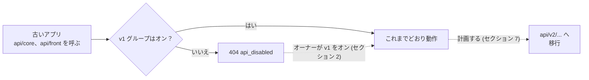

> 🌐 **言語:** [🇻🇳 Tiếng Việt](./api-v1_vi.md) · [🇬🇧 English](./api-v1.md) · 🇯🇵 日本語（現在）

# API v1（開発終了）

## はじめに

このドキュメントは、**API v2 より前に作られたアプリを保守している開発者**向けです。対象は、`api/core/...`（管理）と
`api/front/...`（ストア、顧客アカウント）を呼び出すアプリです。API v1 の状況、サイトで再びオンにする方法、エンドポイントの
一覧、v1 と v2 の違い、アプリを v2 に移行する方法を説明します。新しいアプリはこのドキュメントを読む必要はありません。
[API 入門](./api-introduction_ja.md)を直接お読みください。

> ⚠️ **API v1 は凍結されています。**
> - 利用中のアプリでは**引き続き動作します**。
> - **新規インストールでは v1 は最初からオフ**です（gp247/core 3.3.1 から）。サイトのオーナーがオンに戻す必要があります（セクション 2）。
> - API v2 の提供開始（gp247/core、gp247/front、gp247/shop 3.3.0）以降、**新機能は追加されず**、**セキュリティ修正のみ**を受けます。
> - **新しいアプリは API v2 を使う必要があります** — [API 入門](./api-introduction_ja.md)を参照してください。

## ひと目でわかる

v1 グループがオンの間、古いアプリは v1 のまま動き続けます。その間に少しずつ v2 へ移行します。



- **新規インストールでは v1 はオフ** — オフのグループを呼ぶと `404 api_disabled` になります。API 管理画面でオンに戻せます（セクション 2）。
- **セキュリティは v2 と同じ** — トークン、権限、API Connection、エラーコードは共通です（セクション 3）。
- **v2 よりできることが少ない** — リフレッシュトークン、MFA、カート／注文、絞り込み／並べ替えはありません（セクション 3）。
- **v2 への移行は、主に接頭辞の変更と `data` キーの読み取り** — 対応表はセクション 7 にあります。

## このページの内容

- [1. v1 の状況と、まだ v1 が必要な場合](#1-v1-の状況とまだ-v1-が必要な場合) — v1 と v2 のライフサイクルの違い
- [2. API v1 をオンにする](#2-api-v1-をオンにする) — オーナーが API 管理画面で v1 グループをオンに戻す
- [3. v2 と共通の点と異なる点](#3-v2-と共通の点と異なる点) — ログイン、権限、エラー、制限
- [4. v1 の管理エンドポイント](#4-v1-の管理エンドポイントapicore) — `api/core/*`
- [5. v1 の公開・顧客エンドポイント](#5-v1-の公開顧客エンドポイントapifront) — `api/front/*`
- [6. v1 のレスポンス形式](#6-v1-のレスポンス形式) — v1 の結果の読み方
- [7. API v2 への移行](#7-api-v2-への移行) — 対応表とチェックリスト

---

## 1. v1 の状況と、まだ v1 が必要な場合

API v1 は GP247 API の最初の世代です。API v2 の提供開始時、動いているアプリが壊れないよう v1 はそのまま残されましたが、
新機能はすべて v2 にだけ追加されます。

| | API v1 | API v2 |
| --- | --- | --- |
| 接頭辞 | `api/core`, `api/front` | `api/v2/core`, `api/v2/front` |
| 状況 | **凍結** — 新機能なし | 開発中 |
| 新規インストール | **オフ**（gp247/core 3.3.1 から） | オン |
| 古いバージョンからアップグレードしたサイト | オン／オフの状態を維持 | オン／オフの状態を維持 |
| セキュリティ修正 | あり | あり |
| 対象 | v2 より前に作られたアプリ | すべての新しいアプリ |

**まだ v1 が必要**なのは、本番で動いているアプリが `api/core` や `api/front` を呼んでいて、すぐには更新できない場合です。
たとえば、利用者がまだ新しい版に更新していない古いモバイルアプリや、サードパーティの同期ツールです。その間は該当する
v1 グループをオンのままにし、v2 への移行を計画してください（セクション 7）。

---

## 2. API v1 をオンにする

サイトのオーナーは、管理画面の **API 管理画面**（API Connection と同じ画面）で v1 をオン／オフします。ファイルの編集や
コマンドの実行は不要です。この画面には v1 用のスイッチが 2 つあります。

| スイッチ | 対象 |
| --- | --- |
| **v1 · 管理API (core)** | `api/core/*` |
| **v1 · 公開・顧客API (front)** | `api/front/*` |

v1 をオンに戻す手順：

1. API を管理できるアカウントで管理画面にログインします。
2. **API 管理画面**を開きます。
3. **REST API（全グループ）** スイッチがオンになっていることを確認します。これがオフだと、すべてのグループがオフになります。
4. アプリが `api/core/...` を呼ぶ場合は **v1 · 管理API (core)** を、`api/front/...` を呼ぶ場合は **v1 · 公開・顧客API (front)**
   をオンにします。本当に必要なグループだけをオンにしてください。
5. ターミナルで試しに呼び出します。

   ```bash
   curl -X GET "https://shop.example.com/api/front/product/list" -H "Accept: application/json"
   ```

   成功すると、商品一覧が JSON で返ります。まだ `404`（`"code": "api_disabled"`）が返る場合は、グループがオフのままです。
   手順 4 に戻ってください。

- オフのグループを呼ぶと → HTTP `404`、`"code": "api_disabled"` — トークンがなくても同じです *（gp247/core 3.4.0 から。
  3.3.1 ではトークンがないと `401` を返します）*。
- 環境変数 `GP247_API_MODE=0` はサーバーレベルですべての API をオフにし、画面のスイッチをロックします。
- ルートキャッシュを使うサイト：[API 入門のセクション 5](./api-introduction_ja.md#5-api-のオンオフ) の注意を参照してください。

> 💡 **ヒント:** v1 を呼ぶアプリがなくなったら、v1 グループをオフに戻しましょう。使われていないサイトの入り口が 1 つ減ります。

---

## 3. v2 と共通の点と異なる点

v1 と v2 はサイトで**同じチェック**を通るため、ほとんどのルールは同じです。下の表は要約だけです。詳細はメインのドキュメントを
お読みください。

| 項目 | v2 と同じ | 詳細 |
| --- | --- | --- |
| トークンによるログイン、`Authorization: Bearer …` ヘッダー、scope `admin` / `admin-supper` / `user` | はい | [API 入門のセクション 2](./api-introduction_ja.md#2-認証api-へのログイン) |
| ログイン回数の制限（アカウントごと 5 回/分、IP ごと 20 回/分）、1 分あたり 1000 回の共通制限 | はい — 管理画面のフォーム、`api/core/login`、`api/v2/core/login` は同じカウンターを共有 | [API 入門のセクション 2](./api-introduction_ja.md#2-認証api-へのログイン) |
| 管理画面ごとの権限、ストアごとのデータ | はい | [API 入門のセクション 3](./api-introduction_ja.md#3-core-api-の権限とデータの範囲) |
| API Connection レイヤー（`apiconnection` / `apikey`） | はい | [API 入門のセクション 4](./api-introduction_ja.md#4-接続保護レイヤーapi-connection-任意) |
| エラー本文 `{"error": 1, "msg": "…", "code": "…"}` と意味の正しい HTTP コード | はい | [API 入門のセクション 6](./api-introduction_ja.md#6-レスポンスの形式一覧のパラメーターエラーコード) |
| すべてのレスポンスの `X-Request-Id` ヘッダー | はい | [API 入門のセクション 6](./api-introduction_ja.md#6-レスポンスの形式一覧のパラメーターエラーコード) |
| 公開データはストアが表示している内容だけ | はい | セクション 5 |
| 管理 API の呼び出し（`login` を除く）を**操作ログ**に記録 | はい | [API 入門のセクション 9.5](./api-introduction_ja.md#95-管理-api-のアクセスログ) |
| パスワードの変更／再設定ですべてのトークンが無効になる | はい — v1 のトークンも含む | [API 入門のセクション 2](./api-introduction_ja.md#2-認証api-へのログイン) |

**v1 だけの点**（v2 に移行する理由）：

- **トークンは 7 日／30 日のものだけ**（`remember_me`）。`with_refresh`、`refresh` エンドポイント、セッション管理（`sessions`）はありません。
- **追加の確認ステップ（MFA）がありません。** 二要素認証を有効にしたアカウントは v1 のログインで `401 challenge_required` になり、
  完了できません — アプリは `api/v2/.../login` と `login/challenge` を使う必要があります。
- **`GET logout` はまだ受け付けますが非推奨です**：レスポンスに `Deprecation` ヘッダーが付きます。`POST logout` を使ってください。
- 会員登録、パスワードを忘れた場合、プロフィール、住所録、カート、チェックアウト、注文、支払い、`meta` は**ありません**。
- `filter`、`sort`、`q`、`lang` パラメーターは**ありません**。名前と説明はすべての言語分が返ります（セクション 6）。

---

## 4. v1 の管理エンドポイント（`api/core`）

このグループはリモート管理ツール向けで、**管理者**アカウント（`username` ＋ `password`）でログインします。

**ログインとアカウントのエンドポイント**：

| メソッド | パス | ログイン必要 | 機能 |
| --- | --- | --- | --- |
| `POST` | `api/core/login` | 不要 | 管理者ログイン、`access_token` を受け取る |
| `POST` | `api/core/logout` | 必要（Bearer） | ログアウト、現在のトークンを失効 |
| `GET` | `api/core/logout` | 必要（Bearer） | 上と同じ — **非推奨**。レスポンスに `Deprecation` ヘッダーが付きます。`POST` に切り替えてください |
| `GET` | `api/core/info` | 必要（Bearer） | ログイン中の管理者情報を取得 |

**管理データのエンドポイント**（トークン ＋ 対応する管理画面を開く権限が必要）：

| メソッド | パス | 機能 |
| --- | --- | --- |
| `GET` | `api/core/customer/list` | 顧客一覧 |
| `GET` | `api/core/customer/detail/{id}` | 顧客 1 件の詳細 |
| `GET` | `api/core/order/list` | 注文一覧（明細行と合計金額を含む） |
| `GET` | `api/core/order/detail/{id}` | 注文 1 件の詳細 |
| `GET` | `api/core/product/list` | 商品一覧 |
| `GET` | `api/core/product/detail/{id}` | 商品 1 件の詳細 |
| `GET` | `api/core/category/list` | カテゴリー一覧 |
| `GET` | `api/core/category/detail/{id}` | カテゴリー 1 件の詳細 |
| `GET` | `api/core/brand/list` | ブランド一覧 |
| `GET` | `api/core/brand/detail/{id}` | ブランド 1 件の詳細 |
| `GET` | `api/core/supplier/list` | 仕入先一覧 |
| `GET` | `api/core/supplier/detail/{id}` | 仕入先 1 件の詳細 |
| `GET` | `api/core/banner/list` | バナー一覧 |
| `GET` | `api/core/banner/detail/{id}` | バナー 1 件の詳細 |
| `GET` | `api/core/page/list` | コンテンツページ一覧 |
| `GET` | `api/core/page/detail/{id}` | コンテンツページ 1 件の詳細 |

管理者ログインの例（ターミナルで `curl` を使用）：

```bash
curl -X POST "https://shop.example.com/api/core/login" \
  -H "Content-Type: application/json" \
  -d '{"username":"admin","password":"your-password","remember_me":true}'
```

成功すると、次のような JSON が返ります（v1 はオブジェクトをそのまま返し、`data` で包みません）。

```json
{
  "access_token": "1|aBcD...very-long...XyZ",
  "token_type": "Bearer",
  "scopes": ["admin-supper"],
  "expires_at": "2026-11-25 10:00:00"
}
```

続いて、受け取ったトークンで注文一覧を取得します。

```bash
curl -X GET "https://shop.example.com/api/core/order/list" \
  -H "Authorization: Bearer 1|aBcD...very-long...XyZ"
```

---

## 5. v1 の公開・顧客エンドポイント（`api/front`）

このグループは**公開データ**（ログイン不要）と**顧客個人のデータ**（`email` ＋ `password` でログイン）を扱います。

**公開エンドポイント**（トークン不要）：

| メソッド | パス | 機能 |
| --- | --- | --- |
| `GET` | `api/front/product/list` | 商品一覧 |
| `GET` | `api/front/product/detail/{id}` | 商品 1 件の詳細 |
| `GET` | `api/front/category/list` | カテゴリー一覧 |
| `GET` | `api/front/category/detail/{id}` | カテゴリー 1 件の詳細（商品を含む） |
| `GET` | `api/front/brand/list` | ブランド一覧 |
| `GET` | `api/front/brand/detail/{id}` | ブランド 1 件の詳細 |
| `GET` | `api/front/banner/list` | バナー一覧 |
| `GET` | `api/front/banner/detail/{id}` | バナー 1 件の詳細 |
| `GET` | `api/front/page/list` | コンテンツページ一覧 |
| `GET` | `api/front/page/detail/{id}` | コンテンツページ 1 件の詳細 |

> ℹ️ **対応バージョン:** gp247/shop 3.2.3, gp247/front 3.2.3 — 公開データは、呼び出したドメインで
> **ストアが表示している内容とまったく同じ**です。非表示の商品、未承認の商品、他のストアに属する商品は含まれません。
> レスポンスには公開項目だけが入り、原価、仕入先、在庫数／販売数は含まれません。

**顧客アカウントのエンドポイント**（顧客のトークンが必要）：

| メソッド | パス | ログイン必要 | 機能 |
| --- | --- | --- | --- |
| `POST` | `api/front/login` | 不要 | 顧客のメールアドレス／パスワードでログインし、トークンを受け取る |
| `POST` | `api/front/logout` | 必要（Bearer） | 顧客のログアウト |
| `GET` | `api/front/logout` | 必要（Bearer） | 上と同じ — **非推奨**。レスポンスに `Deprecation` ヘッダーが付きます。`POST` に切り替えてください |
| `GET` | `api/front/info` | 必要（Bearer） | 顧客アカウントの情報 |
| `GET` | `api/front/member/order/list` | 必要（Bearer） | 顧客の注文一覧 |
| `GET` | `api/front/member/order/detail/{id}` | 必要（Bearer） | 注文 1 件の詳細 |

商品一覧を取得する例（公開データ、トークン不要）：

```bash
curl -X GET "https://shop.example.com/api/front/product/list" \
  -H "Accept: application/json"
```

顧客としてログインし、注文を確認する例：

```bash
# 1) 顧客ログイン
curl -X POST "https://shop.example.com/api/front/login" \
  -H "Content-Type: application/json" \
  -d '{"email":"customer@example.com","password":"your-password"}'

# 2) 受け取ったトークンで注文一覧を取得
curl -X GET "https://shop.example.com/api/front/member/order/list" \
  -H "Authorization: Bearer 2|zzz...customer-token...zzz"
```

---

## 6. v1 のレスポンス形式

v1 はデータを「そのままの」形で返し、次の点で v2 と異なります。

- **1 件**：オブジェクトをそのまま返します（外側の `data` キーはありません）。
- **一覧**：Laravel 標準のページ分割形式です。`data`、`current_page`、`per_page`、`total`、`last_page` などが**同じ階層**に
  あります。ページは `page[number]` と `page[size]` で指定します。
- **商品／カテゴリー／コンテンツページの名前と説明**：**すべての言語**分の配列 `descriptions` で、各要素に `lang` があります。
- **価格**：`price` だけです。`price_final`（プロモーション適用後に顧客が支払う価格）はありません。
- **エラー**：v2 と同じ `{"error": 1, "msg": "…", "code": "…"}` 形式です。

v1 の商品一覧の 1 ページの例（抜粋）：

```json
{
  "current_page": 1,
  "data": [
    { "id": "PRD-AbC12", "sku": "TSHIRT-01", "price": 250000,
      "descriptions": [ { "lang": "vi", "name": "Áo thun" }, { "lang": "en", "name": "T-shirt" } ] }
  ],
  "per_page": 20,
  "total": 1,
  "last_page": 1
}
```

---

## 7. API v2 への移行

ほとんどの v1 アプリは、**接頭辞を変え**、**`data` キーの中のデータを読む**ことで v2 に移行できます。すべての v1 エンドポイントに
対応する v2 エンドポイントがあります。

| v1 エンドポイント | v2 エンドポイント |
| --- | --- |
| `POST` `api/core/login` | `POST` `api/v2/core/login` |
| `POST` `api/core/logout`, `GET` `api/core/logout` | `POST` `api/v2/core/logout` |
| `GET` `api/core/info` | `GET` `api/v2/core/info` |
| `api/core/customer/list`, `api/core/customer/detail/{id}` | `api/v2/core/customer/list`, `api/v2/core/customer/detail/{id}` |
| `api/core/order/list`, `api/core/order/detail/{id}` | `api/v2/core/order/list`, `api/v2/core/order/detail/{id}` |
| `api/core/product/list`, `api/core/product/detail/{id}` | `api/v2/core/product/list`, `api/v2/core/product/detail/{id}` |
| `api/core/category/list`, `api/core/category/detail/{id}` | `api/v2/core/category/list`, `api/v2/core/category/detail/{id}` |
| `api/core/brand/list`, `api/core/brand/detail/{id}` | `api/v2/core/brand/list`, `api/v2/core/brand/detail/{id}` |
| `api/core/supplier/list`, `api/core/supplier/detail/{id}` | `api/v2/core/supplier/list`, `api/v2/core/supplier/detail/{id}` |
| `api/core/banner/list`, `api/core/banner/detail/{id}` | `api/v2/core/banner/list`, `api/v2/core/banner/detail/{id}` |
| `api/core/page/list`, `api/core/page/detail/{id}` | `api/v2/core/page/list`, `api/v2/core/page/detail/{id}` |
| `POST` `api/front/login` | `POST` `api/v2/front/login` |
| `POST` `api/front/logout`, `GET` `api/front/logout` | `POST` `api/v2/front/logout` |
| `GET` `api/front/info` | `GET` `api/v2/front/info` |
| `api/front/member/order/list`, `api/front/member/order/detail/{id}` | `api/v2/front/member/order/list`, `api/v2/front/member/order/detail/{id}` |
| `api/front/product/list`, `api/front/product/detail/{id}` | `api/v2/front/product/list`, `api/v2/front/product/detail/{id}` |
| `api/front/category/list`, `api/front/category/detail/{id}` | `api/v2/front/category/list`, `api/v2/front/category/detail/{id}` |
| `api/front/brand/list`, `api/front/brand/detail/{id}` | `api/v2/front/brand/list`, `api/v2/front/brand/detail/{id}` |
| `api/front/banner/list`, `api/front/banner/detail/{id}` | `api/v2/front/banner/list`, `api/v2/front/banner/detail/{id}` |
| `api/front/page/list`, `api/front/page/detail/{id}` | `api/v2/front/page/list`, `api/v2/front/page/detail/{id}` |

上の一覧／詳細のエンドポイントは、すべて `GET` メソッドです。

アプリで直す必要がある**レスポンス形式の違い**：

| 違い | v1 | v2 |
| --- | --- | --- |
| ログイン | トークンは最上位（`access_token`） | トークンは `data` の中（`data.access_token`） |
| 成功時（1 件） | オブジェクトをそのまま返す | `{"data": {...}}` |
| 成功時（一覧） | Laravel のページ分割（`data`、`current_page`、`total` などが同じ階層） | `{"data": [...], "meta": {...}, "links": {...}}` |
| 商品／カテゴリー／ページの名前と説明 | 全言語分の配列 `descriptions` | `lang` で選んだ言語の `name`、`description` など |
| 価格 | `price` | `price` と `price_final`（ストアで顧客が支払う価格。プロモーション適用後） |
| ログアウト | `POST`（および非推奨の `GET`） | `POST` のみ |

**移行のチェックリスト：**

1. 接頭辞を `api/core` → `api/v2/core`、`api/front` → `api/v2/front` に変えます。
2. ログインのトークンは `data.access_token` から読み、すべての結果は `data` キーの中から読みます。
3. 一覧：ページ情報は最上位ではなく `meta`（`current_page`、`per_page`、`total`、`last_page`）から読みます。
4. 名前／説明は、配列 `descriptions` を絞り込む代わりに `name`、`description` から表示します（言語は `lang` で指定）。
5. 顧客が支払う価格として `price_final` を表示します。
6. ログアウトは `POST logout` で行います。
7. あわせて推奨：`with_refresh: true` でのログイン、`401 challenge_required`（MFA）への対応、アプリ側の絞り込みの代わりに
   `filter` / `sort` の利用 — [API 入門](./api-introduction_ja.md)を参照してください。
8. 新しい版のアプリを公開し、v1 を呼ぶ古い版がなくなったら、サイトのオーナーに v1 グループをオフにしてもらいます（セクション 2）。

---

## よくある質問（Q&A）

**Q1: アプリが `api/front/...` を呼ぶと `404`（`"code": "api_disabled"`）が返ります。なぜですか？**

→ サイトで v1 グループがオフになっています。新規インストールでは v1 は最初からオフです。サイトのオーナーに該当するグループを
オンにしてもらい（セクション 2）、v2 への移行を計画してください（セクション 7）。

**Q2: API v1 はまだ修正されますか？**

→ v1 が受けるのは**セキュリティ修正**だけです。新機能はなく、その他の不具合は v2 でのみ修正されます。v2 への移行を計画してください。

**Q3: 二要素認証を有効にしたアカウントが v1 でサインインできないのはなぜですか？**

→ v1 にはコードを入力するステップがないため、ログインは `401 challenge_required` になります。`api/v2/core/login` または
`api/v2/front/login` を使い、続けて v2 の `login/challenge` を呼んでください。

**Q4: v1 でカート、注文、会員登録は使えますか？**

→ 使えません。これらの機能は v2 にだけあります — [API 入門](./api-introduction_ja.md)のセクション 9 と 10 を参照してください。

**Q5: `GET logout` に `Deprecation` ヘッダーが付くのはなぜですか？**

→ `GET` によるログアウトは非推奨だからです。`POST logout` に切り替えてください。v2 は `POST` だけを受け付けます。

**Q6: v1 をオンにするとサイトの安全性が下がりますか？**

→ v1 は v2 と同じチェックを通ります：有効期限付きのトークン、管理画面ごとの権限、ストアごとのデータ、API Connection、
ログイン回数の制限。それでも、本当に必要な v1 グループだけをオンにし、使うアプリがなくなったらオフにしてください。

**Q7: v1 と v2 を同時に使えますか？**

→ 使えます。移行中は両方のグループをオンにしておき、古い版のアプリは v1、新しい版は v2 を呼びます。古い版が使われなく
なったら v1 をオフにします。

**Q8: v2 への移行は大変ですか？**

→ 通常はそれほどではありません。接頭辞の変更、`data` キーの中のデータの読み取り、名前と価格の読み方の変更が中心です。
対応表とチェックリストはセクション 7 にあります。

---

## 変更履歴
<!-- ロジック/動作が変わった場合のみ記載。最新の行を一番上に。1 日 1 行：同じ日の変更は既存の行にまとめ、同じ日付の行を追加しない。 -->

| 日付 | GP247 バージョン | 変更内容 |
| --- | --- | --- |
| 2026-10-31 | gp247/core, gp247/front, gp247/shop 3.3.0。新規インストールで v1 オフ：gp247/core 3.3.1 | API 入門から独立したドキュメントに分離。v1 を凍結 |

---

<sub>📅 **最終更新:** 2026-10-31 · ✍️ **作成者 (Author):** GP247</sub>
