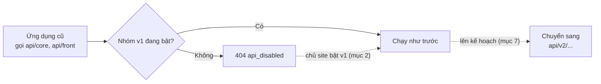

> 🌐 **Ngôn ngữ:** 🇻🇳 Tiếng Việt (hiện tại) · [🇬🇧 English](./api-v1.md) · [🇯🇵 日本語](./api-v1_ja.md)

# API v1 (đã ngưng phát triển)

## Giới thiệu

Tài liệu này dành cho **lập trình viên đang duy trì ứng dụng viết trước khi có API v2** — ứng dụng gọi các địa chỉ
`api/core/...` (quản trị) và `api/front/...` (cửa hàng, tài khoản khách). Tài liệu cho biết trạng thái của API v1, cách
bật lại trên site, danh sách endpoint, những điểm v1 khác v2 và cách chuyển ứng dụng sang v2. Ứng dụng mới không cần đọc
tài liệu này: hãy đọc thẳng [Giới thiệu API](./api-introduction_vi.md).

> ⚠️ **API v1 đã đóng băng.**
> - **Vẫn chạy** cho ứng dụng đang dùng.
> - **Site cài mới tắt sẵn v1** (từ gp247/core 3.3.1) — chủ site phải tự bật lại (mục 2).
> - **Không có tính năng mới** kể từ khi có API v2 (gp247/core, gp247/front, gp247/shop 3.3.0); **chỉ nhận bản vá bảo mật**.
> - **Ứng dụng mới phải dùng API v2** — xem [Giới thiệu API](./api-introduction_vi.md).

## Nhìn nhanh

Ứng dụng cũ chạy tiếp với v1 khi nhóm v1 được bật, trong lúc bạn chuyển dần sang v2:



- **Cài mới tắt v1** — gọi vào nhóm tắt nhận `404 api_disabled`; bật lại trên màn quản lý API (mục 2).
- **Bảo mật như v2** — cùng token, phân quyền, API Connection, mã lỗi (mục 3).
- **Thiếu nhiều thứ so với v2** — không refresh token, không MFA, không giỏ hàng / đặt đơn, không lọc/sắp xếp (mục 3).
- **Chuyển sang v2 chủ yếu là đổi tiền tố và đọc khoá `data`** — bảng đối chiếu ở mục 7.

## Trong trang này

- [1. Trạng thái và khi nào còn cần v1](#1-trạng-thái-và-khi-nào-còn-cần-v1) — v1 khác v2 về vòng đời ra sao
- [2. Bật API v1](#2-bật-api-v1) — chủ site bật lại nhóm v1 trên màn quản lý API
- [3. Dùng chung với v2 và những điểm khác](#3-dùng-chung-với-v2-và-những-điểm-khác) — đăng nhập, quyền, lỗi, giới hạn
- [4. Endpoint quản trị v1](#4-endpoint-quản-trị-v1-apicore) — `api/core/*`
- [5. Endpoint công khai & khách hàng v1](#5-endpoint-công-khai--khách-hàng-v1-apifront) — `api/front/*`
- [6. Định dạng phản hồi của v1](#6-định-dạng-phản-hồi-của-v1) — đọc kết quả v1
- [7. Chuyển sang API v2](#7-chuyển-sang-api-v2) — bảng đối chiếu và danh sách kiểm tra

---

## 1. Trạng thái và khi nào còn cần v1

API v1 là thế hệ API đầu tiên của GP247. Khi API v2 ra đời, v1 được giữ nguyên để ứng dụng đang chạy không bị hỏng,
nhưng mọi tính năng mới chỉ làm ở v2.

| | API v1 | API v2 |
| --- | --- | --- |
| Tiền tố | `api/core`, `api/front` | `api/v2/core`, `api/v2/front` |
| Trạng thái | **Đóng băng** — không thêm tính năng | Đang phát triển |
| Site cài mới | **Tắt sẵn** (từ gp247/core 3.3.1) | Bật sẵn |
| Site nâng cấp từ bản cũ | Giữ nguyên trạng thái bật/tắt | Giữ nguyên trạng thái bật/tắt |
| Bản vá bảo mật | Có | Có |
| Dành cho | Ứng dụng viết trước khi có v2 | Mọi ứng dụng mới |

Bạn **còn cần v1** khi đang có ứng dụng chạy thật gọi `api/core` hoặc `api/front` mà chưa thể cập nhật ngay — ví dụ bản
app di động cũ mà người dùng chưa cài bản mới, hay một công cụ đồng bộ của bên thứ ba. Trong thời gian đó, giữ nhóm v1
tương ứng đang bật và lên kế hoạch chuyển sang v2 (mục 7).

---

## 2. Bật API v1

Chủ site bật/tắt v1 trên **màn quản lý API** của trang quản trị (cùng màn với API Connection) — không cần sửa file hay chạy
lệnh. Màn này có hai công tắc riêng cho v1:

| Công tắc | Áp dụng cho |
| --- | --- |
| **v1 · API quản trị (core)** | `api/core/*` |
| **v1 · API công khai & khách hàng (front)** | `api/front/*` |

Các bước bật lại v1:

1. Đăng nhập trang quản trị bằng tài khoản được phép quản lý API.
2. Mở **màn quản lý API**.
3. Kiểm tra công tắc **REST API (tất cả nhóm)** đang bật — tắt công tắc này thì mọi nhóm đều tắt.
4. Bật **v1 · API quản trị (core)** nếu ứng dụng gọi `api/core/...`, và/hoặc **v1 · API công khai & khách hàng (front)**
   nếu ứng dụng gọi `api/front/...`. Chỉ bật nhóm thật sự cần.
5. Gọi thử từ Terminal:

   ```bash
   curl -X GET "https://shop.example.com/api/front/product/list" -H "Accept: application/json"
   ```

   Nếu thành công, bạn nhận về JSON danh sách sản phẩm. Nếu vẫn nhận `404` với `"code": "api_disabled"`, nhóm vẫn đang
   tắt — quay lại Bước 4.

- Gọi vào nhóm đang tắt → HTTP `404` với `"code": "api_disabled"` — kể cả khi chưa gửi token *(từ gp247/core 3.4.0;
  bản 3.3.1 trả `401` nếu thiếu token)*.
- Biến môi trường `GP247_API_MODE=0` tắt hẳn mọi API ở tầng máy chủ và khoá các công tắc trên màn.
- Site có cache route: xem lưu ý ở [Giới thiệu API — mục 5](./api-introduction_vi.md#5-bậttắt-api).

> 💡 **Mẹo:** khi không còn ứng dụng nào gọi v1, hãy tắt lại các nhóm v1 — bớt một cửa vào site mà không ai dùng.

---

## 3. Dùng chung với v2 và những điểm khác

v1 và v2 đi qua **cùng các lớp kiểm tra** của site, nên phần lớn quy tắc giống hệt nhau. Bảng dưới chỉ tóm tắt; chi tiết đọc
ở tài liệu chính.

| Chủ đề | Giống v2 | Chi tiết |
| --- | --- | --- |
| Đăng nhập bằng token, header `Authorization: Bearer …`, scope `admin` / `admin-supper` / `user` | Có | [Giới thiệu API — mục 2](./api-introduction_vi.md#2-xác-thực-đăng-nhập-vào-api) |
| Giới hạn đăng nhập (5 lần/phút mỗi tài khoản, 20 lần/phút mỗi IP), giới hạn chung 1000 lần/phút | Có — form quản trị, `api/core/login` và `api/v2/core/login` dùng chung một bộ đếm | [Giới thiệu API — mục 2](./api-introduction_vi.md#2-xác-thực-đăng-nhập-vào-api) |
| Quyền theo màn admin, dữ liệu theo cửa hàng | Có | [Giới thiệu API — mục 3](./api-introduction_vi.md#3-phân-quyền-và-phạm-vi-dữ-liệu-của-api-core) |
| Lớp API Connection (`apiconnection` / `apikey`) | Có | [Giới thiệu API — mục 4](./api-introduction_vi.md#4-lớp-bảo-vệ-kết-nối-api-connection--tùy-chọn) |
| Thân lỗi `{"error": 1, "msg": "…", "code": "…"}` và mã HTTP đúng nghĩa | Có | [Giới thiệu API — mục 6](./api-introduction_vi.md#6-định-dạng-phản-hồi-tham-số-danh-sách--mã-lỗi) |
| Header `X-Request-Id` trên mọi phản hồi | Có | [Giới thiệu API — mục 6](./api-introduction_vi.md#6-định-dạng-phản-hồi-tham-số-danh-sách--mã-lỗi) |
| Dữ liệu công khai chỉ gồm những gì cửa hàng đang hiển thị | Có | mục 5 |
| Ghi vào **Nhật ký thao tác** mỗi lần gọi API quản trị (trừ `login`) | Có | [Giới thiệu API — mục 9.5](./api-introduction_vi.md#95-nhật-ký-truy-cập-api-quản-trị) |
| Đổi / đặt lại mật khẩu làm mọi token hết hiệu lực | Có — kể cả token v1 | [Giới thiệu API — mục 2](./api-introduction_vi.md#2-xác-thực-đăng-nhập-vào-api) |

**Những điểm chỉ có ở v1** (lý do nên chuyển sang v2):

- **Token chỉ có loại 7 / 30 ngày** (`remember_me`). Không có `with_refresh`, không có endpoint `refresh`, không có quản lý
  phiên (`sessions`).
- **Không có bước xác thực thêm (MFA).** Tài khoản đã bật xác thực hai lớp đăng nhập v1 nhận `401 challenge_required`
  và không hoàn tất được — ứng dụng phải dùng `api/v2/.../login` và `login/challenge`.
- **`GET logout` vẫn được nhận nhưng đã lỗi thời**: phản hồi kèm header `Deprecation`. Hãy dùng `POST logout`.
- **Không có** đăng ký, quên mật khẩu, hồ sơ, sổ địa chỉ, giỏ hàng, checkout, đặt đơn, thanh toán, `meta`.
- **Không có** tham số `filter`, `sort`, `q`, `lang`; tên và mô tả trả về cho mọi ngôn ngữ (mục 6).

---

## 4. Endpoint quản trị v1 (`api/core`)

Nhóm này dành cho công cụ quản trị từ xa, đăng nhập bằng tài khoản **quản trị viên** (`username` + `password`).

**Endpoint đăng nhập & tài khoản**:

| Phương thức | Đường dẫn | Cần đăng nhập | Chức năng |
| --- | --- | --- | --- |
| `POST` | `api/core/login` | Không | Đăng nhập admin, nhận `access_token` |
| `POST` | `api/core/logout` | Có (Bearer) | Đăng xuất, thu hồi token hiện tại |
| `GET` | `api/core/logout` | Có (Bearer) | Như trên — **đã lỗi thời**, phản hồi kèm header `Deprecation`; hãy chuyển sang `POST` |
| `GET` | `api/core/info` | Có (Bearer) | Lấy thông tin quản trị viên đang đăng nhập |

**Endpoint dữ liệu quản trị** (cần token + quyền mở màn admin tương ứng):

| Phương thức | Đường dẫn | Chức năng |
| --- | --- | --- |
| `GET` | `api/core/customer/list` | Danh sách khách hàng |
| `GET` | `api/core/customer/detail/{id}` | Chi tiết một khách hàng |
| `GET` | `api/core/order/list` | Danh sách đơn hàng (kèm dòng hàng và tổng tiền) |
| `GET` | `api/core/order/detail/{id}` | Chi tiết một đơn hàng |
| `GET` | `api/core/product/list` | Danh sách sản phẩm |
| `GET` | `api/core/product/detail/{id}` | Chi tiết một sản phẩm |
| `GET` | `api/core/category/list` | Danh sách danh mục |
| `GET` | `api/core/category/detail/{id}` | Chi tiết một danh mục |
| `GET` | `api/core/brand/list` | Danh sách thương hiệu |
| `GET` | `api/core/brand/detail/{id}` | Chi tiết một thương hiệu |
| `GET` | `api/core/supplier/list` | Danh sách nhà cung cấp |
| `GET` | `api/core/supplier/detail/{id}` | Chi tiết một nhà cung cấp |
| `GET` | `api/core/banner/list` | Danh sách banner |
| `GET` | `api/core/banner/detail/{id}` | Chi tiết một banner |
| `GET` | `api/core/page/list` | Danh sách trang nội dung |
| `GET` | `api/core/page/detail/{id}` | Chi tiết một trang nội dung |

Ví dụ đăng nhập admin (dùng `curl` trong Terminal):

```bash
curl -X POST "https://shop.example.com/api/core/login" \
  -H "Content-Type: application/json" \
  -d '{"username":"admin","password":"your-password","remember_me":true}'
```

Nếu thành công, bạn nhận về JSON dạng (v1 trả thẳng object, không bọc trong `data`):

```json
{
  "access_token": "1|aBcD...rất-dài...XyZ",
  "token_type": "Bearer",
  "scopes": ["admin-supper"],
  "expires_at": "2026-11-25 10:00:00"
}
```

Sau đó lấy danh sách đơn hàng bằng token vừa nhận:

```bash
curl -X GET "https://shop.example.com/api/core/order/list" \
  -H "Authorization: Bearer 1|aBcD...rất-dài...XyZ"
```

---

## 5. Endpoint công khai & khách hàng v1 (`api/front`)

Nhóm này phục vụ **dữ liệu công khai** (không cần đăng nhập) và **dữ liệu riêng của khách** (đăng nhập bằng `email` +
`password`).

**Các endpoint công khai** (không cần token):

| Phương thức | Đường dẫn | Chức năng |
| --- | --- | --- |
| `GET` | `api/front/product/list` | Danh sách sản phẩm |
| `GET` | `api/front/product/detail/{id}` | Chi tiết một sản phẩm |
| `GET` | `api/front/category/list` | Danh sách danh mục |
| `GET` | `api/front/category/detail/{id}` | Chi tiết một danh mục (kèm sản phẩm) |
| `GET` | `api/front/brand/list` | Danh sách thương hiệu |
| `GET` | `api/front/brand/detail/{id}` | Chi tiết một thương hiệu |
| `GET` | `api/front/banner/list` | Danh sách banner |
| `GET` | `api/front/banner/detail/{id}` | Chi tiết một banner |
| `GET` | `api/front/page/list` | Danh sách trang nội dung |
| `GET` | `api/front/page/detail/{id}` | Chi tiết một trang nội dung |

> ℹ️ **Có từ:** gp247/shop 3.2.3, gp247/front 3.2.3 — dữ liệu công khai **giống hệt những gì cửa hàng
> đang hiển thị** trên tên miền bạn gọi: sản phẩm ẩn, chưa được duyệt hoặc thuộc cửa hàng khác không
> xuất hiện. Phản hồi chỉ gồm các trường công khai — không có giá vốn, nhà cung cấp, số tồn/đã bán.

**Các endpoint tài khoản khách** (cần token của khách):

| Phương thức | Đường dẫn | Cần đăng nhập | Chức năng |
| --- | --- | --- | --- |
| `POST` | `api/front/login` | Không | Đăng nhập bằng email/mật khẩu khách, nhận token |
| `POST` | `api/front/logout` | Có (Bearer) | Đăng xuất khách |
| `GET` | `api/front/logout` | Có (Bearer) | Như trên — **đã lỗi thời**, phản hồi kèm header `Deprecation`; hãy chuyển sang `POST` |
| `GET` | `api/front/info` | Có (Bearer) | Thông tin tài khoản khách |
| `GET` | `api/front/member/order/list` | Có (Bearer) | Danh sách đơn hàng của khách |
| `GET` | `api/front/member/order/detail/{id}` | Có (Bearer) | Chi tiết một đơn hàng |

Ví dụ lấy danh sách sản phẩm (công khai, không cần token):

```bash
curl -X GET "https://shop.example.com/api/front/product/list" \
  -H "Accept: application/json"
```

Ví dụ đăng nhập khách rồi xem đơn hàng:

```bash
# 1) Đăng nhập khách
curl -X POST "https://shop.example.com/api/front/login" \
  -H "Content-Type: application/json" \
  -d '{"email":"customer@example.com","password":"your-password"}'

# 2) Dùng token nhận được để lấy danh sách đơn hàng
curl -X GET "https://shop.example.com/api/front/member/order/list" \
  -H "Authorization: Bearer 2|zzz...token-khach...zzz"
```

---

## 6. Định dạng phản hồi của v1

v1 trả dữ liệu ở dạng "thô", khác v2 ở mấy điểm sau:

- **Một bản ghi**: trả thẳng object (không có khoá `data` bọc ngoài).
- **Danh sách**: theo chuẩn phân trang của Laravel — `data`, `current_page`, `per_page`, `total`, `last_page`… nằm **cùng
  tầng**; chọn trang bằng `page[number]` và `page[size]`.
- **Tên, mô tả** sản phẩm / danh mục / trang nội dung: mảng `descriptions` gồm **mọi ngôn ngữ**, mỗi phần tử có `lang`.
- **Giá**: chỉ có `price`; không có `price_final` (giá khách trả sau khuyến mãi).
- **Lỗi**: cùng dạng `{"error": 1, "msg": "…", "code": "…"}` như v2.

Ví dụ một trang danh sách sản phẩm v1 (rút gọn):

```json
{
  "current_page": 1,
  "data": [
    { "id": "PRD-AbC12", "sku": "TSHIRT-01", "price": 250000,
      "descriptions": [ { "lang": "vi", "name": "Áo thun" }, { "lang": "en", "name": "T-shirt" } ] }
  ],
  "per_page": 20,
  "total": 1,
  "last_page": 1
}
```

---

## 7. Chuyển sang API v2

Phần lớn ứng dụng v1 chuyển sang v2 bằng cách **đổi tiền tố** và **đọc dữ liệu trong khoá `data`**. Mọi endpoint v1 đều có
endpoint v2 tương ứng:

| Endpoint v1 | Endpoint v2 |
| --- | --- |
| `POST` `api/core/login` | `POST` `api/v2/core/login` |
| `POST` `api/core/logout`, `GET` `api/core/logout` | `POST` `api/v2/core/logout` |
| `GET` `api/core/info` | `GET` `api/v2/core/info` |
| `api/core/customer/list`, `api/core/customer/detail/{id}` | `api/v2/core/customer/list`, `api/v2/core/customer/detail/{id}` |
| `api/core/order/list`, `api/core/order/detail/{id}` | `api/v2/core/order/list`, `api/v2/core/order/detail/{id}` |
| `api/core/product/list`, `api/core/product/detail/{id}` | `api/v2/core/product/list`, `api/v2/core/product/detail/{id}` |
| `api/core/category/list`, `api/core/category/detail/{id}` | `api/v2/core/category/list`, `api/v2/core/category/detail/{id}` |
| `api/core/brand/list`, `api/core/brand/detail/{id}` | `api/v2/core/brand/list`, `api/v2/core/brand/detail/{id}` |
| `api/core/supplier/list`, `api/core/supplier/detail/{id}` | `api/v2/core/supplier/list`, `api/v2/core/supplier/detail/{id}` |
| `api/core/banner/list`, `api/core/banner/detail/{id}` | `api/v2/core/banner/list`, `api/v2/core/banner/detail/{id}` |
| `api/core/page/list`, `api/core/page/detail/{id}` | `api/v2/core/page/list`, `api/v2/core/page/detail/{id}` |
| `POST` `api/front/login` | `POST` `api/v2/front/login` |
| `POST` `api/front/logout`, `GET` `api/front/logout` | `POST` `api/v2/front/logout` |
| `GET` `api/front/info` | `GET` `api/v2/front/info` |
| `api/front/member/order/list`, `api/front/member/order/detail/{id}` | `api/v2/front/member/order/list`, `api/v2/front/member/order/detail/{id}` |
| `api/front/product/list`, `api/front/product/detail/{id}` | `api/v2/front/product/list`, `api/v2/front/product/detail/{id}` |
| `api/front/category/list`, `api/front/category/detail/{id}` | `api/v2/front/category/list`, `api/v2/front/category/detail/{id}` |
| `api/front/brand/list`, `api/front/brand/detail/{id}` | `api/v2/front/brand/list`, `api/v2/front/brand/detail/{id}` |
| `api/front/banner/list`, `api/front/banner/detail/{id}` | `api/v2/front/banner/list`, `api/v2/front/banner/detail/{id}` |
| `api/front/page/list`, `api/front/page/detail/{id}` | `api/v2/front/page/list`, `api/v2/front/page/detail/{id}` |

Các endpoint danh sách/chi tiết ở trên đều dùng phương thức `GET`.

**Khác biệt về dạng phản hồi** cần sửa trong ứng dụng:

| Khác biệt | v1 | v2 |
| --- | --- | --- |
| Đăng nhập | Token ở tầng ngoài cùng (`access_token`) | Token trong `data` (`data.access_token`) |
| Thành công (một bản ghi) | Trả thẳng object | `{"data": {...}}` |
| Thành công (danh sách) | Phân trang Laravel (`data`, `current_page`, `total`… cùng tầng) | `{"data": [...], "meta": {...}, "links": {...}}` |
| Tên, mô tả sản phẩm/danh mục/trang | Mảng `descriptions` mọi ngôn ngữ | `name`, `description`… theo ngôn ngữ chọn bằng `lang` |
| Giá | `price` | `price` và `price_final` (giá khách trả trên cửa hàng, đã tính khuyến mãi) |
| Đăng xuất | `POST` (và `GET` đã lỗi thời) | Chỉ `POST` |

**Danh sách kiểm tra khi chuyển:**

1. Đổi tiền tố `api/core` → `api/v2/core` và `api/front` → `api/v2/front`.
2. Đọc token đăng nhập ở `data.access_token`; đọc mọi kết quả trong khoá `data`.
3. Danh sách: đọc thông tin trang ở `meta` (`current_page`, `per_page`, `total`, `last_page`) thay vì ở tầng ngoài.
4. Hiển thị tên/mô tả từ `name`, `description` (gửi `lang` để chọn ngôn ngữ) thay vì lọc mảng `descriptions`.
5. Hiển thị `price_final` làm giá khách trả.
6. Đăng xuất bằng `POST logout`.
7. Nên làm thêm: đăng nhập kèm `with_refresh: true`, xử lý `401 challenge_required` (MFA), dùng `filter` / `sort` thay cho
   lọc phía ứng dụng — xem [Giới thiệu API](./api-introduction_vi.md).
8. Phát hành bản ứng dụng mới; khi không còn bản cũ nào gọi v1, nhờ chủ site tắt các nhóm v1 (mục 2).

---

## Hỏi & Đáp (Q&A)

**Câu 1: Ứng dụng của tôi gọi `api/front/...` thì nhận `404` với `"code": "api_disabled"`. Vì sao?**

→ Nhóm v1 đang tắt trên site — site cài mới tắt sẵn v1. Nhờ chủ site bật nhóm tương ứng (mục 2), rồi lên kế hoạch chuyển
sang v2 (mục 7).

**Câu 2: API v1 có còn được sửa lỗi không?**

→ v1 chỉ nhận **bản vá bảo mật**. Không có tính năng mới; các lỗi khác chỉ được sửa ở v2. Hãy lên kế hoạch chuyển sang
v2.

**Câu 3: Tài khoản đã bật xác thực hai lớp không đăng nhập được qua v1?**

→ Đúng vậy: v1 không có bước nhập mã, nên đăng nhập trả `401 challenge_required`. Hãy dùng `api/v2/core/login` hoặc
`api/v2/front/login` rồi `login/challenge` của v2.

**Câu 4: Có giỏ hàng, đặt đơn hay đăng ký tài khoản qua v1 không?**

→ Không. Các tính năng này chỉ có ở v2 — xem mục 9 và mục 10 của [Giới thiệu API](./api-introduction_vi.md).

**Câu 5: Vì sao `GET logout` trả thêm header `Deprecation`?**

→ Đăng xuất bằng `GET` đã lỗi thời. Hãy đổi sang `POST logout`; v2 chỉ nhận `POST`.

**Câu 6: Bật v1 có làm site kém an toàn hơn không?**

→ v1 đi qua cùng các lớp kiểm tra như v2: token có hạn, phân quyền theo màn admin, dữ liệu theo cửa hàng, API Connection,
giới hạn đăng nhập. Dù vậy, chỉ bật nhóm v1 thật sự cần và tắt khi không còn ứng dụng nào dùng.

**Câu 7: Có chạy song song v1 và v2 được không?**

→ Được. Trong lúc chuyển, giữ cả hai nhóm cùng bật: bản ứng dụng cũ gọi v1, bản mới gọi v2. Tắt v1 khi bản cũ không còn
được dùng.

**Câu 8: Chuyển sang v2 có tốn nhiều công không?**

→ Thường là ít: đổi tiền tố, đọc dữ liệu trong khoá `data`, đổi cách đọc tên và giá. Bảng đối chiếu và danh sách kiểm
tra ở mục 7.

---

## Lịch sử thay đổi
<!-- Chỉ ghi khi có thay đổi về logic/hành vi. Dòng mới nhất ở trên cùng. Mỗi ngày một dòng: cùng ngày thì gộp vào dòng có sẵn, không tách dòng mới. -->

| Ngày | Phiên bản GP247 | Thay đổi |
| --- | --- | --- |
| 2026-10-31 | gp247/core, gp247/front, gp247/shop 3.3.0; cài mới tắt v1: gp247/core 3.3.1 | Tách khỏi Giới thiệu API thành tài liệu riêng; v1 đóng băng |

---

<sub>📅 **Cập nhật lần cuối:** 2026-10-31 · ✍️ **Tác giả (Author):** GP247</sub>
