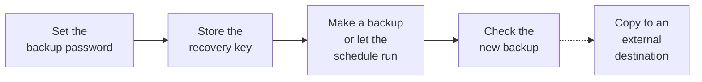

> 🌐 **Language:** [🇻🇳 Tiếng Việt](./backup-and-restore_vi.md) · 🇬🇧 English (current) · [🇯🇵 日本語](./backup-and-restore_ja.md)

# Backup & restore — set it up once, the site protects itself

## Introduction
GP247 has **backup & restore** built into the admin: every backup is encrypted, checked right after it is made, and runs even on a
shared host without cron. This document is for **site owners and administrators**: how to set it up the first time, how to make a
backup, how to let the site back itself up on a schedule, and what GP247 does on its own before a risky change. Restoring after a
problem is in [Restore by situation](./restore-guide.md); copying backups off the server is in [External destination](./backup-offsite.md).

## At a glance
Set it up once; after that the site backs itself up, checks each backup and keeps enough of them:



- **The backup password + recovery key are the only keys** — lose both and no backup can be opened, not even by the GP247 team.
- **Making a backup needs no password, opening one does** — the schedule runs without anyone typing anything.
- **By default the site backs itself up every 24 hours** while an administrator has the admin open — no cron needed.
- **Every backup is checked right after it is made**; only a **Verified** backup is used to restore.
- **Before a system update, an extension update or a template switch**, GP247 takes a backup of the data about to be touched.

## On this page
- [What is backed up](#what-is-backed-up) — data and files inside one backup
- [First-time setup](#first-time-setup-password-and-recovery-key) — backup password and recovery key
- [Make a backup](#make-a-backup) — three ways and when to use each
- [The backup list](#the-backup-list-check-pin-download-delete) — check, pin, download, delete, how many are kept
- [Scheduled backups](#scheduled-backups) — choose how it runs for your hosting
- [Snapshot before a change](#automatic-snapshot-before-a-risky-change) — what GP247 does before an update
- [Rights and protection](#who-can-do-what-rights-and-protection) — who creates, downloads, restores
- [Health check](#check-backup-health) — know for sure the site is protected
- [Command line](#command-line-for-people-with-cli-access) — `gp247:backup-*` commands for a VPS

## What is backed up
A backup holds **data groups** (database tables grouped by business meaning) and, for a full backup, **file groups**.

| Group | Contains | Present when |
| --- | --- | --- |
| **Configuration** | Site, store, language, currency settings… | Always |
| **Admin accounts & rights** | Admin accounts, roles, permissions | Always |
| **Logs** | Operation log, failed sign-ins, API events | Always (can be left out of a full backup) |
| **Content** | Pages, banners, layout blocks, links | The site has a storefront |
| **Catalog** | Products, categories, attributes, brands | The site has a shop |
| **Orders** | Orders, order lines, history, payments | The site has a shop |
| **Customers** | Customers, addresses | The site has a storefront / shop |
| **Plugin groups** | Tables a plugin declares as its own | The plugin declares its tables |
| **Other tables** | Tables with the site prefix that belong to no group | When there are any |

File groups are only in a **Full backup**: uploaded images and files, the extensions folder (`app/GP247`, without `.git` and
`node_modules`), the `.env` file and `composer.lock`.

> ⚠️ **Note:** tables **without the site prefix** that no plugin declares are **not** backed up. `php artisan gp247:doctor` lists them
> (row `backup_unassigned_tables`) — tell the developer of the plugin that owns them.

## First-time setup: password and recovery key
Every backup is encrypted with the site's own key; the backup password and the recovery key are the two ways to unlock it. Only an
**Administrator** can set this up.

These two are easy to choose in a hurry and then forget. Read this table before you set them:

| | Backup password | Recovery key |
| --- | --- | --- |
| **Who makes it** | You choose it | The system makes it and shows it **once** |
| **Used when** | Each time a backup is opened: restoring, checking again, bringing in a backup file, changing the password. Making backups (scheduled ones too) does **not** need it | The backup password is forgotten: it opens backups wherever the password is asked for and lets you set a new password |
| **Where to keep it** | A password manager; **different** from your admin password | **Away from this server**: a password manager, or on paper in a safe place |
| **If you lose it** | Use the recovery key to set a new password | Changing the backup password issues a new recovery key |

Nobody can get these back for you, not your hosting provider and not GP247. **Lose both and no backup can be opened.**

1. Go to **System config → Backup & restore**.
2. In **Set up backups**, type the **Backup password** (at least 12 characters) twice and click **Set up**.
3. The screen shows the **recovery key** — shown **only once**. Click **Download as a text file** or write it down.
4. Store the recovery key **outside this server** (a password manager, a safe, a USB drive kept apart) — not next to the backups.
5. Type the **last 8 characters** of the key to prove you saved it, then click **I have saved it**.

If it worked, the screen says "Backups are set up." and the schedule starts.

> 💡 **Tip:** use a backup password **different** from your admin sign-in password. Someone who guesses the admin password still cannot open the backups.

To change the password or create a new recovery key: **Backup settings → Backup password & recovery key**. Existing backups open with
the new password; a new recovery key replaces the old one.

## Make a backup
The **Backup & restore** screen offers three ways to make a backup, differing in scope and run time:

| Way | Holds | Time | Use it when |
| --- | --- | --- | --- |
| **Quick snapshot** | One data group | Seconds | Before changing settings or bulk-editing prices |
| **Selected groups** | The groups you tick | Depends on size | You want orders, products… on their own |
| **Full backup** | Every data group + uploads, extensions, `.env`, `composer.lock` | Longest | A backup that can rebuild the whole site |

1. Choose the way, pick groups (if any), click **Start**.
2. Keep the tab open: the backup is written in small parts in the background, then checked. Close the tab halfway and it carries on next time.
3. When done, the backup appears in the list with the status **Verified**.

> ℹ️ **Info:** a very large backup (over 500 MB by default) started from the browser asks again — on a VPS,
> `php artisan gp247:backup-run` is safer because it is not bound by a web request's time limit.

## The backup list: check, pin, download, delete
Each row of **Backups** shows the time, kind, groups, size, where it is stored and the check result. Actions:

- **Check again** — read the whole backup again to be sure it is intact (needs the backup password or recovery key).
- **Pin** — a pinned backup is **never** removed automatically when old backups are cleaned up.
- **Download** — download the `.gp247bak` file (still encrypted) through a **single-use** link that expires after 5 minutes.
- **Restore** — open the restore screen with this backup ([Restore by situation](./restore-guide.md)).
- **Delete** — type the backup id again to confirm; a backup in use cannot be deleted.

**How many are kept** (change it in **Backup settings**): by default **7** regular backups and **3** "before a change" backups. Older
ones are removed only **after** the new one passed its check; the newest good backup and pinned backups are always kept.

Backups are stored in `storage/app/private/gp247-backup/` (outside the public web folder). To move them: **Backup settings →
Storage folder**, give an absolute path outside the web folder.

## Scheduled backups
The schedule is set in **Backup settings → Schedule**. Choose how it runs from where your site is hosted:

| Site runs on | Choose | How it works |
| --- | --- | --- |
| **Shared host without cron** | **When an administrator opens the admin (no cron needed)** *(default)* | When due and an admin has the admin open, the backup is written in small background parts — pages do not slow down, visitors are not affected |
| **VPS / hosting with cron** | **At a fixed hour (needs cron on the server)** | Runs at the chosen hour, even when nobody visits |
| You do not want automation | **Off** | Only backups someone makes — not recommended |

Also choose **How often** (every 6, 12, 24, 48 hours or every week) and **What a scheduled backup holds** (whole site without logs —
the default, or the database only, lighter). Click **Save schedule**.

**Install cron for "At a fixed hour"** (once, on the VPS or on the hosting's "Cron jobs" page):

1. Open **Backup settings**, choose **At a fixed hour** — the screen shows the exact cron line for your server.
2. Add that line to the crontab. General form (replace the path with your site folder):

   ```
   * * * * * cd /path/to/site && php artisan schedule:run >> /dev/null 2>&1
   ```

3. After one cycle, the list has a backup of kind **Scheduled**. With no backup for two cycles, the backup screen and `gp247:doctor`
   warn that "cron does not run".

> ℹ️ **Info:** with the **Scheduled tasks** plugin installed, the scheduled backup appears in the plugin's task list like any other task.

The backup screen always says **how far back you can go** if something goes wrong now. "When an administrator opens the admin" has a
real limit: if no admin opens the admin for 3 days, there is no new backup for those 3 days. When the newest good backup is older than
**48 hours** and the schedule is on, GP247 mails the site owner, at most **once a day**.

## Automatic snapshot before a risky change
Before three operations that can easily break data, GP247 takes a backup of **the data that operation may touch**:

| Operation | GP247 backs up |
| --- | --- |
| **System update** (`php artisan gp247:update`) | Every data group except logs |
| **Plugin / template update** | Configuration + that extension's own data |
| **Template switch** | Configuration + content |

- **From the command line**: the backup finishes first, then the operation runs.
- **From the admin**: if the backup is not done within a few seconds, the screen says the backup is being made and asks you to do the same
  action again in a few seconds. Click again then: GP247 uses the backup just made and does **not** take another one.
- **The backup cannot be made** (e.g. another backup is running, the disk is full): the operation stops and says why; you can still choose to go on without a backup.
- **Backups not set up yet**: the operation runs, with a reminder that there is no backup.

## Who can do what: rights and protection
Backups have three separate permissions, assigned in **Roles** like any other permission:

| Permission | Allows | Note |
| --- | --- | --- |
| **Backup - create** | Make, check, pin, delete backups; run the schedule | No download, no restore |
| **Backup - download** | See the list, download `.gp247bak` files | Downloaded files are still encrypted |
| **Backup - restore** | See the list, restore, bring a backup in | The strongest right — give it only to people who really need it |

Three more layers protect actions that take data out or overwrite data:

- **Confirm it is you** — before a download or a restore, type your admin sign-in password again — **not** the backup password (and the two-factor code if enabled);
  valid for 5 minutes in that browser.
- **Log** — every create, download, restore and delete (including refused ones) is recorded with who and when.
- **E-mail** — the site owner is mailed when a backup fails, when someone downloads a backup and when someone restores. Mail goes out only
  when the site has mail sending turned on (**Configuration → Email**).

## Check backup health
Run this command (on a VPS, or ask your hosting provider) to know for sure the site **can really be restored**:

```
php artisan gp247:doctor
```

Rows starting with `backup_` tell you: whether backups are set up, how many hours ago the newest good backup was made, whether the
schedule runs, whether the external destination works, which tables are not backed up, whether e-mail is on. The row
`backup_vault_exposed` **fails** when a backup file can be downloaded through the site's web address — the web server serves the whole
project folder instead of `public/` only; fix it now following [Production configuration](../security/security-production-config.md).
This failure also shows in the **System alerts** block of the dashboard.

## Command line (for people with CLI access)
Everything on the screen can be done with a command; add `--json` for machine-readable output.

| Command | Does |
| --- | --- |
| `php artisan gp247:backup-run` | Make a full backup (`--kind=snapshot\|selective\|full`, `--group=`, `--exclude-logs`) |
| `php artisan gp247:backup-run --scheduled` | The scheduled backup (contents from **Backup settings**) |
| `php artisan gp247:backup-list` | List backups |
| `php artisan gp247:backup-verify <id>` | Check a backup again |
| `php artisan gp247:backup-pin <id>` | Pin (`--unpin` to remove the pin) |
| `php artisan gp247:backup-delete <id>` | Delete a backup |
| `php artisan gp247:backup-restore <id>` | Restore — see [Restore by situation](./restore-guide.md) |
| `php artisan gp247:backup-import <file>` | Bring a `.gp247bak` file into the list |
| `php artisan gp247:backup-export-sql <id>` | Export the data as an **unencrypted** `.sql` file |
| `php artisan gp247:backup-offsite test\|list\|push\|fetch` | External destination — see [External destination](./backup-offsite.md) |

Commands that need the backup password **ask for it while running** (never as an argument, so it does not stay in the shell history).
In a script, pass it on one line of standard input with `--secret-stdin`.

## Conditions & Rules (know before you act)
**When setting up**
- **The backup password has at least 12 characters** — a backup can end up in someone else's hands; a short password gets guessed.
- **The recovery key is shown only once** — GP247 does not keep it in clear, so it cannot show it again.
- **Only an Administrator** sets up, changes the password, the schedule and the storage folder — this is the key to all of the site's data.

**When making a backup**
- **Only one writing task at a time** (backup, restore, bringing a backup in) — two at once could make backups inconsistent.
- **The storage folder must be outside the public web folder** — otherwise anyone who knows the path could download backups.

**When downloading / restoring**
- **You must have confirmed it is you in the last 5 minutes** — someone borrowing a signed-in computer cannot take the data.
- **Download links are single-use and expire after 5 minutes** — a leaked link cannot be reused.
- **A plain `.sql` file is exported from the command line only** — it is not encrypted and should not go through a browser.

## Q&A
**Q1: I forgot the backup password — what now?**

→ Use the recovery key wherever the password is asked, then set a new password in **Backup settings**. Lose both the password and the
recovery key and no backup can be opened — nobody, GP247 included, can decrypt it.

**Q2: My hosting has no cron — does the site still back itself up?**

→ Yes. The default "When an administrator opens the admin" runs in the background when an admin opens the admin. Someone just needs to
open the admin now and then; the backup screen tells you how long ago the newest good backup was made.

**Q3: Does backing up slow the site down for visitors?**

→ No. The backup is written in small parts in separate admin requests, never in a visitor's request.

**Q4: Do backups contain customer passwords and payment details?**

→ They contain all of the site's data (passwords only in hashed form), which is why every backup is encrypted and downloading / restoring
needs its own right, a fresh identity check, and is logged.

**Q5: What opens a downloaded `.gp247bak` file?**

→ Only GP247: bring it into a GP247 site (**Bring in a backup file** or `gp247:backup-import`) with the backup password or recovery key of
the site that made it. For an ordinary SQL file, use `gp247:backup-export-sql`.

**Q6: Backups are on the server itself — what if the server dies?**

→ Backups on the same server are lost with it. Set up an [External destination](./backup-offsite.md) so every verified backup is copied
elsewhere, or download backups regularly and keep them apart.

**Q7: A scheduled backup failed — does the site retry right away?**

→ Not over and over: the site owner gets a failure e-mail, the backup screen warns, and the schedule tries again at the next cycle. You
can make a backup by hand as soon as the cause is fixed (often a full disk).

**Q8: Does turning the backup feature off delete existing backups?**

→ No. Turning it off in **Backup settings** only stops the schedule, hides the menu and skips the snapshot before a change; backups and
keys stay, and turning it back on picks up where it left off.

---

<sub>📅 **Last updated:** 2026-11-08 · ✍️ **Author:** GP247</sub>
