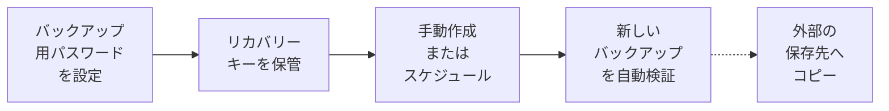

> 🌐 **言語:** [🇻🇳 Tiếng Việt](./backup-and-restore_vi.md) · [🇬🇧 English](./backup-and-restore.md) · 🇯🇵 日本語（現在）

# バックアップと復元 — 一度設定すれば、サイトが自分を守ります

## はじめに
GP247 には管理画面に**バックアップと復元**の機能が組み込まれています。すべてのバックアップは暗号化され、作成直後に自動で検証され、
cron のない共有ホスティングでも動作します。このドキュメントは**サイトのオーナーと管理者**向けで、初回の設定方法、バックアップの作成方法、
スケジュールによる自動バックアップ、そしてリスクのある変更の前に GP247 が自動で行うことを説明します。問題が起きたときの復元は
[状況別の復元ガイド](./restore-guide_ja.md)、サーバー外へのコピーは[外部の保存先](./backup-offsite_ja.md)をご覧ください。

## ひと目でわかる
一度設定すれば、あとはサイトが自分でバックアップし、検証し、必要な数を保持します。



- **バックアップ用パスワードとリカバリーキーが唯一の鍵です** — 両方を失うと、GP247 チームを含め誰もバックアップを開けません。
- **作成にはパスワード不要、開くときに必要です** — スケジュールは誰も入力しなくても実行されます。
- **初期設定では 24 時間ごとに自動バックアップします** — 管理者が管理画面を開いているときに実行され、cron は不要です。
- **作成直後にすべて検証されます**。復元に使えるのは「検証済み」のバックアップだけです。
- **システム更新、拡張機能の更新、テンプレートの切り替えの前に**、GP247 は影響を受けるデータのバックアップを自動で作成します。

## このページの内容
- [バックアップされるもの](#バックアップされるもの) — 1 つのバックアップに含まれるデータとファイル
- [初回の設定](#初回の設定パスワードとリカバリーキー) — バックアップ用パスワードとリカバリーキー
- [バックアップを作成する](#バックアップを作成する) — 3 つの作成方法と使い分け
- [バックアップ一覧](#バックアップ一覧再検証固定ダウンロード削除) — 再検証、固定、ダウンロード、削除、保持数
- [スケジュールバックアップ](#スケジュールバックアップ) — ホスティングに合った実行方法の選び方
- [変更前のスナップショット](#リスクのある変更の前の自動スナップショット) — 更新の前に GP247 が行うこと
- [権限と保護](#誰が何をできるか権限と保護) — 作成、ダウンロード、復元できる人
- [ヘルスチェック](#バックアップのヘルスチェック) — サイトが本当に守られているか確認する
- [コマンドライン](#コマンドラインcli-を使える方向け) — VPS 向けの `gp247:backup-*` コマンド

## バックアップされるもの
1 つのバックアップには、**データグループ**（業務上の意味でまとめたデータベースのテーブル）と**ファイルグループ**が含まれます。
バックアップ画面では各グループの下に同じ説明が表示されるため、何をバックアップするのか（復元画面では何を置き換えるのか）がわかります。

| グループ | 内容 | 対象となる条件 |
| --- | --- | --- |
| **設定** | ストア情報と設定、管理ダッシュボードのレイアウト、言語と翻訳、国、カスタムフィールド、API 接続と Webhook。ショップがある場合は通貨、税、注文・支払い・配送のステータスも | 常に |
| **管理者アカウントと権限** | 管理者アカウント、ロール、権限、管理メニュー | 常に |
| **ログ** | 管理操作ログ、システム通知、API イベントと Webhook 送信、ログイン失敗 | 常に（全体バックアップでは除外可能） |
| **コンテンツ** | ページ、バナー、レイアウトブロック、リンクとリンクグループ、URL リダイレクト、国の一覧 | ストアフロントがあるサイト |
| **カタログ** | 商品（説明、画像、属性、セール、ダウンロード、タグ、セット・グループ）、カテゴリー、ブランド、仕入先 | ショップがあるサイト |
| **注文** | 注文（明細、履歴、合計）、決済取引と決済リクエスト、配送 | ショップがあるサイト |
| **顧客** | お問い合わせメッセージとニュースレター登録。ショップがある場合は顧客アカウント、住所、保存されたカートも | ストアフロント / ショップがあるサイト |
| **プラグインのグループ** | プラグイン自身の説明。ない場合は「拡張機能 … が保存したデータ」 | プラグインがテーブルを宣言している場合 |
| **その他のテーブル** | サイトの接頭辞を持ち、どのグループにも属さないテーブル — **全体バックアップにのみ含まれます** | ある場合 |
| **アップロードファイル** | ファイルマネージャーでアップロードした画像とファイル（商品、バナー、ページなど） | 常に |
| **拡張機能** | `app/GP247` 内のプラグインとテンプレート（独自の変更を含む。`.git` と `node_modules` を除く） | 常に |
| **.env ファイル** | 暗号化キーとデータベースのパスワードを含むサーバー設定 — 別に保管してください | 常に |
| **composer.lock** | インストール済みパッケージの正確なバージョン（同じものを再インストールするため） | 常に |

**クイックスナップショット**は 1 つのデータグループを対象にします。**グループを選択**では、チェックしたデータグループとファイルグループを
対象にします。**全体バックアップ**は**その他のテーブル**を含め、上のすべてを対象にします。バックアップしないもの：ログインセッション、
パスワード再設定リンク、API トークン、バックアップ機能自体の記録 — これらを復元すると、バックアップ後に取り消したアクセスが再び有効になるおそれがあるためです。
**管理操作ログ**と**ログイン失敗の記録**はバックアップに含まれますが、復元で**置き換えられることはありません**。復元を「誰が何をしたか」の
記録を消す手段にしないためです。

> ⚠️ **注意:** サイトの**接頭辞がない**テーブルで、どのプラグインも宣言していないものは**バックアップされません**。
> `php artisan gp247:doctor` がそれらを一覧表示します（`backup_unassigned_tables` の行）。そのテーブルを持つプラグインの開発者に伝えてください。

## 初回の設定：パスワードとリカバリーキー
すべてのバックアップはサイト自身の鍵で暗号化されます。バックアップ用パスワードとリカバリーキーは、その鍵を開ける 2 つの方法です。
設定できるのは**最上位の管理者（Administrator）**だけです。

この 2 つは急いで決めて忘れてしまいがちです。設定する前に次の表をお読みください。

| | バックアップ用パスワード | リカバリーキー |
| --- | --- | --- |
| **作成者** | ご自身で決めます | システムが作成し、**一度だけ**表示します |
| **使う場面** | バックアップを開くたび：復元、再検証、バックアップファイルの取り込み、パスワードの変更。バックアップの作成（自動実行を含む）には**不要**です | バックアップ用パスワードを忘れたとき：パスワードを求められる場面でバックアップを開け、新しいパスワードを設定できます |
| **保管場所** | パスワードマネージャー。管理者ログインのパスワードとは**別**にします | **このサーバー以外の場所**：パスワードマネージャー、または安全な場所に保管した紙 |
| **失くしたら** | リカバリーキーで新しいパスワードを設定します | バックアップ用パスワードを変更すると新しいリカバリーキーが発行されます |

この 2 つは誰にも復旧できません（ホスティング会社や GP247 も不可）。**両方を失うと、どのバックアップも開けません。**

1. **システム設定 → バックアップと復元**を開きます。
2. **バックアップの設定**で**バックアップ用パスワード**（12 文字以上）を 2 回入力し、**設定する**をクリックします。
3. 画面に**リカバリーキー**が表示されます。表示は**一度だけ**です。**テキストファイルでダウンロード**をクリックするか、紙に書き写します。
4. リカバリーキーは**このサーバーの外**（パスワードマネージャー、金庫、別に保管する USB メモリ）に保管します。バックアップと同じ場所には置かないでください。
5. 保管したことを示すためにキーの**最後の 8 文字**を入力し、**保存しました**をクリックします。

成功すると「バックアップの設定が完了しました。」と表示され、スケジュールが動き始めます。

> 💡 **ヒント:** バックアップ用パスワードは管理画面のログインパスワードと**別のもの**にしてください。管理者パスワードを推測されても、バックアップは開けません。

パスワードの変更やリカバリーキーの再作成は、**バックアップ設定 → バックアップ用パスワードとリカバリーキー**で行います。既存のバックアップは新しい
パスワードで開けます。新しいリカバリーキーは古いキーを置き換えます。

## バックアップを作成する
**バックアップと復元**画面には、範囲と所要時間が異なる 3 つの作成方法があります。

| 方法 | 内容 | 所要時間 | 使う場面 |
| --- | --- | --- | --- |
| **クイックスナップショット** | 1 つのデータグループ | 数秒 | 設定変更や価格の一括編集の前 |
| **グループを選択** | チェックしたグループ | データ量による | 注文や商品などを個別に残したいとき |
| **全体バックアップ** | すべてのデータグループ + アップロード、拡張機能、`.env`、`composer.lock` | 最も長い | サイト全体を作り直せるバックアップ |

1. 作成方法を選び、（必要なら）グループを選んで**開始**をクリックします。
2. タブは開いたままにします。バックアップはバックグラウンドで少しずつ書き込まれ、その後検証されます。途中でタブを閉じても、次に開いたときに続きから実行されます。
3. 完了すると、一覧に**検証済み**の状態で表示されます。

> ℹ️ **情報:** 非常に大きなバックアップ（初期設定では 500 MB 超）をブラウザーから実行すると確認が求められます。VPS では Web リクエストの
> 時間制限を受けない `php artisan gp247:backup-run` のほうが安全です。

## バックアップ一覧：再検証、固定、ダウンロード、削除
**バックアップ一覧**の各行には、日時、種類、グループ、サイズ、保存先、検証結果が表示されます。操作は次のとおりです。

- **再検証** — バックアップ全体を読み直し、壊れていないことを確認します（バックアップ用パスワードまたはリカバリーキーと、本人確認が必要）。
- **固定** — 固定したバックアップは、古いバックアップの整理で**自動削除されることはありません**。固定を解除すると整理の対象になり得るため、解除には本人確認が必要です。
- **ダウンロード** — `.gp247bak` ファイル（暗号化されたまま）を、5 分で期限が切れる**1 回限り**のリンクでダウンロードします。
- **復元** — このバックアップで復元画面を開きます（[状況別の復元ガイド](./restore-guide_ja.md)）。
- **削除** — バックアップの ID を再入力し、本人確認を行います。使用中のバックアップは削除できません。

**保持するバックアップ数**（**バックアップ設定**で変更）：初期設定では通常のバックアップを **7** 個、「変更前」のバックアップを **3** 個保持します。
古いものは、新しいバックアップが検証に合格した**後で**削除されます。常に保持されるのは、最新の正常なバックアップ、固定したバックアップ、
そして**最新の検証済み全体バックアップ**です。クイックスナップショットが続いても、最後の全体バックアップが一覧から押し出されることはありません。

> ⚠️ **注意:** **データベース全体**の復元には**全体**バックアップしか使えません。検証済みの全体バックアップがまだない場合、または最新の
> 全体バックアップが 48 時間より古い場合は、より新しいクイックスナップショットがあってもバックアップ画面に警告が表示されます。この警告が
> 出たら、**全体バックアップ**を作成してください。

バックアップは `storage/app/private/gp247-backup/`（公開 Web フォルダーの外）に保存されます。場所を変えるには、**バックアップ設定 → 保存フォルダー**で
Web フォルダー外の絶対パスを指定します。

## スケジュールバックアップ
スケジュールは**バックアップ設定 → スケジュール**で設定します。サイトの動作環境に合わせて実行方法を選びます。

| サイトの環境 | 選択 | 動き方 |
| --- | --- | --- |
| **cron のない共有ホスティング** | **管理者が管理画面を開いたとき（cron 不要）**（初期設定） | 予定時刻を過ぎていて管理者が管理画面を開くと、バックグラウンドで少しずつ書き込まれます。画面は遅くならず、来訪者にも影響しません |
| **cron のある VPS / ホスティング** | **決まった時刻（サーバーの cron が必要）** | 誰もアクセスしなくても、選んだ時刻に実行されます |
| 自動化しない | **オフ** | 誰かが作成したバックアップのみ。推奨しません |

あわせて**頻度**（6、12、24、48 時間ごと、または毎週）と**スケジュールバックアップの内容**（ログを除くサイト全体 — 初期設定、または軽量な
データベースのみ）を選び、**スケジュールを保存**をクリックします。

**「決まった時刻」のための cron 設定**（VPS またはホスティングの「Cron ジョブ」ページで一度だけ）：

1. **バックアップ設定**を開き、**決まった時刻**を選びます。画面にお使いのサーバー用の cron の行が表示されます。
2. その行を crontab に追加します。一般的な形は次のとおりです（パスはサイトのフォルダーに置き換えてください）。

   ```
   * * * * * cd /path/to/site && php artisan schedule:run >> /dev/null 2>&1
   ```

3. 1 周期後、一覧に種類「**スケジュール**」のバックアップが表示されます。2 周期続けてバックアップがないと、バックアップ画面と `gp247:doctor` が
   「cron が動いていない」と警告します。

> ℹ️ **情報:** **Scheduled tasks** プラグインを導入している場合、スケジュールバックアップは他のタスクと同じようにプラグインのタスク一覧に表示されます。

バックアップ画面には、今問題が起きたら**どこまで戻せるか**が常に表示されます。「管理者が管理画面を開いたとき」には実際の制約があります。
3 日間誰も管理画面を開かなければ、その 3 日間の新しいバックアップはありません。最新の正常なバックアップが **48 時間**より古く、スケジュールが
有効な場合、GP247 はサイトのオーナーにメールを送ります（**1 日 1 回**まで）。

## リスクのある変更の前の自動スナップショット
データを壊しやすい 3 つの操作の前に、GP247 は**その操作が影響し得るデータ**のバックアップを自動で作成します。

| 操作 | GP247 が自動で保存するもの |
| --- | --- |
| **システム更新**（`php artisan gp247:update`） | ログを除くすべてのデータグループ |
| **プラグイン / テンプレートの更新** | 設定 + その拡張機能自身のデータ。自分のテーブルを宣言していない拡張機能では、ログを除くすべてのデータグループと**その他のテーブル** |
| **テンプレートの切り替え** | 設定 + コンテンツ |

- **コマンドラインから実行した場合**：バックアップが完了してから操作が実行されます。
- **管理画面から操作した場合**：数秒でバックアップが終わらないときは、作成中であること、数秒後にもう一度操作するよう画面に表示されます。
  そのあともう一度クリックすると、GP247 は作成したばかりのバックアップを使い、**新たには作成しません**。
- **バックアップを作成できない場合**（別のバックアップが実行中、ディスクがいっぱいなど）：操作は止まり、理由が表示されます。バックアップなしで続行することも選べます。
- **バックアップが未設定の場合**：操作はそのまま実行され、バックアップがない旨の注意が表示されます。

## 誰が何をできるか：権限と保護
バックアップには 3 つの独立した権限があり、他の権限と同じように**ロール**で割り当てます。

| 権限 | できること | 補足 |
| --- | --- | --- |
| **Backup - create** | 作成、再検証、固定、削除、スケジュールの実行 | ダウンロードと復元はできません |
| **Backup - download** | 一覧の閲覧、`.gp247bak` ファイルのダウンロード | ダウンロードしたファイルは暗号化されたままです |
| **Backup - restore** | 一覧の閲覧、復元、バックアップの取り込み | 最も強い権限です。本当に必要な人だけに付与してください。**出所未確認**のバックアップ（このサイトで作成していないもの）を画面で復元できるのは **Administrator** だけです |

データを外へ持ち出す操作、上書きする操作、バックアップを失わせ得る操作には、さらに 4 つの保護があります。

- **本人確認** — ダウンロード、復元、再検証、固定の解除、バックアップの削除、全般設定の保存（保持数、保存フォルダー、機能のオン / オフ）の前に、
  管理画面のログインパスワード（バックアップ用パスワードでは**ありません**。二段階認証を有効にしている場合はそのコードも）を再入力します。
  そのブラウザーで 5 分間有効です。
- **バックアップ用パスワードの誤入力の制限** — 管理画面では、管理者ごとに **15 分間に 5 回**まで、サイト全体で **1 時間に 20 回**の誤りまでです。
  超えると、しばらく待つ必要があります。コマンドラインはすでにサーバーへのアクセスが必要なため、この制限はありません。
- **ログ** — 作成、ダウンロード、復元、削除（拒否されたものも含む）を、誰がいつ行ったかとともに記録します。
- **メール** — バックアップの失敗時、誰かがダウンロードしたとき、誰かが復元したときに、サイトのオーナーへメールが届きます。メールはサイトで
  メール送信を有効にしている場合のみ送られます（**設定 → メール**）。

## バックアップのヘルスチェック
サイトが**本当に復元できる状態か**を確かめるには、次のコマンドを実行します（VPS 上で実行するか、ホスティング会社に依頼してください）。

```
php artisan gp247:doctor
```

`backup_` で始まる行で、設定済みかどうか、最新の正常なバックアップが何時間前か、スケジュールが動いているか、外部の保存先が使えるか、
バックアップされていないテーブル、メールが有効かがわかります。`backup_vault_exposed` の行は、サイトの Web アドレスからバックアップファイルを
ダウンロードできる場合に**失敗**になります。これは Web サーバーが `public/` だけでなくプロジェクトフォルダー全体を公開している状態です。
[本番環境の設定](../security/security-production-config_ja.md)に従ってすぐに修正してください。この失敗はダッシュボードの **System alerts** ブロックにも表示されます。

`backup_key_ring` の行は、バックアップの署名キーがデータベースに**暗号化されずに**保存されている場合に**失敗**になります。データベースに
アクセスできる誰かがバックアップキーを置き換えた兆候です。開発者がバックアップキーをリセットするまで**バックアップは作成されません**。
以前のバックアップは、バックアップ用パスワードで引き続き復元できます（出所未確認として扱われます）。この警告はバックアップ画面にも表示されます。

## コマンドライン（CLI を使える方向け）
画面で行えることはすべてコマンドでも行えます。`--json` を付けると機械で読める形式で出力されます。

| コマンド | 内容 |
| --- | --- |
| `php artisan gp247:backup-run` | 全体バックアップを作成（`--kind=snapshot\|selective\|full`、`--group=`、`--exclude-logs`） |
| `php artisan gp247:backup-run --scheduled` | スケジュールバックアップ（内容は**バックアップ設定**に従う） |
| `php artisan gp247:backup-list` | バックアップの一覧 |
| `php artisan gp247:backup-verify <ID>` | バックアップを再検証 |
| `php artisan gp247:backup-pin <ID>` | 固定（`--unpin` で解除） |
| `php artisan gp247:backup-delete <ID>` | バックアップを削除 |
| `php artisan gp247:backup-restore <ID>` | 復元 — [状況別の復元ガイド](./restore-guide_ja.md)を参照 |
| `php artisan gp247:backup-import <ファイル>` | `.gp247bak` ファイルを一覧に取り込む |
| `php artisan gp247:backup-export-sql <ID>` | データを**暗号化されていない** `.sql` ファイルとして書き出す |
| `php artisan gp247:backup-offsite test\|list\|push\|fetch` | 外部の保存先 — [外部の保存先](./backup-offsite_ja.md)を参照 |

バックアップ用パスワードが必要なコマンドは、**実行中に入力を求めます**（引数では受け取らないため、シェルの履歴に残りません）。スクリプトで
自動実行する場合は、`--secret-stdin` を付けて標準入力の 1 行で渡します。

## 条件と制約（操作の前に確認）
**設定するとき**
- **バックアップ用パスワードは 12 文字以上** — バックアップが他人の手に渡ることもあり、短いパスワードは推測されます。
- **リカバリーキーは一度だけ表示されます** — GP247 はキーを平文で保存しないため、再表示できません。
- **設定、パスワード変更、スケジュールと保存フォルダーの変更は Administrator のみ** — サイトの全データの鍵だからです。

**バックアップを作成するとき**
- **書き込みを伴う処理は同時に 1 つだけ**（バックアップ、復元、取り込み） — 同時に 2 つ実行するとバックアップの整合性が崩れるおそれがあります。
- **保存フォルダーは公開 Web フォルダーの外に置く必要があります** — そうでないと、パスを知っている人がバックアップをダウンロードできてしまいます。
- **最新の検証済み全体バックアップは自動で整理されません** — データベース全体を復元できるのは全体バックアップだけだからです。

**ダウンロード / 復元 / 削除するとき**
- **直近 5 分以内に本人確認が必要です** — ログインしたままのパソコンを借りた人がデータを持ち出したり、バックアップを削除したりできないようにするためです。
- **バックアップ用パスワードの誤入力は回数が制限されます** — 1 回の試行ごとにサーバーに大きな負荷がかかり、パスワードを延々と試されないようにするためです。
- **ダウンロードリンクは 1 回限りで、5 分で期限切れになります** — 漏れたリンクを再利用できないようにするためです。
- **平文の `.sql` ファイルはコマンドラインからのみ書き出せます** — 暗号化されていないため、ブラウザーを経由させるべきではありません。

## よくある質問（Q&A）
**Q1: バックアップ用パスワードを忘れました。どうすればよいですか？**

→ パスワードを求められる場所でリカバリーキーを使い、**バックアップ設定**で新しいパスワードを設定してください。パスワードとリカバリーキーの
両方を失うと、GP247 を含め誰も復号できず、どのバックアップも開けません。

**Q2: ホスティングに cron がありません。自動バックアップはされますか？**

→ されます。初期設定の「管理者が管理画面を開いたとき」は、管理者が管理画面を開いたときにバックグラウンドで実行されます。ときどき誰かが
管理画面を開けば十分で、最新の正常なバックアップが何時間前かはバックアップ画面でわかります。

**Q3: バックアップでサイトが来訪者にとって遅くなりませんか？**

→ なりません。バックアップは管理画面の別リクエストで少しずつ書き込まれ、来訪者のリクエストの中で実行されることはありません。

**Q4: バックアップには顧客のパスワードや決済情報も含まれますか？**

→ サイトのすべてのデータが含まれます（パスワードはハッシュ化された形のみ）。そのため、すべてのバックアップは暗号化され、ダウンロードと復元には
専用の権限と本人確認が必要で、ログにも記録されます。

**Q5: ダウンロードした `.gp247bak` ファイルは何で開けますか？**

→ GP247 だけです。作成したサイトのバックアップ用パスワードまたはリカバリーキーを使い、GP247 のサイトに取り込みます（**バックアップファイルの取り込み**
または `gp247:backup-import`）。一般的な SQL ファイルが必要なときは `gp247:backup-export-sql` を使います。

**Q6: バックアップがサーバー上にあります。サーバーが壊れたらどうなりますか？**

→ 同じサーバー上のバックアップはサーバーとともに失われます。[外部の保存先](./backup-offsite_ja.md)を設定して、検証済みのバックアップを自動で
別の場所へコピーするか、定期的にダウンロードして別に保管してください。

**Q7: スケジュールバックアップが失敗したら、すぐに再試行されますか？**

→ 何度も繰り返しは再試行しません。サイトのオーナーに失敗のメールが届き、バックアップ画面に警告が表示され、次の周期で再び実行されます。
原因（多くはディスク容量不足）を解消したら、すぐに手動でバックアップを作成できます。

**Q8: バックアップ機能をオフにすると、既存のバックアップは消えますか？**

→ 消えません。**バックアップ設定**でオフにすると、スケジュールの停止、メニューの非表示、変更前スナップショットの省略だけが行われます。
バックアップと鍵はそのまま残り、オンに戻せば続けて使えます。

**Q9: 古いバックアップを復元すると、管理操作ログは消えますか？**

→ 消えません。操作ログとログイン失敗の記録はバックアップされますが、復元で置き換えられることはありません。そのため、行ったすべての操作
（復元そのものも含む）の記録が残ります。

## 変更履歴
<!-- ロジック/動作が変わった場合のみ記載。最新の行を一番上に。1 日 1 行：同じ日の変更は既存の行にまとめ、同じ日付の行を追加しない。 -->

| 日付 | GP247 バージョン | 変更内容 |
| --- | --- | --- |
| 2026-11-11 | | 最新の検証済み全体バックアップを常に保持し、全体バックアップがない場合に警告；再検証、固定の解除、バックアップの削除、全般設定の保存で本人確認；バックアップ用パスワードの誤入力を制限；出所未確認のバックアップは画面では Administrator のみ復元可能；操作ログは復元で置き換えない；`gp247:doctor` に `backup_key_ring` の行を追加 |

---

<sub>📅 **最終更新:** 2026-11-11 · ✍️ **作成者 (Author):** GP247</sub>
