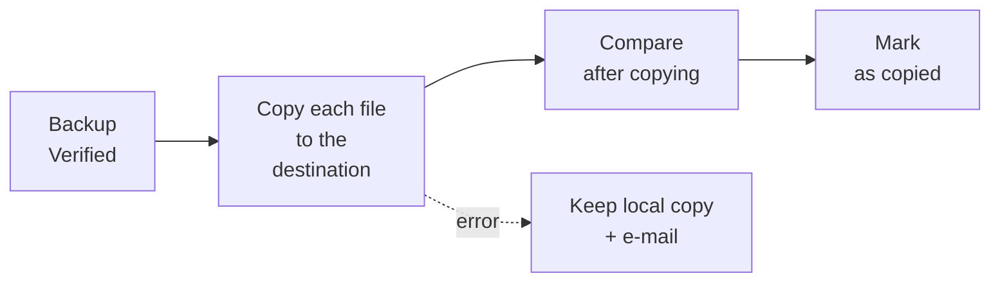
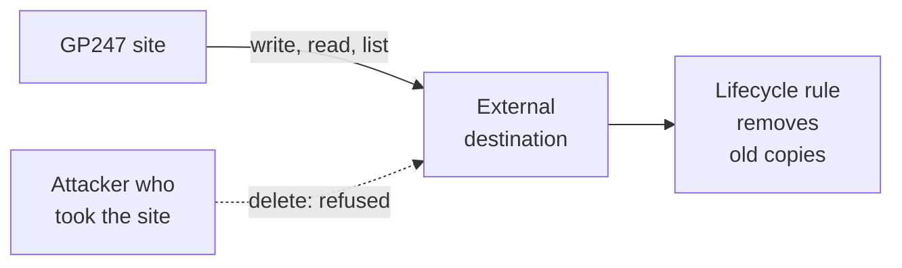

> 🌐 **Language:** [🇻🇳 Tiếng Việt](./backup-offsite_vi.md) · 🇬🇧 English (current) · [🇯🇵 日本語](./backup-offsite_ja.md)

# External destination — copy backups off the server, where they cannot be deleted

## Introduction
A backup on the server itself is lost with the server when a disk dies, the provider locks the account or the site is taken over. This
document is for **site owners and administrators**: how to set up an **external destination** (an S3-compatible storage service or an
SFTP server / NAS) so every verified backup is copied there automatically, how to grant **write-only** rights so an attacker cannot delete
the copies, and how to bring a backup back when needed. Basic backup setup is in [Backup & restore](./backup-and-restore.md).

## At a glance
Once set up, copying off-site happens automatically after every verified backup:



- **Backups stay encrypted outside** — the storage provider cannot read the contents.
- **The local copy is always kept**; a failing destination never damages the backup on the server.
- **Write-only credentials + Object Lock** are the most important layer: whoever takes over the site still cannot delete the copies outside.
- **Bring a backup back at any time**, even one no longer in the site's list (for example when moving to a new server).

## Choose a destination type
GP247 supports **one** external destination at a time, of one of two types:

| Type | Suits | Library needed |
| --- | --- | --- |
| **S3-compatible** | AWS S3, Cloudflare R2, Backblaze B2, Wasabi, MinIO… | `league/flysystem-aws-s3-v3` — ships with GP247 |
| **SFTP server or NAS** | Another server of yours, an office NAS | `league/flysystem-sftp-v3` |

Without the library, that type shows as **not available** on the screen, together with the command to run. Ask your developer or
hosting provider to run it in the site folder:

```
composer require league/flysystem-sftp-v3
```

## Set up the external destination
Only an **Administrator** can set it up, and must confirm their identity before saving.

1. Go to **System config → Backup & restore → Backup settings**, block **External destination**.
2. Choose the **Type**: S3-compatible or SFTP server or NAS.
3. Fill in the details:
   - **S3-compatible** — Endpoint URL (leave empty for AWS S3), Region, Bucket, Folder in the bucket (optional), Access key ID,
     Secret access key. Turn on **Path-style addresses** for MinIO or a provider that requires it.
   - **SFTP / NAS** — Server, Port, User name, Folder on the server, and a **Password** or a **Private key** (with its passphrase if any).
4. Click **Test the connection**. GP247 tries to write, read and list, and tells you whether the credential may **delete**.
5. For SFTP: the screen shows the **server key fingerprint**. Compare it with the fingerprint your provider / NAS administrator gave you;
   accept it if it matches — from then on GP247 connects only to that exact server.
6. Save. From the next verified backup, backups are copied off-site automatically; the **Stored** column of the list tells you whether a
   backup has been copied.

If it worked, the test result includes "Works, and the credential cannot delete…" — the state to aim for.

> ⚠️ **Note:** secrets (secret key, password, private key) are stored encrypted and are **never shown again** on the screen. Changing the
> endpoint, bucket, server or user name means typing the secret again, and every backup goes back to "not copied" to be copied to the new place.

## Grant write-only rights so copies cannot be deleted
Ransomware and attackers usually **delete the backups first**. Give the site a credential that can only **write, read and list** — no
delete, no overwrite — and turn on retention locking at the destination.



- **The site only adds new copies**; removing old ones is left to the storage service's own **lifecycle rule**.
- **Object Lock** blocks deletion even if someone gets hold of the storage service's admin account.

**AWS S3**
1. Create a bucket with **Object Lock**, default retention (for example 30 days) in **Compliance** mode.
2. Create an IAM user with only the following policy (replace `BUCKET` with the bucket name):

   ```json
   {
     "Version": "2012-10-17",
     "Statement": [
       { "Effect": "Allow", "Action": ["s3:ListBucket"], "Resource": "arn:aws:s3:::BUCKET" },
       { "Effect": "Allow", "Action": ["s3:PutObject", "s3:GetObject"], "Resource": "arn:aws:s3:::BUCKET/*" }
     ]
   }
   ```

3. Add a lifecycle rule that deletes objects older than the time you want to keep (for example 90 days).

**Cloudflare R2**
1. Create an API token of type **Object Read & Write**, limited to that bucket.
2. Add a bucket lock rule: **R2 → bucket → Settings → Bucket lock**.
3. Add a lifecycle rule that deletes old objects.

**Backblaze B2**
1. Turn on **Object Lock** for the bucket.
2. Create an application key with only `listFiles`, `readFiles`, `writeFiles` (**no** `deleteFiles`).
3. Set the lifecycle rule (Lifecycle Settings) to keep copies for the number of days you want.

**SFTP / NAS**
1. Use an account that can only **create** files in its folder, not delete or rename them.
2. Turn on **snapshots** on the NAS so a copy survives even if the folder is overwritten.

> 💡 **Tip:** if **Test the connection** says the credential **may delete**, GP247 still works but reminds you to switch to a write-only
> credential. `php artisan gp247:doctor` reports it too, in row `backup_destination_can_delete`.

## Follow up and copy again after an error
The **Stored** column of each backup shows its state at the external destination:

| Stored | Meaning | What you do |
| --- | --- | --- |
| **This server + external** | The backup is at the destination and was compared after copying | Nothing |
| **Local · copying off-site** | Files are being copied in the background | Wait; if the tab closes it carries on next time |
| **Local · off-site copy failed** | The destination refused (network, rights, full) | Fix the cause, then click **Copy off-site** |
| **This server** | No external destination is set up | Set one up as described above |

- **Temporary errors** (a flaky network) are retried a few times; a lasting error stops, marks the backup **off-site copy failed** and e-mails the site owner.
- **The newest backup not yet copied is always kept on the server** when old backups are cleaned up, so it can be copied once the destination
  works again. Older uncopied backups follow the normal keep rule, so a destination down for a long time cannot fill the disk.
- **Backups brought in from elsewhere** are not copied into this site's folder at the destination.

## Bring a backup back from the external destination
Use this when the backup on the server is gone (dead disk, server move) or you want to restore from a backup that only exists outside.

1. Go to the **Restore** screen, block **From the external destination**, click **Look at the destination**. The list shows every backup of
   the site at the destination — no backup password needed.
2. On the backup you want, click **Bring back**, type the **backup password or recovery key** of the site that made it, then confirm it is you.
3. The backup is downloaded in parts in the background and **fully checked before it enters the list**. A backup changed at the destination is refused.
4. Once it appears in the list, restore it like any other backup ([Restore by situation](./restore-guide.md)).

On a server with a command line:

```
php artisan gp247:backup-offsite list
php artisan gp247:backup-offsite fetch <backup-id>
```

## Conditions & Rules (know before you act)
**When setting up**
- **One external destination at a time** — changing it copies the backups again to the new place.
- **Administrator only, after confirming identity** — the destination's credential is the key to the copies outside the server.
- **The address may not point to a cloud metadata service or a link-local address; unencrypted `http://` only works towards this machine or a
  private network** (for example an office MinIO) — so nobody can use this screen to probe the server's internal information.
- **SFTP connects only to the server with the accepted fingerprint** — if the server changes its key, connections are blocked until you accept it again.

**When copying out / bringing back**
- **Only Verified backups are copied out** — broken backups are never pushed outside.
- **Bringing back needs the backup password or recovery key of the site that made it** — copies outside stay encrypted.
- **The download phase may take up to 6 hours**; once downloaded there is still 1 hour to check it and add it to the list — a very large backup on a slow link still comes back.
- **Only one writing task at a time**: while a backup is being brought back, a new backup cannot start.

## Q&A
**Q1: Can the storage provider read my data?**

→ No. Backups are encrypted on your server before they are copied; only the site's backup password or recovery key opens them.

**Q2: With a write-only credential, who deletes old copies at the destination?**

→ The storage service's own lifecycle rule, for example deleting objects older than 90 days. The site cannot delete them itself — that is exactly what keeps them safe.

**Q3: I only have a shared host — can I use an external destination?**

→ Yes. Copying runs file by file in the background, like a scheduled backup. SFTP needs the `league/flysystem-sftp-v3` library — ask your hosting provider to install it if missing.

**Q4: If the destination fails, is the backup on the server affected?**

→ No. The local backup stays usable and is only marked **off-site copy failed**; you get an e-mail and copy it again once fixed.

**Q5: I moved to a new server — how do I get my data back from the destination?**

→ Install GP247 on the new server, set up the same destination, go to **Restore → From the external destination → Bring back** with the old site's recovery key, then restore that backup.

**Q6: Why must I type the secret key again when I change the bucket?**

→ So that the old place's credential is not used for a new place without you noticing. Any change of the destination's identity asks for the secret again.

**Q7: The connection test says "may delete" — is that dangerous?**

→ The site works normally, but whoever takes over the site could also delete the copies outside. Create a new credential with only write, read and list rights as shown above.

---

<sub>📅 **Last updated:** 2026-11-07 · ✍️ **Author:** GP247</sub>
