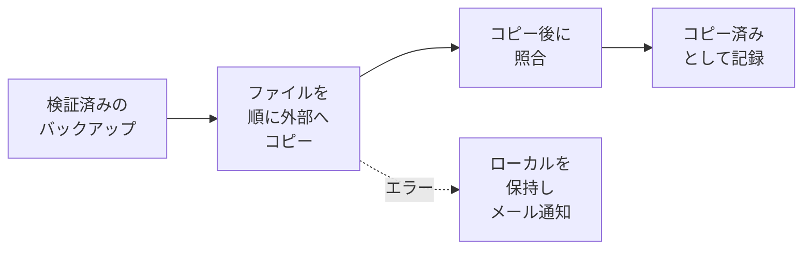
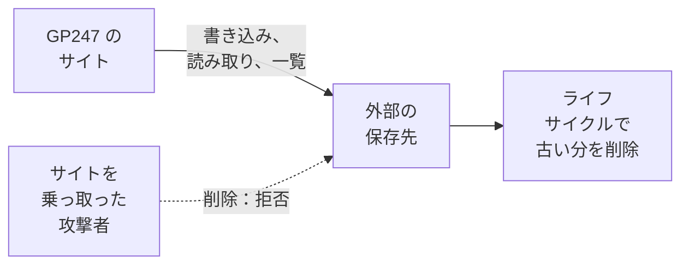

> 🌐 **言語:** [🇻🇳 Tiếng Việt](./backup-offsite_vi.md) · [🇬🇧 English](./backup-offsite.md) · 🇯🇵 日本語（現在）

# 外部の保存先 — バックアップをサーバーの外へ、削除できない形でコピーする

## はじめに
サーバー上にあるバックアップは、ディスクの故障、プロバイダーによるアカウント停止、サイトの乗っ取りが起きるとサーバーとともに失われます。
このドキュメントは**サイトのオーナーと管理者**向けで、**外部の保存先**（S3 互換のストレージサービス、または SFTP サーバー / NAS）を設定して
検証済みのバックアップを自動でコピーする方法、攻撃者がコピーを削除できないよう**書き込み専用**の権限を与える方法、必要なときに
バックアップを取り戻す方法を説明します。基本的なバックアップの設定は[バックアップと復元](./backup-and-restore_ja.md)をご覧ください。

## ひと目でわかる
設定後は、検証済みのバックアップができるたびに自動で外部へコピーされます。



- **外部でも暗号化されたままです** — ストレージ事業者は内容を読めません。
- **ローカルのコピーは常に保持されます**。外部の保存先でエラーが起きても、サーバー上のバックアップは壊れません。
- **書き込み専用の認証情報 + Object Lock** が最も重要な層です。サイトを乗っ取った人でも、外部のコピーは削除できません。
- **いつでも取り戻せます**。サイトの一覧にもう残っていないバックアップも取り戻せます（新しいサーバーへの移行時など）。

## 保存先の種類を選ぶ
GP247 で同時に使える外部の保存先は**1 つ**で、次の 2 種類のいずれかです。

| 種類 | 向いている用途 | 必要なライブラリ |
| --- | --- | --- |
| **S3 互換** | AWS S3、Cloudflare R2、Backblaze B2、Wasabi、MinIO… | `league/flysystem-aws-s3-v3` — GP247 に同梱 |
| **SFTP サーバーまたは NAS** | ご自身の別サーバー、オフィスの NAS | `league/flysystem-sftp-v3` |

ライブラリがない場合、その種類は画面で**利用不可**と表示され、実行すべきコマンドが示されます。サイトのフォルダーで次を実行するよう、
開発者またはホスティング会社に依頼してください。

```
composer require league/flysystem-sftp-v3
```

## 外部の保存先を設定する
設定できるのは **Administrator** だけで、保存の前に本人確認が必要です。

1. **システム設定 → バックアップと復元 → バックアップ設定**を開き、**外部の保存先**ブロックへ進みます。
2. **種類**で S3 互換、または SFTP サーバーまたは NAS を選びます。
3. 情報を入力します。
   - **S3 互換** — エンドポイント URL（AWS S3 では空欄）、リージョン、バケット、バケット内のフォルダー（任意）、アクセスキー ID、
     シークレットアクセスキー。MinIO や必要とする事業者では**パス形式のアドレス**をオンにします。
   - **SFTP / NAS** — サーバー、ポート、ユーザー名、サーバー上のフォルダー、そして**パスワード**または**秘密鍵**（パスフレーズがあればそれも）。
4. **接続をテスト**をクリックします。GP247 が書き込み、読み取り、一覧取得を試し、認証情報に**削除**権限があるかどうかを表示します。
5. SFTP の場合は**サーバーキーのフィンガープリント**が表示されます。事業者や NAS の管理者から伝えられた値と照合し、一致すれば承認します。
   以後、GP247 はそのサーバーにだけ接続します。
6. 保存します。次の検証済みバックアップから自動でコピーされます。一覧の**保存先**列で、コピー済みかどうかがわかります。

成功すると、テスト結果に「使用でき、認証情報に削除権限はありません…」と表示されます。これが目指すべき状態です。

> ⚠️ **注意:** シークレット（シークレットキー、パスワード、秘密鍵）は暗号化して保存され、画面に**再表示されることはありません**。エンドポイント、
> バケット、サーバー、ユーザー名を変更するとシークレットの再入力が必要になり、すべてのバックアップが「未コピー」に戻って新しい場所へコピーし直されます。

## コピーを削除されないよう書き込み専用の権限を与える
ランサムウェアや攻撃者は、まず**バックアップを削除**しようとします。サイトには**書き込み、読み取り、一覧取得**だけができ、削除も上書きもできない
認証情報を与え、保存先側で保持ロックをオンにしてください。



- **サイトは新しいコピーを追加するだけです**。古いコピーの削除は、ストレージサービス自身の**ライフサイクルルール**に任せます。
- **Object Lock** は、誰かがストレージサービスの管理者アカウントを手に入れても削除を防ぎます。

**AWS S3**
1. **Object Lock** を有効にしたバケットを作成し、既定の保持期間（例：30 日）を **Compliance** モードで設定します。
2. 次のポリシーだけを持つ IAM ユーザーを作成します（`BUCKET` をバケット名に置き換えてください）。

   ```json
   {
     "Version": "2012-10-17",
     "Statement": [
       { "Effect": "Allow", "Action": ["s3:ListBucket"], "Resource": "arn:aws:s3:::BUCKET" },
       { "Effect": "Allow", "Action": ["s3:PutObject", "s3:GetObject"], "Resource": "arn:aws:s3:::BUCKET/*" }
     ]
   }
   ```

3. 保持したい期間（例：90 日）より古いオブジェクトを削除するライフサイクルルールを追加します。

**Cloudflare R2**
1. そのバケットに限定した **Object Read & Write** タイプの API トークンを作成します。
2. バケットのロックルールを追加します：**R2 → バケット → Settings → Bucket lock**。
3. 古いオブジェクトを削除するライフサイクルルールを追加します。

**Backblaze B2**
1. バケットの **Object Lock** を有効にします。
2. `listFiles`、`readFiles`、`writeFiles` だけを持つ（`deleteFiles` を**持たない**）アプリケーションキーを作成します。
3. ライフサイクルルール（Lifecycle Settings）で、保持したい日数を設定します。

**SFTP / NAS**
1. 自分のフォルダーにファイルを**作成**することしかできず、削除や名前変更ができないアカウントを使います。
2. NAS で**スナップショット**を有効にし、フォルダーが上書きされてもコピーが残るようにします。

> 💡 **ヒント:** **接続をテスト**で認証情報に**削除権限がある**と表示された場合も GP247 は動作しますが、書き込み専用の認証情報への切り替えを
> 促されます。`php artisan gp247:doctor` でも `backup_destination_can_delete` の行で報告されます。

## 状況の確認とエラー後の再コピー
各バックアップの**保存先**列に、外部の保存先での状態が表示されます。

| 保存先 | 意味 | すること |
| --- | --- | --- |
| **このサーバー + 外部** | 外部にあり、コピー後の照合も済んでいます | 何もしなくて大丈夫です |
| **ローカル · オフサイトへコピー中** | バックグラウンドでファイルをコピー中です | 待ちます。タブを閉じても次回続きから実行されます |
| **ローカル · オフサイトへのコピー失敗** | 保存先が受け付けませんでした（ネットワーク、権限、容量） | 原因を解消してから**オフサイトへコピー**をクリックします |
| **このサーバー** | 外部の保存先が未設定です | 上の手順で設定します |

- **一時的なエラー**（不安定なネットワークなど）は数回再試行されます。エラーが続く場合は停止し、**オフサイトへのコピー失敗**として記録し、オーナーにメールします。
- **まだコピーできていない最新のバックアップは、古いバックアップの整理の際も常にサーバー上に保持されます**。保存先が復旧したらコピーし直せます。
  それより古い未コピーのバックアップは通常の保持ルールに従うため、保存先が長く停止してもディスクがいっぱいになりません。
- **他の場所から取り込んだバックアップ**は、このサイトの保存先フォルダーにはコピーされません。

## 外部の保存先からバックアップを取り戻す
サーバー上のバックアップが失われたとき（ディスク故障、サーバー移行）や、外部にしかないバックアップから復元したいときに使います。

1. **復元**画面の**外部の保存先から**ブロックで**保存先を確認**をクリックします。保存先にあるこのサイトのバックアップが一覧表示されます（バックアップ用パスワードは不要）。
2. 使いたいバックアップで**取り戻す**をクリックし、作成したサイトの**バックアップ用パスワードまたはリカバリーキー**を入力してから本人確認をします。
3. バックアップはバックグラウンドで少しずつダウンロードされ、**一覧に入る前に完全に検証されます**。保存先で改ざんされたバックアップは拒否されます。
4. 一覧に表示されたら、他のバックアップと同じように復元します（[状況別の復元ガイド](./restore-guide_ja.md)）。

コマンドラインを使えるサーバーでは次のとおりです。

```
php artisan gp247:backup-offsite list
php artisan gp247:backup-offsite fetch <バックアップID>
```

## 条件と制約（操作の前に確認）
**設定するとき**
- **外部の保存先は同時に 1 つだけ** — 変更すると、新しい場所へバックアップがコピーし直されます。
- **Administrator のみ、本人確認の後** — 保存先の認証情報は、サーバー外のコピーの鍵だからです。
- **クラウドのメタデータサービスやリンクローカルアドレスは指定できません。暗号化されない `http://` は、このマシンまたはプライベートネットワーク
  （オフィスの MinIO など）に対してのみ使えます** — この画面を使ってサーバー内部の情報を探られないようにするためです。
- **SFTP は承認したフィンガープリントを持つサーバーにだけ接続します** — サーバーのキーが変わると、再承認するまで接続はブロックされます。

**外部へコピーする / 取り戻すとき**
- **外部へコピーされるのは検証済みのバックアップだけです** — 壊れたバックアップを外へ送ることはありません。
- **取り戻すには、作成したサイトのバックアップ用パスワードまたはリカバリーキーが必要です** — 外部のコピーも暗号化されたままだからです。
- **ダウンロードは最大 6 時間まで続けられ**、ダウンロード完了後さらに 1 時間で検証して一覧に追加します — 遅い回線でも非常に大きなバックアップを取り戻せます。
- **書き込みを伴う処理は同時に 1 つだけ** — バックアップを取り戻している間は、新しいバックアップを開始できません。

## よくある質問（Q&A）
**Q1: ストレージ事業者に私のデータを読まれませんか？**

→ 読まれません。バックアップはコピーの前にお使いのサーバー上で暗号化され、開けるのはサイトのバックアップ用パスワードかリカバリーキーだけです。

**Q2: 書き込み専用の認証情報だと、保存先の古いコピーは誰が削除しますか？**

→ ストレージサービス自身のライフサイクルルールです（例：90 日より古いオブジェクトを削除）。サイトからは削除できないこと自体が安全の理由です。

**Q3: 共有ホスティングしかありません。外部の保存先は使えますか？**

→ 使えます。コピーはスケジュールバックアップと同じように、バックグラウンドでファイルごとに実行されます。SFTP には `league/flysystem-sftp-v3`
ライブラリが必要なので、ない場合はホスティング会社に導入を依頼してください。

**Q4: 保存先でエラーが起きると、サーバー上のバックアップに影響しますか？**

→ しません。ローカルのバックアップはそのまま使え、**オフサイトへのコピー失敗**と記録されるだけです。メールが届くので、原因を解消してからコピーし直してください。

**Q5: 新しいサーバーへ移行しました。保存先からデータを取り戻すには？**

→ 新しいサーバーに GP247 をインストールし、同じ保存先を設定してから、旧サイトのリカバリーキーを使って**復元 → 外部の保存先から → 取り戻す**を実行し、
そのバックアップを復元します。

**Q6: バケットを変えるとシークレットキーの再入力を求められるのはなぜですか？**

→ 旧保存先の認証情報が、気づかないうちに新しい保存先で使われないようにするためです。保存先の識別情報を変更すると、必ずシークレットの再入力が必要です。

**Q7: 接続テストで「削除権限あり」と表示されました。危険ですか？**

→ サイトは通常どおり動作しますが、サイトを乗っ取った人が外部のコピーまで削除できてしまいます。上の手順で、書き込み、読み取り、一覧取得だけの
新しい認証情報を作成してください。

---

<sub>📅 **最終更新:** 2026-11-07 · ✍️ **作成者 (Author):** GP247</sub>
