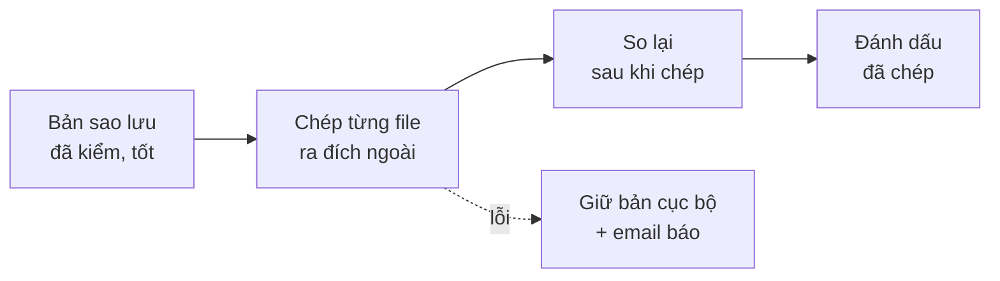
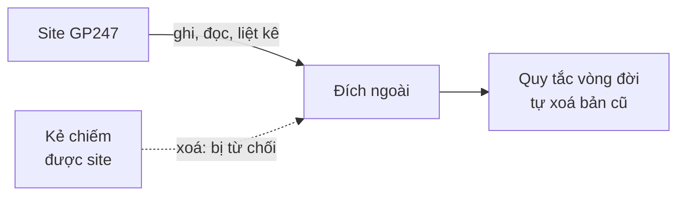

> 🌐 **Ngôn ngữ:** 🇻🇳 Tiếng Việt (hiện tại) · [🇬🇧 English](./backup-offsite.md) · [🇯🇵 日本語](./backup-offsite_ja.md)

# Đích ngoài — chép bản sao lưu ra khỏi máy chủ, không xoá được

## Giới thiệu
Bản sao lưu nằm trên chính máy chủ sẽ mất cùng máy chủ khi ổ hỏng, nhà cung cấp khoá tài khoản hay site bị chiếm quyền. Tài liệu này
dành cho **chủ site và người quản trị**: cách cấu hình một **đích ngoài** (dịch vụ lưu trữ S3-compatible hoặc máy chủ SFTP / NAS) để
mỗi bản đã kiểm tự được chép sang đó, cách cấp quyền **chỉ-ghi** để kẻ tấn công không xoá được bản ngoài, và cách kéo một bản về khi
cần. Thiết lập sao lưu cơ bản xem ở [Sao lưu & phục hồi](./backup-and-restore_vi.md).

## Nhìn nhanh
Sau khi cấu hình, việc chép ra ngoài diễn ra tự động sau mỗi bản đã kiểm:



- **Bản vẫn mã hoá khi ra ngoài** — nhà cung cấp lưu trữ không đọc được nội dung.
- **Bản cục bộ luôn được giữ**; đích ngoài lỗi không làm hỏng bản trên máy chủ.
- **Credential chỉ-ghi + Object Lock** là lớp quan trọng nhất: kẻ chiếm được site vẫn không xoá được bản ngoài.
- **Kéo về được bất cứ lúc nào**, kể cả bản không còn trong danh sách của site (ví dụ khi chuyển sang máy chủ mới).

## Chọn loại đích
GP247 hỗ trợ **một** đích ngoài tại một thời điểm, thuộc một trong hai loại:

| Loại | Phù hợp | Thư viện cần có |
| --- | --- | --- |
| **S3-compatible** | AWS S3, Cloudflare R2, Backblaze B2, Wasabi, MinIO… | `league/flysystem-aws-s3-v3` — có sẵn cùng GP247 |
| **Máy chủ SFTP hoặc NAS** | Máy chủ khác của bạn, NAS ở văn phòng | `league/flysystem-sftp-v3` |

Thiếu thư viện thì loại đó hiện **không khả dụng** trên màn, kèm lệnh cần chạy. Nhờ lập trình viên hoặc nhà cung cấp hosting chạy
ở thư mục site:

```
composer require league/flysystem-sftp-v3
```

## Cấu hình đích ngoài
Chỉ **quản trị viên cấp cao (Administrator)** cấu hình được, và phải xác nhận lại danh tính trước khi lưu.

1. Vào **Cấu hình hệ thống → Sao lưu & phục hồi → Cài đặt sao lưu**, khối **Đích ngoài**.
2. Chọn **Loại**: S3-compatible hoặc Máy chủ SFTP hoặc NAS.
3. Điền thông tin:
   - **S3-compatible** — Địa chỉ endpoint (để trống với AWS S3), Vùng (region), Bucket, Thư mục trong bucket (tuỳ chọn), Access key ID,
     Secret access key. Bật **Địa chỉ kiểu path-style** khi dùng MinIO hoặc nhà cung cấp yêu cầu.
   - **SFTP / NAS** — Máy chủ, Cổng, Tên đăng nhập, Thư mục trên máy chủ, và **Mật khẩu** hoặc **Khoá riêng** (kèm passphrase nếu có).
4. Bấm **Kiểm tra kết nối**. GP247 thử ghi, đọc, liệt kê và cho biết credential có quyền **xoá** hay không.
5. Với SFTP: màn hiện **vân tay khoá máy chủ**. Đối chiếu với vân tay nhà cung cấp / người quản trị NAS đưa cho bạn, khớp thì chấp nhận —
   từ đó GP247 chỉ kết nối tới đúng máy chủ này.
6. Lưu. Từ bản đã kiểm tiếp theo, bản tự được chép ra ngoài; cột **Nơi lưu** trong danh sách cho biết bản đã chép hay chưa.

Nếu thành công, kết quả kiểm tra có dòng "Dùng được, và credential không có quyền xoá…" — đó là trạng thái nên đạt.

> ⚠️ **Lưu ý:** bí mật (secret key, mật khẩu, khoá riêng) được lưu mã hoá và **không bao giờ hiện lại** trên màn. Đổi địa chỉ, bucket,
> máy chủ hay tên đăng nhập thì phải nhập lại bí mật, và mọi bản quay về trạng thái "chưa chép" để chép lại sang nơi mới.

## Cấp quyền chỉ-ghi để bản ngoài không bị xoá
Mã độc tống tiền và kẻ tấn công thường **xoá bản sao lưu trước tiên**. Hãy cấp cho site credential chỉ **ghi, đọc và liệt kê** — không
xoá, không ghi đè — và bật khoá giữ bản ở phía đích.



- **Site chỉ thêm bản mới**; việc xoá bản cũ giao cho **quy tắc vòng đời** của chính dịch vụ lưu trữ.
- **Khoá giữ bản (Object Lock)** chặn xoá cả khi ai đó lấy được tài khoản quản trị của dịch vụ.

**AWS S3**
1. Tạo bucket có **Object Lock**, giữ mặc định (ví dụ 30 ngày) ở chế độ **Compliance**.
2. Tạo một IAM user chỉ có chính sách sau (thay `BUCKET` bằng tên bucket):

   ```json
   {
     "Version": "2012-10-17",
     "Statement": [
       { "Effect": "Allow", "Action": ["s3:ListBucket"], "Resource": "arn:aws:s3:::BUCKET" },
       { "Effect": "Allow", "Action": ["s3:PutObject", "s3:GetObject"], "Resource": "arn:aws:s3:::BUCKET/*" }
     ]
   }
   ```

3. Thêm quy tắc vòng đời xoá object cũ hơn thời gian bạn muốn giữ (ví dụ 90 ngày).

**Cloudflare R2**
1. Tạo API token loại **Object Read & Write**, giới hạn trong đúng bucket.
2. Thêm quy tắc khoá bucket: **R2 → bucket → Settings → Bucket lock**.
3. Thêm quy tắc vòng đời xoá object cũ.

**Backblaze B2**
1. Bật **Object Lock** cho bucket.
2. Tạo application key chỉ có `listFiles`, `readFiles`, `writeFiles` (**không** có `deleteFiles`).
3. Đặt quy tắc vòng đời (Lifecycle Settings) giữ bản trong số ngày mong muốn.

**SFTP / NAS**
1. Dùng tài khoản chỉ **tạo** được file trong thư mục của nó, không xoá hay đổi tên được.
2. Bật **snapshot** trên NAS để có bản giữ lại ngay cả khi thư mục bị ghi đè.

> 💡 **Mẹo:** nếu **Kiểm tra kết nối** báo credential **có quyền xoá**, GP247 vẫn chạy được nhưng sẽ nhắc bạn đổi sang credential chỉ-ghi.
> `php artisan gp247:doctor` cũng báo điều này ở dòng `backup_destination_can_delete`.

## Theo dõi và chép lại khi lỗi
Cột **Nơi lưu** của mỗi bản cho biết trạng thái ở đích ngoài:

| Nơi lưu | Nghĩa | Bạn làm gì |
| --- | --- | --- |
| **Máy chủ này + đích ngoài** | Bản đã ở đích ngoài và đã so lại sau khi chép | Không cần làm gì |
| **Cục bộ · đang chép ra ngoài** | Đang chép từng file trong nền | Chờ; đóng tab thì lần sau chạy tiếp |
| **Cục bộ · chép ra ngoài lỗi** | Đích ngoài không nhận (mạng, quyền, đầy) | Sửa nguyên nhân rồi bấm **Chép ra ngoài** |
| **Máy chủ này** | Chưa cấu hình đích ngoài | Cấu hình theo hướng dẫn ở trên |

- **Lỗi tạm thời** (mạng chập chờn) được thử lại vài lần; lỗi kéo dài thì dừng, đánh dấu **chép ra ngoài lỗi** và gửi email cho chủ site.
- **Bản mới nhất chưa chép được luôn được giữ trên máy chủ** khi dọn bản cũ, để chép lại khi đích hoạt động trở lại. Bản chưa chép cũ hơn
  theo quy tắc giữ bản thông thường, để đích hỏng lâu không làm đầy đĩa.
- **Bản đưa vào từ nơi khác** không được chép ra ngoài thư mục của site này.

## Kéo một bản từ đích ngoài về
Dùng khi bản trên máy chủ đã mất (ổ hỏng, chuyển máy chủ) hoặc muốn phục hồi từ một bản chỉ còn ở ngoài.

1. Vào màn **Phục hồi**, khối **Từ đích ngoài**, bấm **Xem ở đích ngoài**. Danh sách hiện mọi bản của site ở đích — không cần mật khẩu sao lưu.
2. Ở bản muốn dùng, bấm **Kéo về**, nhập **mật khẩu sao lưu hoặc recovery key** của site đã tạo bản, rồi xác nhận lại danh tính.
3. Bản được tải về từng phần trong nền và **kiểm đầy đủ trước khi vào danh sách**. Bản bị sửa ở đích sẽ bị từ chối.
4. Khi bản hiện trong danh sách, phục hồi như mọi bản khác ([Phục hồi theo tình huống](./restore-guide_vi.md)).

Trên máy chủ có dòng lệnh:

```
php artisan gp247:backup-offsite list
php artisan gp247:backup-offsite fetch <mã-bản>
```

## Điều kiện & ràng buộc (hiểu trước khi thao tác)
**Khi cấu hình**
- **Chỉ một đích ngoài tại một thời điểm** — đổi đích thì các bản được chép lại sang nơi mới.
- **Chỉ Administrator, sau khi xác nhận lại danh tính** — credential của đích ngoài là chìa khoá của các bản ngoài máy chủ.
- **Địa chỉ không được trỏ tới dịch vụ metadata của cloud hay địa chỉ link-local; `http://` không mã hoá chỉ dùng được tới chính máy này hoặc
  mạng nội bộ** (ví dụ MinIO ở văn phòng) — để không ai dùng màn này dò thông tin nội bộ của máy chủ.
- **SFTP chỉ kết nối tới máy chủ có đúng vân tay đã chấp nhận** — máy chủ đổi khoá thì kết nối bị chặn cho tới khi bạn chấp nhận lại.

**Khi chép ra / kéo về**
- **Chỉ bản "Đã kiểm, tốt" mới được chép ra** — không đẩy bản hỏng ra ngoài.
- **Kéo về cần mật khẩu sao lưu hoặc recovery key của site đã tạo bản** — bản ngoài vẫn mã hoá.
- **Pha tải về được tối đa 6 giờ**; sau khi tải xong còn 1 giờ để kiểm và đưa vào danh sách — bản rất lớn trên đường truyền chậm vẫn kéo về được.
- **Mỗi lúc chỉ một việc ghi**: đang kéo bản về thì chưa tạo được bản sao lưu mới.

## Hỏi & Đáp (Q&A)
**Câu 1: Dịch vụ lưu trữ có đọc được dữ liệu của tôi không?**

→ Không. Bản được mã hoá trên máy chủ của bạn trước khi chép ra; chỉ mật khẩu sao lưu hoặc recovery key của site mở được.

**Câu 2: Credential chỉ-ghi thì ai xoá bản cũ ở đích?**

→ Quy tắc vòng đời (lifecycle) của chính dịch vụ lưu trữ, ví dụ tự xoá object cũ hơn 90 ngày. Site không tự xoá được — đó chính là điểm an toàn.

**Câu 3: Tôi chỉ có shared host, dùng đích ngoài được không?**

→ Được. Việc chép chạy từng file trong nền giống sao lưu theo lịch. Với SFTP cần thư viện `league/flysystem-sftp-v3` — nhờ nhà cung cấp hosting cài nếu chưa có.

**Câu 4: Đích ngoài lỗi thì bản trên máy chủ có bị ảnh hưởng không?**

→ Không. Bản cục bộ vẫn dùng được, chỉ bị đánh dấu **chép ra ngoài lỗi**; bạn nhận email và chép lại sau khi sửa.

**Câu 5: Chuyển sang máy chủ mới, tôi lấy lại dữ liệu từ đích ngoài thế nào?**

→ Cài GP247 trên máy chủ mới, cấu hình cùng đích ngoài, vào **Phục hồi → Từ đích ngoài → Kéo về** với recovery key của site cũ, rồi phục hồi bản đó.

**Câu 6: Vì sao màn bắt tôi nhập lại secret key khi đổi bucket?**

→ Để credential của nơi cũ không bị dùng cho nơi mới mà bạn không để ý. Mọi thay đổi định danh của đích đều bắt nhập lại bí mật.

**Câu 7: Kiểm tra kết nối báo "có quyền xoá" có nguy hiểm không?**

→ Site vẫn chạy bình thường, nhưng kẻ chiếm được site có thể xoá luôn bản ngoài. Hãy tạo credential mới chỉ có quyền ghi, đọc, liệt kê theo hướng dẫn ở trên.

---

<sub>📅 **Cập nhật lần cuối:** 2026-11-07 · ✍️ **Tác giả (Author):** GP247</sub>
