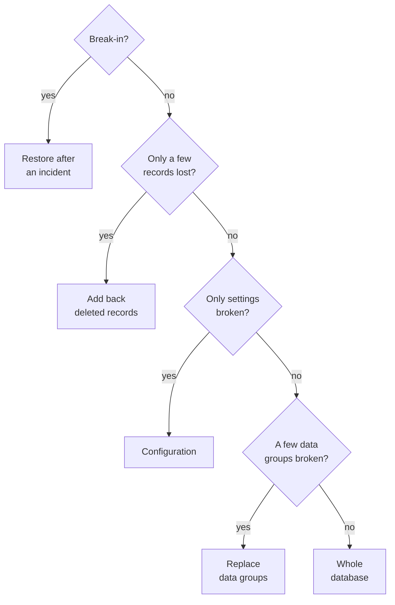
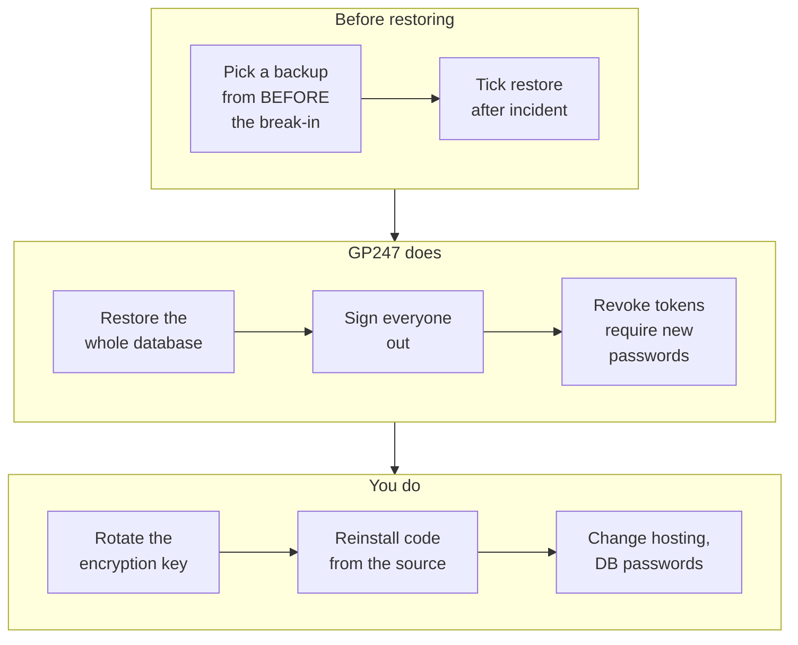

> 🌐 **Language:** [🇻🇳 Tiếng Việt](./restore-guide_vi.md) · 🇬🇧 English (current) · [🇯🇵 日本語](./restore-guide_ja.md)

# Restore by situation — pick the right level, follow the right order

## Introduction
When something goes wrong, the most important thing is to **restore only the part that broke** — not to send the whole site back in time
because of one wrong setting. This document is for **site owners and administrators** who need to restore: choosing the restore level for
the situation, the steps on the **Restore** screen, undoing, restoring **after a security incident**, and using a backup made on another
site. Backup setup is in [Backup & restore](./backup-and-restore.md).

## At a glance
Every restore on the screen goes through the same five steps; nothing is written before you type the confirmation:


- **Pick the smallest level that fixes the problem** — the rest of the site keeps its newer data.
- **Always preview**: the screen lists which tables are replaced, how much newer data will be lost, and what this restore does **not** bring back.
- **Undo is possible for 24 hours** for the levels that replace data — a mistake can be taken back.
- **Suspect a break-in?** Use **Restore after a security incident**, not an ordinary restore.

## On this page
- [Choose the restore level](#choose-the-restore-level-for-the-situation) — decision diagram
- [Restore steps on the screen](#restore-steps-on-the-screen) — from picking a backup to the result
- [Undo a restore](#undo-a-restore) — when you restored the wrong thing
- [Restore files](#restore-files-images-extensions-env) — uploads, extensions, `.env`
- [Restore after a security incident](#restore-after-a-security-incident) — when the site was taken over
- [Use a backup made elsewhere](#use-a-backup-made-elsewhere) — bring a `.gp247bak` file in, move servers
- [Restore from the command line](#restore-from-the-command-line) — on a VPS, sites too large for a browser

## Choose the restore level for the situation
Answer the questions below in order; stop at the first level that solves your problem.



| Situation | Level | What happens |
| --- | --- | --- |
| Deleted a few products, customers, orders by mistake | **Add back deleted records** | Only missing records come back (with their child records); **nothing existing is changed** |
| A settings change broke the site | **Configuration** | Settings go back to the backup; backup settings are kept |
| Bulk import went wrong for products, prices | **Replace data groups** | The chosen groups go back to the backup; other groups stay |
| An update damaged many tables | **Whole database** | The whole database goes back to the backup; needs a **Full** backup |
| The site was taken over | **Restore after a security incident** | Whole database + everyone signed out, tokens revoked, new passwords required |
| Uploaded images lost, an extension broken | **Restore files** | Command line only — see [Restore files](#restore-files-images-extensions-env) |

> 💡 **Tip:** after a failed update, look for the **"Before a change"** backup GP247 took right before that operation — it is usually the best one to use.

## Restore steps on the screen
You need the **Backup - restore** permission. Every restore is logged and e-mailed to the site owner.

1. Go to **System config → Backup & restore**, and on the backup you want click **Restore** (only **Verified** backups can be restored).
2. In **What to restore**, choose the level from the table above; for **Replace data groups** tick the groups, for **Add back deleted
   records** choose the table and then the records (or **Add back all of them**).
3. Type the **backup password** or **recovery key**, then confirm it is you with your sign-in password.
4. Click **Preview**. Read **What this restore will do** carefully: tables to replace, record counts now and in the backup, newer data
   that will be lost, tables with passwords / API keys (accounts deleted or changed after the backup's time will come back).
   The block **Not brought back by this restore** lists what will not come back:
   - **Tables in the backup that this site does not have (extension not installed)** — reinstall the extension first if you need that data.
   - **Tables never replaced by a restore (sign-in tokens, activity logs, backup bookkeeping…)**.
   - **Tables of the chosen groups that the backup does not hold**.
   - **Files in the backup** (images, uploads, code, `.env`) — written back only with the command, see [Restore files](#restore-files-images-extensions-env).

   If the backup has **columns the site no longer has** (an update removed or renamed them), the screen lists each one: their data will
   **not** come back. Tick **I understand that the data of these columns is lost** and click **Preview** again; without it the restore cannot start.
5. Type the code shown on the screen into **Confirmation** to start.
6. Keep the tab open until the screen shows the result. For **Whole database**, the site goes into maintenance mode while it runs; you
   alone keep using the admin.

If it worked, the screen shows the result and an **Undo the last restore** button with its deadline.

> ⚠️ **Note:** any data created **after** the backup's time in the replaced tables (new orders, new customers…) disappears from the site.
> Write down orders you must keep first, or choose a smaller level.

## Undo a restore
Restored the wrong backup or the wrong group? Go back without needing another backup.

1. Go to the **Restore** screen: the top block says "The last restore can be undone until …".
2. Click **Undo the last restore** and confirm.
3. The tables the restore replaced go back exactly to how they were just before the restore.

- **The undo deadline is 24 hours** after the restore.
- **Only the latest restore can be undone.**
- **Add back deleted records has no undo**: this level only adds missing records, it does not replace any table.

## Restore files (images, extensions, .env)
Restoring files overwrites folders on the server, so it is done only from the **command line**, with someone answering each confirmation
question. The backup must be a **Full** backup.

1. Preview:

   ```
   php artisan gp247:backup-restore <backup-id> --files=uploads --preview
   ```

2. Run it for real (without `--preview`) and answer the confirmation questions:

   ```
   php artisan gp247:backup-restore <backup-id> --files=uploads
   ```

File groups you can choose: `uploads` (uploaded images and files), `extensions` (plugin / template folders), `env` (the `.env` file).
Combine with a data restore using `--level=full`.

> ⚠️ **Note:** restoring `.env` also replaces the site's encryption keys. Do it only when the current `.env` is lost or broken, and read
> [Encryption keys & backup](../security/security-keys-and-backup.md) first.

## Restore after a security incident
When you suspect the site was taken over, an ordinary restore is **not enough**: the attacker still has sign-in sessions, API tokens and
known passwords. **Restore after a security incident** does those extra steps right after restoring.



1. Pick a backup made **before** the suspected break-in (later backups may already hold accounts or data the attacker planted).
2. On the **Restore** screen, choose **Whole database** and tick **Restore after a security incident**.
3. Go through preview and confirmation as usual. Right after it finishes: **every sign-in session ends (yours too)**, every API / MCP token
   is revoked, every admin must set a new password at the next sign-in.
4. Sign in again and set a new password. The backup screen shows the list of **tasks to do by hand**:
   - Rotate the site's encryption key (put a new key in `.env`, move the old one to the previous-key variable, run the rotation command — the screen shows the exact command).
   - Reinstall the code (core, plugins, templates) from the original source.
   - Change the database, hosting, FTP and e-mail passwords.
   - Run `php artisan gp247:doctor` and fix what it reports.
5. When done, click **These tasks are done**.

> ℹ️ **Info:** this mode does **not** restore code and `.env` from the backup — the code may have been given a backdoor before. The full
> incident procedure is in [Updates & incidents](../security/security-updates-and-incidents.md).

## Use a backup made elsewhere
You can restore from a `.gp247bak` file downloaded earlier, or made on another server (moving servers, building a test site).

1. Go to the **Restore** screen, block **Bring in a backup file**.
2. Type the **backup password or recovery key of the site that made the file**.
3. Choose the file and click **Upload and check**. The file is sent in small parts (up to 2 GB by default) and fully checked.
4. Once checked, the backup appears in the list with kind **Imported**; restore it like any other backup.

A backup made on another site is marked **origin not verified** (it is not signed with this site's key): the data is intact, but GP247
cannot prove who made it. When restoring, you must tick **I know where this backup comes from — restore it anyway**; code and `.env` from
such a backup are not restored. On the screen, **only an Administrator** can restore a backup of unverified origin — someone with just
the **Backup - restore** right cannot, since a backup made with their own password could replace the admin accounts. A backup that only exists at the external destination is brought back as described in
[External destination](./backup-offsite.md#bring-a-backup-back-from-the-external-destination).

## Restore from the command line
On a VPS, or when the site is too large for a browser, use `gp247:backup-restore`. The command asks for the backup password and the
confirmation code while it runs.

| Task | Command |
| --- | --- |
| Preview | `php artisan gp247:backup-restore <id> --level=full --preview` |
| Whole database | `php artisan gp247:backup-restore <id> --level=full` |
| Replace data groups | `php artisan gp247:backup-restore <id> --level=replace --group=catalog` |
| Configuration | `php artisan gp247:backup-restore <id> --level=config` |
| Add back deleted records | `php artisan gp247:backup-restore <id> --level=undelete --table=<table> --key=<key>` |
| After a security incident | `php artisan gp247:backup-restore <id> --level=full --post-incident` |
| From a `.gp247bak` file | `php artisan gp247:backup-restore --file=<path> --level=full` |
| Undo | `php artisan gp247:backup-restore --undo` |

Add `--recovery-key` when you type the recovery key instead of the password; `--accept-unverified` for a backup whose origin is not verified;
`--accept-column-loss` when the preview reports columns the site no longer has (the data of those columns is lost). The command's preview
also prints the tables that are skipped and why.

## Conditions & Rules (know before you act)
**Choosing the backup and level**
- **Only Verified backups** — a broken or altered backup is never used to write onto the site.
- **Whole database needs a Full backup** — a quick snapshot or selected groups do not hold every table.
- **A backup newer than the site cannot be restored**: update the site to the backup's version first — a newer backup's table structure may differ.
- **Tables that other tables point to must be restored with their whole group** — replacing one table alone would break links between records.
- **Add back deleted records only works for tables with a primary key, up to 5,000 records at a time**; for more, use **Replace data groups**.

**While running**
- **Only one writing task at a time** — wait if another backup or restore is running.
- **The key that opens the backup is usable for 1 hour** from the start — a restore left too long must be started again.
- **Maintenance mode turns itself off** if a whole-database restore cannot finish, so the site does not stay stuck on the maintenance page.
- **A restore left unfinished after its tables were replaced ends by itself** — after about 15 minutes (about 1 hour while data is being
  updated), the next time someone opens the site; the site leaves maintenance mode, the replaced tables stay and can still be undone within 24 hours.
- **The admin activity log and failed sign-ins are never replaced** — a restore must not be a way to erase who did what.
- **Auto-increment ids do not go back** — new records after a restore never get an id the site already handed out.
- **Code and `.env` are not restored in incident mode or from a backup whose origin is not verified** — code in the backup may carry a backdoor.
- **Only an Administrator restores a backup of unverified origin on the screen** — a backup made with someone else's password could replace the admin accounts.
- **Wrong backup passwords are limited** (5 tries in 15 minutes per administrator, 20 wrong tries an hour for the whole site) — nobody can keep guessing the password.

## Q&A
**Q1: Will restoring lose new orders?**

→ Only in the replaced tables: orders created after the backup's time are lost if you replace the **Orders** group or the **Whole
database**. The preview shows how much data will be lost before you confirm.

**Q2: I deleted one product by mistake — do I have to send the whole site back to yesterday?**

→ No. Choose **Add back deleted records**, pick the products table and that product — everything else stays as it is.

**Q3: What do visitors see during a whole-database restore?**

→ The maintenance page. You — the person who started the restore — keep using the admin to follow its progress.

**Q4: I noticed I picked the wrong backup after restoring — what now?**

→ Click **Undo the last restore** within 24 hours; the tables go back exactly to how they were before the restore.

**Q5: Why does the incident restore sign me out too?**

→ Because your session cannot be told apart from one the attacker stole. Signing everyone out and requiring new passwords is the sure way to close the door.

**Q6: Can a backup from the old site be restored on a new site?**

→ Yes: bring the `.gp247bak` file in with the old site's backup password or recovery key, tick the origin confirmation, then restore. The
new site must run the same or a newer GP247 version than the old one.

**Q7: What if the browser closes during a restore?**

→ Open the **Restore** screen again: the unfinished restore carries on from where it stopped. While it is still reading data from the
backup, if it is left for more than 1 hour it is stopped and maintenance mode turns itself off; preview again and restore from the start.
Once the tables have been replaced, if it is left about 15 minutes (about 1 hour while data is being updated) it ends by itself the next
time someone opens the site: the site leaves maintenance mode, the restored data stays and can still be undone. If the backup is older than the site, the data update after the restore is skipped — run
`php artisan gp247:update`.

**Q8: I have no command line — how do I restore uploaded images?**

→ Restoring files is command-line only. Ask your hosting provider or developer to run the commands in [Restore files](#restore-files-images-extensions-env).

## Change history
<!-- Only when logic/behavior changed. Newest row on top. One row per day: merge same-day changes into the existing row, never add a new row for the same date. -->

| Date | GP247 version | Change |
| --- | --- | --- |
| 2026-11-11 | | The preview lists what is not brought back; columns the site no longer has need their own confirmation (`--accept-column-loss`); a backup of unverified origin restored on the screen only by an Administrator; the activity log is not replaced; a restore left unfinished after its tables were replaced ends by itself after about 15 minutes (about 1 hour while data is being updated), the next time someone opens the site; wrong backup passwords limited |

---

<sub>📅 **Last updated:** 2026-11-11 · ✍️ **Author:** GP247</sub>
