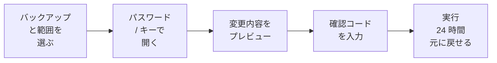
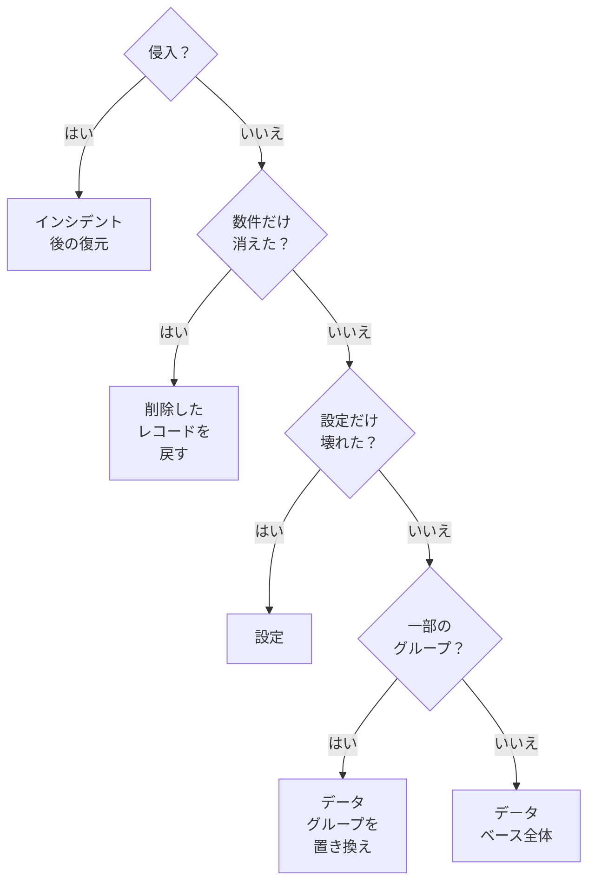
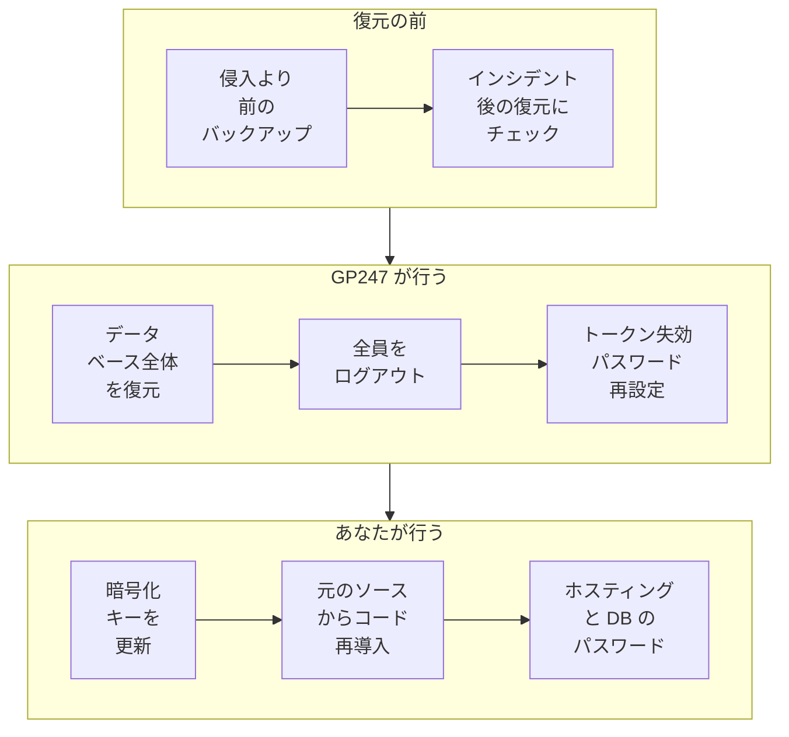

> 🌐 **言語:** [🇻🇳 Tiếng Việt](./restore-guide_vi.md) · [🇬🇧 English](./restore-guide.md) · 🇯🇵 日本語（現在）

# 状況別の復元ガイド — 正しい範囲を選び、正しい順序で行う

## はじめに
問題が起きたときに最も大切なのは、**壊れた部分だけを復元する**ことです。設定を 1 つ間違えただけで、サイト全体を過去に戻す必要はありません。
このドキュメントは復元が必要な**サイトのオーナーと管理者**向けで、状況に応じた復元範囲の選び方、**復元**画面での手順、元に戻す方法、
**セキュリティインシデント後**の復元、別のサイトで作成したバックアップの使い方を説明します。バックアップの設定は
[バックアップと復元](./backup-and-restore_ja.md)をご覧ください。

## ひと目でわかる
画面からの復元はすべて同じ 5 つの段階を通ります。確認コードを入力するまで、データは一切書き込まれません。



- **問題を解決できる最小の範囲を選びます** — サイトの他の部分は新しいデータのまま残ります。
- **必ずプレビューします** — 置き換えられるテーブル、失われる新しいデータの量、そして今回の復元で**戻らない**ものが表示されます。
- **データを置き換える範囲は 24 時間以内なら元に戻せます** — 間違えても取り消せます。
- **侵入が疑われるとき**は、通常の復元ではなく**セキュリティインシデント後の復元**を使います。

## このページの内容
- [状況に応じて復元範囲を選ぶ](#状況に応じて復元範囲を選ぶ) — 判断の流れ図
- [画面での復元手順](#画面での復元手順) — バックアップの選択から結果まで
- [復元を元に戻す](#復元を元に戻す) — 間違えて復元したとき
- [ファイルの復元](#ファイルの復元画像拡張機能env) — アップロード、拡張機能、`.env`
- [セキュリティインシデント後の復元](#セキュリティインシデント後の復元) — サイトが乗っ取られたとき
- [他の場所で作成したバックアップを使う](#他の場所で作成したバックアップを使う) — `.gp247bak` の取り込み、サーバー移行
- [コマンドラインからの復元](#コマンドラインからの復元) — VPS、ブラウザーには大きすぎるサイト

## 状況に応じて復元範囲を選ぶ
次の質問に順に答え、問題を解決できる最初の範囲で止まります。



| 状況 | 範囲 | 起きること |
| --- | --- | --- |
| 商品、顧客、注文を数件誤って削除した | **削除したレコードを戻す** | 不足しているレコード（子レコードを含む）だけを戻し、**既存のものは変更しません** |
| 設定変更でサイトがおかしくなった | **設定** | 設定がバックアップの状態に戻ります。バックアップ設定はそのまま残ります |
| 商品や価格の一括取り込みを誤った | **データグループを置き換え** | 選んだグループがバックアップの状態に戻り、他のグループはそのままです |
| 更新で多くのテーブルが壊れた | **データベース全体** | データベース全体がバックアップの状態に戻ります。**全体**バックアップが必要です |
| サイトが乗っ取られた | **セキュリティインシデント後の復元** | データベース全体 + 全員のログアウト、トークン失効、新しいパスワードの要求 |
| アップロード画像の消失、拡張機能の破損 | **ファイルの復元** | コマンドラインのみ — [ファイルの復元](#ファイルの復元画像拡張機能env)を参照 |

> 💡 **ヒント:** 更新が失敗したら、その操作の直前に GP247 が自動作成した「**変更前**」のバックアップを探してください。たいていそれが最適です。

## 画面での復元手順
**Backup - restore** 権限が必要です。すべての復元はログに記録され、サイトのオーナーにメールが届きます。

1. **システム設定 → バックアップと復元**を開き、使いたいバックアップで**復元**をクリックします（復元できるのは**検証済み**のバックアップだけです）。
2. **復元する内容**で、上の表から範囲を選びます。**データグループを置き換え**ではグループにチェックを入れ、**削除したレコードを戻す**では
   テーブルを選んでからレコードを選びます（または**すべて戻す**）。
3. **バックアップ用パスワード**または**リカバリーキー**を入力し、ログインパスワードで本人確認をします。
4. **プレビュー**をクリックします。**この復元で行われること**をよく読みます。置き換えられるテーブル、現在とバックアップ内のレコード数、
   失われる新しいデータ、パスワードや API キーを含むテーブル（バックアップの時点以降に削除・変更したアカウントやキーが戻ります）が表示されます。
   **この復元では戻らないもの**の欄には、戻らない部分が一覧表示されます。
   - **バックアップにあるがこのサイトにないテーブル（拡張機能が未インストール）** — そのデータが必要なら、先に拡張機能をインストールし直します。
   - **復元で置き換えないテーブル（ログイントークン、操作ログ、バックアップの管理情報など）**。
   - **選んだグループのうちバックアップにないテーブル**。
   - **バックアップ内のファイル**（画像、アップロード、コード、`.env`） — コマンドでのみ書き戻せます。[ファイルの復元](#ファイルの復元画像拡張機能env)を参照してください。

   バックアップに**サイトにもうない列**（更新で削除・名前変更された列）がある場合は、列ごとに一覧表示され、そのデータは**戻りません**。
   **これらの列のデータが失われることを理解しました**にチェックを入れ、もう一度**プレビュー**をクリックします。チェックしないと復元できません。
5. 画面に表示されたコードを**確認**欄に入力して開始します。
6. 結果が表示されるまでタブを開いたままにします。**データベース全体**の場合、実行中はサイトがメンテナンスモードになりますが、
   開始したあなただけは管理画面を使えます。

成功すると結果が表示され、期限付きの**前回の復元を元に戻す**ボタンが表示されます。

> ⚠️ **注意:** 置き換えたテーブルでは、バックアップの時点**以降**に作成されたデータ（新しい注文、新しい顧客など）がサイトから消えます。
> 残したい注文は事前に控えておくか、より小さな範囲を選んでください。

## 復元を元に戻す
違うバックアップや違うグループを復元してしまっても、別のバックアップなしで元に戻せます。

1. **復元**画面を開くと、上部に「前回の復元は … まで元に戻せます」と表示されています。
2. **前回の復元を元に戻す**をクリックして確認します。
3. 復元で置き換えられたテーブルが、復元の直前の状態にそのまま戻ります。

- **元に戻せる期限は復元から 24 時間**です。
- **元に戻せるのは直近の復元だけです。**
- **削除したレコードを戻すには「元に戻す」はありません** — この範囲は不足しているレコードを追加するだけで、テーブルを置き換えないためです。

## ファイルの復元（画像、拡張機能、.env）
ファイルの復元はサーバー上のフォルダーを上書きするため、**コマンドライン**からのみ、確認の質問に人が答えながら行います。
バックアップは**全体**バックアップである必要があります。

1. プレビューします。

   ```
   php artisan gp247:backup-restore <バックアップID> --files=uploads --preview
   ```

2. 本番実行します（`--preview` を外し、確認の質問に答えます）。

   ```
   php artisan gp247:backup-restore <バックアップID> --files=uploads
   ```

選べるファイルグループは `uploads`（アップロードした画像やファイル）、`extensions`（プラグイン / テンプレートのフォルダー）、`env`（`.env` ファイル）です。
`--level=full` と組み合わせてデータの復元と同時に行えます。

> ⚠️ **注意:** `.env` を復元するとサイトの暗号化キーも置き換わります。現在の `.env` が失われたか壊れたときだけ行い、事前に
> [暗号化キーとバックアップ](../security/security-keys-and-backup_ja.md)を読んでください。

## セキュリティインシデント後の復元
サイトが乗っ取られた疑いがあるとき、通常の復元では**不十分**です。攻撃者はログインセッション、API トークン、知っているパスワードをまだ持っています。
**セキュリティインシデント後の復元**は、復元の直後にそれらの対処も行います。



1. 侵入が疑われる時点より**前**に作成されたバックアップを選びます（それ以降のバックアップには、攻撃者が仕込んだアカウントやデータが含まれているおそれがあります）。
2. **復元**画面で**データベース全体**を選び、**セキュリティインシデント後の復元**にチェックを入れます。
3. 通常どおりプレビューと確認を行います。完了した直後に、**すべてのログインセッションが終了し（あなた自身も含む）**、すべての API / MCP トークンが
   失効し、すべての管理者が次回ログイン時に新しいパスワードを設定する必要があります。
4. 再ログインして新しいパスワードを設定します。バックアップ画面に**手動で行う作業**の一覧が表示されます。
   - サイトの暗号化キーを更新する（`.env` に新しいキーを設定し、古いキーを旧キー用の変数へ移し、キー更新コマンドを実行 — 画面に正確なコマンドが表示されます）。
   - コード（core、プラグイン、テンプレート）を元のソースから再導入する。
   - データベース、ホスティング、FTP、メールのパスワードを変更する。
   - `php artisan gp247:doctor` を実行し、報告された問題に対処する。
5. 終わったら**これらの作業は完了しました**をクリックします。

> ℹ️ **情報:** このモードでは、コードと `.env` はバックアップから**復元しません** — コードには以前からバックドアが仕込まれているおそれがあるためです。
> インシデント対応の全体手順は[更新とインシデント対応](../security/security-updates-and-incidents_ja.md)をご覧ください。

## 他の場所で作成したバックアップを使う
以前ダウンロードした `.gp247bak` ファイルや、別のサーバーで作成したファイル（サーバー移行、テストサイトの構築）から復元できます。

1. **復元**画面の**バックアップファイルの取り込み**ブロックを開きます。
2. **ファイルを作成したサイトのバックアップ用パスワードまたはリカバリーキー**を入力します。
3. ファイルを選び、**アップロードして検証**をクリックします。ファイルは小さく分けて送信され（初期設定では最大 2 GB）、完全に検証されます。
4. 検証に合格すると、種類「**インポート**」として一覧に表示されます。他のバックアップと同じように復元します。

別のサイトで作成したバックアップは**出所未確認**として記録されます（このサイトの鍵で署名されていないため）。データは完全ですが、誰が作成したかを
GP247 は証明できません。復元するときは**このバックアップの出所を把握しています — 復元する**にチェックを入れる必要があり、そのようなバックアップの
コードと `.env` は復元されません。画面で出所未確認のバックアップを復元できるのは **Administrator だけ**です。**Backup - restore** 権限だけを
持つ人はできません。その人自身のパスワードで作ったバックアップで、管理者アカウントまで置き換えられてしまうおそれがあるためです。
外部の保存先にしかないバックアップは、[外部の保存先](./backup-offsite_ja.md#外部の保存先からバックアップを取り戻す)の
手順で取り戻します。

## コマンドラインからの復元
VPS 上や、サイトがブラウザーには大きすぎる場合は `gp247:backup-restore` を使います。実行中にバックアップ用パスワードと確認コードの入力を求められます。

| 作業 | コマンド |
| --- | --- |
| プレビュー | `php artisan gp247:backup-restore <ID> --level=full --preview` |
| データベース全体 | `php artisan gp247:backup-restore <ID> --level=full` |
| データグループを置き換え | `php artisan gp247:backup-restore <ID> --level=replace --group=catalog` |
| 設定 | `php artisan gp247:backup-restore <ID> --level=config` |
| 削除したレコードを戻す | `php artisan gp247:backup-restore <ID> --level=undelete --table=<テーブル> --key=<キー>` |
| セキュリティインシデント後 | `php artisan gp247:backup-restore <ID> --level=full --post-incident` |
| `.gp247bak` ファイルから | `php artisan gp247:backup-restore --file=<パス> --level=full` |
| 元に戻す | `php artisan gp247:backup-restore --undo` |

パスワードの代わりにリカバリーキーを入力するときは `--recovery-key` を、出所未確認のバックアップには `--accept-unverified` を、
サイトにもうない列があるとプレビューに表示されたときは `--accept-column-loss` を付けます（その列のデータは失われます）。コマンドの
プレビューには、スキップされるテーブルとその理由も表示されます。

## 条件と制約（操作の前に確認）
**バックアップと範囲を選ぶとき**
- **検証済みのバックアップだけ** — 壊れたり改ざんされたりしたバックアップがサイトに書き込まれることはありません。
- **データベース全体には全体バックアップが必要です** — クイックスナップショットやグループ選択のバックアップには、すべてのテーブルが含まれていません。
- **サイトより新しいバックアップは復元できません** — 先にサイトをバックアップのバージョンまで更新してください。新しいバックアップはテーブル構造が異なる場合があります。
- **他のテーブルから参照されているテーブルは、グループごと復元する必要があります** — 1 つのテーブルだけを置き換えると、レコード同士のつながりが壊れます。
- **削除したレコードを戻すのは、主キーのあるテーブルで、1 回あたり 5,000 件まで** — それより多い場合は**データグループを置き換え**を使います。

**実行中**
- **書き込みを伴う処理は同時に 1 つだけ** — 別のバックアップや復元が実行中なら、終わるまで待ちます。
- **バックアップを開く鍵が使えるのは開始から 1 時間** — 長く放置した復元は最初からやり直しになります。
- **データベース全体の復元が完了できない場合、メンテナンスモードは自動で解除されます** — サイトがメンテナンス画面のまま止まらないようにするためです。
- **テーブルの置き換え後に約 15 分放置された復元は自動で終了します** — サイトはメンテナンスモードから戻り、置き換えたテーブルはそのまま残り、
  24 時間以内なら元に戻せます。
- **管理操作ログとログイン失敗の記録は置き換えません** — 復元を「誰が何をしたか」の記録を消す手段にしないためです。
- **自動採番の ID は巻き戻りません** — 復元後の新しいレコードが、サイトがすでに発行した ID を再び受け取ることはありません。
- **インシデントモードや出所未確認のバックアップでは、コードと `.env` は復元しません** — バックアップ内のコードにバックドアがあるおそれがあるためです。
- **出所未確認のバックアップを画面で復元できるのは Administrator だけ** — 他人のパスワードで作ったバックアップで管理者アカウントまで置き換えられるおそれがあるためです。
- **バックアップ用パスワードの誤入力は制限されます**（管理者ごとに 15 分間に 5 回、サイト全体で 1 時間に 20 回の誤りまで） — パスワードを延々と試されないようにするためです。

## よくある質問（Q&A）
**Q1: 復元すると新しい注文は消えますか？**

→ 置き換えたテーブルでだけ消えます。**注文**グループまたは**データベース全体**を置き換えると、バックアップの時点以降に作成された注文は失われます。
確認の前に、失われるデータの量がプレビューに表示されます。

**Q2: 商品を 1 つ誤って削除しました。サイト全体を昨日に戻す必要がありますか？**

→ ありません。**削除したレコードを戻す**を選び、商品のテーブルとその商品を選ぶだけで、他はすべてそのままです。

**Q3: データベース全体の復元中、来訪者には何が表示されますか？**

→ メンテナンス画面です。復元を開始したあなたは、管理画面で進行状況を確認し続けられます。

**Q4: 復元した後で、違うバックアップを選んでいたことに気づきました。**

→ 24 時間以内に**前回の復元を元に戻す**をクリックしてください。テーブルが復元前の状態にそのまま戻ります。

**Q5: インシデント後の復元で、自分までログアウトされるのはなぜですか？**

→ あなたのセッションと、攻撃者が盗んだセッションを区別できないためです。全員をログアウトさせ、新しいパスワードを求めるのが確実に扉を閉める方法です。

**Q6: 旧サイトのバックアップを新しいサイトに復元できますか？**

→ できます。旧サイトのバックアップ用パスワードまたはリカバリーキーで `.gp247bak` ファイルを取り込み、出所の確認にチェックを入れてから復元します。
新しいサイトは、旧サイトと同じかそれより新しい GP247 のバージョンである必要があります。

**Q7: 復元中にブラウザーが閉じてしまったらどうなりますか？**

→ **復元**画面を開き直すと、途中の復元が止まったところから続きます。バックアップからデータを読み込んでいる間に 1 時間以上放置すると、
復元は停止し、メンテナンスモードは自動で解除されます。もう一度プレビューして、最初から復元してください。テーブルの置き換えが終わった後に
約 15 分放置すると、復元は自動で終了します。サイトはメンテナンスモードから戻り、復元したデータはそのまま残り、元に戻すこともできます。
バックアップがサイトより古い場合、復元後のデータ更新はスキップされるため、`php artisan gp247:update` を実行してください。

**Q8: コマンドラインが使えません。アップロード画像を復元するには？**

→ ファイルの復元はコマンドラインのみです。ホスティング会社または開発者に、[ファイルの復元](#ファイルの復元画像拡張機能env)のコマンドの実行を依頼してください。

## 変更履歴
<!-- ロジック/動作が変わった場合のみ記載。最新の行を一番上に。1 日 1 行：同じ日の変更は既存の行にまとめ、同じ日付の行を追加しない。 -->

| 日付 | GP247 バージョン | 変更内容 |
| --- | --- | --- |
| 2026-11-11 | | プレビューに戻らないものを表示；サイトにもうない列は別途確認が必要（`--accept-column-loss`）；出所未確認のバックアップは画面では Administrator のみ復元可能；操作ログは置き換えない；テーブル置き換え後に放置された復元は約 15 分で自動終了；バックアップ用パスワードの誤入力を制限 |

---

<sub>📅 **最終更新:** 2026-11-11 · ✍️ **作成者 (Author):** GP247</sub>
