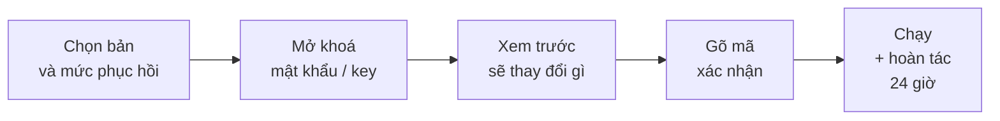
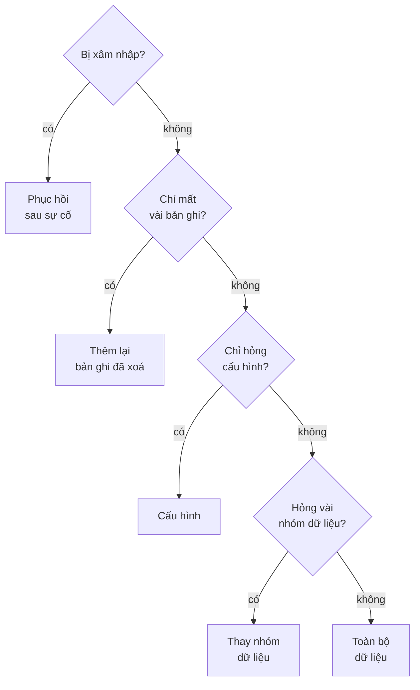
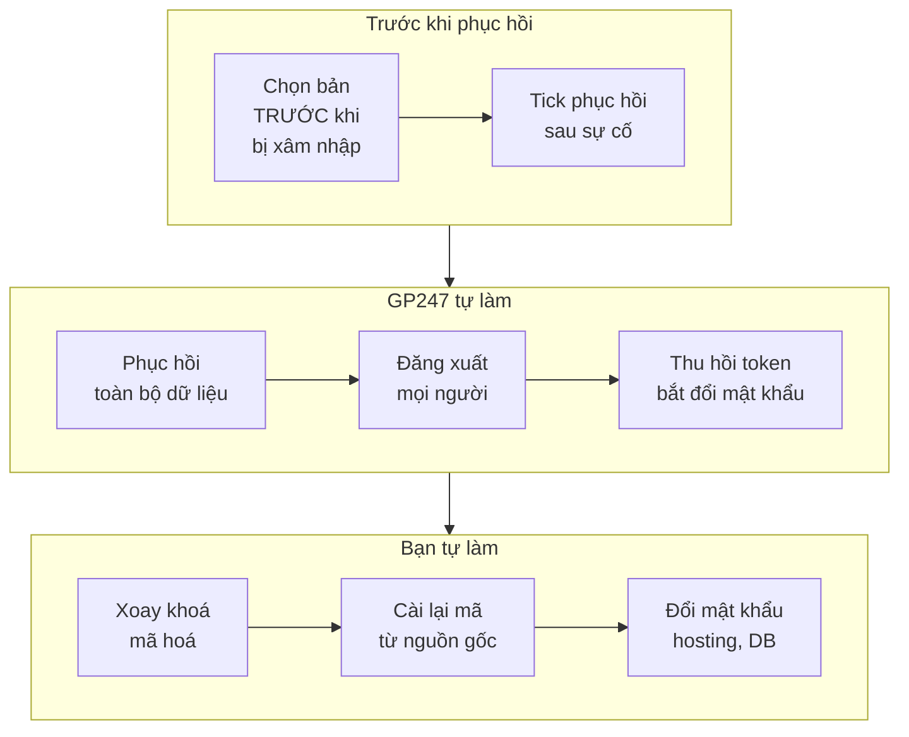

> 🌐 **Ngôn ngữ:** 🇻🇳 Tiếng Việt (hiện tại) · [🇬🇧 English](./restore-guide.md) · [🇯🇵 日本語](./restore-guide_ja.md)

# Phục hồi theo tình huống — chọn đúng mức, làm đúng thứ tự

## Giới thiệu
Khi có sự cố, điều quan trọng nhất là **phục hồi đúng phần bị hỏng** — không kéo cả site về quá khứ chỉ vì một cấu hình đặt sai. Tài
liệu này dành cho **chủ site và người quản trị** đang cần phục hồi: chọn mức phục hồi theo tình huống, các bước trên màn **Phục hồi**,
cách hoàn tác, cách phục hồi **sau sự cố bảo mật**, và cách dùng một bản tạo ở site khác. Thiết lập sao lưu xem ở
[Sao lưu & phục hồi](./backup-and-restore_vi.md).

## Nhìn nhanh
Mọi lần phục hồi trên màn đều đi qua cùng năm bước; không bước nào ghi dữ liệu trước khi bạn gõ xác nhận:



- **Chọn mức nhỏ nhất giải quyết được sự cố** — phần còn lại của site giữ nguyên dữ liệu mới.
- **Luôn xem trước**: màn liệt kê bảng nào bị thay, bao nhiêu dữ liệu mới hơn bản sẽ mất.
- **Hoàn tác được trong 24 giờ** với các mức thay dữ liệu — làm nhầm vẫn quay lại được.
- **Nghi bị xâm nhập** thì dùng chế độ **Phục hồi sau sự cố bảo mật**, không phục hồi thường.

## Trong trang này
- [Chọn mức phục hồi theo tình huống](#chọn-mức-phục-hồi-theo-tình-huống) — sơ đồ quyết định
- [Các bước phục hồi trên màn](#các-bước-phục-hồi-trên-màn) — từ chọn bản tới kết quả
- [Hoàn tác một lần phục hồi](#hoàn-tác-một-lần-phục-hồi) — khi phục hồi nhầm
- [Phục hồi file](#phục-hồi-file-ảnh-extension-env) — ảnh tải lên, extension, `.env`
- [Phục hồi sau sự cố bảo mật](#phục-hồi-sau-sự-cố-bảo-mật) — khi site bị chiếm quyền
- [Dùng bản tạo ở nơi khác](#dùng-bản-tạo-ở-nơi-khác) — đưa file `.gp247bak` vào, chuyển máy chủ
- [Phục hồi bằng dòng lệnh](#phục-hồi-bằng-dòng-lệnh) — trên VPS, site quá lớn cho trình duyệt

## Chọn mức phục hồi theo tình huống
Trả lời các câu hỏi dưới đây theo thứ tự; dừng ở mức đầu tiên giải quyết được sự cố của bạn.



| Tình huống | Mức | Điều gì xảy ra |
| --- | --- | --- |
| Lỡ xoá vài sản phẩm, khách hàng, đơn | **Thêm lại bản ghi đã xoá** | Chỉ thêm bản ghi đang thiếu (kèm bản ghi con), **không sửa** gì đang có |
| Đổi cấu hình làm site lỗi | **Cấu hình** | Cấu hình quay về như trong bản; cài đặt sao lưu được giữ nguyên |
| Nhập sai hàng loạt sản phẩm, giá | **Thay nhóm dữ liệu** | Các nhóm đã chọn quay về như trong bản; nhóm khác giữ nguyên |
| Cập nhật làm hỏng nhiều bảng | **Toàn bộ dữ liệu** | Cả cơ sở dữ liệu quay về như trong bản; cần bản **Toàn bộ** |
| Site bị chiếm quyền | **Phục hồi sau sự cố bảo mật** | Toàn bộ dữ liệu + đăng xuất mọi người, thu hồi token, bắt đổi mật khẩu |
| Mất ảnh tải lên, hỏng extension | **Phục hồi file** | Chỉ bằng dòng lệnh — xem [Phục hồi file](#phục-hồi-file-ảnh-extension-env) |

> 💡 **Mẹo:** sau khi sửa một cập nhật, hãy tìm bản **"Trước thay đổi"** GP247 đã tự chụp ngay trước thao tác đó — đó thường là bản phù hợp nhất.

## Các bước phục hồi trên màn
Cần quyền **Backup - restore**. Mọi lần phục hồi đều được ghi nhật ký và gửi email cho chủ site.

1. Vào **Cấu hình hệ thống → Sao lưu & phục hồi**, ở bản muốn dùng bấm **Phục hồi** (chỉ bản **Đã kiểm, tốt** mới phục hồi được).
2. Ở **Phục hồi gì**, chọn mức theo bảng ở trên; với **Thay nhóm dữ liệu** tick các nhóm, với **Thêm lại bản ghi đã xoá** chọn bảng rồi
   chọn bản ghi (hoặc **Thêm lại tất cả**).
3. Nhập **mật khẩu sao lưu** hoặc **recovery key**, rồi xác nhận lại danh tính bằng mật khẩu đăng nhập.
4. Bấm **Xem trước**. Đọc kỹ khung **Phục hồi này sẽ làm gì**: bảng nào bị thay, số bản ghi hiện có và trong bản, dữ liệu mới hơn bản sẽ
   mất, bảng có mật khẩu / khoá API (tài khoản đã xoá hay đổi sau thời điểm của bản sẽ quay lại).
5. Gõ đúng mã hiện trên màn vào ô **Xác nhận** để bắt đầu.
6. Giữ tab mở tới khi màn báo kết quả. Với **Toàn bộ dữ liệu**, site chuyển sang chế độ bảo trì trong lúc chạy; riêng bạn vẫn dùng được trang quản trị.

Nếu thành công, màn báo kết quả và hiện nút **Hoàn tác lần phục hồi trước** kèm thời hạn.

> ⚠️ **Lưu ý:** mọi dữ liệu tạo **sau** thời điểm của bản ở các bảng bị thay (đơn mới, khách mới…) sẽ mất khỏi site. Ghi lại trước những đơn
> cần giữ, hoặc chọn mức nhỏ hơn.

## Hoàn tác một lần phục hồi
Phục hồi nhầm bản hay nhầm nhóm thì quay lại được mà không cần một bản sao lưu khác.

1. Vào màn **Phục hồi**: khung trên cùng ghi "Có thể hoàn tác lần phục hồi trước tới …".
2. Bấm **Hoàn tác lần phục hồi trước**, xác nhận.
3. Các bảng mà lần phục hồi đã thay quay về đúng như ngay trước khi phục hồi.

- **Hạn hoàn tác là 24 giờ** sau lần phục hồi.
- **Chỉ hoàn tác lần phục hồi gần nhất.**
- **Thêm lại bản ghi đã xoá không có hoàn tác**: mức này chỉ thêm bản ghi đang thiếu, không thay bảng nào.

## Phục hồi file (ảnh, extension, .env)
Phục hồi file ghi đè thư mục trên máy chủ nên chỉ làm bằng **dòng lệnh**, có người trả lời từng câu xác nhận. Bản phải là bản **Toàn bộ**.

1. Xem trước:

   ```
   php artisan gp247:backup-restore <mã-bản> --files=uploads --preview
   ```

2. Chạy thật (bỏ `--preview`), trả lời các câu hỏi xác nhận:

   ```
   php artisan gp247:backup-restore <mã-bản> --files=uploads
   ```

Nhóm file chọn được: `uploads` (ảnh và file tải lên), `extensions` (thư mục plugin / template), `env` (file `.env`). Kết hợp với phục hồi
dữ liệu bằng `--level=full`.

> ⚠️ **Lưu ý:** phục hồi `.env` thay cả khoá mã hoá của site. Chỉ làm khi `.env` hiện tại đã mất hoặc hỏng, và đọc trước
> [Khoá mã hoá & sao lưu](../security/security-keys-and-backup_vi.md).

## Phục hồi sau sự cố bảo mật
Khi nghi site bị chiếm quyền, phục hồi thường **không đủ**: kẻ tấn công vẫn còn phiên đăng nhập, token API và mật khẩu đã biết. Chế độ
**Phục hồi sau sự cố bảo mật** làm thêm các bước đó ngay sau khi phục hồi.



1. Chọn một bản tạo **trước** thời điểm nghi bị xâm nhập (bản sau đó có thể đã chứa tài khoản hay dữ liệu do kẻ tấn công cài vào).
2. Ở màn **Phục hồi**, chọn **Toàn bộ dữ liệu** và tick **Phục hồi sau sự cố bảo mật**.
3. Làm các bước xem trước, xác nhận như thường. Ngay sau khi xong: **mọi phiên đăng nhập kết thúc (kể cả của bạn)**, mọi token API / MCP bị
   thu hồi, mọi admin phải đặt mật khẩu mới ở lần đăng nhập sau.
4. Đăng nhập lại, đặt mật khẩu mới. Màn sao lưu hiện danh sách **việc phải tự làm**:
   - Xoay khoá mã hoá của site (đặt khoá mới trong `.env`, chuyển khoá cũ sang biến khoá trước, chạy lệnh xoay khoá — màn ghi đúng lệnh).
   - Cài lại mã (core, plugin, template) từ nguồn gốc.
   - Đổi mật khẩu database, hosting, FTP và e-mail.
   - Chạy `php artisan gp247:doctor` và xử lý những gì nó báo.
5. Làm xong thì bấm **Đã làm xong các việc này**.

> ℹ️ **Thông tin:** chế độ này **không** phục hồi mã và `.env` từ bản — mã có thể đã bị cài cửa hậu từ trước. Quy trình xử lý sự cố đầy đủ ở
> [Cập nhật & sự cố](../security/security-updates-and-incidents_vi.md).

## Dùng bản tạo ở nơi khác
Bạn có thể phục hồi từ một file `.gp247bak` đã tải về trước đó, hoặc tạo trên máy chủ khác (chuyển máy chủ, dựng site thử).

1. Vào màn **Phục hồi**, khối **Đưa bản sao lưu vào**.
2. Nhập **mật khẩu sao lưu hoặc recovery key của site đã tạo file**.
3. Chọn file, bấm **Tải lên và kiểm**. File được gửi thành từng phần nhỏ (tối đa 2 GB mặc định) và kiểm đầy đủ.
4. Kiểm đạt thì bản hiện trong danh sách với loại **Đưa vào**; phục hồi như mọi bản khác.

Bản tạo ở site khác được ghi là **chưa xác minh nguồn gốc** (không ký bằng khoá của site này): dữ liệu nguyên vẹn nhưng GP247 không chứng
minh được ai tạo ra nó. Khi phục hồi, bạn phải tick **Tôi biết rõ nguồn gốc bản này — vẫn phục hồi**; mã và `.env` trong bản như vậy
không được phục hồi. Bản chỉ còn ở đích ngoài thì kéo về theo [Đích ngoài](./backup-offsite_vi.md#kéo-một-bản-từ-đích-ngoài-về).

## Phục hồi bằng dòng lệnh
Trên VPS, hoặc khi site quá lớn cho một trình duyệt, dùng `gp247:backup-restore`. Lệnh hỏi mật khẩu sao lưu và mã xác nhận khi chạy.

| Việc | Lệnh |
| --- | --- |
| Xem trước | `php artisan gp247:backup-restore <mã> --level=full --preview` |
| Toàn bộ dữ liệu | `php artisan gp247:backup-restore <mã> --level=full` |
| Thay nhóm dữ liệu | `php artisan gp247:backup-restore <mã> --level=replace --group=catalog` |
| Cấu hình | `php artisan gp247:backup-restore <mã> --level=config` |
| Thêm lại bản ghi đã xoá | `php artisan gp247:backup-restore <mã> --level=undelete --table=<bảng> --key=<khoá>` |
| Sau sự cố bảo mật | `php artisan gp247:backup-restore <mã> --level=full --post-incident` |
| Từ file `.gp247bak` | `php artisan gp247:backup-restore --file=<đường-dẫn> --level=full` |
| Hoàn tác | `php artisan gp247:backup-restore --undo` |

Thêm `--recovery-key` khi nhập recovery key thay cho mật khẩu; `--accept-unverified` cho bản chưa xác minh nguồn gốc.

## Điều kiện & ràng buộc (hiểu trước khi thao tác)
**Chọn bản và mức**
- **Chỉ bản "Đã kiểm, tốt"** — bản hỏng hay bị sửa không bao giờ được dùng để ghi lên site.
- **Toàn bộ dữ liệu cần bản Toàn bộ** — bản chụp nhanh hay chọn nhóm không chứa đủ bảng.
- **Bản mới hơn site không phục hồi được**: hãy cập nhật site lên phiên bản của bản trước — cấu trúc bảng của bản mới có thể khác.
- **Bảng có bảng khác trỏ tới phải phục hồi cả nhóm** — thay riêng một bảng làm vỡ liên kết giữa các bản ghi.
- **Thêm lại bản ghi chỉ áp dụng cho bảng có khoá chính, tối đa 5 000 bản ghi một lần**; nhiều hơn thì dùng **Thay nhóm dữ liệu**.

**Khi chạy**
- **Mỗi lúc chỉ một việc ghi** — đang sao lưu hay phục hồi khác thì phải chờ.
- **Khoá mở bản chỉ dùng trong 1 giờ** kể từ khi bắt đầu — phục hồi bỏ dở quá lâu phải làm lại từ đầu.
- **Chế độ bảo trì tự tắt** nếu một lần phục hồi toàn bộ không thể hoàn tất, để site không bị kẹt ở trang bảo trì.
- **Mã và `.env` không phục hồi trong chế độ sau sự cố hoặc với bản chưa xác minh nguồn gốc** — mã trong bản có thể đã bị cài cửa hậu.

## Hỏi & Đáp (Q&A)
**Câu 1: Phục hồi có làm mất đơn hàng mới không?**

→ Chỉ ở các bảng bị thay: đơn tạo sau thời điểm của bản sẽ mất nếu bạn thay nhóm **Đơn hàng** hoặc **Toàn bộ dữ liệu**. Màn xem trước cho biết số
dữ liệu sẽ mất trước khi bạn xác nhận.

**Câu 2: Tôi lỡ xoá một sản phẩm, có phải đưa cả site về hôm qua không?**

→ Không. Chọn **Thêm lại bản ghi đã xoá**, chọn bảng sản phẩm và đúng sản phẩm đó — mọi thứ khác giữ nguyên.

**Câu 3: Đang phục hồi toàn bộ thì khách vào site thấy gì?**

→ Trang bảo trì. Bạn — người bắt đầu phục hồi — vẫn dùng được trang quản trị để theo dõi tiến độ.

**Câu 4: Phục hồi xong mới thấy chọn nhầm bản thì sao?**

→ Bấm **Hoàn tác lần phục hồi trước** trong vòng 24 giờ; các bảng quay về đúng như trước khi phục hồi.

**Câu 5: Vì sao phục hồi sau sự cố đăng xuất cả tôi?**

→ Vì không phân biệt được phiên của bạn với phiên kẻ tấn công đã đánh cắp. Đăng xuất tất cả và bắt đổi mật khẩu là cách chắc chắn để đóng cửa.

**Câu 6: Bản tạo trên site cũ có phục hồi sang site mới được không?**

→ Được: đưa file `.gp247bak` vào bằng mật khẩu sao lưu hoặc recovery key của site cũ, tick xác nhận nguồn gốc, rồi phục hồi. Site mới phải chạy
phiên bản GP247 bằng hoặc mới hơn site cũ.

**Câu 7: Trình duyệt bị đóng giữa lúc phục hồi thì sao?**

→ Mở lại màn **Phục hồi**: lần phục hồi đang dở chạy tiếp từ chỗ dừng. Bỏ quá 1 giờ thì lần đó bị dừng và chế độ bảo trì tự tắt; hãy xem trước
lại rồi phục hồi lại từ đầu.

**Câu 8: Không có quyền dòng lệnh, tôi phục hồi ảnh tải lên thế nào?**

→ Phục hồi file chỉ làm bằng dòng lệnh. Nhờ nhà cung cấp hosting hoặc lập trình viên chạy lệnh ở [Phục hồi file](#phục-hồi-file-ảnh-extension-env).

---

<sub>📅 **Cập nhật lần cuối:** 2026-11-07 · ✍️ **Tác giả (Author):** GP247</sub>
