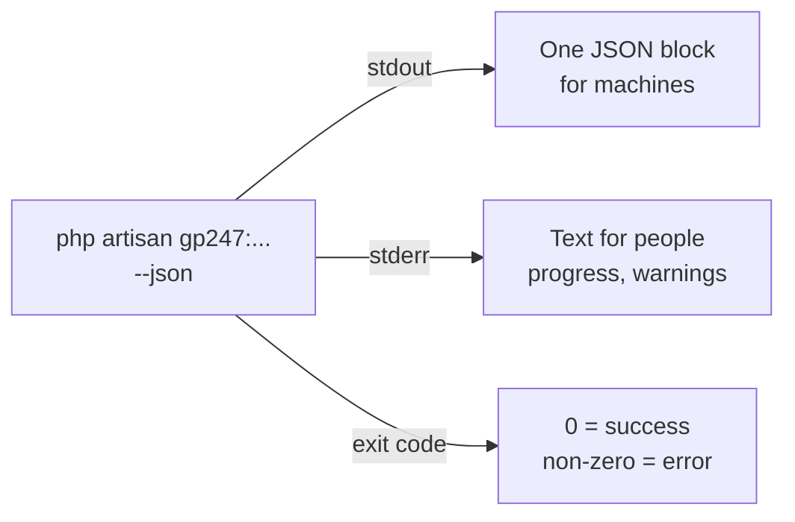

> 🌐 **Language:** [🇻🇳 Tiếng Việt](./cli-automation_vi.md) · 🇬🇧 English (current) · [🇯🇵 日本語](./cli-automation_ja.md)

# Using commands in scripts, CI and Docker

## Introduction
Every `gp247:*` command returns its result the same way, so scripts, CI/CD, Docker and cron can read it without guessing: the
`--json` flag, the exit code, the error code. This page is for developers and people writing deploy scripts. After reading it
you can read a command's result by machine, run commands that need confirmation when nobody is at the keyboard, and you have
ready-made scripts for deploy, CI and Docker.

## At a glance
Add `--json` to any command and the output splits into two streams:



- **stdout holds exactly one JSON block** — so `php artisan gp247:info --json | jq` is always clean.
- **Exit code 0 is success, non-zero is an error** — for every command, with or without `--json`.
- **Commands that can delete data never run by themselves in a script** — you must add an explicit consent flag.
- **Secrets never go through arguments** — the backup password goes through standard input (`--secret-stdin`).

## The `--json` result
Every command returns the same structure:

```json
{ "ok": true, "command": "gp247:ext-install", "data": { }, "warnings": [], "error": null }
```

| Key | Meaning |
| --- | --- |
| `ok` | `true` on success |
| `command` | Name of the command that ran |
| `data` | The command's own result (e.g. `gp247:update` has `completed` — the finished steps; `make-plugin` has `path` — the `.zip` file) |
| `warnings` | Non-blocking warnings (e.g. an extension whose data update failed during `gp247:update`) |
| `error` | `null` on success; on error: `{ "code": "...", "message": "..." }` |

Without `--json`, commands print text and tables for people as usual; the exit code rule stays the same.

> ℹ️ **Since:** gp247/core 2.1. From this version `gp247:make-plugin` / `gp247:make-template` return the block above instead of
> the old `{"error":0,"path":"...","msg":"Success"}` format; external tools reading the old format must switch to `data.path`.

## Commands that need confirmation when automated
Run in a terminal, the commands below ask for confirmation (default **no**). In a script or with `--json` nobody answers, so
they **refuse** (error code `confirmation_required`) — unless you add the consent flag. The consent flag is your decision:
adding it means you accept the consequence.

| Command | Consent flag | Consequence when consented |
| --- | --- | --- |
| `gp247:install` | `--force=1` | Recreates the front/shop tables |
| `gp247:core-install` | `--force=1` | Installs even when the installed marker exists |
| `gp247:admin-password` | `--force=1` | Changes the password, revokes API/MCP tokens |
| `gp247:mcp-uninstall` | `--force` | Removes MCP, revokes every MCP token |
| `gp247:backup-restore`, `gp247:backup-delete`, `gp247:backup-export-sql` | `--confirm=<backup-id>` | Restore / delete / export `.sql` |

Two commands **have no separate consent flag** and treat running non-interactively as consent:

- **`gp247:update --publish=<token>`** — overwriting tokens are copied straight away (with a warning on stderr). Typing the
  token name is the consent.
- **`gp247:template-prune`** — with `--json` or `--no-interaction` it deletes the files identical to the package straight away.
  Run `--dry-run` first.

> ⚠️ **Warning:** do not add `--force` just "to make the command run". Re-read what the command does in the table above; on a
> site with real data, back up first.

## Passing the backup password in a script
`gp247:backup-*` commands that need the backup password read **one line** from standard input when given `--secret-stdin`.
Take the password from your secret store (CI variables, a secret manager), never write it in the script:

```bash
printf '%s\n' "$GP247_BACKUP_SECRET" | php artisan gp247:backup-verify <backup-id> --secret-stdin --json
```

Add `--recovery-key` when what you pass is the recovery key instead of the password.

## Common error codes
`error.code` is stable for scripts to branch on; `error.message` is for people and its wording may change.

| Error code | Command | Meaning |
| --- | --- | --- |
| `confirmation_required` | install, core-install, admin-password, mcp-uninstall, backup-* | Run non-interactively without the consent flag |
| `already_installed` | core-install | The site is already installed |
| `invalid_admin_password` | install, core-install | `--admin-password` has the wrong length |
| `invalid_publish_target` | update | Misspelled `--publish` token — no step ran |
| `pre_change_stopped` | update | The before-change snapshot failed |
| `core_update_failed`, `front_update_failed`, `shop_update_failed`, `mcp_update_failed` | update | An update step failed; `data.completed` lists the finished steps |
| `checks_failed` | doctor | At least one check is FAIL; `data.checks` lists every check |
| `not_installed` | mcp-update, mcp-uninstall | The database has no GP247 install |
| `paid_multi_not_allowed` | ext-install | `--paid` with several `--key` |
| `api_license_required`, `domain_not_authorized` | ext-install, ext-update, ext-search | API License missing or wrong domain |
| `env_write_failed` | ext-register-license | `.env` cannot be written; the key is printed for you to paste |
| `template_file_not_found` | template-publish | Wrong file path; `data.suggestions` lists close matches |
| `user_not_found`, `invalid_password` | admin-password | Unknown account / password does not meet the policy |
| `not_set_up`, `wrong_secret` | backup-* | Backup not set up / wrong backup password |

## Sample scripts

### Deploy script (updating a running site)
```bash
#!/usr/bin/env bash
set -euo pipefail
cd /var/www/my-shop

php artisan gp247:backup-run --json > /dev/null
composer install --no-dev --optimize-autoloader
php artisan gp247:update --json | tee storage/logs/deploy-update.json
php artisan gp247:doctor --json > /dev/null
```

`set -e` stops the script as soon as a command returns non-zero; the last line fails the script when `gp247:doctor` has a
FAIL check.

### Check gate in CI
```bash
php artisan gp247:doctor --json > doctor.json || {
  jq -r '.data.checks[]? | select(.status=="fail") | .name' doctor.json
  exit 1
}
```

### First install in Docker
```bash
php artisan gp247:info --json | jq -e '.data.installed' > /dev/null \
  || php artisan gp247:install --force=1
php artisan gp247:update
```

The script installs only when the site is not installed yet, and always runs `gp247:update` on every start — safe because that
command deletes no data. The one-time administrator password ends up in the container log: read it right away and change it in
the admin, or pass `--admin-password` from your secret.

> 💡 **Tip:** the keys inside `data` differ per command. Run the command once with `--json` to see its structure before writing
> `jq`.

## Conditions & Rules (know before you act)
- **Only stdout is JSON** — do not merge stderr into it (`2>&1`) when you need to parse, every progress line is there.
- **A command refused for lack of confirmation still exits non-zero** — a script using `set -e` stops, which is the point of
  protecting the data.
- **Commands that call sub-commands** (`gp247:install`, `gp247:update`) stop at the first failing step; running again after the
  fix is safe with `gp247:update`, **not** safe with `gp247:install` on a site with data.

## Q&A
**Q1: Does `--json` make the command silent?**

→ No. The text for people is still printed, but to stderr. stdout only holds the JSON block.

**Q2: My script fails to parse the JSON because of a strange character at the start?**

→ A PHP file with a BOM is being printed first. Run `php artisan gp247:doctor` and look at the `file_bom` check —
[Checks & diagnostics](./cli-diagnostics.md#why-file_bom-is-worth-checking).

**Q3: Can `--no-interaction` replace `--force=1`?**

→ No. With `gp247:install` and the commands in the confirmation table, `--no-interaction` only makes the command **refuse**
instead of asking. To really run it you need the consent flag.

**Q4: How do I know where `gp247:update` stopped?**

→ Read `error.code` (e.g. `shop_update_failed`) and `data.completed` (the finished steps) in the JSON block.

**Q5: Do I need `--json` for cron?**

→ Not required. Cron only needs the exit code; `--json` helps when you keep the result for monitoring.

**Q6: Do error codes change between versions?**

→ `error.code` is kept stable so scripts can rely on it; the wording of `error.message` may change. Write scripts against the `code`.

---

<sub>📅 **Last updated:** 2026-11-08 · ✍️ **Author:** GP247</sub>
