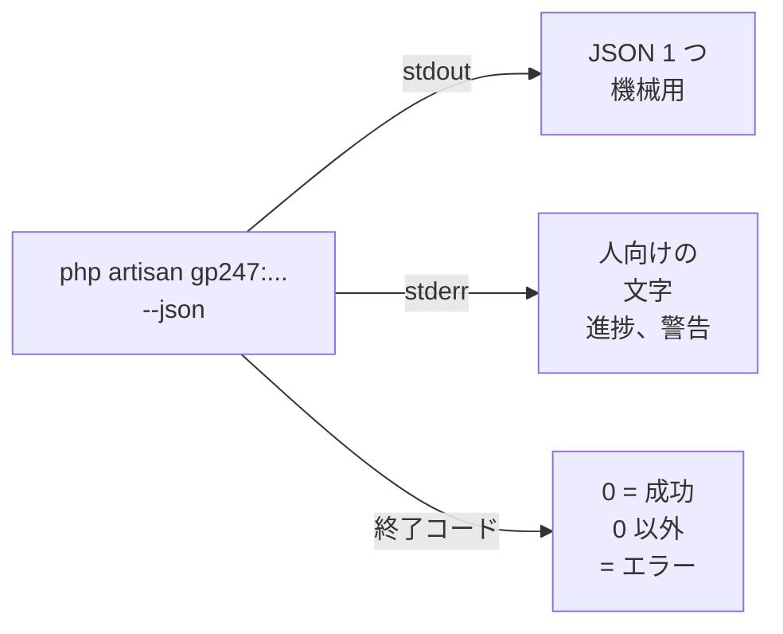

> 🌐 **言語:** [🇻🇳 Tiếng Việt](./cli-automation_vi.md) · [🇬🇧 English](./cli-automation.md) · 🇯🇵 日本語（現在）

# スクリプト・CI・Docker でコマンドを使う

## はじめに
すべての `gp247:*` コマンドは同じ方法で結果を返すので、スクリプト、CI/CD、Docker、cron が推測せずに読み取れます。
`--json` フラグ、終了コード、エラーコードです。対象は、開発者とデプロイスクリプトを書く方です。読み終えると、コマンドの結果を
機械で読み取り、誰もいないときに確認が必要なコマンドを実行でき、デプロイ、CI、Docker 用のスクリプト例を使えるようになります。

## ひと目でわかる
どのコマンドにも `--json` を付けると、出力が 2 つの流れに分かれます。



- **stdout にはちょうど 1 つの JSON ブロックだけが出ます** — だから `php artisan gp247:info --json | jq` は常にきれいです。
- **終了コード 0 は成功、0 以外はエラーです** — `--json` の有無にかかわらず、すべてのコマンドで同じです。
- **データを削除しうるコマンドは、スクリプトの中で勝手に実行されません** — 明示的な同意フラグが必要です。
- **機密情報は引数では渡しません** — バックアップのパスワードは標準入力（`--secret-stdin`）で渡します。

## `--json` の結果
すべてのコマンドが同じ構造を返します。

```json
{ "ok": true, "command": "gp247:ext-install", "data": { }, "warnings": [], "error": null }
```

| キー | 意味 |
| --- | --- |
| `ok` | 成功なら `true` |
| `command` | 実行したコマンド名 |
| `data` | コマンド固有の結果（例：`gp247:update` の `completed` — 完了した手順。`make-plugin` の `path` — `.zip` ファイル） |
| `warnings` | 処理を止めない警告の一覧（例：`gp247:update` 中にデータ更新が失敗した拡張機能） |
| `error` | 成功なら `null`。エラー時は `{ "code": "...", "message": "..." }` |

`--json` がなければ、これまでどおり人向けの文字と表を表示します。終了コードの決まりは同じです。

> ℹ️ **対応バージョン:** gp247/core 2.1。このバージョンから、`gp247:make-plugin`／`gp247:make-template` は旧形式
> `{"error":0,"path":"...","msg":"Success"}` の代わりに上の構造を返します。旧形式を読む外部ツールは `data.path` に切り替えてください。

## 自動実行で確認が必要なコマンド
ターミナルで実行すると、下のコマンドは確認を求めます（既定は**いいえ**）。スクリプトや `--json` では誰も答えないので、同意フラグを
付けない限り**拒否**します（エラーコード `confirmation_required`）。同意フラグを付けるかどうかはあなたの判断です。付けることは、
その結果を受け入れることを意味します。

| コマンド | 同意フラグ | 同意したときの結果 |
| --- | --- | --- |
| `gp247:install` | `--force=1` | front／shop のテーブルを作り直す |
| `gp247:core-install` | `--force=1` | インストール済みの印があってもインストールする |
| `gp247:admin-password` | `--force=1` | パスワードを変え、API／MCP のトークンを無効にする |
| `gp247:mcp-uninstall` | `--force` | MCP を削除し、すべての MCP トークンを無効にする |
| `gp247:backup-restore`、`gp247:backup-delete`、`gp247:backup-export-sql` | `--confirm=<バックアップID>` | 復元／削除／`.sql` の書き出し |

次の 2 つのコマンドには**専用の同意フラグがなく**、対話なしで実行したこと自体を同意とみなします。

- **`gp247:update --publish=<トークン>`** — 上書きするトークンはそのままコピーされます（stderr に警告が出ます）。トークン名を
  入力したことが同意です。
- **`gp247:template-prune`** — `--json` または `--no-interaction` では、パッケージと同一のファイルをすぐに削除します。先に
  `--dry-run` を実行してください。

> ⚠️ **注意:** 「コマンドを動かすため」だけに `--force` を付けないでください。上の表でコマンドの内容を読み直し、実データのある
> サイトでは先にバックアップしてください。

## スクリプトでバックアップのパスワードを渡す
バックアップのパスワードが必要な `gp247:backup-*` コマンドは、`--secret-stdin` を付けると標準入力から **1 行**を読みます。
パスワードは機密情報の保管場所（CI の変数、シークレットマネージャー）から取り出し、スクリプトには書かないでください。

```bash
printf '%s\n' "$GP247_BACKUP_SECRET" | php artisan gp247:backup-verify <バックアップID> --secret-stdin --json
```

渡すものがパスワードではなくリカバリーキーの場合は、`--recovery-key` を付けます。

## よくあるエラーコード
`error.code` はスクリプトで分岐できるよう固定されています。`error.message` は人向けで、文言が変わることがあります。

| エラーコード | コマンド | 意味 |
| --- | --- | --- |
| `confirmation_required` | install、core-install、admin-password、mcp-uninstall、backup-* | 同意フラグなしで、対話なしに実行した |
| `already_installed` | core-install | サイトはインストール済み |
| `invalid_admin_password` | install、core-install | `--admin-password` の長さが不正 |
| `invalid_publish_target` | update | `--publish` のトークン名の誤り — どの手順も実行していない |
| `pre_change_stopped` | update | 変更前のスナップショットが失敗した |
| `core_update_failed`、`front_update_failed`、`shop_update_failed`、`mcp_update_failed` | update | 更新の手順が失敗した。`data.completed` に完了した手順 |
| `checks_failed` | doctor | FAIL のチェックが 1 つ以上ある。`data.checks` にすべてのチェック |
| `not_installed` | mcp-update、mcp-uninstall | データベースに GP247 がインストールされていない |
| `paid_multi_not_allowed` | ext-install | `--paid` と複数の `--key` の組み合わせ |
| `api_license_required`、`domain_not_authorized` | ext-install、ext-update、ext-search | API ライセンスがない、またはドメインが違う |
| `env_write_failed` | ext-register-license | `.env` に書き込めない。貼り付け用に鍵を表示 |
| `template_file_not_found` | template-publish | ファイルのパスが違う。`data.suggestions` に近い候補 |
| `user_not_found`、`invalid_password` | admin-password | 存在しないアカウント／パスワードがポリシーを満たさない |
| `not_set_up`、`wrong_secret` | backup-* | バックアップ未設定／バックアップのパスワードが違う |

## サンプルスクリプト

### デプロイスクリプト（稼働中のサイトを更新）
```bash
#!/usr/bin/env bash
set -euo pipefail
cd /var/www/my-shop

php artisan gp247:backup-run --json > /dev/null
composer install --no-dev --optimize-autoloader
php artisan gp247:update --json | tee storage/logs/deploy-update.json
php artisan gp247:doctor --json > /dev/null
```

`set -e` により、コマンドが 0 以外を返した時点でスクリプトが止まります。最後の行は、`gp247:doctor` に FAIL のチェックがあると
スクリプトを失敗させます。

### CI での点検の関門
```bash
php artisan gp247:doctor --json > doctor.json || {
  jq -r '.data.checks[]? | select(.status=="fail") | .name' doctor.json
  exit 1
}
```

### Docker での初回インストール
```bash
php artisan gp247:info --json | jq -e '.data.installed' > /dev/null \
  || php artisan gp247:install --force=1
php artisan gp247:update
```

このスクリプトは、サイトが未インストールのときだけインストールし、起動するたびに必ず `gp247:update` を実行します。このコマンドは
データを削除しないので安全です。一度だけ表示される管理者パスワードはコンテナーのログに残ります。すぐに読み取って管理画面で変更
するか、シークレットから `--admin-password` を渡してください。

> 💡 **ヒント:** `data` の中のキーはコマンドごとに違います。`jq` を書く前に、一度 `--json` 付きで実行して構造を確認してください。

## 条件と制約（操作の前に確認）
- **JSON は stdout だけです** — 解析が必要なときは stderr を混ぜないでください（`2>&1`）。進捗の行はすべて stderr にあります。
- **確認がないために拒否されたコマンドも 0 以外で終了します** — `set -e` を使うスクリプトは止まります。それがデータを守る目的です。
- **下位のコマンドを呼び出すコマンド**（`gp247:install`、`gp247:update`）は、最初に失敗した手順で止まります。修正後の再実行は
  `gp247:update` なら安全ですが、データのあるサイトでの `gp247:install` は安全では**ありません**。

## よくある質問（Q&A）
**Q1: `--json` を付けるとコマンドは何も表示しなくなりますか？**

→ いいえ。人向けの文字も表示されますが、stderr に出ます。stdout には JSON ブロックだけが残ります。

**Q2: スクリプトで JSON を解析すると、先頭の不明な文字のせいで失敗します。**

→ BOM の付いた PHP ファイルが先に出力されています。`php artisan gp247:doctor` を実行し、`file_bom` のチェックを確認して
ください — [点検と診断](./cli-diagnostics_ja.md#file_bom-を確認する理由)。

**Q3: `--no-interaction` で `--force=1` の代わりになりますか？**

→ なりません。`gp247:install` と確認の表にあるコマンドでは、`--no-interaction` を付けると、尋ねる代わりに**拒否**するだけです。
実際に実行するには同意フラグが必要です。

**Q4: `gp247:update` がどの手順で止まったかを知るには？**

→ JSON ブロックの `error.code`（例：`shop_update_failed`）と `data.completed`（完了した手順）を読んでください。

**Q5: cron には `--json` が必要ですか？**

→ 必須ではありません。cron に必要なのは終了コードだけです。結果を監視用に残すときは `--json` が便利です。

**Q6: エラーコードはバージョンによって変わりますか？**

→ `error.code` は、スクリプトが頼れるよう固定されています。`error.message` の文言は変わることがあります。スクリプトは `code`
を基準に書いてください。

---

<sub>📅 **最終更新:** 2026-11-08 · ✍️ **作成者 (Author):** GP247</sub>
