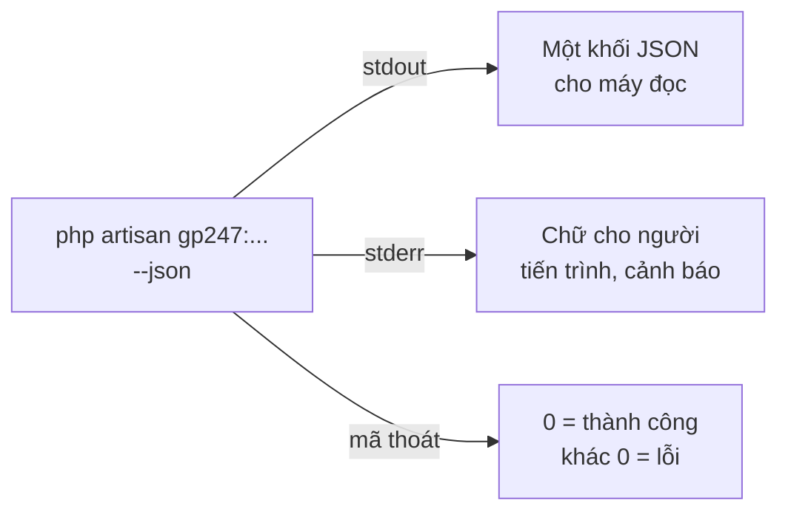

> 🌐 **Ngôn ngữ:** 🇻🇳 Tiếng Việt (hiện tại) · [🇬🇧 English](./cli-automation.md) · [🇯🇵 日本語](./cli-automation_ja.md)

# Dùng lệnh trong script, CI và Docker

## Giới thiệu
Mọi lệnh `gp247:*` dùng chung một cách trả kết quả để script, CI/CD, Docker và cron đọc được mà không phải đoán: cờ `--json`,
mã thoát, mã lỗi. Trang này dành cho lập trình viên và người viết script triển khai. Đọc xong, bạn biết đọc kết quả của lệnh
bằng máy, chạy được các lệnh cần xác nhận khi không có người ngồi trước màn hình, và có sẵn mẫu script cho deploy, CI và Docker.

## Nhìn nhanh
Thêm `--json` vào bất kỳ lệnh nào, kết quả tách làm hai luồng:



- **stdout chỉ có đúng một khối JSON** — nên `php artisan gp247:info --json | jq` luôn sạch.
- **Mã thoát 0 là thành công, khác 0 là lỗi** — cho mọi lệnh, có hay không có `--json`.
- **Lệnh có thể xoá dữ liệu không bao giờ tự chạy trong script** — bạn phải thêm cờ đồng ý tường minh.
- **Bí mật không đi qua tham số** — mật khẩu sao lưu truyền qua đầu vào chuẩn (`--secret-stdin`).

## Khối kết quả `--json`
Mọi lệnh trả cùng một cấu trúc:

```json
{ "ok": true, "command": "gp247:ext-install", "data": { }, "warnings": [], "error": null }
```

| Khoá | Ý nghĩa |
| --- | --- |
| `ok` | `true` khi thành công |
| `command` | Tên lệnh đã chạy |
| `data` | Kết quả riêng của lệnh (vd `gp247:update` có `completed` — các bước đã xong; `make-plugin` có `path` — file `.zip`) |
| `warnings` | Danh sách cảnh báo không chặn (vd extension cập nhật dữ liệu lỗi trong `gp247:update`) |
| `error` | `null` khi thành công; khi lỗi: `{ "code": "...", "message": "..." }` |

Không có `--json`, lệnh in chữ và bảng cho người đọc như bình thường; mã thoát vẫn giữ nguyên quy tắc.

> ℹ️ **Có từ:** gp247/core 2.1. Từ bản này `gp247:make-plugin` / `gp247:make-template` trả khối trên thay cho định dạng cũ
> `{"error":0,"path":"...","msg":"Success"}`; công cụ ngoài đọc định dạng cũ cần đổi sang `data.path`.

## Lệnh cần xác nhận khi chạy tự động
Khi chạy trong Terminal, các lệnh dưới đây hỏi xác nhận (mặc định **không**). Trong script hoặc với `--json` không có ai trả
lời, nên chúng **từ chối** (mã lỗi `confirmation_required`) — trừ khi bạn thêm cờ đồng ý. Cờ đồng ý là quyết định của bạn: thêm
nó nghĩa là bạn chấp nhận hậu quả.

| Lệnh | Cờ đồng ý | Hậu quả khi đồng ý |
| --- | --- | --- |
| `gp247:install` | `--force=1` | Tạo lại bảng front/shop |
| `gp247:core-install` | `--force=1` | Cài cả khi đã có dấu đã cài |
| `gp247:admin-password` | `--force=1` | Đổi mật khẩu, thu hồi token API/MCP |
| `gp247:mcp-uninstall` | `--force` | Gỡ MCP, thu hồi mọi token MCP |
| `gp247:backup-restore`, `gp247:backup-delete`, `gp247:backup-export-sql` | `--confirm=<mã-bản>` | Phục hồi / xoá / xuất `.sql` |

Hai lệnh **không có cờ đồng ý riêng** mà coi việc bạn chạy không tương tác là đồng ý:

- **`gp247:update --publish=<token>`** — token ghi đè được chép luôn (kèm cảnh báo ra stderr). Tự gõ tên token chính là đồng ý.
- **`gp247:template-prune`** — với `--json` hoặc `--no-interaction` xoá luôn file giống package. Chạy `--dry-run` trước.

> ⚠️ **Lưu ý:** không thêm `--force` chỉ để "cho lệnh chạy được". Đọc lại lệnh làm gì ở bảng trên; với site có dữ liệu thật,
> sao lưu trước.

## Truyền mật khẩu sao lưu trong script
Lệnh `gp247:backup-*` cần mật khẩu sao lưu thì đọc **một dòng** từ đầu vào chuẩn khi có `--secret-stdin`. Lấy mật khẩu từ
kho bí mật của bạn (biến môi trường của CI, secret manager), không ghi vào script:

```bash
printf '%s\n' "$GP247_BACKUP_SECRET" | php artisan gp247:backup-verify <ma-ban> --secret-stdin --json
```

Thêm `--recovery-key` nếu thứ bạn truyền là recovery key thay cho mật khẩu.

## Mã lỗi thường gặp
`error.code` ổn định để script rẽ nhánh; `error.message` dành cho người đọc và có thể đổi câu chữ.

| Mã lỗi | Lệnh | Nghĩa |
| --- | --- | --- |
| `confirmation_required` | install, core-install, admin-password, mcp-uninstall, backup-* | Chạy không tương tác mà thiếu cờ đồng ý |
| `already_installed` | core-install | Site đã cài |
| `invalid_admin_password` | install, core-install | `--admin-password` không đạt độ dài |
| `invalid_publish_target` | update | Token `--publish` sai tên — chưa bước nào chạy |
| `pre_change_stopped` | update | Bản chụp trước thay đổi thất bại |
| `core_update_failed`, `front_update_failed`, `shop_update_failed`, `mcp_update_failed` | update | Một bước cập nhật lỗi; `data.completed` liệt kê bước đã xong |
| `checks_failed` | doctor | Có ít nhất một mục FAIL; `data.checks` liệt kê mọi mục |
| `not_installed` | mcp-update, mcp-uninstall | Database chưa cài GP247 |
| `paid_multi_not_allowed` | ext-install | `--paid` kèm nhiều `--key` |
| `api_license_required`, `domain_not_authorized` | ext-install, ext-update, ext-search | Thiếu API License hoặc sai tên miền |
| `env_write_failed` | ext-register-license | Không ghi được `.env`; khoá được in để tự dán |
| `template_file_not_found` | template-publish | Đường dẫn file sai; `data.suggestions` gợi ý file gần đúng |
| `user_not_found`, `invalid_password` | admin-password | Sai tên tài khoản / mật khẩu không đạt chính sách |
| `not_set_up`, `wrong_secret` | backup-* | Chưa thiết lập sao lưu / sai mật khẩu sao lưu |

## Mẫu script

### Script deploy (cập nhật site đang chạy)
```bash
#!/usr/bin/env bash
set -euo pipefail
cd /var/www/my-shop

php artisan gp247:backup-run --json > /dev/null
composer install --no-dev --optimize-autoloader
php artisan gp247:update --json | tee storage/logs/deploy-update.json
php artisan gp247:doctor --json > /dev/null
```

`set -e` dừng script ngay khi một lệnh trả mã khác 0; dòng cuối làm script thất bại nếu `gp247:doctor` có mục FAIL.

### Cổng kiểm tra trong CI
```bash
php artisan gp247:doctor --json > doctor.json || {
  jq -r '.data.checks[]? | select(.status=="fail") | .name' doctor.json
  exit 1
}
```

### Cài lần đầu trong Docker
```bash
php artisan gp247:info --json | jq -e '.data.installed' > /dev/null \
  || php artisan gp247:install --force=1
php artisan gp247:update
```

Script chỉ cài khi site chưa cài, và luôn chạy `gp247:update` ở mỗi lần khởi động — an toàn vì lệnh này không xoá dữ liệu.
Mật khẩu quản trị in một lần nằm trong log container: đọc nó ngay rồi đổi trong trang quản trị, hoặc truyền
`--admin-password` từ secret của bạn.

> 💡 **Mẹo:** tên khoá trong `data` khác nhau theo lệnh. Chạy lệnh một lần với `--json` để xem cấu trúc trước khi viết `jq`.

## Điều kiện & ràng buộc (hiểu trước khi thao tác)
- **Chỉ stdout là JSON** — đừng gộp stderr vào (`2>&1`) khi cần parse, mọi dòng tiến trình nằm ở đó.
- **Lệnh từ chối vì thiếu xác nhận vẫn thoát khác 0** — script dùng `set -e` sẽ dừng, đúng mục đích bảo vệ dữ liệu.
- **Lệnh gọi lệnh con** (`gp247:install`, `gp247:update`) dừng ở bước lỗi đầu tiên; chạy lại sau khi sửa là an toàn với
  `gp247:update`, **không** an toàn với `gp247:install` trên site có dữ liệu.

## Hỏi & Đáp (Q&A)
**Câu 1: `--json` có làm lệnh im lặng không?**

→ Không. Chữ cho người đọc vẫn in, nhưng sang stderr. stdout chỉ còn khối JSON.

**Câu 2: Script của tôi parse JSON bị lỗi ký tự lạ ở đầu?**

→ Có file PHP bị dính BOM đang in ra trước. Chạy `php artisan gp247:doctor` và xem mục `file_bom` —
[Kiểm tra & chẩn đoán](./cli-diagnostics_vi.md#vì-sao-file_bom-đáng-kiểm).

**Câu 3: `--no-interaction` có thay được `--force=1` không?**

→ Không. Với `gp247:install` và các lệnh trong bảng xác nhận, `--no-interaction` chỉ khiến lệnh **từ chối** thay vì hỏi.
Muốn chạy thật phải có cờ đồng ý.

**Câu 4: Làm sao biết `gp247:update` dừng ở bước nào?**

→ Đọc `error.code` (vd `shop_update_failed`) và `data.completed` (các bước đã xong) trong khối JSON.

**Câu 5: Có cần `--json` cho cron không?**

→ Không bắt buộc. Cron chỉ cần mã thoát; `--json` hữu ích khi bạn lưu kết quả để theo dõi.

**Câu 6: Mã lỗi có đổi giữa các phiên bản không?**

→ `error.code` được giữ ổn định để script dựa vào; câu chữ `error.message` có thể đổi. Viết script theo `code`.

---

<sub>📅 **Cập nhật lần cuối:** 2026-11-08 · ✍️ **Tác giả (Author):** GP247</sub>
