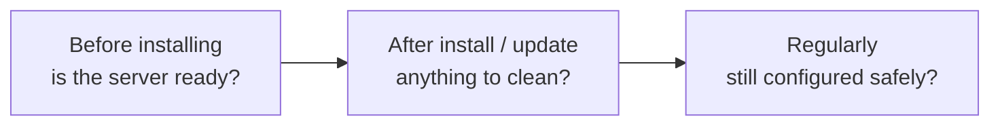

> 🌐 **Language:** [🇻🇳 Tiếng Việt](./cli-diagnostics_vi.md) · 🇬🇧 English (current) · [🇯🇵 日本語](./cli-diagnostics_ja.md)

# Check and diagnostic commands

## Introduction
This page describes the commands that tell you what state the site is in: `gp247:doctor` checks the server, the installation
and the security configuration; `gp247:info` and `gp247:core-info` show the versions; `gp247:cache-rebuild` rebuilds the
cache. They are all **read only** (apart from rebuilding the cache), so run them at any time, even on a selling site. It is
for site owners and people who run the server. After reading it you understand every line `gp247:doctor` reports and how to
fix it.

## At a glance
Use `gp247:doctor` at three moments:



- **Three statuses**: **PASS** fine · **WARN** worth cleaning, does not block · **FAIL** must be fixed.
- **Any FAIL makes the command exit non-zero** — use it as a gate in CI or before installing. WARN does not change the exit code.
- **On an installed site, doctor also checks the security configuration** — the same items the **System alerts** page shows administrators.
- **Need the version to report a bug or check a fix** → `gp247:info`.

## `gp247:doctor` — site health check
1. In the site folder, type:

   ```bash
   php artisan gp247:doctor
   ```

2. Read the result table: each line has the check name, the status and a note (path, count, suggested fix command).
3. Fix every **FAIL** line first, then the **WARN** lines. Run it again until no FAIL is left.

Doctor reads the configuration and the database; it does **not** open the site over the network. Whether `http://` redirects
to `https://`, or whether `.env` can be downloaded from outside, still has to be checked yourself — see
[Safe production configuration](../security/security-production-config.md) in the [Security](../security/security-introduction.md)
handbook.

### Server and installation
| Check | What it checks | When it fails |
| --- | --- | --- |
| `php_version` | PHP 8.3 or newer | FAIL — upgrade PHP |
| `ext_pdo`, `ext_mbstring`, `ext_openssl`, `ext_tokenizer`, `ext_ctype`, `ext_json` | Required PHP extensions | FAIL — enable the extension |
| `ext_zip`, `ext_curl`, `ext_gd`, `ext_fileinfo` | Recommended PHP extensions | WARN — some features (`.zip` install, images) do not work |
| `env_file` | A `.env` file exists | FAIL |
| `writable_storage`, `writable_bootstrap_cache` | `storage/`, `bootstrap/cache/` are writable | FAIL — fix the folder permissions |
| `writable_app_gp247`, `writable_public_gp247` | `app/GP247`, `public/GP247` are writable | WARN — extensions cannot be installed / updated |
| `db_connection` | The database is reachable | FAIL — check `DB_*` in `.env` |
| `installed` | Whether the site is installed | WARN when not installed (normal before the first install) |

### Encryption key and secrets
| Check | What it checks |
| --- | --- |
| `encryption_key_dedicated` | A dedicated `GP247_ENCRYPTION_KEY` is set for secrets, rather than sharing `APP_KEY` — see [Data encryption](../system/data-encryption.md) |
| `secret_decryptable` | Encrypted secrets in the configuration can still be decrypted (if not: sign that the key changed without keeping the old one) |
| `backup_post_incident_pending` | Tasks still open after a "post security incident" restore (change keys, reinstall the code, change database / hosting passwords) |

### Extensions and look
| Check | What it checks | Fix command |
| --- | --- | --- |
| `extension_assets` | An installed extension is missing CSS/JS/images in `public/GP247/...` | `gp247:ext-publish` |
| `extension_data_pending` | An extension has files newer than the version GP247 recorded (just `git pull`ed, copied over) without its data update | `gp247:ext-update --local --all` |
| `template_source` | Number of published template files identical to the package — they will not receive fixes | `gp247:template-prune` |
| `file_bom` | `.php` / `.blade.php` files starting with a UTF-8 BOM | Save the file again as UTF-8 without BOM |

### REST API
| Check | What it checks |
| --- | --- |
| `api_config_legacy_names` | `.env` still uses old, renamed API variable names (skipped while the config is cached) |
| `api_route_gate` | With routes cached: every REST API route passes through the shared API protection |
| `api_event_retention` | The API sync event table holds events past their keep time (cleaned automatically on API requests; lower `GP247_API_EVENT_DAYS` if needed) |

### Security configuration (installed site)
These checks are only **PASS** or **WARN** — even when the admin rates them critical — so they do not change the exit code.

| Check | WARN when |
| --- | --- |
| `app_debug` | `APP_DEBUG` is on |
| `https` | `APP_URL` does not start with `https://` or `SESSION_SECURE_COOKIE` is off (WARN only when `APP_ENV=production`) |
| `trusted_proxies` | `TRUSTED_PROXIES` trusts every source (`*`, `REMOTE_ADDR`…) — anyone can set their own IP, so sign-in throttling and IP rules stop working |
| `default_admin_password` | The active `admin` account still uses the default password |
| `password_policy` | The minimum administrator password length is under 12 characters |
| `mfa_enabled` | The MFA two-factor plugin is not installed or not enabled |
| `api_exposure` | (Information only, PASS) the REST API / MCP is on |
| `support_line` | The version line in use has under 6 months of security support left, or none |

### Why `file_bom` is worth checking
A BOM is **3 invisible bytes** that many Windows editors add at the start of a file saved as "UTF-8". PHP prints them **before
anything else**, causing "headers already sent" errors, JSON/XML/CSV broken at the first character, or HTML starting with a
stray character. The file looks perfectly normal when opened, so only a machine can spot it. Doctor scans `app/GP247/**` and
the source of the `gp247/*` packages.

**How to fix:** open the file in an editor and save it again as **UTF-8 without BOM** (VS Code: click `UTF-8 with BOM` in the
bottom-right status bar → *Save with Encoding* → *UTF-8*). Run `gp247:doctor` again to see the check back at PASS.

## `gp247:info` and `gp247:core-info` — show versions
| Command | Prints |
| --- | --- |
| `gp247:info` | The version of each installed package (core, front, shop, mcp), whether the site is installed, the number of plugins / templates, the extension library address |
| `gp247:core-info` | Name, core version and sub-version, home page, source repository |

```bash
php artisan gp247:info
```

> 💡 **Tip:** to know whether the site has a security fix, compare the package versions `gp247:info` prints with the tables in
> the [Release notes](../release/release.md). The S-Cart version in the admin footer is not reliable after the first
> `composer update` — always rely on the package versions.

## `gp247:cache-rebuild` — rebuild the cache
Clears and rebuilds the route and config cache. GP247 calls it itself after installing, enabling, updating an extension and at
the end of `gp247:update`. Run it by hand when you just changed `.env` or routes and the site has not picked them up.

```bash
php artisan gp247:cache-rebuild
```

## Q&A
**Q1: Doctor shows WARN lines. Does the site still work?**

→ Yes. WARN means something worth cleaning (security, leftover files); it does not block the site. Only FAIL must be fixed now.

**Q2: Is it useful to run doctor before installing?**

→ Yes — that is one of its main uses. Doctor exists right after `composer require`, even before installing; the checks that need
an installed database are skipped.

**Q3: Doctor reports `secret_decryptable` not passing?**

→ The encryption key changed and the old one is gone. Put the old key in `GP247_ENCRYPTION_PREVIOUS_KEYS` and run
`gp247:encryption-key-rotate` — see [Data encryption](../system/data-encryption.md).

**Q4: Doctor shows `https` WARN on my dev machine?**

→ It is a WARN only when `APP_ENV=production`; other environments show PASS with a note. If you see WARN, check your `APP_ENV`.

**Q5: How do I use doctor in CI?**

→ `php artisan gp247:doctor --json`: the command exits non-zero when there is a FAIL, so the CI step stops by itself. See
[Scripts, CI & Docker](./cli-automation.md).

**Q6: Does the doctor security check replace a security review?**

→ No. Doctor only reads the configuration. Go through the full [Security checklist](../security/security-checklist.md).

---

<sub>📅 **Last updated:** 2026-11-08 · ✍️ **Author:** GP247</sub>
