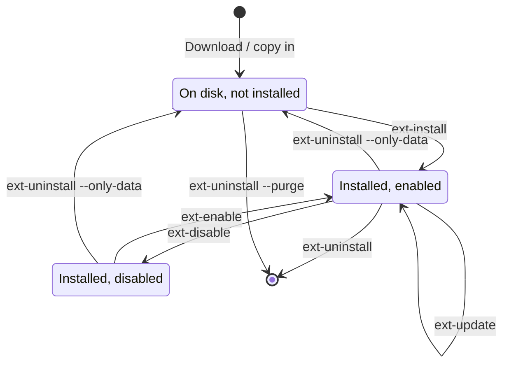

> 🌐 **Language:** [🇻🇳 Tiếng Việt](./cli-extensions_vi.md) · 🇬🇧 English (current) · [🇯🇵 日本語](./cli-extensions_ja.md)

# Plugin and template (extension) commands

## Introduction
The `gp247:ext-*` family does from the command line everything the **Extensions** screen of the admin does: find, install,
enable/disable, update and remove plugins and templates, and manage licenses. This page is for site owners with
command-line access, people deploying with scripts or Docker, and developers writing extensions. After reading it you can
pick the right command for each step of an extension's life and you know which command can delete its folder. Installing
through the admin (online, `.zip` upload, copying a folder) is covered in [Installing plugins & templates](../extension/install-extension.md).

## At a glance
An extension moves through these states; each arrow is a command:



- **Plugins and templates share one command family** — pick with `--type=plugin` (default) or `--type=template`.
- **"Installed" means GP247 has recorded its configuration**, not just that a folder exists on disk.
- **`ext-uninstall` deletes the folder by default** — add `--only-data` to keep the files.
- **The CLI and the admin run the same engine**, so the result is the same whichever way you use.

## On this page
- [Pick the type and the extension](#pick-the-type-and-the-extension) — `--type`, `--key`, several keys at once
- [List and find extensions](#list-and-find-extensions) — `ext-list`, `ext-search`, `ext-check-update`
- [Install an extension](#install-an-extension) — from a file, a folder or the online library
- [Enable, disable, update](#enable-disable-update) — `ext-enable`, `ext-disable`, `ext-update`
- [Remove an extension](#remove-an-extension) — three ways to remove, which one keeps the files
- [Static files and licenses](#static-files-and-licenses) — `ext-publish`, the two kinds of license
- [Scaffold a new extension](#scaffold-a-new-extension) — `make-plugin`, `make-template`

## Pick the type and the extension
Every `ext-*` command takes two shared options:

| Option | Value | Meaning |
| --- | --- | --- |
| `--type` | `plugin` (default) or `template` | Kind of extension |
| `--key` | folder name, e.g. `News` | The extension to act on. `ext-install`, `ext-enable`, `ext-disable`, `ext-uninstall`, `ext-publish` accept **several keys**: repeat the option (`--key=A --key=B`) or separate with commas (`--key=A,B`) |

With several keys, each extension is handled **on its own** and reported on its own; the route/config cache is rebuilt
**once** at the end; the command exits non-zero if **any** extension failed. It is not "all or nothing": an extension already
done is not rolled back because a later one failed.

## List and find extensions
Three read-only commands, safe to run at any time.

| Command | Options | What it does |
| --- | --- | --- |
| `gp247:ext-list` | `--type` | List the extensions on the site: installed or not, enabled or not, version, update available (reads the cache, no network call) |
| `gp247:ext-check-update` | `--type`, `--force` | Report which extensions have an update; `--force` asks the library now instead of using the cache |
| `gp247:ext-search` | `--type`, `--keyword=`, `--free`, `--page=` | Search the online extension library; `--free` shows free ones only |

```bash
php artisan gp247:ext-list --type=plugin
php artisan gp247:ext-search --keyword=payment --free
```

## Install an extension
`gp247:ext-install` takes one of three sources:

| Source | Option | Use when |
| --- | --- | --- |
| Archive | `--file=<path.zip>` | You have the extension's `.zip` file |
| Extracted folder | `--dir=<folder>` | A folder containing `<Name>/gp247.json` |
| By key | `--key=<Name>` | The extension is **already on disk** (copied by FTP, `git clone`, bundled) → installed in place; **not on disk** → downloaded from the library |

1. (Only when downloading from the library, **once** per site) Set `APP_URL` in `.env` to the real domain, then register the
   free API License:

   ```bash
   php artisan gp247:ext-register-license
   ```

2. Install the extension:

   ```bash
   php artisan gp247:ext-install --type=plugin --key=News
   ```

   If it works, the plugin is **enabled already** and the cache is refreshed. The extension's `public/` folder (CSS/JS/images)
   is copied to `public/GP247/...`.
3. A **paid** extension: install it **one at a time**, with its license:

   ```bash
   php artisan gp247:ext-install --type=plugin --key=YourPluginPro --paid --license=<your-license>
   ```

4. Template: after installing, activate it in the admin → **Website information** (there is no command for this step).

> ⚠️ **Warning:** `ext-install` only **checks** dependencies, it does not install them. An extension that needs another
> Composer package or another extension (for example a Pro edition that needs the Free one) needs those installed first.

## Enable, disable, update
| Command | Options | What it does |
| --- | --- | --- |
| `gp247:ext-enable` | `--type`, `--key` | Enable an **installed** extension |
| `gp247:ext-disable` | `--type`, `--key` | Disable an installed extension; refuses a template in use |
| `gp247:ext-update` | `--type`, `--key` or `--all` | Download the new version from the library, **back up** the old one, install over it; rolls back on error |
| `gp247:ext-update --local` | `--type`, `--key` or `--all`, `--dry-run` | **Downloads nothing**: runs the data update of extensions whose files you replaced yourself |

The two ways to update fit two situations:

- **Update from the library** (`ext-update --key=News`) — the site installed the extension from the online library. GP247
  downloads the new version, keeps a backup in `storage/backups/extensions/`, and puts the old version back if the install
  fails.
- **Update in place** (`ext-update --local`) — you replaced the files with `git pull`, Composer or a manual copy. GP247
  compares the version in `gp247.json` with the version it recorded at install, then runs the extension's data update.
  `gp247:update` already does this step for every plugin and template.

```bash
php artisan gp247:ext-update --local --all --dry-run
php artisan gp247:ext-update --local --type=plugin --key=News
```

> ⚠️ **Warning:** do **not** use `ext-update` (without `--local`) on an extension folder that is source code you are
> developing: the command deletes the folder and copies the downloaded version over it, losing the git history and any
> unsaved changes.

`ext-update` also takes a data snapshot before updating when the backup feature is on; `--skip-pre-change` skips it.

## Remove an extension
`gp247:ext-uninstall` has three modes, which differ in **whether the folder is deleted**:

| Command | Extension | Removes configuration | Deletes the folder |
| --- | --- | --- | --- |
| `ext-uninstall --key=X` | installed | Yes | **Yes** |
| `ext-uninstall --key=X --only-data` | installed | Yes | No — files kept for reinstalling |
| `ext-uninstall --key=X --purge` | not installed, on disk | — | **Yes** |

```bash
php artisan gp247:ext-uninstall --type=plugin --key=News --only-data
```

- **Protected extensions** and **the template in use / the default template** cannot be removed (in the CLI and the admin).
- **The extension folder is source code you are developing?** Only use `--only-data` — the default removal deletes the whole
  folder, `.git` included.

## Static files and licenses

### Copy static files again: `gp247:ext-publish`
Browsers can only read the `public/` folder, so an extension's CSS/JS/images must be copied from
`app/GP247/<Plugins|Templates>/<Key>/public/` to `public/GP247/<Plugins|Templates>/<Key>/`. Installing already does this; run
it again when `gp247:doctor` reports `extension_assets` (the extension's pages show 404 errors for CSS/JS).

```bash
php artisan gp247:ext-publish --type=template --key=MyTheme
php artisan gp247:ext-publish --type=plugin --all
```

### Two kinds of license
| | API License | License of a paid extension |
| --- | --- | --- |
| Purpose | Lets the site connect to the online extension library | Unlocks one paid extension |
| Price | Free | Bought per extension |
| Command | `gp247:ext-register-license` | `--license=` when installing, or `gp247:ext-license` |
| Stored in | `GP247_API_LICENSE` in `.env` | The site configuration (database) |
| Tied to | The `APP_URL` domain | The extension and the domain |

`gp247:ext-license` sets / shows / removes the license of one extension:

```bash
php artisan gp247:ext-license --type=plugin --key=YourPluginPro --license=<your-license>
php artisan gp247:ext-license --type=plugin --key=YourPluginPro --delete
```

## Scaffold a new extension
Two commands for developers that create the standard folder structure so you do not build each file by hand.

| Command | Options | Result |
| --- | --- | --- |
| `gp247:make-plugin` | `--name=` (required), `--download=0\|1` | Plugin skeleton: admin controller, model, sample Livewire, translations, provider, routes, `gp247.json`, `AppConfig`. With `gp247/front` it also gets a storefront part |
| `gp247:make-template` | `--name=` (required), `--download=0\|1` | Storefront template skeleton: `AppConfig`, translations, provider, `gp247.json` |

- `--download=0` (default): copied straight into `app/GP247/<Plugins|Templates>/<Name>` and `public/GP247/...`, ready to use.
- `--download=1`: not copied into the site, packed as a `.zip` in `storage/tmp` (the path is in `data.path` with `--json`).

```bash
php artisan gp247:make-plugin --name=MyBlog
```

Writing extensions: [Create a plugin](../extension/create-plugin.md), [Create a template](../extension/create-template.md).

## Conditions & Rules (know before you act)

**When installing**
- **`ext-install` refuses an installed extension** ("already exists", checked before downloading so no bandwidth is wasted) —
  to refresh it use `ext-update`, to reinstall it remove it first.
- **Downloading from the library needs an API License** for the right domain; with `APP_URL=http://localhost` the library
  refuses (`domain_not_authorized`).
- **Paid extensions install one at a time** — `--paid` with several `--key` is refused at once (`paid_multi_not_allowed`),
  because one license cannot apply to several extensions.
- **Writing `.env` fails** while registering the API License → the command reports `env_write_failed` and prints the key for
  you to paste. Keep that key secret.

**When enabling / disabling / removing**
- **A not-installed extension cannot be enabled / disabled** — no "enabling" a folder that has no configuration.
- **The template in use or the default template cannot be disabled / removed** — the site would lose its look.
- **`--only-data` and `--purge` cannot be combined** — one keeps the files, the other deletes them.

## Q&A
**Q1: After installing, the plugin's pages are broken and CSS/JS return 404?**

→ The static files were not copied to `public/`. Run `php artisan gp247:ext-publish --type=plugin --key=<Name>` and reload.

**Q2: `ext-install --key` says "not found in the marketplace"?**

→ The library has no such key (check upper/lower case), and the folder is not on disk either. Find the right name with
`php artisan gp247:ext-search --keyword=<word>`.

**Q3: It reports `api_license_required` or `domain_not_authorized`?**

→ The site has no API License, or the license does not match the domain. Set `APP_URL` to the real domain and run
`php artisan gp247:ext-register-license` again.

**Q4: I ran `git pull` on a plugin. Do I need to run anything?**

→ Yes: `php artisan gp247:ext-update --local --type=plugin --key=<Name>` (or `gp247:update`, which does it for every
extension). `gp247:doctor` reminds you with `extension_data_pending` when you forget.

**Q5: Does removing a plugin lose the data it created?**

→ It depends on the plugin: the removal calls the plugin's own uninstall, and the plugin decides whether to keep its tables.
Read the plugin's README and back up before removing.

**Q6: How do I reinstall a plugin and keep its files?**

→ `gp247:ext-uninstall --key=<Name> --only-data`, then `gp247:ext-install --key=<Name>` — the key is on disk, so it is
installed in place.

**Q7: A template installed from the command line, but the storefront still shows the old look?**

→ Not finished yet: go to the admin → **Website information** and pick the new template for the store.

**Q8: `make-plugin` says `Command error`?**

→ `--name` is missing. Type it again with a name, for example `php artisan gp247:make-plugin --name=MyBlog`.

---

<sub>📅 **Last updated:** 2026-11-08 · ✍️ **Author:** GP247</sub>
