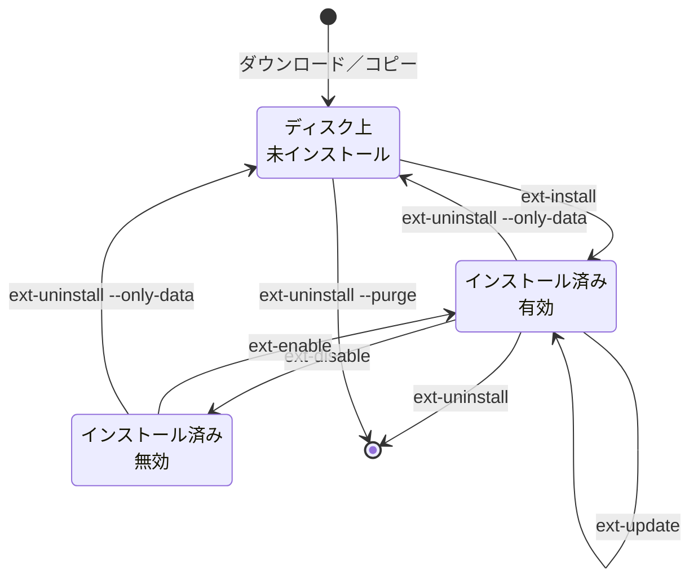

> 🌐 **言語:** [🇻🇳 Tiếng Việt](./cli-extensions_vi.md) · [🇬🇧 English](./cli-extensions.md) · 🇯🇵 日本語（現在）

# プラグインとテンプレート（拡張機能）のコマンド

## はじめに
`gp247:ext-*` 系のコマンドは、管理画面の**拡張機能**画面でできることをすべてコマンドラインで行います。プラグインと
テンプレートの検索、インストール、有効化／無効化、更新、削除、ライセンスの管理です。対象は、コマンドラインを使えるサイト
オーナー、スクリプトや Docker でデプロイする方、拡張機能を作る開発者です。読み終えると、拡張機能のライフサイクルの各段階で
正しいコマンドを選べ、どのコマンドがフォルダーを削除しうるかが分かります。管理画面からのインストール（オンライン、
`.zip` のアップロード、フォルダーのコピー）は [プラグイン・テンプレートのインストールガイド](../extension/install-extension_ja.md) にあります。

## ひと目でわかる
拡張機能は次の状態を移り変わります。矢印 1 本が 1 つのコマンドです。



- **プラグインとテンプレートは同じコマンド群を使います** — `--type=plugin`（既定）または `--type=template` で選びます。
- **「インストール済み」とは、GP247 がその設定を記録した状態**のことで、ディスクにフォルダーがあるだけではありません。
- **`ext-uninstall` は既定でフォルダーも削除します** — ファイルを残すには `--only-data` を付けます。
- **CLI と管理画面は同じ仕組みで動きます**。どちらを使っても結果は同じです。

## このページの内容
- [種類と拡張機能の指定](#種類と拡張機能の指定) — `--type`、`--key`、複数のキーを一度に
- [拡張機能の一覧と検索](#拡張機能の一覧と検索) — `ext-list`、`ext-search`、`ext-check-update`
- [拡張機能のインストール](#拡張機能のインストール) — ファイル、フォルダー、オンラインライブラリから
- [有効化、無効化、更新](#有効化無効化更新) — `ext-enable`、`ext-disable`、`ext-update`
- [拡張機能の削除](#拡張機能の削除) — 3 つの削除方法と、ファイルが残る方法
- [静的ファイルとライセンス](#静的ファイルとライセンス) — `ext-publish`、2 種類のライセンス
- [新しい拡張機能のひな形作成](#新しい拡張機能のひな形作成) — `make-plugin`、`make-template`

## 種類と拡張機能の指定
すべての `ext-*` コマンドは、共通の 2 つのオプションを受け付けます。

| オプション | 値 | 意味 |
| --- | --- | --- |
| `--type` | `plugin`（既定）または `template` | 拡張機能の種類 |
| `--key` | フォルダー名（例：`News`） | 操作する拡張機能。`ext-install`、`ext-enable`、`ext-disable`、`ext-uninstall`、`ext-publish` は**複数のキー**を受け付けます：オプションを繰り返す（`--key=A --key=B`）か、カンマで区切ります（`--key=A,B`） |

複数のキーを指定すると、拡張機能は**1 つずつ個別に**処理され、結果も個別に報告されます。ルート／設定のキャッシュは最後に
**1 回だけ**再構築されます。**どれか 1 つでも**失敗すると、コマンドは 0 以外で終了します。「全部か無か」ではないので、
後の拡張機能が失敗しても、完了した拡張機能は元に戻されません。

## 拡張機能の一覧と検索
読み取りのみの 3 つのコマンドです。いつ実行しても安全です。

| コマンド | オプション | 内容 |
| --- | --- | --- |
| `gp247:ext-list` | `--type` | サイトの拡張機能を一覧表示：インストール済みか、有効か、バージョン、更新の有無（キャッシュを読むだけで、通信しません） |
| `gp247:ext-check-update` | `--type`、`--force` | 更新のある拡張機能を報告。`--force` はキャッシュを使わず、すぐにライブラリへ問い合わせます |
| `gp247:ext-search` | `--type`、`--keyword=`、`--free`、`--page=` | オンラインの拡張機能ライブラリを検索。`--free` は無料のものだけを表示します |

```bash
php artisan gp247:ext-list --type=plugin
php artisan gp247:ext-search --keyword=payment --free
```

## 拡張機能のインストール
`gp247:ext-install` は、次の 3 つのどれかを入手元にします。

| 入手元 | オプション | 使う場面 |
| --- | --- | --- |
| 圧縮ファイル | `--file=<パス.zip>` | 拡張機能の `.zip` ファイルがある |
| 展開済みフォルダー | `--dir=<フォルダー>` | `<名前>/gp247.json` を含むフォルダー |
| キー指定 | `--key=<名前>` | 拡張機能が**すでにディスク上にある**（FTP でコピー、`git clone`、同梱）→ その場でインストール。**ない** → ライブラリからダウンロード |

1. （ライブラリからダウンロードするときだけ。サイトごとに **1 回**）`.env` の `APP_URL` を実際のドメインにしてから、無料の
   API ライセンスを登録します。

   ```bash
   php artisan gp247:ext-register-license
   ```

2. 拡張機能をインストールします。

   ```bash
   php artisan gp247:ext-install --type=plugin --key=News
   ```

   成功すると、プラグインは**有効な状態**になり、キャッシュが更新されます。拡張機能の `public/` フォルダー（CSS／JS／画像）は
   `public/GP247/...` にコピーされます。
3. **有料**の拡張機能は、ライセンスを付けて **1 つずつ**インストールします。

   ```bash
   php artisan gp247:ext-install --type=plugin --key=YourPluginPro --paid --license=<あなたのライセンス>
   ```

4. テンプレートは、インストール後に管理画面の「**サイト情報**」で有効にします（この手順のコマンドはありません）。

> ⚠️ **注意:** `ext-install` は依存関係を**確認するだけ**で、インストールはしません。別の Composer パッケージや別の拡張機能
> （例：Free 版が必要な Pro 版）が必要な場合は、先にそれらをインストールしてください。

## 有効化、無効化、更新
| コマンド | オプション | 内容 |
| --- | --- | --- |
| `gp247:ext-enable` | `--type`、`--key` | **インストール済み**の拡張機能を有効化 |
| `gp247:ext-disable` | `--type`、`--key` | インストール済みの拡張機能を無効化。使用中のテンプレートは拒否 |
| `gp247:ext-update` | `--type`、`--key` または `--all` | ライブラリから新しいバージョンをダウンロードし、古いバージョンを**バックアップ**して上書き。失敗時は自動で元に戻す |
| `gp247:ext-update --local` | `--type`、`--key` または `--all`、`--dry-run` | **何もダウンロードしない**：自分でファイルを入れ替えた拡張機能のデータ更新を実行 |

2 つの更新方法は、2 つの場面に対応します。

- **ライブラリから更新**（`ext-update --key=News`） — オンラインライブラリから拡張機能をインストールしたサイト。GP247 は
  新しいバージョンをダウンロードし、`storage/backups/extensions/` にバックアップを残し、インストールに失敗したら古いバージョンに戻します。
- **その場で更新**（`ext-update --local`） — `git pull`、Composer、手動コピーでファイルを入れ替えた場合。GP247 は
  `gp247.json` のバージョンとインストール時に記録したバージョンを比べ、拡張機能のデータ更新を実行します。`gp247:update` は、
  すべてのプラグインとテンプレートについてこの手順を自動で行います。

```bash
php artisan gp247:ext-update --local --all --dry-run
php artisan gp247:ext-update --local --type=plugin --key=News
```

> ⚠️ **注意:** 開発中のソースコードである拡張機能フォルダーに `ext-update`（`--local` なし）を**使わないでください**。
> フォルダーを削除してダウンロード版をコピーするので、git の履歴も未保存の変更も失われます。

バックアップ機能が有効な場合、`ext-update` は更新前にデータのスナップショットも取ります。`--skip-pre-change` で省けます。

## 拡張機能の削除
`gp247:ext-uninstall` には 3 つの方法があり、**フォルダーを削除するかどうか**が違います。

| コマンド | 拡張機能 | 設定を削除 | フォルダーを削除 |
| --- | --- | --- | --- |
| `ext-uninstall --key=X` | インストール済み | はい | **はい** |
| `ext-uninstall --key=X --only-data` | インストール済み | はい | いいえ — 再インストール用にファイルを残す |
| `ext-uninstall --key=X --purge` | 未インストール、ディスク上 | — | **はい** |

```bash
php artisan gp247:ext-uninstall --type=plugin --key=News --only-data
```

- **保護された拡張機能**と**使用中／既定のテンプレート**は削除できません（CLI でも管理画面でも）。
- **拡張機能のフォルダーが開発中のソースコードですか？** `--only-data` だけを使ってください。既定の削除は `.git` を含む
  フォルダー全体を消します。

## 静的ファイルとライセンス

### 静的ファイルを再コピー：`gp247:ext-publish`
ブラウザーが読めるのは `public/` フォルダーだけなので、拡張機能の CSS／JS／画像は
`app/GP247/<Plugins|Templates>/<Key>/public/` から `public/GP247/<Plugins|Templates>/<Key>/` へコピーする必要があります。
インストール時にすでに行われますが、`gp247:doctor` が `extension_assets` を報告したとき（拡張機能の画面で CSS／JS が 404
になるとき）にもう一度実行します。

```bash
php artisan gp247:ext-publish --type=template --key=MyTheme
php artisan gp247:ext-publish --type=plugin --all
```

### 2 種類のライセンス
| | API ライセンス | 有料拡張機能のライセンス |
| --- | --- | --- |
| 用途 | サイトをオンラインの拡張機能ライブラリに接続する | 有料の拡張機能を 1 つ使えるようにする |
| 料金 | 無料 | 拡張機能ごとに購入 |
| コマンド | `gp247:ext-register-license` | インストール時の `--license=`、または `gp247:ext-license` |
| 保存場所 | `.env` の `GP247_API_LICENSE` | サイトの設定（データベース） |
| ひも付け先 | `APP_URL` のドメイン | 拡張機能とドメイン |

`gp247:ext-license` は、1 つの拡張機能のライセンスを設定／表示／削除します。

```bash
php artisan gp247:ext-license --type=plugin --key=YourPluginPro --license=<あなたのライセンス>
php artisan gp247:ext-license --type=plugin --key=YourPluginPro --delete
```

## 新しい拡張機能のひな形作成
開発者向けの 2 つのコマンドです。標準のフォルダー構成を作るので、ファイルを 1 つずつ手で作る必要がありません。

| コマンド | オプション | 結果 |
| --- | --- | --- |
| `gp247:make-plugin` | `--name=`（必須）、`--download=0\|1` | プラグインのひな形：管理画面のコントローラー、モデル、Livewire のサンプル、翻訳、Provider、ルート、`gp247.json`、`AppConfig`。`gp247/front` があればストアフロント部分も付きます |
| `gp247:make-template` | `--name=`（必須）、`--download=0\|1` | ストアフロントのテンプレートのひな形：`AppConfig`、翻訳、Provider、`gp247.json` |

- `--download=0`（既定）：`app/GP247/<Plugins|Templates>/<名前>` と `public/GP247/...` に直接コピーされ、すぐに使えます。
- `--download=1`：サイトにはコピーせず、`storage/tmp` に `.zip` としてまとめます（`--json` では `data.path` にパス）。

```bash
php artisan gp247:make-plugin --name=MyBlog
```

拡張機能の作り方：[プラグイン作成ガイド](../extension/create-plugin_ja.md)、[テンプレート作成ガイド](../extension/create-template_ja.md)。

## 条件と制約（操作の前に確認）

**インストールするとき**
- **インストール済みの拡張機能は `ext-install` が拒否します**（「already exists」。ダウンロード前に確認するので通信量を
  無駄にしません） — 新しくするには `ext-update`、入れ直すには先に削除します。
- **ライブラリからのダウンロードには、正しいドメインの API ライセンスが必要です**。`APP_URL=http://localhost` のままでは
  ライブラリが拒否します（`domain_not_authorized`）。
- **有料の拡張機能は 1 つずつインストールします** — `--paid` と複数の `--key` の組み合わせはすぐに拒否されます
  （`paid_multi_not_allowed`）。1 つのライセンスを複数の拡張機能に使うことはできないためです。
- **API ライセンスの登録で `.env` に書き込めない場合**、コマンドは `env_write_failed` を報告し、貼り付け用に鍵を表示します。
  この鍵は秘密にしてください。

**有効化／無効化／削除するとき**
- **未インストールの拡張機能は有効化／無効化できません** — 設定のないフォルダーを「有効化」しないためです。
- **使用中または既定のテンプレートは無効化／削除できません** — サイトの見た目が失われるためです。
- **`--only-data` と `--purge` は同時に使えません** — 一方はファイルを残し、もう一方はファイルを消すためです。

## よくある質問（Q&A）
**Q1: インストール後、プラグインの画面が崩れ、CSS／JS が 404 になります。**

→ 静的ファイルが `public/` にコピーされていません。`php artisan gp247:ext-publish --type=plugin --key=<名前>` を実行し、
ページを再読み込みしてください。

**Q2: `ext-install --key` が「not found in the marketplace」と表示します。**

→ ライブラリにそのキーがなく（大文字・小文字を確認してください）、ディスク上にもフォルダーがありません。
`php artisan gp247:ext-search --keyword=<キーワード>` で正しい名前を探してください。

**Q3: `api_license_required` または `domain_not_authorized` と表示されます。**

→ サイトに API ライセンスがないか、ライセンスがドメインと一致しません。`APP_URL` を実際のドメインに直し、
`php artisan gp247:ext-register-license` をもう一度実行してください。

**Q4: プラグインを `git pull` しました。何か実行する必要がありますか？**

→ はい。`php artisan gp247:ext-update --local --type=plugin --key=<名前>`（またはすべての拡張機能を処理する `gp247:update`）を
実行します。忘れた場合は、`gp247:doctor` が `extension_data_pending` で知らせます。

**Q5: プラグインを削除すると、そのプラグインが作ったデータも消えますか？**

→ プラグイン次第です。削除処理はプラグイン自身のアンインストールを呼び出し、テーブルを残すかどうかはプラグインが決めます。
プラグインの README を読み、削除前にバックアップしてください。

**Q6: ファイルを残したままプラグインを入れ直すには？**

→ `gp247:ext-uninstall --key=<名前> --only-data` の後、`gp247:ext-install --key=<名前>` を実行します。キーがディスク上に
あるので、その場でインストールされます。

**Q7: コマンドでテンプレートをインストールしたのに、ストアフロントが古い見た目のままです。**

→ まだ完了していません。管理画面の「**サイト情報**」で、ストアの新しいテンプレートを選んでください。

**Q8: `make-plugin` が `Command error` と表示します。**

→ `--name` がありません。名前を付けて、例えば `php artisan gp247:make-plugin --name=MyBlog` と入力し直してください。

---

<sub>📅 **最終更新:** 2026-11-08 · ✍️ **作成者 (Author):** GP247</sub>
